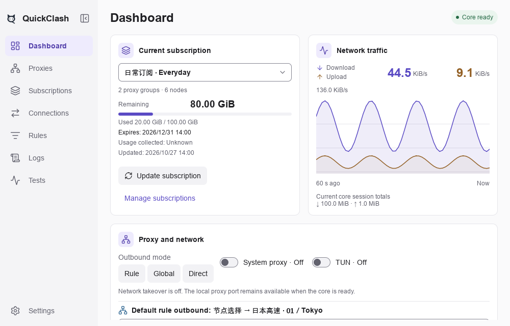
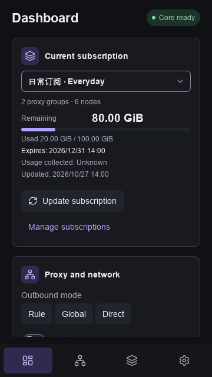

# QuickClash

[English](README.md) | [简体中文](README.zh-CN.md)

**An independent desktop client built with C++20 and Qt Quick, based on the Mihomo (formerly Clash.Meta) core and currently developed and validated on Windows.**

QuickClash brings subscriptions, proxy groups, routing rules, connections, and network controls into one interface. It uses the official precompiled Mihomo core without modifying it. The interface adapts from a full sidebar to an icon rail and bottom navigation as the window narrows. Clear status feedback, bounded caches, and reclaimable UI resources guide development.

> **Development status — November 7, 2026**: Version `0.1.0` is a development build with local Windows x64 usage evidence. Validation of a current release candidate, a clean standard-user environment, and remaining system-event and authorization scenarios is still pending. Linux and macOS are planned desktop targets; Android and iOS have architecture boundaries only.

<p align="center">
  <picture>
    <source media="(prefers-color-scheme: dark)" srcset="docs/reference/quickclash_minimal_dark_en.png">
    
  </picture>
</p>

<p align="center"><sub>Dashboard from the 0.1.0 development build, with 15 px sidebar labels in medium and semibold weights, captured with Qt 6.12 in an isolated offscreen/software environment using synthetic data. The <a href="docs/reference/quickclash_minimal_preview.html">offline interaction preview</a> illustrates the current eight-page structure and supports English / 简体中文, with English selected initially. See <a href="docs/reference/README.md">sources, rendering conditions, and preview scope</a>.</sub></p>

<p align="center">
  
</p>

<p align="center"><sub>A 360 × 640 desktop window in dark theme, showing stacked cards and bottom navigation. This demonstrates the desktop layout at a narrow width; mobile platforms are still planned.</sub></p>

## Main capabilities

- **Subscriptions and configuration**: Import HTTP/HTTPS subscriptions or local Mihomo YAML/JSON and native URI/Base64 node lists; edit the source, name, schedule, and automatic-apply policy. Source editing, separate overrides, drafts, history rollback, conditional caching, and provider snapshot/runtime modes are available. Failed downloads or validation retain the previous configuration.
- **Proxies and strategies**: Search nodes and groups, locate the current node, select manual-group members, and use automatic latency, failover, or load-balancing groups. Single-node tests and recursive group tests share results for the same node and target, support cancellation, and do not select nodes.
- **Custom routing**: Manage global and profile-specific rules, their order, enabled state, and proxy-group bindings. Connection details can propose a domain or IP rule for confirmation. The Rules page shows effective rules and offers resource updates when the selected profile has managed providers.
- **Dashboard and diagnostics**: Five cards cover the current subscription, live traffic, proxy/network controls, network tools, and runtime overview. IP comparison and website checks run on request. Connections and logs support filtering and expandable details; client memory totals include required helpers, with the core reported separately.
- **Windows integration**: Current-user system proxy leases, a privileged TUN service, login startup, single-instance activation, tray controls, and deduplicated problem notifications. Normal exit restores proxy values still owned by QuickClash and preserves changes made by other software; forced-exit recovery has a limitation described below.
- **Core, resources, and data**: Core identity and digest checks, readiness checks, bounded crash retries, compatible-core repair/switching, Geo download/apply/rollback, local configuration/rule backup, and diagnostic export. Configurations are validated with the official core before activation; failed application attempts try to restore the last confirmed session.
- **Interface and resource lifecycle**: Eight pages: Dashboard, Proxies, Subscriptions, Connections, Rules, Logs, Tests, and Settings. Light/dark/system themes, English/Simplified Chinese/system language, keyboard controls, and DPI-aware layouts are available. An optional experimental setting unloads the UI after closing to the tray; it is off by default, and minimizing retains the UI and taskbar entry.
- **Local data protection**: Subscription URLs, request headers, and test targets use current-user Windows DPAPI. Node credentials and editing drafts can exist in files with restricted access; backups can contain plain text credentials. Downloads, file reads, and runtime lists have bounds; diagnostics are exported locally without automatic upload.

## Getting started on Windows

The [Releases page](https://github.com/junliangdg/quick-clash/releases) is the download entry point. The repository's CI is configured to publish an unsigned `continuous` Windows development snapshot after its fast checks pass. Snapshot binaries may lag the working tree, and a CI pass does not establish stable-release readiness. For a source build, see the commands below.

1. Extract the **entire** Windows x64 portable ZIP, launch `bin/quickclash.exe`, and read the first-launch usage notice. Keep `bin/`, `core/`, `geo/`, `metadata/`, and `licenses/` together; user data is stored separately in the directory shown in Settings.
2. Open **Subscriptions → Add subscription** and enter an HTTP/HTTPS subscription URL or import a local file. Mihomo YAML/JSON and URI/Base64 node lists are parsed and validated with the selected official core. The name is optional. The first valid profile is selected and its core starts automatically; system proxy and TUN stay off on first use. An import error retains the input for correction.
3. On **Proxies**, select a member of a manual group, or let an automatic group choose. Use node delay controls for individual tests and the group's **Test latency** button for the group and its subgroups. Testing does not change a manual selection. Select Rule, Global, or Direct mode from the dashboard or tray.
4. Use the ready local HTTP/SOCKS5 proxy address directly, enable **System proxy** for applications that follow Windows proxy settings, or enable **TUN** for supported network interception. First-time TUN setup requests UAC authorization for the dedicated service; ordinary proxy use does not require installing it.
5. Closing to the tray keeps forwarding active; **Exit** cleans up the owned session and proxy lease. Minimizing keeps a taskbar entry. If QuickClash is forcibly terminated and connectivity is affected, reopen it to recover its proxy lease, or inspect **Windows Settings → Network & internet → Proxy**, preserving any later changes made by other software.

“Core ready” confirms a local runtime, not public internet reachability. The dashboard's IP queries and site checks, and the Tests page's HTTPS checks, help inspect the selected path; they do not measure bandwidth or guarantee that every remote node works. Detailed operation and recovery steps are in the [Windows user guide](docs/baseline/windows_user_guide.md).

### Usage notice

QuickClash manages configurations and subscriptions you import. Proxy traffic is handled by the bundled official Mihomo core; this project does not develop or modify that core or provide remote proxy nodes, node accounts, or subscription services. Supply configurations or subscriptions you are authorized to use and check that their sources are trustworthy. Enabling system proxy or TUN changes how this device accesses the network; learn how to stop these features and restore connectivity, and comply with applicable laws and regulations.

The first launch shows a usage notice in English or Simplified Chinese. **I understand** saves its version locally; ordinary software upgrades do not show it again, and only material notice changes require a new version. Existing settings without an acknowledgment also show it. Storage failures still let you dismiss the notice and access recovery; failed writes retain old settings and the next launch shows the notice again. Reopen it from **Settings → About → Usage notice**. QuickClash and bundled components are covered by their respective open-source licenses; see “License and feedback” below and the distribution's `licenses/` directory.

### Custom automatic strategy groups

Open **Proxies → New strategy group**. Use an All nodes, Hong Kong, Japan, Singapore, or Failover template, or configure a group yourself:

1. Choose automatic latency selection, ordered failover, or load balancing, and select inline nodes and/or runtime providers from the current profile.
2. Filter with case-insensitive include/exclude keywords or a restricted regular expression. Empty include matches all; exclusions win. Region templates match names rather than IP geolocation.
3. Set the probe URL and timing options, preview candidates, and confirm **Save and apply** after official-core validation. A new or edited group with no candidates cannot be applied.
4. Optionally attach it to an existing manual group and explicitly select it after applying. **Creating a group alone does not change routing** or switch Rule/Global modes.

Custom groups belong to a subscription/profile entry and are stored separately from its source YAML. Updating that entry or changing its URL retains them; deleting the entry removes its groups, and history rollback restores that version's definitions. Missing dependencies or name conflicts reject the update and keep the previous data. A user-reported disappearance remains unexplained despite targeted tests; its status is retained in the [task ledger](docs/progress/TASKS.md#未关闭风险).

Runtime providers remain dynamically filtered by the core. Their health-check settings are shared, so conflicting settings across custom groups sharing a provider are rejected. If a saved group's candidates later become empty, it rejects traffic rather than silently using DIRECT. Applying changes may restart the session.

### Custom rules and resource updates

Open **Rules → Manage custom rules…** to edit global and current-profile rules in one workspace. **Confirm** saves and applies the changes together. In Rule mode, profile-specific rules run first, then global rules, then the profile's original rules. A rule suggested from a connection enters this draft workflow and requires confirmation.

When a profile contains managed resources, **Resource updates…** shows proxy providers and rule sets. **Refresh list** reads their status; each row's **Update** downloads that resource. Snapshot updates rebuild and validate a configuration candidate, while runtime-provider updates are performed by the core. Settings groups controls into **General, Network, Core and resources, Data and diagnostics, and About**; backup, recovery, and diagnostic actions are in Data and diagnostics.

## Current status

| Scope | Status |
| --- | --- |
| Windows x64 | Native implementation with local evidence for real-subscription proxy/TUN forwarding, service cleanup, and controlled failure degradation; current-candidate release validation is still pending |
| Historical MVP evidence | The 16 local MVP items have historical passes for their recorded versions and scope; these do not certify the entire current working tree or release package |
| Linux / macOS | Planned desktop targets with shared boundaries and candidate build configuration; native builds and functional validation remain `NotRun`, and system integration remains to be implemented |
| Android / iOS | Future host targets; no mobile project, runtime, or validation |
| Distribution | Development portable-package workflow exists; a stable Windows release still needs candidate validation and distribution materials. Formal installer, signing, and application update integration remain future work |

The [task ledger](docs/progress/TASKS.md) and [release checklist](docs/progress/CHECKLISTS.md) track evidence and remaining work. Current local UI checks use Qt 6.12; the configured CI minimum is Qt 6.9. Historical results from either toolchain apply only to their recorded versions and scope.

## Support scope and known limitations

- **Configuration input**: Mihomo YAML/JSON and native URI/Base64 node subscriptions use the selected official core for protocol, transport and rule validation. Managed settings and resource budgets follow the bundled `metadata/config_policy.json`; successful validation does not establish reachability of every node.
- **System proxy recovery**: The switch controls current-user WinINet settings; it does not cover WinHTTP or software that ignores those settings. In both ordinary and service modes, the GUI holds the proxy lease. After a GUI crash or forced termination, the proxy may point to a stopped port until the app is reopened or settings are recovered manually. A running service does not guarantee immediate proxy restoration.
- **TUN and host scenarios**: Local forwarding and controlled recovery have evidence. Cross-user operation, the full first-authorization/cancellation and failure-cleanup matrix, a clean standard-user machine, reboot, and real network/power changes still need validation. Installing the service registers it for automatic startup; it can remain idle after GUI exit.
- **Backups**: Local configuration/rule backups can contain plain text credentials and are not password-encrypted; application settings and subscription-source credentials are excluded. Both backup scopes reject the whole export if an enabled profile-specific `RULE-SET` rule refers to a runtime provider absent from the expanded offline snapshot. This limitation does not affect every subscription containing `RULE-SET`.
- **Updates**: Core management only accepts the client's bundled compatibility list, currently official Mihomo `v1.19.33`; it is not an arbitrary upstream-version updater. Geo and core changes have explicit apply/recovery actions. Full application automatic updating is not delivered.
- **Resources and accessibility**: Subscription-related memory residency and long-term resource behavior remain under investigation. Default Qt Quick RHI/GPU rendering is retained, helpers count toward client statistics, and core memory is separate; no fixed cross-machine memory limit is promised. Qt 6.12 bilingual label checks have passed, while actual Windows UI Automation/screen-reader use, physical touch, OS text scaling, and some multi-display/host scenarios remain unverified.
- **Other platforms**: The `360×480` minimum window and compact bottom navigation describe desktop adaptation. They do not establish Linux/macOS or mobile support.

## Build from source

Use Windows x64, PowerShell 7.2+, CMake 3.24+, Ninja, a compatible MSVC x64 toolchain/Windows SDK, and a Qt MSVC kit with the modules listed in the [build guide](docs/baseline/build_and_package.md). The project minimum and Windows CI configuration are Qt `6.9` / `6.9.0 msvc2022_64`; current local UI validation uses `6.12.0 msvc2022_64`. The latest working-tree changes have not had a complete application retest on Qt 6.9.

Run these commands from the repository root:

```powershell
# Fetch version- and SHA-256-pinned yaml-cpp, Mihomo, and Geo assets
pwsh -NoProfile -File scripts/fetch_dependencies.ps1

# Configure/build the client, service, and minimum smoke targets; run contracts and qml_smoke
# Adjust QtRoot to your installed kit
pwsh -NoProfile -File scripts/build_windows.ps1 -QtRoot C:/Qt/6.12.0/msvc2022_64

# Launch the development build
.\build\dev\quickclash.exe
```

The default build runs **minimum smoke tests only**. Select verification for the change; add `-Lint` for QML changes. In a PowerShell session, for example:

```powershell
# Build and run only the named affected tests, plus QML lint
./scripts/build_windows.ps1 -Test ui_state,ui_subscriptions -Lint

# Build and lint before a targeted manual UI check; no tests run
./scripts/build_windows.ps1 -BuildOnly -Lint
```

`-Test`, `-BuildOnly`, `-Fast`, and `-Full` select mutually exclusive scopes. `-Fast` runs the CI/cross-module fast scope; `-Full` explicitly runs the current configuration's full CTest suite. `-Headless` selects the non-UI configuration. See [verification scope and stopping rules](docs/progress/README.md#日常范围与停止规则) before broadening checks.

Initial dependency fetching needs network access; cached files are still digest-checked. CMake configuration does not download dependencies. After changing Qt kits or compilers, or moving the repository, use a new `-BuildDirectory`. Development output is not a portable distribution; see [Build and offline packaging](docs/baseline/build_and_package.md) for Release packaging, deployment, and CI.

Documentation-only changes do not require a product rebuild. Relevant repository checks are:

```powershell
pwsh -NoProfile -File scripts/build_design_docs.ps1 -Check
pwsh -NoProfile -File scripts/check_progress.ps1
pwsh -NoProfile -File scripts/check_source_layout.ps1
pwsh -NoProfile -File scripts/check_platform_boundaries.ps1
git diff --check
```

After editing design sources, run `scripts/build_design_docs.ps1` before its `-Check` mode. For HTML reference changes, generate and check the preview as described in the [reference guide](docs/reference/README.md). These checks validate repository consistency; they do not certify product behavior or release readiness.

## Project layout

```text
app/        Application host, single-instance handling, tray, probes, and service entry points
src/        Domain, application, infrastructure, platform adapters, and presentation
qml/        Pages, shared components, and window shell
resources/  Icons, translations, metadata, and third-party licenses
tests/      Unit, integration, contract, visual, and script tests
bench/      Windows resource sampling and comparison tools
docs/       Design, progress, baseline, and reference material
scripts/    Dependency fetching, builds, checks, packaging, and releases
```

## Documentation

| Document | Contents |
| --- | --- |
| [Design documents](docs/design/README.md) | Product scope, architecture, data and interface contracts, platform strategy, and acceptance criteria |
| [Current tasks and risks](docs/progress/TASKS.md) | Current implementation/validation scope, open issues, and next work |
| [Development and validation](docs/progress/README.md) | Status rules, targeted verification, release checklist, development log, and evidence index |
| [Windows user guide](docs/baseline/windows_user_guide.md) | Operation, recovery, and known limitations of the current development build |
| [Build and offline packaging](docs/baseline/build_and_package.md) | Toolchain, dependencies, builds, tests, deployment, packaging, and CI |
| [UI reference](docs/reference/README.md) | Current Qt dashboard captures, offline interaction preview, and synchronization instructions |
| [C++ and source conventions](docs/development/cpp_style.md) | C++20, Qt lifetime management, naming, testing, and documentation synchronization |
| [License baseline](docs/baseline/licenses.md) | Sources and obligations for Qt, Mihomo, Geo, icons, and other dependencies |

## License and feedback

QuickClash is released under the GNU General Public License version 3 only (`GPL-3.0-only`). See [LICENSE](LICENSE) for the complete terms. Bundled third-party components such as Qt, Mihomo, and Geo remain under their own licenses; their notices and source/distribution obligations are documented in the [license baseline](docs/baseline/licenses.md). When distributing binaries, provide the corresponding source required by GPLv3.

Please report issues and suggestions through [GitHub Issues](https://github.com/junliangdg/quick-clash/issues). Remove subscription URLs, credentials, node names, and other sensitive details from logs before sharing them.
