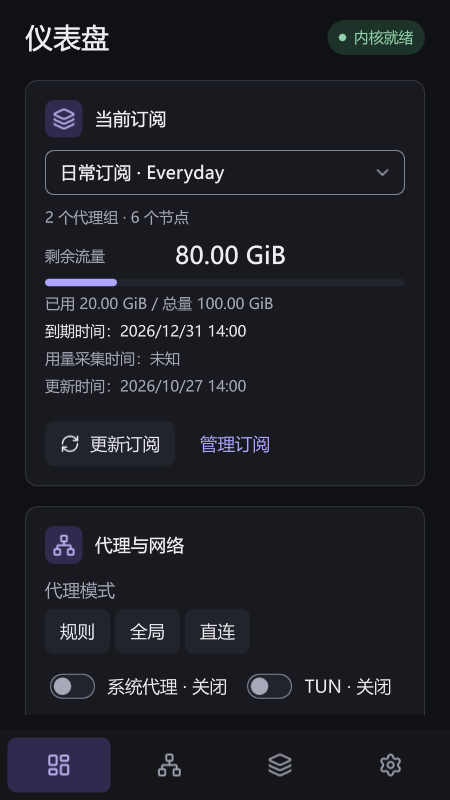

# QuickClash

[English](README.md) | [简体中文](README.zh-CN.md)

**一个使用 C++20 与 Qt Quick 构建的独立桌面客户端，基于 Mihomo（原 Clash.Meta）内核，当前在 Windows 上开发和验证。**

QuickClash 把订阅、代理组、分流规则、连接和网络控制集中到一个界面中，使用官方预编译 Mihomo，不改造内核。窗口收窄时，导航从完整侧栏切换到图标栏和底部导航。项目持续关注清晰的状态反馈、有界缓存和可回收的界面资源。

> **开发状态 · 2026-11-07**：当前为 `0.1.0` 开发版，已有 Windows x64 本机使用证据；当前候选版的发布验收、干净普通用户环境，以及部分系统事件和授权场景仍待补齐。Linux/macOS 是后续桌面目标，Android/iOS 目前仅保留架构边界。

<p align="center">
  <picture>
    <source media="(prefers-color-scheme: dark)" srcset="docs/reference/quickclash_minimal_dark.png">
    
  </picture>
</p>

<p align="center"><sub>0.1.0 开发版仪表盘，使用 Qt 6.12 在 offscreen/software 隔离环境中生成，数据均为合成演示。<a href="docs/reference/quickclash_minimal_preview.html">离线交互示意</a>按当前八页面结构编排，支持 English / 简体中文，默认英文，可在页首切换；来源、渲染条件和适用范围见<a href="docs/reference/README.md">预览说明</a>。</sub></p>

<p align="center">
  
</p>

<p align="center"><sub>360 × 640 桌面窄窗，深色主题，展示卡片纵排与底部导航；这是桌面窗口收窄后的布局，移动平台仍在规划中。</sub></p>

## 主要能力

- **订阅与配置**：导入标准 HTTPS 订阅或本地 Mihomo YAML，可修改来源、名称、更新计划和自动应用策略；支持原文编辑、独立覆盖项、草稿、历史回退、条件缓存及 provider 快照/运行时模式。下载或校验失败保留旧配置。
- **代理与策略**：搜索节点和策略组、定位当前节点、手选组成员，并使用自动低延迟、故障切换或负载均衡策略。单节点及递归整组测速按节点和目标共享结果，支持取消；测速本身不选节点。
- **自定义分流**：管理全局/配置专属规则、顺序、启停及代理组绑定；连接详情可生成待确认的域名或 IP 规则。规则页展示生效规则，所选配置包含受管资源时提供资源更新入口。
- **仪表盘与诊断**：当前订阅、实时流量、代理与网络、网络工具、运行概况五张卡片；IP 对照和网站测试由用户手动发起。连接和日志支持筛选、展开详情，客户端内存合计包含必要辅助进程，内核单列。
- **Windows 集成**：当前用户系统代理租约、独立 TUN 权限服务、登录启动、单实例激活、托盘控制和去重提醒。正常退出恢复仍由 QuickClash 持有的代理值，保留其他软件的修改；强制退出的恢复限制见下文。
- **内核、资源与数据**：内核身份与摘要核对、就绪检查、有界故障重试、兼容内核修复/切换、Geo 下载/应用/回退、本地配置与规则备份、诊断导出。配置先经官方内核校验，再尝试激活；应用失败时尝试恢复上一确认会话。
- **界面与资源生命周期**：仪表盘、代理、订阅、连接、规则、日志、测试、设置八个页面；支持浅色/深色/跟随系统主题、English/简体中文/跟随系统语言、键盘操作和 DPI 自适应。实验性的“关闭到托盘后卸载界面”默认关闭；最小化保留界面和任务栏入口。
- **本地数据保护**：订阅地址、请求头和测试目标使用当前 Windows 用户 DPAPI 加密；节点凭据和编辑草稿可能保存在限制访问的文件中，备份可能包含明文凭据。下载、文件读取及运行列表有上限，诊断仅导出到本地，不自动上传。

## Windows 快速开始

下载入口为 [Releases](https://github.com/junliangdg/quick-clash/releases)。仓库 CI 配置为快速检查通过后发布未签名的 `continuous` Windows 开发快照；快照可能落后于工作区，CI 通过也不代表稳定版验收完成。从源码运行可使用下方构建命令。

1. **完整解压** Windows x64 便携 ZIP，运行 `bin/quickclash.exe` 并阅读首次启动的“使用须知”。保留 `bin/`、`core/`、`geo/`、`metadata/`、`licenses/` 的相对位置；用户数据单独保存在设置页显示的数据目录。
2. 在 **订阅 → 添加订阅** 中输入标准 HTTPS 订阅地址，或导入本地 YAML；名称可留空。首份有效配置会自动选中并运行内核，首次不会自动开启系统代理或 TUN。导入失败时保留输入，供修改重试。
3. 在 **代理** 页选择手选组成员，或由自动组决定出口。节点延迟入口单独测速，组标题的“测延迟”递归包含子组；测速不会改变手选结果。规则/全局/直连模式可从仪表盘或托盘切换。
4. 可直接使用就绪内核的本地 HTTP/SOCKS5 代理地址，开启 **系统代理** 供遵循 Windows 代理设置的软件使用，或开启 **TUN** 使用已支持的网络接管能力。首次 TUN 设置会为独立权限服务请求 UAC 授权，普通代理使用无需安装该服务。
5. 关闭到托盘会保留转发，**退出** 才清理本应用会话和代理租约；最小化保留任务栏入口。若强制终止后联网受影响，重新打开应用恢复租约，或检查 **Windows 设置 → 网络和 Internet → 代理**，保留其他软件在此后作出的修改。

“内核就绪”表示本地运行时可用，不代表外网一定可达。仪表盘 IP 查询、网站测试及测试页的 HTTPS 检查用于观察所选路径，不测带宽，也不保证所有远端节点可用。详细操作与恢复步骤见 [Windows 使用指南](docs/baseline/windows_user_guide.md)。

### 使用须知

QuickClash 管理用户自行导入的配置与订阅，代理转发由随包的官方 Mihomo 内核完成；本项目不自行开发或修改该内核，也不提供远程代理节点、节点账号或订阅服务。请自行准备有权使用的配置或订阅，确认来源可信。启用系统代理或 TUN 会改变设备的网络访问方式，请了解停止及恢复方法，并遵守适用的法律法规。

首次启动显示中英文“使用须知”，点击“我已了解”后在本地保存须知版本；普通软件升级不重复提示，须知有实质变化时才更新版本。已有设置缺少确认记录时也会提示；存储故障时仍可关闭提示进入修复，失败不覆盖旧设置，下次启动再次提示。可随时从 **设置 → 关于 → 使用须知** 重看。QuickClash 及第三方组件分别适用各自的开源许可，见下方“许可与反馈”及发行包 `licenses/`。

### 自定义自动策略组

在 **代理 → 新建策略组** 中选择全部、香港、日本、新加坡或故障切换模板，也可以直接自定义：

1. 选择自动低延迟、顺序故障切换或负载均衡，以及当前配置的内嵌节点和/或运行时提供者。
2. 使用不区分大小写的包含/排除关键词或受限正则筛选；包含为空表示全部，排除优先。地区模板只匹配名称，不识别 IP 地理位置。
3. 设置探测地址和时间参数，预览候选节点，经官方内核校验后确认 **保存并应用**；创建或编辑时没有候选节点不能应用。
4. 可接入已有手选组，并显式选择应用后选用此组。**仅创建不会改变路由**，也不会切换规则/全局模式。

自建组归属于订阅/配置条目，与订阅原文分开保存；更新该条目或修改其地址会保留，删除条目会移除所属组，历史回退恢复该版本定义。依赖缺失或名称冲突时拒绝更新并保留旧数据。用户反馈的疑似丢失问题在定向测试中未复现，原因仍未解释，继续保留在[任务风险](docs/progress/TASKS.md#未关闭风险)中。

运行时提供者继续由内核动态过滤，健康检查设置会被共用；多个自定义组对同一提供者要求冲突参数时拒绝应用。已保存组的候选后来变空时拒绝流量，不隐式直连。应用变更可能重启当前会话。

### 自定义规则与资源更新

在 **规则 → 管理自定义规则…** 中统一编辑全局和当前配置专属规则，点击 **确定** 后一并保存应用。规则模式下，配置专属规则优先，其次是全局规则，最后是配置原有规则；从连接生成的规则也先进入草稿，须确认后生效。

配置含受管资源时，**资源更新…** 展示代理集合与规则集；**刷新列表** 只读取状态，行尾 **更新** 才下载资源。快照更新会重建并校验配置候选，运行时提供者更新由内核执行。设置分为 **通用、网络、内核与资源、数据与诊断、关于** 五类；备份、恢复和诊断入口位于“数据与诊断”。

## 当前状态

| 范围 | 状态 |
| --- | --- |
| Windows x64 | 已有原生实现及真实订阅代理/TUN 转发、服务清理、受控故障降级的本机证据；当前候选版发布验收仍待完成 |
| 历史 MVP 证据 | 16 项本机 MVP 曾在各自记录的版本和范围通过，不代表整个当前工作区或发行包自动通过 |
| Linux / macOS | 规划的桌面目标；保留共享边界和候选构建配置，原生构建与功能验证仍为 `NotRun`，系统集成待实现 |
| Android / iOS | 未来宿主目标；尚无移动工程、运行时或验证 |
| 发行 | 已有开发便携包流程；Windows 稳定版仍需候选包验收及发行材料，正式安装器、签名和应用更新集成留待后续 |

[任务台账](docs/progress/TASKS.md)与[发布清单](docs/progress/CHECKLISTS.md)记录证据和剩余工作。当前本机界面检查使用 Qt 6.12，CI 配置的最低版本为 Qt 6.9；两套工具链的历史结果均只适用于所记录的版本和范围。

## 支持范围与已知限制

- **配置输入**：要求标准 Mihomo YAML，不转换 Base64 订阅或分享链接。支持字段以随包 `metadata/config_policy.json` 为准；校验成功不代表每个节点都可连通。
- **系统代理恢复**：开关作用于当前用户 WinINet 设置，不覆盖 WinHTTP 或忽略该设置的软件。普通与服务模式均由 GUI 持有系统代理租约；GUI 崩溃或被强制终止后，代理可能指向已停止的端口，须重开应用或手工恢复。权限服务驻留不保证即时恢复系统代理。
- **TUN 与宿主场景**：已有本机转发和受控恢复证据；跨用户、完整首次授权/取消及失败清理矩阵、干净普通用户机器、系统重启、真实换网/电源事件仍需验证。安装权限服务时会注册为自动启动，GUI 退出后服务可能继续待命。
- **备份**：本地配置/规则备份可能包含明文凭据，尚无密码加密；不含应用设置或订阅来源凭据。启用的配置专属 `RULE-SET` 引用了离线展开快照中不存在的运行时提供者时，两种备份范围均拒绝整份导出；不是所有包含 `RULE-SET` 的订阅都会触发。
- **更新**：内核管理只接受客户端内置兼容清单，目前为官方 Mihomo `v1.19.33`，不支持任意上游版本升级。Geo 与内核均有显式应用/恢复操作，完整的应用自动更新尚未交付。
- **资源与可访问性**：订阅相关内存驻留和长期资源表现仍在调查。默认保持 Qt Quick RHI/GPU，必要辅助进程计入客户端、内核单列，不承诺跨机器统一内存门槛。Qt 6.12 双语控件标签检查已通过；真实 Windows UI Automation/读屏、物理触摸、OS 文字缩放及部分多屏/宿主场景仍未验证。
- **其他平台**：最小窗口 `360×480` 和窄窗底部导航属于桌面自适应，不代表 Linux/macOS 或移动端已经可用。

## 从源码构建

需要 Windows x64、PowerShell 7.2+、CMake 3.24+、Ninja、兼容的 MSVC x64 工具链/Windows SDK，以及包含[构建说明](docs/baseline/build_and_package.md)所列模块的 Qt MSVC 套件。项目最低要求/Windows CI 配置为 Qt `6.9` / `6.9.0 msvc2022_64`，当前本机界面验证使用 `6.12.0 msvc2022_64`；最新工作区改动尚未在 Qt 6.9 下完整重测应用。

在仓库根目录执行：

```powershell
# 获取版本与 SHA-256 已锁定的 yaml-cpp、Mihomo 和 Geo 资源
pwsh -NoProfile -File scripts/fetch_dependencies.ps1

# 配置并构建客户端、服务和最小冒烟目标，运行 contracts 与 qml_smoke
# QtRoot 按本机已安装套件调整
pwsh -NoProfile -File scripts/build_windows.ps1 -QtRoot C:/Qt/6.12.0/msvc2022_64

# 启动开发版
.\build\dev\quickclash.exe
```

默认构建**只运行最小冒烟测试**。按改动选择验证范围，QML 改动追加 `-Lint`。例如在 PowerShell 会话中执行：

```powershell
# 只构建并运行指定的受影响测试，同时执行 QML lint
./scripts/build_windows.ps1 -Test ui_state,ui_subscriptions -Lint

# 构建和 lint 后人工检查受影响界面；此命令不运行测试
./scripts/build_windows.ps1 -BuildOnly -Lint
```

`-Test`、`-BuildOnly`、`-Fast`、`-Full` 是互斥范围；`-Fast` 用于 CI/跨模块快速回归，`-Full` 显式运行当前配置的完整 CTest 套件，`-Headless` 选择无 UI 配置。扩大检查范围前参阅[验证范围与停止规则](docs/progress/README.md#日常范围与停止规则)。

首次获取依赖需要网络，缓存仍按摘要核对；CMake 配置本身不下载依赖。更换 Qt、编译器或迁移仓库后，使用新的 `-BuildDirectory`。开发构建目录不是便携发行包；Release 打包、部署和 CI 见[构建与离线包基线](docs/baseline/build_and_package.md)。

纯文档改动不需要重建产品，相关仓库检查为：

```powershell
pwsh -NoProfile -File scripts/build_design_docs.ps1 -Check
pwsh -NoProfile -File scripts/check_progress.ps1
pwsh -NoProfile -File scripts/check_source_layout.ps1
pwsh -NoProfile -File scripts/check_platform_boundaries.ps1
git diff --check
```

修改设计源文档后，先运行 `scripts/build_design_docs.ps1`，再执行其 `-Check` 模式；HTML 参考稿的生成与检查见[参考说明](docs/reference/README.md)。这些检查验证仓库一致性，不代表产品行为或发布验收通过。

## 项目结构

```text
app/        应用宿主、单实例、托盘、探针与服务入口
src/        领域、应用、基础设施、平台适配和表现层
qml/        页面、共享组件与窗口壳
resources/  图标、翻译、元数据和第三方许可
tests/      单元、集成、契约、视觉及脚本测试
bench/      Windows 资源采样与对照工具
docs/       设计、进度、基线和参考稿
scripts/    依赖获取、构建、检查、打包与发布
```

## 文档导航

| 文档 | 内容 |
| --- | --- |
| [设计文档](docs/design/README.md) | 产品范围、总体架构、数据与接口契约、平台策略和验收标准 |
| [当前任务与风险](docs/progress/TASKS.md) | 当前实现/验证范围、未关闭问题与下一步 |
| [开发与验收约定](docs/progress/README.md) | 状态规则、定向验证、发布清单、开发日志和证据入口 |
| [Windows 使用指南](docs/baseline/windows_user_guide.md) | 当前开发版的操作、恢复和已知限制 |
| [构建与离线包](docs/baseline/build_and_package.md) | 工具链、依赖、构建、测试、部署、打包和 CI |
| [界面参考](docs/reference/README.md) | 当前 Qt 首页截图、离线交互示意与同步维护方式 |
| [C++ 与源码规范](docs/development/cpp_style.md) | C++20、Qt 生命周期、命名、测试和文档同步约定 |
| [许可基线](docs/baseline/licenses.md) | Qt、Mihomo、Geo、图标及其他依赖的来源和义务 |

## 许可与反馈

QuickClash 以 GNU General Public License v3.0 only（`GPL-3.0-only`）发布，完整条款见 [LICENSE](LICENSE)。随包的 Qt、Mihomo、Geo 等第三方组件仍分别适用其自身许可，通知、源码和分发义务见[许可基线](docs/baseline/licenses.md)。分发二进制时，应按 GPLv3 提供对应的完整源码。

问题与建议请提交到 [GitHub Issues](https://github.com/junliangdg/quick-clash/issues)。反馈前请移除订阅地址、认证信息、节点名称和日志中的其他敏感内容。
