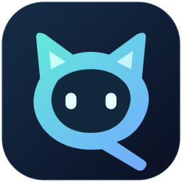
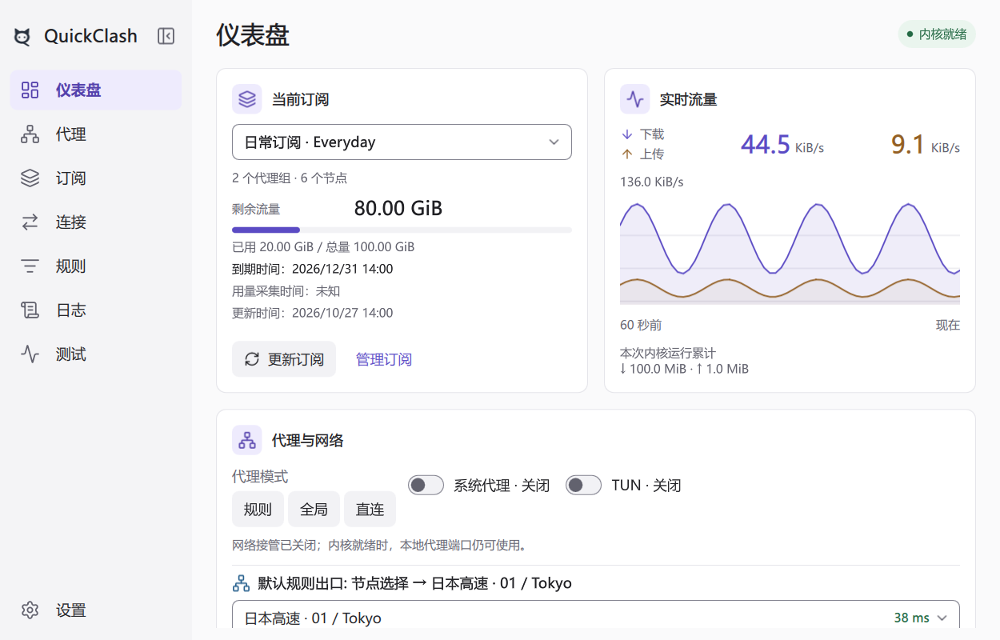

<p align="center">
  
</p>

<h1 align="center">QuickClash</h1>

[English](README.md) | [简体中文](README.zh-CN.md)

**一个使用 Qt Quick 构建、基于 Mihomo（原 Clash.Meta）内核的独立跨平台代理客户端。**

QuickClash 把订阅、代理组、分流规则、连接和网络控制集中到一个界面中，使用官方预编译 Mihomo，不改造内核。窗口收窄时，导航从完整侧栏切换到图标栏和底部导航。

> **当前提供 Windows x64 开发预览版。** Linux、macOS 及移动端（Android/iOS）支持仍在规划中。

<p align="center">
  <picture>
    <source media="(prefers-color-scheme: dark)" srcset="docs/reference/quickclash_minimal_dark.png">
    
  </picture>
</p>

<p align="center"><sub>使用演示数据的仪表盘。可打开<a href="docs/reference/quickclash_minimal_preview.html">离线交互示意</a>体验 English / 简体中文界面。</sub></p>

<p align="center">
  
</p>

<p align="center"><sub>深色主题的桌面窄窗布局，卡片纵排并使用底部导航。</sub></p>

## 主要能力

- **订阅与配置**：导入 HTTP/HTTPS 订阅、本地 Mihomo YAML/JSON 或 URI/Base64 节点列表，支持定时更新、配置编辑和历史回退。下载或校验失败保留旧配置。
- **代理与策略**：搜索节点和策略组，手动选择节点，或使用自动低延迟、故障切换与负载均衡。支持单节点及整组测速，不改变手选结果。
- **自定义分流**：管理全局与配置专属规则，从连接生成规则草稿，更新代理集合与规则集。
- **仪表盘与诊断**：查看实时流量、连接、日志和资源占用，查询 IP、检测网站连通性，并将诊断导出到本地。
- **Windows 集成**：系统代理、TUN、登录启动、托盘控制和问题提醒。正常退出恢复 QuickClash 所作的系统代理修改，保留其他软件的后续修改。
- **内核与数据管理**：通过官方内核校验配置，修复或切换兼容内核，更新或回退 Geo 资源，备份本地配置和规则。
- **界面外观**：浅色、深色与跟随系统主题，English / 简体中文，键盘操作及窗口尺寸、DPI 自适应。

## Windows 快速开始

从 [Releases](https://github.com/junliangdg/quick-clash/releases) 下载 Windows x64 便携包。`continuous` 包是未签名的开发快照。

1. **完整解压** ZIP，运行 `bin/quickclash.exe` 并阅读“使用须知”。保留包内各目录的相对位置；用户数据单独保存在设置页显示的数据目录。
2. 在 **订阅 → 添加订阅** 中输入订阅地址，或导入本地文件，名称可留空。首份有效配置会自动运行，首次不会自动开启系统代理或 TUN。
3. 在 **代理** 页选择手选组成员，或由自动组决定出口，使用 **测延迟** 检查节点。规则/全局/直连模式可从仪表盘或托盘切换。
4. 使用仪表盘显示的本地 HTTP/SOCKS5 代理地址，开启 **系统代理**，或开启 **TUN**。首次 TUN 设置会请求 Windows 管理员授权，普通代理使用无需安装权限服务。
5. 关闭到托盘会保留转发，选择 **退出** 才停止会话并恢复代理设置；最小化保留任务栏入口。

“内核就绪”表示本地内核已运行，可通过 IP 查询和网站测试检查所选路径的连通性。操作、TUN 授权、便携更新与联网恢复见 [Windows 使用指南](resources/windows_readme_zh_cn.md)。

### 使用须知

QuickClash 不提供远程代理节点、节点账号或订阅服务。请自行准备有权使用的配置或订阅，确认来源可信。启用系统代理或 TUN 会改变设备的网络访问方式，请了解恢复方法，并遵守适用的法律法规。可从 **设置 → 关于 → 使用须知** 重看完整说明。

### 自定义策略与规则

在 **代理 → 新建策略组** 中创建自动低延迟、故障切换或负载均衡组，预览候选节点后 **保存并应用**，再选择该组用于分流。自建组归属于订阅条目：更新来源会保留，删除条目则移除。

在 **规则 → 管理自定义规则…** 中编辑全局和当前配置专属规则，点击 **确定** 保存应用。规则模式下，配置专属规则优先，其次是全局规则，最后是配置原有规则。**资源更新…** 用于管理所选配置的代理集合与规则集。

## 已知限制

- **系统代理恢复**：仅影响遵循当前 Windows 用户代理设置的软件。崩溃或强制终止后可能影响联网，须重新打开 QuickClash，或在 **Windows 设置 → 网络和 Internet → 代理** 中恢复，保留其他软件的后续修改。
- **TUN**：跨用户使用、干净普通用户机器、系统重启、换网和电源事件仍需验证。
- **备份**：配置/规则备份可能包含明文凭据，尚无密码加密。启用的配置专属 `RULE-SET` 规则引用了离线快照中缺失的运行时提供者时，导出会失败。
- **更新**：暂不支持应用自动更新；内核管理仅支持随包兼容清单。
- **自建组**：修改订阅来源后疑似丢失的反馈仍在调查。
- **资源与可访问性**：订阅相关内存增长和长期资源占用仍在调查；读屏、物理触摸和系统文字缩放尚未充分验证。

## 从源码构建

QuickClash 使用 C++20 与 Qt Quick。Windows x64 构建需要 PowerShell 7.2+、CMake 3.24+、Ninja、MSVC x64 工具链/Windows SDK，以及包含 Qt Quick、Qt SVG、Linguist 工具和 Qt Test 的 Qt 6.9+ MSVC 套件。

在仓库根目录执行：

```powershell
# 获取版本与 SHA-256 已锁定的 yaml-cpp、Mihomo 和 Geo 资源
pwsh -NoProfile -File scripts/fetch_dependencies.ps1

# QtRoot 按本机已安装套件调整
pwsh -NoProfile -File scripts/build_windows.ps1 -QtRoot C:/Qt/6.12.0/msvc2022_64

# 启动开发版
.\build\dev\quickclash.exe
```

默认构建运行最小冒烟测试。

## 许可与反馈

QuickClash 以 GNU General Public License v3.0 only（`GPL-3.0-only`）发布，完整条款见 [LICENSE](LICENSE)。随包的 Qt、Mihomo、Geo 等第三方组件仍分别适用其自身许可。分发二进制时，应按 GPLv3 提供对应的完整源码。

问题与建议请提交到 [GitHub Issues](https://github.com/junliangdg/quick-clash/issues)。反馈前请移除订阅地址、认证信息、节点名称和日志中的其他敏感内容。
