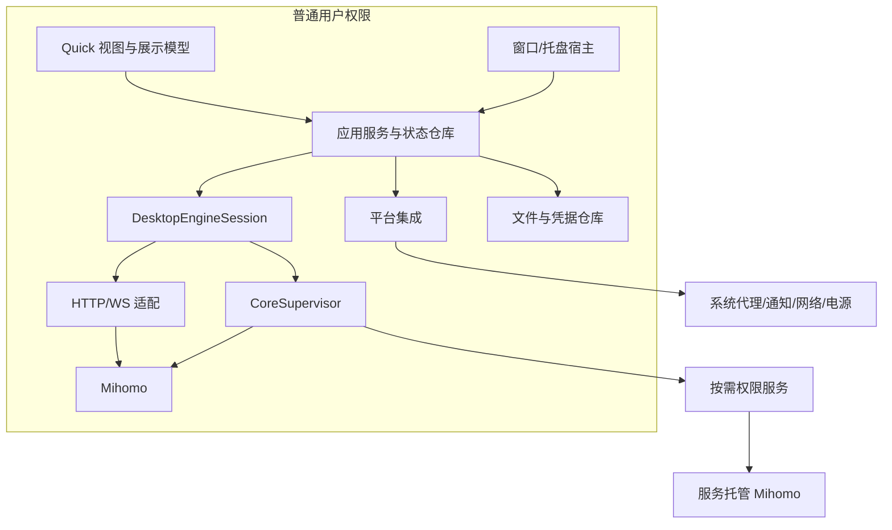

# 02 总体架构与运行模型

关联：[阶段计划](01-目标范围与阶段计划.md)、[接口](03-数据模型与接口契约.md)、[内核](05-内核生命周期与控制API.md)。

## 1. 技术选型

| 部分 | 决定 | 理由与限制 |
|---|---|---|
| 界面 | Qt Quick Controls + 轻量自有组件 | 控制对象规模、绘制和跨平台布局 |
| 应用逻辑 | C++20，Qt Core/Network | 固定类型数据、异步 IO、可分析的内存所有权 |
| 构建 | CMake，qt_add_qml_module | 标准 QML 模块、构建期缓存、依赖收敛 |
| YAML | 锁定版本的 yaml-cpp 候选 | P0 验证格式、解析限额与许可证；不保证注释往返 |
| 元数据 | 版本化 JSON 文件 + 原子写入 + 操作日志 | 首版不增加连接历史数据库 |
| 内核 | 独立 Mihomo 可执行文件 | 复用成熟数据面，隔离崩溃和版本 |
| 托盘 | QSystemTrayIcon + QApplication | 首版成熟实现；实际模块成本纳入测量 |
| 平台桥 | C++ / Objective-C++ 与原生 API | 差异收敛在适配模块 |

Qt 小版本、最低系统版本、Mihomo 版本在 P0 的 release-matrix 文件冻结。本文不假定当前最新版本和所有发行版均已验证。Qt Widgets 只用于宿主和托盘，不要求主界面采用 Widgets。

## 2. 进程拓扑



普通模式与服务模式只允许一个会话拥有目标内核。图中的两个 Mihomo 是互斥部署方式，不是同时启动两份。流量直接经过内核监听器或 TUN，不穿过客户端界面。

默认客户端退出时停止所拥有的内核并恢复所拥有的系统代理。首版不提供“GUI 全退出但自动保留代理”的隐式行为；关闭窗口进入托盘与退出命令分开。服务是否驻留不代表内核会话应继续运行。

## 3. 模块和依赖

| 模块 | 内容 | 可依赖 | 不可依赖 |
|---|---|---|---|
| domain | 类型、值对象、校验规则、能力 | C++ 标准库、必要 QtCore 值类型 | 网络、QML、系统 API |
| application | 配置/订阅/选择/状态协调 | domain、抽象接口 | QProcess、窗口、具体 HTTP 路径 |
| infra-core | API、进程、会话实现 | application 接口、QtNetwork | QML 页面 |
| infra-storage | JSON、YAML、凭据存储适配 | domain、QtCore、平台凭据桥 | 页面状态 |
| platform | 系统代理、托盘、服务 IPC、电源 | 接口、平台库 | 页面业务决策 |
| presentation | ViewModel、列表模型、操作门面 | application、QtCore | 直接写系统代理、拼 API |
| ui | QML 组件和桌面页面 | presentation 公开属性/命令 | 文件、网络、进程管理 |
| host | 组装依赖、单实例、窗口生命周期 | 上述模块 | 可避免的业务规则 |

平台集成接口按职责拆为代理、服务、通知、电源等小接口；上层可提供 IPlatformIntegration 聚合门面，避免一个包含几十个无关方法的接口。

## 4. 推荐源码结构

```text
app/                    启动、依赖组装、单实例、窗口宿主
src/domain/             通用模型与错误
src/application/        用例、事务、仓库接口、需求协调
src/presentation/       ViewModel 与 Qt 模型
src/infra/core/         Mihomo API、CoreSupervisor
src/infra/storage/      JSON、YAML、原子文件与凭据
src/platform/windows/   系统代理、服务、安装桥
src/platform/linux/     桌面代理、DBus/polkit
src/platform/macos/     代理、菜单栏、helper
qml/components/         通用组件、主题 token
qml/desktop/            桌面布局和页面
services/               受限权限服务
tests/                  单元、契约、集成、UI、恢复
bench/                  回放、基准脚本和场景定义
packaging/              三平台打包
docs/                   接口冻结、ADR、发行矩阵
```

平台目录在非目标平台不参与编译。通过 target 依赖落实边界，不依靠目录命名自觉。Mihomo 是可替换发行资源，不将内核源码混入 UI target。

## 5. 线程模型

| 执行上下文 | 职责 | 约束 |
|---|---|---|
| GUI/应用事件线程 | 应用状态、用例协调、模型变更、窗口 | 不阻塞文件、网络、校验或服务等待 |
| 网络事件线程 | QNetworkAccessManager、WebSocket、传输 | QObject 在所属线程创建、使用和销毁 |
| 有界工作池 | YAML、JSON 解析、差异计算、签名校验 | 大任务并发有上限，支持过期结果丢弃 |
| 存储串行执行器 | 元数据写入、事务日志、迁移、备份 | 同一仓库只有一个写者 |
| 内核/服务进程 | 转发、系统权限操作 | 不回调操作 GUI 对象 |

初期网络对象也可在 GUI 线程异步工作；若使用独立网络线程则完整迁移对象，不交叉调用。解析与大文件操作必须离开 GUI 线程。避免为了每个模块建立一个常驻线程；线程数量与栈开销属于资源预算。

跨线程传递不可变值或共享只读快照。QAbstractItemModel 的 begin/end、行数据与信号都在 GUI 线程执行。取消令牌可终止尚未执行工作；无法中断的解析用 generation 校验使结果失效。

## 6. 状态权威与命令流

应用状态仓库拥有期望状态与操作状态；内核/API 是运行时事实来源；系统 API 是系统代理事实来源。ViewModel 只读状态并发命令，不自己成为第二份运行时权威。

用户操作经过：门面校验 → 创建 operationId → 用例调度 → IO/系统操作 → 核对实际结果 → 更新仓库 → 模型通知。按钮显示进行中，成功必须有确认依据；超时进入“待核对”，不自动等同失败或重发非幂等操作。

区分 DesiredState、ObservedState、OperationState。例如 TUN 期望开启但内核尚未确认时，展示“正在启用”，不能提前显示已开启。

## 7. 并发和资源调度

EngineMutationCoordinator 串行处理影响同一会话的启动、停止、配置应用、TUN 模式切换与内核更新。一次配置应用中途不允许另一操作覆盖其配置或进程。用户停止请求可取消尚未提交的步骤；已产生系统变更时必须进入补偿。

配置草稿不占内核锁；订阅可并行下载，但同 profileId 的候选提交串行；节点测速为独立有界任务。配置应用期间暂停提交依赖旧配置的组选择、模式与提供者变更，读/测速结果核对 expectedRevision，应用后刷新再接受新命令；关闭连接按当前 epoch/目标集合校验。互斥获取顺序固定为会话变更协调器 → 配置仓库提交 → 平台代理租约，不持有线程阻塞锁等待网络。

每次内核启动生成 engineEpoch；每次期望配置变更生成 revision；每次列表快照有 sequence。旧 epoch 的结果不得覆盖新会话。接口细节见 [03](03-数据模型与接口契约.md)。

## 8. 启动顺序

1. 定位用户目录、获取单实例锁；第二实例通过受限本地 IPC 请求显示窗口后退出。
2. 读取设置版本与待恢复事务，完成恢复判定，禁止无条件套用旧系统代理快照。
3. 创建应用服务和托盘宿主；窗口按用户设置决定是否立即创建。
4. 读取所选配置与最后可用 revision；如启用自动启动，校验并启动内核。
5. 就绪及监听器确认后，按保存的用户意图申请系统代理/TUN；失败明确降级。
6. 恢复订阅计划；页面可见后才申请页面统计需求。

自动启动代理失败不阻止打开设置、日志和配置修复。不能为了“快速启动”先写系统代理再等待内核。

## 9. 退出和异常恢复

正常退出：拒绝新变更 → 停止统计需求与调度 → 恢复本应用仍拥有的系统代理 → 停止内核会话 → 写入退出结果 → 关闭服务会话与进程。各步骤有截止时间，不能无期限卡住退出。

异常退出由本地事务日志与代理租约记录支持下次恢复；服务模式可由会话心跳超时执行受限清理。无权限服务时无法保证客户端被强杀后立即恢复系统代理，需在下次启动恢复并提供手工恢复指引，不能承诺不存在的实时保证。

## 10. 架构验收

- 销毁并重建 UI 不产生第二个内核或丢失操作状态。
- application/domain 在不链接 QtQuick/Widgets 的测试目标中可用。
- 高频数据没有完整 JSON → QVariant 树 → JS 数组 → 第二行模型的长期多份保留。
- 崩溃恢复和操作补偿依赖持久化状态，不依赖 QML 页面是否存在。
- 动态增加原生托盘或独立 UI 进程时，不重写配置、订阅和业务状态模型。
