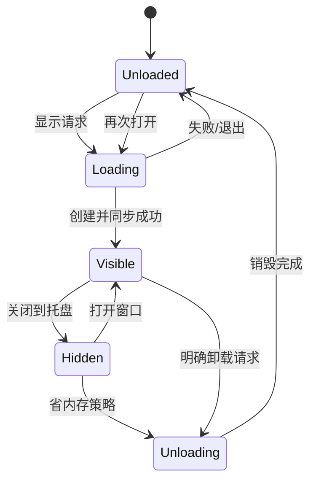

# 04 界面、导航与窗口生命周期

覆盖 F05、F11，关联各功能页面设计、[FlClash UI 移植规范](17-FlClash界面参考与QtQuick落地.md)及 [性能规范](13-性能预算与基准方案.md)。UI 以 FlClash 为主要参考；本文件描述 Qt 运行机制，导航名称和顺序由参考版本清单最终对齐。

## 1. 信息架构

桌面窗口由导航栏、页面区、全局状态区构成。导航顺序为总览、代理、配置与订阅、连接、日志、规则与提供者、设置。错误提示显示在操作附近，影响代理运行的错误在全局状态区保留，不能仅用短暂 toast 表达。

| 常驻区域 | 内容 | 生命周期 |
|---|---|---|
| 宿主 | 应用服务、托盘、单实例 IPC | 客户端整个生命周期 |
| 基础壳 | 导航、主题、全局状态条 | 界面加载期间 |
| 页面 | 当前页 ViewModel、模型与视图 | 按需创建，离开后释放重资源 |
| 浮层 | 节点详情、配置编辑、确认对话框 | 打开时创建，关闭释放 |

页面导航状态保留在小型 UiSessionState：pageId、profileId、过滤文本、排序、选中业务 ID、滚动锚点、未提交草稿引用。它不保存完整连接列表、日志模型或 QML 对象。连接和日志状态恢复时先同步新会话，不复活过时网络对象。

## 2. 组件和视觉约束

建立 ThemeTokens：颜色、间距、字号、圆角、行高、动画时长；支持系统/浅色/深色和减少动态效果。Qt Quick Controls 使用一致的轻量样式，页面不各自实现一套按钮和输入控件。

基本组件：StatusIndicator、OperationButton、ErrorBanner、EmptyState、FilterBar、VirtualListRow、ConfirmDialog、TrafficSparkline、SettingsRow。业务组件依赖门面状态，不接触网络。

初始参考：常用列表行高约 36—44 逻辑像素，布局在普通桌面尺寸可用；具体最小窗口尺寸由字体与本地化测试确定，不能靠强制缩小字体。图标优先打包的矢量/小尺寸资源，不加载远程节点图标作为默认功能。

优先还原参考界面的布局和视觉层次，阴影等效果使用可复用的轻量实现，避免逐行昂贵特效、大面积实时模糊和持续闪烁。确有成本冲突时先优化实现，再记录视觉调整及理由；不能为了低占用把成熟信息结构简化掉。弹层和切页动画短且有限，用户减少动态效果时关闭非必要动画。

## 3. 窗口状态机

退出是宿主的独立状态，不是图中 Unloaded。相同时间的多个显示请求合并；正在卸载时的新显示请求在销毁完成后重建，不能同时创建第二套引擎。

### 3.1 Visible

只激活当前页面数据需求；失去焦点不等于隐藏，不能在用户切换应用时任意卸载窗口。窗口被最小化可采用单独节流策略，恢复时立即刷新。多窗口首版不支持，避免重复页面订阅与复杂生命周期。

### 3.2 Hidden

关闭页面需求 token、停止动画、取消不必要的图标任务和模型刷新；保留正在进行的配置提交、订阅更新等业务任务。业务任务结束以托盘状态和下次打开结果显示，不为了维持进度条创建隐藏渲染。

### 3.3 Unloaded

卸载步骤：保存小型会话状态 → 释放页面需求 → 断开视图回调 → 取消或标记过期的展示任务 → 销毁窗口及 QML 对象 → 按所属线程完成延迟销毁 → 销毁 QML 引擎。业务服务采用明确 C++ 所有权，不能被 JS 所有权回收。

QML 单例若由引擎持有，应视为短生命周期门面；跨引擎保留的是独立 C++ 服务。持久服务对临时对象使用安全弱引用/自动断连，禁止悬空回调。场景图资源只能通过 Qt 支持的渲染线程机制释放。

清理不保证所有 Qt 库、堆缓存和驱动内存归还 OS；分别记录实际节省与打开延迟。确需完全释放 UI 运行时且同进程达不到时，再评估独立 UI 进程。

## 4. 关闭、退出与无托盘环境

首次关闭提示当前策略并允许记住；产品默认倾向关闭到托盘，具体由原型测量确定。无可用托盘时不允许窗口消失后没有可发现入口，可选择最小化、保持窗口或确认退出。Linux 无托盘扩展是正常能力差异。

退出命令明确执行恢复代理与停止所拥有内核；存在配置事务时等待安全边界或进入取消/补偿。未保存编辑草稿提供保存草稿、放弃或取消退出，不能无提示丢弃。

托盘基础菜单：打开窗口、当前配置、运行状态、系统代理开关、代理模式、重启内核、退出。大量节点不全部展开成菜单；高级操作跳转页面。TUN 等授权操作以明确进行中状态处理，避免连击。

## 5. 页面加载与数据恢复

PageHost 只维持当前重页面。转场可短时保留新旧两页，动画结束释放旧页。Loader 的目的在于控制昂贵对象，不对每个基础控件套 Loader。

重新显示时先读取仓库状态，展示旧快照的时间与刷新中标记，再申请新数据。已有变更操作只附着进度观察，不再次发起操作。草稿恢复到对应 baseRevision，若期间配置变更则提示冲突。

## 6. 可访问性与桌面习惯

导航、表格和对话框可键盘使用；焦点移动与可访问名称明确。颜色外提供文字/图标表达状态；支持高 DPI、多显示器切换、字体缩放、系统深色模式和屏幕阅读器基本操作。文本国际化使用稳定 key，日志和原始配置不自动翻译。

快捷键遵从平台惯例：查找、复制、关闭窗口、退出、打开设置；macOS 使用对应 Command 习惯。危险操作不占用容易误触的全局快捷键。初版不注册全局快捷键。

## 7. UI 验收

| 编号 | 场景 | 通过条件 |
|---|---|---|
| UI-01 | 连续开关/卸载 100 次 | 无失效对象调用、重复内核、持续句柄增长 |
| UI-02 | 隐藏时下载完成 | 业务成功、无隐藏动画；打开后状态正确 |
| UI-03 | 卸载时收到旧连接快照 | 结果安全丢弃，不重建隐藏页面 |
| UI-04 | 无托盘环境关闭 | 仍有清晰恢复入口或执行明确退出 |
| UI-05 | 配置提交中退出 | 安全等待/补偿，事务可恢复 |
| UI-06 | 大字体与高 DPI | 主操作不被截断，表格可滚动 |
| UI-07 | 只有键盘操作 | 可进入页面、筛选、操作和关闭对话框 |

## 8. 所属阶段

P1 完成状态机和代表页面；P2 将状态绑定真实业务；P3 完成桌面全部操作；P4 验证平台窗口/托盘习惯；P5 重复生命周期与可访问性验收。
