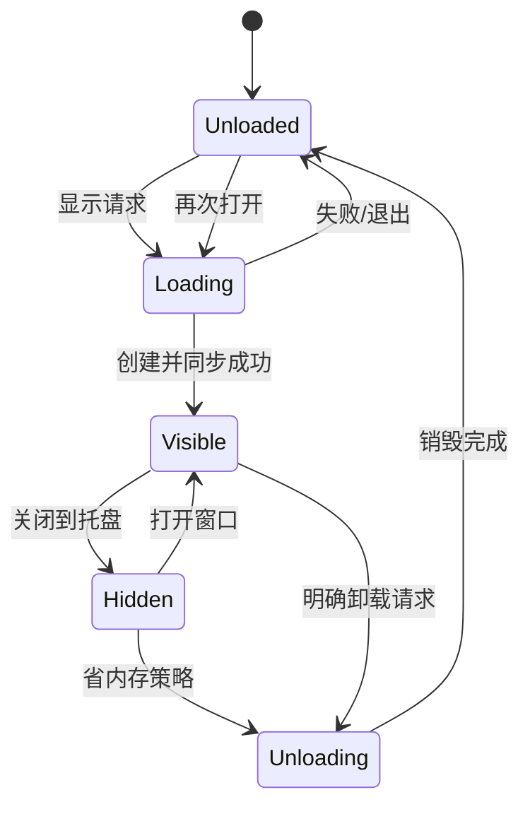

# 04 界面、导航与窗口生命周期

覆盖 F05、F11，关联各功能页面设计、[统一视觉系统与 Qt Quick 规范](17-界面参考与QtQuick落地.md)及 [性能规范](13-性能预算与基准方案.md)。桌面采用左侧导航＋右侧页面，全部控件和页面遵循方案C。本文件约定导航与Qt生命周期，桌面窄窗实现底部精选导航，移动平台只保留边界。

## 1. 信息架构

窗口由标题/全局状态区、左侧导航栏和右侧 PageHost 构成。侧栏按首页、代理、订阅、连接、规则、日志、测试、设置排列；设置可独立锚定底部，顺序与键盘焦点保持可理解。每项切换对应页面，右侧包含页标题、该页操作和内容区；提供者归入规则/代理的相关子视图，不增加主导航项。首页保留聚合控制，但连接、规则、日志、测试、设置各有独立页面。常规侧栏显示图标＋名称，600—999宽度收为64宽图标轨，提供工具提示、可访问名称和展开入口；小于600逻辑像素隐藏侧栏，显示仪表盘、代理、订阅、设置四个底部纯图标入口。具体尺寸和内容断点见17。

功能模块通过 FeatureDescriptor 注册，NavigationModel 按 NavigationPolicy 投影入口；PageRouter 处理稳定 pageId 和上下文。桌面策略展示全部模块，未来移动策略可精选底栏入口、经更多访问或把模块内容嵌入其他页面。导航容器不拥有业务服务或页面数据，也不要求一个模块必须有一个永久导航项。移动安全区/触摸/返回由移动壳适配，本期实现桌面窄窗底栏，不创建Android/iOS平台工程。窗口缩放只改变导航投影和布局，不替换PageHost或启动/停止内核；当前页即使未在底栏投影中也保留，设置提供连接/规则/日志/测试四个次级入口，次级页有返回。MVP 未交付页面按01显示禁用说明，不能点击后用空白页假装功能完成。

首页优先展示订阅、当前运行阶段、主代理组/节点、网络设置与模式；流量和内核/系统信息置于次级区域，IP/网站测试可折叠或按需开启。首次启动提供“添加订阅/导入文件”，已有可用配置后提供“启动代理”，TUN 不作为首次使用的必经授权。错误提示显示在操作附近，运行阶段在页面右上角状态胶囊统一呈现；影响代理运行的错误在全局状态区保留，不能仅用短暂 toast 表达。运行概况卡以相同信息层级并列内核名称/版本、客户端内存、内核内存与运行时间，另列实际就绪代理地址，详情收纳完整资源与系统信息；不重复列出QuickClash进程内存，不重复就绪标识，不放连接/日志跳转。

| 常驻区域 | 内容 | 生命周期 |
|---|---|---|
| 宿主 | 应用服务、托盘、单实例 IPC | 客户端整个生命周期 |
| 基础壳 | 左侧导航、主题、全局状态条与 PageHost | 界面加载期间 |
| 页面 | 当前页 ViewModel、模型与视图 | 按需创建，离开后释放重资源 |
| 浮层 | 节点详情、配置编辑、确认对话框 | 打开时创建，关闭释放 |

页面导航状态保留在小型 UiSessionState：当前 pageId，以及按模块/业务上下文/实例键保存的 profileId、过滤文本、排序、选中业务 ID、滚动锚点和未提交草稿引用。它不保存完整连接列表、日志模型或 QML 对象。侧栏收展、切页和未来导航容器替换只改变呈现；连接和日志状态恢复时先同步新会话，不复活过时网络对象。

连续拖动窗口时，壳用确定的侧栏宽度、底栏高度和页面边界驱动同一个PageHost，不让导航名称的隐式宽度反向参与窗口或外层Layout尺寸协商。收起名称时保持图标/按钮几何，断点切换不重新加载当前页或重新申请数据需求；页面内部仍可用Layout重排。窗口每个像素变化直接更新几何，不反复启动尺寸过渡。

### 1.1 模块、完整页面与嵌入内容

| 层次 | 责任 | 不得承担 |
|---|---|---|
| 功能模块 | 展示门面、内容组件、完整页面适配器、轻量注册描述 | 导入具体平台导航、定位其他页面对象、直接读写系统 |
| 完整页面适配器 | 页面标题/工具区、模块内容与本页上下文 | 复制模块业务、私建控制 API 客户端 |
| 可嵌入内容 | 明确的摘要/列表/详情能力、受上下文约束的操作与路由意图 | 自带主导航/窗口标题、擅自替换宿主页面、隐式全量遥测 |
| 平台壳与布局 | 导航选择、页面路由、嵌入编排、返回/焦点、实例可见性 | 改写模块业务状态、仅用隐藏入口代替能力/权限检查 |

例如代理模块提供完整 ProxiesPage 和 ProxySelectionContent：桌面从侧栏打开完整页面，首页可嵌入只显示固定主组的紧凑内容；未来移动可沿用底栏页面，也可将该内容嵌入首页并通过“查看全部”进入完整路由。日志摘要仅订阅有界错误需求，不因嵌入一个错误贴片而启动完整实时日志页。模块独立依赖应用门面和共享组件，跨模块由注册引用和路由组合，避免首页直接导入兄弟页面。

PageHost 与 EmbeddedHost 均为可见实例分配 instanceKey 和 demand token，激活后才申请所声明数据，隐藏/离开/销毁时释放。多个消费者由业务仓库合并数据流；视图筛选与滚动状态按实例隔离。导航策略只存工厂引用，不实例化未显示模块；“嵌入”不自动赋予后台持续运行权限。

## 2. 组件和视觉约束

建立 ThemeTokens：语义颜色、间距、字号、圆角、行高、动画时长。应用内置完整浅色/深色两套配色，设置可选浅色、深色、跟随系统；默认跟随系统，无法读取时使用浅色，显式选择持久化后不被系统事件覆盖。切换只更新视觉，不重启内核、不丢页面状态。Qt Quick Controls 使用一致的轻量样式；窗口背景、侧栏、贴片、菜单/弹层、输入框、图表和全部状态均使用当前主题，详见 17。

基本组件统一由17第6节定义，涵盖导航、页面标题/工具栏、面板、四类按钮、输入/下拉/数字、开关/选项、页签、表格、菜单/对话框与反馈。FlatTile/SectionPanel用于信息分组；连接/日志等高密度内容使用单面板表格/虚拟列表，不逐单元格嵌套面板。业务组件依赖门面状态，不接触网络。

正文14/20、辅助12/18，按钮/输入36高、列表40高；默认1000×640、最小360×480逻辑像素，字体缩放和本地化不靠缩字号补救。导航使用本地圆角线性SVG，灵猫Q品牌与独立收展按钮分开；窗口/执行文件和明暗托盘沿用同源品牌，具体尺寸与行为见17/3.1，不引入图标字体或远程节点图标。

页面以中性纯色底面、小圆角、轻边框和蓝紫强调表达层次，默认无投影、拟物渐变或实时模糊。面板圆角10、内边距/间距16，控件/节点圆角7、页面边距24，窄窗按17重排。hover/pressed/focus/selected/disabled/pending/error统一使用状态token、文字与符号。弹层与切页动画短且有限，减少动态效果关闭非必要动画；不能为了低占用省略核心操作或降低可读性。

Qt Quick 的优势用于布局自然重排、局部状态插值、选中/进行中反馈、轻量抽屉与详情过渡；不是给每个控件加动画。常规窗口的节点/连接可采用紧凑行或表格、内联操作、分栏详情及复制/右键/键盘导航；窄窗才在相同状态上切到单列详情。主要操作无需手势、长按或多级全屏跳转，桌面也不强制底部导航、触屏尺寸控件或全屏对话框。初始尺寸/密度/动效规格和验证样本见 17，Qt Widgets 依赖只用于成熟托盘宿主，不决定主界面外观。

## 3. 窗口状态机

退出是宿主的独立状态，不是图中 Unloaded。相同时间的多个显示请求合并；正在卸载时的新显示请求在销毁完成后重建，不能同时创建第二套引擎。窗口几何在隐藏与卸载前保存、重建显示时恢复；进程内首次显示按 17 的默认逻辑尺寸在鼠标所在屏幕的可用区域居中，保存过的几何优先于默认尺寸与居中。

### 3.1 Visible

只激活当前页面数据需求；失去焦点不等于隐藏，不能在用户切换应用时任意卸载窗口。窗口被最小化可采用单独节流策略，恢复时立即刷新。多窗口首版不支持，避免重复页面订阅与复杂生命周期。

低内存选项使用unloadWhenHidden布尔偏好，默认false；JSON字段及ui.ini迁移键保持兼容，已存false保持false，已存true继续启用，不为全部用户自动打开。设置明确标为“低内存：隐藏或最小化5秒后卸载界面（实验性）”，true同时覆盖这两种后台状态；迁移说明应明确该语义，不另加同义开关。启用须有真实可用/可见托盘，超时再次核对；无托盘时不卸载最小化窗口，保留任务栏恢复入口，已启用者仍可关闭选项。若隐藏等待期间托盘失去能力，则取消卸载并恢复隐藏窗口。

单次延迟租约绑定引擎代次/票据，使用精确定时器避免粗粒度计时提前触发，实际繁忙时允许晚于5秒；重复同代隐藏不累积计时器、不无限重置截止。显示、禁用/偏好保存中、退出、卸载和不满足后台条件时取消，旧回调不能卸载刚恢复的窗口。卸载期间显示请求合并，销毁完成后排一次重建；重复显示只复用现有引擎。最小化/隐藏立即释放页面需求，业务worker、内核、订阅更新/事务继续；重建只恢复一套界面及当前页面需求，不重发业务操作。

### 3.2 Hidden

关闭页面需求 token、停止动画、取消不必要的图标任务和模型刷新；保留正在进行的配置提交、订阅更新等业务任务。业务任务结束以托盘状态和下次打开结果显示，不为了维持进度条创建隐藏渲染。

### 3.3 Unloaded

卸载步骤：保存小型会话状态 → 释放页面需求 → 断开视图回调 → 取消或标记过期的展示任务 → 销毁窗口及 QML 对象 → 按所属线程完成延迟销毁 → 销毁 QML 引擎。业务服务采用明确 C++ 所有权，不能被 JS 所有权回收。

QML 单例若由引擎持有，应视为短生命周期门面；跨引擎保留的是独立 C++ 服务。持久服务对临时对象使用安全弱引用/自动断连，禁止悬空回调。场景图资源只能通过 Qt 支持的渲染线程机制释放。

清理不保证所有 Qt 库、堆缓存和驱动内存归还 OS；分别记录实际节省与打开延迟。确需完全释放 UI 运行时且同进程达不到时，再评估独立 UI 进程。

## 4. 关闭、退出与无托盘环境

首次关闭提示当前策略并允许记住；MVP 默认在托盘可用时关闭到托盘，隐藏后的卸载策略由原型测量确定。无可用托盘时不允许窗口消失后没有可发现入口，默认保留窗口并提示选择最小化或确认退出。Linux 无托盘扩展是正常能力差异。

退出命令明确执行恢复代理与停止所拥有内核；存在配置事务时等待安全边界或进入取消/补偿。未保存编辑草稿提供保存草稿、放弃或取消退出，不能无提示丢弃。

托盘基础菜单：打开窗口、当前配置、运行状态、系统代理开关、代理模式、重启内核、退出。大量节点不全部展开成菜单；高级操作跳转页面。TUN 等授权操作以明确进行中状态处理，避免连击。

## 5. 页面加载与数据恢复

PageHost 只维持当前重页面。转场可短时保留新旧两页，动画结束释放旧页。Loader 的目的在于控制昂贵对象，不对每个基础控件套 Loader。

重新显示时先读取仓库状态，展示旧快照的时间与刷新中标记，再申请新数据。已有变更操作只附着进度观察，不再次发起操作。草稿恢复到对应 baseRevision，若期间配置变更则提示冲突。

## 6. 可访问性与桌面习惯

Windows字体基准保持14逻辑像素，读取当前用户Accessibility/TextScaleFactor（100—225%）放大正文、辅助文字及对应控件/行高；Qt独立应用每屏DPI，不重复叠加设备像素比。设置变更通知更新宿主字体，界面跟随且不重建业务会话；隐藏卸载后按当前字体重建。无有效设置采用100%，不写系统设置。物理多屏迁移与Windows实际文本设置须在有相应环境时独立验收，注入字号不能替代。

输入、下拉、数字字段与图标动作提供稳定可翻译名称，名称不随输入内容消失；只读预览同样可识别。按钮支持Space及Enter激活，Enter自动重复不重复执行。模态确认默认聚焦可用取消/关闭按钮，Tab约束在弹层内；关闭时仅向仍存在、可见且可用的触发控件返回焦点。一般多行字段及只读预览使用Tab/Shift+Tab导航；YAML原文编辑保留Tab文本输入，用Ctrl+Tab/Ctrl+Shift+Tab离开，避免键盘焦点陷阱。

导航、表格和对话框可键盘使用；焦点移动与可访问名称明确。颜色外提供文字/图标表达状态；支持高 DPI、多显示器切换、字体缩放、系统深色模式和屏幕阅读器基本操作。产品源文案统一英文，QML以qsTr提取，C++以tr或QT_TRANSLATE_NOOP固定context提取；resources/i18n/quickclash_zh_cn.ts作为中文词表，lrelease在构建时生成并内嵌qm，随应用带上Qt基础/声明式中文翻译。QLocale::system().uiLanguages()按用户首选语言顺序匹配zh/en，所有zh地区映射当前简体中文词表；无匹配或应用词表不可用回退英文，启动首帧前安装QTranslator，生命周期长于宿主与worker。更改系统语言后重启生效，本期不提供手动语言选择。协议值、稳定错误码、用户配置/节点名称和原始日志不自动翻译；运行阶段在展示层映射可翻译文案。英文/中文及未知语言回退须有必要行为检查。

快捷键遵从平台惯例：查找、复制、关闭窗口、退出、打开设置；macOS 使用对应 Command 习惯。危险操作不占用容易误触的全局快捷键。初版不注册全局快捷键。

## 7. UI 验收

| 编号 | 场景 | 通过条件 |
|---|---|---|
| UI-01 | 连续开关/卸载 100 次 | 无失效对象调用、重复内核、持续句柄增长 |
| UI-02 | 隐藏时下载完成 | 业务成功、无隐藏动画；打开后状态正确 |
| UI-03 | 卸载时收到旧连接快照 | 结果安全丢弃，不重建隐藏页面 |
| UI-04 | 无托盘环境关闭 | 仍有清晰恢复入口或执行明确退出 |
| UI-05 | 配置提交中退出 | 安全等待/补偿，事务可恢复 |
| UI-06 | 大字体与高 DPI | 主操作不被截断，表格可滚动 |
| UI-07 | 只有键盘操作 | 可进入页面、筛选、操作和关闭对话框 |
| UI-08 | 左侧导航切换页面 | 八类已交付模块均从左侧导航进入对应右侧页面；收展/切页不丢业务状态，未交付入口说明清楚，不常驻八套视图 |
| UI-09 | 桌面与窄屏折中 | 常规窗口保留信息密度、分栏/复制/键盘操作；窄窗无溢出，主要动作不依赖手势/长按或全屏逐级导航 |
| UI-10 | 双主题与贴片一致性 | 两套内置配色覆盖侧栏、页面、菜单/弹层、图表和全部交互状态；切换/重开偏好正确，扁平圆角贴片一致，无不可读或未适配控件 |
| UI-11 | 模块独立与嵌入复用 | 代表模块可独立页面/嵌入内容复用；策略可精选入口且已支持路由可访问，能力检查不被绕过；多实例状态隔离、需求合并，隐藏后不残留遥测或额外完整页面 |

## 8. 所属阶段

P1 完成状态机和代表页面；P2 将状态绑定真实业务；P3 完成桌面全部操作；P4 验证平台窗口/托盘习惯；P5 重复生命周期与可访问性验收。

## 9. Qt 宿主与图形环境约束

桌面宿主采用QApplication/QSystemTrayIcon/QMenu，功能页面全部使用QML；C++ UiState由宿主独占、引擎仅借用。ThemeTokens随引擎销毁，主题/路由/最多32份轻量筛选位置状态保留在门面；工厂注册不创建页面。PageHost只加载当前模块，首页以EmbeddedHost加载代理摘要；嵌入参数改变时释放旧实例，无效参数清空内容。嵌入上下文必须声明并验证，移动仅保留投影与稳定路由边界，见[实现边界](../development/ui_module_boundary.md)。

主界面使用Qt Quick场景图，默认由Qt RHI及平台适配选择图形后端，字体使用Qt的QFont/QFontDatabase与文字控件；业务和页面不直接接管GDI、DirectWrite或原生图形API绘制。跨平台内存优化在该路径上处理对象/模型/文字布局/字形及绘制资源生命周期，不将Windows专有字体后端切换作为产品方案。启动参数--software-rendering在创建窗口前通过QQuickWindow::setGraphicsApi(Software)选择Qt Quick自身的跨平台CPU软件场景图；只作用于本次进程，不修改字体后端、持久设置或默认后端。切换须完全退出旧单实例后重开；软件模式的CPU、滚动和效果兼容性单独验收，不据此保证字体缓存或所有私有内存下降。

Windows参考图形环境默认采用D3D11 basic渲染循环；显式选择其他后端或循环时保留调用者设置，其资源和恢复表现须独立验证。中文字体优先选择系统已安装Microsoft YaHei，缺失时回退GeneralFont；不打包/下载OS字体，不将整份TTC作为应用字体加载。

宿主向QML窗口传递完整QFont，控件继承字号、字重与字体策略，ThemeTokens提供同一主字体名称。导航使用FeatureDescriptor的本地icon资源，收展使用独立面板箭头，保留工具提示与可访问名称。订阅/节点名称按纯文本显示并保留原始字符与业务身份；任意语言所需的系统字体回退仍然允许，不全局禁用字体合并，不把首选回退字体列表当成字体白名单。字体文件映射、可共享驻留页、私有驻留与私有提交分别记录，不能以裁剪工作集或清除系统字体缓存代替释放持有资源。

默认basic/D3D11路径在QApplication创建前设置QT_D3D_MAX_FRAME_LATENCY=0，避免GUI线程等待帧延迟对象，保留GPU、flip交换链和垂直同步。显式QSG_RENDER_LOOP、QSG_RHI_BACKEND、QT_QUICK_BACKEND及D3D选项按启动条件处理，不覆盖用户的QT_D3D_MAX_FRAME_LATENCY或QT_D3D_NO_FLIP。离屏软件渲染检查不能替代真实Windows连续缩放、生命周期或帧表现验收。
