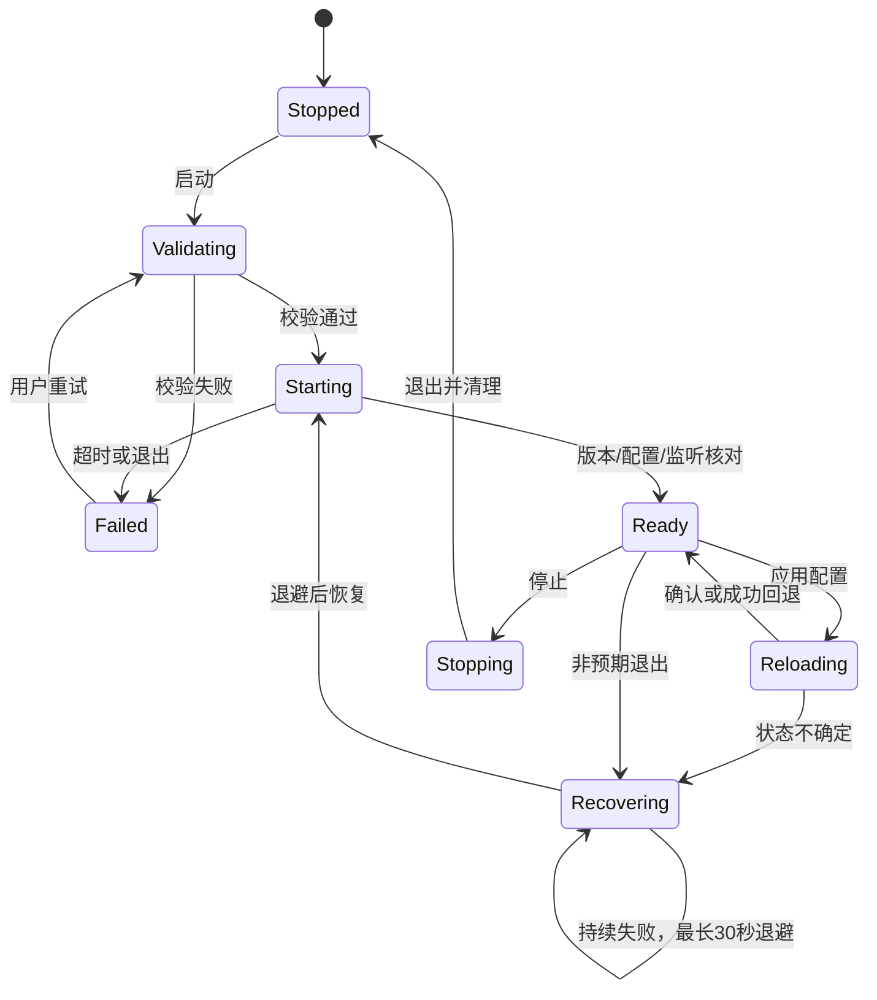

# 05 内核生命周期与控制 API

覆盖 F01，并为所有控制功能提供基础设施。接口表用于实现规划，必须对 P0 锁定的 Mihomo 版本建立契约测试；未列出的版本不能默认兼容。

## 1. 职责与边界

CoreSupervisor 管理进程或服务会话；MihomoApiClient 管理认证、请求、WS 与解析；DesktopEngineSession 实现应用接口，协调两者。客户端只管理自己创建或通过服务正式接管的会话，首版不支持发现任意第三方内核后自动接管。

产品仅使用随包官方Mihomo，作为后台实现细节自动管理，不向用户提供内核列表、启动/停止/自动启动选项。存储恢复完成且选中有效配置后自动运行；无配置时等待导入。首页、设置和托盘只提供“系统代理”“虚拟网卡模式（TUN）”两个网络开关，模式与端口仍为独立配置。关闭系统代理只释放租约；关闭TUN迁回普通内核，保持本地转发可用。退出/删除当前配置优先取消恢复并清理会话和仍拥有的网络设置。内部startCore/startProxy/stopProxy保留用于应用编排与测试，不作为用户管理入口。这里的后台运行不等于注册操作系统开机启动。

配置文件、控制器端口、工作目录、内核可执行路径均由受管资源解析得到。跨平台可使用QProcess参数列表；Windows P2采用受控CreateProcessW启动器，正确引用每个参数且不经过shell。生产默认使用随安装包提供或已验证更新的内核；开发者自定义路径为后续显式功能。

### 1.1 官方预编译资产接入

内核唯一发行来源为 [MetaCubeX/mihomo Releases](https://github.com/MetaCubeX/mihomo/releases)。P0 选择经验证的正式 tag 和每个平台具体资产，不在运行时跟随 latest 自动执行，也不在客户端构建中编译 Go 内核。release-matrix 记录 tag、资产原名/URL、OS/arch、最低 CPU 指令集、压缩格式、下载与解包大小上限、归档和可执行文件 SHA-256、许可证与来源验证记录。兼容 CPU 的资产优先，指令集不满足时禁止执行并给出可操作错误。

构建/打包阶段下载并验证固定资产、受限解包，保存原始可执行字节；可按平台包布局命名和设置执行权限。macOS 必要的嵌套签名会改变文件字节，必须同时记录上游摘要、签名前后摘要、签名身份和变换步骤，仍使用同一预编译程序，不冒称发布后的字节与上游完全一致。安装后离线即可启动内核。

来源校验采用项目签名发行元数据绑定上游 tag/资产/摘要，或随已验证应用包携带固定摘要；上游仅有 checksum 时不得称为上游签名。记录可核验的上游许可证及源码获取位置，具体分发义务在许可台账落实。不得下载任意用户 URL 后执行。

## 2. 生命周期状态

UI 生命周期变化不驱动此状态机。停止优先级高于尚未提交的启动；非预期退出与用户主动停止分开。应用退出后不得因自动恢复又启动内核。

| 当前阶段/事件 | 必须动作与最终状态 |
|---|---|
| Validating/Starting 收到停止 | 失效校验 generation、禁止迟到启动；已创建进程经 Stopping 清理至 Stopped |
| Reloading 收到停止或内核退出 | 进入补偿/待核对，按事务与 owned 身份安全停止；不直接发第二次重载 |
| Recovering 收到停止/退出 | 取消退避和排队启动，处理仍存活会话，进入 Stopped 或 Uncertain |
| Failed/Uncertain 请求清理 | 先探测实际会话并撤回仍拥有代理；身份无法证明时不强杀第三方进程 |
| 普通模式迁入服务失败 | 确认服务会话已停止、TUN 已清理后恢复旧用户态配置和租约；无法确认则 Uncertain，不重复启动 |

Uncertain 同时体现在 Operation/EngineStatus 的 certainty 中，状态图只是主路径；不能因图中未绘制边就忽略上述事件。

## 3. 启动流程

1. 获取会话变更许可，核对当前无本应用已有会话。
2. 读取已验证配置 artifact，确认路径、权限、端口和内核版本；运行配置测试。
3. 创建 epoch 与会话记录，生成高熵控制器 secret，将不可变 RuntimeConfig 模板物化为该 epoch/revision 的受限 SessionConfig 后执行；模板本身不得直接传给内核。独立校验使用一次性临时 secret，正式启动不修改已提交模板；同 epoch 重载复用本次认证，新 epoch 必须换 secret。控制器绑定策略在锁定版本上验证；不可从订阅继承对外控制器监听。
4. Windows 普通模式经受控 CreateProcessW 启动并纳入 owned Job；服务模式由 startSession 门面调用固定 IPC。记录 PID、创建时间或平台可靠句柄、可执行身份和配置 revision，不能仅凭 PID 认领。
5. Windows 使用进程句柄事件通知和重叠管道读取，不以固定高频定时器检查退出和输出；每轮最多读取64 KiB并让出事件循环，内存只保留4 KiB尾部，诊断统一脱敏。不得因管道不读取阻塞子进程。
6. 普通模式在启动进程前短暂试绑两个IPv4回环TCP端口，系统拒绝或已被占用时立即返回端口不可用；试绑释放后仍可能出现竞争，不能替代正式监听归属核对。在截止时间内查询版本、运行配置摘要和监听器；确认是当前会话的认证端点且内核未退出。控制器可先于配置应用和入站监听就绪，配置仍为初始值或监听尚未属于本会话时继续有界异步核对，全部核对通过前不进入Ready；截止仍不匹配或未确认归属则分别报错并停止owned进程。Windows TCP表在两次读取间增长时有限重读。默认启动截止 10 秒作为起点，慢机器可调整。
7. 更新内核 Ready，应用层依据具体用例恢复选择并决定是否申请系统代理；TUN 的路由/DNS 状态由对应平台核对。

配置校验直接调用当前已校验摘要的官方内核程序，以独立 owned Job 子进程和临时工作目录执行 `-t`，不向正在转发流量的进程提交候选，不复制内核程序，也不创建 Windows AppContainer profile。校验进程使用启动用户的权限，临时目录不构成 OS 权限沙箱，不承诺强制断网或阻止内核缺陷访问宿主资源；通过受管资源副本、宿主配置覆盖和内核自身路径检查限制正常配置行为。校验清除环境中可替换候选、控制器、脚本及安全路径的覆盖；原生 provider 正文校验仅使用已准备的 file vehicle、专用用户/SYSTEM 管道，不启用数据监听、健康检查、TUN或系统代理。每个校验阶段限 10 秒，超时终止 Job 并提示校验超时；失败保留确认版本，完成后回收临时文件。AppContainer 仅保留为显式实验探针，不是客户端或默认完整验证的依赖。

端口探测不能完全消除 TOCTOU 竞争；真正绑定失败必须从内核退出/日志得到并向用户报告。API 可连不代表所有代理出站可用，Ready 只表达控制面和配置就绪。

端口预检区分地址已占用、Windows拒绝绑定和其他不可用原因，错误携带具体TCP端口及代理/控制器角色，不在未确认时指认占用进程。已知监听冲突暂停后台重试，用户显式重试或提交新设置后解除。设置提供“使用可用端口”入口，最多检查附近128个候选；候选展示后仍须通过捕获epoch/selectionGeneration的设置确认提交，不能直接写偏好或静默切换。候选探测不预留端口，正式启动仍重新绑定和核对。端口变更沿用配置事务，验证新会话后迁移仍拥有的系统代理租约；失败补偿旧配置/会话，清理不确定则不启动第二会话。

### 3.1 MVP 监听器与应用层命令

Windows MVP 默认 mixed=127.0.0.1:7890，同时接受 HTTP CONNECT/SOCKS；独立 HTTP/SOCKS 端口关闭。普通模式 controller=127.0.0.1:9090，每次 epoch 生成新 secret，禁止局域网访问。两端口均可在基础设置中修改，范围 1024—65535 且不得相同；占用时报出具体端口并提供修改/重试，不自动抢占、杀进程或静默换端口。订阅不能改写这些应用受管字段。正式 bind/监听归属必须结合 owned 进程、认证控制器、运行监听摘要和必要的 OS 端口归属核对；仅 TCP connect 成功不足以证明监听器属于本次内核。

应用层 IProxyApplication 提供以下用例，按钮和托盘复用，不在 QML 中串联多个调用：

| 命令 | 成功、失败与意图 |
|---|---|
| startCore | 启动已选择版本并确认内核，按 06 提交运行版本；不新申请系统代理，适合手工指定代理的应用 |
| startProxy | 已有 Ready 会话则复用，否则启动所选版本；恢复可靠组选择后申请系统代理，全部核对并落盘后才报告组合成功 |
| startProxy 失败 | 撤回本次新申请且仍拥有的租约；后台受管模式中仅平台代理申请失败时保留已确认的本地转发内核，但组合Operation必须Failed、开关不得显示成功；内核/配置/提交失败仍清理或补偿。低层手动模式本次新建内核失败则停止；复用既有会话时保留会话，代理清理遵循租约所有权。具体失败阶段可见 |
| setSystemProxy(true/false) | 仅在 Ready 时开启，未就绪时明确转入 startProxy 组合用例；关闭只释放租约，不停止内核。失败不保存虚假的成功意图 |
| stopProxy | 内部编排设置停止意图、取消重试、释放本应用租约并停止 owned 内核；重复调用幂等。UserStop 清除下次系统代理意图；AppExit/SuspendForMutation 保留已确认意图，重开在存储/租约恢复完成后按后台策略运行。恢复失败仍停止并保留 RecoveryRequired、原快照和手工入口，不报全部成功 |

同一用例的中间Ready只表示内核阶段完成，不提前将网络操作标成功。首次systemProxyDesired=false；只有用户开关成功后保存true，明确关闭后保存false，崩溃恢复和AppExit保留已确认意图。应用打开后自动运行有效配置并按已确认意图恢复网络，外部租约冲突不自动覆盖。后台模式下系统代理申请失败会显示错误并保留本地转发内核，开关不能伪装开启。停止请求立即失效恢复token；运行切换沿用事务前网络状态，重试先核对operation和租约。

## 4. 控制 API 适配表

| 目的 | 常见端点/方式 | 客户端处理 |
|---|---|---|
| 版本 | GET /version | 契约与能力核对 |
| 读取运行摘要 | GET /configs | 不视为完整原配置 |
| 热更新字段 | PATCH /configs | 仅契约确认可修改字段 |
| 重载配置 | PUT /configs | 请求体、force 与路径语义按锁定版本 |
| 代理与组 | GET /proxies | 解析类型、成员和当前选择 |
| 选择组成员 | PUT /proxies/{name} | name 是单一路径段编码 |
| 单项延迟测试 | GET /proxies/{name}/delay | URL、timeout 参数受策略限制 |
| 流量 | /traffic 流 | HTTP/WS 能力按版本适配 |
| 连接 | GET/WS /connections | 完整快照与间隔参数按版本核验 |
| 关闭连接 | DELETE /connections/{id} 或集合 | 单条与全部分别提供 |
| 日志 | /logs 流 | 级别、协议与字段按版本核验 |
| 规则 | GET /rules | 只读、有序 |
| 提供者 | /providers/proxies、/providers/rules | 查看、更新与健康接口逐项契约验证 |

默认不通过开放任意路径的方法暴露给 QML。内部请求用强类型命令；PATCH/PUT 支持的差异由能力映射决定。HTTP 状态成功仍需解析并核对语义。遇到 404/405 等先区分版本能力与认证/路径问题，不能无限重试。

控制请求绕过系统代理，避免自我依赖；只连接受管回环地址。HTTP 认证优先使用授权头；若特定 WS 实现仅支持 URL token，限定回环并在日志、诊断和错误中彻底清除。生产不得输出 secret 或完整认证 URL。

当前会话Ready且有效配置完全相同时，按06的复用条件只提交来源、历史及版本元数据，保留进程、epoch、会话文件和现有代理租约；不创建重复校验或转发内核。仅模式变化时，沿用配置事务生成并校验不可变候选，写入CoreApplying后执行PATCH mode并GET configs回读，确认后提交manifest。回读或提交前持久化失败先PATCH回旧模式并回读，再终结旧事务；无法确认回退时请求停止并保留Uncertain及待恢复日志。manifest已替换而日志补记失败时以新manifest为准，不回滚已提交模式。其他配置变化优先使用PUT /configs?force=true重载，条件为内核程序、进程身份/服务模式、控制器和Geo快照均不变，且会话Ready、无恢复或清理不确定。普通模式发送有界payload；服务固定reload命令只接收有界配置字节、端口、模式和既定DNS/TUN字段，独立预检并生成自己的路径，不接受调用方路径或任意API转发。重载后GET核对模式、端口、allow-lan和TUN，并确认owned监听，再读组及恢复可信选择、提交manifest。请求/读回/提交失败先重载旧会话配置并读回补偿；补偿无法确认时才转受控重建，manifest已提交则保留已提交版本并报告Uncertain。重载保留PID/epoch/控制器和secret；配置代次单独拒绝旧组查询。替换内核、切换进程身份/TUN、控制器或Geo快照变化仍受控重启。

上表描述内核适配层能力。普通模式适配层位于用户态；服务模式适配层位于权限服务内，真实控制器使用服务专属受限本地端点（锁定版本支持的 Unix socket/命名管道及 OS ACL），服务独占 secret。若目标平台/内核无法强制限制访问，则该组合不启用服务模式，不以回环地址或“不向 QML 暴露”代替权限隔离。GUI 经固定 IPC 请求组选择、连接关闭、模式/配置变更和遥测；配置/TUN 必须走 applyApprovedConfig。IPC 不接受任意 HTTP 方法、URL、路径或原始请求体转发。具体映射与字段白名单在 P0 冻结、P3 实测。

## 5. 请求与重连策略

起始超时：普通 GET 3 秒、普通变更 5 秒、延迟测试 2 秒（服务 IPC delay 上限 5 秒）、配置应用按事务阶段给出较长截止。每项配置均有上限，不允许无限等待。取消只表示客户端停止等待，不保证服务端操作没有发生。

幂等读取可在短退避后重试一次；选择、重载、关闭连接等命令响应丢失先核对实际状态。不能仅因网络超时就再次执行全局关闭连接。WS 重连采用带抖动的 1/2/4/8 秒至约 30 秒退避；无需求、用户停止或 epoch 改变立即取消。

会话心跳低频、可暂停或合并，优先利用进程退出事件。显示页面不会各自创建健康轮询。状态 stale 与内核停止分开：控制面断线不证明数据面已经停止。

服务健康status默认5秒一次，每类status/流最多一个请求在途；有流需求时每秒读取流，无需求时轮询定时器降至5秒。普通命令已续租时不再发送冗余heartbeat，显式heartbeat只在10秒无发送且无在途heartbeat时请求。超时只释放当前请求，不销毁已验证会话。

服务模式的周期 status 是会话健康输入，不是数据面证明。请求超时、传输失败或缺少响应对象只记为控制面 Unknown，不得据此停止 owned 内核或报告 CoreExited；只有服务明确返回 ready=false 才判定内核退出并进入恢复。连续状态失败可用于显示降级，但不得升级为杀核动作。

服务会话的超时按阶段区分：连接与 hello 握手共享一个短截止（15 秒起步），握手完成后会话保持，不因单次请求超时而关闭；每次 status 或受控操作单独计时并按策略重试。单次请求超时只让该次操作进入 Unknown 或失败，不得终止已验证会话，也不得让服务停止 owned 内核。

TUN 适配器、路由与 DNS 是独立观测：On、Missing、Unknown 只描述当前可观测性。目标接口短暂不可见时内核保持运行；连续三次轮询均为 Missing/Unknown 才向界面报告 TUN 不可用，随后恢复 On 时清除该提示。观测失败不触发内核重启。

## 6. 崩溃恢复

生产后台模式采用1/2/4/8/16/30秒退避，之后最多每30秒重试一次，连续崩溃不在第三次后永久停止。稳定运行60秒后重置退避。仅恢复最后确认版本；只读/损坏存储、未解决事务或服务清理不确定时保持错误边界，不抢占第三方会话。无页面轮询驱动恢复，退出取消定时器和所有迟到启动。低层手动模式仅供编排测试复用旧有限恢复策略，不决定产品行为。

内核退出时，立即标记状态不可用并尝试撤回所拥有的系统代理；恢复成功后重新申请，而不是永久指向失效端口。恢复使用最后可用配置，不能反复启动刚刚失败的候选。

内核真实退出时记录退出码、UTC 时间和有界 stderr 尾部（服务内存最多 4 KiB，发送前脱敏并截断至 2 KiB），并记录本次运行时长。没有这些诊断时不得把状态超时当作退出原因。

TUN 会话的崩溃恢复有独立上限：核心运行不足 60 秒且已请求 TUN 的连续短时失败达到 3 次时，暂停自动重开 TUN，以普通代理模式恢复并报告 TunRecoveryExhausted；用户显式开启或关闭 TUN 后清除阻断并重新计数。普通代理会话仍按 1/2/4/8/16/30 秒退避，不因该上限永久停止自动恢复。

上述计数也覆盖已有TUN意图在Ready前的可重试启动失败；服务停止清理确认后才交付启动失败并累计。权限/身份/安装要求、配置与资产完整性错误暂停后台重试，等待显式操作；清理不确定或停止失败保留恢复边界，不以普通重试掩盖。普通模式及服务模式都提供退出码（Windows无符号32位）、UTC时间和有界脱敏输出尾部，启动中退出同样记录。

服务失联时先探测其会话状态。禁止在未确认服务内核已停止时再启动用户态内核占用相同端口或 TUN。无法判断时进入 Uncertain 并提供明确恢复操作。

服务清理不确定阻止经服务再次启动 owned 内核或恢复 TUN，并暂停自动替代会话；普通用户态代理保留显式独立启动能力，但仍须通过监听器占用核对。只有真正完成过服务握手并建立会话的客户端退出才请求 status/stop 清理；从未建立会话时，不得把客户端关闭写成需要清理的不确定状态，也不得据此阻止下一次普通代理启动。

## 7. 停止与所有权

仅对匹配会话身份的内核停止。先恢复系统代理，再请求服务停止或进程正常退出；超过截止可终止所拥有的进程，记录是否强制。Windows MVP 的 Job 强制策略见 11；Linux/macOS 使用对应受控会话方案，不假定跨平台 QProcess 析构能满足所有清理需求。

Windows停止策略为恢复租约→TerminateJobObject→最多2秒等待，属于强制停止owned Job，不等同请求内核正常退出。AppExit保留独立持久的系统代理意图，UserStop/明确关开关清除意图；下次打开在存储与租约核对完成后自动运行有效配置，再按已确认意图申请系统代理，冲突不覆盖。若引入正常退出流程，须另行定义请求、截止与强制回收边界，不能用进程退出码推断关闭方式。

终止失败或等待超时返回明确错误，保留句柄、Job与身份供重试，不清理其配置、不启动替代普通会话；只有确认进程结束后才释放身份并报告Stopped。服务同样保留未确认进程、epoch及配置，清理响应不能成功；停止后的旧API响应不得重新发布为就绪结果。

旧 pid 文件不能作为强杀依据；PID 复用、服务升级、崩溃残留必须结合创建时间、句柄或服务会话 token 核对。

## 8. 验收与阶段

| 编号 | 测试 | 结果 |
|---|---|---|
| CORE-01 | 连点启动、窗口重建 | 仅一个 owned 会话 |
| CORE-02 | 无效配置/端口占用 | 不写系统代理，错误可定位 |
| CORE-03 | API 响应延迟后成功 | 核对状态，无重复变更 |
| CORE-04 | 内核连续崩溃 | 后台普通代理按退避恢复且稳定60秒重置；TUN 连续3次短时失败后暂停自动重开并保留普通代理，用户显式操作后恢复；退出取消，存储/事务不确定时不自动启动，无请求风暴 |
| CORE-05 | 服务失联/状态超时 | 请求超时或 TUN 观测失败不停止健康内核、不误报 CoreExited；真实 ready=false 才恢复；不重复启动，不确定状态可见 |
| CORE-06 | 大量 stderr | 无管道阻塞、缓冲有界 |
| CORE-07 | PID 被复用 | 不终止第三方进程 |
| CORE-08 | 旧 epoch 响应 | 不覆盖新会话状态 |
| CORE-09 | 版本/OS/CPU 资产不匹配 | 执行前拒绝，不触发系统代理；官方来源与摘要可追溯 |
| CORE-10 | 校验/启动/恢复期间停止 | 无迟到自动启动；迁移失败不产生双内核 |

P0 对启动/校验命令、认证、version/configs/proxies、模式与成员变更冻结真实请求/响应及错误夹具；流和服务端点可按后续阶段冻结。P2 完成主要闭环及崩溃/停止/端口故障，P3/P4 完成服务模式，P5 扩展故障与版本升级。
