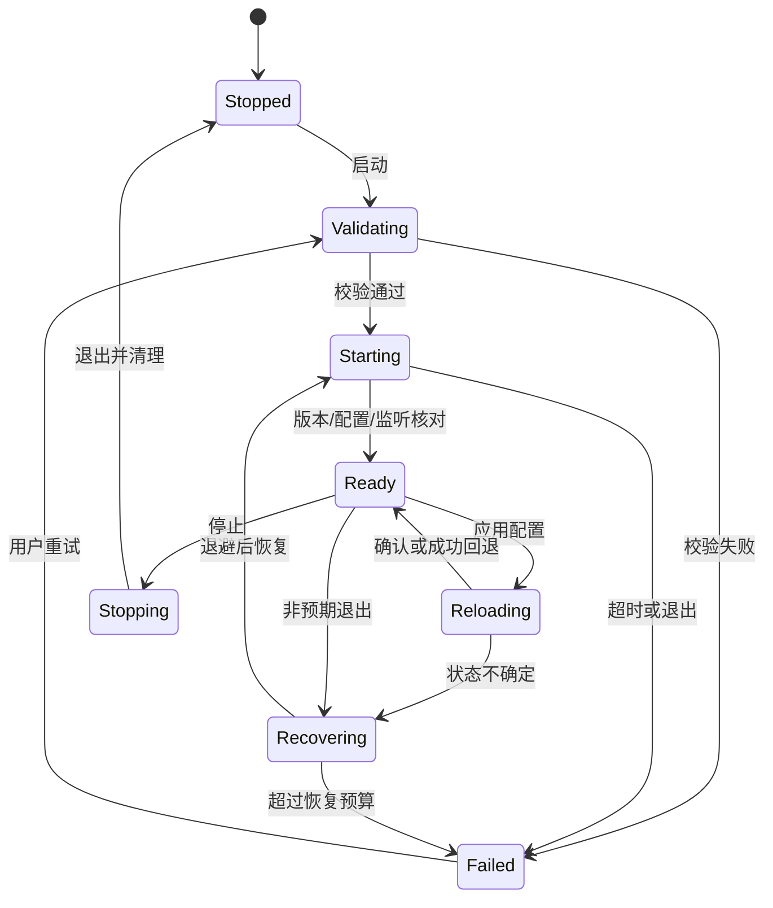

# 05 内核生命周期与控制 API

覆盖 F01，并为所有控制功能提供基础设施。接口表用于实现规划，必须对 P0 锁定的 Mihomo 版本建立契约测试；未列出的版本不能默认兼容。

## 1. 职责与边界

CoreSupervisor 管理进程或服务会话；MihomoApiClient 管理认证、请求、WS 与解析；DesktopEngineSession 实现应用接口，协调两者。客户端只管理自己创建或通过服务正式接管的会话，首版不支持发现任意第三方内核后自动接管。

配置文件、控制器端口、工作目录、内核可执行路径均由受管资源解析得到。通过 QProcess 的参数列表启动，不将配置名称拼进 shell 命令。生产默认使用随安装包提供或已验证更新的内核；开发者自定义路径为后续显式功能。

### 1.1 官方预编译资产接入

内核唯一发行来源为 [MetaCubeX/mihomo Releases](https://github.com/MetaCubeX/mihomo/releases)。P0 选择经验证的正式 tag 和每个平台具体资产，不在运行时跟随 latest 自动执行，也不在客户端构建中编译 Go 内核。release-matrix 记录 tag、资产原名/URL、OS/arch、最低 CPU 指令集、压缩格式、下载与解包大小上限、归档和可执行文件 SHA-256、许可证与来源验证记录。兼容 CPU 的资产优先，指令集不满足时禁止执行并给出可操作错误。

构建/打包阶段下载并验证固定资产、受限解包，保存原始可执行字节；可按平台包布局命名和设置执行权限。macOS 必要的嵌套签名会改变文件字节，必须同时记录上游摘要、签名前后摘要、签名身份和变换步骤，仍使用同一预编译程序，不冒称发布后的字节与上游完全一致。安装后离线即可启动内核。

来源校验采用项目签名发行元数据绑定上游 tag/资产/摘要，或随已验证应用包携带固定摘要；上游仅有 checksum 时不得称为上游签名。记录可核验的上游许可证及源码获取位置，具体分发义务在许可台账落实。不得下载任意用户 URL 后执行。

## 2. 生命周期状态

UI 生命周期变化不驱动此状态机。停止优先级高于尚未提交的启动；非预期退出与用户主动停止分开。应用退出后不得因自动恢复又启动内核。

| 当前阶段/事件 | 必须动作与最终状态 |
|---|---|
| Validating/Starting 收到停止 | 失效校验 generation、禁止迟到启动；已创建进程经 Stopping 清理至 Stopped |
| Reloading 收到停止或内核退出 | 进入补偿/待核对，按事务与 owned 身份安全停止；不直接发第二次重载 |
| Recovering 收到停止/退出 | 取消退避和排队启动，处理仍存活会话，进入 Stopped 或 Uncertain |
| Failed/Uncertain 请求清理 | 先探测实际会话并撤回仍拥有代理；身份无法证明时不强杀第三方进程 |
| 普通模式迁入服务失败 | 确认服务会话已停止、TUN 已清理后恢复旧用户态配置和租约；无法确认则 Uncertain，不重复启动 |

Uncertain 同时体现在 Operation/EngineStatus 的 certainty 中，状态图只是主路径；不能因图中未绘制边就忽略上述事件。

## 3. 启动流程

1. 获取会话变更许可，核对当前无本应用已有会话。
2. 读取已验证配置 artifact，确认路径、权限、端口和内核版本；运行配置测试。
3. 创建 epoch 与会话记录，生成高熵控制器 secret，将不可变 RuntimeConfig 模板物化为该 epoch/revision 的受限 SessionConfig 后执行；模板本身不得直接传给内核。独立校验使用一次性临时 secret，正式启动不修改已提交模板；同 epoch 重载复用本次认证，新 epoch 必须换 secret。控制器绑定策略在锁定版本上验证；不可从订阅继承对外控制器监听。
4. 普通模式启动 QProcess；服务模式由 startSession 门面依次调用 openSession/startCore 固定 IPC。记录 PID、创建时间或平台可靠句柄、可执行身份和配置 revision，不能仅凭 PID 认领。
5. 异步读取 stdout/stderr，限速并限制单行/总缓冲；不得因管道不读取阻塞子进程。
6. 在截止时间内查询版本、运行配置摘要和监听器；确认是当前会话的认证端点且内核未退出。默认启动截止 10 秒作为起点，慢机器可调整。
7. 更新内核 Ready，应用层依据具体用例恢复选择并决定是否申请系统代理；TUN 的路由/DNS 状态由对应平台核对。

端口探测不能完全消除 TOCTOU 竞争；真正绑定失败必须从内核退出/日志得到并向用户报告。API 可连不代表所有代理出站可用，Ready 只表达控制面和配置就绪。

### 3.1 MVP 监听器与应用层命令

Windows MVP 默认 mixed=127.0.0.1:7890，同时接受 HTTP CONNECT/SOCKS；独立 HTTP/SOCKS 端口关闭。普通模式 controller=127.0.0.1:9090，每次 epoch 生成新 secret，禁止局域网访问。两端口均可在基础设置中修改，范围 1024—65535 且不得相同；占用时报出具体端口并提供修改/重试，不自动抢占、杀进程或静默换端口。订阅不能改写这些应用受管字段。正式 bind/监听归属必须结合 owned 进程、认证控制器、运行监听摘要和必要的 OS 端口归属核对；仅 TCP connect 成功不足以证明监听器属于本次内核。

应用层 IProxyApplication 提供以下用例，按钮和托盘复用，不在 QML 中串联多个调用：

| 命令 | 成功、失败与意图 |
|---|---|
| startCore | 启动已选择版本并确认内核，按 06 提交运行版本；不新申请系统代理，适合手工指定代理的应用 |
| startProxy | 已有 Ready 会话则复用，否则启动所选版本；恢复可靠组选择后申请系统代理，全部核对并落盘后才报告组合成功 |
| startProxy 失败 | 撤回本次新申请且仍拥有的租约；若本次新建内核则停止，确认版本不推进；若复用既有会话则保留该会话和原租约。具体失败阶段可见 |
| setSystemProxy(true/false) | 仅在 Ready 时开启，未就绪时明确转入 startProxy 组合用例；关闭只释放租约，不停止内核。失败不保存虚假的成功意图 |
| stopProxy | 设置本次停止意图、取消重试、释放本应用租约并停止 owned 内核；重复调用幂等。UserStop 清除下次系统代理意图；AppExit/SuspendForMutation 只结束本次会话，保留用户意图供以后明确启动/已启用的自动启动使用。恢复失败仍停止并保留 RecoveryRequired、原快照和手工入口，不报全部成功 |

同一 use case 的中间 Ready 只表示内核阶段完成，不提前将组合 Operation 标成功。首次 systemProxyDesired=false，只有用户组合启动/开关成功后保存 true；显式关闭或 UserStop 成功后保存 false，崩溃恢复及 AppExit 保留原意图。停止请求即失效本次自动恢复 token，即使清理失败也不会继续重启。应用自动启动默认关闭；用户以后启用时读取保存意图。运行切换沿用事务前的代理意图，未勾选系统代理时无需写系统设置也能提交配置。代理意图落盘失败同样进入补偿，不将仅 OS 写入成功当作组合成功。重试必须复用/核对既有 operation 和租约，停止优先。

## 4. 控制 API 适配表

| 目的 | 常见端点/方式 | 客户端处理 |
|---|---|---|
| 版本 | GET /version | 契约与能力核对 |
| 读取运行摘要 | GET /configs | 不视为完整原配置 |
| 热更新字段 | PATCH /configs | 仅契约确认可修改字段 |
| 重载配置 | PUT /configs | 请求体、force 与路径语义按锁定版本 |
| 代理与组 | GET /proxies | 解析类型、成员和当前选择 |
| 选择组成员 | PUT /proxies/{name} | name 是单一路径段编码 |
| 单项延迟测试 | GET /proxies/{name}/delay | URL、timeout 参数受策略限制 |
| 流量 | /traffic 流 | HTTP/WS 能力按版本适配 |
| 连接 | GET/WS /connections | 完整快照与间隔参数按版本核验 |
| 关闭连接 | DELETE /connections/{id} 或集合 | 单条与全部分别提供 |
| 日志 | /logs 流 | 级别、协议与字段按版本核验 |
| 规则 | GET /rules | 只读、有序 |
| 提供者 | /providers/proxies、/providers/rules | 查看、更新与健康接口逐项契约验证 |

默认不通过开放任意路径的方法暴露给 QML。内部请求用强类型命令；PATCH/PUT 支持的差异由能力映射决定。HTTP 状态成功仍需解析并核对语义。遇到 404/405 等先区分版本能力与认证/路径问题，不能无限重试。

控制请求绕过系统代理，避免自我依赖；只连接受管回环地址。HTTP 认证优先使用授权头；若特定 WS 实现仅支持 URL token，限定回环并在日志、诊断和错误中彻底清除。生产不得输出 secret 或完整认证 URL。

上表描述内核适配层能力。普通模式适配层位于用户态；服务模式适配层位于权限服务内，真实控制器使用服务专属受限本地端点（锁定版本支持的 Unix socket/命名管道及 OS ACL），服务独占 secret。若目标平台/内核无法强制限制访问，则该组合不启用服务模式，不以回环地址或“不向 QML 暴露”代替权限隔离。GUI 经固定 IPC 请求组选择、连接关闭、模式/配置变更和遥测；配置/TUN 必须走 applyApprovedConfig。IPC 不接受任意 HTTP 方法、URL、路径或原始请求体转发。具体映射与字段白名单在 P0 冻结、P3 实测。

## 5. 请求与重连策略

起始超时：普通 GET 3 秒、普通变更 5 秒、延迟测试由用户策略上限控制、配置应用按事务阶段给出较长截止。每项配置均有上限，不允许无限等待。取消只表示客户端停止等待，不保证服务端操作没有发生。

幂等读取可在短退避后重试一次；选择、重载、关闭连接等命令响应丢失先核对实际状态。不能仅因网络超时就再次执行全局关闭连接。WS 重连采用带抖动的 1/2/4/8 秒至约 30 秒退避；无需求、用户停止或 epoch 改变立即取消。

会话心跳低频、可暂停或合并，优先利用进程退出事件。显示页面不会各自创建健康轮询。状态 stale 与内核停止分开：控制面断线不证明数据面已经停止。

## 6. 崩溃恢复

起始策略为 1/2/4 秒退避，60 秒内最多 3 次自动启动；持续失败进入 Failed，停止刷屏并给出日志。稳定运行一段时间后再重置计数。阈值在压力测试后冻结。

内核退出时，立即标记状态不可用并尝试撤回所拥有的系统代理；恢复成功后重新申请，而不是永久指向失效端口。恢复使用最后可用配置，不能反复启动刚刚失败的候选。

服务失联时先探测其会话状态。禁止在未确认服务内核已停止时再启动用户态内核占用相同端口或 TUN。无法判断时进入 Uncertain 并提供明确恢复操作。

## 7. 停止与所有权

仅对匹配会话身份的内核停止。先恢复系统代理，再请求服务停止或进程正常退出；超过截止可终止所拥有的进程，记录是否强制。Windows MVP 的 Job 强制策略见 11；Linux/macOS 使用对应受控会话方案，不假定跨平台 QProcess 析构能满足所有清理需求。

旧 pid 文件不能作为强杀依据；PID 复用、服务升级、崩溃残留必须结合创建时间、句柄或服务会话 token 核对。

## 8. 验收与阶段

| 编号 | 测试 | 结果 |
|---|---|---|
| CORE-01 | 连点启动、窗口重建 | 仅一个 owned 会话 |
| CORE-02 | 无效配置/端口占用 | 不写系统代理，错误可定位 |
| CORE-03 | API 响应延迟后成功 | 核对状态，无重复变更 |
| CORE-04 | 内核连续崩溃 | 退避有限，回退配置，停止风暴 |
| CORE-05 | 服务失联 | 不重复启动；不确定状态可见 |
| CORE-06 | 大量 stderr | 无管道阻塞、缓冲有界 |
| CORE-07 | PID 被复用 | 不终止第三方进程 |
| CORE-08 | 旧 epoch 响应 | 不覆盖新会话状态 |
| CORE-09 | 版本/OS/CPU 资产不匹配 | 执行前拒绝，不触发系统代理；官方来源与摘要可追溯 |
| CORE-10 | 校验/启动/恢复期间停止 | 无迟到自动启动；迁移失败不产生双内核 |

P0 对启动/校验命令、认证、version/configs/proxies、模式与成员变更冻结真实请求/响应及错误夹具；流和服务端点可按后续阶段冻结。P2 完成主要闭环及崩溃/停止/端口故障，P3/P4 完成服务模式，P5 扩展故障与版本升级。
