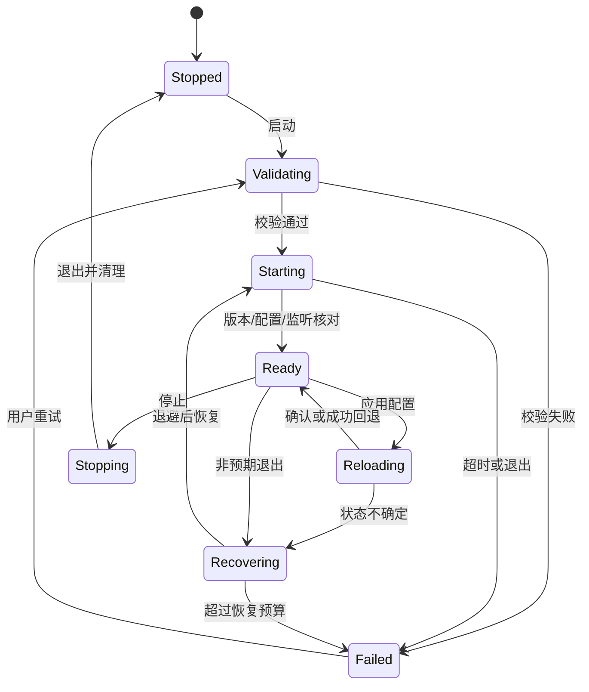

# 05 内核生命周期与控制 API

覆盖 F01，并为所有控制功能提供基础设施。接口表用于实现规划，必须对 P0 锁定的 Mihomo 版本建立契约测试；未列出的版本不能默认兼容。

## 1. 职责与边界

CoreSupervisor 管理进程或服务会话；MihomoApiClient 管理认证、请求、WS 与解析；DesktopEngineSession 实现应用接口，协调两者。客户端只管理自己创建或通过服务正式接管的会话，首版不支持发现任意第三方内核后自动接管。

配置文件、控制器端口、工作目录、内核可执行路径均由受管资源解析得到。通过 QProcess 的参数列表启动，不将配置名称拼进 shell 命令。生产默认使用随安装包提供或已验证更新的内核；开发者自定义路径为后续显式功能。

## 2. 生命周期状态

UI 生命周期变化不驱动此状态机。停止优先级高于尚未提交的启动；非预期退出与用户主动停止分开。应用退出后不得因自动恢复又启动内核。

## 3. 启动流程

1. 获取会话变更许可，核对当前无本应用已有会话。
2. 读取已验证配置 artifact，确认路径、权限、端口和内核版本；运行配置测试。
3. 创建 epoch 与会话记录，生成高熵控制器 secret，准备回环控制器和受限文件。控制器绑定策略在锁定版本上验证；不可从订阅继承对外控制器监听。
4. 普通模式启动 QProcess；服务模式发送受限 startSession 请求。记录 PID、创建时间或平台可靠句柄、可执行身份和配置 revision，不能仅凭 PID 认领。
5. 异步读取 stdout/stderr，限速并限制单行/总缓冲；不得因管道不读取阻塞子进程。
6. 在截止时间内查询版本、运行配置摘要和监听器；确认是当前会话的认证端点且内核未退出。默认启动截止 10 秒作为起点，慢机器可调整。
7. 更新 Ready 后才申请系统代理；TUN 的路由/DNS 状态由对应平台核对。

端口探测不能完全消除 TOCTOU 竞争；真正绑定失败必须从内核退出/日志得到并向用户报告。API 可连不代表所有代理出站可用，Ready 只表达控制面和配置就绪。

## 4. 控制 API 适配表

| 目的 | 常见端点/方式 | 客户端处理 |
|---|---|---|
| 版本 | GET /version | 契约与能力核对 |
| 读取运行摘要 | GET /configs | 不视为完整原配置 |
| 热更新字段 | PATCH /configs | 仅契约确认可修改字段 |
| 重载配置 | PUT /configs | 请求体、force 与路径语义按锁定版本 |
| 代理与组 | GET /proxies | 解析类型、成员和当前选择 |
| 选择组成员 | PUT /proxies/{name} | name 是单一路径段编码 |
| 单项延迟测试 | GET /proxies/{name}/delay | URL、timeout 参数受策略限制 |
| 流量 | /traffic 流 | HTTP/WS 能力按版本适配 |
| 连接 | GET/WS /connections | 完整快照与间隔参数按版本核验 |
| 关闭连接 | DELETE /connections/{id} 或集合 | 单条与全部分别提供 |
| 日志 | /logs 流 | 级别、协议与字段按版本核验 |
| 规则 | GET /rules | 只读、有序 |
| 提供者 | /providers/proxies、/providers/rules | 查看、更新与健康接口逐项契约验证 |

默认不通过开放任意路径的方法暴露给 QML。内部请求用强类型命令；PATCH/PUT 支持的差异由能力映射决定。HTTP 状态成功仍需解析并核对语义。遇到 404/405 等先区分版本能力与认证/路径问题，不能无限重试。

控制请求绕过系统代理，避免自我依赖；只连接受管回环地址。HTTP 认证优先使用授权头；若特定 WS 实现仅支持 URL token，限定回环并在日志、诊断和错误中彻底清除。生产不得输出 secret 或完整认证 URL。

## 5. 请求与重连策略

起始超时：普通 GET 3 秒、普通变更 5 秒、延迟测试由用户策略上限控制、配置应用按事务阶段给出较长截止。每项配置均有上限，不允许无限等待。取消只表示客户端停止等待，不保证服务端操作没有发生。

幂等读取可在短退避后重试一次；选择、重载、关闭连接等命令响应丢失先核对实际状态。不能仅因网络超时就再次执行全局关闭连接。WS 重连采用带抖动的 1/2/4/8 秒至约 30 秒退避；无需求、用户停止或 epoch 改变立即取消。

会话心跳低频、可暂停或合并，优先利用进程退出事件。显示页面不会各自创建健康轮询。状态 stale 与内核停止分开：控制面断线不证明数据面已经停止。

## 6. 崩溃恢复

起始策略为 1/2/4 秒退避，60 秒内最多 3 次自动启动；持续失败进入 Failed，停止刷屏并给出日志。稳定运行一段时间后再重置计数。阈值在压力测试后冻结。

内核退出时，立即标记状态不可用并尝试撤回所拥有的系统代理；恢复成功后重新申请，而不是永久指向失效端口。恢复使用最后可用配置，不能反复启动刚刚失败的候选。

服务失联时先探测其会话状态。禁止在未确认服务内核已停止时再启动用户态内核占用相同端口或 TUN。无法判断时进入 Uncertain 并提供明确恢复操作。

## 7. 停止与所有权

仅对匹配会话身份的内核停止。先恢复系统代理，再请求服务停止或进程正常退出；超过截止可终止所拥有的进程，记录是否强制。Windows 等平台的父子生命周期可使用 Job Object 等机制，Linux/macOS 使用对应受控会话方案；不假定跨平台 QProcess 析构能满足所有清理需求。

旧 pid 文件不能作为强杀依据；PID 复用、服务升级、崩溃残留必须结合创建时间、句柄或服务会话 token 核对。

## 8. 验收与阶段

| 编号 | 测试 | 结果 |
|---|---|---|
| CORE-01 | 连点启动、窗口重建 | 仅一个 owned 会话 |
| CORE-02 | 无效配置/端口占用 | 不写系统代理，错误可定位 |
| CORE-03 | API 响应延迟后成功 | 核对状态，无重复变更 |
| CORE-04 | 内核连续崩溃 | 退避有限，回退配置，停止风暴 |
| CORE-05 | 服务失联 | 不重复启动；不确定状态可见 |
| CORE-06 | 大量 stderr | 无管道阻塞、缓冲有界 |
| CORE-07 | PID 被复用 | 不终止第三方进程 |
| CORE-08 | 旧 epoch 响应 | 不覆盖新会话状态 |

P0 冻结端点契约，P2 完成主要闭环，P3/P4 完成服务模式，P5 覆盖故障与版本升级。
