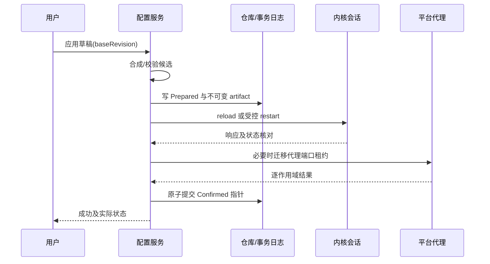

# 06 配置管理与事务应用

覆盖 F02。设计目标是保留用户原文、明确覆盖来源，并在错误、中断或崩溃后恢复到可识别状态。

## 1. 受管文件与页面

配置列表显示名称、来源、更新时间、是否当前、候选状态和错误；操作包括导入、复制、重命名、编辑、设为当前、回退和删除。删除当前配置必须先切换或停止内核，不能删除正在使用的唯一 artifact。

本地文件导入后复制到受管目录；外部文件变化不自动改变运行配置。导入 URL 走订阅设计。编辑原文与编辑覆盖项是两个入口，页面同时显示当前运行版本和草稿 baseRevision。

```text
profiles/<uuid>/source.yaml       原文，不由结构化保存重写
profiles/<uuid>/overlay.json      版本化用户覆盖
profiles/<uuid>/draft.yaml        可选草稿
runtime/<revision>/config.yaml   不可变的实际候选
runtime/<revision>/manifest.json 合成来源与摘要
transactions/<operationId>.json  配置应用日志
```

路径由程序生成。导入配置的 path、rule-provider、proxy-provider、证书等引用需要解析为受管资源或明确支持的外部资源；不能让配置任意写出数据目录。首版仅支持约定的资源布局，不能安全解析的路径给出具体错误，保留原文而不尝试猜测。

## 2. 合成顺序

RawProfile → 用户覆盖 → 平台覆盖 → 应用保留字段 → RuntimeConfig。每一步记录来源，提供“有效配置”和“来源差异”只读预览；包含秘密时预览默认遮蔽，复制/导出有明确提示。

| 类别 | 合并规则 |
|---|---|
| 普通 scalar | 后层显式值覆盖；未设置保持原值 |
| map | 递归合并已知结构；未知字段按透传策略保留 |
| 一般 sequence | 默认整体替换，不盲目按名称合并 |
| rules | 显式 prepend/append/replace 三种操作；顺序固定 |
| proxies/proxy-groups | 首版整体替换或不覆盖；复杂逐项补丁后续再做 |
| 删除字段 | 使用显式 remove 操作；区分 null 与未设置 |

应用保留字段包括受管控制器地址、secret、管理路径及必要端口约束。来自订阅的危险/冲突保留项不静默启用，界面列出被覆盖字段及原因。TUN、系统代理是应用状态；系统代理不写进 Mihomo YAML，TUN 通过有效配置表达。

用户修改 YAML 的注释、锚点和格式不保证经过结构化解析后往返保留，所以原文独立保存。应用产生的 runtime YAML 可以规范化，但不能覆盖 source.yaml。解析器须拒绝多文档歧义、非法标签和重复关键键，限制别名扩展、深度和总大小。

## 3. 校验流水线

1. 输入限额与编码检查；默认 UTF-8，其他编码明确转换并保留源备份。
2. YAML 解析与安全限额。
3. 结构检查：必须字段、类型、端口范围、组成员引用、循环/不存在引用。
4. 平台检查：TUN 能力、受管资源路径、监听器冲突、保留字段。
5. 合成有效配置并写临时 artifact。
6. 使用目标版本内核执行配置测试，工作目录与正式运行一致；测试可能涉及资源访问，应受截止时间和文件范围约束。
7. 展示差异、预计热重载/重启和可能中断，再进入应用。

内核测试通过不是出站可用保证。校验错误映射原文行列与覆盖层位置；无法映射的指出“合成配置第 N 行”，不能误指用户原文。默认大小可从 16 MiB 原文和有限深度起步，在真实大规则配置上验证后冻结，可配置合理上限。

## 4. 应用事务



事务日志阶段：Prepared、CoreApplying、CoreConfirmed、PlatformApplying、Committed，失败进入 Compensating、RolledBack 或 RecoveryRequired。日志在对应不可逆外部操作前更新，并使用原子写和必要的持久化同步。跨文件、进程和系统设置不存在单一原子事务，必须依靠补偿与恢复收敛。

用户确认前可取消；校验中取消结果作废；应用过程中取消只能在安全边界转入恢复，不能直接删临时文件并声称已撤销。

### 4.1 热重载与重启

只对锁定版本确认支持的变更热重载。控制器地址/secret、核心运行容器、服务模式、部分监听器/TUN 改动默认走受控重启，除非契约测试证明安全。其余字段由适配器提供 requiresRestart 判定。

重启流程先暂时撤回旧系统代理，停止旧会话，启动新配置，确认后应用新代理租约；其间可能短暂直连或不可用，产品明确提示。首版不提供无中断切换保证。热重载也不保证现有连接全部保留。

### 4.2 确认与回退

确认依据包括请求成功、API 版本/摘要、关键监听器及已知状态。不能仅用“请求发出”更新当前配置。API 无法证明完整 hash 时以受控提交记录为准；响应丢失进入待核对，必要时重新加载确定版本。

候选失败：保留失败 artifact 与脱敏错误 → 尝试恢复最后可用配置 → 重新核对关键状态 → 恢复旧代理租约。若回退失败，停止代理意图、撤回拥有的系统代理，标记 RecoveryRequired，禁止循环自动切换。

最后可用只在整笔事务确认后推进。下载成功、YAML 通过、内核暂时起来均不单独更新该指针。

## 5. 崩溃后的恢复表

| 日志阶段 | 下次启动 |
|---|---|
| Prepared | 候选尚未作用于内核，删除或保留草稿；使用旧确认版本 |
| CoreApplying | 状态不确定；识别 owned 会话，受控收敛到旧确认版本 |
| CoreConfirmed | 仍需核对平台代理；未提交前默认恢复旧版本 |
| PlatformApplying | 检查逐作用域租约，只恢复仍属于本应用的变更 |
| Committed | 使用新确认版本，清理过期事务 |
| Compensating/RecoveryRequired | 不自动推进候选；执行恢复向导或安全停止 |

多文件提交采用先写不可变 artifact，再原子替换单一 manifest 指针。manifest 持有 activeRevision、lastGoodRevision 和引用集合；旧 artifact 在无引用且超出保留策略后清理。不能靠多个 JSON 恰巧写完来假定原子性。

## 6. 编辑冲突与版本保留

草稿携带 baseRevision 和 sourceHash。订阅更新或其他窗口操作改变基线时，编辑保存返回冲突，提供查看差异、另存副本或重新基于最新内容编辑；首版不自动三方合并 YAML。

默认保留最近 5 个确认版本和当前事务引用版本，另设总容量上限。清理前保留至少一个可用版本；空间不足导致新配置无法落盘时不破坏旧配置。

## 7. 验收与阶段

CFG-01 错误 YAML 不替换当前配置；CFG-02 同名组/无效引用定位明确；CFG-03 校验时 UI 可交互；CFG-04 任意事务阶段强杀后恢复确定版本；CFG-05 磁盘满不损坏 manifest；CFG-06 草稿冲突不覆盖新订阅；CFG-07 回退失败停止并撤回代理；CFG-08 端口变化后代理设置与真实监听一致；CFG-09 原文注释不因查看有效配置丢失。

P2 完成导入、合成、事务；P3 完成编辑和回退 UI；P5 执行所有中断注入。
