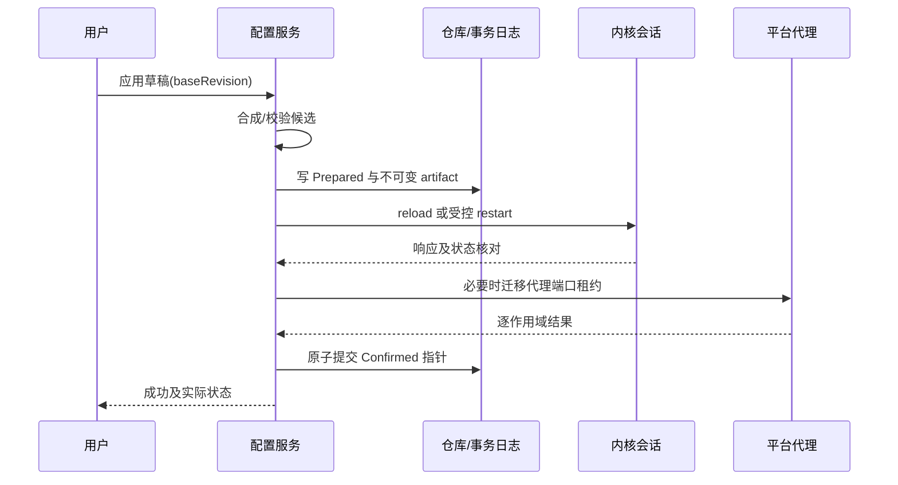

# 06 配置管理与事务应用

覆盖 F02。设计目标是保留用户原文、明确覆盖来源，并在错误、中断或崩溃后恢复到可识别状态。

## 1. 受管文件与页面

配置列表显示名称、来源、更新时间、下次所选/当前运行、候选状态和错误；操作包括导入、复制、重命名、编辑、设为当前、回退和删除，按 01 分期。MVP 的最小管理见 07/4.1。删除当前配置必须先切换或停止内核，不能删除正在使用的唯一 artifact。

本地文件导入后复制到受管目录；外部文件变化不自动改变运行配置。导入 URL 走订阅设计。编辑原文与编辑覆盖项是两个入口，页面同时显示当前运行版本和草稿 baseRevision。

```text
profiles/<uuid>/source.yaml       原文，不由结构化保存重写
profiles/<uuid>/overlay.json      版本化用户覆盖
profiles/<uuid>/draft.yaml        可选草稿
runtime/current.json             唯一可变配置 manifest，选择/确认/资源/偏好指针
runtime/<revision>/config.yaml   不可变语义模板，不直接执行
runtime/<revision>/manifest.json 不可变合成来源、偏好/资源引用与语义摘要
sessions/<epoch>/<revision>/config.yaml 注入本次 secret 的真实内核配置，受限且不导出
transactions/<operationId>.json  配置应用日志
```

路径由程序生成。导入配置的 path、rule-provider、proxy-provider、证书等引用需要解析为受管资源或明确支持的外部资源；不能让配置任意写出数据目录。首版仅支持约定的资源布局，不能安全解析的路径给出具体错误，保留原文而不尝试猜测。

## 2. 合成顺序

RawProfile → 按 profile 保存的用户覆盖 → 全局 RuntimePreferences（mode/TUN/监听器）→ 平台约束 → 应用保留字段 → RuntimeConfig。每一步记录来源，提供“有效配置”和“来源差异”只读预览；包含秘密时预览默认遮蔽，复制/导出有明确提示。全局偏好在首次使用时初始化为 rule、TUN 关闭、应用受管回环监听器；以后切换订阅不自动继承订阅中的 TUN 或监听地址。

| 类别 | 合并规则 |
|---|---|
| 普通 scalar | 后层显式值覆盖；未设置保持原值 |
| map | 递归合并已知结构；普通模式未知字段经风险分类后透传，服务模式仅允许版本化白名单 |
| 一般 sequence | 默认整体替换，不盲目按名称合并 |
| rules | 显式 prepend/append/replace 三种操作；顺序固定 |
| proxies/proxy-groups | 首版整体替换或不覆盖；复杂逐项补丁后续再做 |
| 删除字段 | 使用显式 remove 操作；区分 null 与未设置 |

应用保留字段包括受管控制器地址、secret、管理路径及必要端口约束。来自订阅的危险/冲突保留项不静默启用，界面列出被覆盖字段及原因。TUN、系统代理是应用状态；系统代理不写进 Mihomo YAML，TUN 通过有效配置表达。

受管监听器默认只绑定回环，订阅的 allow-lan/bind-address 和额外 listeners 不得静默扩大暴露面；局域网共享为后续显式能力。controller、external-ui 的下载/路径、资源路径、证书、DNS/listeners、TUN/路由、嗅探/进程查找和可能改变宿主资源的字段分别列入版本化配置策略。服务独立执行白名单、值域、路径和资源校验，未知高权限字段明确拒绝，不由普通模式的未知字段透传规则放行。

用户修改 YAML 的注释、锚点和格式不保证经过结构化解析后往返保留，所以原文独立保存。应用产生的 runtime YAML 可以规范化，但不能覆盖 source.yaml。解析器须拒绝多文档歧义、非法标签和重复关键键，限制别名扩展、深度和总大小。

## 3. 校验流水线

1. 输入限额与编码检查；默认 UTF-8，其他编码明确转换并保留源备份。
2. YAML 解析与安全限额。
3. 结构检查：必须字段、类型、端口范围、组成员引用、循环/不存在引用。
4. 平台检查：TUN 能力、受管资源路径、监听器冲突、保留字段。
5. 合成有效语义配置并写临时 artifact，不把每次 epoch 的 secret 纳入不可变语义摘要。
6. 使用目标版本内核执行配置测试，在隔离 staging 中物化带临时认证的会话配置并复刻正式资源布局；不可变资源只读映射，可能写入的缓存/数据库使用独立副本。测试限时，不能修改当前 provider/Geo/缓存，也不能产生正式 TUN/路由变更；锁定版本核验测试模式副作用。服务配置测试在服务校验后按相同隔离策略执行。
7. 展示差异、预计热重载/重启和可能中断，再进入应用。

内核测试通过不是出站可用保证。校验错误映射原文行列与覆盖层位置；无法映射的指出“合成配置第 N 行”，不能误指用户原文。默认大小可从 16 MiB 原文和有限深度起步，在真实大规则配置上验证后冻结，可配置合理上限。

端口预检区分本应用当前 owned 监听器与第三方占用：运行中应用相同端口不得因自己的内核占用而误拒绝；校验命令不得实际占用正式监听/TUN。受控重启释放旧端口后仍可能被他人抢占，最终以启动绑定和所有权核对判定并按事务补偿。

## 4. 应用事务

### 4.0 停机选择、首次启动与运行应用

“使用此配置”必须按当前运行状态处理，不能把校验通过视为运行成功：

| 场景 | 持久化与运行结果 |
|---|---|
| 首次导入并校验 | 保存候选，用户选择后原子提交 ConfigSelection；activeRevision/lastGoodRevision 仍为空，页面显示“已选择，未启动” |
| 停机切换配置或修改模式/端口 | 合成并校验新候选，原子更新 ConfigSelection 及其偏好/资源引用；旧确认快照不变，不申请系统代理 |
| 启动所选版本 | 读取同一 selectionGeneration，完成下述运行事务后才更新 activeRevision/lastGoodRevision；成功后 selectedRevision 与其一致 |
| 运行中切换或应用新候选 | 不先改 selectedRevision；在同一运行事务成功时一起提交选择、确认版本及偏好；失败保留原选择和原运行状态 |
| 正常停止 | 保留选择和确认历史；EngineStatus 变为 Stopped，首页不得仅因 activeRevision 非空显示运行中 |

从 Stopped 启动失败时清理本次 owned 进程及本次租约，回到 Stopped/Failed，保留候选错误。首次使用没有旧版本时回退目标就是“无内核、无本应用租约”，不解引用空 lastGoodRevision；有历史时提供“改用上次可用版本并启动”，不悄悄运行另一订阅。运行中应用失败则自动补偿到事务开始时的已确认旧版本；自动崩溃恢复只使用该会话最后确认版本。选中提交与运行提交共享 manifest 单写者，但分别记录操作类型、generation 和结果。

停机偏好来自 selectedPreferenceSnapshotRef，运行时偏好来自确认 preferenceSnapshotRef；两者不一致时 UI 明示“下次启动生效”。revision 绑定合成时的偏好和资源，启动不临时拼接另一份 settings。来源改变生成新候选，旧已确认 artifact 保留；新内容必须重新合成/校验，不因换 URL 就删掉旧可用版本。

同一 revision 可在不同 epoch 启动，语义摘要不变，会话认证和物化文件摘要不同；会话记录关联二者。会话文件每个 revision 写一次并限制当前用户/服务权限，重载指向新文件；退出/恢复完成后清理不再使用的秘密文件，保留脱敏来源与结果。实际内核配置的预览默认遮蔽认证；诊断/普通导出不复制 sessions。



事务日志阶段：Prepared、CoreApplying、CoreConfirmed、PlatformApplying、Committed，失败进入 Compensating、RolledBack 或 RecoveryRequired。日志在对应不可逆外部操作前更新，并使用原子写和必要的持久化同步。跨文件、进程和系统设置不存在单一原子事务，必须依靠补偿与恢复收敛。

用户确认前可取消；校验中取消结果作废；应用过程中取消只能在安全边界转入恢复，不能直接删临时文件并声称已撤销。

### 4.1 热重载与重启

只对锁定版本确认支持的变更热重载。控制器地址/secret、核心运行容器、服务模式、部分监听器/TUN 改动默认走受控重启，除非契约测试证明安全。其余字段由适配器提供 requiresRestart 判定。

重启流程先暂时撤回旧系统代理，停止旧会话，启动新配置，确认后应用新代理租约；其间可能短暂直连或不可用，产品明确提示。首版不提供无中断切换保证。热重载也不保证现有连接全部保留。

### 4.2 确认与回退

确认依据包括请求成功、API 版本/摘要、关键监听器及已知状态。不能仅用“请求发出”更新当前配置。API 无法证明完整 hash 时以受控提交记录为准；响应丢失进入待核对，必要时重新加载确定版本。

运行中候选失败：保留失败 artifact 与脱敏错误 → 尝试恢复事务开始时的确认配置 → 重新核对关键状态 → 恢复旧代理租约。若回退失败，停止代理意图、撤回拥有的系统代理，标记 RecoveryRequired，禁止循环自动切换。首次/停机启动失败按 4.0 清理，不强行恢复不存在的会话。

最后可用只在整笔事务确认后推进。下载成功、YAML 通过、内核暂时起来均不单独更新该指针。

## 5. 崩溃后的恢复表

| 日志阶段 | 下次启动 |
|---|---|
| Prepared | 候选尚未作用于内核，保留原选择；按事务前运行/停止状态恢复 |
| CoreApplying | 状态不确定；识别 owned 会话，有旧运行会话则收敛到旧确认版本，否则停止本次会话 |
| CoreConfirmed | 仍需核对平台代理；未提交前默认恢复事务前运行/停止状态 |
| PlatformApplying | 检查逐作用域租约，只恢复仍属于本应用的变更 |
| Committed | 保留新确认版本并清理过期事务；进程是否运行仍须探测，不能仅凭此标记自动启动 |
| Compensating/RecoveryRequired | 不自动推进候选；执行恢复向导或安全停止 |

多文件提交采用先写不可变 artifact，再原子替换单一 manifest 指针。manifest 持有 manifestGeneration、committedOperationId、ConfigSelection、可空 activeRevision/lastGoodRevision、确认 preferenceSnapshotRef/resourceManifestRef、leaseGeneration 和引用集合；它是配置/偏好提交的唯一权威。catalog 与 settings 中同类摘要是可重建投影，不允许另一个写者独立修改运行指针。

提交顺序：持久化候选及 Prepared → 每次外部动作前持久化意图日志 → 核对内核与平台代理 → 原子替换并按平台同步 manifest → 更新事务日志 Committed。恢复必须先读 manifest：若 committedOperationId 与目标 revision 匹配，按新版本核对并补记日志，不因日志仍为 PlatformApplying 回滚；若未提交，依据旧确认版本补偿内核、偏好和租约。日志声称 Committed 但 manifest 不匹配、引用/摘要损坏时进入 RecoveryRequired，不猜测提交成功。

同一 manifest 的下一次选择/运行提交必须等待前一次日志已终结或已按 manifest 补记；不得让后续提交覆盖 committedOperationId 后再用它判断旧未完成日志。日志带 base/target manifestGeneration，已终结历史日志只用于审计，不与当前 manifest 的最后 operationId 强行相等。提交已成功而补记失败时冻结新变更，允许只读/停止/恢复，先完成核对再继续。

恢复表适用于 manifest 尚未提交该操作的情况。日志包含 operationKind、previousSelection、previousConfirmedRevision、hadRunningSession 与本次 lease 引用；首次/停机启动未提交时恢复为停止，而不是凭历史 activeRevision 自动启动。PlatformApplying 必须同时核对内核 revision、候选端口和逐作用域租约，恢复事务前的运行或停止状态，不能只恢复系统代理。旧 artifact 在无引用且超出保留策略后清理。必须注入 manifest 替换前后、日志更新前后和服务确认响应丢失等故障窗口。

### 5.1 资源与回滚范围

每个运行版本引用 ManagedResource 清单：resourceId、kind、sourceIdentity、contentHash、managedRef、writer、mutable、generation 与保留引用。应用管理的证书/静态规则/Geo 版本按内容保存，回退恢复其引用；MVP 允许内嵌节点和规则，无需先完成所有外部资源格式。不能安全受管化的引用明确拒绝。

内核管理的动态 provider 使用独立受管可写目录及最后可用缓存，唯一写者为内核；回滚恢复配置与资源身份，不承诺重现远端历史内容。远端不可用且无有效缓存时保留错误并回退可启动的配置，不能把缺失资源称为回滚成功。资源清理保留当前/最后可用版本和未完成事务引用，Geo 与 provider 的更新责任见 07。

## 6. 编辑冲突与版本保留

草稿携带 baseRevision 和 sourceHash。订阅更新或其他窗口操作改变基线时，编辑保存返回冲突，提供查看差异、另存副本或重新基于最新内容编辑；首版不自动三方合并 YAML。

默认保留最近 5 个确认版本和当前事务引用版本，另设总容量上限。清理前保留至少一个可用版本；空间不足导致新配置无法落盘时不破坏旧配置。

## 7. 验收与阶段

CFG-01 错误 YAML 不替换当前配置；CFG-02 同名组/无效引用定位明确；CFG-03 校验时 UI 可交互；CFG-04 任意事务阶段强杀后恢复确定版本；CFG-05 磁盘满不损坏 manifest；CFG-06 草稿冲突不覆盖新订阅；CFG-07 回退失败停止并撤回代理；CFG-08 端口变化后代理设置与真实监听一致；CFG-09 原文注释不因查看有效配置丢失；CFG-10 manifest/日志写入间隙恢复判定一致；CFG-11 校验不改运行资源，缺缓存不冒称回滚成功；CFG-12 模式/TUN/端口落盘失败补偿并核对实际值。

P2 完成导入、合成、停机选择/首次启动/运行切换事务，并覆盖首次失败、manifest 提交前后中断、磁盘失败和端口迁移；P3 完成编辑和完整回退 UI；P5 扩展全部故障窗口与长稳回归。MVP-09—12 补充停机/重启与首次失败验收。

Windows P2 对配置、模式和监听端口统一使用受控重启事务；热重载适配能力保留，后续再启用。Ready 验证固定版本、受管监听器和模式后，逐组恢复可信身份的选择并读回，再应用系统代理并提交 manifest。有效配置预览读取已选择的不可变模板，遮蔽节点端点/凭据，不读取会话 secret；较大预览显示限额提示。系统代理恢复允许在新日志无法落盘时使用已有持久租约恢复仍精确匹配的值，记录日志未完成错误；不得因磁盘只读留下指向已停止内核的 owned 代理。
