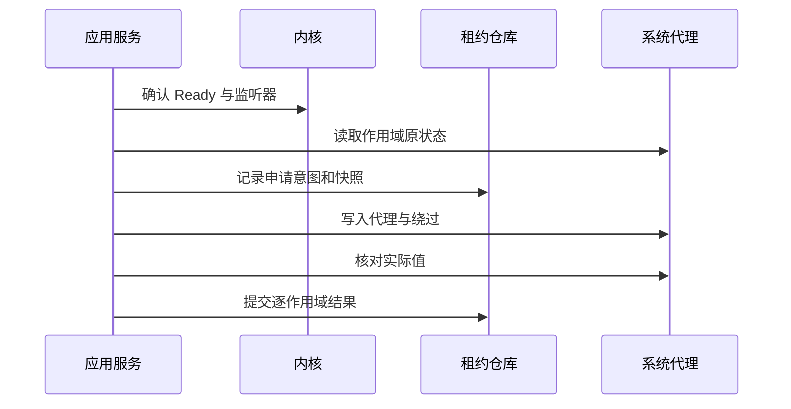

# 10 系统代理、TUN 与权限服务

覆盖 F09、F10。权限边界服务于桌面系统功能，GUI 正常以普通用户身份运行。系统代理和 TUN 独立显示，不能用一个开关隐藏两种机制的差异。

## 1. 系统代理语义

系统代理只影响遵从平台代理设置的应用；TUN 通过虚拟接口和路由接管流量，实际覆盖受平台、路由和内核配置影响。系统代理开启不意味着所有应用都被代理，TUN 开启也不等于不存在绕行。

首版系统代理支持明确的手动 HTTP/HTTPS 代理和绕过列表；SOCKS 的系统映射按平台能力提供，不能把 SOCKS 端口错误写作 HTTP 端口。PAC 原状态必须能保存/恢复，但首版不新增 PAC 服务器。

## 2. 代理租约模型

ProxyLease：leaseId、ownerSession、platform、scope、beforeSnapshot、appliedSnapshot、generation、createdAt、status。scope 在 Windows 可为目标用户设置，在 macOS 为网络服务集合，在 Linux 为桌面配置后端。

写入前持久化 beforeSnapshot 与预期 appliedSnapshot；写入后核对真实值并记录逐作用域结果。快照保存原始模式、地址、绕过、PAC/自动发现等被改字段，不能只保存一个 on/off。

释放时比较当前字段与本应用最后应用值：仍匹配则恢复 before；不匹配说明用户或其他软件修改，停止自动覆盖并提示冲突。平台代理 API 通常没有真正 compare-and-swap，读后写之间仍可能竞争；需最小化窗口、再次核对，并明确这是尽力的所有权保护。

## 3. 开启、关闭与部分失败

申请失败时对已成功且仍拥有的作用域补偿恢复；无法恢复则显示具体作用域与修复入口。关闭系统代理的含义是释放本应用租约，通常恢复此前用户状态，而不是无条件把系统设为直连。

监听端口变更先通过配置事务管理，再迁移租约；不能让系统代理长时间指向旧端口。外部软件修改时默认不自动抢回，可提供用户明确的重新应用操作。

## 4. 崩溃与会话租约

普通模式 GUI 被强杀后可能短期遗留系统代理；下次启动检查未完成租约，只对仍匹配 appliedSnapshot 的值恢复。提供独立恢复入口和平台手工操作说明。不能宣称无服务也能在进程死亡后立刻清理。

服务模式可用客户端会话租约与心跳，超时后先核对所有权，再撤回代理并停止该会话内核。心跳间隔/超时从 10 秒/60 秒起步并在休眠、负载和更新测试中修订；系统睡眠不误判为恶意断开，恢复后重新核对会话。

不为纯省 CPU 诉求强制引入服务守护；服务用于需要的权限与可靠会话清理。

## 5. TUN 状态与操作

TunState：Unsupported、Off、AuthorizationRequired、Enabling、On、Disabling、Failed、Uncertain。DesiredTun 与 ObservedTun 分开；On 至少需要内核确认配置、目标接口可用及平台可核对的关键路由/DNS状态。核对不意味着对所有流量给出绝对保证。

启用流程：检查平台能力与驱动/设备 → 生成候选配置 → 请求权限服务 → 如需服务模式迁移则安全停止普通会话 → 启动服务会话并应用 TUN → 核对 → 提交状态。服务授权被拒绝时保持旧工作模式，不让整个应用失效。

禁用先应用无 TUN 配置或停止对应会话，核对接口/路由清理。默认可继续以服务模式运行普通代理以避免额外切换；是否迁回用户态作为显式策略，不每次切开关就来回重启。

TUN 设置提供受支持栈、DNS、自动路由和绕过范围的基础选项；高级字段由 YAML 覆盖管理。具体字段与平台能力在锁定内核版本验证，不承诺所有平台支持全部组合。路由/DNS 由内核机制负责，服务不另行创建一套竞争配置。

## 6. 权限服务职责

服务仅支持固定协议：probeVersion、openSession、startCore、stopCore、querySession、applyApprovedConfig、closeSession、heartbeat。安装/升级/卸载走平台授权机制。禁止任意 shell、任意可执行文件和任意路径写入。

IPC 包含 protocolVersion、requestId、sessionId、action、受限 payload；验证报文长度、字段、状态和请求速率，拒绝未知指令。客户端操作与服务内核所有权绑定，不接受仅凭猜测 sessionId 的控制。

| 平台 | 通道 | 身份与权限 |
|---|---|---|
| Windows | 受限命名管道 | ACL、目标用户/会话、对端身份及安装目录校验 |
| Linux | system DBus 或受限 Unix socket | peer credentials、polkit action、包/安装策略 |
| macOS | XPC | audit token、代码签名要求、受支持授权安装方式 |

服务从受信安装目录启动经过验证的内核；更新文件先验证摘要/签名和写入权限。配置不直接引用用户可随时替换的路径，先复制到服务拥有的 staging，拒绝符号链接/重解析点，验证后原子发布。artifact 中引用资源同样受管。

首版服务约定单个活动本地用户会话拥有 TUN；多用户并发争抢返回 Busy 并指出已有会话，不能互相覆盖机器路由。后续多会话支持需独立设计。

## 7. 服务/客户端兼容与失败

握手比较协议主版本与能力；不兼容时禁用相关权限操作，提供升级服务，普通代理仍可使用。服务崩溃由系统服务管理器恢复，但不能未核对旧内核就再起一份。安装失败不自动降级为 root GUI。

日志只记操作与结果，不记录配置秘密。权限服务的配置大小、并发和启动次数有上限，避免普通客户端让高权限进程无限分配资源。

## 8. 验收与阶段

SYS-01 原有 PAC/绕过列表可恢复；SYS-02 第三方修改后释放不覆盖；SYS-03 多网络服务部分失败可补偿；SYS-04 内核未就绪不写代理；TUN-01 拒绝授权不破坏普通模式；TUN-02 快速开关串行；SVC-01 未授权 IPC 被拒绝；SVC-02 路径逃逸和链接替换被拒绝；SVC-03 客户端死亡有清理记录；SVC-04 协议不兼容不强行操作；SVC-05 多用户争用明确失败。

P3 完成主平台，P4 完成其他平台，P5 重点进行所有权、崩溃、权限和网络恢复测试。
