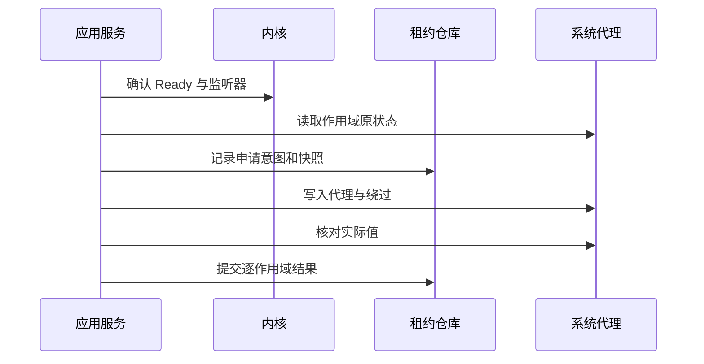

# 10 系统代理、TUN 与权限服务

覆盖 F09、F10。权限边界服务于桌面系统功能，GUI 正常以普通用户身份运行。系统代理和 TUN 独立显示，不能用一个开关隐藏两种机制的差异。

## 1. 系统代理语义

系统代理只影响遵从平台代理设置的应用；TUN 通过虚拟接口和路由接管流量，实际覆盖受平台、路由和内核配置影响。系统代理开启不意味着所有应用都被代理，TUN 开启也不等于不存在绕行。

首版系统代理支持明确的手动 HTTP/HTTPS 代理和绕过列表；SOCKS 的系统映射按平台能力提供，不能把 SOCKS 端口错误写作 HTTP 端口。PAC 原状态必须能保存/恢复，但首版不新增 PAC 服务器。

## 2. 代理租约模型

ProxyLease：leaseId、ownerSession、platform、scope、beforeSnapshot、appliedSnapshot、generation、createdAt、status。scope 在 Windows 可为目标用户设置，在 macOS 为网络服务集合，在 Linux 为桌面配置后端。

写入前持久化 beforeSnapshot 与预期 appliedSnapshot；写入后核对真实值并记录逐作用域结果。快照保存原始模式、地址、绕过、PAC/自动发现等被改字段，不能只保存一个 on/off。

释放时比较当前字段与本应用最后应用值：仍匹配则恢复 before；不匹配说明用户或其他软件修改，停止自动覆盖并提示冲突。平台代理 API 通常没有真正 compare-and-swap，读后写之间仍可能竞争；需最小化窗口、再次核对，并明确这是尽力的所有权保护。

## 3. 开启、关闭与部分失败

申请失败时对已成功且仍拥有的作用域补偿恢复；无法恢复则显示具体作用域与修复入口。关闭系统代理的含义是释放本应用租约，通常恢复此前用户状态，而不是无条件把系统设为直连。

监听端口变更先通过配置事务管理，再迁移租约；不能让系统代理长时间指向旧端口。外部软件修改时默认不自动抢回，可提供用户明确的重新应用操作。

同一 owner/scope/目标监听器的重复 acquire 为幂等：已匹配 appliedSnapshot 时返回原租约，不把本应用代理再存成 beforeSnapshot。端口迁移属于原租约的新 generation，保留最初 before；写新 applied 前记录意图，失败恢复事务前状态。当前值与 applied 不同则返回 Conflict；只有用户明确“重新应用”后才以当时外部设置为新 before 创建新租约，旧记录标为 Superseded，后续不能再恢复更早快照覆盖第三方设置。

MVP 的绕过列表默认仅为本机/本地名称（localhost、127.0.0.1、::1 及平台支持的本地名称项），由 Windows 适配器核验序列化和通知语义，不默认扩大为所有私网网段。租约启用手动代理期间暂停原 PAC/自动发现以避免路径歧义，关闭时恢复其原值。原状态、改动字段和冲突在恢复入口可查看；不会把“关闭系统代理”固定写成全局直连。

## 4. 崩溃与会话租约

普通模式 GUI 被强杀后可能短期遗留系统代理；下次启动检查未完成租约，只对仍匹配 appliedSnapshot 的值恢复。提供独立恢复入口和平台手工操作说明。不能宣称无服务也能在进程死亡后立刻清理。

服务模式以客户端会话租约与心跳管理 owned 内核；只有 ProxyRecoveryCapability=Verified 的平台/作用域才承诺 GUI 死亡后恢复系统代理。心跳间隔/超时从 10 秒/60 秒起步，睡眠期间暂停过期判定并在恢复后给予重新握手窗口；阈值在负载/更新测试后冻结。未验证代理恢复能力时仍安全停止 owned 内核/TUN，并明确可能遗留系统代理、下次启动恢复与手工入口，不把服务驻留等同于全部恢复已保证。

### 4.1 代理租约的可信移交

服务模式申请系统代理前，应用调用 acquireProxyLease，提交有界的目标作用域和受管监听器引用，不提交可随意恢复的 before 值。服务或经验证的当前用户恢复适配器读取真实 before、生成 applied、持久化受保护租约，再按本章第 3 节逐作用域写入/确认；queryProxyLease/releaseProxyLease 使用同一权威记录。leaseId 绑定认证用户、桌面会话、owned core、generation 和 operationId；GUI 的 data/leases 只保存引用与状态投影，不能指示服务恢复任意设置。

Windows 服务使用目标用户 token/配置作用域及正确通知路径；不能把 LocalSystem 的 HKCU 当作用户 HKCU。Linux 桌面 GSettings/KDE 属于用户会话，机器服务不能假设能访问会话 DBus；只有验证过的受限用户恢复组件可承接该作用域，否则标 NotAvailable 并采用下次启动恢复。macOS 按 SystemConfiguration 的受授权网络服务作用域核对。额外恢复组件计入 100 MB，不为宣称实时恢复强制引入。

服务启动先读自己的租约日志、探测进程身份和已应用值，再决定继续会话、补偿或清理；旧 GUI PID/session 不足以接管。用户注销、服务升级、休眠与心跳丢失逐项测试；超时先恢复已验证仍拥有的系统代理，再清理 owned 内核/TUN。无可用恢复能力时记录限制，不执行任意跨用户写入。

不为纯省 CPU 诉求强制引入服务守护；服务用于需要的权限与可靠会话清理。

## 5. TUN 状态与操作

TunState：Unsupported、Off、AuthorizationRequired、Enabling、On、Disabling、Failed、Uncertain。DesiredTun 与 ObservedTun 分开；On 至少需要内核确认配置、目标接口可用及平台可核对的关键路由/DNS状态。核对不意味着对所有流量给出绝对保证。

启用流程：检查平台能力与驱动/设备 → 生成候选配置 → 请求权限服务 → 如需服务模式迁移则安全停止普通会话 → 启动服务会话并应用 TUN → 核对 → 提交状态。服务授权被拒绝时保持旧工作模式，不让整个应用失效。

迁移候选、旧配置/偏好与代理租约引用进入同一会话事务。新服务会话失败后，先确认其内核和 TUN 已停止，再恢复旧用户态内核及租约；清理无法确认则 Uncertain，禁止立即启动另一内核。MVP 只要求系统代理入口，TUN 不作为订阅导入或首次启动的前置条件。

禁用先应用无 TUN 配置或停止对应会话，核对接口/路由清理。默认可继续以服务模式运行普通代理以避免额外切换；是否迁回用户态作为显式策略，不每次切开关就来回重启。

TUN 设置提供受支持栈、DNS、自动路由和绕过范围的基础选项；高级字段由 YAML 覆盖管理。具体字段与平台能力在锁定内核版本验证，不承诺所有平台支持全部组合。路由/DNS 由内核机制负责，服务不另行创建一套竞争配置。

## 6. 权限服务职责

服务仅支持版本化固定协议。会话类：probeVersion/openSession/startCore/stopCore/querySession/closeSession/heartbeat；配置类：applyApprovedConfig；受限控制类：selectProxy/testLatency/closeConnections/refreshProvider；遥测类：setTelemetryDemand/queryMetrics；代理租约类：acquireProxyLease/queryProxyLease/releaseProxyLease；更新类：stageCoreUpdate/activateCoreVersion。安装/服务升级/卸载走平台授权机制。startSession/stopSession 仅为 03 的应用门面，映射 open/start 和 stop/close，不是额外 IPC。

每个请求固定 payload schema：资源用受管逻辑引用，组/节点校验当前 revision，关闭连接校验 epoch 与目标集合，提供者仅操作当前配置声明资源；更新只接受项目签名发行描述符和受限传输，不接受任意可执行路径。模式/TUN 经 applyApprovedConfig，不新增任意 PATCH 转发。禁止 shell、任意程序、任意路径写入及通用 HTTP/WS 隧道。

IPC 包含 protocolVersion、requestId、sessionId、action、受限 payload；验证报文长度、字段、状态和请求速率，拒绝未知指令。客户端操作与服务内核所有权绑定，不接受仅凭猜测 sessionId 的控制。

变更请求携带 operationId、expectedRevision 和 generation；服务保留有界操作结果和未完成意图，同一会话 requestId 重放返回原操作/查询状态，不重复应用。服务重启后查询持久化意图和事实再恢复，客户端超时不能靠换 requestId 盲重试。对端 OS 身份、会话和授权与每次请求绑定，不能只在握手时检查。

| 平台 | 通道 | 身份与权限 |
|---|---|---|
| Windows | 受限命名管道 | ACL、目标用户/会话、对端身份及安装目录校验 |
| Linux | system DBus 或受限 Unix socket | peer credentials、polkit action、包/安装策略 |
| macOS | XPC | audit token、代码签名要求、受支持授权安装方式 |

服务从受信安装目录启动经过验证的内核；更新文件先验证摘要/签名和写入权限。配置不直接引用用户可随时替换的路径，先复制到服务拥有的 staging，拒绝符号链接/重解析点，验证后原子发布。artifact 中引用资源同样受管。

服务独占高权限内核 controller 的 secret 和 OS 受限本地端点，GUI 只能收到裁剪后的状态/数据。服务重新合成受管字段并执行版本化字段白名单和值域；订阅对 controller/附加监听、external-ui 下载、证书/路径、资源写入、TUN/路由等字段不能绕过检查，未知字段拒绝并定位原因。仅“复制到 staging”不构成配置安全。字段策略/端点 ACL 在锁定官方内核上核验；无法强制隔离时禁用该平台服务模式，保留普通代理。

首版服务约定单个活动本地用户会话拥有 TUN；多用户并发争抢返回 Busy 并指出已有会话，不能互相覆盖机器路由。后续多会话支持需独立设计。

## 7. 服务/客户端兼容与失败

握手比较协议主版本与能力；不兼容时禁用相关权限操作，提供升级服务，普通代理仍可使用。服务崩溃由系统服务管理器恢复，但不能未核对旧内核就再起一份。安装失败不自动降级为 root GUI。

日志只记操作与结果，不记录配置秘密。权限服务的配置大小、并发和启动次数有上限，避免普通客户端让高权限进程无限分配资源。

## 8. 验收与阶段

SYS-01 原有 PAC/绕过列表可恢复；SYS-02 第三方修改后释放不覆盖；SYS-03 多网络服务部分失败可补偿；SYS-04 内核未就绪不写代理；SYS-05 可信租约移交/服务重启与用户身份正确，未验证恢复能力明确降级。TUN-01 拒绝授权不破坏普通模式；TUN-02 快速开关串行；TUN-03 迁移失败清理后恢复或 Uncertain，无双内核。SVC-01 未授权 IPC 被拒绝；SVC-02 路径逃逸和链接替换被拒绝；SVC-03 客户端死亡有清理及能力限制记录；SVC-04 协议不兼容不强行操作；SVC-05 多用户争用明确失败；SVC-06 GUI 无法绕过服务直连高权限配置 API，未知危险字段被拒；SVC-07 IPC 重放与响应丢失不重复变更。

P2 完成主平台普通模式系统代理与租约基础，P3 完成主平台 TUN/权限服务及可信租约移交，P4 完成其他平台，P5 重点进行所有权、崩溃、权限和网络恢复测试。
