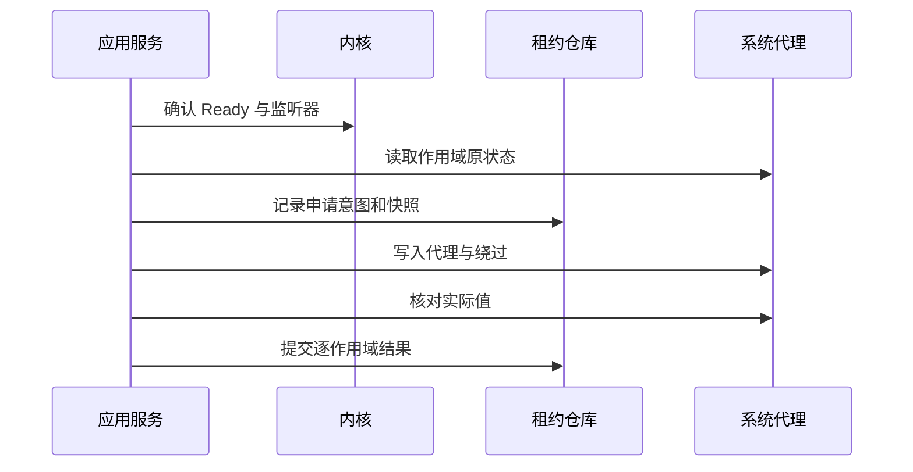

# 10 系统代理、TUN 与权限服务

覆盖 F09、F10。权限边界服务于桌面系统功能，GUI 正常以普通用户身份运行。系统代理和 TUN 独立显示，不能用一个开关隐藏两种机制的差异。

## 1. 系统代理语义

系统代理只影响遵从平台代理设置的应用；TUN 通过虚拟接口和路由接管流量，实际覆盖受平台、路由和内核配置影响。系统代理开启不意味着所有应用都被代理，TUN 开启也不等于不存在绕行。

首版系统代理支持明确的手动 HTTP/HTTPS 代理和绕过列表；SOCKS 的系统映射按平台能力提供，不能把 SOCKS 端口错误写作 HTTP 端口。PAC 原状态必须能保存/恢复，但首版不新增 PAC 服务器。

## 2. 代理租约模型

ProxyLease：leaseId、ownerSession、platform、scope、beforeSnapshot、appliedSnapshot、generation、createdAt、status。scope 在 Windows 可为目标用户设置，在 macOS 为网络服务集合，在 Linux 为桌面配置后端。

写入前持久化 beforeSnapshot 与预期 appliedSnapshot；写入后核对真实值并记录逐作用域结果。快照保存原始模式、地址、绕过、PAC/自动发现等被改字段，不能只保存一个 on/off。

释放时比较当前字段与本应用最后应用值：仍匹配则恢复 before；不匹配说明用户或其他软件修改，停止自动覆盖并提示冲突。平台代理 API 通常没有真正 compare-and-swap，读后写之间仍可能竞争；需最小化窗口、再次核对，并明确这是尽力的所有权保护。

## 3. 开启、关闭与部分失败

申请失败时对已成功且仍拥有的作用域补偿恢复；无法恢复则显示具体作用域与修复入口。关闭系统代理的含义是释放本应用租约，通常恢复此前用户状态，而不是无条件把系统设为直连。

监听端口变更先通过配置事务管理，再迁移租约；不能让系统代理长时间指向旧端口。外部软件修改时默认不自动抢回；用户显式开启系统代理（开关或重新应用入口）即视为明确授权，以当时外部值为新 before 重建租约基线，不再失败关闭并要求寻找隐藏入口。损坏的租约文件仍要求手工修复，不自动基线化。

同一 owner/scope/目标监听器的重复 acquire 为幂等：已匹配 appliedSnapshot 时返回原租约，不把本应用代理再存成 beforeSnapshot。端口迁移属于原租约的新 generation，保留最初 before；写新 applied 前记录意图，失败恢复事务前状态。当前值与 applied 不同则返回 Conflict；只有用户明确“重新应用”后才以当时外部设置为新 before 创建新租约，旧记录标为 Superseded，后续不能再恢复更早快照覆盖第三方设置。

MVP 的绕过列表默认仅为本机/本地名称（localhost、127.0.0.1、::1 及平台支持的本地名称项），由 Windows 适配器核验序列化和通知语义，不默认扩大为所有私网网段。租约启用手动代理期间暂停原 PAC/自动发现以避免路径歧义，关闭时恢复其原值。原状态、改动字段和冲突在恢复入口可查看；不会把“关闭系统代理”固定写成全局直连。

## 4. 崩溃与会话租约

普通模式 GUI 被强杀后可能短期遗留系统代理；下次启动检查未完成租约，只对仍匹配 appliedSnapshot 的值恢复。提供独立恢复入口和平台手工操作说明。不能宣称无服务也能在进程死亡后立刻清理。

服务模式以客户端会话租约与心跳管理 owned 内核；只有 ProxyRecoveryCapability=Verified 的平台/作用域才承诺 GUI 死亡后恢复系统代理。心跳间隔/超时从 10 秒/60 秒起步，睡眠期间暂停过期判定并在恢复后给予重新握手窗口；阈值在负载/更新测试后冻结。未验证代理恢复能力时仍安全停止 owned 内核/TUN，并明确可能遗留系统代理、下次启动恢复与手工入口，不把服务驻留等同于全部恢复已保证。

### 4.1 代理租约的可信移交

服务模式申请系统代理前，应用调用 acquireProxyLease，提交有界的目标作用域和受管监听器引用，不提交可随意恢复的 before 值。服务或经验证的当前用户恢复适配器读取真实 before、生成 applied、持久化受保护租约，再按本章第 3 节逐作用域写入/确认；queryProxyLease/releaseProxyLease 使用同一权威记录。leaseId 绑定认证用户、桌面会话、owned core、generation 和 operationId；GUI 的 data/leases 只保存引用与状态投影，不能指示服务恢复任意设置。

Windows 服务使用目标用户 token/配置作用域及正确通知路径；不能把 LocalSystem 的 HKCU 当作用户 HKCU。Linux 桌面 GSettings/KDE 属于用户会话，机器服务不能假设能访问会话 DBus；只有验证过的受限用户恢复组件可承接该作用域，否则标 NotAvailable 并采用下次启动恢复。macOS 按 SystemConfiguration 的受授权网络服务作用域核对。额外恢复组件计入客户端资源统计，不为宣称实时恢复强制引入。

服务启动先读自己的租约日志、探测进程身份和已应用值，再决定继续会话、补偿或清理；旧 GUI PID/session 不足以接管。用户注销、服务升级、休眠与心跳丢失逐项测试；超时先恢复已验证仍拥有的系统代理，再清理 owned 内核/TUN。无可用恢复能力时记录限制，不执行任意跨用户写入。

不为纯省 CPU 诉求强制引入服务守护；服务用于需要的权限与可靠会话清理。

## 5. TUN 状态与操作

TunState：Unsupported、Off、AuthorizationRequired、Enabling、On、Missing、Unknown、Disabling、Blocked、Failed、Uncertain。DesiredTun 与 ObservedTun 分开；On 至少需要内核确认配置、目标接口可用及平台可核对的关键路由/DNS状态。Missing 表示内核仍健康但目标接口当前不可见，Unknown 表示网络枚举或状态请求无法完成；两者都不证明内核退出。Blocked 表示连续短时 TUN 失败后自动重开暂停、普通代理继续。核对不意味着对所有流量给出绝对保证。

启用流程：检查平台能力与驱动/设备 → 生成候选配置 → 请求权限服务 → 如需服务模式迁移则安全停止普通会话 → 启动服务会话并应用 TUN → 核对 → 提交状态。服务授权被拒绝时保持旧工作模式，不让整个应用失效。

迁移候选、旧配置/偏好与代理租约引用进入同一会话事务。新服务会话失败后，先确认其内核和 TUN 已停止，再恢复旧用户态内核及租约；清理无法确认则 Uncertain，禁止立即启动另一内核。MVP 只要求系统代理入口，TUN 不作为订阅导入或首次启动的前置条件。

禁用先应用无 TUN 配置或停止对应会话，核对接口/路由清理。默认可继续以服务模式运行普通代理以避免额外切换；是否迁回用户态作为显式策略，不每次切开关就来回重启。

TUN 设置提供受支持栈、DNS、自动路由和绕过范围的基础选项；高级字段由 YAML 覆盖管理。具体字段与平台能力在锁定内核版本验证，不承诺所有平台支持全部组合。路由/DNS 由内核机制负责，服务不另行创建一套竞争配置。

### 5.1 Windows接口命名、身份与冲突

服务生成安装专属标识，在受保护的服务数据目录保存稳定设备名`QuickClash-xxxxxxxx`。每次启动枚举包括未启用接口在内的名称；未知同名接口保持原样，在最多16个候选中避让并保存新名称。不按名称删除、禁用、接管其他接口，也不将“存在任意虚拟网卡”当作冲突。客户端不提交设备名，订阅不能覆盖它。

持久接口只有与服务保存的GUID/LUID及名称全部一致、接口Down且路由/DNS已清理时才可复用原名；未知同名、身份变化或残留未清不能复用。成功观测后的身份单独保存在安装记录中，会话清理不丢失可验证的稳定名称关联。

名称只用于创建和发现候选，不是所有权证明。服务在启动前保存创建意图/epoch/时间，关联owned核心PID，保存创建前接口快照；就绪时要求认证控制器读回设备名、受管核心监听、本次新出现的GUID/LUID或上述已验证干净的自有持久接口、接口Up、IPv4默认路由或成对/1路由及DNS服务器观测。持久化GUID/LUID后持续按身份核对；当前进程的句柄/Job提供PID生命周期约束。服务崩溃后只依据受保护日志核对残留，不凭旧PID接管。

`Meta`、`QuickClash`或任何友好名称都不能直接证明属于本应用，进程名`mihomo`/`clash`也不能证明归属。其他Clash Meta客户端同样作为第三方处理；只按实际端口绑定及接口/路由冲突判断，绝不停止未知进程或改动其网卡。

名称冲突与路由冲突分别处理。在停止普通会话前，通过固定IPC预检当前网络；启动校验完成、创建TUN之前再次核对。其他Up的非硬件/非loopback接口持有IPv4/IPv6默认或/1广域路由时，返回明确冲突，提示用户关闭对应VPN/TUN后重试；只有局部路由的WSL/Hyper-V/分流VPN不因此被拒绝。DNS同时作为接口观测和残留清理条件；未从DNS地址臆测第三方所有者。预检是瞬时快照，不能消除其他软件同时切换网络的竞争。

新建自有网卡只解决接口名称冲突，不解决全局默认路由冲突。Windows可以同时存在多张虚拟网卡，但IPv4/IPv6默认路由按metric选出实际承载全局流量的下一跳，两个全隧道TUN不能同时拥有默认流量。服务因此不通过更低metric抢占第三方默认路由，也不把“已创建自己的网卡”当作可以与另一全隧道TUN并存；只有局部路由的分流VPN可以与QuickClash TUN共存。

停止先终止本会话Job，再按记录的GUID/LUID检查接口未Up、广域路由与DNS已清理；接口消失也可确认清理。成功后删除会话日志。创建意图尚无GUID但同名接口仍存在、GUID/LUID不一致、网络枚举/日志写入失败或路由/DNS仍残留均保留Uncertain，禁止第二会话，绝不以删除未知接口强行恢复。服务保持IPC诊断/重试入口。安装升级保留稳定名称与日志。固定IPC能力标识必须匹配，旧服务需从同包更新；错误详情只允许固定端口/角色字段。

### 5.2 服务状态观测与诊断

服务周期 status 返回 ready、tunState 和兼容布尔 tun。客户端只把明确 ready=false 视为 owned 内核退出；请求超时、IPC 错误或缺少响应对象一律视为 Unknown，不得停止内核或报告 CoreExited。tunState 的 On/Missing/Unknown 与内核健康独立；Missing 表示核心仍运行但目标适配器当前不可见，Unknown 表示网络枚举失败，均不得用于杀核。服务端连续三次轮询均为 Missing/Unknown 后才向界面报告 TUN 不可用，瞬时抖动保留 On。

内核真实退出时，服务在同一次 status 中返回 coreExitCode、coreExitedAt 和有界 coreStderr。原始 stderr 仅在服务内存保留最后 4 KiB，发送前按日志规则脱敏并截断至 2 KiB；客户端只记录这些字段，不拼接无限输出。自动恢复连续 3 次核心运行不足 60 秒的 TUN 会话后，设置 Blocked 并停止自动重开 TUN，以普通代理继续；用户显式操作 TUN 时清除该状态并重新计数。

## 6. 权限服务职责

服务仅支持版本化固定协议。目标会话类：probeVersion/openSession/startCore/stopCore/querySession/closeSession/heartbeat；配置类：applyApprovedConfig；受限控制类：selectProxy/testLatency/closeConnections/refreshProvider；遥测类：setTelemetryDemand/queryMetrics；代理租约类：acquireProxyLease/queryProxyLease/releaseProxyLease；更新类：stageCoreUpdate/activateCoreVersion。实际开放命令由握手能力和平台版本约束，不以该目标列表隐含开放尚未实现的租约或更新操作。安装/服务升级/卸载走平台授权机制。startSession/stopSession 仅为 03 的应用门面，映射 open/start 和 stop/close，不是额外 IPC。

每个请求固定 payload schema：资源用受管逻辑引用，组/节点校验当前 revision，关闭连接校验 epoch 与目标集合，提供者仅操作当前配置声明资源；更新只接受项目签名发行描述符和受限传输，不接受任意可执行路径。模式/TUN 经 applyApprovedConfig，不新增任意 PATCH 转发。禁止 shell、任意程序、任意路径写入及通用 HTTP/WS 隧道。

IPC 包含 protocolVersion、requestId、sessionId、action、受限 payload；验证报文长度、字段、状态和请求速率，拒绝未知指令。客户端操作与服务内核所有权绑定，不接受仅凭猜测 sessionId 的控制。

Windows服务最多保留4个连接。未成为会话owner的连接自接入起最多保留3秒，认证失败、静默连接、未完成hello或只完成hello但不申请会话的连接均按期回收；发送零碎字节不能延长期限。完成身份认证和hello前只接受最多16KiB报文，认证失败连接使用同一小预算，不分配完整配置预算。认证并完成hello后允许完整配置预算，以支持首个start请求；owner使用独立心跳租约，不受握手期限回收。该限制保证闲置连接有界，不承诺抵御持续本地连接洪泛。

支持跨连接恢复的平台变更请求携带operationId、expectedRevision和generation；服务保留有界操作结果和未完成意图，同一会话requestId重放返回原操作/查询状态，不重复应用。此类服务重启后查询持久化意图和事实再恢复，客户端超时不能靠换requestId盲重试。Windows 版本采用下述终止旧会话策略，以连接sessionId/requestId及engineEpoch约束变更，不承诺持久化操作恢复。对端OS身份、会话和授权与每次请求绑定，不能只在握手时检查。

Windows 版本固定IPC以hello交换协议/能力并分配随机连接sessionId，与内核epoch分离；客户端核对管道对端PID与SCM运行PID，要求独立进程、LocalSystem及当前便携程序同目录的quickclash_service.exe（单个带引号程序、无参数）。管理员首次确认将便携目录写入受保护配置，服务按对端PID取最终镜像路径，要求恰好等于该目录的quickclash.exe，并绑定SID、活动控制台会话和进程创建时间；后续请求核对绑定。客户端不可通过IPC申报或扩大受信根。同一连接最多4个在途和32个已完成请求；相同requestId/报文返回缓存，改报文复用ID断开，淘汰后旧ID拒绝。断线或服务重启终止owned Job，不接管旧会话；新握手查询clean后重新启动，不跨连接盲重放未确认操作。proxyRecovery=NotAvailable时用户代理仍由用户态租约处理。

首次UAC授权持续信任便携目录中的服务、运行库、官方内核及未来更新；这是用户级代理产品明确接受的信任模型。拥有该目录写权限的程序可能影响未来SYSTEM执行，因此不宣称普通用户可写目录具备受保护安装隔离。保留官方内核摘要、固定IPC和配置校验，用于防错与缩小正常操作面，不能据此阻止已被替换的服务程序。拒绝盘符根、ProgramData/Public/SystemRoot子树、Program Files根、重解析点及Everyone/Anonymous可写目录；用户自行管理授权目录与更新来源。移动或改名目录需再次UAC修复注册。每次实际TUN启动记录调用方镜像。

Windows固定动作仍为 --service-setup install|update|authorize|uninstall|validate，不执行脚本或任意命令。首次install、旧保护目录迁移、目录搬迁authorize与uninstall经UAC；直接将SCM ImagePath注册为便携目录的quickclash_service.exe，SERVICE_AUTO_START，不复制运行文件到Program Files。注册和授权文件仍由SYSTEM/管理员维护，普通用户仅获查询及启停权限。相同已注册目录的update只重启服务，无需UAC、不能改路径或授权；更新服务文件前须停止服务以释放映射文件。迁移/重授权先保留原注册及授权，失败恢复；新服务成功后仅删除固定旧安装位置下可确认的bin/core/geo载荷，异常布局留日志供人工处理。卸载删除服务注册和受信根，保留便携文件与用户数据。validate仅核对本地布局。

程序、服务、内核和随包Geo只保留便携发行目录这一份权威来源。服务私有配置、控制器secret及TUN清理日志仍在ProgramData保护目录；会话运行/校验目录按需物化Geo并核验摘要，属于可重建运行数据，不是独立安装版本。普通和服务模式使用相同已选择Geo快照；手动更新/回退继续走既有双库验证与配置事务。服务只接受固定data/geo/<sha256>/<filename>引用，按已认证管道客户端权限打开快照源文件，再从同一有界句柄流式复制并核验摘要，不用SYSTEM替客户端读私有文件。

首次显式开启TUN时GUI保持普通权限，通过固定动作请求一次UAC并自动重试预检；取消保持普通模式。以后应用重开沿用持久化tunDesired，系统启动自动运行服务但不自行开启TUN，由活动用户GUI重新申请会话；服务停止时GUI按已验证注册直接启动，不再请求UAC。旧注册或路径变更时才重新授权；同路径版本不匹配可普通权限重启服务后重试。每次开启最多执行一次修复动作，失败显示日志，不反复弹框。

服务在握手能力中返回自身服务程序的构建标识（`quickclash_service.exe` 的 SHA-256）。GUI 计算随包同目录服务载荷的同一摘要并比对；不一致时不静默复用旧服务，返回 ServiceProtocolMismatch 并按一次受控 update 处理，避免旧服务与新客户端的协议或行为错配。

每次用户显式开启 TUN 都执行完整服务预检，包括服务注册与状态、受信根、构建标识及协议能力；即使持久化 tunDesired 已为 true、配置中仍记录 TUN 意图，也不得跳过预检直接启动。预检通过后才进入 TUN 启动，预检期间普通代理保持可用。

| 平台 | 通道 | 身份与权限 |
|---|---|---|
| Windows | 受限命名管道 | ACL、目标用户/会话、对端镜像须落在安装时授权的受信根内；位置由管理员固定，客户端不可申报 |
| Linux | system DBus 或受限 Unix socket | peer credentials、polkit action、包/安装策略 |
| macOS | XPC | audit token、代码签名要求、受支持授权安装方式 |

Windows服务从授权便携布局选择与普通模式相同的官方内核，启动前核对冻结版本摘要；更新内核仍需符合发行描述符及官方资产验证，不接受任意可执行路径。配置由服务重新合成并保存到私有会话目录，引用资源受固定schema及摘要约束。

服务独占高权限内核 controller 的 secret 和 OS 受限本地端点，GUI 只能收到裁剪后的状态/数据。服务重新合成受管字段并执行版本化字段白名单和值域；订阅对 controller/附加监听、external-ui 下载、证书/路径、资源写入、TUN/路由等字段不能绕过检查，未知字段拒绝并定位原因。仅“复制到 staging”不构成配置安全。字段策略/端点 ACL 在锁定官方内核上核验；无法强制隔离时禁用该平台服务模式，保留普通代理。

首版服务约定单个活动本地用户会话拥有 TUN；多用户并发争抢返回 Busy 并指出已有会话，不能互相覆盖机器路由。后续多会话支持需独立设计。

Windows 版本只接受当前活动控制台桌面会话；已有owner时其他连接返回ServiceSessionBusy。服务随系统自动启动并可由普通GUI启停，注册配置更改仍需管理员。启动先核对旧TUN清理并删除旧会话配置；TUN清理不确定时保留诊断/重试IPC并拒绝新会话，配置清理失败拒绝监听。clean及停止成功要求owned核心、校验核心、配置及目标TUN状态全部清理。

清理不确定状态只拒绝新的服务会话与 TUN 启动，不阻止普通代理：GUI 仍可使用用户态内核提供本地转发和系统代理，只在 TUN 开关处保留可操作提示。客户端只有在完成服务握手后才发送 status/stop 清理请求；未建立会话的启动/退出不产生 ServiceCleanupUncertain。

## 7. 服务/客户端兼容与失败

握手比较协议主版本与能力；不兼容时禁用相关权限操作，提供升级服务，普通代理仍可使用。服务崩溃由系统服务管理器恢复，但不能未核对旧内核就再起一份。安装失败不自动降级为 root GUI。

握手完成后的单次控制请求超时不得关闭已验证会话、停止 owned 内核或触发重新安装；它只影响该次操作的结果。服务状态只在明确 ready=false 时判定内核退出。

日志只记操作与结果，不记录配置秘密。权限服务的配置大小、并发和启动次数有上限，避免普通客户端让高权限进程无限分配资源。

## 8. 验收与阶段

SYS-01 原有PAC/绕过列表可恢复；SYS-02 外部修改后释放不覆盖；SYS-03 部分失败补偿；SYS-04 Ready后写代理；SYS-05 未验证服务恢复能力明确降级。TUN-01 拒绝授权保留普通模式；TUN-02 快速开关串行；TUN-03 无双核心、清理失败Uncertain；TUN-04 网络短暂不可见不误判CoreExited，三次缺失才显示不可用；TUN-05 三次短时失败暂停自动TUN、保留普通代理并可显式重试。SVC-01 未授权IPC拒绝/闲置连接有界；SVC-02 路径逃逸、坏摘要、链接及超权限Geo读取拒绝；SVC-03 客户端/核心/服务死亡清理；SVC-04 协议不兼容拒绝；SVC-05 多用户争用Busy；SVC-06 控制器/配置保护与危险字段拒绝；SVC-07 重放幂等；SVC-08 授权便携根身份/根外拒绝；SVC-09 首次一次UAC、后续重开及停止后启动免UAC、普通与服务模式共用内核/Geo，升级释放文件与卸载；SVC-10 旧安装迁移、目录搬迁重新授权及失败回退；SVC-11 实际TUN启动调用镜像可追溯。

P2 完成 Windows 普通模式系统代理与租约基础，P3 完成 Windows TUN/权限服务及可信租约移交，P4 完成其他桌面平台，P5 重点进行所有权、崩溃、权限和网络恢复测试。
