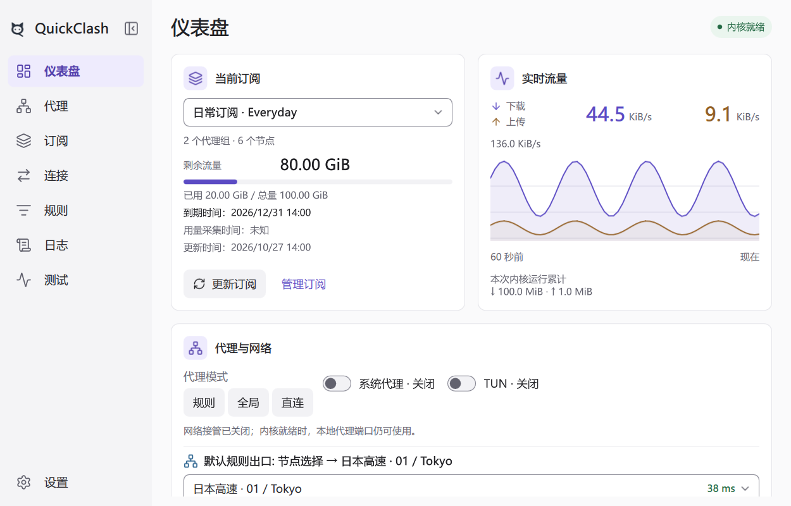
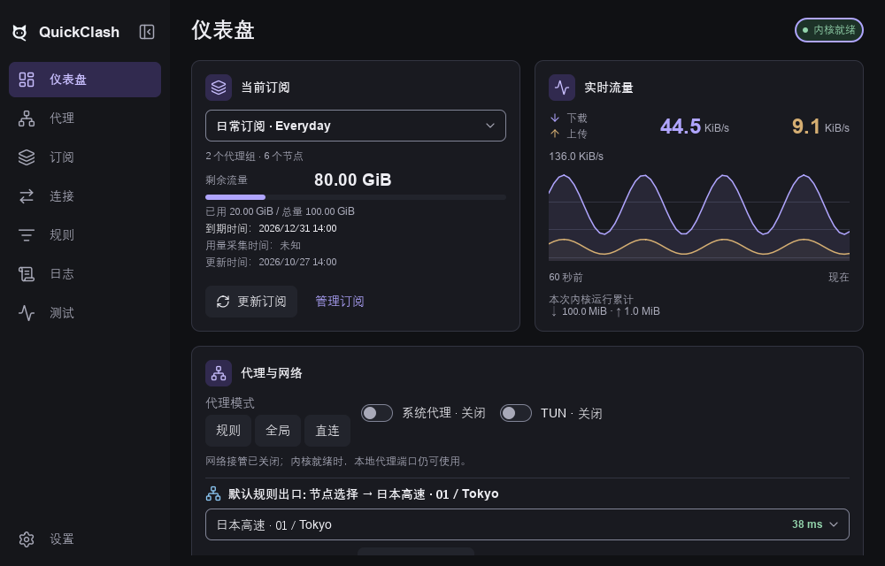

# 17 统一视觉系统、页面模板与 Qt Quick 落地

QuickClash 的界面采用**极简桌面工具风**。中性灰层次、精细间距、小圆角、轻边框和少量蓝紫强调构成统一视觉语言，完整覆盖 Light / Dark。Linear 的克制信息层级与 shadcn/ui 的清晰控件语义仅作理念参考；本章的 token、尺寸、交互和布局为 QuickClash 自有规范，产品使用 C++20 + Qt Quick 实现。

本章是应用壳、八个页面、嵌入内容与基础控件的共同视觉契约。[离线概念预览](../reference/quickclash_minimal_preview.html)及[预览说明](../reference/README.md)用于展示代表布局和状态；正文规定完整行为，预览不证明功能已实现或资源已达标。

## 1. 视觉原则

| 维度 | 统一规则 |
|---|---|
| 气质 | 清晰、克制、可靠；突出连接状态和当前操作，避免装饰型仪表盘 |
| 层级 | 页面、导航、内容、次级面四级；通过对齐、间距和字号分组，避免逐条套卡 |
| 强调 | 蓝紫用于主操作、焦点、选择和小面积标题图标底；正文数值为主，信息蓝区分技术信息，语义色表达状态，流量上下行沿用固定配色 |
| 形状 | 面板圆角10、控件/节点圆角7；仅少量状态徽标使用胶囊 |
| 密度 | 正文14、常规控件高36、列表高40；不缩字号塞内容，不统一放大为触屏控件 |
| 动效 | 离散交互短过渡、局部更新；无常驻背景动画、实时模糊或逐行计时器 |
| 表达 | 一个区域一个标题、一个操作组一个主按钮；关键错误就近持续展示 |

没有来源的用量、延迟、IP、连接数显示“暂无数据/未测试”，不填演示值。未知、未启用、不支持、权限不足和失败分别表达。主题、缩放、切页不隐式发起测速、网络探测、更新或内核操作。

## 2. 概念预览

用浏览器直接打开[界面概念预览](../reference/quickclash_minimal_preview.html)，支持 Light、Dark、跟随系统，默认浅色。八个导航入口比较页面结构，“控件与状态”展示按钮、字段、选项、禁用、处理中、错误、菜单和确认弹层。

下图为同一概念页面的明暗主题，全部数值均为演示。可交互版本以离线预览为入口。

**Light · 浅色**

**Dark · 深色**

| 部分 | 展示目标 |
|---|---|
| 仪表盘 | 订阅与合并流量同行、网络控制条、当前代理摘要 |
| 代理 | 工具栏、代理组、紧凑节点、选择与延迟 |
| 订阅/连接/规则/日志/测试 | 统一表头、平面行、状态与操作组织 |
| 设置 | 分组行、下拉/开关/端口校验、保存反馈 |
| 控件与状态 | 统一组件层级、状态优先级、菜单/确认与焦点 |

预览内置公开假数据，离线可用，不请求网络、不读用户配置、不改系统设置。数字、节点、域名、来源、时间和结果均为演示。浏览器中的窗口控制为概念装饰，产品遵循实际平台窗口惯例；网页技术和演示内容不作为产品依赖或默认值。

## 3. 应用壳与响应式布局

### 3.1 窗口与导航

应用壳在常规宽度采用左侧导航＋右侧页面；顺序为仪表盘、代理、订阅、连接、规则、日志、测试、设置。设置可锚定底部，短窗导航可滚动，不遮挡入口。标题栏仅放产品身份、必要全局状态和平台窗口控制，主题选择集中在设置的外观区域；页面名称、筛选和业务动作放在内容区。

默认1000×640、最小360×480逻辑像素。进程内首次显示在鼠标所在屏幕可用区域居中，无屏幕信息回退主屏，已保存几何优先。明暗主题使用相同几何与操作位置。

| 窗口宽度 | 导航 | 内容 |
|---|---|---|
| 360—599 | 隐藏侧栏，底部56高，仪表盘/代理/订阅/设置四个纯图标入口 | 边距12、单列、工具栏换行；其他模块经设置/摘要次级路由访问 |
| 600—999 | 64宽图标轨，可临时展开名称 | 边距16；按可用内容宽度重排，表格保留必要水平滚动 |
| 1000—1199 | 192宽图标＋名称侧栏，可收窄 | 边距24；首页1—2列、节点按最小内容宽度排列 |
| ≥1200 | 208宽图标＋名称侧栏，可收窄至64宽图标轨 | 边距24；内容最大1440并居中，支持主详情分栏 |

图标轨/底栏提供提示、可访问名称和选中标记。底栏投影外的当前页保留，并有标题与返回入口。窄窗不代表移动OS，不影响能力与权限；本期不创建移动工程。

导航统一使用圆角线性SVG：仪表盘为分区面板、代理为节点网络、订阅为层叠卡片、连接为双向箭头、规则为筛选列表、日志为文本卷页、测试为脉冲线、设置为齿轮。图标24×24画布、基准显示20×20、描边1.75，圆端点/圆连接；随正文比例缩放，侧栏图标与文字间隔16。普通态使用muted，选中使用onSelection与原selection底色，提示与焦点仍由原导航控件提供。八个本地SVG随程序资源嵌入，使用Qt控件icon着色、保持DPR清晰度；不依赖字体回退、图标字体、远程资源或常驻特效。离线概念预览从同一SVG资源生成，页面内辅助符号保持既有规范。图标来源与分发许可见[许可台账](../baseline/licenses.md)。

品牌采用“灵猫Q”：深海蓝圆角底、冰青至浅蓝猫头，右下尾部融入Q的识别形状。侧栏展开时展示24px无底板单色猫标和QuickClash名称，猫标按应用界面明暗选择浅色/深色，同形托盘图标仍按任务栏明暗独立选择；品牌本身不承担点击操作；相邻独立按钮以面板左收/展开图标、工具提示及可访问名称表达动作。≥1000宽窗可收为64宽图标轨，600—999可展开名称，两档分别保留本窗口的偏好；低于600使用底栏。收展只调整同一页面几何，不重建页面或申请数据需求。

完整客户端版本在设置页“关于”中显示，读取应用版本而不在侧栏重复展示；版本来自构建项目版本。程序、窗口和任务栏使用同源彩色灵猫Q；Windows执行文件编译嵌入16/20/24/32/40/48/64/128/256多尺寸ICO，32px以下移除耳内细节。托盘使用无底板单色轮廓，按系统任务栏明暗选浅色/深色版本，与应用内主题选择独立；不增加常驻动画、字体或网络依赖。

缩放直接更新同一个 PageHost 的几何/布局，不按像素重启动画、复制常驻页面、重新申请需求或重置业务。长名称省略并可复制/看详情，说明换行，必要操作始终可达。实际OS字体缩放、高DPI、多屏移动独立验收。

### 3.2 通用页面模板

~~~text
平台标题栏：QuickClash / 必要全局状态 / 平台窗口控制
左侧导航     页标题＋必要说明                 本页主操作
             搜索 / 筛选 / 排序 / 批量操作（需要才显示）
             就近错误或警告（有则持续显示）
             内容面板 / 平面列表 / 设置分组
             计数、分页或操作结果（需要才显示）
~~~

PageHeader统一标题、说明和操作对齐，顶级页不重复面包屑；真实层级详情才显示路径。工具栏不自行增加投影或大底色。页面默认一个纵向主滚动容器，表格可独立滚动；代理组和设置避免多层同方向滚动。加载、空、错误替换原内容区，不另造页面模板。

## 4. 八页面编排

### 4.1 仪表盘

仪表盘采用五卡结构：当前订阅与实时流量在内容宽度至少600时等宽等高并排；下方依次为整行的代理与网络、网络工具、运行概况。窄窗全部堆叠。代理与网络在内容宽度至少960时内部两栏、出口更宽；其余窗口上下排，用细分隔区分控制和出口，不嵌套卡片。

订阅提供切换、远端更新及管理入口，展示剩余/已用/总量、到期、更新时间和预警；当前选择由下拉框表示，不重复显示已选择/应用中/已应用角标，运行阶段与错误由页头表示。实时流量上下行用固定色标、24px数字与12px单位，曲线有刻度和断档并固定显示，忽略旧版收起偏好；可靠累计标明本次内核运行范围。实时流量、代理与网络、网络工具的标题只展示图标和名称，不设收起曲线、查看代理或详细测试按钮；代理页与测试页经应用导航进入。页头Ready显示“内核就绪”，公网可达性由手动测试单独表达。

代理与网络包含模式、系统代理和TUN的实际状态/进行中/错误、主策略链和当前节点；手动组才允许选择，自动组及负载均衡保持内核语义。网络工具包含手动IP对照与常用网站测试，来源/时间/路径、失败及过期清楚可读；不自动查询。运行概况为紧凑自适应卡，默认并列内核名称/版本、客户端专用工作集、内核专用工作集和本次运行时长；四项使用相同标签/值样式，版本不再作为无标签的角标。末行是实际就绪代理地址/复制和详情；内容宽度800起四项横排、480—799两列、窄窗纵排，不保留连接/日志跳转。详情默认折叠，展示完整三项内存、客户端合计及独立服务/内核/校验器，不另列QuickClash进程。首页可见即共享约5秒采样，折叠不停止默认指标，离页/隐藏释放。IP、网站及详情的显示偏好持久保存；无可靠来源时不创建连接数、DNS数或IP质量评分。

五卡标题统一14px DemiBold与30px浅强调底图标，图标18px；分组及指标标签配小型线性图标，辅助说明和时间使用12px muted。剩余流量、当前出口与IP优先于来源说明；内核身份和有效IP使用info，流量数字对应上下行固定色。延迟小于300ms为success、300—799ms为warning、至少800ms及失败为error，未测/过期为muted；颜色与明确文字并用，时间单独弱化。网站按钮保留名称并加本地站点图标，图标用于站点识别；测试结果以独立语义色文字表达，HTTP状态和时间另行弱化。图标随主题和文字比例缩放，使用本地SVG与Qt控件着色，不引入图标字体、远程下载、额外Timer或常驻特效。

### 4.2 代理

标题与按需测速位于工具区，搜索/排序紧邻组列表。组标题统一展示类型、当前成员、数量和展开动作；标题第一行对齐展开箭头、当前成员与组延迟测试按钮，次行显示策略及成员数，窄窗组按钮可仅显示图标并附提示；少量组使用页面级 Flickable，展开集合按订阅保存。只创建展开组的可见节点，多节点用虚拟化网格/分行模型。展开期间固定测速进度/取消区域高度，不因测试切换跳动。

节点以40高紧凑行为主：名称占剩余空间，协议/明确UDP能力为次级信息，延迟右对齐；必要时两行，不为等高堆空白。confirmed选择用selection底色、primary边界和勾；pending保留上次confirmed并显示“切换中”，失败恢复并就近解释。自动组按能力显示，不伪装可手选。延迟使用“38 ms/超时/未测试/不可用”等文字加颜色；可测试节点的延迟区域为独立按钮，悬停和键盘焦点明确提示测速，不触发卡片选择。

### 4.3 订阅

标题区提供添加订阅按钮并打开HTTPS/本地文件导入弹窗，空列表仍保留入口；失败显示原因并保留输入，关闭或离页清除敏感地址。SubscriptionCard或统一平面行呈现名称、来源类型、当前/待应用、最近更新、结果；有来源才显示用量/到期。当前上下文“使用/应用”为主操作，更新和更多为次级；删除在菜单内并说明影响。详情抽屉承载来源、计划、候选及错误，敏感地址脱敏，复制真实值需明确用户操作。

### 4.4 连接

标题行显示真实连接数和弱化的采样/暂停状态；“连接”与状态右侧对齐，第二行统一筛选输入、排序下拉、关闭筛选结果与全部关闭。单面板虚拟表格固定列为目标与进程、链路、下载速率、上传速率，目标列以次级行显示进程与网络，速率右对齐、按量级格式化，缺失显示短横线。整行点击或键盘回车打开详情弹层，行尾不设查看按钮；详情先列目标、进程、链路、规则、速率、累计流量与时长，原始 JSON 默认折叠；弹层关闭释放快照，保留筛选/滚动锚点。窄窗对整表水平滚动。关闭筛选/全部区分，pending 防重复。

### 4.5 规则

规则与提供者使用同一页签工具栏，标题显示当前集合条数和生效顺序提示。规则表固定列为序号、类型、匹配内容、出口，序号始终取内核原位置，筛选不重排；整行点击展开只读详情，行尾不设查看列，长规则省略，来源、计数、更新时间与有限信息放在展开内容。提供者表固定列为提供者、类型、条目、更新时间和更新动作，整行不触发更新，仅行尾按钮提交。刷新显示来源、时间和错误；未加载、无数据、权限/能力限制分别表达，不用禁用行冒充已生效。

### 4.6 日志

工具区第一行放搜索与暂停接收，第二行统一来源、级别、跟随最新、清空视图与脱敏导出，窄窗自动换行。表格固定列为时间、级别、来源、消息，单行省略，PlainText；级别用文字加主题色标，不整行染色。长内容点击行展开，展开区只读、可选择复制；用户向上滚动只停止自动跟随，接收继续，暂停与跟随分别命名。底部常驻有界缓冲、丢弃/截断/缺口计数；清空视图不等同删除磁盘日志。

### 4.7 测试

有限目标列表展示目标、真实路径、时间、HTTP/错误结果和耗时。显式按钮测试，取消在同一操作区；未测试、进行中、成功、超时和TLS失败分别显示。详情使用抽屉，标明经当前代理/直连等真实路径，页面可见不自动探测公网。

### 4.8 设置

分组顺序为外观与交互、连接与网络、订阅与更新、存储与诊断、关于。SettingsRow左为14标签＋12说明，右对齐开关/下拉/输入/动作；组间16、组内1px分隔，不每行再套面板。不可用时有原因和解决入口。外观区域同时提供主题和界面语言；语言选项为跟随系统、English、简体中文，当前选择有明确选中态。

主题、语言等即时偏好仅在保存成功后生效并能反馈保存失败；语言切换同步刷新当前页面、导航、页面标题、派生状态和托盘，不重建页面或QML引擎。端口/复杂网络等显式应用字段显示脏状态、校验及保存/取消。不对所有设置强加与即时行为不符的“保存”。错误归属字段/分组，重试保留草稿；未提交修改离页按业务契约提示。窄窗控件换到标签下，说明可换行。

## 5. 双主题与 token

### 5.1 策略

内置浅色、深色、跟随系统；产品默认跟随系统，不可读回退浅色。显式选择持久化后不被系统事件覆盖。启动/重建在首帧前解析，切换不重启内核、不清草稿/筛选/选择、不发业务请求。深色按底面层次独立配色。

### 5.2 语义颜色

| token | Light | Dark | 用途 |
|---|---|---|---|
| background | #FAFAFB | #101114 | 页面 |
| navigationSurface | #F4F4F6 | #15161A | 导航/应用壳 |
| surface / onSurface | #FFFFFF / #202024 | #191A20 / #EDEDF2 | 面板/弹层及正文 |
| surfaceMuted | #F2F2F5 | #22242C | 次级面、表头 |
| muted | #62626E | #A8A9B8 | 说明、时间 |
| outline | #E5E5EA | #323440 | 装饰分隔 |
| controlOutline | #858591 | #818496 | 输入与必要控件边界 |
| primary / onPrimary | #5B4BC4 / #FFFFFF | #B0A5FF / #251A58 | 主操作及文字 |
| selection / onSelection | #EEEBFD / #5340AB | #312A4F / #C9BFFF | 导航、节点、分段选中 |
| focusRing | #5B4BC4 | #B0A5FF | 键盘焦点 |
| success / successSurface | #246944 / #EAF5EE | #93D4AC / #1D3228 | 已确认成功/健康 |
| warning / warningSurface | #855510 / #FFF4DF | #EBC47E / #382D1C | 需注意 |
| error / errorSurface | #B33043 / #FFF0F2 | #FFA0B0 / #3B222C | 失败、校验、危险 |
| info | #28618E | #8CC8F5 | IP、内核身份等技术信息及站点识别；不表示已连接 |
| chartDownload / chartUpload | #5B4BC4 / #936025 | #B0A5FF / #D5AE72 | 下/上行固定配色 |
| scrim | #000000 @ 36% | #000000 @ 56% | 模态遮罩 |

正文/辅助文字对实际底色至少4.5:1，大字3:1，焦点/必要边界3:1。outline仅装饰，输入用controlOutline。禁用仍可辨并说明原因，不整组件降低透明度。曲线允许primary的10%填充、网格outline，流量数字可对应上下行固定色，保留文字/线型辅助辨认。

### 5.3 状态 token 与优先级

| token | Light | Dark |
|---|---|---|
| hoverSurface / pressedSurface | #EAEAF0 / #E0DFE8 | #2A2C36 / #343743 |
| primaryHover / primaryPressed | #5141B2 / #46369F | #BDB3FF / #A195F0 |
| selectionHover / selectionPressed | #E5DFFB / #DAD2F6 | #3B335F / #453B6D |
| disabledSurface / disabledText | #F2F2F5 / #62626E | #22242C / #A8A9B8 |
| pendingSurface / pendingText | #EEEBFD / #5340AB | #312A4F / #C9BFFF |
| errorHover / errorPressed | #FBE3E8 / #F8D8DF | #4A2A35 / #59323F |

disabled取消交互反馈；pending防连击但保留允许的取消；pressed覆盖hover；confirmed选择持续保留；focus独立外环，可与选择/错误共存；error边界和说明不被hover覆盖。页面引用统一状态token，不能各自降低透明度生成状态。

选择区域的正文和说明使用onSelection，主按钮使用onPrimary，语义反馈使用对应语义前景；不把muted直接叠到selectionHover/selectionPressed等有色状态面。每个实际组合按对比度核对，不能仅检验默认白底。

### 5.4 字体、间距、几何和动效

| 类别 | 逻辑像素/规则 |
|---|---|
| 字体 | 宿主完整QFont；Windows 上优先使用已安装的 Microsoft YaHei，缺失时用 Qt GeneralFont；读取当前用户100—225%文本缩放，字号/相关控件高度同步，Qt另行处理每屏DPI；保留系统回退，不打包/下载OS字体 |
| 标题 | 页面24/32 DemiBold，窄窗22/30；分组14/20 DemiBold |
| 正文/辅助 | 14/20 Normal；辅助/徽标12/18，不低于12 |
| 速率/技术文本 | 速率24/32 DemiBold、单位12；动态数值等宽数字；日志/地址等必要技术区系统等宽14/20 |
| 间距 | 4/8/12/16/24/32；图标文字8，组内12、面板内16、面板间16、页面24 |
| 圆角 | 面板/抽屉10，控件/节点/菜单7，徽标999；窗口外框随平台 |
| 边框/焦点 | 边框1；普通控件focus外环2＋间隔2；贴边紧凑行使用内嵌环，均不能被裁剪 |
| 高度 | 按钮/输入/下拉36，紧凑动作32，导航/列表40；图标按钮32；触摸命中44 |
| 动效 | hover/pressed100ms，展开/弹层160ms；减少动态效果关闭非必要过渡，连续缩放不插值 |

## 6. 统一组件库

类型名是职责约定，磁盘名ASCII小写下划线，CMake显式QT_QML_SOURCE_TYPENAME导出。

布尔选项保留主题复选框与滑动开关两种表达：选项及附加条件使用ThemedCheckBox，功能启停使用ThemedSwitch。页面复选框统一复用ThemedCheckBox，不混用默认CheckBox外观；两类控件共用主题颜色、字体、焦点和禁用状态规范。

| 组件 | 规格与契约 |
|---|---|
| NavigationItem / BottomNavigationItem | 图标16—20、文字14；selection/onSelection、独立focus；图标模式有提示/可访问名称 |
| PageHeader / FilterBar | 标题/说明/动作统一对齐，工具栏可换行，不复制导航 |
| FlatTile / SectionPanel | surface、outline边框、圆角10、内边距16；信息容器不提供可点击反馈 |
| ActionButton | primary/secondary/ghost/destructive四种；主primary、次surface＋controlOutline、ghost透明；Qt控件图标与文字共同布局，图标16—18、间距8；图标随状态着色，名称/Enter/Space保留 |
| IconButton | 32×32、统一hover/pressed，有名称/提示，不将必要说明仅藏在图标中 |
| TextField / SearchField / NumberField | 36高、controlOutline、独立focus/error说明；标签不依赖placeholder；端口1—65535，清空可键盘操作 |
| ComboBox / SpinBox | 与输入同高同圆角，弹出项32；当前选中/焦点可区分，方向键/Enter/Escape一致 |
| Switch | 36×20轨、14拇指；开启primary、关闭surfaceMuted＋controlOutline；pending不提前确认 |
| CheckBox / RadioButton | 可见标记16—18，标签同行；复选支持半选，单选互斥；Space/组内方向键 |
| SegmentedControl / Tabs | 模式等少量互斥用分段，子视图用页签；焦点/选择/禁用分离，保留上下文 |
| ProxyItem / DelayBadge | 名称/协议/能力/延迟/confirmed/pending独立；无私有Timer或网络请求 |
| SubscriptionCard / SettingsRow | 字段按4.3/4.8，动作不嵌套截获整行选择，字段同字号与间距 |
| VirtualListRow / DataTable | 行40，hoverSurface/selection；表头surfaceMuted，数值右对齐，无默认竖线；统一空/加载/错 |
| Menu / ContextMenu / ToolTip | surface、圆角7、controlOutline，菜单项32、危险error；Escape关闭、焦点回触发器、越界翻转 |
| Dialog / Drawer | surface、圆角10；对话框常规400/最大520且≤视口减32；抽屉360—480、窄窗详情路由；模态约束焦点 |
| Banner / Toast / StatusBadge | 状态文字＋图标，关键错误持续Banner含修复；Toast只做非关键确认，徽标不可误作按钮 |
| EmptyState / LoadingState | 原区域内原因/动作；刷新保留旧快照/时间，按需进度，不闪换整页 |
| ProgressBar / BusyIndicator | 已完成/总量或“处理中”，允许的取消可达；仅可见且pending运行动画，减少动态效果用静态文案 |
| ScrollBar / Selection / TrafficSparkline | 双主题可辨滚动条和文本选择，图表有界数据、按需重绘 |

删除持久数据等危险动作使用ConfirmDialog，明确对象/影响，默认焦点取消，动作文字具体。关闭弹层不谎称后台提交已取消，取消由Operation契约决定。

### 6.1 焦点与裁切容器

- `ThemeTokens.focusExtent = focusGap + focusWidth`；`focusMargin = focusExtent + scaledSize(4)`作为滚动表单四边安全区，禁止各页面复制固定偏移。普通输入、按钮、选择器保留外扩焦点，不通过取消裁切、压缩焦点描边或去除焦点反馈规避问题。
- 所有纵向滚动表单与弹框正文使用`ThemedScrollView`，显式声明唯一`form`正文。容器统一拥有正文x/y/width和内容高度，正文提供implicitHeight；容器保留安全区并为竖滚动条保持稳定几何，不随显隐伸缩，避免内容换行高度与可用宽度的测量反馈。页面根滚动表单的容器向既有页面留白外延，使正文与页头、其他页面内容使用一致的左右基准；滚动条位于留白内而不是再次缩窄正文。窄窗/大字号的外侧留白至少容纳焦点安全区、滚动条和少量边缘空间；弹框只在自身边界内预留安全区和滚动条空间。页面不得再次绑定正文几何、在同一容器内并排放多个独立正文，或直接用裸ScrollView替代；原有非视觉对象/弹框所有权不随正文迁移。
- 导航、虚拟列表与贴边节点等紧凑项通过`StateSurface.insetFocus`使用内嵌焦点，与外边框保持间隔，避免依赖行间距。水平可滚动表格将焦点框限制在当前可见横向区间，随contentX更新，不创建逐帧轮询或额外模型。
- 安全区不能代替内容自适应：Flow中的控件宽度不得超过Flow可用宽度；工具栏按可用宽度和字号换行，长文案的最小宽度不得撑破视口。
- 焦点圆角跟随实际表面半径；数字步进按钮保留完整命中区域，悬停/按下视觉内缩，不能覆盖控件边框或焦点。对话框footer不随正文滚动，安全留白不能引入水平滚动条。
- 回归包括源契约（仅共享实现可声明裸ScrollView）、真实订阅管理与编辑器弹框、导航/虚拟列表，以及明暗、窄窗和字体缩放下的正文安全区和焦点几何；检查页面正文与页头的水平基准、滚动条显隐时内容宽度稳定及条在留白内不遮挡焦点。原生RHI截图与离屏断言分别保留适用范围。

## 7. 状态反馈与可访问性

| 状态 | 表现与行为 |
|---|---|
| 默认/hover/pressed | 尺寸不变、局部底色变化，不改变行高或重建模型 |
| focus | 普通控件2px外环/2px间隔，贴边紧凑项内嵌；Tab/Enter/Space可操作，选择和错误仍可见 |
| selected | selection＋勾/标记，只表示confirmed |
| disabled | disabled底/字＋可读原因，恢复入口仍可用 |
| pending | 动作文字＋有界进度，保留confirmed，防连击/可取消，迟到结果核对代次 |
| 字段错误 | error边界＋字段下说明，聚焦首错、保留草稿、可修正重试 |
| 操作错误 | 运行错误由右上角状态胶囊持续指示，悬浮/聚焦提示完整详情并提供可访问描述，页面不插入重复错误行；字段校验保留就近说明，不清旧有效数据 |
| 空/不可用 | 区分无数据、筛选无结果、未知、权限/能力；提供合适动作 |
| 成功 | 根据业务确认更新状态、小范围确认，不弹模态打断 |

正文PlainText，必要详情才用富文本。运行错误的完整详情通过状态胶囊提示与可访问描述读取，错误状态始终有文字/颜色指示；其他必要操作信息不只放在工具提示中；颜色配文字/形状，字段标签/说明/错误关联。屏幕阅读器播报结果变化，不逐秒播流量。Escape关闭临时层并恢复触发器焦点，不丢筛选/滚动/草稿。

主字体统一注入。产品导航共享注册项中的本地SVG资源，品牌及独立收展按钮遵守3.1；操作保留文字、提示与可访问名称。节点名保留原文和系统回退，不因缺字删数据；字体后端/图标资源/渲染策略变化需单独核对授权与验证。

## 8. Qt Quick 落地与资源

### 8.1 样式与组件边界

1. ThemeTokens是颜色、字号、行高、间距、圆角、状态、动效的唯一来源，由少量只读对象分发；页面、嵌入、弹层用同一对象。
2. Qt Quick Controls使用统一轻量基础样式，再以共享background/contentItem/indicator定义外观；palette只兜底，不能代替Switch/Menu/Dialog完整样式，页面不自行切Material/Fusion等。
3. 共享职责文件为theme_tokens.qml、action_button.qml、flat_tile.qml、state_surface.qml、focus_ring.qml及themed_field/text_area/switch/check_box/combo_box/spin_box/dialog/tool_tip/progress.qml；保留业务复用组件并收敛硬编码，不维护并行风格。强调色文字token使用accentForeground，避免on前缀被QML解析为信号处理器。
4. 页面组合PageHeader/FilterBar/业务内容；业务组件只收状态、发意图，应用门面负责网络/仓库/权限。FeatureRegistry/PageRouter共享，不经parent链定位兄弟页面。
5. PageHost/EmbeddedHost按可见实例分配需求，隐藏/离开释放；主题不重载页面/模型，视图轻量状态保留。

### 8.2 绘制与生命周期

纯色Rectangle＋布局实现，默认无投影、模糊、拟物渐变，不逐行建layer/离屏遮罩。弹层必要阴影需少量有界并测成本，层级主要用底面/边框/间距。

节点/连接/日志对象受视口与合理预取限制，不Flow＋Repeater创建上千完整节点。少量组可页面Flickable，展开组内节点虚拟化，折叠释放。多个摘要共享业务仓库，不复制整份配置/JSON/连接表。

流量上下行同卡，使用业务侧最多60点（最近60秒）的有界历史、默认1Hz，切页/最小化保持同一共享流连续记录，会话代次改变/隐藏/卸载时清空；仅图表可见且数据/主题/可见/尺寸变化才重绘，恢复直接展示已有样本。平滑不能过冲伪造峰值，最新点右侧进入、上下留2px。未采样区域以空采样稳定横轴，不计入累计值，不冒充已观测历史；无有效样本用空态。文字仅实际变化才通知，无16ms Timer。隐藏停止动画绘制，业务事务独立继续。
折线开启抗锯齿并使用圆角连接/端点，陡峭峰谷不产生超出绘图区的尖角；有效连续段按真实点连线，不用曲线插值制造峰值。单个有效点也显示，缺采样两侧保持分段，不跨空档连线。
纵轴上限数值置于绘图区左上方的独立一行，与纵轴对齐，不覆盖曲线；速率单位按1024自动选择KiB/s、MiB/s或GiB/s，与既有二进制速率口径一致，无需“刻度上限”前缀。

客户端以小内存占用为持续目标，不设跨机器统一的100 MB硬门槛，保持Qt Quick默认RHI/GPU渲染；记录Qt/驱动、字体、DPI与负载差异。Windows同时采集客户端进程组专用工作集、总工作集和私有提交，必要辅助计入、内核单列；以同环境基线、有界缓存和需求释放评价资源。不能删功能、降可读字号或强制清缓存掩盖问题。产品迁移做一次Windows增量构建和受影响检查；资源敏感变化选单场景10—30秒短测，长期/帧/GPU按风险后置。文档/概念预览不替代产品验证。

## 9. 验收标准

REF为稳定UI标识，按当前设计逐项核对：

| 编号 | 条件 |
|---|---|
| REF-01 | 本章、离线预览、token、组件、页面模板共同采用该视觉系统，无外部UI框架运行依赖 |
| REF-02 | 八页面标题/工具栏/内容/结果统一，主要信息、操作和修复入口完整 |
| REF-03 | 360×480、360×780、599/600、999/1000、1280×800及中英文无溢出/遮挡，长名和必要操作可达 |
| REF-04 | 缩放/切页/主题不重建业务会话、不重复请求，保留筛选/排序/选择/草稿 |
| REF-05 | 节点/连接/日志虚拟化与有界缓存，组展开/测速无不必要高度跳动 |
| REF-06 | 视觉/图表符合资源约束，短测记录三指标/内核，不将未测长期/帧/GPU写Pass |
| REF-07 | 键盘、名称、字体回退、实际大字体/高DPI可用，焦点与文本选择清楚 |
| REF-08 | 字体/符号/素材来源许可明确，概念图标非产品依赖，演示值不进默认配置 |
| REF-09 | ≥600侧栏八模块，<600底部仪表盘/代理/订阅/设置四入口，其他次级可达 |
| REF-10 | 标题24/正文14/辅助12、面板圆角10/控件7、按钮36/列表40和间距统一 |
| REF-11 | Light/Dark/跟随系统覆盖图表/列表/菜单/弹层/滚动条/全部状态，首帧/持久化/对比度正确 |
| REF-12 | 功能注册/导航/完整页/嵌入解耦，需求生命周期受控，不复制业务或常驻整套页面 |
| REF-13 | 首页订阅＋合并流量/独立控制/代理系统摘要统一，数据有来源，无隐式IP/完整连接流 |
| REF-14 | 四类按钮、输入/下拉/数字、开关/复选/单选、分段/页签、菜单/弹层共用规格 |
| REF-15 | hover/pressed/focus/selected/disabled/pending/error双主题覆盖，优先级正确，失败保留草稿/有效数据 |
| REF-16 | 预览离线可切主题/八页面，含字段错误、禁用、处理中、菜单/确认，样例清楚标演示 |

产品评审先核对壳、仪表盘、代理、设置、控件状态，再推广列表/详情。设计、概念预览、QML实现、真实Windows交互与资源结果分别记录，不互相替代。
