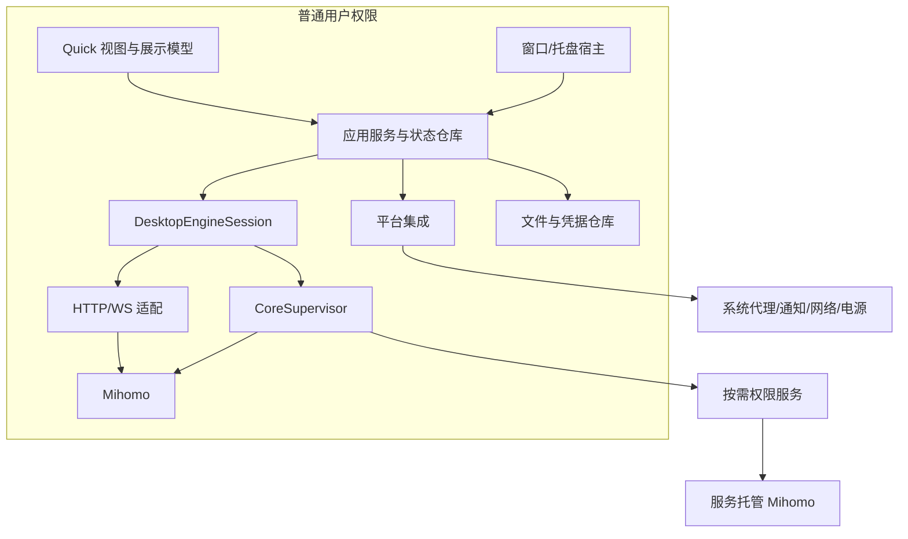
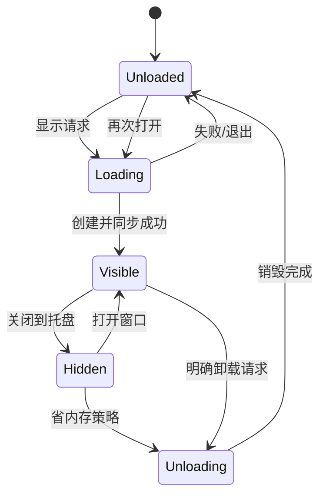
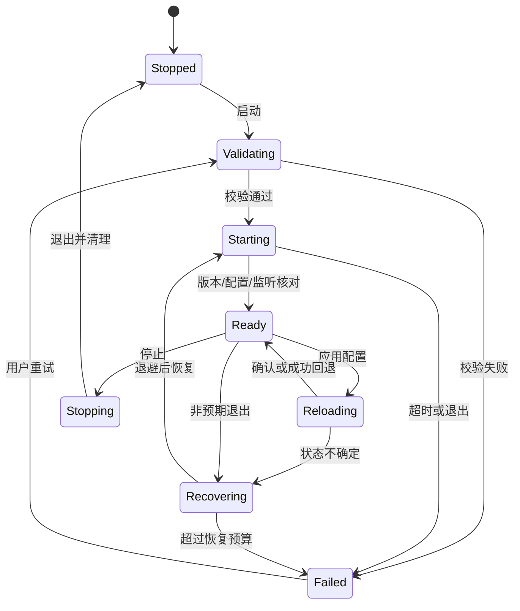
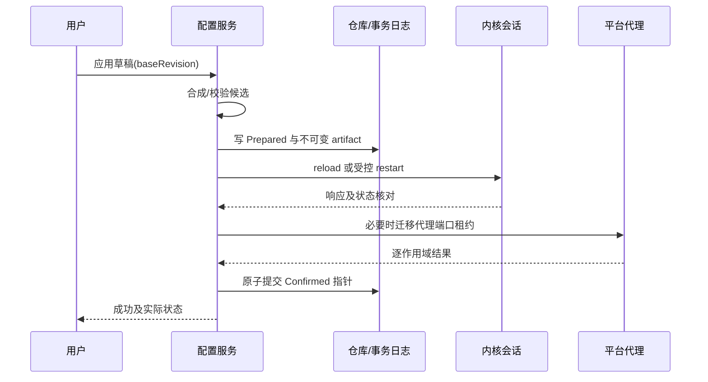
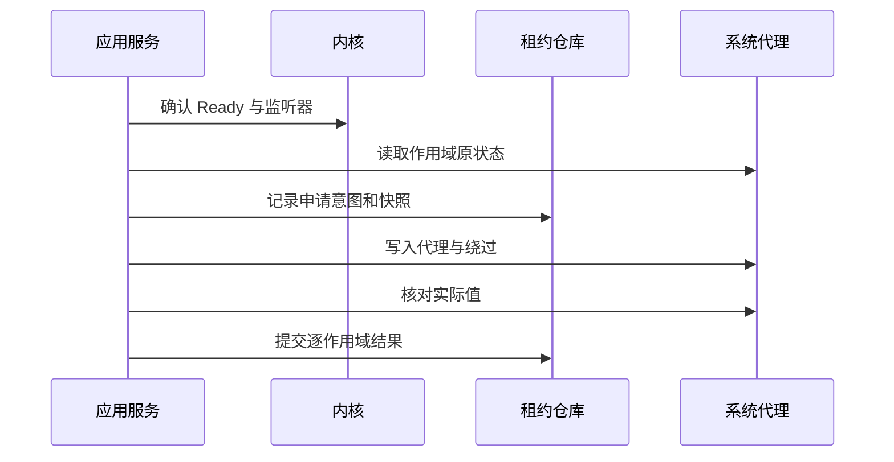

# Qt Quick + Mihomo 完整设计文档（合并版）

版本 1.0 · 2026-10-23。由 18 个分册生成，修改请以分册为准。

**桌面三平台优先；FlClash 为主要 UI 参考；客户端层总内存目标 ≤100 MB；Mihomo 单列；移动端仅预留架构。**

本文件包含完整设计、阶段、功能、异常恢复、接口与验收。尚未创建客户端实现或完成性能实测。

## 目录

- [01 目标、范围与阶段计划](#chapter-01)
- [02 总体架构与运行模型](#chapter-02)
- [03 数据模型与接口契约](#chapter-03)
- [04 界面、导航与窗口生命周期](#chapter-04)
- [05 内核生命周期与控制 API](#chapter-05)
- [06 配置管理与事务应用](#chapter-06)
- [07 订阅、配置来源与资源更新](#chapter-07)
- [08 总览、代理组与延迟测试](#chapter-08)
- [09 连接、日志、规则与提供者](#chapter-09)
- [10 系统代理、TUN 与权限服务](#chapter-10)
- [11 Windows、Linux、macOS 平台适配](#chapter-11)
- [12 设置、持久化、备份与诊断](#chapter-12)
- [13 GUI 性能预算、基准与优化流程](#chapter-13)
- [14 测试、持续集成、发布与更新](#chapter-14)
- [15 Android / iOS 架构预留](#chapter-15)
- [16 设计决策、风险与需求追踪](#chapter-16)
- [17 FlClash 界面参考与 Qt Quick 落地规范](#chapter-17)
- [18 实施任务、交付物与评审清单](#chapter-18)

---

<a id="chapter-01"></a>

## 01 目标、范围与阶段计划

文档版本：1.0；日期：2026-10-23；状态：开发前设计基线。客户端内存 ≤100 MB 是确定目标，其余分项预算与工期为规划值，尚无性能实测。

### 1. 产品定义

开发基于 Qt Quick / C++ 的 Mihomo 桌面客户端，在功能等价的前提下降低 GUI 内存、界面绘制 CPU 与后台唤醒。桌面客户端层总内存目标不超过 100 MB，Mihomo 独立统计；客户端必要辅助进程、托盘与管理层计入客户端预算。近期交付 Windows、Linux、macOS；Android、iOS 只保留架构扩展边界。100 MB 的单位、平台指标、峰值与支持负载定义见 [13](#chapter-13)，不得用空白页或卸载状态代替正常页面验收。

UI 以 FlClash 为主要参考，优先保留其成熟的信息层级、操作路径与响应式体验，采用 C++/Qt Quick 实现资源优势。界面移植规范见 [17](#chapter-17)。用户观察的 Verge Rev WebView 约 200—300 MB、FlClash 约 500—700 MB（典型约 600 MB）与 Mihomo 通常不足 100 MB，作为需统一口径复测的输入，不冒充本项目已完成的基准结果。

实际代理数据面由原有 Mihomo 负责，客户端不参与逐包转发，不改造 DNS、协议、规则引擎或 TUN 栈来获得选型收益。控制接口的采样会引入额外的内核工作，应与 GUI 开销分别报告。

参考 Clash Verge Rev 的桌面功能组织、服务模式与恢复流程；参考 FlClash 的跨平台交互。Clash Verge Rev 使用 Tauri/WebView，FlClash 使用 Flutter，比较时分别测量，不将两者统一归为 Web 前端。参考产品行为不意味着直接复制实现。

### 2. 交付目标及优先级

| 优先级 | 目标 | 成功依据 |
|---|---|---|
| P0 | 配置、内核、系统代理状态可信 | 操作失败不遗留错误代理；恢复过程可观察 |
| P0 | 客户端总内存 ≤100 MB、GUI 低开销 | 常用页面、托盘与卸载状态均验证；包含必要辅助进程 |
| P0 | 可用于日常代理 | 订阅、代理组、测速、系统代理、TUN、日志等闭环 |
| P1 | 桌面体验一致 | 三平台的主要操作、快捷键、错误语义一致 |
| P1 | 可维护 | 平台适配、控制 API 与共享业务隔离 |
| P2 | 未来移动共享 | 业务与展示模型不依赖桌面进程、窗口类型 |

功能正确性优先于节省少量内存。禁用必要错误处理、静默丢弃用户数据、降低内核日志级别或减少代理功能均不能计入前端优化收益。

### 3. 首个稳定版本的功能清单

| 编号 | 功能 | 范围 | 主设计 |
|---|---|---|---|
| F01 | 内核运行 | 启停、就绪、崩溃退避、版本与所有权 | [05](#chapter-05) |
| F02 | 配置管理 | 导入、编辑、覆盖、校验、事务应用、回滚 | [06](#chapter-06) |
| F03 | 订阅管理 | 下载、更新、计划、缓存、使用信息 | [07](#chapter-07) |
| F04 | 代理组与测速 | 选择、过滤、延迟、批量调度、选择恢复 | [08](#chapter-08) |
| F05 | 总览 | 运行状态、流量、快捷操作、配置摘要 | [08](#chapter-08) |
| F06 | 连接 | 实时快照、筛选排序、详情、关闭 | [09](#chapter-09) |
| F07 | 日志 | 流式、缓冲、暂停、筛选、导出 | [09](#chapter-09) |
| F08 | 规则与提供者 | 只读检查、来源、手动刷新 | [09](#chapter-09) |
| F09 | 系统代理 | 应用、恢复、外部修改冲突、崩溃恢复 | [10](#chapter-10) |
| F10 | TUN 与服务 | 能力检测、授权、受限服务、状态确认 | [10](#chapter-10) |
| F11 | 托盘与窗口 | 单实例、隐藏、卸载、恢复、快捷操作 | [04](#chapter-04) |
| F12 | 设置与诊断 | 持久化、迁移、备份、脱敏、支持包 | [12](#chapter-12) |
| F13 | 应用及内核更新 | 验证、兼容性、暂存、失败回退 | [14](#chapter-14) |
| F14 | 桌面交付 | 安装、签名、卸载、平台适配 | [11](#chapter-11)、[14](#chapter-14) |
| F15 | 网络与电源变化 | 重连、休眠恢复、系统代理重新核对 | [11](#chapter-11) |

首版不含远程控制面板、任意脚本执行、WebDAV 同步、长期连接历史数据库、内置 Web 浏览器、移动端工程。后续增加功能仍需预算评审。

### 4. 分阶段交付

阶段按依赖推进，不能把阶段名称当作已完成状态。每阶段交付可运行产物、验收记录与未关闭问题。Windows 暂作首个基准平台；Linux/macOS 工具链和可编译骨架从 P0 建立，系统功能在 P4 完成。

#### P0：工程与契约基线

输入：本文档集、目标平台与工具链。

工作：确定 Qt、编译器、CMake、Mihomo 版本及来源；建立三个桌面平台的空壳构建；创建模块边界、错误模型和版本清单；制作不含秘密的配置与 API 夹具；记录依赖许可与源代码来源。

产物：三平台可启动空壳、锁定依赖清单、API 契约清单、基准环境表、基础 CI。

出口 G0：干净环境可重现构建；未知 API 和平台版本有明确验证任务；共享模块未引用桌面系统头文件。没有锁定版本的功能不得宣称兼容。

#### P1：资源原型与技术路线验证

工作：参考 FlClash 实现托盘、静态页、1 Hz 流量图、500 节点和 1,000 连接演示；实现响应式窗口缩放、显示、隐藏、卸载、重建；对比参考客户端；记录 CPU、内存、GPU、长帧。数据可先用录制或合成回放。

产物：资源原型、原始测量、对比报告、分项预算修订记录。原型预计数天至两周，取决于工具链和基准自动化；这不是完整产品工期。

出口 G1：资源测量可重复；客户端 ≤100 MB 的关键场景验证通过并冻结分项预算；界面卸载后可恢复；对比具有相同数据和采样口径。100 MB 为已确定目标，P1 只能细化口径与子预算，不能自行提高上限。若未达到，定位成本后继续优化、调整架构或重新评估路线，不先补齐所有功能。

#### P2：真实内核与配置闭环

工作：真实 API、进程管理、就绪握手、配置校验、事务应用、回滚、基本代理选择、总览；完成临时目录、控制器认证、错误分类。

产物：可从本地配置启动和停止代理的内部版本；故障注入记录。

出口 G2：错误配置不替换最后可用配置；应用失败可恢复；同一内核不会因重复点击或窗口重建被重复启动；UI 线程无同步网络和配置校验等待。

#### P3：日常功能与首个平台集成

工作：订阅、计划更新、代理组测速、连接、日志、规则/提供者、设置、系统代理、托盘；在 Windows 完成 TUN/服务闭环；完善备份与诊断。

产物：主平台日常使用 Alpha、逐功能验收、数据迁移样本。

出口 G3：F01—F12 在主平台闭环；订阅失败保留旧配置；系统代理恢复不覆盖用户后续修改；后台没有页面专属连接/日志流。

#### P4：桌面三平台 Beta

工作：Linux GNOME/KDE 能力识别、托盘和服务；macOS 菜单栏、网络服务代理、helper；三平台休眠恢复、更新、安装卸载、签名流程。

产物：三平台 Beta、明确的系统/桌面环境支持矩阵、平台故障记录。

出口 G4：支持矩阵内 F01—F15 通过；缺少托盘等平台能力有可操作的退路；未覆盖的桌面环境明确标记，不笼统宣称所有发行版支持。

#### P5：稳定版与资源回归

工作：同条件对比、长期运行、窗口循环、配置与更新中断、磁盘故障、应用/内核更新回退、安装包验证、许可证及源码交付检查。

产物：候选稳定版、性能报告、升级/回退报告、用户说明、发行清单。

出口 G5：冻结预算与阻断缺陷标准满足；无数据损坏、错误代理遗留或可复现的持续资源增长；签名、校验和、源代码/许可材料齐备。

#### P6：按证据进行的后续优化

仅在分析结果支持时实施：原生托盘、独立 UI 进程、自定义场景图图表、更细的模型差异算法。每项都要比较新增代码、测试及平台维护成本。Android/iOS 不属于 P0—P6 的交付范围。

### 5. 阶段准入的执行规则

每个 G 门都有结论：通过、带已知限制通过、未通过。已知限制不能覆盖数据损坏、权限越界、错误代理恢复或资源无界增长。条件通过必须记录受影响平台、临时行为、修复任务和复测期限。

阶段可并行开展无依赖任务，例如 P1 时准备 macOS 签名和 Linux 测试环境；不得跳过 G1 后直接以完整功能数量证明技术选型成功。

### 6. 需求变更

新增需求记录：使用场景、对应功能 ID、资源成本、持久化变化、受影响平台、测试、所属阶段。影响共享接口或权限边界时记录设计决策。固定预算变化需保留旧值、调整原因与新测量依据。

本文档集是设计成果，不代表功能已实现，也不代表所列性能目标已达到。

---

<a id="chapter-02"></a>

## 02 总体架构与运行模型

关联：[阶段计划](#chapter-01)、[接口](#chapter-03)、[内核](#chapter-05)。

### 1. 技术选型

| 部分 | 决定 | 理由与限制 |
|---|---|---|
| 界面 | Qt Quick Controls + 轻量自有组件 | 控制对象规模、绘制和跨平台布局 |
| 应用逻辑 | C++20，Qt Core/Network | 固定类型数据、异步 IO、可分析的内存所有权 |
| 构建 | CMake，qt_add_qml_module | 标准 QML 模块、构建期缓存、依赖收敛 |
| YAML | 锁定版本的 yaml-cpp 候选 | P0 验证格式、解析限额与许可证；不保证注释往返 |
| 元数据 | 版本化 JSON 文件 + 原子写入 + 操作日志 | 首版不增加连接历史数据库 |
| 内核 | 独立 Mihomo 可执行文件 | 复用成熟数据面，隔离崩溃和版本 |
| 托盘 | QSystemTrayIcon + QApplication | 首版成熟实现；实际模块成本纳入测量 |
| 平台桥 | C++ / Objective-C++ 与原生 API | 差异收敛在适配模块 |

Qt 小版本、最低系统版本、Mihomo 版本在 P0 的 release-matrix 文件冻结。本文不假定当前最新版本和所有发行版均已验证。Qt Widgets 只用于宿主和托盘，不要求主界面采用 Widgets。

### 2. 进程拓扑



普通模式与服务模式只允许一个会话拥有目标内核。图中的两个 Mihomo 是互斥部署方式，不是同时启动两份。流量直接经过内核监听器或 TUN，不穿过客户端界面。

默认客户端退出时停止所拥有的内核并恢复所拥有的系统代理。首版不提供“GUI 全退出但自动保留代理”的隐式行为；关闭窗口进入托盘与退出命令分开。服务是否驻留不代表内核会话应继续运行。

### 3. 模块和依赖

| 模块 | 内容 | 可依赖 | 不可依赖 |
|---|---|---|---|
| domain | 类型、值对象、校验规则、能力 | C++ 标准库、必要 QtCore 值类型 | 网络、QML、系统 API |
| application | 配置/订阅/选择/状态协调 | domain、抽象接口 | QProcess、窗口、具体 HTTP 路径 |
| infra-core | API、进程、会话实现 | application 接口、QtNetwork | QML 页面 |
| infra-storage | JSON、YAML、凭据存储适配 | domain、QtCore、平台凭据桥 | 页面状态 |
| platform | 系统代理、托盘、服务 IPC、电源 | 接口、平台库 | 页面业务决策 |
| presentation | ViewModel、列表模型、操作门面 | application、QtCore | 直接写系统代理、拼 API |
| ui | QML 组件和桌面页面 | presentation 公开属性/命令 | 文件、网络、进程管理 |
| host | 组装依赖、单实例、窗口生命周期 | 上述模块 | 可避免的业务规则 |

平台集成接口按职责拆为代理、服务、通知、电源等小接口；上层可提供 IPlatformIntegration 聚合门面，避免一个包含几十个无关方法的接口。

### 4. 推荐源码结构

```text
app/                    启动、依赖组装、单实例、窗口宿主
src/domain/             通用模型与错误
src/application/        用例、事务、仓库接口、需求协调
src/presentation/       ViewModel 与 Qt 模型
src/infra/core/         Mihomo API、CoreSupervisor
src/infra/storage/      JSON、YAML、原子文件与凭据
src/platform/windows/   系统代理、服务、安装桥
src/platform/linux/     桌面代理、DBus/polkit
src/platform/macos/     代理、菜单栏、helper
qml/components/         通用组件、主题 token
qml/desktop/            桌面布局和页面
services/               受限权限服务
tests/                  单元、契约、集成、UI、恢复
bench/                  回放、基准脚本和场景定义
packaging/              三平台打包
docs/                   接口冻结、ADR、发行矩阵
```

平台目录在非目标平台不参与编译。通过 target 依赖落实边界，不依靠目录命名自觉。Mihomo 是可替换发行资源，不将内核源码混入 UI target。

### 5. 线程模型

| 执行上下文 | 职责 | 约束 |
|---|---|---|
| GUI/应用事件线程 | 应用状态、用例协调、模型变更、窗口 | 不阻塞文件、网络、校验或服务等待 |
| 网络事件线程 | QNetworkAccessManager、WebSocket、传输 | QObject 在所属线程创建、使用和销毁 |
| 有界工作池 | YAML、JSON 解析、差异计算、签名校验 | 大任务并发有上限，支持过期结果丢弃 |
| 存储串行执行器 | 元数据写入、事务日志、迁移、备份 | 同一仓库只有一个写者 |
| 内核/服务进程 | 转发、系统权限操作 | 不回调操作 GUI 对象 |

初期网络对象也可在 GUI 线程异步工作；若使用独立网络线程则完整迁移对象，不交叉调用。解析与大文件操作必须离开 GUI 线程。避免为了每个模块建立一个常驻线程；线程数量与栈开销属于资源预算。

跨线程传递不可变值或共享只读快照。QAbstractItemModel 的 begin/end、行数据与信号都在 GUI 线程执行。取消令牌可终止尚未执行工作；无法中断的解析用 generation 校验使结果失效。

### 6. 状态权威与命令流

应用状态仓库拥有期望状态与操作状态；内核/API 是运行时事实来源；系统 API 是系统代理事实来源。ViewModel 只读状态并发命令，不自己成为第二份运行时权威。

用户操作经过：门面校验 → 创建 operationId → 用例调度 → IO/系统操作 → 核对实际结果 → 更新仓库 → 模型通知。按钮显示进行中，成功必须有确认依据；超时进入“待核对”，不自动等同失败或重发非幂等操作。

区分 DesiredState、ObservedState、OperationState。例如 TUN 期望开启但内核尚未确认时，展示“正在启用”，不能提前显示已开启。

### 7. 并发和资源调度

EngineMutationCoordinator 串行处理影响同一会话的启动、停止、配置应用、TUN 模式切换与内核更新。一次配置应用中途不允许另一操作覆盖其配置或进程。用户停止请求可取消尚未提交的步骤；已产生系统变更时必须进入补偿。

配置草稿不占内核锁；订阅可并行下载，但同 profileId 的候选提交串行；节点测速为独立有界任务。配置应用期间暂停提交依赖旧配置的组选择、模式与提供者变更，读/测速结果核对 expectedRevision，应用后刷新再接受新命令；关闭连接按当前 epoch/目标集合校验。互斥获取顺序固定为会话变更协调器 → 配置仓库提交 → 平台代理租约，不持有线程阻塞锁等待网络。

每次内核启动生成 engineEpoch；每次期望配置变更生成 revision；每次列表快照有 sequence。旧 epoch 的结果不得覆盖新会话。接口细节见 [03](#chapter-03)。

### 8. 启动顺序

1. 定位用户目录、获取单实例锁；第二实例通过受限本地 IPC 请求显示窗口后退出。
2. 读取设置版本与待恢复事务，完成恢复判定，禁止无条件套用旧系统代理快照。
3. 创建应用服务和托盘宿主；窗口按用户设置决定是否立即创建。
4. 读取所选配置与最后可用 revision；如启用自动启动，校验并启动内核。
5. 就绪及监听器确认后，按保存的用户意图申请系统代理/TUN；失败明确降级。
6. 恢复订阅计划；页面可见后才申请页面统计需求。

自动启动代理失败不阻止打开设置、日志和配置修复。不能为了“快速启动”先写系统代理再等待内核。

### 9. 退出和异常恢复

正常退出：拒绝新变更 → 停止统计需求与调度 → 恢复本应用仍拥有的系统代理 → 停止内核会话 → 写入退出结果 → 关闭服务会话与进程。各步骤有截止时间，不能无期限卡住退出。

异常退出由本地事务日志与代理租约记录支持下次恢复；服务模式可由会话心跳超时执行受限清理。无权限服务时无法保证客户端被强杀后立即恢复系统代理，需在下次启动恢复并提供手工恢复指引，不能承诺不存在的实时保证。

### 10. 架构验收

- 销毁并重建 UI 不产生第二个内核或丢失操作状态。
- application/domain 在不链接 QtQuick/Widgets 的测试目标中可用。
- 高频数据没有完整 JSON → QVariant 树 → JS 数组 → 第二行模型的长期多份保留。
- 崩溃恢复和操作补偿依赖持久化状态，不依赖 QML 页面是否存在。
- 动态增加原生托盘或独立 UI 进程时，不重写配置、订阅和业务状态模型。

---

<a id="chapter-03"></a>

## 03 数据模型与接口契约

本文件定义应用内部契约。这里的类型和方法是实现设计，不是现有 Mihomo API 的逐字映射；外部字段由 [05](#chapter-05) 的锁定版本适配。

### 1. 标识、时间与版本

| 名称 | 定义 | 使用规则 |
|---|---|---|
| profileId | 本地 UUID | 改名、换 URL 不改变；复制配置产生新 ID |
| revision | 本地单调递增配置版本 | 表示合成后的候选内容，不使用墙钟时间代替 |
| engineEpoch | 每次启动尝试分配的会话唯一值 | 旧请求、旧连接 ID、旧测速不能跨会话使用；控制连接重连不改变它 |
| operationId | 单次用例 UUID | 从用户操作贯穿下载、校验、提交和诊断 |
| sequence | 某一数据流的单调序号 | 仅在相同 epoch 和流内比较 |
| schemaVersion | 持久化格式版本 | 明确迁移路径，不能用应用版本代替 |

持续时间使用单调时钟；计划更新时间、订阅到期使用 UTC 墙钟，展示时本地化。字节/累计计数使用 64 位整数；QML 展示通过格式化字符串或安全数值门面，避免 JavaScript 大整数精度丢失。

### 2. 核心数据模型

#### 2.1 Profile

| 字段 | 类型/语义 | 持久化 |
|---|---|---|
| id/name/kind | UUID、用户名称、Local/Subscription | 是 |
| sourceRef | 本地受管文件引用或 subscriptionId | 是 |
| rawHash | 原文摘要 | 是 |
| userOverlayRef | 用户结构化覆盖/补丁 | 是 |
| lastGoodRevision | 最近经运行确认的版本 | 是 |
| candidateState | None/Downloaded/Validated/Rejected | 是，含原因 |
| createdAt/updatedAt | UTC | 是 |

文件引用是受管目录内的逻辑 ID，不接受导入文件直接指定绝对写入路径。原始 YAML 保存原文；结构化修改另存覆盖层。

#### 2.2 Subscription

字段：id、profileId、urlSecretRef、displayOrigin、requestHeaderSecretRef、enabled、interval、nextDueAt、lastAttemptAt、lastSuccessAt、etag、lastModified、backoffCount、usageInfo。

displayOrigin 只保存脱敏主机/路径提示，完整 URL 视为秘密。usageInfo 含上传/下载/总量/到期和来源可信度，字段缺失用 unknown，不能用零冒充未知。

#### 2.3 RuntimeConfig 与 EngineStatus

RuntimeConfig：revision、profileId、effectiveHash、artifactRef、coreVersion、overlayVersion、createdAt、validationResult、applyState。applyState 为 Candidate/Validated/Prepared/Applying/Confirmed/Failed/RolledBack。

EngineStatus：epoch、lifecycle、ownership、version、configRevision、configCertainty、controllerEndpoint、listeners、tunObserved、health、lastError。controllerEndpoint 不向普通页面暴露认证信息；configCertainty 为 Confirmed/Uncertain/Unknown。

不能用 GET /configs 的局部字段反推完整运行配置 hash；configRevision 的确认来自本地提交记录、成功响应及必要的运行时核对。崩溃导致不确定时通过受控重载/重启收敛。

#### 2.4 代理、连接和日志

| 模型 | 主要字段 | 标识规则 |
|---|---|---|
| ProxyGroup | name、type、members、current、selectable、testable | 同 epoch 下 name；名称变化重新映射 |
| ProxyNode | name、type、provider、delayState、delayMs、testedAt | 不假设订阅之间同名即同节点 |
| Connection | id、metadata、chains、rule、start、upload、download | epoch + 内核 connectionId |
| LogEntry | localSeq、timestamp、level、source、message | 有界缓冲中的本地序号 |
| TrafficSample | epoch、monotonicAt、uploadRate、downloadRate | 断线形成 gap，不插入虚假的零 |
| Provider | name、kind、vehicleType、updatedAt、health、count | kind + name |
| Rule | index、type、payload、target、providerRef | epoch + 规则快照序号 + index |

规则顺序有意义；不能为显示而修改实际规则顺序。连接累计数值不总是速率，需有时间差才计算速率。

### 3. 操作和错误

所有异步命令立即返回 operationId；完成通过状态或事件交付。Operation 包含 kind、target、stage、startedAt、deadline、cancelability、result。依赖配置的控制还携带 expectedRevision 与目标 generation：热重载不改变进程 epoch，但旧配置的组选择、测速和规则结果仍需失效。支持 Pending/Running/Succeeded/Failed/Cancelled/Uncertain，只有业务核对完成后进入 Succeeded。

统一错误结构：code、category、userMessageKey、retryable、operationId、stage、redactedDetail、optionalOsCode。诊断细节不直接显示完整请求、配置或凭据。

| 类别 | 例子 | UI 处理 |
|---|---|---|
| Input | YAML 语法、端口冲突 | 定位字段与行，不自动重试 |
| Network | 下载超时、DNS、TLS | 保留旧数据，允许重试 |
| Auth | 控制器秘密不匹配、授权拒绝 | 修复会话/授权，不无限重试 |
| Core | 启动失败、接口不支持 | 版本/日志入口与恢复操作 |
| Platform | 系统代理部分失败 | 列明失败作用域与当前状态 |
| Conflict | 草稿过期、租约变化 | 刷新、保留草稿，用户选择处理 |
| Storage | 空间不足、原子提交失败 | 不覆盖最后可用数据 |
| Integrity | 更新签名不合法 | 拒绝安装并保留现有版本 |
| Cancelled/Uncertain | 用户取消、提交响应丢失 | 分别显示，后者先核对状态 |

控制结果和错误不能像遥测快照一样被最新值覆盖。操作结果保留有限历史，例如最近 100 条或 24 小时，秘密剔除后落盘。

### 4. 应用接口

以下为概念签名，实现可用 QObject 信号/槽和强类型值；不要求暴露 C++ future 给 QML。

| 接口 | 方法/事件 | 语义 |
|---|---|---|
| IEngineSession | capabilities(), observedStatus() | 不含平台窗口与进程句柄 |
| 同上 | start(config), stop(reason) | 经变更协调器，返回 Operation |
| 同上 | validate(config), apply(config, mode) | 校验与应用分离；mode 为 reload/restart 决策 |
| 同上 | selectProxy(group, member), testLatency(targets, policy) | 成员及能力先校验，带 epoch |
| 同上 | closeConnection(id), closeConnections(scope) | destructive command，超时后核对 |
| 同上 | setTelemetryDemand(aggregateDemand) | 整体需求替换，内部管理网络流 |
| IConfigurationService | import/readDraft/validateDraft/apply/rollback | 草稿携带 baseRevision 防止覆盖更新 |
| ISubscriptionService | add/updateOne/updateDue/cancel | 候选下载与激活分离 |
| ISystemProxyAdapter | inspect/acquire/apply/release | 返回逐作用域结果与租约 |
| IPrivilegedRuntime | probe/ensureAuthorized/startSession/stopSession | 固定请求集合，不能任意执行命令 |
| ISettingsRepository | load/snapshot/update(expectedVersion) | 原子提交、版本比较 |
| ICredentialStore | read/write/remove(reference) | 原生安全存储适配，不返回给 QML |

Capability 值为 Supported/Unsupported/RequiresAuthorization/TemporarilyUnavailable，并附原因。将“系统允许”和“用户已开启”分开表达。

### 5. TelemetryDemand

需求由 token 注册：owner、streams、requestedInterval、visibilityPolicy、priority。token 与页面展示门面生命周期绑定，释放后取消该需求。聚合器按流合并，多个消费者共享一条网络流。

流量、连接、日志需求分别计算；日志级别为活跃消费者要求的集合/最低级别策略，不改内核自身记录等级来制造收益。数据频率受锁定 API 能力限制；客户端跳过渲染不等于减少服务端传输。

状态流和控制事件不要求常驻高频 WebSocket；使用操作完成后刷新、进程事件和低频健康核对。隐藏后如用户打开托盘速率，只保留共享流量流。

### 6. 快照和差异契约

完整快照携带 epoch、sequence、receivedAt、记录集合。最多一个正在解析/计算、一个最新待处理快照；新完整快照可覆盖旧的待处理完整快照。

差异携带 baseSequence、targetSequence、增删改列表。GUI 只接受 baseSequence 与当前模型一致的差异；不一致时基于最新完整快照重新计算或显式重建，不能将几个被丢弃基线的差异直接拼接。不能对增量事件随意使用 latest-wins。

重建模型只允许初始加载、epoch 变化或无法安全合并时发生；常规 1 Hz 更新采用增量。大量无序变化时批量策略需测量，避免为了理论增量引入 O(n²) 查找。

### 7. UI 模型契约

模型使用固定 roles，data() 不执行网络、磁盘、复杂解析。每个批次合并相邻通知，只发送变化 roles。选择和展开状态保存业务 ID，不保存行号。delegate 复用时清除行内临时状态。

过滤条件由展示门面持有，输入合并约 150 ms 起步；排序明确稳定次级键。筛选结果可在工作线程计算索引，再由 GUI 线程应用。大规模动态排序默认不持续追随字节变化。

### 8. 一致性验收

- 旧 epoch 的控制/测速/连接结果不污染新会话；同 epoch 热重载后核对 expectedRevision。订阅下载独立于内核 epoch，核对 subscription/profile 的 generation 和 sourceHash，不因无关内核重启丢弃合法下载。
- operationId 能关联界面错误、事务日志和诊断，但不泄漏秘密。
- 网络断开时显示数据时间与 stale 状态，不显示虚假的成功或零速率。
- 64 位累计字节经 C++→QML 展示没有精度截断。
- 未实现的能力得到明确 Unsupported，不靠接口超时推断。

---

<a id="chapter-04"></a>

## 04 界面、导航与窗口生命周期

覆盖 F05、F11，关联各功能页面设计、[FlClash UI 移植规范](#chapter-17)及 [性能规范](#chapter-13)。UI 以 FlClash 为主要参考；本文件描述 Qt 运行机制，导航名称和顺序由参考版本清单最终对齐。

### 1. 信息架构

桌面窗口由导航栏、页面区、全局状态区构成。导航顺序为总览、代理、配置与订阅、连接、日志、规则与提供者、设置。错误提示显示在操作附近，影响代理运行的错误在全局状态区保留，不能仅用短暂 toast 表达。

| 常驻区域 | 内容 | 生命周期 |
|---|---|---|
| 宿主 | 应用服务、托盘、单实例 IPC | 客户端整个生命周期 |
| 基础壳 | 导航、主题、全局状态条 | 界面加载期间 |
| 页面 | 当前页 ViewModel、模型与视图 | 按需创建，离开后释放重资源 |
| 浮层 | 节点详情、配置编辑、确认对话框 | 打开时创建，关闭释放 |

页面导航状态保留在小型 UiSessionState：pageId、profileId、过滤文本、排序、选中业务 ID、滚动锚点、未提交草稿引用。它不保存完整连接列表、日志模型或 QML 对象。连接和日志状态恢复时先同步新会话，不复活过时网络对象。

### 2. 组件和视觉约束

建立 ThemeTokens：颜色、间距、字号、圆角、行高、动画时长；支持系统/浅色/深色和减少动态效果。Qt Quick Controls 使用一致的轻量样式，页面不各自实现一套按钮和输入控件。

基本组件：StatusIndicator、OperationButton、ErrorBanner、EmptyState、FilterBar、VirtualListRow、ConfirmDialog、TrafficSparkline、SettingsRow。业务组件依赖门面状态，不接触网络。

初始参考：常用列表行高约 36—44 逻辑像素，布局在普通桌面尺寸可用；具体最小窗口尺寸由字体与本地化测试确定，不能靠强制缩小字体。图标优先打包的矢量/小尺寸资源，不加载远程节点图标作为默认功能。

优先还原参考界面的布局和视觉层次，阴影等效果使用可复用的轻量实现，避免逐行昂贵特效、大面积实时模糊和持续闪烁。确有成本冲突时先优化实现，再记录视觉调整及理由；不能为了低占用把成熟信息结构简化掉。弹层和切页动画短且有限，用户减少动态效果时关闭非必要动画。

### 3. 窗口状态机



退出是宿主的独立状态，不是图中 Unloaded。相同时间的多个显示请求合并；正在卸载时的新显示请求在销毁完成后重建，不能同时创建第二套引擎。

#### 3.1 Visible

只激活当前页面数据需求；失去焦点不等于隐藏，不能在用户切换应用时任意卸载窗口。窗口被最小化可采用单独节流策略，恢复时立即刷新。多窗口首版不支持，避免重复页面订阅与复杂生命周期。

#### 3.2 Hidden

关闭页面需求 token、停止动画、取消不必要的图标任务和模型刷新；保留正在进行的配置提交、订阅更新等业务任务。业务任务结束以托盘状态和下次打开结果显示，不为了维持进度条创建隐藏渲染。

#### 3.3 Unloaded

卸载步骤：保存小型会话状态 → 释放页面需求 → 断开视图回调 → 取消或标记过期的展示任务 → 销毁窗口及 QML 对象 → 按所属线程完成延迟销毁 → 销毁 QML 引擎。业务服务采用明确 C++ 所有权，不能被 JS 所有权回收。

QML 单例若由引擎持有，应视为短生命周期门面；跨引擎保留的是独立 C++ 服务。持久服务对临时对象使用安全弱引用/自动断连，禁止悬空回调。场景图资源只能通过 Qt 支持的渲染线程机制释放。

清理不保证所有 Qt 库、堆缓存和驱动内存归还 OS；分别记录实际节省与打开延迟。确需完全释放 UI 运行时且同进程达不到时，再评估独立 UI 进程。

### 4. 关闭、退出与无托盘环境

首次关闭提示当前策略并允许记住；产品默认倾向关闭到托盘，具体由原型测量确定。无可用托盘时不允许窗口消失后没有可发现入口，可选择最小化、保持窗口或确认退出。Linux 无托盘扩展是正常能力差异。

退出命令明确执行恢复代理与停止所拥有内核；存在配置事务时等待安全边界或进入取消/补偿。未保存编辑草稿提供保存草稿、放弃或取消退出，不能无提示丢弃。

托盘基础菜单：打开窗口、当前配置、运行状态、系统代理开关、代理模式、重启内核、退出。大量节点不全部展开成菜单；高级操作跳转页面。TUN 等授权操作以明确进行中状态处理，避免连击。

### 5. 页面加载与数据恢复

PageHost 只维持当前重页面。转场可短时保留新旧两页，动画结束释放旧页。Loader 的目的在于控制昂贵对象，不对每个基础控件套 Loader。

重新显示时先读取仓库状态，展示旧快照的时间与刷新中标记，再申请新数据。已有变更操作只附着进度观察，不再次发起操作。草稿恢复到对应 baseRevision，若期间配置变更则提示冲突。

### 6. 可访问性与桌面习惯

导航、表格和对话框可键盘使用；焦点移动与可访问名称明确。颜色外提供文字/图标表达状态；支持高 DPI、多显示器切换、字体缩放、系统深色模式和屏幕阅读器基本操作。文本国际化使用稳定 key，日志和原始配置不自动翻译。

快捷键遵从平台惯例：查找、复制、关闭窗口、退出、打开设置；macOS 使用对应 Command 习惯。危险操作不占用容易误触的全局快捷键。初版不注册全局快捷键。

### 7. UI 验收

| 编号 | 场景 | 通过条件 |
|---|---|---|
| UI-01 | 连续开关/卸载 100 次 | 无失效对象调用、重复内核、持续句柄增长 |
| UI-02 | 隐藏时下载完成 | 业务成功、无隐藏动画；打开后状态正确 |
| UI-03 | 卸载时收到旧连接快照 | 结果安全丢弃，不重建隐藏页面 |
| UI-04 | 无托盘环境关闭 | 仍有清晰恢复入口或执行明确退出 |
| UI-05 | 配置提交中退出 | 安全等待/补偿，事务可恢复 |
| UI-06 | 大字体与高 DPI | 主操作不被截断，表格可滚动 |
| UI-07 | 只有键盘操作 | 可进入页面、筛选、操作和关闭对话框 |

### 8. 所属阶段

P1 完成状态机和代表页面；P2 将状态绑定真实业务；P3 完成桌面全部操作；P4 验证平台窗口/托盘习惯；P5 重复生命周期与可访问性验收。

---

<a id="chapter-05"></a>

## 05 内核生命周期与控制 API

覆盖 F01，并为所有控制功能提供基础设施。接口表用于实现规划，必须对 P0 锁定的 Mihomo 版本建立契约测试；未列出的版本不能默认兼容。

### 1. 职责与边界

CoreSupervisor 管理进程或服务会话；MihomoApiClient 管理认证、请求、WS 与解析；DesktopEngineSession 实现应用接口，协调两者。客户端只管理自己创建或通过服务正式接管的会话，首版不支持发现任意第三方内核后自动接管。

配置文件、控制器端口、工作目录、内核可执行路径均由受管资源解析得到。通过 QProcess 的参数列表启动，不将配置名称拼进 shell 命令。生产默认使用随安装包提供或已验证更新的内核；开发者自定义路径为后续显式功能。

### 2. 生命周期状态



UI 生命周期变化不驱动此状态机。停止优先级高于尚未提交的启动；非预期退出与用户主动停止分开。应用退出后不得因自动恢复又启动内核。

### 3. 启动流程

1. 获取会话变更许可，核对当前无本应用已有会话。
2. 读取已验证配置 artifact，确认路径、权限、端口和内核版本；运行配置测试。
3. 创建 epoch 与会话记录，生成高熵控制器 secret，准备回环控制器和受限文件。控制器绑定策略在锁定版本上验证；不可从订阅继承对外控制器监听。
4. 普通模式启动 QProcess；服务模式发送受限 startSession 请求。记录 PID、创建时间或平台可靠句柄、可执行身份和配置 revision，不能仅凭 PID 认领。
5. 异步读取 stdout/stderr，限速并限制单行/总缓冲；不得因管道不读取阻塞子进程。
6. 在截止时间内查询版本、运行配置摘要和监听器；确认是当前会话的认证端点且内核未退出。默认启动截止 10 秒作为起点，慢机器可调整。
7. 更新 Ready 后才申请系统代理；TUN 的路由/DNS 状态由对应平台核对。

端口探测不能完全消除 TOCTOU 竞争；真正绑定失败必须从内核退出/日志得到并向用户报告。API 可连不代表所有代理出站可用，Ready 只表达控制面和配置就绪。

### 4. 控制 API 适配表

| 目的 | 常见端点/方式 | 客户端处理 |
|---|---|---|
| 版本 | GET /version | 契约与能力核对 |
| 读取运行摘要 | GET /configs | 不视为完整原配置 |
| 热更新字段 | PATCH /configs | 仅契约确认可修改字段 |
| 重载配置 | PUT /configs | 请求体、force 与路径语义按锁定版本 |
| 代理与组 | GET /proxies | 解析类型、成员和当前选择 |
| 选择组成员 | PUT /proxies/{name} | name 是单一路径段编码 |
| 单项延迟测试 | GET /proxies/{name}/delay | URL、timeout 参数受策略限制 |
| 流量 | /traffic 流 | HTTP/WS 能力按版本适配 |
| 连接 | GET/WS /connections | 完整快照与间隔参数按版本核验 |
| 关闭连接 | DELETE /connections/{id} 或集合 | 单条与全部分别提供 |
| 日志 | /logs 流 | 级别、协议与字段按版本核验 |
| 规则 | GET /rules | 只读、有序 |
| 提供者 | /providers/proxies、/providers/rules | 查看、更新与健康接口逐项契约验证 |

默认不通过开放任意路径的方法暴露给 QML。内部请求用强类型命令；PATCH/PUT 支持的差异由能力映射决定。HTTP 状态成功仍需解析并核对语义。遇到 404/405 等先区分版本能力与认证/路径问题，不能无限重试。

控制请求绕过系统代理，避免自我依赖；只连接受管回环地址。HTTP 认证优先使用授权头；若特定 WS 实现仅支持 URL token，限定回环并在日志、诊断和错误中彻底清除。生产不得输出 secret 或完整认证 URL。

### 5. 请求与重连策略

起始超时：普通 GET 3 秒、普通变更 5 秒、延迟测试由用户策略上限控制、配置应用按事务阶段给出较长截止。每项配置均有上限，不允许无限等待。取消只表示客户端停止等待，不保证服务端操作没有发生。

幂等读取可在短退避后重试一次；选择、重载、关闭连接等命令响应丢失先核对实际状态。不能仅因网络超时就再次执行全局关闭连接。WS 重连采用带抖动的 1/2/4/8 秒至约 30 秒退避；无需求、用户停止或 epoch 改变立即取消。

会话心跳低频、可暂停或合并，优先利用进程退出事件。显示页面不会各自创建健康轮询。状态 stale 与内核停止分开：控制面断线不证明数据面已经停止。

### 6. 崩溃恢复

起始策略为 1/2/4 秒退避，60 秒内最多 3 次自动启动；持续失败进入 Failed，停止刷屏并给出日志。稳定运行一段时间后再重置计数。阈值在压力测试后冻结。

内核退出时，立即标记状态不可用并尝试撤回所拥有的系统代理；恢复成功后重新申请，而不是永久指向失效端口。恢复使用最后可用配置，不能反复启动刚刚失败的候选。

服务失联时先探测其会话状态。禁止在未确认服务内核已停止时再启动用户态内核占用相同端口或 TUN。无法判断时进入 Uncertain 并提供明确恢复操作。

### 7. 停止与所有权

仅对匹配会话身份的内核停止。先恢复系统代理，再请求服务停止或进程正常退出；超过截止可终止所拥有的进程，记录是否强制。Windows 等平台的父子生命周期可使用 Job Object 等机制，Linux/macOS 使用对应受控会话方案；不假定跨平台 QProcess 析构能满足所有清理需求。

旧 pid 文件不能作为强杀依据；PID 复用、服务升级、崩溃残留必须结合创建时间、句柄或服务会话 token 核对。

### 8. 验收与阶段

| 编号 | 测试 | 结果 |
|---|---|---|
| CORE-01 | 连点启动、窗口重建 | 仅一个 owned 会话 |
| CORE-02 | 无效配置/端口占用 | 不写系统代理，错误可定位 |
| CORE-03 | API 响应延迟后成功 | 核对状态，无重复变更 |
| CORE-04 | 内核连续崩溃 | 退避有限，回退配置，停止风暴 |
| CORE-05 | 服务失联 | 不重复启动；不确定状态可见 |
| CORE-06 | 大量 stderr | 无管道阻塞、缓冲有界 |
| CORE-07 | PID 被复用 | 不终止第三方进程 |
| CORE-08 | 旧 epoch 响应 | 不覆盖新会话状态 |

P0 冻结端点契约，P2 完成主要闭环，P3/P4 完成服务模式，P5 覆盖故障与版本升级。

---

<a id="chapter-06"></a>

## 06 配置管理与事务应用

覆盖 F02。设计目标是保留用户原文、明确覆盖来源，并在错误、中断或崩溃后恢复到可识别状态。

### 1. 受管文件与页面

配置列表显示名称、来源、更新时间、是否当前、候选状态和错误；操作包括导入、复制、重命名、编辑、设为当前、回退和删除。删除当前配置必须先切换或停止内核，不能删除正在使用的唯一 artifact。

本地文件导入后复制到受管目录；外部文件变化不自动改变运行配置。导入 URL 走订阅设计。编辑原文与编辑覆盖项是两个入口，页面同时显示当前运行版本和草稿 baseRevision。

```text
profiles/<uuid>/source.yaml       原文，不由结构化保存重写
profiles/<uuid>/overlay.json      版本化用户覆盖
profiles/<uuid>/draft.yaml        可选草稿
runtime/<revision>/config.yaml   不可变的实际候选
runtime/<revision>/manifest.json 合成来源与摘要
transactions/<operationId>.json  配置应用日志
```

路径由程序生成。导入配置的 path、rule-provider、proxy-provider、证书等引用需要解析为受管资源或明确支持的外部资源；不能让配置任意写出数据目录。首版仅支持约定的资源布局，不能安全解析的路径给出具体错误，保留原文而不尝试猜测。

### 2. 合成顺序

RawProfile → 用户覆盖 → 平台覆盖 → 应用保留字段 → RuntimeConfig。每一步记录来源，提供“有效配置”和“来源差异”只读预览；包含秘密时预览默认遮蔽，复制/导出有明确提示。

| 类别 | 合并规则 |
|---|---|
| 普通 scalar | 后层显式值覆盖；未设置保持原值 |
| map | 递归合并已知结构；未知字段按透传策略保留 |
| 一般 sequence | 默认整体替换，不盲目按名称合并 |
| rules | 显式 prepend/append/replace 三种操作；顺序固定 |
| proxies/proxy-groups | 首版整体替换或不覆盖；复杂逐项补丁后续再做 |
| 删除字段 | 使用显式 remove 操作；区分 null 与未设置 |

应用保留字段包括受管控制器地址、secret、管理路径及必要端口约束。来自订阅的危险/冲突保留项不静默启用，界面列出被覆盖字段及原因。TUN、系统代理是应用状态；系统代理不写进 Mihomo YAML，TUN 通过有效配置表达。

用户修改 YAML 的注释、锚点和格式不保证经过结构化解析后往返保留，所以原文独立保存。应用产生的 runtime YAML 可以规范化，但不能覆盖 source.yaml。解析器须拒绝多文档歧义、非法标签和重复关键键，限制别名扩展、深度和总大小。

### 3. 校验流水线

1. 输入限额与编码检查；默认 UTF-8，其他编码明确转换并保留源备份。
2. YAML 解析与安全限额。
3. 结构检查：必须字段、类型、端口范围、组成员引用、循环/不存在引用。
4. 平台检查：TUN 能力、受管资源路径、监听器冲突、保留字段。
5. 合成有效配置并写临时 artifact。
6. 使用目标版本内核执行配置测试，工作目录与正式运行一致；测试可能涉及资源访问，应受截止时间和文件范围约束。
7. 展示差异、预计热重载/重启和可能中断，再进入应用。

内核测试通过不是出站可用保证。校验错误映射原文行列与覆盖层位置；无法映射的指出“合成配置第 N 行”，不能误指用户原文。默认大小可从 16 MiB 原文和有限深度起步，在真实大规则配置上验证后冻结，可配置合理上限。

### 4. 应用事务



事务日志阶段：Prepared、CoreApplying、CoreConfirmed、PlatformApplying、Committed，失败进入 Compensating、RolledBack 或 RecoveryRequired。日志在对应不可逆外部操作前更新，并使用原子写和必要的持久化同步。跨文件、进程和系统设置不存在单一原子事务，必须依靠补偿与恢复收敛。

用户确认前可取消；校验中取消结果作废；应用过程中取消只能在安全边界转入恢复，不能直接删临时文件并声称已撤销。

#### 4.1 热重载与重启

只对锁定版本确认支持的变更热重载。控制器地址/secret、核心运行容器、服务模式、部分监听器/TUN 改动默认走受控重启，除非契约测试证明安全。其余字段由适配器提供 requiresRestart 判定。

重启流程先暂时撤回旧系统代理，停止旧会话，启动新配置，确认后应用新代理租约；其间可能短暂直连或不可用，产品明确提示。首版不提供无中断切换保证。热重载也不保证现有连接全部保留。

#### 4.2 确认与回退

确认依据包括请求成功、API 版本/摘要、关键监听器及已知状态。不能仅用“请求发出”更新当前配置。API 无法证明完整 hash 时以受控提交记录为准；响应丢失进入待核对，必要时重新加载确定版本。

候选失败：保留失败 artifact 与脱敏错误 → 尝试恢复最后可用配置 → 重新核对关键状态 → 恢复旧代理租约。若回退失败，停止代理意图、撤回拥有的系统代理，标记 RecoveryRequired，禁止循环自动切换。

最后可用只在整笔事务确认后推进。下载成功、YAML 通过、内核暂时起来均不单独更新该指针。

### 5. 崩溃后的恢复表

| 日志阶段 | 下次启动 |
|---|---|
| Prepared | 候选尚未作用于内核，删除或保留草稿；使用旧确认版本 |
| CoreApplying | 状态不确定；识别 owned 会话，受控收敛到旧确认版本 |
| CoreConfirmed | 仍需核对平台代理；未提交前默认恢复旧版本 |
| PlatformApplying | 检查逐作用域租约，只恢复仍属于本应用的变更 |
| Committed | 使用新确认版本，清理过期事务 |
| Compensating/RecoveryRequired | 不自动推进候选；执行恢复向导或安全停止 |

多文件提交采用先写不可变 artifact，再原子替换单一 manifest 指针。manifest 持有 activeRevision、lastGoodRevision 和引用集合；旧 artifact 在无引用且超出保留策略后清理。不能靠多个 JSON 恰巧写完来假定原子性。

### 6. 编辑冲突与版本保留

草稿携带 baseRevision 和 sourceHash。订阅更新或其他窗口操作改变基线时，编辑保存返回冲突，提供查看差异、另存副本或重新基于最新内容编辑；首版不自动三方合并 YAML。

默认保留最近 5 个确认版本和当前事务引用版本，另设总容量上限。清理前保留至少一个可用版本；空间不足导致新配置无法落盘时不破坏旧配置。

### 7. 验收与阶段

CFG-01 错误 YAML 不替换当前配置；CFG-02 同名组/无效引用定位明确；CFG-03 校验时 UI 可交互；CFG-04 任意事务阶段强杀后恢复确定版本；CFG-05 磁盘满不损坏 manifest；CFG-06 草稿冲突不覆盖新订阅；CFG-07 回退失败停止并撤回代理；CFG-08 端口变化后代理设置与真实监听一致；CFG-09 原文注释不因查看有效配置丢失。

P2 完成导入、合成、事务；P3 完成编辑和回退 UI；P5 执行所有中断注入。

---

<a id="chapter-07"></a>

## 07 订阅、配置来源与资源更新

覆盖 F03，并与 F02、F08 衔接。订阅负责获取候选；配置服务负责验证和应用，二者不能混成“下载后直接覆盖运行文件”。

### 1. 支持输入

首版支持本地 Mihomo YAML 和返回完整 Mihomo 配置的 HTTPS 订阅 URL。单纯节点链接、Base64 节点集合、第三方转换服务不默认为同等支持，导入时给出类型错误与说明。HTTP 源可作为用户明确选择的兼容能力，默认提示传输不加密；不关闭 TLS 校验。

订阅编辑包含名称、URL、更新间隔、自动更新、自动应用、下载路径策略、必要请求头。完整 URL/请求头通常含凭据，不显示在列表、通知和默认诊断中。

### 2. 下载状态机

Idle → Scheduled → Downloading → CandidateStored → Validating → Ready；网络失败进入 Backoff，内容失败进入 Rejected。激活进入配置事务，不属于下载状态。

每个 subscriptionId 最多一个下载；再次手动更新可附着当前任务或取消后重启。删除订阅先取消任务并失效 generation，迟到响应不得重新创建已删除配置。

### 3. 网络策略

| 项目 | 初始策略 |
|---|---|
| 下载路由 | 明确 Direct / RunningProxy / Auto，不继承控制 API 的回环策略 |
| Auto | 直连优先；允许时失败后通过已就绪内核尝试一次，并记录路径 |
| 并发 | 默认最多 2 个订阅下载，同源限额 |
| 超时 | 连接/整体截止分开，整体先以 30 秒起步 |
| 重定向 | 最多 5 次；跨 origin 不转发敏感请求头 |
| 大小 | 解压后默认上限 16 MiB，流式计数防压缩膨胀 |
| 条件请求 | ETag、Last-Modified；304 继续使用已存在候选/原文 |
| 重试 | 短暂网络失败有限重试；401/403、格式错误不高频重试 |

不自动接受 HTTPS 降级到 HTTP；显式配置兼容源时另行处理。URL 不允许 file/执行型 scheme；本地网络 HTTP/HTTPS 订阅可能是用户实际需求，按明确来源使用，而非把所有私网地址一概拒绝。

RunningProxy 使用明确指定的受管 HTTP/SOCKS 代理，内核不可用时返回可解释错误，不形成启动前必须先通过自身代理下载配置的循环。首次启动始终可用本地配置或 Direct 获取。

### 4. 候选提交与激活

下载先写 temporary 文件，检查状态码、大小、内容、来源与 generation，计算摘要后提交候选原文。Content-Type 是提示，真正以结构校验决定，HTML 登录页面不能当 YAML 成功。

非活动配置更新：保存新 source 候选并校验，当前内核不变。活动配置自动应用默认保守关闭；用户开启后才在校验成功时进入配置事务。校验失败保留旧确认版本与旧可用源，显示失败候选的原因。

订阅更新与用户编辑同时发生时，候选另存，禁止直接覆盖草稿。选择状态恢复由 [08](#chapter-08) 的名称/成员存在性规则处理，不把旧 YAML 中的选择重新写回原文。

### 5. 调度和电源变化

使用一个最早到期定时器管理全部计划，而不是每个订阅永久持有高频 Timer。下次时间保存 UTC；进程内等待使用单调计时。加小幅抖动避免同时唤醒，用户手动更新立即执行。

应用重启/休眠恢复时只对已到期项目做一次合并调度，按并发上限排队，不补跑每一次错过的周期。网络离线暂停，恢复后带抖动执行。失败采用指数退避且设置最大间隔，成功后恢复正常周期。

如果用户设置“计量网络不自动更新”，平台能力不可得时显示限制并遵从保守策略。托盘/卸载状态仍可进行低频业务计划更新；它与页面统计停止不冲突。

### 6. 用量与到期信息

解析来源响应中的订阅用量头时，字段单位和格式按约定处理。未知/格式错误显示“来源未提供”，不推断为无限或零。用量不等同本机流量累计，多设备使用和提供方统计延迟需在帮助说明中解释。

元数据随响应保存最后采集时间；本机流量图由内核遥测提供，二者不混算。显示临近到期/流量告警不导致高频轮询。

### 7. 规则集、Geo 数据与提供者

首版区分应用管理的订阅和内核管理的 provider。proxy-provider/rule-provider 的更新调用锁定 API，不自行同时写其文件；Geo 资源使用明确的应用更新任务或交由内核机制管理，指定唯一写者。

全局“更新资源”需列出会更新哪些内容，分别显示结果。资源下载成功不自动宣称配置已应用。外部引用路径在配置校验时受管化或明确拒绝，不依靠任意相对路径逃逸工作目录。

### 8. 验收与阶段

SUB-01 HTML/超大/压缩膨胀响应被拒绝，旧配置保留；SUB-02 304 但本地源缺失时重新获取而非报成功；SUB-03 跨域重定向无认证头泄漏；SUB-04 删除后迟到响应不复活；SUB-05 休眠一晚后不补发数十次更新；SUB-06 用户草稿与新候选并存；SUB-07 代理不可用时首个配置仍能导入；SUB-08 使用信息未知不显示零；SUB-09 自动应用失败回退最后可用版本。

P3 实现主要功能，P4 完成网络/电源适配，P5 验证长时间调度与恢复。

---

<a id="chapter-08"></a>

## 08 总览、代理组与延迟测试

覆盖 F04、F05。默认页面以低频状态展示为主，不持续绘制没有变化的内容。

### 1. 总览的信息与操作

| 区域 | 内容 | 更新来源 |
|---|---|---|
| 内核状态 | 停止/启动中/就绪/异常、版本、运行时长 | 会话状态事件 |
| 当前配置 | 名称、来源、revision、上次更新 | 配置仓库事件 |
| 流量 | 当前上下行、约 120 点曲线 | 可见时共享 /traffic，约 1 Hz |
| 快捷控制 | 启停、系统代理、TUN、规则/全局/直连 | 应用命令 + 实际状态核对 |
| 恢复提示 | 配置失败、平台代理冲突、版本不兼容 | 持久操作结果 |

默认不为显示“活动连接数”额外打开完整连接流；若锁定 API 无轻量来源，省略或标记需开启统计，不能隐蔽增加大快照开销。累计流量只有在来源可靠时展示；仅对 1 Hz 速率积分得到的是估算，不能当作精确累计。

每个快捷操作显示期望、进行中和确认状态。API/平台状态暂时未知时展示“待核对”，不能仅根据用户点击改成已开启。内核未就绪时，系统代理开关给出前置条件或组合启动流程，不直接指向未监听端口。

### 2. 流量采样与曲线

TrafficRepository 保存有界环形缓冲；TrafficViewModel 输出绘制所需的缩放后点集。先采用简单轻量图表，在约 120 点、1 Hz 场景测量后才考虑 QSGGeometryNode。

断线插入 gap，重连不连出跨长时间的假曲线；epoch 变化重置运行期统计。速率与字节计数标明单位，自动缩放保持一定迟滞，避免每秒反复跳量级。窗口隐藏/离开总览后释放该页 demand；托盘速率开启时复用同一流。

曲线没有连续插值动画；鼠标悬停只处理当前指针与附近点，不扫描配置或触发网络。文本变化可每秒一次，未变化就不通知 QML。

### 3. 代理页面结构

左侧组列表/顶部组选择，右侧显示该组成员。提供名称/类型/提供者筛选、当前成员标识、延迟状态、测试时间和手动选择。节点详情按需加载。首版不将每个组的所有成员同时实例化成卡片。

组能力由内核类型映射：selector 等可手动选择；url-test/fallback/load-balance 等行为按内核定义展示。不可手选的组不显示可用选择按钮，不为了统一 UI 把所有组视为 selector。嵌套组按引用显示，详情可展开且避免循环递归。

### 4. 手动选择流程

1. 校验 epoch、组存在、可选择、成员仍属于该组。
2. 为该组建立一个最新用户意图，提交选择命令；显示“切换中”。
3. 读取组状态或确认响应所表达的选择，成功后更新 current；失败恢复真实状态并显示原因。
4. 相同组的快速点击可合并未发出的意图；已发请求响应必须按序列处理，旧响应不得覆盖最后确认值。

不采用无法回滚的乐观已选状态；可用 pending 标记改善反馈。取消客户端请求不等于节点未切换，超时后必须读取实际组状态。

切换只改变内核当前选择，不默认强制关闭已有连接。提供单独“切换后关闭本组连接”选项时，需要可靠连接归属和明确提示；首版默认关闭此选项。

### 5. 选择恢复

保存 profileId、groupName、memberName、上次确认时间；只在相同配置上下文、组仍可选择、成员仍存在时恢复。新订阅删除成员时采用内核默认选择并提示，不能挑选同名但来源不同的节点而不核对。

本地 UUID 无法在内核任意改名后保证身份一致；组/节点改名没有明确稳定 ID 时视作新项。应用选择恢复与内核自身缓存策略指定一个主要写者，避免启动时互相覆盖；P0 对锁定版本缓存行为建立契约。

### 6. 延迟测试

| 策略 | 初始值/规则 |
|---|---|
| 触发 | 手动测试当前组/选中项；默认不后台全量测速 |
| 并发 | 起始 4 个，可配置上限并对内核/网络负载测量 |
| 超时 | 每项起始 5 秒，整体任务可取消 |
| 测试目标 | 默认受控 HTTPS 探测 URL；高级设置可改 |
| 缓存 | 记录时刻与目标 hash，过期显示 stale |
| 状态 | Untested/Queued/Testing/Success/Timeout/Failed/Cancelled |
| 去重 | 同 epoch、节点、目标的并发请求合并 |

delayMs 是到指定探测目标的结果，不等于带宽或所有网站体验；超时不显示 0 ms。测试组自身与测试组内每个节点含义不同，按钮明确范围。调用可能产生真实出站请求和节点流量，在帮助中说明。

取消队列中尚未发出的项；已发项目停止等待并按 generation 忽略结果，内核侧可能仍执行。用户切换配置/epoch 后旧结果作废。离开页面可默认取消队列；如选择后台继续，任务由服务持有且无隐藏动画。

按延迟排序为明确动作或选项；持续结果到达时批量更新、固定次级键，避免列表每收到一项就跳动。超时/未知排在末尾。

### 7. 模式切换

规则/全局/直连通过会话命令执行并核对运行摘要。它与系统代理、TUN 三种状态独立：规则模式不意味着系统流量一定进入代理，直连模式也不等于系统代理被关闭。UI 各自显示，帮助给出简短解释。

模式变化写入用户覆盖或明确的运行偏好，并通过单一状态路径持久化，不能一部分写 YAML、一部分只在按钮内保存。新配置应用后按预先定义的偏好规则恢复，确保运行值和有效配置一致。

### 8. 验收与阶段

OV-01 总览隐藏后无页面专属流；OV-02 gap 不画假数据；OV-03 状态未知不显示成功；PX-01 非 selector 不可误选；PX-02 快速连点最终与内核一致；PX-03 已删除成员不被恢复；PX-04 超时不显示零延迟；PX-05 测速并发/队列有界；PX-06 配置切换后旧测速不污染；PX-07 500 节点滚动对象数与可视范围相关。

P1 完成回放页面，P2 接入真实组与模式操作，P3 完成测速及恢复，P5 执行压力回归。

---

<a id="chapter-09"></a>

## 09 连接、日志、规则与提供者

覆盖 F06、F07、F08。各页面只申请自己需要的数据；离开页面与隐藏窗口默认停止其数据流。

### 1. 连接页

#### 1.1 展示和数据

列包括目标主机/IP、网络类型、端口、进程（可用时）、代理链、规则、持续时间、累计上下行、计算速率。默认只启用常用列，详情面板展示完整 metadata。进程信息可能因系统/权限缺失，显示不可用，不触发额外提权只为补齐一列。

进入页面申请约 1 Hz 完整快照，首次显示加载态；后续更新有时间戳与 stale 标记。快照按 epoch+id 索引，工作线程解析与计算差异，GUI 批量提交。最多一个处理中和一个最新待处理快照。模型差异必须核对 baseSequence，见 [03](#chapter-03)。

#### 1.2 速率、筛选与排序

速率由相同 epoch、同连接相邻累计值差除以单调时间差；首次样本未知，负差或异常间隔不生成负速率。结束连接在新快照消失，默认不保存长期历史。

筛选支持文本、进程、类型、代理链和规则；输入约 150 ms 合并，纯文本默认不启用昂贵正则。排序默认稳定，用户选择实时字节排序时降频重排并显示行为。选中项用 ID 追踪，不能因行插入错选其他连接。

#### 1.3 关闭操作

单条关闭发送当前 epoch/id；若已结束或 404，经核对视为目标已不活动。批量“关闭筛选结果”对确认时的 ID 快照执行，并给出成功/已结束/失败数量；后续新连接不在目标集合。

“关闭全部”调用集合接口会影响执行时的所有连接，需明确确认，不能误用来实现关闭筛选结果。重复点击合并，响应超时核对状态，不盲目重发。全局关闭无撤销能力，不保存成后台自动计划。

#### 1.4 资源限制和降级

虚拟化减少行对象，不减少全量快照解析。达到报文/内存上限时停止该流并显示“数据过大，已暂停”，提供降低频率、筛选展示或诊断；客户端本地筛选不减少传输，要明确区别。解析失败保留旧快照并标 stale，不将失败当作所有连接归零。

快照报文上限根据 P1/P3 的真实压力测量冻结，例如 32 MiB 作为初始防护值。更大用户场景可增加有上限的设置；不能静默截断后显示完整统计。

### 2. 日志页

#### 2.1 来源与缓冲

区分 Core（内核日志流）、App（客户端操作）、Service（权限服务）三种来源。统一模型显示时间、级别、来源、消息；各来源级别名称做映射但保留原值供诊断。

默认内存环形缓冲以 2,000 条、4 MiB 两个上限中先达到者为准；超长消息截断有明确标记，完整原始秘密不得为了排障写入未脱敏文件。丢弃旧消息记录计数，不伪装连续完整历史。

网络接收与 UI 通知分批处理，例如最多 100 ms 或 200 条一次，压力下合并通知，避免每行一个 QML 事件。具体批量参数在 P1 记录。

#### 2.2 暂停、跟随与筛选

“暂停接收”释放该页日志 demand 并冻结当前缓冲；恢复后标明中间存在缺口，不保证补齐。用户向上滚动只暂停自动跟随，接收仍在继续，界面提示新增数量；这两个行为分别命名。

级别、来源和文本筛选作用于有界缓冲；改变服务端日志级别前核对 API 支持。页面筛选不更改内核全局日志配置。清空仅清本地缓冲，不清内核文件或修改诊断记录。

#### 2.3 导出与后台诊断

导出当前缓冲时在工作线程生成脱敏文本，显示包含时间段、来源、丢弃/截断计数。默认隐藏订阅 token、控制器 secret、认证头、URL 查询凭据。目标域名/进程名等隐私字段提供预览与进一步隐藏选项。

后台诊断记录是独立显式设置，具有独立 demand 和文件轮转/保留策略。关闭日志页不一定停止用户明确开启的诊断；UI 和性能报告注明该例外。

### 3. 规则页

首版只读展示当前有效规则的顺序、类型、匹配内容、目标和来源；筛选不会改变实际顺序。默认进入时获取一次，配置 revision 改变时重新获取，不每秒刷新。

规则提供者引用按 providerName 关联，可展开计数和更新时间。API 未返回详细内容时标记有限信息，不自行解压读取不受管路径来猜测。规则命中统计只在锁定版本提供可靠字段时启用，缺失不推断为零。

编辑通过配置覆盖的 prepend/append/replace 操作，离开只读页进入配置事务；首版不实现拖拽任意规则行后直接热改内核。

### 4. 提供者页

分 proxy-provider 和 rule-provider，显示类型、更新时间、项目数和上次结果。进入时或用户刷新时查询；配置变化后重新加载。

手动更新同一 provider 串行，调用契约支持的更新端点；成功后再次读取元数据，并提示不一定能从时间字段证明每个远端内容均改变。更新失败保留旧状态并显示错误。

代理提供者健康检查可能发出大量网络请求，需明确范围、有界调度和取消说明；不在进入页面时自动全量执行。提供者文件由内核管理，应用不得与内核并发写同一个文件。

### 5. 错误和空状态

| 场景 | 行为 |
|---|---|
| 内核停止 | 显示停止与启动入口，释放流 |
| 控制面断开 | 旧数据标 stale，有限重连 |
| 无活动连接/无日志 | 显示正常空状态，不当作错误 |
| 接口不支持 | 明确版本能力限制，不重复报错 |
| 解析超限/格式错误 | 暂停受影响数据流，其他控制保持可用 |
| 选中连接已结束 | 详情标为结束，关闭按钮禁用 |

### 6. 验收与阶段

CON-01 1,000 连接 1 Hz 下差异正确、交互无明显长阻塞；CON-02 连接结束与关闭并发不误操作；CON-03 关闭筛选不会关闭新连接；CON-04 旧 epoch ID 不提交；LOG-01 超限后缓冲稳定且报告丢弃；LOG-02 暂停接收无后台该页流；LOG-03 导出不泄漏凭据；RULE-01 筛选不改变规则顺序；PROV-01 更新串行且不会双写资源。

P1 通过回放验证列表/日志性能，P3 完成真实功能，P5 压力和长时间验收。

---

<a id="chapter-10"></a>

## 10 系统代理、TUN 与权限服务

覆盖 F09、F10。权限边界服务于桌面系统功能，GUI 正常以普通用户身份运行。系统代理和 TUN 独立显示，不能用一个开关隐藏两种机制的差异。

### 1. 系统代理语义

系统代理只影响遵从平台代理设置的应用；TUN 通过虚拟接口和路由接管流量，实际覆盖受平台、路由和内核配置影响。系统代理开启不意味着所有应用都被代理，TUN 开启也不等于不存在绕行。

首版系统代理支持明确的手动 HTTP/HTTPS 代理和绕过列表；SOCKS 的系统映射按平台能力提供，不能把 SOCKS 端口错误写作 HTTP 端口。PAC 原状态必须能保存/恢复，但首版不新增 PAC 服务器。

### 2. 代理租约模型

ProxyLease：leaseId、ownerSession、platform、scope、beforeSnapshot、appliedSnapshot、generation、createdAt、status。scope 在 Windows 可为目标用户设置，在 macOS 为网络服务集合，在 Linux 为桌面配置后端。

写入前持久化 beforeSnapshot 与预期 appliedSnapshot；写入后核对真实值并记录逐作用域结果。快照保存原始模式、地址、绕过、PAC/自动发现等被改字段，不能只保存一个 on/off。

释放时比较当前字段与本应用最后应用值：仍匹配则恢复 before；不匹配说明用户或其他软件修改，停止自动覆盖并提示冲突。平台代理 API 通常没有真正 compare-and-swap，读后写之间仍可能竞争；需最小化窗口、再次核对，并明确这是尽力的所有权保护。

### 3. 开启、关闭与部分失败



申请失败时对已成功且仍拥有的作用域补偿恢复；无法恢复则显示具体作用域与修复入口。关闭系统代理的含义是释放本应用租约，通常恢复此前用户状态，而不是无条件把系统设为直连。

监听端口变更先通过配置事务管理，再迁移租约；不能让系统代理长时间指向旧端口。外部软件修改时默认不自动抢回，可提供用户明确的重新应用操作。

### 4. 崩溃与会话租约

普通模式 GUI 被强杀后可能短期遗留系统代理；下次启动检查未完成租约，只对仍匹配 appliedSnapshot 的值恢复。提供独立恢复入口和平台手工操作说明。不能宣称无服务也能在进程死亡后立刻清理。

服务模式可用客户端会话租约与心跳，超时后先核对所有权，再撤回代理并停止该会话内核。心跳间隔/超时从 10 秒/60 秒起步并在休眠、负载和更新测试中修订；系统睡眠不误判为恶意断开，恢复后重新核对会话。

不为纯省 CPU 诉求强制引入服务守护；服务用于需要的权限与可靠会话清理。

### 5. TUN 状态与操作

TunState：Unsupported、Off、AuthorizationRequired、Enabling、On、Disabling、Failed、Uncertain。DesiredTun 与 ObservedTun 分开；On 至少需要内核确认配置、目标接口可用及平台可核对的关键路由/DNS状态。核对不意味着对所有流量给出绝对保证。

启用流程：检查平台能力与驱动/设备 → 生成候选配置 → 请求权限服务 → 如需服务模式迁移则安全停止普通会话 → 启动服务会话并应用 TUN → 核对 → 提交状态。服务授权被拒绝时保持旧工作模式，不让整个应用失效。

禁用先应用无 TUN 配置或停止对应会话，核对接口/路由清理。默认可继续以服务模式运行普通代理以避免额外切换；是否迁回用户态作为显式策略，不每次切开关就来回重启。

TUN 设置提供受支持栈、DNS、自动路由和绕过范围的基础选项；高级字段由 YAML 覆盖管理。具体字段与平台能力在锁定内核版本验证，不承诺所有平台支持全部组合。路由/DNS 由内核机制负责，服务不另行创建一套竞争配置。

### 6. 权限服务职责

服务仅支持固定协议：probeVersion、openSession、startCore、stopCore、querySession、applyApprovedConfig、closeSession、heartbeat。安装/升级/卸载走平台授权机制。禁止任意 shell、任意可执行文件和任意路径写入。

IPC 包含 protocolVersion、requestId、sessionId、action、受限 payload；验证报文长度、字段、状态和请求速率，拒绝未知指令。客户端操作与服务内核所有权绑定，不接受仅凭猜测 sessionId 的控制。

| 平台 | 通道 | 身份与权限 |
|---|---|---|
| Windows | 受限命名管道 | ACL、目标用户/会话、对端身份及安装目录校验 |
| Linux | system DBus 或受限 Unix socket | peer credentials、polkit action、包/安装策略 |
| macOS | XPC | audit token、代码签名要求、受支持授权安装方式 |

服务从受信安装目录启动经过验证的内核；更新文件先验证摘要/签名和写入权限。配置不直接引用用户可随时替换的路径，先复制到服务拥有的 staging，拒绝符号链接/重解析点，验证后原子发布。artifact 中引用资源同样受管。

首版服务约定单个活动本地用户会话拥有 TUN；多用户并发争抢返回 Busy 并指出已有会话，不能互相覆盖机器路由。后续多会话支持需独立设计。

### 7. 服务/客户端兼容与失败

握手比较协议主版本与能力；不兼容时禁用相关权限操作，提供升级服务，普通代理仍可使用。服务崩溃由系统服务管理器恢复，但不能未核对旧内核就再起一份。安装失败不自动降级为 root GUI。

日志只记操作与结果，不记录配置秘密。权限服务的配置大小、并发和启动次数有上限，避免普通客户端让高权限进程无限分配资源。

### 8. 验收与阶段

SYS-01 原有 PAC/绕过列表可恢复；SYS-02 第三方修改后释放不覆盖；SYS-03 多网络服务部分失败可补偿；SYS-04 内核未就绪不写代理；TUN-01 拒绝授权不破坏普通模式；TUN-02 快速开关串行；SVC-01 未授权 IPC 被拒绝；SVC-02 路径逃逸和链接替换被拒绝；SVC-03 客户端死亡有清理记录；SVC-04 协议不兼容不强行操作；SVC-05 多用户争用明确失败。

P3 完成主平台，P4 完成其他平台，P5 重点进行所有权、崩溃、权限和网络恢复测试。

---

<a id="chapter-11"></a>

## 11 Windows、Linux、macOS 平台适配

覆盖 F14、F15，承接 [系统代理与 TUN](#chapter-10)。支持声明以 P0 冻结、P4 实测的 release-matrix 为准，不把 Qt 能编译等同于产品全部功能可用。

### 1. 支持矩阵与编译约束

| 平台 | 首选架构/交付候选 | 需要冻结的条件 |
|---|---|---|
| Windows | x64 首发；ARM64 按工具链验证 | Windows 版本、Qt/编译器、TUN 依赖、安装/便携行为 |
| Linux | x86_64 首发；ARM64 按需求 | 参考发行版、glibc、X11/Wayland、GNOME/KDE、打包方式 |
| macOS | Apple Silicon 与 x86_64 按支持范围 | 最低系统、Qt、helper 安装 API、签名、公证 |

移动端不出安装包。最低 OS 与发行版支持不能在未选 Qt 版本和未跑测试时写成产品承诺。Linux 的内核代理功能与桌面系统代理/托盘能力分别记录。

### 2. Windows

#### 2.1 系统代理

默认处理当前用户 Internet/WinINET 代理配置，通过受支持的 Internet 选项接口或受控设置适配实现，并发送配置变化通知；读取和恢复手动代理、绕过列表、PAC、自动发现等相关字段。不要只写注册表而不通知。

WinHTTP 代理独立，首版不修改系统级 WinHTTP 设置；环境变量和自带代理的软件也不保证受此开关影响。界面帮助明确这个范围。HTTP/HTTPS 映射到实际 HTTP/mixed 监听器，SOCKS 只有在支持路径正确时设置。

#### 2.2 进程、服务和托盘

用户态内核可使用 Job Object 等确保异常退出的子进程策略，具体由安装模式与 QProcess 创建路径验证；服务托管内核由服务会话管理。停止身份验证使用进程句柄/创建时间，不只看 PID。

服务安装进入受保护目录，服务控制与 IPC 有 ACL，客户端不能传任意可执行路径。便携版允许普通代理；需要 TUN 时提供明确授权安装服务入口，不能悄悄把便携目录变成高权限信任根。

托盘测试 Explorer 重启、图标丢失后重建、DPI 和多显示器。自启动默认用户级、可见且可关闭；服务自启动与客户端自启动分别展示。

#### 2.3 网络和电源

接收原生网络/电源事件并合并短时间重复通知；休眠恢复后核对内核、控制连接、代理租约和 TUN，不能直接反复重启。网络换址不默认等于配置失效。

### 3. Linux

#### 3.1 桌面代理与托盘

按运行会话探测后端。GNOME 使用对应 GSettings 代理 schema；KDE 使用经过目标版本验证的配置/通知机制；其他桌面显示未支持自动设置，并提供具体手工配置入口。不能仅凭环境变量含 KDE 就写配置并报告成功。

有些应用忽略桌面代理，终端已运行进程的环境变量也不会自动更新；不全局重写 shell rc 或注入用户环境。

QSystemTrayIcon 的效果依赖 StatusNotifierItem/桌面支持。GNOME 缺少扩展时可能无托盘；Wayland 激活窗口也可能受合成器限制。无托盘退路遵从 [04](#chapter-04)。测试会话 DBus 重启与托盘宿主重建。

#### 3.2 权限和发行

TUN 设备及路由/DNS 需要的权限由受限服务获得，优先 systemd + polkit 或发行包集成；不要默认给可被用户替换的 Mihomo 文件永久宽泛 capabilities。服务权限最小化方案需结合内核实际系统调用验证，不能靠猜测缩减后宣称可用。

AppImage 适合普通用户态分发，但不自动解决高权限服务安装；完整 TUN 体验优先提供对应 deb/rpm 或独立受管服务包。Flatpak 沙箱权限与后台服务访问单独评估，首版不在未验证时列为完整支持。

设置/数据按 XDG 目录；运行 socket/锁使用用户 runtime 目录并检查权限。测试不同文件系统、缺少 systemd 用户会话和只读安装目录。

### 4. macOS

#### 4.1 系统代理和菜单栏

使用 SystemConfiguration 等原生机制读取/修改选定网络服务的代理设置；快照覆盖相关服务与字段，逐服务应用和恢复。VPN、Wi-Fi、以太网服务切换时重新核对，不能只对“第一个网卡”处理。

菜单栏首版可用 Qt 标准路径，测试点击、Dock、关闭窗口仍运行和重新激活行为。Quit 与 Close Window 遵循平台惯例。

#### 4.2 helper 与分发

优先官网签名、公证分发。helper 安装依据最低系统采用 Apple 支持的授权/ServiceManagement 路线；P0 选择 SMAppService 或相应兼容路线并验证包布局与授权体验，不在通用架构中硬编码过时安装命令。

XPC 以签名/audit token 验证对端；签名嵌套内核、helper 与动态库，核对更新后的 designated requirement。TUN 与 DNS/路由能力由锁定内核和授权方式实测。App Store/沙箱分发作为未来单独课题，不在首版承诺。

### 5. 通用路径与实例

通过 QStandardPaths 解析配置、数据、缓存与日志；路径不可硬编码用户名。安装目录只读，运行配置不能写进应用包。锁文件 + QLocalServer/平台等价 IPC 维持单实例，端点限制当前用户；接收显示、导入等有限请求，不接受任意命令。

导入深链协议不作为首版必需能力；未来启用时限制 scheme、长度和可支持参数，外部请求不能自动安装服务或覆盖当前配置。第二实例传文件同样视作未信任输入。

### 6. 网络变化与休眠恢复算法

1. 对连续事件做短时合并，标记网络环境 generation。
2. 核对 owned 进程/服务会话是否仍存在。
3. 恢复所需控制连接；旧 epoch/网络请求安全失效。
4. 检查系统代理租约；外部变化只提示，不自动抢回。
5. TUN 异常时先采集状态，再按有限策略恢复；禁止不断重置机器路由。
6. 恢复订阅到期调度，页面可见时恢复遥测；隐藏页面仍无专属流。

没有网络不等于停止本地代理，离线时可保留监听器和配置编辑。在线检测应尽量用平台信号；需要探测 URL 时显式设置、低频并记录其网络开销。

### 7. 平台验收矩阵

| 场景 | Windows | Linux | macOS |
|---|---|---|---|
| 系统代理 | 原 PAC/手动/自动发现恢复 | GNOME/KDE 各自读取恢复 | 多网络服务部分失败恢复 |
| 托盘 | Explorer 重启 | 无托盘扩展、DBus 变化 | 菜单栏、Dock、再激活 |
| 显示 | 多屏 DPI、RDP | X11/Wayland、缩放 | Retina/外接显示器 |
| 权限 | 普通用户、拒绝 UAC | polkit 拒绝、服务缺失 | 授权拒绝、helper 版本冲突 |
| 电源 | 睡眠、休眠、换网 | suspend/resume | 合盖、唤醒、换网 |
| 分发 | 安装/便携/升级卸载 | 发行包/AppImage 受限能力 | 签名、公证、升级 |

全部按“实际支持”“有限支持”“未覆盖”记录。P4 完成矩阵，P5 在冻结版本重新执行关键路径。

---

<a id="chapter-12"></a>

## 12 设置、持久化、备份与诊断

覆盖 F12。持久化必须在窗口未加载时工作，故障不能依赖页面退出回调才写回。

### 1. 设置分类

| 分组 | 设置 | 生效方式 |
|---|---|---|
| 外观 | 主题、字体、减少动态效果 | 即时 UI 变更，不重启内核 |
| 窗口 | 关闭行为、隐藏后卸载、启动显示 | 下次对应事件；先保存意图 |
| 常驻 | 托盘速率、开机启动 | 平台操作确认后保存 observed 状态 |
| 内核 | 自动启动、模式、监听器、TUN 基础项 | 进入配置/会话事务 |
| 订阅 | 更新间隔、网络策略、自动应用 | 计划重算，不立即批量下载 |
| 诊断 | 应用日志等级、后台记录、轮转 | 显式需求与资源提示 |
| 更新 | 通道、检查频率、下载策略 | 独立低频调度 |
| 高级 | 数据目录查看、备份恢复、恢复代理 | 明确影响与错误回退 |

字段区分 requested 与 effective，例如保存“请求开机启动”不能在系统操作失败时显示已启用。需要重启内核的设置在提交前提示，多个改动可合并成一次配置事务。

### 2. 目录与数据所有权

```text
config/settings.json          schemaVersion + 用户偏好
data/catalog.json             profile/subscription 索引与版本引用
data/profiles/                原文、覆盖、草稿
data/runtime/                 不可变运行版本
data/transactions/            配置/更新事务日志
data/leases/                  系统代理与会话恢复信息
data/credentials/             仅必要的受限降级存储
cache/downloads/              可重建候选与临时文件
logs/                         脱敏轮转日志
```

源配置往往含节点密码，本身就是敏感数据；原生凭据存储不能让所有 YAML 自动变成加密安全。对受管目录设置当前用户权限，不以“使用 keychain”声称配置完全受保护。

catalog 引用受管逻辑 ID，解析后确认仍在根目录内。备份与导入档案拒绝路径穿越、链接、设备文件和无限展开。缓存清理不能删当前 revision 或未完成事务引用的数据。

### 3. 原子写、迁移和损坏恢复

普通设置使用 QSaveFile 或等价的同目录临时写入/原子替换，检查提交结果；关键事务增加必要的文件及目录持久化同步。不同 OS/文件系统对断电保障有差异，不能把 rename 等同绝对防断电。

schemaVersion 递增迁移：锁定单写者 → 备份原元数据 → 验证输入 → 写迁移候选 → 校验引用与计数 → 原子切换 manifest → 保留备份到确认运行。迁移失败进入恢复模式，不用默认空数据覆盖旧文件。

旧应用发现更高 schemaVersion 时拒绝写入并说明需使用兼容版本；回退应用只有在元数据兼容或恢复对应备份后进行。启动恢复模式允许查看目录、导出备份、回退与安全停止。

### 4. 秘密存储

凭据适配器候选：Windows DPAPI/凭据能力、macOS Keychain、Linux Secret Service；P0 根据打包和会话环境锁定实现。Linux 没有 Secret Service 时提供仅本次会话或明确的当前用户受限文件存储选项，不能静默宣称加密。

订阅 URL、敏感请求头、更新认证与控制器 secret 使用 secretRef；QML 只得到 masked 值和“已保存”状态。编辑时可替换，不默认回显。内核确需读取 secret 时写入受限运行配置，诊断/备份单独处理。

secret 的内存零化尽力实施，但 Qt 隐式共享/字符串拷贝下不承诺所有副本瞬间消失；主要措施是缩短生命周期、减少复制与防日志泄漏。

### 5. 备份恢复

默认“诊断导出”不含原始配置与凭据；“配置备份”则可能包含节点认证，必须清晰区分。备份 manifest 包括格式版本、应用版本、文件摘要与包含秘密的声明。若提供密码加密，使用成熟库和有认证的格式，不能自行设计加密算法。首版可先提供明确标记敏感的本地备份，并要求用户选择受控位置。

恢复先解包到受限 staging，检查大小/数量/路径/摘要/schema，显示将导入的配置与秘密范围；确认后作为新配置导入。默认不覆盖现有系统代理租约、不恢复旧 PID/session，不直接启动导入 TUN。恢复当前配置仍经正常配置事务。

### 6. 诊断设计

应用日志结构：UTC、单调偏移、级别、模块、operationId、stage、脱敏消息。默认以错误和关键状态变更为主，细粒度跟踪限时开启。示例轮转预算为 3 个 5 MiB 文件，具体在 P1 记账；服务有独立上限。

支持包内容：版本/构建/平台能力、脱敏设置、状态机摘要、最近操作结果、日志、资源摘要、可选的脱敏配置结构。默认排除完整订阅 URL、控制 token、原始认证、内网拓扑、完整连接目标；用户可预览并主动选择增加内容。导出不自动上传或发送。

崩溃转储可能含秘密，默认不自动上传；是否生成与如何本地保存需平台配置和用户说明。记录状态变更即可定位的错误不必默认抓完整内存。

### 7. 恢复工具

恢复页不依赖内核：检查当前系统代理租约、释放仍拥有的代理、查看服务、恢复最后可用配置、导出支持包、打开受管目录。清空数据必须先停止内核、处理租约并提供备份，不能只递归删除目录。

### 8. 验收与阶段

STORE-01 写入失败旧值可读；STORE-02 迁移中断恢复旧 manifest；STORE-03 新 schema 旧应用不写；SEC-01 日志/支持包无认证泄漏；SEC-02 缺安全存储时明确降级；BACK-01 恢复拒绝路径穿越和超量展开；BACK-02 备份恢复不接管旧会话；DIAG-01 后台记录有界且开销可测；DIAG-02 支持包可在无 UI 页面数据流时生成。

P0 定义格式和秘密策略，P2 建立原子仓库，P3 实现设置和导出，P5 验证迁移与故障。

---

<a id="chapter-13"></a>

## 13 GUI 性能预算、基准与优化流程

本方案最重要的选型验证文件。**桌面客户端层总内存不超过 100 MB 是用户已确定的设计目标和发布准入要求，不是可随意上调的原型建议。** 尚无实测，不能宣称已经达到；P1 用实际原型验证目标，并冻结分项预算、平台环境和测量脚本。其他 CPU/时延数字属于初始预算。

### 1. 统计边界

分别报告：GUI/客户端管理进程及其必要运行时子进程；权限服务；Mihomo；GPU 相关分配；包体与启动 IO。Qt 同进程业务开销计入客户端，不只统计窗口对象。参考客户端的 WebView/Flutter 运行时也应计入，不能只选看起来最小的一个进程。

100 MB 的客户端预算包含 Qt 宿主、Qt/QML 运行时、托盘、业务逻辑、模型、缓存、常驻服务及运行期间临时更新/解析辅助进程，不能靠拆进程规避。Mihomo 独立进程不在此预算；内核自身是否超过 100 MB 取决于配置和负载，不作为本项目的普遍保证。独立安装器的系统管理进程单列，正常运行中的更新工作进程仍计入客户端。

用户提供的观察基线为 Verge Rev WebView 约 200—300 MB、FlClash 约 500—700 MB（典型约 600 MB）。尚未确认版本、页面、OS、进程边界和计量口径，不能据此直接声称本项目节省 80% 或以上。

主比较保持相同内核版本、配置、日志等级、规则、健康检查、窗口、DPI 和数据采样。不能替换内核时注明 fork/版本限制，用同形 API 回放补充纯 GUI 对比；真实网络与回放结果分开，回放不能证明代理性能。

### 2. 强制内存目标与初始分项预算

| 项目 | 目标/预算 | 说明 |
|---|---|---|
| 客户端内存上限 | ≤100 MB（100,000,000 字节，约 95.37 MiB） | 三平台各按下面固定口径验收；不含 Mihomo，包含必要客户端进程 |
| 内部工程目标 | 常规可见状态争取 ≤80 MB，留出约 20 MB 波动余量 | 子预算建议，最终仍不得突破 100 MB |
| 静态空闲 CPU | 单个逻辑核口径 <0.1% | 无主动连续渲染，长窗口累计测量 |
| 1 Hz 总览 CPU | 单个逻辑核口径 <0.5% | 区分数据处理与渲染 |
| 隐藏/卸载 | 同样 ≤100 MB，且无页面连接/日志流、持续动画 | 另测较可见状态的节省与恢复延迟 |
| 60 Hz 滚动 | P95 帧时间争取 ≤16.7 ms，记录 P99 与 >50 ms 长帧 | 同时报 CPU/GPU，不只看平均 FPS |
| 稳定性 | 缓存/对象有界，循环后无持续增长趋势 | 可保留稳定平台缓存，不要求每次回到首次启动字节值 |

P1 必须为隐藏/卸载的进一步节省、冷启动和恢复时间填写实际值与门槛；不得自行把 100 MB 上限改成更大值。三平台分别测量，避免将 Windows 私有提交与 macOS footprint 直接排名。

工程分项以 80 MB 工作预算进行归因：运行时/基础壳约 40 MB，页面和模型约 15 MB，网络及解析工作集约 10 MB，图片/字体/缓存约 5 MB，服务与托盘等约 5 MB，其余约 5 MB。该分配是待测假设，非 Qt 固定成本事实；类目按互斥归因，重分配不改变总上限。GPU 单列，见下文。

#### 2.1 有界数据与调度预算

| 项目 | 起始限额 | 超限或取消行为 |
|---|---|---|
| 页面实例 | 当前重页面；转场仅短时允许新旧两页 | 转场结束释放旧页 |
| 流量曲线 | 约 120 点 | 环形覆盖，不增长 |
| 日志 | 2,000 条和 4 MiB，任一先到 | 丢弃旧项并计数，长行有标记 |
| 连接完整快照 | 一个处理中、一个最新待处理 | 新完整快照替换待处理旧快照 |
| 订阅下载 | 总并发 2 | 排队，可取消；解压字节有上限 |
| 节点测速 | 总并发 4 起步 | 有界队列，取消未发项 |
| 配置解析/校验 | 正常一个写事务，受控工作池 | 旧草稿结果失效，避免叠加峰值 |
| 图标与字体缓存 | 从约 5 MB 子预算内分配 | 优先打包资源，测量后收紧 |
| 操作历史 | 最近 100 条或 24 小时 | 清理旧记录，保留未完成事务 |

这些限额同时约束内存和后台工作，不意味着实际每个上限可叠加到刚好用满；有共享预算协调，内存敏感的解析与更新阶段避免并发叠加。线程/连接/缓存实际计数在诊断中可见。

#### 2.2 支持负载与峰值

必须达标的首版基准至少包含：500 节点、1,000 活动连接约 1 Hz 更新、约 120 点流量图、2,000 条/4 MiB 日志缓冲、100 行每秒常规日志、常用配置校验/切换、订阅更新、正常内核更新、隐藏与重建。不是仅刚启动空窗口达标。

上述支持负载下，稳定运行与切页、滚动、重建、解析等正常操作的观测峰值均要求不超过 100 MB；不能只报告平均值。稳定段至少 1 Hz 采样，操作峰值使用约 100 ms 或更高精度工具，注明采样分辨率。

16 MiB 原文、32 MiB 快照是早期防护上界候选，不意味着允许该负载无条件突破总预算。P1/P3 需要通过并发限制、流式处理或降低合理接收限额实现预算。超支持负载压力场景必须有界并明确暂停/拒绝，不能静默截断，也不能把常见页面重新标成“不支持”来达标。正式支持数据规模在 G1/G3 留痕冻结。

连续操作后缓存达到平台稳定值时仍不得超过上限；不采用强行裁剪工作集、交换出去或主动压缩来制造表面驻留下降。若完整 Qt 壳已经无法满足目标，应在 G1 明确未通过并调整实现。

### 3. CPU 和内存口径

单逻辑核 CPU 百分比 = 进程累计 CPU 时间增量 / 墙钟时间增量 ×100%。若操作系统工具显示全机归一化值，需说明逻辑核数量并转换。0.06 CPU 秒/分钟等于 0.1%，0.3 秒/分钟等于 0.5%；任务管理器瞬时 0% 不能作为证据。

100 MB 门槛的平台计量固定为：Windows 对客户端进程组同时检查私有提交总量与工作集保守总量均 ≤100 MB；后者包含共享映射的重复计数，报告时明确它是保守上界，并附私有工作集/共享页分析。Linux 以进程组 PSS 总量为主，同时报 USS/RSS 和交换量；macOS 以固定工具取得的进程组 physical footprint 总量为主，同时报驻留与压缩信息。跨平台不宣称三者完全等价。

正式报告提供进程清单、原始指标、聚合方法和观测峰值。除上述 Windows 保守上界外，分析共享页时应避免简单重复相加。私有提交不等于物理 RAM，不能只选择较小指标通过；Windows 任一指定指标超限即需调查并修复。其他平台同样不可只靠交换/压缩达标。

GPU 内存可能位于独立显存或共享系统内存，应注明来源与系统口径；已经计入进程指标的共享图形页不可再次简单相加。独立显存另列，不把“100 MB 客户端内存”宣传成包含全部显存的统一总量；P1 为图形分配制定平台子预算并调查驱动异常增长。不能靠把 CPU 工作转移给 GPU 就宣称总体资源下降。内核 /memory 不是完整客户端或内核进程内存。

### 4. 场景和样本

| 场景 ID | 数据/操作 | 主指标 |
|---|---|---|
| PERF-S1 | 静态设置页 10 分钟 | CPU 累计、唤醒、渲染活动、稳态内存 |
| PERF-S2 | 总览 1 Hz，120 点，10 分钟 | 数据处理/绘制占比、GPU、内存 |
| PERF-S3 | 500 节点稳定滚动 2 分钟 | P95/P99 帧、delegate 数、峰值内存 |
| PERF-S4 | 1,000 连接 1 Hz、5% 与 30% 周转两档 | JSON、差异、模型提交、排序成本 |
| PERF-S5 | 日志 10/100/1,000 行每秒各档 | 丢弃计数、内存上限、事件队列延迟 |
| PERF-S6 | 隐藏到托盘 10 分钟 | 页面流是否关闭、CPU、内存 |
| PERF-S7 | 卸载 10 分钟后打开 | 资源释放、首次可交互/首个真实数据时间 |
| PERF-S8 | 显示/隐藏/卸载重建各 100 次 | 内存趋势、句柄、对象与显存 |
| PERF-S9 | 24 小时与稳定版前 72 小时运行 | 长期增长、调度、断线恢复 |
| PERF-S10 | 冷启动、热启动、运行中配置切换 | 启动时间、峰值、UI 阻塞 |

日志高压是承压场景，不要求它和空闲页同 CPU 预算，但要求有界、不冻结其他操作。连接压力另加 10,000 条探索性档，按目标用户数据决定是否进入产品支持范围。

### 5. 测量步骤

1. 记录机器、CPU/内存/GPU、OS、驱动、屏幕/刷新率/DPI、电源模式、软件版本和构建选项。
2. 使用 Release，关闭调试器、QML Profiler 和开发热重载；分析运行与最终测量分开。
3. 重启应用、预热约 2 分钟，再采样稳定段；冷启动场景单独保持冷条件。
4. 每场景至少 5 次，交错运行产品次序减少系统温度/缓存偏差，记录中位数和范围。
5. 同时采集 CPU 时间、内存、图形与行为计数，保存原始 CSV/JSON 与操作脚本。
6. 报告所有失败与异常，不只选择最好一轮。资源改动通过重复测量验证超出噪声。

首次参考环境需实测系统噪声下限；0.1% 目标若工具分辨率不足，延长采样而非把读数四舍五入为零。截图只能补充环境，不能替代原始数据。

### 6. 内部埋点

可开关的本地统计：每流接收字节/快照数、丢弃待处理快照数、解析/差异/模型提交耗时、活跃 demand、行/对象数量、队列长度、图表重绘、配置阶段耗时。默认聚合计数，不逐连接高频写日志。

QML Profiler 观察绑定、对象和 JS；平台工具观察 CPU/堆/唤醒；渲染统计观察批次与过度绘制。工具开销不纳入正常产品指标；开启分析时在报告注明。

### 7. 实现预算

- 列表按可视范围创建，复用 delegate；data() 不格式化复杂内容或执行 IO。
- 高频行更新使用变更 roles，不每秒 reset；排序、过滤与格式化可分批/缓存。
- 无大 JSON/JS 副本常驻；解析缓冲及时释放，队列有界。
- Qt 编译期 QML 缓存按版本启用，不声称全部 JS 已变为原生代码。
- 图形后端使用 Qt 默认支持路径，软件渲染是兼容性选项，不能默认认为更省 CPU。
- 窗口隐藏时业务计划仍可低频工作，页面任务应停止；分别归因。

### 8. 优化决策树

| 观察到的问题 | 优先检查 | 升级方案的触发条件 |
|---|---|---|
| 静态 CPU 高 | Timer、动画、绑定循环、重复 update | 定位到具体唤醒源后修复 |
| 总览 CPU 高 | 曲线重绘、字符串、通知频率 | 简单图表确为瓶颈才用场景图几何 |
| 连接页高 | JSON、O(n²) 差异、动态排序、全量通知 | 改算法/批次；不先换 UI 框架 |
| 可见内存高 | 对象数、缓存、多份数据、图片/纹理 | 先减少占用来源 |
| 卸载仍高 | Qt 固定成本、分配器、驱动缓存 | 测得收益足够时独立 UI 进程 |
| Widgets 固定开销影响预算 | 托盘和菜单依赖的增量 | 三平台原生托盘维护成本可接受时替换 |

### 9. 报告与回归门槛

报告包含基线版本、场景、原始统计、相对变化、功能差异、限制与结论。G1 冻结预算后，回归可暂以同环境内存/CPU 中位数恶化超过 10% 且大于绝对噪声为调查阈值；这是报警值，最终是否阻断由预算、原因和重复证据决定。

客户端内存超过 100 MB 的必测正常场景不得发布为已达标，不能用其他场景平均值抵消。缓存无界、后台持续重绘、数据积压、错误状态下忙重试即使尚未超过 100 MB 也属于缺陷。性能不能只通过空白页证明。

---

<a id="chapter-14"></a>

## 14 测试、持续集成、发布与更新

覆盖 F13、F14，并为全部功能提供质量门槛。测试重点在状态、恢复和权限边界，低风险视觉微调不要求编写镜像实现的单元测试。

### 1. 测试分层

| 层 | 工具候选 | 内容 | 执行时机 |
|---|---|---|---|
| 单元 | Qt Test / 项目统一 C++ 测试库 | 覆盖规则、ID、调度、差异、错误映射 | 每次变更 |
| 模型 | QAbstractItemModelTester 等 | 行增删、roles、索引、排序与通知 | 模型变化 |
| API 契约 | 真实锁定内核 + 固定夹具 | 端点、认证、字段、WS、版本差异 | 适配变化、内核升级 |
| 集成 | 临时目录、真实子进程、可控故障 | 配置事务、仓库、下载、回退 | 相关模块变化 |
| QML/UI | Qt Quick Test + 平台操作测试 | 导航、键盘、窗口生命周期、错误反馈 | UI/生命周期变化 |
| 平台系统 | 隔离机器/虚拟机 | 代理、权限服务、安装与恢复 | 平台变化、候选发布 |
| 性能 | Release 专用参考机 | 固定场景和原始数据 | 资源敏感变化、阶段门 |
| 长稳 | 可重复任务与状态采集 | 24/72 小时、休眠、换网 | Beta/稳定候选 |

系统代理、TUN、服务安装测试不在开发者日常网络环境无隔离地执行。测试机保留原设置快照，结束后核对恢复；测试失败也执行清理。

### 2. 关键故障注入

| 故障 | 注入位置 | 必须结果 |
|---|---|---|
| 进程被杀 | 配置事务每个阶段 | 下次启动收敛到确定版本 |
| 内核退出 | 就绪前、重载中、稳定期 | 不遗留错误代理，有限恢复 |
| IO 失败 | 写临时文件、替换 manifest、轮转日志 | 旧数据可读，错误有界 |
| 网络异常 | 超时、半包、重定向、TLS、断流 | 保留旧配置，无无限重试 |
| 响应丢失 | 非幂等控制已执行后 | 待核对，不盲目重发 |
| 权限拒绝 | 安装服务、代理、TUN | 保持可用普通模式 |
| 外部改设置 | 租约存在期间 | 不覆盖他人最新状态 |
| 数据压力 | 巨大快照、日志突发、YAML 别名 | 有界暂停，其他控制可用 |
| 版本冲突 | 服务协议、schema、内核 API | 明确拒绝不兼容路径 |
| 电源变化 | 睡眠、换网、时钟跳变 | 调度合并、旧结果失效 |

操作系统断电/文件系统行为用专项恢复测试验证，不把单元测试模拟成功等同真实断电保证。

### 3. CI 与构建产物

每个变更至少运行相关单元、模型、格式/静态检查和主平台构建；合入主分支运行三平台编译与关键契约。目标平台用各自工具链原生验证；不要把交叉编译通过当作运行通过。

Release 记录源码 commit、依赖锁定、编译器、Qt、内核摘要、资源版本、构建标志。默认不带调试 QML、热重载、开发控制端口和测试 secret。调试符号独立保留，方便本地诊断。

发布流水线：构建 → 测试 → 打包 → 签名/公证 → 验证签名 → 安装升级测试 → 生成 manifest、校验和、许可清单与发布说明 → 分发。签名凭据位于发布设施，不进入源码和普通构建日志。

可重复构建是长期目标，首版先确保可追溯和依赖固定，不在未验证时宣称二进制逐字节可重现。

### 4. 应用更新设计

UpdateManifest 至少包含 product、channel、version、platform、arch、minOs、minUpdaterVersion、artifactUrl、size、sha256、signature、releaseNotesRef、兼容性约束。HTTPS + 摘要不足以证明发布者身份，manifest/包需使用发行信任锚验证；密钥轮换有预定义规则。

更新状态：Idle → Checking → Available → Downloading → Verified → ReadyToInstall → Installing → AwaitingHealth → Complete/Failed/RolledBack。默认通知更新，不静默打断代理。

下载在受限 staging，大小、URL 来源、摘要和签名均验证；防档案路径逃逸。安装前完成或安全中止配置事务、撤回代理、停止 owned 内核。安装机制采用各平台适配的成熟工具链；应用运行时不自行覆盖正在执行的全部文件。

安装后以 health marker 确认启动、设置可读与必要服务兼容。回退必须考虑 schema：默认先做兼容性检查与备份，不在不可逆迁移后直接启动旧应用。不能自动安全回退时进入恢复模式并保留数据。

Linux 包管理器安装的应用优先交给包管理器更新；应用内检查可提示新版本，不与系统包数据库竞争。AppImage 等形态另行采用验证过的替换机制。

### 5. 内核更新设计

内核与 UI 独立版本，但稳定版只支持 release-matrix 中的组合。下载只接受官方发布链路/项目受管且签名验证的构建；若上游只有摘要，项目需在自己的发行元数据中完成可信绑定，不能把任意 checksum 文本当作签名。

流程：下载并验证 → 暂存新版本 → 读取版本/契约兼容 → 用当前及代表配置校验 → 获得会话变更许可 → 停止旧会话 → 切换受管版本 → 启动确认 → 提交 current 指针。失败切回旧内核和旧确认配置。权限服务安装目录的更新由授权服务按受限协议完成。

禁止 GUI 下载后向高权限服务传任意路径直接执行；服务验证受管 artifact 身份、权限和摘要。当前/上一可用内核保留到新版本确认，缓存清理不删除回退引用。

### 6. 安装、卸载与用户数据

安装不默认导入第三方客户端数据或接管其系统代理。可提供手动配置导入，但来源、凭据和语义差异明确。卸载先检测活动会话/服务租约，恢复仍拥有的代理与路由状态，再卸载服务；用户数据默认保留或明确选择删除。

安装器权限不赋予普通 GUI 持续管理员权限。便携、机器安装和用户安装分别验证自启动、路径、更新和服务兼容。

### 7. 缺陷与发布门

阻断：数据丢失/损坏、权限越界、认证泄漏、错误代理遗留且无可用恢复、无界增长、可复现崩溃主路径、更新不可恢复、实际支持平台关键功能失效。

性能预算恶化先复测归因；客户端正常支持负载内存 ≤100 MB 为硬目标，超限不得发布为达标，也不得以平均帧率好看替代。视觉细节缺陷可有明确限制发布，但不应破坏参考 UI 的主流程和可访问性。

### 8. 验收编号与交付

UPD-01 无效签名拒绝安装；UPD-02 中断下载不覆盖当前版本；UPD-03 新内核不能启动时回退；UPD-04 schema 不兼容回退进入恢复；REL-01 干净机器安装成功；REL-02 卸载恢复拥有的系统状态；REL-03 不删除第三方代理配置；REL-04 三平台签名/来源与版本清单可核验。

P0 建 CI，P2/P3 添加契约与故障测试，P4 完成更新和包装，P5 执行最终发布门。

---

<a id="chapter-15"></a>

## 15 Android / iOS 架构预留

这是边界设计，近期不创建移动端工程、不承诺移动发布工期。桌面低资源目标与三平台交付优先。

### 1. 共享与平台差异

| 部分 | 共享策略 | 现在落实 | 未来工作 |
|---|---|---|---|
| 订阅与配置 | C++ 用例和数据大部分共享 | 不依赖窗口/进程 | 移动文件与后台限制适配 |
| 展示模型 | 状态与命令共享 | 异步接口、能力驱动 | 原生容器状态映射 |
| 基础 QML | 主题和业务组件共享 | 尺寸无关 token、浅组件 | 触摸、安全区与软键盘 |
| 页面布局 | 同语义、响应式组合 | 桌面窄宽窗口适配 | 手机编排和导航验证 |
| 内核宿主 | 各平台替换 | IEngineSession | Android 服务、iOS 扩展 |
| 系统能力 | 平台实现 | capability + 不支持原因 | VPN 授权、通知、平台存储 |

“一套代码”指同仓库共享核心和 UI 组件，不保证五端完全没有原生代码，也不预先给出未经实现验证的代码复用百分比。

### 2. 最小接口要求

业务调用 validate/apply/start/stop/select/test/telemetry，状态以值对象和事件返回；不传 QProcess 指针、PID 作为业务主键、桌面 socket 路径或 QWidget。配置 artifact 用逻辑引用，平台解析为适合宿主的资源。

展示层识别 Supported/RequiresAuthorization/Unsupported 等能力；不写“如果 Android 则按钮 A，否则按钮 B”的分散判断。与触屏相关的快捷操作可由布局选择，但业务语义一致。

UI 销毁不等于代理会话停止，这是桌面托盘与未来移动后台共同需要的边界。UI 重建从宿主同步真实状态，不能自己按旧按钮状态启动另一内核。

### 3. Android 未来替换点

VPN 授权、VpnService、前台服务、通知、socket protect、网络变化由原生适配承载。Mihomo 的嵌入/桥接方式和编译链届时验证，不能直接把桌面外部进程方案当成移动可发布方案。

配置/统计跨服务边界传递要有大小上限与版本，UI 断开后服务仍有明确策略。后台计划受系统节电约束，不假定桌面定时器能准时运行。现在无需写 JNI 或 Go ABI。

### 4. iOS 未来替换点

Packet Tunnel Extension 等原生网络扩展宿主、主应用与扩展共享数据、受限 IPC、配置与统计生命周期需独立设计。Qt UI 放在主应用，不引入网络扩展进程；扩展有自己的资源限制，不能把桌面 Qt/内核总占用预算搬过去。

实际内核接入、entitlement、许可证、签名和分发可行性在启动 iOS 实现前核验。这里只保留接口，不保证同一个桌面 Mihomo 二进制或所有功能直接可用。

### 5. 布局共享

以 FlClash 的信息组织与响应式体验为主要参考；导航容器可替换，页面内容和状态语义共享。桌面常见宽屏用侧导航和双栏，窄窗口用单栏/紧凑导航。断点采用逻辑像素与内容最小宽度，具体见 [17](#chapter-17)。

桌面原型验证窗口缩放和长文本即可提前发现布局耦合，不因此要求现在制作完整手机页面、手势体系或移动签名工程。

### 6. 防止过度设计

接口先服务真实桌面调用；未来移动端确实需要时允许有版本演进。不要现在构建通用分布式状态总线、跨五端 SDK、RPC 代码生成或虚拟 VPN 容器。只要保持所有权、异步状态、平台依赖和资源路径边界，近期即可获得足够扩展性。

### 7. 预留验收

MOB-BOUND-01 domain/application 不链接窗口与平台系统库；MOB-BOUND-02 业务接口没有桌面进程类型；MOB-BOUND-03 UI 隐藏/销毁后会话状态仍可同步；MOB-BOUND-04 未支持能力有正常 UI；MOB-BOUND-05 主题组件不依赖固定桌面像素与鼠标悬停才能完成关键操作。

---

<a id="chapter-16"></a>

## 16 设计决策、风险与需求追踪

### 1. 已作出的设计决策

| ADR | 决策 | 依据 | 重新评估条件 |
|---|---|---|---|
| ADR-01 | Qt Quick + C++，外置 Mihomo | 降低 GUI 开销，保留成熟数据面 | 原型无法达到有意义的资源收益 |
| ADR-02 | 桌面三平台优先 | 当前需求与工作量 | 用户明确启动移动阶段 |
| ADR-03 | 首版一个 Qt 客户端 | 简化状态、IPC 和固定开销 | 卸载界面后常驻仍不达预算 |
| ADR-04 | 标准 Qt 托盘先行 | 成熟与维护成本 | Widgets 增量经测量成为主要成本 |
| ADR-05 | 原文 + 覆盖 + 不可变运行版本 | 保留原文、可追溯与回退 | 真实配置需要更复杂补丁 |
| ADR-06 | 页面按需遥测 | 降低解析、事件与绘制 | 新业务明确需要后台统计 |
| ADR-07 | JSON 元数据，无连接历史库 | 首版规模、依赖与资源 | 大规模历史查询成为明确需求 |
| ADR-08 | 权限服务固定协议 | 保护权限边界与恢复 | 新系统能力经单独评审 |
| ADR-09 | 资源原型先于功能全量 | 验证选型主要目标 | 不因交付压力自动跳过 |
| ADR-10 | FlClash 为主要 UI 参考 | 用户认可其桌面/移动适配 | 仅在实现、可访问性或资源证据要求时局部调整 |
| ADR-11 | 客户端层总内存 ≤100 MB | 用户确定的目标；内核单列、辅助进程计入 | 不能自行上调，达不到则记录 G1 未通过并优化 |

代码复用需遵从锁定来源的许可证；可参考交互和布局，但不能因为“只移植 UI”就假定源代码、素材、字体与品牌可任意复用。该工作在发布流程内落实，不增加用户逐项审批。

### 2. 风险表

| 风险 | 概率/影响（初始判断） | 对策与验证 | 所属阶段 |
|---|---|---|---|
| Qt 固定成本使内存收益不足 | 中/高 | P1 测空壳与真实页面，按来源归因 | P1 |
| 参考客户端 500—700 MB 口径不明 | 高/中 | 记为用户观察，复测进程/驻留/提交/内核边界 | P1 |
| 漂亮布局引入大量对象与特效 | 中/高 | 保留信息布局，优化虚拟化、资源与动画实现 | P1/P3 |
| 高频连接 JSON 主导 CPU | 高/中 | 按需流、有界队列、线性索引与批量提交 | P1/P3 |
| 内核 API 随版本变化 | 中/高 | 锁定版本、契约与能力映射 | P0/P2 |
| 系统代理与第三方争抢 | 中/高 | 租约、值比较、冲突提示 | P3/P4 |
| Linux 桌面能力碎片化 | 高/中 | 参考环境与明确支持矩阵 | P4 |
| 权限服务变成通用执行器 | 低/极高 | 固定 IPC、路径/身份/版本核验 | P3/P4 |
| 配置更新中断造成状态混乱 | 中/高 | 不可变 artifact、事务日志、补偿 | P2/P5 |
| 更新与 schema 回退不兼容 | 中/高 | 备份、兼容矩阵、恢复模式 | P4/P5 |
| 移动预留过度扩张近期范围 | 中/中 | 只验边界，不建移动工程 | 全阶段 |

### 3. 需求—实现—验收追踪

| 需求 | 主模块 | 文档 | 关键验收 | 阶段 |
|---|---|---|---|---|
| F01 内核运行 | EngineSession/CoreSupervisor | 05 | CORE-01—08 | P2 |
| F02 配置 | ConfigurationService/Repository | 06 | CFG-01—09 | P2/P3 |
| F03 订阅 | SubscriptionService/Scheduler | 07 | SUB-01—09 | P3 |
| F04 代理组 | ProxyService/ProxyModel | 08 | PX-01—07 | P2/P3 |
| F05 总览 | DashboardVM/TrafficRepository | 08 | OV-01—03 | P1/P2 |
| F06 连接 | ConnectionRepository/Model | 09 | CON-01—04 | P3 |
| F07 日志 | LogBuffer/LogModel | 09 | LOG-01—03 | P3 |
| F08 规则与提供者 | ProviderService/RuleModel | 09 | RULE-01、PROV-01 | P3 |
| F09 系统代理 | ProxyLeaseService/Adapter | 10/11 | SYS-01—04 | P3/P4 |
| F10 TUN/服务 | PrivilegedRuntime/TunCoordinator | 10/11 | TUN-01—02、SVC-01—05 | P3/P4 |
| F11 窗口托盘 | Host/UiLifecycle | 04 | UI-01—07 | P1/P4 |
| F12 设置诊断 | Settings/Credential/Diagnostic | 12 | STORE/SEC/BACK/DIAG | P3/P5 |
| F13 更新 | UpdateService/PlatformInstaller | 14 | UPD-01—04 | P4/P5 |
| F14 桌面交付 | Platform/Packaging | 11/14 | REL-01—04、平台矩阵 | P4/P5 |
| F15 网络/电源 | NetworkMonitor/Recovery | 11 | 换网/休眠矩阵 | P4/P5 |
| NFR 低资源 | 所有模块 | 13 | PERF-S1—S10 | P1/P5 |
| NFR UI 参考 | UI/Presentation | 17 | REF-01—08 | P1/P3 |
| NFR 移动预留 | 共享模块 | 15 | MOB-BOUND-01—05 | P0/P4 |

每条任务在开发时补充测试文件/报告链接；本表不假装已有测试实现。没有验收记录的功能只能称为实现中。

### 4. 需要实测冻结的参数

| 参数 | 当前状态 | 冻结负责人角色 | 门 |
|---|---|---|---|
| Qt/编译器/内核/平台版本 | 待 P0 选择 | 架构/构建 | G0 |
| FlClash 参考版本与页面截图 | 待 P0 固定 | 产品/UI/实现 | G0 |
| 内存与 CPU 分项预算 | 总内存 ≤100 MB 已确定；测量脚本/子预算待测 | 性能/架构 | G1 |
| 窗口卸载默认策略 | 待比较节省与延迟 | 产品/性能 | G1 |
| 下载/快照/YAML 限额 | 有初始值，待大样本 | 各模块实现 | G3 |
| 最低 OS/发行版 | 待工具链与系统验证 | 平台/发布 | G4 |
| 更新/服务协议兼容集合 | 待工程冻结 | 平台/发布 | G4 |

这些是实施前或阶段内的明确验证项，不是需要用户现在回答的阻塞问题。

### 5. 文档变更规则

更改接口同步更新 03 与使用它的模块；更改事务同步更新 06/10/12 的恢复；更改页面行为同步更新 04/17 与性能场景；更改阶段同步更新 01 与本追踪表。合并版由分册生成，修改以分册为准。

---

<a id="chapter-17"></a>

## 17 FlClash 界面参考与 Qt Quick 落地规范

用户确认 FlClash 的布局和响应式体验值得大幅参考，本项目以它作为主要 UI 基线。近期实现桌面，同步保持窄宽窗口适配，移动端暂不落地。

本文描述参考方法和 Qt 实现映射，尚未固定参考仓库 commit，也未逐页截图核对；下述断点和组件名是本项目的设计建议，不声称是 FlClash 的源码数值。P0 固定参考版本，P1 完成代表页面对照。

### 1. 参考范围与保留原则

优先保留：一级导航含义、常用操作位置、页面信息层级、卡片分组、状态可读性、桌面/窄屏之间的重排规则、设置组织和基础交互反馈。视觉调整需有明确的可访问性、平台习惯或实测成本依据。

目标是让熟悉 FlClash 的用户容易理解和使用 Qt 客户端。资源优势来自对象、模型、缓存与渲染实现；不以删除信息、压缩字号、取消必要详情或牺牲使用流程来达标。

界面参考不等于依赖 Flutter。不能为了复用现成页面在 Qt 内嵌 Flutter/WebView；采用原生 QML 组件重新实现。涉及代码、图标、字体、配色资源的直接复用，在引入时记录来源与许可，发布前完成相应义务；产品名称和标识单独设计。

### 2. 参考版本冻结清单

| 项目 | 记录方式 | 产物 |
|---|---|---|
| 代码版本 | tag、commit、仓库 URL、许可证版本 | reference-manifest |
| 运行条件 | OS、构建形态、DPI、字体、主题 | 环境表 |
| 页面 | 总览、代理、配置/订阅、连接、日志、设置 | 每页布局与操作截图 |
| 窗口 | 窄、中、宽，记录逻辑尺寸 | 重排规则表 |
| 状态 | 初始、加载、空、失败、长文本、大数据、弹层 | 状态矩阵 |
| 行为 | 切页、选择、测速、编辑、保存、关闭、托盘 | 操作路径记录 |
| 特效 | 圆角、阴影、动画、透明效果 | token 与成本清单 |

参考检查与资源检查分开记录，避免“样式相近”掩盖操作状态错误，也避免“低内存”掩盖信息缺失。素材记录可保存在开发仓库 docs/reference，不将截图中的真实订阅、节点认证和个人数据带入公共仓库。

### 3. 响应式布局

布局由内容宽度驱动，统一在 LayoutPolicy 计算，页面不散落多个不一致的 width 判断。使用逻辑像素，字体/缩放变化时校验内容的最小宽度。初始断点仅用于原型：

| 宽度 | 导航候选 | 内容布局 |
|---|---|---|
| <600 | 紧凑抽屉或少量主入口导航 | 单列，详情进入独立面板/页面 |
| 600—839 | 紧凑导航轨 | 单列主内容，必要时弹出详情 |
| 840—1199 | 侧导航 | 根据卡片最小宽度一至两列 |
| ≥1200 | 展开侧导航 | 主详情双栏，限制正文最大宽度 |

实际导航形态和断点经参考版本核对后调整；手机底部导航只作为未来容器，不要求现在实现移动工程。桌面窄窗口保留全部主要功能，不因宽度降低删除操作。

跨断点变化优先改变同一内容容器的布局属性或替换导航容器，不同时常驻“桌面页”和“手机页”两套完整对象。必须替换视图时，从同一 ViewModel 恢复状态并释放旧视图。

长名称使用省略/换行与详情，不能把卡片撑出窗口；表格可以切换为行卡片或水平滚动，根据参考与数据密度选择。页面切换、筛选、选中节点在窗口缩放前后保持。

### 4. 页面映射

| 页面/元素 | 沿用的信息与交互 | Qt 实现策略 |
|---|---|---|
| 应用壳 | 导航、全局状态、当前页面 | ApplicationWindow/基础壳 + PageHost |
| 总览卡片 | 运行信息、流量、主要开关的层级 | 少量卡片，按数据变化更新属性 |
| 流量图 | 可读曲线与速率 | 有界数据、1 Hz 更新、无常驻动画 |
| 组选择 | 组类型、当前选项、分组层级 | 组索引 + 当前成员虚拟列表 |
| 节点卡片 | 名称、状态、延迟、选择反馈 | delegate 复用，明确 pending 与 confirmed |
| 配置列表 | 来源、当前、更新结果、菜单 | C++ 模型 + 虚拟行，菜单按需创建 |
| 设置 | 分类、说明、开关、输入 | 轻量 SettingsRow，重面板按需创建 |
| 连接/日志 | 可筛选、可检查、错误可见 | 表格/虚拟列表，不预创建所有文本对象 |
| 弹层与详情 | 操作上下文、明确确认 | 单个按需实例，结束后释放 |

卡片网格较适合少量固定总览内容；上千节点不能用 Flow+Repeater 一次实例化全部卡片。需要网格外观时用可虚拟化的视图或分行模型，保持视觉分组并控制可见对象。

### 5. 主题 token 与组件规格

ThemeTokens 至少包括 background/surface/primary/onSurface/muted/error、间距阶梯、卡片/控件圆角、标题/正文/辅助字体、边框/阴影层次、动画时长、密度。由少量全局只读 token 分发，主题切换一次批量更新，避免每行计算系统主题。

组件规格包含：尺寸与伸缩、内容/图标、hover/focus/pressed/disabled/pending/error 状态、键盘行为、可访问名称、数据角色、生命周期和测量记录。例如 ProxyItem 不自行测速，仅调用门面；DelayBadge 接受格式化状态，不持有网络或 Timer。

短动画起始范围可用约 120—200 ms，经参考核对后调整；动画结束停止更新。轻量阴影可以用共享纹理/经过测量的有限效果实现，谨慎计算纹理尺寸与高 DPI 放大；不先假定每张卡片独立离屏效果免费。

### 6. 内存与绘制要求

1. 页面信息和布局可高度相似，运行结构以 Qt 的生命周期和模型系统为准。
2. 页面共享同一业务仓库，不各自复制原始 JSON、节点表和完整配置。
3. 可见列表 delegate 数量与视口相关，缓存只覆盖合理预取区。
4. 文字采用明确纯文本格式，复杂富文本只在必要详情中使用。
5. hover 和选择效果只改局部属性，不重新生成列表与图片。
6. 预加载仅用于经测量确有收益的少量组件，不能为快速切页常驻全部页面。
7. 状态文本只在值实际变化时通知，不用 16 ms Timer 刷新“看起来实时”的界面。
8. 必测正常负载中客户端总内存 ≤100 MB，辅助进程计入；若超限先查实现，不直接取消参考布局。

### 7. 对照评审表

每页记录四列：参考截图/行为、Qt 对应实现、差异、原因。差异可为平台惯例、能力差异、可访问性改进或测量支持的优化；“Qt 不方便”不是省略核心操作的理由。

先完成应用壳、总览、代理页三个代表页面，覆盖普通宽屏、窄窗口、长节点名、深浅色和大字体。它们通过视觉与资源评审后，再推广同一组件库。无需一次性画出全部手机界面。

### 8. 验收

| 编号 | 条件 |
|---|---|
| REF-01 | 参考版本、截图和差异清单可追溯，不混用多个版本而无说明 |
| REF-02 | 常用导航与操作路径保持熟悉，未因优化删除主要信息 |
| REF-03 | 在窄、中、宽桌面窗口无溢出、重叠或关键按钮消失 |
| REF-04 | 响应式切换不创建两套常驻页面，不丢筛选/选择/草稿 |
| REF-05 | 500 节点视觉完整但可视对象数受控，滚动满足帧预算 |
| REF-06 | 图表、卡片效果和主题切换符合 100 MB 与 CPU 预算 |
| REF-07 | 键盘、大字体、深浅色与高 DPI 可用 |
| REF-08 | 复制的代码/素材/字体有来源与许可记录，品牌不冒用 |

P0 冻结参考，P1 验证代表页面，P3 扩展全量桌面页面，P4 适配平台习惯，P5 回归。

---

<a id="chapter-18"></a>

## 18 实施任务、交付物与评审清单

本文件将设计拆成可排期任务。任务顺序表达依赖，不代表所有任务必须由同一人串行执行；未结合团队与实际样本，不给完整产品固定工期。

### 1. 工作分解

| 工作包 | 任务与产物 | 前置 | 完成定义 |
|---|---|---|---|
| W00 | 依赖/版本锁定、平台矩阵、许可台账 | 无 | 可追溯的 Qt/内核/工具链和未验证列表 |
| W01 | FlClash 参考冻结、页面/状态/窗口记录 | W00 | reference-manifest 与差异模板 |
| W02 | CMake 模块、三平台空壳、CI | W00 | 干净环境可构建启动 |
| W03 | domain、错误、Operation、接口、夹具 | W02 | 无 UI 业务测试目标可运行 |
| W04 | 宿主、单实例、托盘、窗口三态 | W02/W03 | UI-01—04 基础路径通过 |
| W05 | 轻量组件与总览/代理/连接回放 | W01/W03/W04 | 响应式与代表页面视觉对照 |
| W06 | 资源采集/场景回放/基线报告 | W04/W05 | G1 的 ≤100 MB 与 CPU 证据 |
| W07 | 原子存储、schema、恢复日志 | W03 | 写入/迁移中断可恢复 |
| W08 | API、进程、就绪/停止/崩溃 | W03/W07 | CORE 契约与状态验收 |
| W09 | 合成、校验、应用/回退事务 | W07/W08 | CFG 故障注入通过 |
| W10 | 总览、组选择、模式、测速 | W05/W08/W09 | OV/PX 验收 |
| W11 | 订阅下载/计划/用量/候选 | W07/W09 | SUB 验收 |
| W12 | 连接/日志/规则/提供者 | W05/W08 | CON/LOG/RULE/PROV 验收 |
| W13 | 主平台系统代理与租约 | W07/W08/W09 | SYS 与异常恢复通过 |
| W14 | 服务 IPC、安装、TUN 会话 | W08/W09/W13 | TUN/SVC 通过，无 root GUI |
| W15 | 设置/凭据/诊断/备份 | W07/W09 | STORE/SEC/BACK/DIAG 通过 |
| W16 | Linux/macOS 系统集成 | W04/W08/W13/W14 | 平台矩阵内路径通过 |
| W17 | 网络/电源恢复与后台调度 | W11/W13/W16 | 换网/休眠无风暴、状态正确 |
| W18 | 应用/内核更新、打包签名 | W07/W08/W14/W16 | UPD/REL 通过，可回退或恢复 |
| W19 | 长稳、性能回归、发布文档 | W10—W18 | G5 阻断项清零、预算证据齐全 |

W06 不通过时暂停大规模展开 W10—W18，优先定位成本；不以功能数量代替路线验证。平台环境准备、许可证核对可提前并行。

### 2. 阶段与工作包

| 阶段 | 核心工作包 | 最小评审产物 |
|---|---|---|
| P0 | W00—W03 | 版本/接口/来源基线、三平台空壳 |
| P1 | W04—W06 | FlClash 代表界面、资源原始数据、G1 结论 |
| P2 | W07—W09 + W10 基础 | 本地配置真实内核闭环、故障恢复 |
| P3 | W10—W15 | 主平台 Alpha 与逐功能验收 |
| P4 | W16—W18 | 三平台 Beta、平台支持与更新矩阵 |
| P5 | W19 | 稳定候选、长稳/性能/安装升级报告 |

### 3. 接口冻结检查

- 共享层无 QProcess/QWidget/平台系统 API。
- 异步命令有 operationId、epoch、截止与不确定状态处理。
- 连接差异带基线 sequence；错误/控制消息不会被遥测覆盖。
- 资源引用是受管逻辑 ID；高权限接口不能执行任意路径。
- 设置/manifest 有 schema 与迁移；草稿有 baseRevision。
- 100 MB 统计包含全部客户端必要进程，内核单列。

### 4. 每功能完成模板

```text
功能 ID / 工作包：
实现版本 / commit：
支持平台与已知限制：
对应文档版本：
接口 / 数据格式变化：
主要交互和空/错/进行中状态：
成功路径记录：
失败 / 取消 / 迟到响应 / 重启恢复记录：
资源增量及是否影响 100 MB 上限：
验收编号、测试位置和结果：
未关闭问题及阻断级别：
结论：通过 / 条件通过 / 未通过
```

### 5. 性能报告模板

```text
报告 ID / 日期：
参考机器、OS/驱动、CPU/GPU/内存、显示/DPI/刷新率：
Qt / 内核 / 产品版本与构建形态：
参考客户端版本与进程列表：
配置 hash / 数据规模 / 采样频率 / 日志与诊断设置：
场景 ID / 操作脚本 / 预热 / 采样分辨率 / 重复次数：
客户端各进程与聚合内存口径：
客户端稳态、P95 与观测峰值 MB；≤100 MB 结论：
内核与服务分别记录；GPU 及共享页说明：
累计 CPU 时间、归一化方式与采样长度：
P95/P99 帧时间、长帧、对象/句柄与队列趋势：
卸载节省、重新可交互和真实数据恢复时间：
原始数据路径 / 噪声 / 异常 / 功能差异：
结论与后续优化：
```

### 6. 首次原型必须回答的问题

1. Qt 基础壳、QApplication/Widgets 托盘、Quick 窗口各自带来多少固定内存？
2. FlClash 风格的真实总览与代理列表能否在 ≤100 MB 内运行，而非空窗口？
3. 最小化、隐藏和卸载分别节省多少 CPU/内存，重开延迟是否可接受？
4. 1,000 连接的瓶颈在 JSON、差异、模型提交还是渲染？
5. 参考客户端的 200—300 MB / 约 600 MB 能否在同口径复现？
6. 必要权限服务计入后还剩多少预算，是否需要收紧缓存或改变宿主？
7. 是否已有证据需要原生托盘或独立 UI 进程？

### 7. 发布候选检查

所有目标平台的版本与支持范围清楚；必测正常负载内存 ≤100 MB；CPU 与帧预算通过；原文/草稿/最后可用配置可恢复；代理与服务所有权安全；更新签名、备份、回退和 schema 路线通过；许可证/素材来源/内核来源完整；无未说明的网络上传或后台诊断；最终用户说明包含关闭与退出、系统代理与 TUN、平台差异和恢复入口。

本清单只定义开发交付要求。本次产物是设计文档，没有创建客户端实现或运行性能测试。

---

## 参考资料与使用说明

### 5. 使用与限制

文档已经给出实现方向、默认策略、失败处理与验收条件，但尚未锁定 Qt/内核/参考 UI 的具体版本，也没有实际资源数据。版本、断点和分项预算需要按阶段验证；总内存目标 100 MB 已确定，不能在实现时自行放宽。

API 表为常见 Mihomo 控制接口规划，P0/P2 需对锁定版本核验请求体、流协议与能力。FlClash 页面参考需在 P0 固定 commit 并截图，本文的断点和组件映射不冒充其源码实现。移动平台的运行容器、签名和分发只保留边界。

各分册均有验收条件，16 汇总需求，18 提供执行模板。测试名称是计划，不表示测试已经存在或运行通过。本次未创建客户端代码和性能结果。

### 6. 参考资料

- [FlClash](https://github.com/chen08209/FlClash)：主要 UI、交互和响应式参考；Flutter 技术路线。
- [Clash Verge Rev](https://github.com/clash-verge-rev/clash-verge-rev)：桌面功能、服务和恢复参考；Tauri/WebView 技术路线。
- [Mihomo 文档](https://wiki.metacubex.one/)及 [API 文档源码](https://github.com/MetaCubeX/Meta-Docs/blob/main/docs/api/index.md)：以冻结版本实测为准。
- [Qt Quick 性能建议](https://doc.qt.io/qt-6/qtquick-performance.html)：模型、绑定、加载、渲染、内存。
- [QSystemTrayIcon](https://doc.qt.io/qt-6/qsystemtrayicon.html)：标准托盘的模块依赖和平台行为。
- [Qt QML 模块构建](https://doc.qt.io/qt-6/qt-add-qml-module.html)：模块和构建期处理。

项目/文档会演进，实施必须保留具体版本与来源；参考资料不替代本项目契约测试和平台验收。
