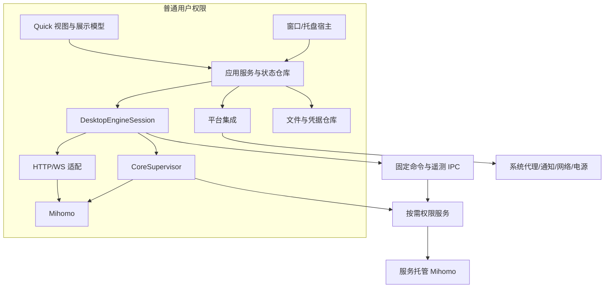
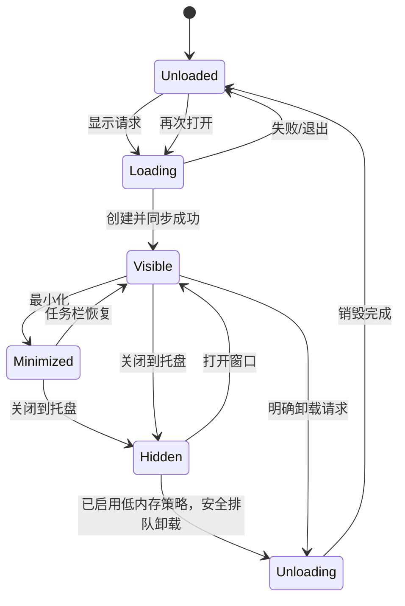
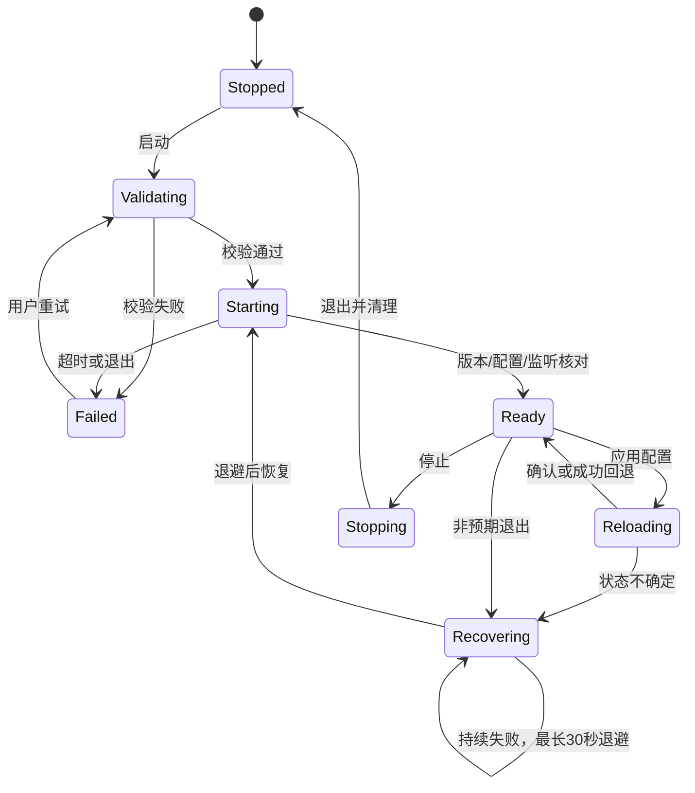
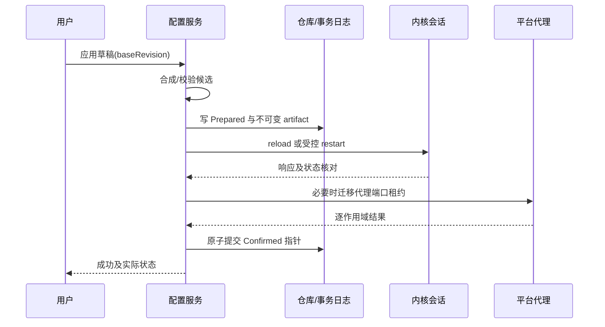
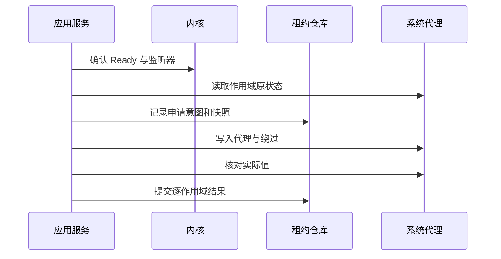
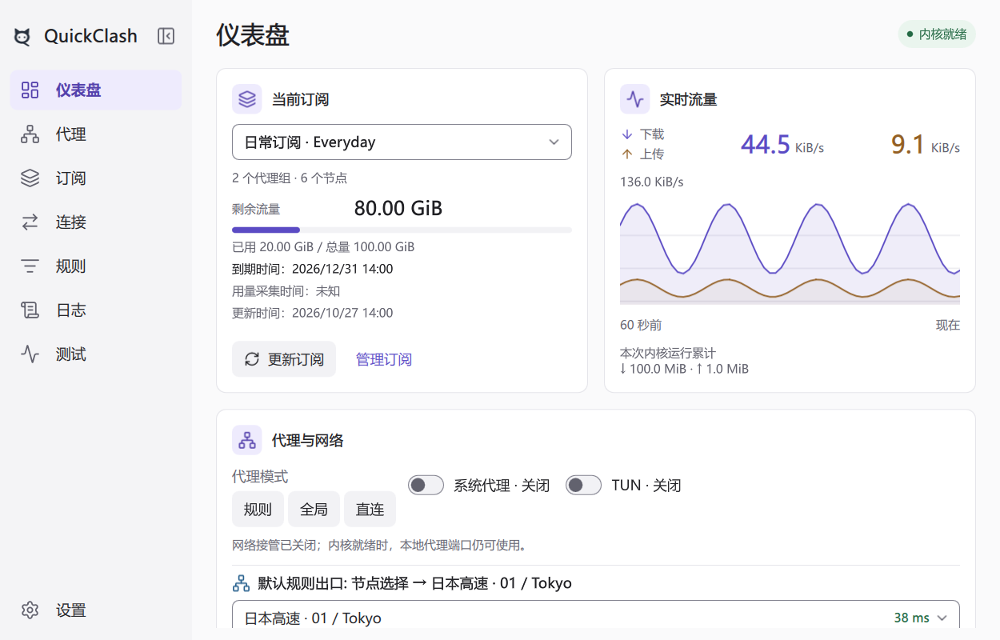
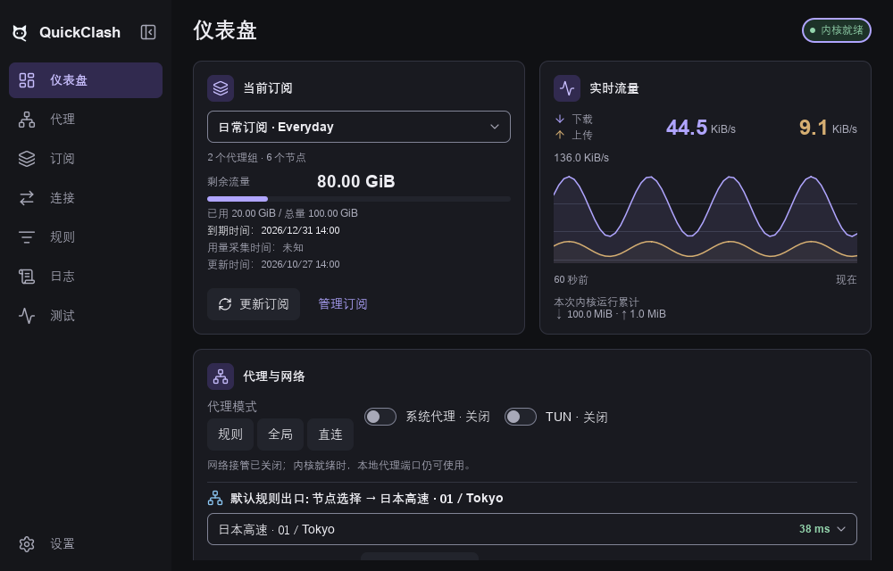

# QuickClash 完整设计文档（合并版）

版本 1.19 · 2026-11-04。由 19 个分册生成，修改请以分册为准。

**官方预编译 Mihomo；跨平台桌面目标为 Windows/Linux/macOS，Android/iOS 仅远期宿主边界；当前在 Windows 交付日常使用并持续核对共享平台边界；极简桌面工具风，统一控件/页面与Light/Dark主题，同一 Qt Quick 应用壳按宽度自适应，宽窗侧栏＋页面、窄窗底部四个图标入口；英文源文案/系统语言中英文/英文回退；客户端以小内存占用为目标，保持Qt Quick默认RHI/GPU，不设固定MB门槛，三项内存指标并记、内核单列。**

本文件包含功能范围、首页、架构、恢复、实施与验收设计。实际实现、验证证据和下一步以 [开发进度台账](../progress/README.md) 为准，设计内容不表示功能已完成。生成与一致性检查使用 scripts/build_design_docs.ps1 及其 -Check 参数。

## 目录

- [01 目标、范围与阶段计划](#chapter-01)
- [02 总体架构与运行模型](#chapter-02)
- [03 数据模型与接口契约](#chapter-03)
- [04 界面、导航与窗口生命周期](#chapter-04)
- [05 内核生命周期与控制 API](#chapter-05)
- [06 配置管理与事务应用](#chapter-06)
- [07 订阅、配置来源与资源更新](#chapter-07)
- [08 总览、代理组与延迟测试](#chapter-08)
- [09 连接、日志、规则与提供者](#chapter-09)
- [10 系统代理、TUN 与权限服务](#chapter-10)
- [11 Windows、Linux、macOS 平台适配](#chapter-11)
- [12 设置、持久化、备份与诊断](#chapter-12)
- [13 GUI 性能预算、基准与优化流程](#chapter-13)
- [14 测试、持续集成、发布与更新](#chapter-14)
- [15 Android / iOS 架构预留](#chapter-15)
- [16 设计决策、风险与需求追踪](#chapter-16)
- [17 统一视觉系统、页面模板与 Qt Quick 落地](#chapter-17)
- [18 实施任务、交付物与评审清单](#chapter-18)
- [19 网络测试、IP 与系统资源信息](#chapter-19)

---

<a id="chapter-01"></a>

## 01 目标、范围与阶段计划

文档版本：1.13；日期：2026-11-01；范围：产品目标是跨平台 Mihomo 客户端，桌面覆盖 Windows/Linux/macOS，Android/iOS 为远期宿主边界。当前 G2/G3 在 Windows 原生实现上完成最小闭环与日常使用验收；Linux/macOS 原生实现与验证按 P4 补齐。采用必要构建/受影响功能检查和单场景短测，不以穷举协议/故障/性能矩阵为统一门槛。UI采用统一视觉系统。客户端以小内存占用为持续目标，不设固定MB硬门槛；专用工作集、总工作集和私有提交同时记录，保持Qt Quick默认RHI/GPU渲染。实施结果见进度台账，其余分项预算与工期为规划值。

### 1. 产品定义

开发 **QuickClash**，基于 Qt Quick / C++ 的跨平台 Mihomo 客户端，在功能等价的前提下降低 GUI 内存、界面绘制 CPU 与后台唤醒。客户端采用按需加载、有界数据与明确资源生命周期，保留 Qt Quick 默认 RHI/GPU 渲染。内存占用受 Qt/驱动、字体、DPI、系统与负载影响，不设跨机器统一的固定MB准入值。必要辅助进程、托盘与管理层计入客户端，Mihomo 独立统计；Windows 同时记录专用工作集、总工作集和私有提交，并在同环境下比较。当前 Windows 是已有原生实现与验收证据的平台；Linux/macOS 原生构建与多平台 CI 执行排至 P4，Android/iOS 只留边界。统计边界、峰值与支持负载见 [13](#chapter-13)，不得用空白页或卸载状态代替正常页面测量。

QuickClash 为应用显示名称，内部程序/CMake project/命名空间根用 quickclash。采用现代 C++20/Qt 实践，自有源码目录和文件主干统一小写下划线；类型名、Qt/QML API 及工具固定文件名遵循各自约定，详见 [编码规范](../development/cpp_style.md)。

UI 采用极简桌面工具风：中性灰层次、小圆角、轻边框、少量蓝紫强调，Light/Dark覆盖全部页面、控件和状态。同一界面按窗口宽度自适应：常规宽度使用左侧导航＋右侧当前页面；600—999逻辑像素使用图标轨；小于600改为底部仪表盘/代理/订阅/设置四个纯图标入口。默认1000×640、最小360×480，支持竖屏窗口；窄窗布局仅说明响应式窗口适配，不构成 Android/iOS 支持，移动平台只定义边界。完整规范与概念预览见 [17](#chapter-17)。

实际代理数据面由原有 Mihomo 负责，客户端不参与逐包转发，不改造 DNS、协议、规则引擎或 TUN 栈来获得选型收益。控制接口的采样会引入额外的内核工作，应与 GUI 开销分别报告。

Clash Verge Rev 用于核对功能覆盖、服务模式与恢复流程；Linear与shadcn/ui仅提供信息层级和控件语义的理念参考。具体视觉使用本项目统一token和组件，兼顾桌面信息密度、键鼠效率与窄窗重排。侧栏列出首页、代理、订阅、连接、规则、日志、测试、设置，右侧切换当前页；宽度变化保留路由、轻量状态和业务会话。性能比较按具体版本、负载与统一口径独立测量。

内核直接采用 [MetaCubeX/mihomo 官方 Releases](https://github.com/MetaCubeX/mihomo/releases) 的预编译程序，按版本、OS、架构和 CPU 指令集锁定具体资产及摘要；不自行编译或修改内核。安装包携带已验证资产，首次使用不依赖在线下载内核。接入、更新与来源验证见 05、14。

### 2. 交付目标及优先级

| 优先级 | 目标 | 成功依据 |
|---|---|---|
| P0 | 配置、内核、系统代理状态可信 | 操作失败不遗留错误代理；恢复过程可观察 |
| P0 | 客户端小内存占用、GUI 低开销 | 常用页面、托盘与卸载状态按实际负载测量；包含必要辅助进程，同环境比较，不设固定MB硬门槛 |
| P0 | 最小订阅—代理闭环 | 导入完整 YAML 订阅、校验、调用官方内核、选择组/节点、系统代理、实际转发与退出恢复 |
| P1 | 完成日常功能 | 计划订阅、测速、连接、规则、日志、TUN 与诊断逐步交付 |
| P1 | 当前阶段日常体验完整 | 已验证平台范围内八模块主路径可用，网络开关、更新与恢复行为明确 |
| P1 | 可维护 | 平台适配、控制 API 与共享业务隔离 |
| P2 | 逐步覆盖桌面三平台 | 在现有 Windows 实现基础上，Linux/macOS 分别原生验证主要操作、快捷键与错误语义 |
| P2 | 未来移动共享 | 业务与展示模型不依赖桌面进程、窗口类型 |

功能正确性优先于节省少量内存。禁用必要错误处理、静默丢弃用户数据、降低内核日志级别或减少代理功能均不能计入前端优化收益。

### 3. 功能覆盖与交付层次

#### 3.1 最小可用版本（MVP）

MVP 在 P2 的 Windows 原生实现中交付，包含窄窗响应式导航和多语言：产品源文案为英文，QML使用qsTr、C++使用tr/固定翻译context，中文词表统一管理；默认按系统首选语言顺序匹配英文/中文，无匹配默认英文；设置页可显式选择跟随系统、English或简体中文并持久化，保存成功后就地刷新界面、导航和托盘，不重建QML引擎或网络内核；跟随系统模式在系统语言改变后重启应用生效。必需功能为完整 Mihomo YAML 格式订阅的添加/来源修改/重命名/手动更新/选择/删除、本地配置备用入口、配置校验与失败保留旧值、官方预编译内核启停、代理组/节点选择及可靠身份下的重启恢复、规则/全局/直连模式、系统代理设置与恢复、基础首页/设置/错误日志及修复入口、一次真实转发验证。首个订阅可直连获取；获取失败时允许导入离线文件。至少能保存两个配置并切换，停止、重开应用不会丢失所选配置与偏好。

首版配置范围包括 HTTP/SOCKS5/Shadowsocks、Hysteria2/Trojan/VLESS/VMess 及声明的 TLS/Reality/传输、select/url-test/fallback 组和基础规则，具体字段见 07 与能力诊断。客户端必须验证配置映射、官方加载、组/节点展示选择和模式读回；不要求把官方内核的每种协议/全部节点逐一公网握手作为 G2 门槛，真实受控节点转发仍必需。动态GEOIP/GEOSITE及受管provider资源分别在P3-20/19，fake-ip/redir-host DNS在P3-08，TUIC及声明字段/load-balance在P3-09；TUN/服务分别在P3-04/25。P3-10已交付的固定Geo/内部DNS不回退；未支持范围明确拒绝。停机选择/首次历史语义见06。Windows离线包、Job清理及租约恢复仍属P2；干净普通用户机器与真实OS/GUI宿主补证归P3-14。

“可代理”必须通过外部测试客户端显式连接本地 HTTP/mixed 代理、访问受控 HTTPS 测试站点验证；集成环境还需核对配置的代理出站收到请求，避免把 DIRECT 的 HTTP 成功当作节点转发成功。Windows 实现另用遵从系统代理的测试客户端验证系统设置生效。TUN、IP/地理信息、详细内存卡、全量诊断、自动更新和完整辅助模块不阻塞 MVP。

#### 3.2 八类模块覆盖

| 模块 | MVP 必需内容 | 日常/稳定版内容与可选扩展 | 设计 |
|---|---|---|---|
| 首页 | 当前订阅、运行阶段、主代理组/节点、启动/停止、系统代理、代理模式、内核版本、单目标测试 | TUN、流量曲线、客户端/内核内存；IP 卡按需启用 | 08、19 |
| 代理 | 组及成员查看、选择、确认实际结果；可靠身份下重启恢复 | 筛选、延迟测试、动态 provider 身份恢复 | 08 |
| 订阅 | 完整 YAML URL 添加、手动更新、激活、失败回退；本地文件备用 | 计划更新、用量/到期、覆盖编辑与版本管理 | 06、07 |
| 连接 | 不阻塞 MVP | 快照、筛选、详情、单条/批量关闭 | 09 |
| 规则 | 由内核按配置执行，无需先完成规则浏览器 | 全局及配置专属自定义规则、有序只读查看、提供者刷新 | 06、09 |
| 日志 | 有界错误/启动输出及修复入口 | Core/App/Service、暂停、筛选、脱敏导出 | 09、12 |
| 测试 | 手动验证当前代理入口可访问 HTTPS 目标 | 节点延迟、网站可达性、可选 IP 查询；不含带宽压测承诺 | 08、19 |
| 设置 | 监听端口、代理模式、系统代理、启动/关闭行为、浅/深/系统主题、订阅秘密保护、最小修复入口 | TUN、更多外观项、调度、完整诊断、备份与更新 | 10—12、14 |

以上八类能力作为独立功能模块注册完整页面及明确支持的嵌入内容，由常规桌面侧栏展示全部模块入口，窄窗底部精选仪表盘/代理/订阅/设置四入口，其余经设置/摘要次级路由访问；导航项常驻不代表页面全部常驻实例化。MVP 尚未交付的页面显示“后续提供”的禁用入口及说明，不创建空页面或请求遥测；完整能力按表中阶段交付。首页快捷操作可跳转同一路由或复用模块摘要，不另建第二套业务。未来移动底栏按 15 的平台策略选择少量模块，其余可经次级路由或嵌入呈现，不要求同时铺开八项。

#### 3.3 功能编号

| 编号 | 功能 | 范围 | 主设计 |
|---|---|---|---|
| F01 | 内核运行 | 启停、就绪、崩溃退避、版本与所有权 | [05](#chapter-05) |
| F02 | 配置管理 | 导入、编辑、覆盖、校验、事务应用、回滚 | [06](#chapter-06) |
| F03 | 订阅管理 | 下载、更新、计划、缓存、使用信息 | [07](#chapter-07) |
| F04 | 代理组与测速 | 选择、过滤、延迟、批量调度、选择恢复 | [08](#chapter-08) |
| F05 | 首页/总览 | 订阅、运行阶段、组/节点、网络/模式、流量、内核与信息卡 | [08](#chapter-08) |
| F06 | 连接 | 实时快照、筛选排序、详情、关闭 | [09](#chapter-09) |
| F07 | 日志 | 流式、缓冲、暂停、筛选、导出 | [09](#chapter-09) |
| F08 | 规则与提供者 | 全局及配置专属规则编辑、有效规则只读检查、提供者手动刷新 | [06](#chapter-06)、[09](#chapter-09) |
| F09 | 系统代理 | 应用、恢复、外部修改冲突、崩溃恢复 | [10](#chapter-10) |
| F10 | TUN 与服务 | 能力检测、授权、受限服务、状态确认 | [10](#chapter-10) |
| F11 | 托盘与窗口 | 单实例、隐藏、卸载、恢复、快捷操作 | [04](#chapter-04) |
| F12 | 设置与诊断 | 持久化、迁移、备份、脱敏、支持包 | [12](#chapter-12) |
| F13 | 应用及内核更新 | 验证、兼容性、暂存、失败回退 | [14](#chapter-14) |
| F14 | 桌面交付 | 安装、签名、卸载、平台适配 | [11](#chapter-11)、[14](#chapter-14) |
| F15 | 网络与电源变化 | 重连、休眠恢复、系统代理重新核对 | [11](#chapter-11) |
| F16 | 网络测试 | 当前入口真实请求、网站可达性与显式路径、有限批量 | [19](#chapter-19) |
| F17 | IP 信息（可选） | 手动查询出口 IPv4/IPv6、来源/路径/时间、可选地区信息 | [19](#chapter-19) |
| F18 | 系统与资源信息 | OS/架构、客户端及内核版本、客户端聚合与内核内存 | [19](#chapter-19) |

首版不含远程控制面板、任意脚本执行、WebDAV 同步、长期连接历史数据库、内置 Web 浏览器、移动端工程。后续增加功能仍需预算评审。

### 4. 分阶段交付

以下阶段及 G0—G5 描述能力范围和历史验收基线，不要求按门的编号机械串行推进；真实技术依赖和安全边界仍须满足。可以独立陈述某项能力在特定版本和范围内的真实结果，不能凭前一门、其他能力或设计本身推断通过。发布按实际声明范围核对关键行为、恢复和未关闭问题；若宣称完整历史 G2 范围，仍须核对其16项条件的有效证据。当前原生实现与验收证据集中在Windows；Linux/macOS 原生构建、启动及系统功能仍需分别验证，未运行不宣称兼容。跨平台产品定位不因现有证据分布改变。

#### P0：工程与契约基线

输入：本文档集、目标平台与工具链。

工作：确定 Qt、编译器、CMake、Mihomo 版本及来源；完成 Windows 本地空壳构建/启动与无 UI 测试，保留多平台 CMake/CI 配置；创建模块边界、错误模型、版本清单及脱敏夹具；记录依赖许可。Linux/macOS 原生及 CI 执行留到 P4。

产物：Windows 可启动空壳及本地测试证据、锁定依赖清单、API 契约、基准环境表、基础 CI 配置。CI run 和 Linux/macOS 原生证据不阻塞 Windows 第一版。

出口 G0：Windows 本地按锁定工具链完成空壳构建/启动、QML 与无 UI 契约测试；共享模块不引用桌面系统头；Windows MVP 的版本/官方资产/配置子集、隔离配置测试/启动参数、认证/模式/组选择关键 API 有真实记录。产物、夹具和后续能力见 18 的 2.1。完整离线包在 G2 本机验证，普通用户干净环境在 G3/P3-14，不将 P0 部署 smoke 当作产品包验收。G0 不要求 Linux/macOS 原生或 CI run；这些有明确 P4 任务且未验证不宣称兼容。构建可复现指流程与依赖可重复，不宣称二进制逐字节一致。

#### P1：资源原型与技术路线验证

工作：按17统一视觉系统实现托盘、页面与共享控件、1 Hz 流量图、500 节点和 1,000 连接演示；实现响应式窗口缩放、显示、隐藏、卸载、重建。用单轮短测记录三项内存及已有 CPU/句柄数据；客户端对比、自动滚动/周转、GPU、长帧和精细恢复时延按需后置。数据可先用录制或合成回放。

产物：资源原型、已有短测原始数据及行为证据、未来组件工程预留。优先复用有效证据，不为进入功能开发另建完整性能平台。

出口 G1：代表页面、双主题、隐藏/卸载/恢复行为可用；已实现首页/列表/设置及隐藏/卸载场景具备单轮短测原始数据，记录客户端进程组三项内存指标及未来服务、解析和更新的资源风险。无需两分钟预热、五次重复、十分钟长场景或帧/GPU/自动滚动专项。G1 只验证原型开发范围；G2/G3/G4 随真实组件交付抽查资源，后期按风险做持续运行与专项。不设固定MB准入值，原型数据和工程估算不代表未来组件或完整产品的实测结果。

#### P2：真实内核与配置闭环

工作：真实 API、官方预编译内核后台管理、就绪握手、停机选择/首次启动/运行切换及补偿、订阅最小管理、组/节点与模式、基础首页、Windows 系统代理与租约、错误日志、基础设置及手动转发测试。安全存储、限额下载、离线验证包及 Windows 网络/电源通知接入和有界核对同期完成；真实换网/唤醒、GUI宿主异常和干净机器验证归P3-14。

产物：从订阅或本地配置到真实代理转发的 MVP；配置、下载、系统代理和停止恢复的故障记录。

出口 G2：按19的范围，MVP-01—16全部通过，覆盖本机订阅→选择→代理页组/节点可见并可选→模式/系统代理→真实转发→停止及重启恢复；保留来源/删除、输入校验、首次关键失败、崩溃、中断、租约幂等与最小修复。错误配置不替换最后可用值，应用失败可恢复；无重复内核，UI线程无同步网络/校验等待。资源复用有效真实配置Ready首页的单场景10—30秒短测，记录客户端进程组三项指标及内核，评价同环境变化与有界生命周期，非所有操作组合。干净普通用户环境、一次真实换网或唤醒及GUI宿主补证由P3-14在G3前关闭；全协议握手/故障全排列不作为统一门槛。验收须逐项关联有效证据，设计范围本身不构成通过结论。

#### P3：Windows 日常使用交付

工作：在 Windows 完成订阅导入/解析/管理、计划更新、切换自动应用、代理组/节点选择及测速、模式、系统代理、TUN/服务、后台内核自动运行及崩溃恢复；首页、代理、订阅、连接、规则、日志、测试、设置八个页面具备声明范围内的真实功能。完善备份、诊断和可恢复的失败处理，IP 卡仍可选。同步检查共享接口、平台适配、构建条件、数据路径、能力声明、导航和多语言的静态兼容性，具体条件见 02/11/15。

F02的原文/覆盖编辑、草稿冲突、有效配置/来源差异和历史回退属于日常交付；订阅下载补显式路径、安全重定向和条件缓存。动态provider/RULE-SET、Geo、DNS分别验收，不能用固定资源或导入展开代替全部运行时更新能力。高级协议以TUIC、已声明传输字段和load-balance为有限范围，逐字段冻结，不以“等高级协议”承诺任意协议。具体任务与依赖见18/2.3。

产物：Windows 可日常使用包、必要功能与恢复证据、使用/恢复说明及已知限制、跨平台静态兼容核对报告。日常使用交付是本地 Windows 产品结论；正式公开发行的签名、在线更新等另按 14 执行。

出口 G3：F01—F12、F16、F18 在 Windows 闭环；完整路径为订阅导入/更新 → 选中订阅自动应用 → 组/节点选择 → 规则/全局/直连模式 → 系统代理或 TUN → 真实节点转发 → 崩溃恢复及退出清理。订阅失败保留旧配置，恢复不覆盖用户后续修改，缺权限有可操作退路；Windows TUN/服务仍需真实功能证据，不以代码存在替代。F17 未启用则隐藏，启用则验收。后台无页面专属连接/日志大流；资源敏感交付选择一个代表场景做 10—30 秒短测，包含必要客户端/服务进程，记录三项内存指标，内核另记；检查有界性及同环境资源变化，不设固定MB硬门槛。复用未受影响的证据，不要求全场景性能矩阵。

G3 还需完成 P3-13 的跨平台静态兼容核对和已识别耦合修正；这不要求 Linux/macOS/Android/iOS 原生构建、设备运行、安装签名或多平台 CI。静态通过不等于其他平台已支持。P3-14补齐普通用户干净Windows环境、一次真实换网或唤醒、真实GUI整体强杀/下次恢复、运行会话隐藏重建及一次外部代理变更核对；复用底层有效证据，只补宿主/系统差异，不穷举组合。

#### P4：后续逐步扩展桌面三平台

工作：完善 Windows 正式安装/更新；Linux、macOS 分别完成原生构建与最小代理链路，再逐项补桌面代理、托盘、权限服务、网络/电源、安装签名和更新。GNOME/KDE、架构及系统版本分别声明，不要求两平台同批完成。

产物：按平台逐次发布的验证包和支持矩阵；Windows/Linux/macOS 均达到声明范围后汇总为三平台 Beta。P4/G4 是后续覆盖里程碑，不是 G3 Windows 日常使用交付的前置。Windows 正式安装/更新任务也不依赖 Linux/macOS 完成。

出口 G4：支持矩阵内 F01—F16、F18 通过，F17 如启用也必须验证；缺少托盘等平台能力有可操作的退路；更新/服务和三平台真实负载补测资源、检查有界生命周期并建立各环境基线；不笼统宣称所有发行版支持。

#### P5：稳定版与资源回归

工作：同条件对比、长期运行、窗口循环、配置与更新中断、磁盘故障、应用/内核更新回退、安装包验证、许可证及源码交付检查。

产物：候选稳定版、性能报告、升级/回退报告、用户说明、发行清单。

出口 G5：冻结预算与阻断缺陷标准满足；无数据损坏、错误代理遗留或可复现的持续资源增长；签名、校验和、源代码/许可材料齐备。

#### P6：按证据进行的后续优化

仅在分析结果支持时实施：原生托盘、独立 UI 进程、自定义场景图图表、更细的模型差异算法。每项都要比较新增代码、测试及平台维护成本。Android/iOS 不属于 P0—P6 的当前交付承诺，按下述远期计划另行启动。

#### 4.1 平台覆盖路线与证据层次

| 覆盖步骤 | 当前/未来工作 | 可以声明的结果 |
|---|---|---|
| 当前：Windows 实现，P3/G3 | 在 Windows 上完成功能、必要真实验收和日常使用交付；同时维护共享边界静态核对 | 仅对已验证 Windows 版本/架构声明功能范围 |
| 后续：Linux/macOS 桌面原生，P4/G4 | 在共享实现基础上分别完成原生构建、运行、系统集成和平台验收 | 每个平台按实际证据独立声明支持；完成后汇总桌面三平台 |
| 远期：Android/iOS 宿主评估 | 在三桌面平台基础上分期评估 Android，再评估 iOS 的宿主、权限、内核资产及分发可行性 | 每个移动平台单独立项和验收；移动是规划，不承诺当前可运行 |

每个平台分别记录“边界设计、静态检查、原生构建、真实功能验收”，并附 NotRun/Pass/Fail/Blocked/Stale 与证据；这些层次互不替代。Windows 窄窗底栏只证明响应式布局，不能证明 Android/iOS 的 VPN、后台、触摸或签名可用。移动内核宿主与官方资产可行性须届时核验，不为凑齐五平台改造或自行编译内核；不满足条件时记录限制和后续方案。

### 5. 阶段准入的执行规则

每个 G 门都有结论：通过、带已知限制通过、未通过。已知限制不能覆盖数据损坏、权限越界、错误代理恢复或资源无界增长。条件通过必须记录受影响平台、临时行为、修复任务和复测期限。

阶段可并行开展无依赖任务，例如 P1 时准备 macOS 签名和 Linux 测试环境；不得跳过 G1 后直接以完整功能数量证明技术选型成功。

### 6. 需求变更

新增需求记录：使用场景、对应功能 ID、资源成本、持久化变化、受影响平台、测试、所属阶段。影响共享接口或权限边界时记录设计决策。固定预算变化需保留旧值、调整原因与新测量依据。

本文档集是设计成果，不代表功能已实现，也不代表所列性能目标已达到。

---

<a id="chapter-02"></a>

## 02 总体架构与运行模型

关联：[阶段计划](#chapter-01)、[接口](#chapter-03)、[内核](#chapter-05)。

应用名 **QuickClash**，内部 project/程序基础名为 quickclash，命名空间以 quickclash 为根。编码与命名依据 [C++ 与源码规范](../development/cpp_style.md)：C++20/RAII/明确所有权，Qt 对象线程约束；类型保留 PascalCase，源码目录/文件使用小写下划线。

### 1. 技术选型

| 部分 | 决定 | 理由与限制 |
|---|---|---|
| 界面 | Qt Quick Controls + 轻量自有组件 | 控制对象规模、绘制和跨平台布局 |
| 应用逻辑 | C++20，Qt Core/Network | 固定类型数据、异步 IO、可分析的内存所有权 |
| 构建 | CMake，qt_add_qml_module | 标准 QML 模块、构建期缓存、依赖收敛 |
| YAML | 锁定版本的 yaml-cpp 候选 | P0 验证格式、解析限额与许可证；不保证注释往返 |
| 元数据 | 版本化 JSON 文件 + 原子写入 + 操作日志 | 首版不增加连接历史数据库 |
| 内核 | 官方 Releases 预编译 Mihomo 可执行文件 | 不自行编译/修改；锁定资产、CPU 要求与摘要 |
| 托盘 | QSystemTrayIcon + QApplication | 首版成熟实现；实际模块成本纳入测量 |
| 平台桥 | C++ / Objective-C++ 与原生 API | 差异收敛在适配模块 |

Qt 小版本、最低系统候选范围、Mihomo tag/资产/摘要在 P0 的 release-matrix 文件冻结；P4 对候选范围完成运行验证并形成正式支持声明。本文不假定当前最新版本和所有发行版均已验证。Qt Widgets 只用于宿主和托盘，不要求主界面采用 Widgets。

离线包以随包metadata/release_matrix.json标识资源布局；受管内核只解析包内core路径并核对冻结摘要，缺失或不匹配进入可修复错误，不回退源码目录或开发缓存。开发核心回退仅用于未部署的测试构建。

### 2. 进程拓扑



普通模式与服务模式只允许一个会话拥有目标内核。图中的两个 Mihomo 是互斥部署方式，不是同时启动两份。流量直接经过内核监听器或 TUN，不穿过客户端界面。

普通模式由用户态适配器持有控制器凭据并直接访问 HTTP/WS；服务模式由服务独占高权限内核的凭据，GUI 只能经受限 IPC 发固定命令并接收遥测，不能直连其配置 API。服务重新校验配置字段和资源，不信任 GUI 的“已验证”标记。网络测试由普通用户请求显式连接本地代理监听器，属于数据面流量，不借用控制器凭据。细节见 10、19。

默认客户端退出时停止所拥有的内核并恢复所拥有的系统代理。首版不提供“GUI 全退出但自动保留代理”的隐式行为；关闭窗口进入托盘与退出命令分开。服务是否驻留不代表内核会话应继续运行。

### 3. 模块和依赖

| 模块 | 内容 | 可依赖 | 不可依赖 |
|---|---|---|---|
| domain | 类型、值对象、校验规则、能力 | C++ 标准库、必要 QtCore 值类型 | 网络、QML、系统 API |
| application | 配置/订阅/选择/状态协调 | domain、抽象接口 | QProcess、窗口、具体 HTTP 路径 |
| infra-core | API、进程、会话实现 | application 接口、QtNetwork | QML 页面 |
| infra-storage | JSON、YAML、凭据存储适配 | domain、QtCore、平台凭据桥 | 页面状态 |
| platform | 系统代理、托盘、服务 IPC、电源 | 接口、平台库 | 页面业务决策 |
| presentation | ViewModel、列表模型、操作门面 | application、QtCore | 直接写系统代理、拼 API |
| ui-features | 功能模块的页面适配器、可嵌入内容、模块描述 | presentation 公开属性/命令、共享 UI 组件 | 具体侧栏/底栏、其他功能页面、文件/网络/进程管理 |
| ui-shell | 导航投影、路由、PageHost/EmbeddedHost、平台布局 | 已注册功能描述、页面工厂、共享 UI 组件 | 在导航项中实现业务、直接访问底层 IO |
| host | 组装依赖、单实例、窗口生命周期 | 上述模块 | 可避免的业务规则 |

平台集成接口按职责拆为代理、服务、通知、电源等小接口；上层可提供 IPlatformIntegration 聚合门面，避免一个包含几十个无关方法的接口。

桌面运行时以 ICredentialStore、ISystemProxyLease、IDesktopProcess 和 IDesktopResources 接收凭据、代理租约、受管进程及采样能力；infra 在存储工作线程组装 DesktopServices，每个适配器由 unique_ptr 单独持有，QObject 不重复挂父对象。运行时先停止会话/校验并取消任务，再销毁适配器；信号和排队回调绑定所属 QObject，取消后以 generation 拒收迟到结果。桌面进程契约是宿主替换点，PID 仅用于桌面诊断/所有权核验，不作为配置或业务会话身份。

平台描述提供核心文件名、冻结摘要及 Supported/RequiresAuthorization/Unsupported 能力；业务使用 Qt 路径组合和逻辑资源标识。未实现适配拒绝凭据读写、代理修改、进程启动和服务命令，不创建替代明文、打开 IPC 或把缺失采样报为零占用；服务异步错误也须在 close 或所属对象销毁后取消。系统代理/TUN 控件和托盘入口按能力启用并给出可翻译的不可用原因。

#### 3.1 Windows 实施期间的静态兼容约束

当前先实现 Windows 适配，但共享业务不把 Windows 当作唯一宿主。G3 的静态兼容核对包括：

- domain、共享 application/presentation 和 QML 不直接引用 Win32、SCM、WinINet、DPAPI 或 `platform/windows` 具体实现；资源采样、凭据、代理、服务、网络/电源和进程所有权经职责接口提供。桌面专用编排允许依赖桌面会话契约，具体实现由 host/infra 组装。仅给业务中的 Windows API 加条件宏不足以完成分层。
- CMake 按平台选择源文件和系统库，Windows 服务仅在 Windows 构建；共享 target 不通过 PUBLIC 头文件/链接依赖泄漏平台 SDK。尚未实现的平台使用明确的 Unsupported 能力，不能用空实现返回成功。
- 业务以配置/会话逻辑标识引用数据；路径、凭据及资源位置由 Qt/平台适配解析，不固定盘符、注册表或用户目录，不向共享接口传 HANDLE、QProcess 或桌面 IPC 地址。
- QML 按能力显示网络开关、授权和不可用原因；功能模块与侧栏/底栏解耦，英文源文案统一翻译，桌面窄窗可提前核对布局与长文本。
- 保持异步、取消、epoch/revision、UI 销毁后会话独立等现有契约。移动宿主另行实现，不假定桌面外部进程、常驻服务和准时定时器在移动端成立。

通过源码/依赖核对、构建条件检查和现有接口测试留证即可完成本期静态检查；不要求创建空的全平台工程、RPC 框架或所有未来适配器。发现当前实现耦合必须记录并修正，P3-13 未完成前不得声称跨平台静态兼容已通过。后续各平台仍需原生工具链和真实系统验收。

NetworkProbeService 承担网站/IP 查询，ResourceSampler 承担本机进程资源采集；二者经应用接口返回不可变结果，不在 QML 中发网络请求或读取 PID。首页、测试面板和诊断复用结果与需求聚合，不能为同一内核各建一套遥测。

UI 功能按首页、代理、订阅、连接、规则、日志、测试、设置拆成独立模块。每个模块注册轻量 FeatureDescriptor，提供完整页面适配器和明确支持的可嵌入内容工厂；壳按 NavigationPolicy 生成桌面全部入口或未来移动精选入口。页面内容不导入 DesktopSidebar/MobileBottomBar，不引用兄弟页面 ID 或操作全局 StackView；跨模块只请求稳定路由或由壳组合内容。依赖方向为平台壳/组合布局 → 注册契约与功能工厂 → 展示门面 → 应用服务，功能模块不反向依赖平台壳。

注册表只保存元数据和惰性工厂，不创建全部页面。嵌入复用不带窗口标题/导航栏的内容组件，不能在首页中塞入完整页面及其工具栏。应用仓库保持业务单一状态；各可见内容实例以独立 demand token 声明 Summary/List/Detail 数据需求，离开或隐藏时释放，聚合后由仓库复用数据流。平台编排采用仓库内静态配置/类型化代码，不引入运行时下载插件或通用插件框架。契约见 03，生命周期见 04。

### 4. 推荐源码结构

```text
app/                    启动、依赖组装、单实例、窗口宿主
src/domain/             通用模型与错误
src/application/        用例、事务、仓库接口、需求协调
src/presentation/       展示门面、Qt 模型、轻量导航契约
src/infra/core/         Mihomo API、CoreSupervisor
src/infra/storage/      JSON、YAML、原子文件与凭据
src/platform/windows/   系统代理、服务、安装桥
src/platform/linux/     桌面代理、DBus/polkit
src/platform/macos/     代理、菜单栏、helper
qml/components/         通用组件、主题 token
qml/features/<module>/  独立页面适配器与可嵌入内容
qml/shell/              注册表、路由、页面/嵌入宿主
qml/desktop/            左侧导航与桌面编排策略
services/               受限权限服务
tests/                  单元、契约、集成、UI、恢复
bench/                  回放、基准脚本和场景定义
packaging/              三平台打包
docs/                   接口冻结、ADR、发行矩阵
```

平台目录在非目标平台不参与编译。通过 target 依赖落实边界，不依靠目录命名自觉。Mihomo 是可替换发行资源，不将内核源码混入 UI target。

具体文件例如 core_supervisor.h/.cpp、proxy_group_model.h/.cpp、flat_tile.qml、subscription_page.qml、page_host.qml；不得创建 CoreSupervisor.cpp 或 subscription-page.qml。QML 通过 `QT_QML_SOURCE_TYPENAME` 显式导出 FlatTile 等合法类型名，代码模块 URI 可用 QuickClash.Ui。工具固定的 CMakeLists.txt/CMakePresets.json 等按规范例外保留。源码命名脚本、格式器/clang-tidy 配置随工程执行，QML 使用 Qt 自有工具，不把 clang-format 用于 QML。

### 5. 线程模型

| 执行上下文 | 职责 | 约束 |
|---|---|---|
| GUI/应用事件线程 | 应用状态、用例协调、模型变更、窗口 | 不阻塞文件、网络、校验或服务等待 |
| 网络事件线程 | QNetworkAccessManager、WebSocket、传输 | QObject 在所属线程创建、使用和销毁 |
| 有界工作池 | YAML、JSON 解析、差异计算、签名校验 | 大任务并发有上限，支持过期结果丢弃 |
| 存储串行执行器 | 元数据写入、事务日志、迁移、备份 | 同一仓库只有一个写者 |
| 内核/服务进程 | 转发、系统权限操作 | 不回调操作 GUI 对象 |

初期网络对象也可在 GUI 线程异步工作；若使用独立网络线程则完整迁移对象，不交叉调用。解析与大文件操作必须离开 GUI 线程。避免为了每个模块建立一个常驻线程；线程数量与栈开销属于资源预算。

跨线程传递不可变值或共享只读快照。QAbstractItemModel 的 begin/end、行数据与信号都在 GUI 线程执行。取消令牌可终止尚未执行工作；无法中断的解析用 generation 校验使结果失效。

DesktopRuntime在存储worker上维护业务状态，生产发布拆成紧凑可靠控制状态与独立集合/样本；显式snapshot只供诊断和无界面集成查询，不从定时publish调用。控制状态、Operation完成及命令可靠排队；可覆盖完整通道状态经LatestMailbox合并，同轮worker发布合一，GUI前最多一个待处理唤醒与各通道最新值，不增加线程池。邮箱关闭与投递使用同一锁，GUI销毁时关闭，随后执行存储线程屏障/退出；迟到发布不得解引用已销毁QObject。

### 6. 状态权威与命令流

应用状态仓库拥有期望状态与操作状态；内核/API 是运行时事实来源；系统 API 是系统代理事实来源。ViewModel 只读状态并发命令，不自己成为第二份运行时权威。

用户操作经过：门面校验 → 创建 operationId → 用例调度 → IO/系统操作 → 核对实际结果 → 更新仓库 → 模型通知。按钮显示进行中，成功必须有确认依据；超时进入“待核对”，不自动等同失败或重发非幂等操作。

区分 DesiredState、ObservedState、OperationState。例如 TUN 期望开启但内核尚未确认时，展示“正在启用”，不能提前显示已开启。

### 7. 并发和资源调度

EngineMutationCoordinator 串行处理影响同一会话的启动、停止、配置应用、TUN 模式切换与内核更新。一次配置应用中途不允许另一操作覆盖其配置或进程。用户停止请求可取消尚未提交的步骤；已产生系统变更时必须进入补偿。

IProxyApplication 位于 application，编排 startCore/startProxy/stopProxy/setSystemProxy；CoreSupervisor/API 不读写系统代理。配置单写者分别提交 ConfigSelection 与运行确认，首次历史可空；组合启动的中间 Ready 不表示整体成功，失败按本次新建/复用会话及租约边界补偿，见 05/06。

ResourceBudgetCoordinator 是应用层单一预算分配者。解析、下载解压、连接快照、导出与更新先申请工作集额度；无法预留则排队、减小可选采样或显式拒绝超限输入，退出/停止/补偿优先，不能因遥测占满预算而阻塞控制。按实测放大系数估算解析峰值，不只累计文件字节；后台完成后释放额度，旧 generation 结果不继续提交。额度用于限制并发和数据放大，不承诺固定客户端内存上限；资源收益依赖真实测量与同环境基线。

配置草稿不占内核锁；订阅可并行下载，但同 profileId 的候选提交串行；节点测速为独立有界任务。配置应用期间暂停提交依赖旧配置的组选择、模式与提供者变更，读/测速结果核对 expectedRevision，应用后刷新再接受新命令；关闭连接按当前 epoch/目标集合校验。互斥获取顺序固定为会话变更协调器 → 配置仓库提交 → 平台代理租约，不持有线程阻塞锁等待网络。

每次内核启动生成 engineEpoch；每次期望配置变更生成 revision；每次列表快照有 sequence。旧 epoch 的结果不得覆盖新会话。接口细节见 [03](#chapter-03)。

### 8. 启动顺序

1. 定位用户目录、获取单实例锁；第二实例通过受限本地 IPC 请求显示窗口后退出。
2. 读取设置版本与待恢复事务，完成恢复判定，禁止无条件套用旧系统代理快照。
3. 创建应用服务和托盘宿主；窗口按用户设置决定是否立即创建。
4. 读取 ConfigSelection 与可空确认历史；只读损坏/过新 schema 修复模式不启动。默认自动启动关闭；用户以后启用时校验所选版本并启动，不把历史 activeRevision 当作仍在运行。
5. 就绪及监听器确认后，按保存的用户意图申请系统代理/TUN；失败明确降级。
6. 恢复订阅计划；页面可见后才申请页面统计需求。

自动启动代理失败不阻止打开设置、日志和配置修复。不能为了“快速启动”先写系统代理再等待内核。

### 9. 退出和异常恢复

正常退出：拒绝新变更 → 停止统计需求与调度 → 恢复本应用仍拥有的系统代理 → 停止内核会话 → 写入退出结果 → 关闭服务会话与进程。各步骤有截止时间，不能无期限卡住退出。

异常退出由本地事务日志与代理租约记录支持下次恢复；服务模式可由会话心跳超时执行受限清理。无权限服务时无法保证客户端被强杀后立即恢复系统代理，需在下次启动恢复并提供手工恢复指引，不能承诺不存在的实时保证。

### 10. 架构验收

- 销毁并重建 UI 不产生第二个内核或丢失操作状态。
- application/domain 在不链接 QtQuick/Widgets 的测试目标中可用。
- 高频数据没有完整 JSON → QVariant 树 → JS 数组 → 第二行模型的长期多份保留。
- 崩溃恢复和操作补偿依赖持久化状态，不依赖 QML 页面是否存在。
- 动态增加原生托盘或独立 UI 进程时，不重写配置、订阅和业务状态模型。
- 功能模块不依赖侧栏/底栏；桌面导航全量显示、策略精选显示和内容嵌入均使用相同模块，不复制业务或常驻额外完整页面；移动端本期只检查边界。

---

<a id="chapter-03"></a>

## 03 数据模型与接口契约

本文件定义应用内部契约。这里的类型和方法是实现设计，不是现有 Mihomo API 的逐字映射；外部字段由 [05](#chapter-05) 的锁定版本适配。

### 1. 标识、时间与版本

| 名称 | 定义 | 使用规则 |
|---|---|---|
| profileId | 本地 UUID | 改名、换 URL 不改变；复制配置产生新 ID |
| revision | 本地单调递增配置版本 | 表示合成后的候选内容，不使用墙钟时间代替 |
| engineEpoch | 每次启动尝试分配的会话唯一值 | 旧请求、旧连接 ID、旧测速不能跨会话使用；控制连接重连不改变它 |
| operationId | 单次用例 UUID | 从用户操作贯穿下载、校验、提交和诊断 |
| sequence | 某一数据流的单调序号 | 仅在相同 epoch 和流内比较 |
| schemaVersion | 持久化格式版本 | 明确迁移路径，不能用应用版本代替 |

持续时间使用单调时钟；计划更新时间、订阅到期使用 UTC 墙钟，展示时本地化。字节/累计计数使用 64 位整数；QML 展示通过格式化字符串或安全数值门面，避免 JavaScript 大整数精度丢失。

### 2. 核心数据模型

#### 2.1 Profile

| 字段 | 类型/语义 | 持久化 |
|---|---|---|
| id/name/kind | UUID、用户名称、Local/Subscription | 是 |
| sourceRef | 本地受管文件引用或 subscriptionId | 是 |
| rawHash | 原文摘要 | 是 |
| userOverlayRef | 用户结构化覆盖/补丁 | 是 |
| lastGoodRevision | 最近经运行确认的版本，可空；由配置 manifest/确认历史投影 | 索引可重建，不独立提交 |
| candidateState | None/Downloaded/Validated/Rejected | 是，含原因 |
| createdAt/updatedAt | UTC | 是 |

文件引用是受管目录内的逻辑 ID，不接受导入文件直接指定绝对写入路径。原始 YAML 保存原文；结构化修改另存覆盖层。

#### 2.2 Subscription

字段：id、profileId、sourceGeneration、urlSecretRef、displayOrigin、requestHeaderSecretRef、enabled、interval、nextDueAt、lastAttemptAt、lastSuccessAt、etag、lastModified、validatorContentHash、backoffCount、usageInfo。sourceGeneration 在来源/认证改变时递增；删除后旧 generation 永久失效，原 ID 不复用。

displayOrigin 只保存脱敏主机/路径提示，完整 URL 视为秘密。usageInfo 含上传/下载/总量/到期和来源可信度，字段缺失用 unknown，不能用零冒充未知。

#### 2.3 RuntimeConfig 与 EngineStatus

RuntimeConfig：revision、profileId、effectiveHash、artifactRef、coreVersion、overlayVersion、createdAt、validationResult、applyState。applyState 为 Candidate/Validated/Prepared/Applying/Confirmed/Failed/RolledBack。

ConfigSelection：selectedRevision、selectedPreferenceSnapshotRef、selectedResourceManifestRef、selectionGeneration，表示下次启动使用的已验证版本，允许与上次确认版本不同。首次导入时 activeRevision/lastGoodRevision 均可空。持久 manifest 的 activeRevision 只表示最近运行事务的确认版本，不表示进程正在运行；当前运行事实由 EngineStatus 的 epoch/configRevision 表达。停机选择只推进 ConfigSelection，不生成伪 Confirmed；详细规则见 06。

RuntimeConfig 还引用 resourceManifestRef 与 preferenceSnapshotRef。全局 RuntimePreferences 持有 mode、tunDesired、listenerPolicy、preferenceVersion；MVP 默认 rule、TUN 关闭、回环 HTTP/mixed 监听。具体事务与优先级见 06/08，QML 不保存第二套偏好。系统代理意图与平台代理租约独立，不写入内核 YAML。

RuntimeConfig 是不可变的语义配置模板；effectiveHash 不包含每次启动新生成的 controller secret/epoch。SessionConfig 将它与会话保留字段合成，包含 epoch、revision、受限 launchConfigRef 和 materializedHash；实际传给内核的文件必须已注入认证，不能直接执行无 secret 的模板。校验使用独立临时 SessionConfig，运行重载也生成对应 revision 的新会话文件。二者的来源/hash 与秘密生命周期见 05/06。

EngineStatus：epoch、lifecycle、ownership、version、configRevision、configCertainty、controllerEndpoint、listeners、tunObserved、health、lastError。controllerEndpoint 不向普通页面暴露认证信息；configCertainty 为 Confirmed/Uncertain/Unknown。

不能用 GET /configs 的局部字段反推完整运行配置 hash；configRevision 的确认来自本地提交记录、成功响应及必要的运行时核对。崩溃导致不确定时通过受控重载/重启收敛。

#### 2.4 代理、连接和日志

| 模型 | 主要字段 | 标识规则 |
|---|---|---|
| ProxyGroup | name、type、members、current、selectable、testable | 同 epoch 下 name；名称变化重新映射 |
| ProxyNode | name、type、udp、provider、delayState、delayMs、testedAt | udp只在配置明确声明时为真；不假设订阅之间同名即同节点 |
| Connection | id、metadata、chains、rule、start、upload、download | epoch + 内核 connectionId |
| LogEntry | localSeq、timestamp、level、source、message | 有界缓冲中的本地序号 |
| TrafficSample | epoch、monotonicAt、uploadRate、downloadRate | 断线形成 gap，不插入虚假的零 |
| Provider | name、kind、vehicleType、updatedAt、health、count | kind + name |
| Rule | index、type、payload、target、providerRef | epoch + 规则快照序号 + index |

规则顺序有意义；不能为显示而修改实际规则顺序。连接累计数值不总是速率，需有时间差才计算速率。

用户自定义规则独立于内核 Rule 快照：每项具有稳定 ID、作用范围（全局或 profileId）、启用状态、顺序、匹配类型/内容和出口。全局“代理”出口按 profileId 绑定一个用户选择的代理组，配置专属规则可直接引用该配置的组；绑定不代表内核已确认的节点选择。规则和绑定有自己的修订基线，运行配置记录参与合成的版本及结果；具体合成与事务见 [06](#chapter-06)，页面交互见 [09](#chapter-09)。内核快照序号不是用户规则 ID。

选择恢复记录包含 profileId、groupName、memberName、sourceIdentity、nodeFingerprint、confirmedAt；provider 名称单独不能证明节点未变。指纹在 C++ 中对规范化协议/地址/端口及影响身份的字段生成带本地密钥的摘要，不将认证明文写入索引/日志；缺乏可靠身份则 identityConfidence=Unknown，跳过跨 revision 自动恢复。动态 provider 内容变化单独增加 generation。

#### 2.5 首页、测试与资源模型

| 模型 | 关键字段与语义 | 保存策略 |
|---|---|---|
| DashboardSummary | activeProfile、subscriptionUsage、runtimeStage、primaryGroup、selectedMember、observedNetwork、mode、coreInfo | 从业务仓库投影；不复制全量节点/连接 |
| ProbeRequest | requestId、targetId/URL、kind、route=Direct/CurrentProxy/SystemDefault、expectedEpoch/revision、networkGeneration、deadline | 手动请求，受限队列 |
| ProbeResult | status、route、HTTP 状态、totalDuration、observedAt、staleReason、optionalExitIp、evidence | 有界会话缓存；失败不是零延迟 |
| IpInfo | IPv4/IPv6、family、source、route、queriedAt、optionalRegion/ASN、freshness | 默认内存保存、可隐藏，不默认写诊断 |
| ProcessResourceSnapshot | clientProcessGroup、coreIdentity、memoryMetric、clientBytes、coreBytes、completeness、sampledAt | 仅 owned 进程低频采集；缺权限为 Unknown |
| ManagedResource | id、kind、sourceIdentity、contentHash、managedRef、writer、mutable、generation、retentionRefs | 随资源 manifest 保存；动态资源显式区分 |

runtimeStage 是用户运行阶段（未配置/下载中/校验中/启动中/运行中/停止中/恢复中/失败/待核对），不展示 P0—P6 开发阶段。连接、网站、内存卡都带数据时间；UI 资源读数和 13 的正式预算口径有差异时必须标明。

#### 2.6 功能注册与导航编排（仅展示层）

以下契约属于 presentation/ui，不下沉到 domain/application，不把 QML 工厂或导航枚举传入业务接口。

| 契约 | 字段与职责 | 约束 |
|---|---|---|
| FeatureDescriptor | moduleId、titleKey、iconKey、pageRoutes、capabilityRequirement、availability、pageFactoryRef、embeddedFactories | 八个稳定 moduleId：home/proxies/subscriptions/connections/rules/logs/tests/settings；工厂惰性，描述对象不持有页面实例 |
| PageRoute | pageId、moduleId、允许的参数 schema、默认上下文 | pageId 在平台间稳定；参数只含有界业务 ID/筛选等，不传 QML 对象、秘密或任意组件路径 |
| EmbeddedFactory | contentId、factoryRef、supportedContexts、demandProfile、stateSchema | 仅暴露模块声明支持的 Summary/List/Detail 等内容形态；不要求每个模块支持所有形态，不嵌套完整页面壳 |
| NavigationPolicy | navigationEntries、secondaryEntries、embeddedPlacements | 仓库内平台编排配置：目标引用已注册 pageId/contentId；桌面列出全部模块，未来移动按空间选择、分组或嵌入 |
| NavigationItem | itemId、labelKey、iconKey、targetPageId/入口组、selected、enabled、reason | 从描述与策略投影，导航项与功能模块不是一一绑定；更多属于壳的入口组，不是业务模块 |
| PresentationContext | instanceKey、pageId/contentId、受校验业务上下文、presentationMode、active、visibility、stateKey | 页面和嵌入实例分别拥有生命周期；不能以单个全局 currentPage 判定所有内容是否活跃 |

展示接口为 registry.resolve(pageId/contentId)、router.navigate(pageId, context)、router.openDetail(...) 及宿主 activate/deactivate/restoreState；功能内容只发出路由/详情意图，具体页面切换、弹层或移动返回由壳执行。ViewModel 接收业务 ID/筛选及独立 demand token，不因从侧栏进入或嵌入进入而改变业务命令。

导航不显示仅代表平台布局选择，不等于能力禁用或权限被授予。路由解析和嵌入宿主均检查实现状态、参数与 capability；后台用例/权限服务仍独立检查授权。移动未在底栏出现的已支持功能可通过更多/详情路由或嵌入访问；明确不支持的模块不可通过隐藏路由绕过检查。未知路由给出可返回的错误，不能偷偷切换到另一功能。

### 3. 操作和错误

所有异步命令立即返回 operationId；完成通过状态或事件交付。Operation 包含 kind、target、stage、startedAt、deadline、cancelability、result。依赖配置的控制还携带 expectedRevision 与目标 generation：热重载不改变进程 epoch，但旧配置的组选择、测速和规则结果仍需失效。支持 Pending/Running/Succeeded/Failed/Cancelled/Uncertain，只有业务核对完成后进入 Succeeded。

统一错误结构：code、category、userMessageKey、retryable、operationId、stage、redactedDetail、optionalOsCode，以及可空的configIssues值列表。诊断细节不直接显示完整请求、配置或凭据。

配置预检的configIssues最多32类，每项为code、path、feature、phase、occurrences；使用固定错误码/功能词和结构索引路径，如$.proxies[0].network。同类多项按索引归一为[*]并计数，避免重复项淹没其他类别。任意未知键统一显示<field>，不回显用户键名、节点/组名、URL、认证值或YAML异常原文。可以一次列出多类兼容性问题；解析/结构错误仍可提前终止。字段错误使用InvalidConfigField，不兼容按协议、传输、组、规则、DNS、外部资源和字段分类，界面统一翻译成英文/中文，持久日志只记稳定总错误码。成功操作清除旧诊断，具体支持字段见config_policy.json。

| 类别 | 例子 | UI 处理 |
|---|---|---|
| Input | YAML 语法、端口冲突 | 定位字段与行，不自动重试 |
| Network | 下载超时、DNS、TLS | 保留旧数据，允许重试 |
| Auth | 控制器秘密不匹配、授权拒绝 | 修复会话/授权，不无限重试 |
| Core | 启动失败、接口不支持 | 版本/日志入口与恢复操作 |
| Platform | 系统代理部分失败 | 列明失败作用域与当前状态 |
| Conflict | 草稿过期、租约变化 | 刷新、保留草稿，用户选择处理 |
| Storage | 空间不足、原子提交失败 | 不覆盖最后可用数据 |
| Integrity | 更新签名不合法 | 拒绝安装并保留现有版本 |
| Cancelled/Uncertain | 用户取消、提交响应丢失 | 分别显示，后者先核对状态 |

控制结果和错误不能像遥测快照一样被最新值覆盖。操作结果保留有限历史，例如最近 100 条或 24 小时，秘密剔除后落盘。

### 4. 应用接口

以下为概念签名，实现可用 QObject 信号/槽和强类型值；不要求暴露 C++ future 给 QML。

| 接口 | 方法/事件 | 语义 |
|---|---|---|
| IProxyApplication | startCore(selectionGeneration), startProxy(selectionGeneration), stopProxy(reason), setSystemProxy(desired) | 应用层组合用例；串行协调配置、内核、租约与补偿，不把系统代理塞入内核适配器；语义见 05 |
| IEngineSession | capabilities(), observedStatus() | 不含平台窗口与进程句柄 |
| 同上 | start(config), stop(reason) | 经变更协调器，返回 Operation |
| 同上 | validate(config), apply(config, mode) | 校验与应用分离；mode 为 reload/restart 决策 |
| 同上 | selectProxy(group, member), testLatency(targets, policy) | 成员及能力先校验，带 epoch |
| 同上 | setMode(mode, expectedRevision), setTun(desired, expectedRevision) | 经配置事务；持久化成功且运行核对后完成 |
| 同上 | closeConnection(id), closeConnections(scope) | destructive command，超时后核对 |
| 同上 | setTelemetryDemand(aggregateDemand) | 整体需求替换，内部管理网络流 |
| IConfigurationService | import/readDraft/validateDraft/selectForNextStart/applyRunning/rollback | 停机选择与运行事务分开；草稿携带 baseRevision，选择携带 selectionGeneration |
| IProfileService | rename/changeSource/delete(expectedGeneration, strategy) | 活动配置只允许先成功切换或停止再删除，失败不删除；引用清理见 07 |
| ISubscriptionService | add/updateOne/updateDue/cancel | 候选下载与激活分离；编辑来源增加 sourceGeneration |
| ISystemProxyAdapter | inspect/acquire/apply/release | 返回逐作用域结果与租约 |
| IPrivilegedRuntime | probe/ensureAuthorized/startSession/stopSession | 固定请求集合，不能任意执行命令 |
| INetworkProbeService | testWebsite(request), queryExitIp(request), cancel(operationId) | 强制路由、限额与结果失效；不自动切节点/模式 |
| IResourceSampler | setDemand(token), snapshot() | 聚合客户端与独立内核，记录指标/完整性 |
| IResourceBudgetCoordinator | reserve(kind, estimatedPeak), release(token) | 有界异步排队，控制/恢复优先 |
| ISettingsRepository | load/snapshot/update(expectedVersion) | 原子提交、版本比较 |
| ICredentialStore | read/write/remove(reference) | 原生安全存储适配，不返回给 QML |

Capability 值为 Supported/Unsupported/RequiresAuthorization/TemporarilyUnavailable，并附原因。将“系统允许”和“用户已开启”分开表达。

### 5. TelemetryDemand

需求由 token 注册：owner、streams、requestedInterval、visibilityPolicy、priority。页面token与展示门面生命周期绑定，释放后取消该需求；轻量流量另有窗口宿主需求，显示及最小化期间保留，隐藏或卸载释放。聚合器按流合并，多个消费者共享一条网络流。

流量、连接、日志需求分别计算；日志级别为活跃消费者要求的集合/最低级别策略，不改内核自身记录等级来制造收益。数据频率受锁定 API 能力限制；客户端跳过渲染不等于减少服务端传输。

状态流和控制事件不要求常驻高频 WebSocket；使用操作完成后刷新、进程事件和低频健康核对。窗口显示及最小化期间保留约1Hz共享流量流以连续记录60点历史，切页不重连；关闭到托盘或实际卸载后停止。将来如用户打开托盘速率，可作为独立消费者复用同一流。
流量样本到达即安排本轮事件循环的数据发布，不等待独立的功能轮询时钟二次采样；仍复用有界合并邮箱与需求/会话代次校验。连续的零值、近零及尖峰都是有效点，只有真实缺采样才留空档。

进程资源需求与网络遥测分开聚合，首页展开资源卡时默认 5 秒采集一次，隐藏后停止该页采集。IP/网站查询是显式操作，不因绑定或切页自动变成周期请求。

### 6. 快照和差异契约

完整快照携带 epoch、sequence、receivedAt、记录集合。最多一个正在解析/计算、一个最新待处理快照；新完整快照可覆盖旧的待处理完整快照。

差异携带 baseSequence、targetSequence、增删改列表。GUI 只接受 baseSequence 与当前模型一致的差异；不一致时基于最新完整快照重新计算或显式重建，不能将几个被丢弃基线的差异直接拼接。不能对增量事件随意使用 latest-wins。

重建模型只允许初始加载、epoch 变化或无法安全合并时发生；常规 1 Hz 更新采用增量。大量无序变化时批量策略需测量，避免为了理论增量引入 O(n²) 查找。

生产发布的changed只传紧凑控制投影（保留status/busy/ready/error/operation/preferences及低频features），不代表完整snapshot；显式snapshot保留独立查询契约。testTarget与delayTarget分别是网站测试和节点延迟测试的已保存目标；设置命令校验并安全持久化后更新控制投影，代理页不得直接改写。RuntimeUpdate携带单调publication generation、epoch及变化的完整通道值。缺少键表示此通道未变化，空集合才是清空；新generation先废弃邮箱旧通道，再发布各通道基线。只允许完整通道latest-wins，不混合丢失基线的行差异；GUI基于自己已应用的模型与最新完整集合计算增量。Operation完成单独可靠转发，不进入邮箱。日志使用单调localSeq，清空不复用序号。

[需求值协议](../../src/application/runtime_update.h)按消费者实例合并为active集合，每流generation在首个消费者进入、最后消费者离开及显式清空时递增。同会话复进不复用旧generation。GUI先同步注销邮箱、清自己的通道基线/模型，再异步传给worker；worker先使请求序号失效，清业务缓存及发布比较基线，发送带需求代次的invalidated通道集合。邮箱与GUI均要求精确需求代次；普通值还要求active，失效通知可以属于当前inactive代次。新会话publication generation/epoch校验仍保留。API读取联合校验epoch、需求generation、operation generation及请求序号；旧回调不能清新请求的在飞状态。恢复需求移除旧比较基线，完整重发，规则/provider重新读取。

页面通道为connections、rules、providers、logs；traffic、resources及connection_status/log_status分别按关联需求独立释放，samples仅保留核心uptime。profiles/groups/nodes/delays为业务选择/控制数据，不按页面退出回收。logs需求表示可见缓冲保留，log_feed独立表示实时接收；暂停只释放log_feed，最后logs需求释放才清worker/邮箱/GUI及暂停副本。App诊断另留最多100条、每条消息2048字符的小环，不保留Core离页历史。显式snapshot/diagnosticSnapshot不隐式申领页面需求，不绕开生产契约。

### 7. UI 模型契约

delay_details是与groups/nodes/delays相同生命周期的完整业务通道，数据形状为节点名→latest与records。每记录含state、可选delayMs、time、source及targetHash，目标URL不发布；每节点最多8个目标，records同时投影各目标的排队/进行中/取消状态，latest优先进行中的目标再按测量时间取值。手动请求传节点及直接组上下文，或当前出口策略名；worker解析组链并从当前会话私有组目标构造请求，按节点与目标去重及取消。默认delays与delayTimes从共享记录派生，UI统一解析组链和目标匹配，不能由页面分别维护或触发刷新。变化走既有邮箱完整通道合并；未变结果不通知，组选择与延迟更新由同一UiState批次应用后重建派生索引。

模型使用固定 roles，data() 不执行网络、磁盘、复杂解析。每个批次合并相邻通知，只发送变化 roles。选择和展开状态保存业务 ID，不保存行号。delegate 复用时清除行内临时状态。

过滤条件由展示门面持有，输入合并约 150 ms 起步；排序明确稳定次级键。筛选结果可在工作线程计算索引，再由 GUI 线程应用。大规模动态排序默认不持续追随字节变化。

页面适配器与可嵌入内容共享业务仓库和命令门面，完整列表与摘要按需投影；允许独立的轻量视图筛选状态，不复制原始数据/控制连接。视图状态按 moduleId＋业务上下文＋instanceKey 隔离，显式定义哪些选择可共享，防止首页摘要覆盖代理页筛选。销毁内容释放该实例需求，不取消应用层仍在执行的配置/订阅事务。

### 8. 一致性验收

- 旧 epoch 的控制/测速/连接结果不污染新会话；同 epoch 热重载后核对 expectedRevision。订阅下载独立于内核 epoch，核对 subscription/profile 的 generation 和 sourceHash，不因无关内核重启丢弃合法下载。
- operationId 能关联界面错误、事务日志和诊断，但不泄漏秘密。
- 网络断开时显示数据时间与 stale 状态，不显示虚假的成功或零速率。
- 64 位累计字节经 C++→QML 展示没有精度截断。
- 未实现的能力得到明确 Unsupported，不靠接口超时推断。

---

<a id="chapter-04"></a>

## 04 界面、导航与窗口生命周期

覆盖 F05、F11，关联各功能页面设计、[统一视觉系统与 Qt Quick 规范](#chapter-17)及 [性能规范](#chapter-13)。桌面采用左侧导航＋右侧页面，全部控件和页面遵循统一视觉系统。本文件约定导航与Qt生命周期，桌面窄窗实现底部精选导航，移动平台只保留边界。

### 1. 信息架构

窗口由标题/全局状态区、左侧导航栏和右侧 PageHost 构成。侧栏按首页、代理、订阅、连接、规则、日志、测试、设置排列；设置可独立锚定底部，顺序与键盘焦点保持可理解。每项切换对应页面，右侧包含页标题、该页操作和内容区；提供者归入规则/代理的相关子视图，不增加主导航项。首页保留聚合控制，但连接、规则、日志、测试、设置各有独立页面。常规侧栏显示图标＋名称，600—999宽度收为64宽图标轨，提供工具提示、可访问名称和展开入口；小于600逻辑像素隐藏侧栏，显示仪表盘、代理、订阅、设置四个底部纯图标入口。具体尺寸和内容断点见17。

功能模块通过 FeatureDescriptor 注册，NavigationModel 按 NavigationPolicy 投影入口；PageRouter 处理稳定 pageId 和上下文。桌面策略展示全部模块，未来移动策略可精选底栏入口、经更多访问或把模块内容嵌入其他页面。导航容器不拥有业务服务或页面数据，也不要求一个模块必须有一个永久导航项。移动安全区/触摸/返回由移动壳适配，本期实现桌面窄窗底栏，不创建Android/iOS平台工程。窗口缩放只改变导航投影和布局，不替换PageHost或启动/停止内核；当前页即使未在底栏投影中也保留，窄窗设置页标题行的“其他”文字按钮打开“更多页面”菜单，提供连接/规则/日志/测试四个次级入口，从任意设置分类可达，次级页有返回。菜单展开时按钮保留选中反馈，取消关闭后焦点回到按钮。设置内部分类始终使用同一条单行页签，空间不足只滚动页签条，不因宽度新增目录/详情或页签返回历史。MVP 未交付页面按01显示禁用说明，不能点击后用空白页假装功能完成。

首页优先展示订阅、当前运行阶段、主代理组/节点、网络设置与模式；流量和内核/系统信息置于次级区域，IP/网站测试可折叠或按需开启。首次启动提供“添加订阅/导入文件”，已有可用配置后提供“启动代理”，TUN 不作为首次使用的必经授权。字段校验等操作提示保留在对应控件附近；运行阶段与运行错误统一在右上角状态胶囊呈现，完整错误通过悬浮或键盘聚焦提示读取，并提供可访问描述，不在页面插入重复错误行导致内容跳动。运行概况卡以相同信息层级并列内核名称/版本、客户端内存、内核内存与运行时间，另列实际就绪代理地址，详情收纳完整资源与系统信息；不重复列出QuickClash进程内存，不重复就绪标识，不放连接/日志跳转。

| 常驻区域 | 内容 | 生命周期 |
|---|---|---|
| 宿主 | 应用服务、托盘、单实例 IPC | 客户端整个生命周期 |
| 基础壳 | 左侧导航、全局状态条与 PageHost | 界面加载期间 |
| 页面 | 当前页 ViewModel、模型与视图 | 按需创建，离开后释放重资源 |
| 浮层 | 节点详情、配置编辑、确认对话框 | 打开时创建，关闭释放 |

页面导航状态保留在小型 UiSessionState：当前 pageId，以及按模块/业务上下文/实例键保存的 profileId、过滤文本、排序、选中业务 ID、滚动锚点和未提交草稿引用。它不保存完整连接列表、日志模型或 QML 对象。侧栏收展、切页和未来导航容器替换只改变呈现；连接和日志状态恢复时先同步新会话，不复活过时网络对象。

连续拖动窗口时，壳用确定的侧栏宽度、底栏高度和页面边界驱动同一个PageHost，不让导航名称的隐式宽度反向参与窗口或外层Layout尺寸协商。收起名称时保持图标/按钮几何，断点切换不重新加载当前页或重新申请数据需求；页面内部仍可用Layout重排。窗口每个像素变化直接更新几何，不反复启动尺寸过渡。

#### 1.1 模块、完整页面与嵌入内容

| 层次 | 责任 | 不得承担 |
|---|---|---|
| 功能模块 | 展示门面、内容组件、完整页面适配器、轻量注册描述 | 导入具体平台导航、定位其他页面对象、直接读写系统 |
| 完整页面适配器 | 页面标题/工具区、模块内容与本页上下文 | 复制模块业务、私建控制 API 客户端 |
| 可嵌入内容 | 明确的摘要/列表/详情能力、受上下文约束的操作与路由意图 | 自带主导航/窗口标题、擅自替换宿主页面、隐式全量遥测 |
| 平台壳与布局 | 导航选择、页面路由、嵌入编排、返回/焦点、实例可见性 | 改写模块业务状态、仅用隐藏入口代替能力/权限检查 |

例如代理模块提供完整 ProxiesPage 和 ProxySelectionContent：桌面从侧栏打开完整页面，首页可嵌入只显示固定主组的紧凑内容；未来移动可沿用底栏页面，也可将该内容嵌入首页并通过“查看全部”进入完整路由。日志摘要仅订阅有界错误需求，不因嵌入一个错误贴片而启动完整实时日志页。模块独立依赖应用门面和共享组件，跨模块由注册引用和路由组合，避免首页直接导入兄弟页面。

PageHost 与 EmbeddedHost 均为可见实例分配 instanceKey 和 demand token，激活后才申请所声明数据，隐藏/离开/销毁时释放。多个消费者由业务仓库合并数据流；视图筛选与滚动状态按实例隔离。导航策略只存工厂引用，不实例化未显示模块；“嵌入”不自动赋予后台持续运行权限。

### 2. 组件和视觉约束

建立 ThemeTokens：语义颜色、间距、字号、圆角、行高、动画时长。应用内置完整浅色/深色两套配色，设置可选浅色、深色、跟随系统；主题切换仅在设置的外观区域提供，页头不重复放入口；默认跟随系统，无法读取时使用浅色，显式选择持久化后不被系统事件覆盖。切换只更新视觉，不重启内核、不丢页面状态。Qt Quick Controls 使用一致的轻量样式；窗口背景、侧栏、贴片、菜单/弹层、输入框、图表和全部状态均使用当前主题，详见 17。

基本组件统一由17第6节定义，涵盖导航、页面标题/工具栏、面板、四类按钮、输入/下拉/数字、开关/选项、页签、表格、菜单/对话框与反馈。FlatTile/SectionPanel用于信息分组；连接/日志等高密度内容使用单面板表格/虚拟列表，不逐单元格嵌套面板。业务组件依赖门面状态，不接触网络。

正文14/20、辅助12/18，按钮/输入36高、列表40高；默认1000×640、最小360×480逻辑像素，字体缩放和本地化不靠缩字号补救。导航使用本地圆角线性SVG，灵猫Q品牌与独立收展按钮分开；窗口/执行文件和明暗托盘沿用同源品牌，具体尺寸与行为见17/3.1，不引入图标字体或远程节点图标。

页面以中性纯色底面、小圆角、轻边框和蓝紫强调表达层次，默认无投影、拟物渐变或实时模糊。面板圆角10、内边距/间距16，控件/节点圆角7、页面边距24，窄窗按17重排。hover/pressed/focus/selected/disabled/pending/error统一使用状态token、文字与符号。弹层与切页动画短且有限，减少动态效果关闭非必要动画；不能为了低占用省略核心操作或降低可读性。

Qt Quick 的优势用于布局自然重排、局部状态插值、选中/进行中反馈、轻量抽屉与详情过渡；不是给每个控件加动画。常规窗口的节点/连接可采用紧凑行或表格、内联操作、分栏详情及复制/右键/键盘导航；窄窗才在相同状态上切到单列详情。主要操作无需手势、长按或多级全屏跳转，桌面也不强制底部导航、触屏尺寸控件或全屏对话框。初始尺寸/密度/动效规格和验证样本见 17，Qt Widgets 依赖只用于成熟托盘宿主，不决定主界面外观。

### 3. 窗口状态机



退出是宿主的独立状态，不是图中 Unloaded。相同时间的多个显示请求合并；正在卸载时的新显示请求在销毁完成后重建，不能同时创建第二套引擎。窗口几何在隐藏与卸载前保存、重建显示时恢复；进程内首次显示按 17 的默认逻辑尺寸在鼠标所在屏幕的可用区域居中，保存过的几何优先于默认尺寸与居中。

#### 3.1 Visible

只激活当前页面数据需求；流量由窗口宿主额外持有一条约1Hz共享流，在切页及最小化期间连续记录最近60点。失去焦点不等于隐藏，不能在用户切换应用时任意卸载窗口。最小化保留窗口、QML引擎和任务栏恢复入口，停止绘图并释放其他页面需求，但保留流量采样；不因低内存选项经过一段时间后卸载。恢复时直接显示已有历史并立即核对过期状态。保留窗口不意味着所有不可见弹窗均保持打开，编辑内容按各编辑器的草稿契约处理。多窗口首版不支持，避免重复页面订阅与复杂生命周期。

低内存选项使用unloadWhenHidden布尔偏好，默认false；JSON字段及ui.ini迁移键保持兼容，已存false保持false，已存true继续启用，不为全部用户自动打开。设置标为“低内存：关闭到托盘时卸载界面（实验性）”；旧开启值沿用，但不再影响最小化，不另加同义开关。关闭到托盘时先隐藏，启用选项且有真实可用/可见托盘时，当前关闭事件返回后立即排队卸载；未启用则保持隐藏界面。无托盘时保留窗口或任务栏恢复入口，已启用者仍可关闭选项。排队到执行期间托盘失去能力则取消卸载并恢复隐藏窗口。

单次排队租约绑定引擎代次/票据，零间隔在事件循环中执行，不在QML关闭信号的调用栈内销毁发起对象；重复同代引发只保留一次。显示、禁用/偏好保存中、退出、卸载和不满足隐藏条件时取消，旧回调不能卸载刚恢复的窗口；偏好保存完成后仍满足条件时重新排队。卸载期间显示请求合并，销毁完成后排一次重建；重复显示只复用现有引擎。最小化/隐藏立即释放页面需求，最小化保留宿主流量需求和历史，隐藏立即释放宿主流量并清空历史；业务worker、内核、订阅更新/事务继续。重建只恢复一套界面、宿主流量及当前页面需求，不重发业务操作。

#### 3.2 Hidden

关闭页面需求 token、停止动画、取消不必要的图标任务和模型刷新；保留正在进行的配置提交、订阅更新等业务任务。业务任务结束以托盘状态和下次打开结果显示，不为了维持进度条创建隐藏渲染。

#### 3.3 Unloaded

卸载步骤：保存小型会话状态 → 释放页面需求 → 断开视图回调 → 取消或标记过期的展示任务 → 销毁窗口及 QML 对象 → 按所属线程完成延迟销毁 → 销毁 QML 引擎。业务服务采用明确 C++ 所有权，不能被 JS 所有权回收。

QML 单例若由引擎持有，应视为短生命周期门面；跨引擎保留的是独立 C++ 服务。持久服务对临时对象使用安全弱引用/自动断连，禁止悬空回调。场景图资源只能通过 Qt 支持的渲染线程机制释放。

清理不保证所有 Qt 库、堆缓存和驱动内存归还 OS；分别记录实际节省与打开延迟。确需完全释放 UI 运行时且同进程达不到时，再评估独立 UI 进程。

### 4. 关闭、退出与无托盘环境

首次关闭提示当前策略并允许记住；MVP 默认在托盘可用时关闭到托盘，隐藏后的卸载策略由原型测量确定。无可用托盘时不允许窗口消失后没有可发现入口，默认保留窗口并提示选择最小化或确认退出。Linux 无托盘扩展是正常能力差异。

退出命令明确执行恢复代理与停止所拥有内核；存在配置事务时等待安全边界或进入取消/补偿。未保存编辑草稿提供保存草稿、放弃或取消退出，不能无提示丢弃。

托盘基础菜单：打开窗口、当前配置、运行状态、系统代理开关、代理模式、重启内核、退出。大量节点不全部展开成菜单；高级操作跳转页面。TUN 等授权操作以明确进行中状态处理，避免连击。

### 5. 页面加载与数据恢复

PageHost 只维持当前重页面。转场可短时保留新旧两页，动画结束释放旧页。Loader 的目的在于控制昂贵对象，不对每个基础控件套 Loader。

重新显示时先读取仓库状态，展示旧快照的时间与刷新中标记，再申请新数据。已有变更操作只附着进度观察，不再次发起操作。草稿恢复到对应 baseRevision，若期间配置变更则提示冲突。

### 6. 可访问性与桌面习惯

Windows字体基准保持14逻辑像素，读取当前用户Accessibility/TextScaleFactor（100—225%）放大正文、辅助文字及对应控件/行高；Qt独立应用每屏DPI，不重复叠加设备像素比。设置变更通知更新宿主字体，界面跟随且不重建业务会话；隐藏卸载后按当前字体重建。无有效设置采用100%，不写系统设置。物理多屏迁移与Windows实际文本设置须在有相应环境时独立验收，注入字号不能替代。

输入、下拉、数字字段与图标动作提供稳定可翻译名称，名称不随输入内容消失；只读预览同样可识别。按钮支持Space及Enter激活，Enter自动重复不重复执行。模态确认默认聚焦可用取消/关闭按钮，Tab约束在弹层内；关闭时仅向仍存在、可见且可用的触发控件返回焦点。一般多行字段及只读预览使用Tab/Shift+Tab导航；YAML原文编辑保留Tab文本输入，用Ctrl+Tab/Ctrl+Shift+Tab离开，避免键盘焦点陷阱。

导航、表格和对话框可键盘使用；焦点移动与可访问名称明确。颜色外提供文字/图标表达状态；支持高 DPI、多显示器切换、字体缩放、系统深色模式和屏幕阅读器基本操作。产品源文案统一英文，QML以qsTr提取，C++以tr或QT_TRANSLATE_NOOP固定context提取；resources/i18n/quickclash_zh_cn.ts作为中文词表，lrelease在构建时生成并内嵌qm，随应用带上Qt基础/声明式中文翻译。界面语言默认跟随系统：QLocale::system().uiLanguages()按用户首选语言顺序匹配zh/en，所有zh地区映射当前简体中文词表；无匹配或应用词表不可用回退英文。设置页外观区域提供跟随系统、English和简体中文选择，选择成功写入UI偏好后立即替换翻译器并重译QML、导航、页面标题、派生状态和托盘，不重建QML引擎或网络内核；显式选择不受系统语言变化覆盖，跟随系统模式的重启行为不变。语言偏好只接受system/en/zh，旧设置缺失该字段按system兼容，非法值进入设置恢复而不静默改写。启动首帧前安装QTranslator，生命周期长于宿主与worker。协议值、稳定错误码、用户配置/节点名称和原始日志不自动翻译；运行阶段在展示层映射可翻译文案。英文/中文、显式切换及未知语言回退须有必要行为检查。

快捷键遵从平台惯例：查找、复制、关闭窗口、退出、打开设置；macOS 使用对应 Command 习惯。危险操作不占用容易误触的全局快捷键。初版不注册全局快捷键。

### 7. UI 验收

| 编号 | 场景 | 通过条件 |
|---|---|---|
| UI-01 | 连续开关/卸载 100 次 | 无失效对象调用、重复内核、持续句柄增长 |
| UI-02 | 隐藏时下载完成 | 业务成功、无隐藏动画；打开后状态正确 |
| UI-03 | 卸载时收到旧连接快照 | 结果安全丢弃，不重建隐藏页面 |
| UI-04 | 无托盘环境关闭 | 仍有清晰恢复入口或执行明确退出 |
| UI-05 | 配置提交中退出 | 安全等待/补偿，事务可恢复 |
| UI-06 | 大字体与高 DPI | 主操作不被截断，表格可滚动 |
| UI-07 | 只有键盘操作 | 可进入页面、筛选、操作和关闭对话框 |
| UI-08 | 左侧导航切换页面 | 八类已交付模块均从左侧导航进入对应右侧页面；收展/切页不丢业务状态，未交付入口说明清楚，不常驻八套视图 |
| UI-09 | 桌面与窄屏折中 | 常规窗口保留信息密度、分栏/复制/键盘操作；窄窗无溢出，主要动作不依赖手势/长按或全屏逐级导航 |
| UI-10 | 双主题与贴片一致性 | 两套内置配色覆盖侧栏、页面、菜单/弹层、图表和全部交互状态；切换/重开偏好正确，扁平圆角贴片一致，无不可读或未适配控件 |
| UI-11 | 模块独立与嵌入复用 | 代表模块可独立页面/嵌入内容复用；策略可精选入口且已支持路由可访问，能力检查不被绕过；多实例状态隔离、需求合并，隐藏后不残留遥测或额外完整页面 |
| UI-12 | 界面语言设置 | 外观区域提供跟随系统/English/简体中文；保存成功后QML、导航、页面标题、派生状态和托盘同步切换，当前页面与QML引擎保持；重开恢复显式选择，跟随系统与未知语言回退正确 |
| UI-13 | 最小化与托盘卸载 | 开启低内存时最小化超过5秒仍保留同一窗口与引擎及任务栏入口；关闭到可恢复托盘后在安全事件循环时机卸载，不等待5秒；禁用选项仅隐藏 |
| UI-14 | 即时关闭和恢复竞态 | 无托盘保留窗口；快速恢复、禁用选项或退出撤销旧卸载，旧引擎回调不销毁新窗口；编辑草稿、业务任务及重建后的路由按各自契约保留 |

### 8. 所属阶段

P1 完成状态机和代表页面；P2 将状态绑定真实业务；P3 完成桌面全部操作；P4 验证平台窗口/托盘习惯；P5 重复生命周期与可访问性验收。

### 9. Qt 宿主与图形环境约束

桌面宿主采用QApplication/QSystemTrayIcon/QMenu，功能页面全部使用QML；C++ UiState由宿主独占、引擎仅借用。ThemeTokens随引擎销毁，主题/路由/最多32份轻量筛选位置状态保留在门面；工厂注册不创建页面。PageHost只加载当前模块，首页以EmbeddedHost加载代理摘要；嵌入参数改变时释放旧实例，无效参数清空内容。嵌入上下文必须声明并验证，移动仅保留投影与稳定路由边界，见[实现边界](../development/ui_module_boundary.md)。

主界面使用Qt Quick场景图，默认由Qt RHI及平台适配选择图形后端，字体使用Qt的QFont/QFontDatabase与文字控件；业务和页面不直接接管GDI、DirectWrite或原生图形API绘制。跨平台内存优化在该路径上处理对象/模型/文字布局/字形及绘制资源生命周期，不将Windows专有字体后端切换作为产品方案。启动参数--software-rendering在创建窗口前通过QQuickWindow::setGraphicsApi(Software)选择Qt Quick自身的跨平台CPU软件场景图；只作用于本次进程，不修改字体后端、持久设置或默认后端。切换须完全退出旧单实例后重开；软件模式的CPU、滚动和效果兼容性单独验收，不据此保证字体缓存或所有私有内存下降。

Windows参考图形环境默认采用D3D11 basic渲染循环；显式选择其他后端或循环时保留调用者设置，其资源和恢复表现须独立验证。中文字体优先选择系统已安装Microsoft YaHei，缺失时回退GeneralFont；不打包/下载OS字体，不将整份TTC作为应用字体加载。

宿主向QML窗口传递完整QFont，控件继承字号、字重与字体策略，ThemeTokens提供同一主字体名称。导航使用FeatureDescriptor的本地icon资源，收展使用独立面板箭头，保留工具提示与可访问名称。订阅/节点名称按纯文本显示并保留原始字符与业务身份；任意语言所需的系统字体回退仍然允许，不全局禁用字体合并，不把首选回退字体列表当成字体白名单。字体文件映射、可共享驻留页、私有驻留与私有提交分别记录，不能以裁剪工作集或清除系统字体缓存代替释放持有资源。

默认basic/D3D11路径在QApplication创建前设置QT_D3D_MAX_FRAME_LATENCY=0，避免GUI线程等待帧延迟对象，保留GPU、flip交换链和垂直同步。显式QSG_RENDER_LOOP、QSG_RHI_BACKEND、QT_QUICK_BACKEND及D3D选项按启动条件处理，不覆盖用户的QT_D3D_MAX_FRAME_LATENCY或QT_D3D_NO_FLIP。离屏软件渲染检查不能替代真实Windows连续缩放、生命周期或帧表现验收。

---

<a id="chapter-05"></a>

## 05 内核生命周期与控制 API

覆盖 F01，并为所有控制功能提供基础设施。接口表用于实现规划，必须对 P0 锁定的 Mihomo 版本建立契约测试；未列出的版本不能默认兼容。

### 1. 职责与边界

CoreSupervisor 管理进程或服务会话；MihomoApiClient 管理认证、请求、WS 与解析；DesktopEngineSession 实现应用接口，协调两者。客户端只管理自己创建或通过服务正式接管的会话，首版不支持发现任意第三方内核后自动接管。

产品仅使用随包官方Mihomo，作为后台实现细节自动管理，不向用户提供内核列表、启动/停止/自动启动选项。存储恢复完成且选中有效配置后自动运行；无配置时等待导入。首页、设置和托盘只提供“系统代理”“虚拟网卡模式（TUN）”两个网络开关，模式与端口仍为独立配置。关闭系统代理只释放租约；关闭TUN迁回普通内核，保持本地转发可用。退出/删除当前配置优先取消恢复并清理会话和仍拥有的网络设置。内部startCore/startProxy/stopProxy保留用于应用编排与测试，不作为用户管理入口。这里的后台运行不等于注册操作系统开机启动。

配置文件、控制器端口、工作目录、内核可执行路径均由受管资源解析得到。跨平台可使用QProcess参数列表；Windows P2采用受控CreateProcessW启动器，正确引用每个参数且不经过shell。生产默认使用随安装包提供或已验证更新的内核；开发者自定义路径为后续显式功能。

#### 1.1 官方预编译资产接入

内核唯一发行来源为 [MetaCubeX/mihomo Releases](https://github.com/MetaCubeX/mihomo/releases)。P0 选择经验证的正式 tag 和每个平台具体资产，不在运行时跟随 latest 自动执行，也不在客户端构建中编译 Go 内核。release-matrix 记录 tag、资产原名/URL、OS/arch、最低 CPU 指令集、压缩格式、下载与解包大小上限、归档和可执行文件 SHA-256、许可证与来源验证记录。兼容 CPU 的资产优先，指令集不满足时禁止执行并给出可操作错误。

构建/打包阶段下载并验证固定资产、受限解包，保存原始可执行字节；可按平台包布局命名和设置执行权限。macOS 必要的嵌套签名会改变文件字节，必须同时记录上游摘要、签名前后摘要、签名身份和变换步骤，仍使用同一预编译程序，不冒称发布后的字节与上游完全一致。安装后离线即可启动内核。

来源校验采用项目签名发行元数据绑定上游 tag/资产/摘要，或随已验证应用包携带固定摘要；上游仅有 checksum 时不得称为上游签名。记录可核验的上游许可证及源码获取位置，具体分发义务在许可台账落实。不得下载任意用户 URL 后执行。

### 2. 生命周期状态



UI 生命周期变化不驱动此状态机。停止优先级高于尚未提交的启动；非预期退出与用户主动停止分开。应用退出后不得因自动恢复又启动内核。

| 当前阶段/事件 | 必须动作与最终状态 |
|---|---|
| Validating/Starting 收到停止 | 失效校验 generation、禁止迟到启动；已创建进程经 Stopping 清理至 Stopped |
| Reloading 收到停止或内核退出 | 进入补偿/待核对，按事务与 owned 身份安全停止；不直接发第二次重载 |
| Recovering 收到停止/退出 | 取消退避和排队启动，处理仍存活会话，进入 Stopped 或 Uncertain |
| Failed/Uncertain 请求清理 | 先探测实际会话并撤回仍拥有代理；身份无法证明时不强杀第三方进程 |
| 普通模式迁入服务失败 | 确认服务会话已停止、TUN 已清理后恢复旧用户态配置和租约；无法确认则 Uncertain，不重复启动 |

Uncertain 同时体现在 Operation/EngineStatus 的 certainty 中，状态图只是主路径；不能因图中未绘制边就忽略上述事件。

### 3. 启动流程

1. 获取会话变更许可，核对当前无本应用已有会话。
2. 读取已验证配置 artifact，确认路径、权限、端口和内核版本；运行配置测试。
3. 创建 epoch 与会话记录，生成高熵控制器 secret，将不可变 RuntimeConfig 模板物化为该 epoch/revision 的受限 SessionConfig 后执行；模板本身不得直接传给内核。独立校验使用一次性临时 secret，正式启动不修改已提交模板；同 epoch 重载复用本次认证，新 epoch 必须换 secret。控制器绑定策略在锁定版本上验证；不可从订阅继承对外控制器监听。
4. 普通模式启动 QProcess；服务模式由 startSession 门面依次调用 openSession/startCore 固定 IPC。记录 PID、创建时间或平台可靠句柄、可执行身份和配置 revision，不能仅凭 PID 认领。
5. 异步读取 stdout/stderr，限速并限制单行/总缓冲；不得因管道不读取阻塞子进程。
6. 普通模式在启动进程前短暂试绑两个IPv4回环TCP端口，系统拒绝或已被占用时立即返回端口不可用；试绑释放后仍可能出现竞争，不能替代正式监听归属核对。在截止时间内查询版本、运行配置摘要和监听器；确认是当前会话的认证端点且内核未退出。控制器可先于配置应用和入站监听就绪，配置仍为初始值或监听尚未属于本会话时继续有界异步核对，全部核对通过前不进入Ready；截止仍不匹配或未确认归属则分别报错并停止owned进程。Windows TCP表在两次读取间增长时有限重读。默认启动截止 10 秒作为起点，慢机器可调整。
7. 更新内核 Ready，应用层依据具体用例恢复选择并决定是否申请系统代理；TUN 的路由/DNS 状态由对应平台核对。

端口探测不能完全消除 TOCTOU 竞争；真正绑定失败必须从内核退出/日志得到并向用户报告。API 可连不代表所有代理出站可用，Ready 只表达控制面和配置就绪。

端口预检区分地址已占用、Windows拒绝绑定和其他不可用原因，错误携带具体TCP端口及代理/控制器角色，不在未确认时指认占用进程。已知监听冲突暂停后台重试，用户显式重试或提交新设置后解除。设置提供“使用可用端口”入口，最多检查附近128个候选；候选展示后仍须通过捕获epoch/selectionGeneration的设置确认提交，不能直接写偏好或静默切换。候选探测不预留端口，正式启动仍重新绑定和核对。端口变更沿用配置事务，验证新会话后迁移仍拥有的系统代理租约；失败补偿旧配置/会话，清理不确定则不启动第二会话。

#### 3.1 MVP 监听器与应用层命令

Windows MVP 默认 mixed=127.0.0.1:7890，同时接受 HTTP CONNECT/SOCKS；独立 HTTP/SOCKS 端口关闭。普通模式 controller=127.0.0.1:9090，每次 epoch 生成新 secret，禁止局域网访问。两端口均可在基础设置中修改，范围 1024—65535 且不得相同；占用时报出具体端口并提供修改/重试，不自动抢占、杀进程或静默换端口。订阅不能改写这些应用受管字段。正式 bind/监听归属必须结合 owned 进程、认证控制器、运行监听摘要和必要的 OS 端口归属核对；仅 TCP connect 成功不足以证明监听器属于本次内核。

应用层 IProxyApplication 提供以下用例，按钮和托盘复用，不在 QML 中串联多个调用：

| 命令 | 成功、失败与意图 |
|---|---|
| startCore | 启动已选择版本并确认内核，按 06 提交运行版本；不新申请系统代理，适合手工指定代理的应用 |
| startProxy | 已有 Ready 会话则复用，否则启动所选版本；恢复可靠组选择后申请系统代理，全部核对并落盘后才报告组合成功 |
| startProxy 失败 | 撤回本次新申请且仍拥有的租约；后台受管模式中仅平台代理申请失败时保留已确认的本地转发内核，但组合Operation必须Failed、开关不得显示成功；内核/配置/提交失败仍清理或补偿。低层手动模式本次新建内核失败则停止；复用既有会话时保留会话，代理清理遵循租约所有权。具体失败阶段可见 |
| setSystemProxy(true/false) | 仅在 Ready 时开启，未就绪时明确转入 startProxy 组合用例；关闭只释放租约，不停止内核。失败不保存虚假的成功意图 |
| stopProxy | 内部编排设置停止意图、取消重试、释放本应用租约并停止 owned 内核；重复调用幂等。UserStop 清除下次系统代理意图；AppExit/SuspendForMutation 保留已确认意图，重开在存储/租约恢复完成后按后台策略运行。恢复失败仍停止并保留 RecoveryRequired、原快照和手工入口，不报全部成功 |

同一用例的中间Ready只表示内核阶段完成，不提前将网络操作标成功。首次systemProxyDesired=false；只有用户开关成功后保存true，明确关闭后保存false，崩溃恢复和AppExit保留已确认意图。应用打开后自动运行有效配置并按已确认意图恢复网络，外部租约冲突不自动覆盖。后台模式下系统代理申请失败会显示错误并保留本地转发内核，开关不能伪装开启。停止请求立即失效恢复token；运行切换沿用事务前网络状态，重试先核对operation和租约。

### 4. 控制 API 适配表

| 目的 | 常见端点/方式 | 客户端处理 |
|---|---|---|
| 版本 | GET /version | 契约与能力核对 |
| 读取运行摘要 | GET /configs | 不视为完整原配置 |
| 热更新字段 | PATCH /configs | 仅契约确认可修改字段 |
| 重载配置 | PUT /configs | 请求体、force 与路径语义按锁定版本 |
| 代理与组 | GET /proxies | 解析类型、成员和当前选择 |
| 选择组成员 | PUT /proxies/{name} | name 是单一路径段编码 |
| 单项延迟测试 | GET /proxies/{name}/delay | URL、timeout 参数受策略限制 |
| 流量 | /traffic 流 | HTTP/WS 能力按版本适配 |
| 连接 | GET/WS /connections | 完整快照与间隔参数按版本核验 |
| 关闭连接 | DELETE /connections/{id} 或集合 | 单条与全部分别提供 |
| 日志 | /logs 流 | 级别、协议与字段按版本核验 |
| 规则 | GET /rules | 只读、有序 |
| 提供者 | /providers/proxies、/providers/rules | 查看、更新与健康接口逐项契约验证 |

默认不通过开放任意路径的方法暴露给 QML。内部请求用强类型命令；PATCH/PUT 支持的差异由能力映射决定。HTTP 状态成功仍需解析并核对语义。遇到 404/405 等先区分版本能力与认证/路径问题，不能无限重试。

控制请求绕过系统代理，避免自我依赖；只连接受管回环地址。HTTP 认证优先使用授权头；若特定 WS 实现仅支持 URL token，限定回环并在日志、诊断和错误中彻底清除。生产不得输出 secret 或完整认证 URL。

上表描述内核适配层能力。普通模式适配层位于用户态；服务模式适配层位于权限服务内，真实控制器使用服务专属受限本地端点（锁定版本支持的 Unix socket/命名管道及 OS ACL），服务独占 secret。若目标平台/内核无法强制限制访问，则该组合不启用服务模式，不以回环地址或“不向 QML 暴露”代替权限隔离。GUI 经固定 IPC 请求组选择、连接关闭、模式/配置变更和遥测；配置/TUN 必须走 applyApprovedConfig。IPC 不接受任意 HTTP 方法、URL、路径或原始请求体转发。具体映射与字段白名单在 P0 冻结、P3 实测。

### 5. 请求与重连策略

起始超时：普通 GET 3 秒、普通变更 5 秒、延迟测试 2 秒（服务 IPC delay 上限 5 秒）、配置应用按事务阶段给出较长截止。每项配置均有上限，不允许无限等待。取消只表示客户端停止等待，不保证服务端操作没有发生。

幂等读取可在短退避后重试一次；选择、重载、关闭连接等命令响应丢失先核对实际状态。不能仅因网络超时就再次执行全局关闭连接。WS 重连采用带抖动的 1/2/4/8 秒至约 30 秒退避；无需求、用户停止或 epoch 改变立即取消。

会话心跳低频、可暂停或合并，优先利用进程退出事件。显示页面不会各自创建健康轮询。状态 stale 与内核停止分开：控制面断线不证明数据面已经停止。

服务模式的周期 status 是会话健康输入，不是数据面证明。请求超时、传输失败或缺少响应对象只记为控制面 Unknown，不得据此停止 owned 内核或报告 CoreExited；只有服务明确返回 ready=false 才判定内核退出并进入恢复。连续状态失败可用于显示降级，但不得升级为杀核动作。

服务会话的超时按阶段区分：连接与 hello 握手共享一个短截止（15 秒起步），握手完成后会话保持，不因单次请求超时而关闭；每次 status 或受控操作单独计时并按策略重试。单次请求超时只让该次操作进入 Unknown 或失败，不得终止已验证会话，也不得让服务停止 owned 内核。

TUN 适配器、路由与 DNS 是独立观测：On、Missing、Unknown 只描述当前可观测性。目标接口短暂不可见时内核保持运行；连续三次轮询均为 Missing/Unknown 才向界面报告 TUN 不可用，随后恢复 On 时清除该提示。观测失败不触发内核重启。

### 6. 崩溃恢复

生产后台模式采用1/2/4/8/16/30秒退避，之后最多每30秒重试一次，连续崩溃不在第三次后永久停止。稳定运行60秒后重置退避。仅恢复最后确认版本；只读/损坏存储、未解决事务或服务清理不确定时保持错误边界，不抢占第三方会话。无页面轮询驱动恢复，退出取消定时器和所有迟到启动。低层手动模式仅供编排测试复用旧有限恢复策略，不决定产品行为。

内核退出时，立即标记状态不可用并尝试撤回所拥有的系统代理；恢复成功后重新申请，而不是永久指向失效端口。恢复使用最后可用配置，不能反复启动刚刚失败的候选。

内核真实退出时记录退出码、UTC 时间和有界 stderr 尾部（服务内存最多 4 KiB，发送前脱敏并截断至 2 KiB），并记录本次运行时长。没有这些诊断时不得把状态超时当作退出原因。

TUN 会话的崩溃恢复有独立上限：核心运行不足 60 秒且已请求 TUN 的连续短时失败达到 3 次时，暂停自动重开 TUN，以普通代理模式恢复并报告 TunRecoveryExhausted；用户显式开启或关闭 TUN 后清除阻断并重新计数。普通代理会话仍按 1/2/4/8/16/30 秒退避，不因该上限永久停止自动恢复。

服务失联时先探测其会话状态。禁止在未确认服务内核已停止时再启动用户态内核占用相同端口或 TUN。无法判断时进入 Uncertain 并提供明确恢复操作。

服务清理不确定只约束服务模式：它阻止经服务再次启动 owned 内核或恢复 TUN，普通用户态代理必须仍能独立启动并提供本地转发。只有真正完成过服务握手并建立会话的客户端退出才请求 status/stop 清理；从未建立会话时，不得把客户端关闭写成需要清理的不确定状态，也不得据此阻止下一次普通代理启动。

### 7. 停止与所有权

仅对匹配会话身份的内核停止。先恢复系统代理，再请求服务停止或进程正常退出；超过截止可终止所拥有的进程，记录是否强制。Windows MVP 的 Job 强制策略见 11；Linux/macOS 使用对应受控会话方案，不假定跨平台 QProcess 析构能满足所有清理需求。

Windows停止策略为恢复租约→TerminateJobObject→最多2秒等待，属于强制停止owned Job，不等同请求内核正常退出。AppExit保留独立持久的系统代理意图，UserStop/明确关开关清除意图；下次打开在存储与租约核对完成后自动运行有效配置，再按已确认意图申请系统代理，冲突不覆盖。若引入正常退出流程，须另行定义请求、截止与强制回收边界，不能用进程退出码推断关闭方式。

旧 pid 文件不能作为强杀依据；PID 复用、服务升级、崩溃残留必须结合创建时间、句柄或服务会话 token 核对。

### 8. 验收与阶段

| 编号 | 测试 | 结果 |
|---|---|---|
| CORE-01 | 连点启动、窗口重建 | 仅一个 owned 会话 |
| CORE-02 | 无效配置/端口占用 | 不写系统代理，错误可定位 |
| CORE-03 | API 响应延迟后成功 | 核对状态，无重复变更 |
| CORE-04 | 内核连续崩溃 | 后台普通代理按退避恢复且稳定60秒重置；TUN 连续3次短时失败后暂停自动重开并保留普通代理，用户显式操作后恢复；退出取消，存储/事务不确定时不自动启动，无请求风暴 |
| CORE-05 | 服务失联/状态超时 | 请求超时或 TUN 观测失败不停止健康内核、不误报 CoreExited；真实 ready=false 才恢复；不重复启动，不确定状态可见 |
| CORE-06 | 大量 stderr | 无管道阻塞、缓冲有界 |
| CORE-07 | PID 被复用 | 不终止第三方进程 |
| CORE-08 | 旧 epoch 响应 | 不覆盖新会话状态 |
| CORE-09 | 版本/OS/CPU 资产不匹配 | 执行前拒绝，不触发系统代理；官方来源与摘要可追溯 |
| CORE-10 | 校验/启动/恢复期间停止 | 无迟到自动启动；迁移失败不产生双内核 |

P0 对启动/校验命令、认证、version/configs/proxies、模式与成员变更冻结真实请求/响应及错误夹具；流和服务端点可按后续阶段冻结。P2 完成主要闭环及崩溃/停止/端口故障，P3/P4 完成服务模式，P5 扩展故障与版本升级。

---

<a id="chapter-06"></a>

## 06 配置管理与事务应用

覆盖 F02。设计目标是保留用户原文、明确覆盖来源，并在错误、中断或崩溃后恢复到可识别状态。

### 1. 受管文件与页面

配置列表显示名称、来源、更新时间、下次所选/当前运行、候选状态和错误；操作包括导入、复制、重命名、编辑、设为当前、回退和删除，按 01 分期。MVP 的最小管理见 07/4.1。删除当前配置必须先切换或停止内核，不能删除正在使用的唯一 artifact。

本地文件导入后复制到受管目录；外部文件变化不自动改变运行配置。导入 URL 走订阅设计。编辑原文与编辑覆盖项是两个入口，页面同时显示当前运行版本和草稿 baseRevision。

```text
data/profiles/<uuid>/<version>.yaml 原文，不由结构化保存重写
data/catalog.json                 当前条目及保留历史的overlay对象、原文/快照引用和摘要
data/drafts/<uuid>_<kind>.json     source或overlay草稿及基线、受限访问
runtime/current.json             唯一可变配置 manifest，选择/确认/资源/偏好指针
runtime/<revision>/config.yaml   不可变语义模板，不直接执行
runtime/<revision>/manifest.json 不可变合成来源、偏好/资源引用与语义摘要
sessions/<epoch>/<revision>/config.yaml 注入本次 secret 的真实内核配置，受限且不导出
transactions/<operationId>.json  配置应用日志
```

路径由程序生成。导入配置的 path、rule-provider、proxy-provider、证书等引用需要解析为受管资源或明确支持的外部资源；不能让配置任意写出数据目录。首版仅支持约定的资源布局，不能安全解析的路径给出具体错误，保留原文而不尝试猜测。

### 2. 合成顺序

RawProfile → 按 profile 保存的高级用户覆盖 → 按 profile 保存的自定义策略组 → 配置专属与全局自定义规则 → 全局 RuntimePreferences（mode/TUN/监听器）→ 平台约束 → 应用保留字段 → RuntimeConfig。每一步记录来源，提供“有效配置”和“来源差异”只读预览；包含秘密时预览默认遮蔽，复制/导出有明确提示。全局偏好在首次使用时初始化为 rule、TUN 关闭、应用受管回环监听器；以后切换订阅不自动继承订阅中的 TUN 或监听地址。

| 类别 | 合并规则 |
|---|---|
| 普通 scalar | 后层显式值覆盖；未设置保持原值 |
| map | 递归合并已知结构；普通模式未知字段经风险分类后透传，服务模式仅允许版本化白名单 |
| 一般 sequence | 默认整体替换，不盲目按名称合并 |
| rules | 先应用现有 profile 高级覆盖的 prepend/append/replace；再按配置专属、全局、上述结果的顺序合成，层内顺序固定 |
| proxies/proxy-groups | 首版整体替换或不覆盖；复杂逐项补丁后续再做 |
| 删除字段 | 使用显式 remove 操作；区分 null 与未设置 |

应用保留字段包括受管控制器地址、secret、管理路径及必要端口约束。来自订阅的危险/冲突保留项不静默启用，界面列出被覆盖字段及原因。TUN、系统代理是应用状态；系统代理不写进 Mihomo YAML，TUN 通过有效配置表达。

受管监听器默认只绑定回环，订阅的 allow-lan/bind-address 和额外 listeners 不得静默扩大暴露面；局域网共享为后续显式能力。controller、external-ui 的下载/路径、资源路径、证书、DNS/listeners、TUN/路由、嗅探/进程查找和可能改变宿主资源的字段分别列入版本化配置策略。服务独立执行白名单、值域、路径和资源校验，未知高权限字段明确拒绝，不由普通模式的未知字段透传规则放行。

用户修改 YAML 的注释、锚点和格式不保证经过结构化解析后往返保留，所以原文独立保存。应用产生的 runtime YAML 可以规范化，但不能覆盖 source.yaml。解析器须拒绝多文档歧义、非法标签和重复关键键，限制别名扩展、深度和总大小。

#### 2.1 用户自定义规则

自定义规则由应用结构化保存，不修改订阅或本地原文，也不写入现有高级 JSON 覆盖。最终 rules 为启用的配置专属规则、启用的全局规则、原文经高级覆盖处理后的规则依次拼接；每层按用户顺序匹配。高级覆盖的 prepend/append/replace 仍只作用于配置原有规则，因此 UI 自定义规则优先于旧覆盖。高级 append 保持原语义，不因已有 MATCH 而自动移动。初次升级两层均为空，既有配置行为不变。

全局规则支持直连、拒绝或“代理”；“代理”由用户按 profile 选择一个实际存在的策略组，所有全局代理规则共用该配置的绑定。配置专属规则支持直连、拒绝或该配置已有的具体策略组，包括合成后的自定义策略组。仅存在直连/拒绝的全局规则时不要求绑定；不根据名称或首个组猜测目标。候选合成时校验绑定和专属引用，缺失或失效时要求用户选择或修改，取消则保留旧选择及确认会话；切换或更新时可从目标候选配置的组中选择，不必先切换到尚未应用的配置。订阅下载所得原文/快照仍可保存为待处理候选，不能标记为已应用。

规则、顺序和每配置代理组绑定独立持久化并有修订基线，运行 revision 记录所用规则和绑定版本及合成结果；结构化规则字段及范围见 [03](#chapter-03)。新订阅更新保留规则与绑定并重新核对；回退某个配置的原文/高级覆盖不回退全局或专属自定义规则，而使用当前规则重新合成校验。删除配置时说明会删除该配置的专属规则和绑定，全局规则不受影响。备份范围见 [12](#chapter-12)。

只改变用户规则的保存应用复用配置隔离校验和运行事务，不直接热改内核。运行中成功确认后才标记生效；校验、启动或保存失败保留编辑内容和旧确认值，并按现有事务尝试恢复，恢复失败明确显示。停机有选中配置时校验并保存下次启动版本，不冒称运行生效；无选中配置时允许保存规则，待选择配置后完成目标校验和应用。草稿期间基线被订阅更新或其他操作改变时提示重新检查，不静默覆盖。其他配置在切换或应用时按当时内容重新校验，不能用当前配置通过代替全部配置通过。

### 3. 校验流水线

1. 输入限额与编码检查；默认 UTF-8，其他编码明确转换并保留源备份。
2. YAML 解析与安全限额。
3. 结构检查：必须字段、类型、端口范围、组成员引用、循环/不存在引用。
4. 平台检查：TUN 能力、受管资源路径、监听器冲突、保留字段。
5. 合成有效语义配置并写临时 artifact，不把每次 epoch 的 secret 纳入不可变语义摘要。
6. 使用目标版本内核执行配置测试，在隔离 staging 中物化带临时认证的会话配置并复刻正式资源布局；不可变资源只读映射，可能写入的缓存/数据库使用独立副本。测试限时，不能修改当前 provider/Geo/缓存，也不能产生正式 TUN/路由变更；锁定版本核验测试模式副作用。服务配置测试在服务校验后按相同隔离策略执行。
7. 按入口展示差异或变更摘要及预计热重载/重启和可能中断，再进入应用；可视化自定义规则不强制先打开完整配置差异预览，原文/高级覆盖编辑仍按第 6 节要求预览。

内核测试通过不是出站可用保证。校验错误映射原文行列与覆盖层位置；无法映射的指出“合成配置第 N 行”，不能误指用户原文。默认大小可从 16 MiB 原文和有限深度起步，在真实大规则配置上验证后冻结，可配置合理上限。

下载原文/展开快照先写受限不可变候选，预检后释放输入；worker私有事务上下文只保留一份有界语义产物及来源/快照摘要、偏好、操作代次。官方隔离校验成功才置可信状态，UI不得传入“已验证”参数；校验回调、提交与启动通过事件循环交接，弱票据同时校验上下文身份/代次。立即应用以64KiB分块SHA-256复核持久文件，不再次整份读取及预检；启动移动语义产物，仍核对artifact摘要/偏好/资源清单，冷启动和恢复保留必需读盘。会话物化字节在写盘作用域结束释放，语义字节在启动进程前释放。停止/失败清上下文；未进catalog的新增原文/快照由RAII尝试删除，catalog接管后按保留策略管理。删除被OS拒绝或强杀不能保证清理。

端口预检区分本应用当前 owned 监听器与第三方占用：运行中应用相同端口不得因自己的内核占用而误拒绝；校验命令不得实际占用正式监听/TUN。受控重启释放旧端口后仍可能被他人抢占，最终以启动绑定和所有权核对判定并按事务补偿。

### 4. 应用事务

#### 4.0 停机选择、首次启动与运行应用

“使用此配置”必须按当前运行状态处理，不能把校验通过视为运行成功：

| 场景 | 持久化与运行结果 |
|---|---|
| 首次导入并校验 | 保存候选并原子提交首次有效ConfigSelection；提交选择尚未启动时activeRevision/lastGoodRevision为空。生产后台管理随后自动发起运行事务，不能把导入成功当Ready；无配置时等待导入 |
| 停机切换配置或修改模式/端口 | 合成并校验新候选，原子更新 ConfigSelection 及其偏好/资源引用；旧确认快照不变，不申请系统代理 |
| 启动所选版本 | 读取同一 selectionGeneration，完成下述运行事务后才更新 activeRevision/lastGoodRevision；成功后 selectedRevision 与其一致 |
| 运行中切换或应用新候选 | 不先改 selectedRevision；在同一运行事务成功时一起提交选择、确认版本及偏好；失败保留原选择和原运行状态 |
| 正常停止 | 保留选择和确认历史；EngineStatus 变为 Stopped，首页不得仅因 activeRevision 非空显示运行中 |

从Stopped启动时，内核/配置/提交失败清理本次owned进程及租约，回到Stopped/Failed并保留错误。后台模式若仅平台代理申请失败，保留已确认的本地转发内核，组合Operation仍Failed且网络开关不伪报成功。首次使用没有旧版本时配置回退目标就是“无内核、无本应用租约”，不解引用空lastGoodRevision；不得悄悄运行另一订阅。运行中应用失败则自动补偿到事务开始时的已确认旧版本；自动崩溃恢复只使用该会话最后确认版本。选中提交与运行提交共享manifest单写者，但分别记录操作类型、generation和结果。

停机偏好来自 selectedPreferenceSnapshotRef，运行时偏好来自确认 preferenceSnapshotRef；两者不一致时 UI 明示“下次启动生效”。revision 绑定合成时的偏好和资源，启动不临时拼接另一份 settings。来源改变生成新候选，旧已确认 artifact 保留；新内容必须重新合成/校验，不因换 URL 就删掉旧可用版本。

同一 revision 可在不同 epoch 启动，语义摘要不变，会话认证和物化文件摘要不同；会话记录关联二者。会话文件每个 revision 写一次并限制当前用户/服务权限，重载指向新文件；退出/恢复完成后清理不再使用的秘密文件，保留脱敏来源与结果。实际内核配置的预览默认遮蔽认证；诊断/普通导出不复制 sessions。



事务日志阶段：Prepared、CoreApplying、CoreConfirmed、PlatformApplying、Committed，失败进入 Compensating、RolledBack 或 RecoveryRequired。日志在对应不可逆外部操作前更新，并使用原子写和必要的持久化同步。跨文件、进程和系统设置不存在单一原子事务，必须依靠补偿与恢复收敛。

用户确认前可取消；校验中取消结果作废；应用过程中取消只能在安全边界转入恢复，不能直接删临时文件并声称已撤销。

#### 4.1 热重载与重启

只对锁定版本确认支持的变更热重载。控制器地址/secret、核心运行容器、服务模式、部分监听器/TUN 改动默认走受控重启，除非契约测试证明安全。其余字段由适配器提供 requiresRestart 判定。

重启流程先暂时撤回旧系统代理，停止旧会话，启动新配置，确认后应用新代理租约；其间可能短暂直连或不可用，产品明确提示。首版不提供无中断切换保证。热重载也不保证现有连接全部保留。

#### 4.2 确认与回退

确认依据包括请求成功、API 版本/摘要、关键监听器及已知状态。不能仅用“请求发出”更新当前配置。API 无法证明完整 hash 时以受控提交记录为准；响应丢失进入待核对，必要时重新加载确定版本。

运行中候选失败：保留失败 artifact 与脱敏错误 → 尝试恢复事务开始时的确认配置 → 重新核对关键状态 → 恢复旧代理租约。若回退失败，停止代理意图、撤回拥有的系统代理，标记 RecoveryRequired，禁止循环自动切换。首次/停机启动失败按 4.0 清理，不强行恢复不存在的会话。

最后可用只在整笔事务确认后推进。下载成功、YAML 通过、内核暂时起来均不单独更新该指针。

### 5. 崩溃后的恢复表

| 日志阶段 | 下次启动 |
|---|---|
| Prepared | 候选尚未作用于内核，保留原选择；按事务前运行/停止状态恢复 |
| CoreApplying | 状态不确定；识别 owned 会话，有旧运行会话则收敛到旧确认版本，否则停止本次会话 |
| CoreConfirmed | 仍需核对平台代理；未提交前默认恢复事务前运行/停止状态 |
| PlatformApplying | 检查逐作用域租约，只恢复仍属于本应用的变更 |
| Committed | 保留新确认版本并清理过期事务；进程是否运行仍须探测，不能仅凭此标记自动启动 |
| Compensating/RecoveryRequired | 不自动推进候选；执行恢复向导或安全停止 |

多文件提交采用先写不可变 artifact，再原子替换单一 manifest 指针。manifest 持有 manifestGeneration、committedOperationId、ConfigSelection、可空 activeRevision/lastGoodRevision、确认 preferenceSnapshotRef/resourceManifestRef、leaseGeneration 和引用集合；它是配置/偏好提交的唯一权威。catalog 与 settings 中同类摘要是可重建投影，不允许另一个写者独立修改运行指针。

提交顺序：持久化候选及 Prepared → 每次外部动作前持久化意图日志 → 核对内核与平台代理 → 原子替换并按平台同步 manifest → 更新事务日志 Committed。恢复必须先读 manifest：若 committedOperationId 与目标 revision 匹配，按新版本核对并补记日志，不因日志仍为 PlatformApplying 回滚；若未提交，依据旧确认版本补偿内核、偏好和租约。日志声称 Committed 但 manifest 不匹配、引用/摘要损坏时进入 RecoveryRequired，不猜测提交成功。

同一 manifest 的下一次选择/运行提交必须等待前一次日志已终结或已按 manifest 补记；不得让后续提交覆盖 committedOperationId 后再用它判断旧未完成日志。日志带 base/target manifestGeneration，已终结历史日志只用于审计，不与当前 manifest 的最后 operationId 强行相等。提交已成功而补记失败时冻结新变更，允许只读/停止/恢复，先完成核对再继续。

恢复表适用于 manifest 尚未提交该操作的情况。日志包含 operationKind、previousSelection、previousConfirmedRevision、hadRunningSession 与本次 lease 引用；首次/停机启动未提交时恢复为停止，而不是凭历史 activeRevision 自动启动。PlatformApplying 必须同时核对内核 revision、候选端口和逐作用域租约，恢复事务前的运行或停止状态，不能只恢复系统代理。旧 artifact 在无引用且超出保留策略后清理。必须注入 manifest 替换前后、日志更新前后和服务确认响应丢失等故障窗口。

#### 5.1 资源与回滚范围

每个运行版本引用 ManagedResource 清单：resourceId、kind、sourceIdentity、contentHash、managedRef、writer、mutable、generation 与保留引用。应用管理的证书/静态规则/Geo 版本按内容保存，回退恢复其引用；MVP 允许内嵌节点和规则，无需先完成所有外部资源格式。不能安全受管化的引用明确拒绝。

固定Geo快照的selection.resourceManifestRef保存固定文件名与SHA-256；重开/启动核对清单，校验/启动核对包内字节并原子复制到隔离目录。不使用Geo的空清单继续兼容。固定清单与动态快照切换、跨应用版本资源历史保留及provider资源是不同能力，不能用前者代替完整资源模型的验收。

内核管理的动态 provider 使用独立受管可写目录及最后可用缓存，唯一运行期写者为内核；回滚恢复逻辑配置、资源身份及导入时已校验的fallback，不承诺重现远端历史内容。远端不可用时由内核使用有效缓存或嵌入fallback；二者都不可用须保留错误并回退可启动的配置，不能把缺失资源称为回滚成功。不可变资源清理保护当前/保留历史和未完成事务引用，可写缓存仅在内核停止后按当前引用清理，Geo 与 provider 的更新责任见 07。

### 6. 编辑冲突与版本保留

草稿携带 baseRevision 和 sourceHash。订阅更新或其他窗口操作改变基线时，编辑保存返回冲突，提供查看差异、另存副本或重新基于最新内容编辑；首版不自动三方合并 YAML。

编辑器仅接受可往返的UTF-8文本，单份草稿上限1MiB；16MiB导入上限不因此缩小。原文编辑按原字节保存注释，覆盖编辑采用JSON操作：set递归合并对象并整体替换数组，remove仅删除根字段，rules以mode及items显式指定顺序。null、未知操作、受管监听器/控制器/TUN及provider引用覆盖拒绝；覆盖JSON紧凑大小上限256KiB，合成结果仍执行完整schema及官方隔离校验。

草稿保存原文/快照引用和原覆盖基线，订阅新候选与草稿独立并存；清理保护其基线引用。800ms延迟自动保存，显式保存、关闭和隐藏前也尝试写入；写入失败显示错误，强杀可能丢失尚未写入的最后编辑。隐藏/卸载后清除界面文本并释放专用editor通道，原文与覆盖不进入通用状态或诊断快照。重新载入最新版本须确认丢弃草稿，损坏草稿也提供此恢复入口。

预览对比当前候选与草稿的脱敏有效配置，标明原文、覆盖字段、全局偏好与应用保留层次；截断预览明确提示。保存应用或另存副本必须先查看相同文本/偏好的新预览并确认。冲突草稿可预览和另存本地副本，不得替换新订阅；副本不复制订阅URL凭据。编辑应用和历史回退不受订阅自动应用开关控制；只有当前所选配置进入运行事务，其他配置保留候选。历史选择携带目录基线，先复核原文/快照摘要并完成隔离校验，再替换候选；保留当前订阅来源凭据与计划。已有不可变快照经复核复用，不覆盖历史文件。运行应用失败保留草稿/候选并尝试恢复旧确认会话，界面区分候选保存与运行成功。

默认保留最近 5 个确认版本和当前事务引用版本，另设总容量上限。清理前保留至少一个可用版本；空间不足导致新配置无法落盘时不破坏旧配置。

### 7. 验收与阶段

CFG-01 错误 YAML 不替换当前配置；CFG-02 同名组/无效引用定位明确；CFG-03 校验时 UI 可交互；CFG-04 任意事务阶段强杀后恢复确定版本；CFG-05 磁盘满不损坏 manifest；CFG-06 草稿冲突不覆盖新订阅；CFG-07 回退失败停止并撤回代理；CFG-08 端口变化后代理设置与真实监听一致；CFG-09 原文注释不因查看有效配置丢失；CFG-10 manifest/日志写入间隙恢复判定一致；CFG-11 校验不改运行资源，缺缓存不冒称回滚成功；CFG-12 模式/TUN/端口落盘失败补偿并核对实际值。

P2完成导入、合成、停机选择/首次启动/运行切换事务，并覆盖首次失败、manifest提交前后中断、磁盘失败和端口迁移；P3-17承接原文/覆盖编辑、草稿冲突、有效配置/来源差异及完整回退UI，P3-23承接这些数据的备份范围。编辑只支持已声明字段，不引入脚本或任意高权限字段；失败保留草稿和旧确认值。P5扩展全部故障窗口与长稳回归。MVP-09—12补充停机/重启与首次失败验收。

Windows P2 对配置、模式和监听端口统一使用受控重启事务；热重载适配能力保留，后续再启用。Ready 验证固定版本、受管监听器和模式后，逐组恢复可信身份的选择并读回，再应用系统代理并提交 manifest。有效配置预览读取已选择的不可变模板，遮蔽节点端点/凭据，不读取会话 secret；较大预览显示限额提示。系统代理恢复允许在新日志无法落盘时使用已有持久租约恢复仍精确匹配的值，记录日志未完成错误；不得因磁盘只读留下指向已停止内核的 owned 代理。

本地自定义策略组以`customGroups`定义保存于profile元数据，不整体替换原始proxy-groups。定义参与profile revision、候选信任比较和历史；导入更新默认继承，回退恢复对应定义。原文/覆盖编辑和有效配置预览必须叠加同一建组层。离线备份将来源物化为冻结节点范围并携带定义及摘要，恢复为新本地配置，不恢复订阅凭据或动态来源身份；原文备份同样保持离线可恢复。含本地组的归档使用schema3，无组保持schema2，恢复兼容schema1/2/3；来源冻结后定义仍受同一大小预算，超限拒绝导出而不产生本应用无法恢复的归档。

---

<a id="chapter-07"></a>

## 07 订阅、配置来源与资源更新

覆盖 F03，并与 F02、F08 衔接。订阅负责获取候选；配置服务负责验证和应用，二者不能混成“下载后直接覆盖运行文件”。

### 1. 支持输入

新建HTTPS订阅时名称可空，手填名称优先；留空则读取最终成功响应的profile-title（UTF-8原文或base64:编码），其次Content-Disposition的filename*（UTF-8/ISO-8859-1及百分号解码）、filename。文件名移除路径与.yaml/.yml后缀；控制/格式字符清除并限制80字符，缺失或无效时使用本地化通用名称。每个元数据头最多4096字节，不从URL查询或节点名称猜测订阅名；更新和替换来源保留已有名称。

订阅管理按当前稳定ID提供已保存URL的只读查看及复制，默认隐藏，用户明确操作后由worker按需读取凭据；复制保留完整原URL/查询。URL不进入列表、运行快照、日志或备份；仅匹配当前弹窗请求令牌的一次性结果可展示/写剪贴板，关闭、页面离开、窗口隐藏、来源变化清空显示及令牌，迟到结果忽略。请求头不回显，替换来源使用独立输入框；读取失败在弹窗提示。复制的内容保留在系统剪贴板，用户自行管理。

首版支持本地Mihomo YAML和标准HTTPS订阅链接。添加、手动更新及更换来源时默认发送User-Agent clash.meta/1.19.33 QuickClash/0.1.0和YAML优先的Accept；显式请求头覆盖默认值。去除输入首尾空白，原查询参数和签名保持，不盲加flag/target参数，不调用第三方转换。Base64与分享链接转换不属于首版范围。

下载后按有界YAML结构识别，不单凭Content-Type；合法配置即使标为text/html也继续预检。空正文、HTML登录页、错误JSON和Base64/分享链接给出中英文说明。结构识别成功不代表支持全部协议/组/规则。P2仅HTTPS、拒绝重定向且正常校验证书。

#### 1.1 配置支持边界

基础范围包含内嵌协议、自动组和有界兼容性诊断，固定Geo与内部DNS用于最小订阅闭环；动态受管资源、完整DNS管理及TUIC等高级能力按P3分项扩展。配置策略与源码逐协议冻结字段，不承诺任意Mihomo配置透传。

Hysteria2支持ports/hop-interval及指纹；生成器的mport规范化为ports，冲突拒绝；VLESS空flow不要求TCP/TLS，非空Vision仍检查其约束。协议字段校验、官方内核加载与真实远端握手是不同层次，单个节点转发不能替代全部节点/协议/规则验收。

“完整 YAML”指配置文件输入格式，并非首版承诺支持任意 Mihomo 配置。基础配置边界如下，扩展能力按对应阶段单独验收；预检在修改运行状态之前完成，并定位不支持字段，不能删掉未知依赖后冒称原配置已生效：

| 内容 | 设计约束 |
|---|---|
| 内嵌 proxies/proxy-groups/rules | 支持HTTP/SOCKS5/Shadowsocks/Hysteria2/Trojan/VLESS/VMess/TUIC；TCP/WS/gRPC、VLESS Reality/flow及TUIC字段按下表冻结。支持select/url-test/fallback/load-balance与深度≤16的无环嵌套组。官方-t与会话启动不等于新增协议的真实远端握手 |
| 普通域名/IP/MATCH规则与GEOIP/GEOSITE | 均支持；Geo使用release_matrix.json固定日期/大小/SHA-256的meta-rules-dat数据，geodata-mode=true；不删除规则、不在运行时下载 |
| proxy-providers/rule-providers、RULE-SET、外部证书/规则文件 | P2 明确 UnsupportedConfigFeature，说明当前仅支持内嵌配置；P3 才引入受管获取、缓存、更新和身份语义。不声称此类订阅已可用 |
| DNS | 保留有界enable/ipv6/use-hosts/use-system-hosts/prefer-h3/respect-rules、fake-ip/redir-host/normal、198.18/15内合法IPv4的/15—/30 fake-ip-range、blacklist/whitelist过滤及nameserver/fallback/default/proxy-server/direct解析器。支持UDP/TCP/TLS/HTTPS、nameserver-policy（≤256键/列表）、direct-nameserver-follow-policy及lru/arc缓存；每个解析器列表1—256项，bootstrap必须IP字面量，拒绝回环/未指定/IPv4映射回环/localhost和区域标识；respect-rules必须提供代理服务器引导解析器。listen固定为空，只用内核内部解析，不改系统DNS；设置覆盖只改模式并为缺项补IP引导DoH，缓存清理由当前epoch确认。外部监听与劫持归P3-04，未知字段明确拒绝，默认预览遮蔽DNS内容 |
| TUN/控制器/监听器/LAN/external-ui | 保留原文，按应用策略关闭 TUN/LAN，替换 controller/监听器，禁用外部 UI 下载；校验结果列出覆盖及原因。MVP 不申请管理员权限 |
| 未识别字段 | 版本化普通模式策略分类：已知无宿主副作用且可透传的字段进入允许表；路径/下载/执行/额外监听或无法分类字段拒绝，不能把“普通权限”当作任意透传依据 |

基础Geo由构建/打包固定并随配置保存资源清单。每次校验/启动均先验证随包原件，再用QSaveFile复制为GeoIP.dat/GeoSite.dat；校验目录是零网络能力AppContainer staging，运行目录是当前实例data/core_state，只有owned核心使用。二者采用同一摘要，无隐式获取，geo-auto-update=false。缓存不写回包目录。资源缺失/损坏时拒绝候选或启动并保留旧配置；启动前再次核对资源清单。固定快照与跨版本动态资源/历史回滚分开建模，后者属于P3受管资源范围。上游latest地址可变，重新获取必须匹配冻结摘要；变化时需显式更新基线，不自动接纳新字节。用户无需先启动代理才能离线校验。

协议和传输矩阵以随包config_policy.json与固定Mihomo v1.19.33为准；优先支持已确认安全且内核实际处理的字段。无法分类的未知字段仍拒绝，不因官方内核允许忽略而静默接纳。订阅顶层geox-url不交给核心下载，采用受管Geo数据并在订阅管理中说明匹配结果可能不同。节点顶层形如x-[a-z0-9-]+的有界标量厂商扩展是固定内核不消费的元数据：原文保留、有效配置移除，并在订阅管理中提示；适用于订阅内联节点和受管proxy-provider快照节点，复合值及其他未知字段不套用此规则。运行内核版本变化时必须重新核对这个分类。

| 范围 | 字段与行为 |
|---|---|
| 节点公共选项 | 支持tfo/mptcp布尔及ip-version的dual、ipv4、ipv6、ipv4-prefer、ipv6-prefer；不据此开放网卡、路由标记或外部路径 |
| TUIC认证 | v4非空token与v5合法UUID+非空password二选一，不混用；凭据只进入受管配置/脱敏预览。原生UDP能力为true，显式udp:false因内核不执行该开关而拒绝 |
| TUIC传输 | sni/alpn、disable-sni/reduce-rtt/skip-cert-verify/fast-open布尔；request-timeout/heartbeat-interval为毫秒、max-udp-relay-packet-size为字节、max-open-streams为数量，均1—1000000；udp-relay-mode为native/quic，congestion-controller为cubic/new_reno/bbr。ALPN≤16项、每项1—64字节。证书文件/ECH等未声明扩展继续拒绝 |
| Trojan/VLESS/VMess | network为tcp/ws/grpc；ws-opts只允许path、headers.Host、max-early-data（0—65536）、early-data-header-name；grpc-opts只允许grpc-service-name，选项必须匹配network。VLESS encryption为不超过4096字节的标量，具体值由固定官方内核验证；预览遮蔽。VLESS Reality须TCP+TLS、43字符URL安全公钥和0—16偶数位十六进制short-id；非空flow只允许TCP+TLS的xtls-rprx-vision；空flow保留 |
| load-balance | 共用自动组url/interval/timeout/lazy/expected-status，strategy为consistent-hashing（默认）/round-robin/sticky-sessions。组显示成员和负载均衡类型，不提供手选或统一当前节点；每个连接的实际链单独显示。停机投影同样不伪造当前首成员 |

订阅编辑包含名称、URL、更新间隔、自动更新、自动应用、下载路径策略、必要请求头。完整 URL/请求头通常含凭据，不显示在列表、通知和默认诊断中。

页面以订阅管理为主，标题区提供添加订阅入口；空列表同样保留此入口。添加弹窗支持HTTPS地址与本地YAML、可选名称及下载路径，失败保留当前输入并在弹窗显示错误；实际新增条目且操作结束无错误后关闭；若条目已保存但后续操作报错，提示已添加并禁用重复导入，关闭、离页或隐藏时清除地址。管理区使用响应式小卡片，显示名称、选中状态、更新时间、套餐用量/总量/到期、计划和更新结果；点击卡片即应用对应订阅，后台内核及代理分组同步切换，无额外“使用/启动”步骤。首个有效导入自动选中；后续导入保留当前选择。更新、重命名、计划、来源/头、回退与删除放在独立管理入口，操作按钮不触发卡片切换。删除当前条目需确认并恢复网络、清空选择；失败保留旧状态。

MVP 先交付添加/编辑来源、手动更新、查看校验结果及明确激活；计划调度、用量告警后续补齐。入口可称“订阅”，其详情中包含配置原文/覆盖，用户不必理解 runtime artifact 才能启动代理。首次添加成功后允许用户继续“激活并启动”，下载完成本身不等于已启用。

### 2. 下载状态机

Idle → Scheduled → Downloading → CandidateStored → Validating → Ready；网络失败进入 Backoff，内容失败进入 Rejected。激活进入配置事务，不属于下载状态。

每个 subscriptionId 最多一个下载；再次手动更新可附着当前任务或取消后重启。删除订阅先取消任务并失效 generation，迟到响应不得重新创建已删除配置。

### 3. 网络策略

订阅主源采用单操作串行、默认直连、15秒传输/20秒整链截止和16MiB解压后累计正文上限，并配合定时调度/失败退避。用户可显式选择受管代理或Auto；安全跳转、路径回退与条件缓存均属于同一次操作，预算不逐跳重置。provider资源下载保留其独立限制，不自动继承主源跳转或认证策略。

| 项目 | 策略 |
|---|---|
| 下载路由 | MVP 默认 Direct；RunningProxy/Auto 需用户显式选择，不继承全局系统代理或控制 API 的回环策略 |
| Auto | 直连优先；允许时失败后通过已就绪内核尝试一次，并记录路径 |
| 并发 | P3沿用单操作串行，主源/provider共享下载额度；有实际收益证据后再评估最多2个，不作为G3前置 |
| 超时 | P3保留15秒传输/20秒总截止；路径回退与重定向共用同一总截止，不逐跳重置 |
| 重定向 | 最多 5 次；跨 origin 不转发敏感请求头 |
| 大小 | 解压后默认上限 16 MiB，流式计数防压缩膨胀 |
| 条件请求 | ETag、Last-Modified与最终URL保存在DPAPI来源信封中，以URL/请求头摘要及sourceHash绑定来源版本；只向匹配最终URL发送，304只复用已核hash原文，缺失/损坏则单次无条件重取 |
| 重试 | 保留现有失败退避，不另加即时重试循环；显式Auto最多一次路径回退，401/403、格式错误不因回退高频重试 |

不自动接受 HTTPS 降级到 HTTP；显式配置兼容源时另行处理。URL 不允许 file/执行型 scheme；本地网络 HTTP/HTTPS 订阅可能是用户实际需求，按明确来源使用，而非把所有私网地址一概拒绝。

RunningProxy 使用明确指定的受管 HTTP/SOCKS 代理，内核不可用时返回可解释错误，不形成启动前必须先通过自身代理下载配置的循环。首次启动始终可用本地配置或 Direct 获取。

最多5次重定向及Auto回退均受总截止、解压后大小和操作代次约束；受管代理捕获当前会话epoch。跨origin移除全部自定义来源头，后续跳回也不恢复；不自动降级TLS，不保存或发送Cookie。Auto仅对没有HTTP响应的连接/DNS/传输网络错误回退一次，TLS、401/403及内容错误不回退。失败保留旧候选/确认版本。304遇到原文缺失/不匹配时清除验证器后进行一次无条件获取，再次304必须失败。

### 4. 候选提交与激活

下载先写 temporary 文件，检查状态码、大小、内容、来源与 generation，计算摘要后提交候选原文。Content-Type 是提示，真正以结构校验决定，HTML 登录页面不能当 YAML 成功。

非活动配置更新：保存新 source 候选并校验，当前内核不变。为满足日常使用，新订阅默认每6小时更新并自动应用选中条目的变化；旧条目缺失策略字段时维持手动更新/手动应用，可在订阅页开启。用户可关闭自动应用或选择手动/1/6/12/24小时周期。后端允许15分钟至7天。校验失败保留旧源与确认版本；通过校验后保存新候选，自动应用失败则补偿回旧确认会话，保留候选并标记待应用。原文候选与确认运行版本分别记录，不能将下载成功显示为已应用。

内容摘要相同且无待应用候选时只刷新下载记录，不重启核心。关闭自动应用时需要再次点击“使用”；模式/端口修改仅处理已确认配置，不顺带应用新下载候选，也不能清除其待应用标记。停机时自动应用仅更新下次选择，不自动启动核心或打开系统代理。

provider主源先持久化并释放下载正文；串行暂存和展开完成后，只将最终有界快照交给预检。普通同内容更新分块复核已有文件，不读出第二份原文；provider仍重新获取并比较展开快照，变化按自动应用事务处理，同内容不重启。可信语义通过06/3的worker私有上下文转移，取消/代次失效不能复用；未接管候选与provider临时文件分别清理。

展开快照模式下，应用是资源下载和缓存的唯一写者；每项资源保存受限不可变正文、SHA-256、来源URL摘要及更新时间，目录只引用应用生成的路径。单项刷新读取已核hash的保存主源，只下载所选资源，其他资源须按key/来源摘要/正文摘要匹配缓存后复用；缓存缺失或损坏明确失败并提示完整订阅更新修复，不暗中扩大为全部下载。展开/预检/官方校验全部成功后才提交新缓存引用与快照，同内容复用不可变资源，坏更新清理候选并保留当前会话；变化仍遵循自动应用偏好和正常重启事务。当前/保留历史引用的缓存不得清理，UI不接收内部路径或URL摘要。快照刷新与内核动态provider端点更新分开展示，前者不宣称热更新。

重复RULE-SET通过重读保持原顺序，同时限制整次展开累计扫描128MiB/200000事件（含初次与重扫，单文档100000、初次合计100000仍保留），防空规则集/大注释重复引用放大工作量。显式标签按标量/序列/映射种类白名单检查，不放行任意标准命名空间标签。可信立即应用同时分块复核原文和快照。

订阅更新与用户编辑同时发生时，候选另存，禁止直接覆盖草稿。选择状态恢复由 [08](#chapter-08) 的名称/成员存在性规则处理，不把旧 YAML 中的选择重新写回原文。

#### 4.1 最小管理操作与持久化

MVP 包含添加、重命名、替换 URL/请求头、手动更新、选择/应用、删除，并能保存至少两个配置后切换；不要求先完成覆盖编辑器。修改 URL/请求头时增加 sourceGeneration、清除旧 ETag/Last-Modified、取消旧下载；旧运行 artifact 与旧可用源保留到新候选确认，编辑成功不代表下载或应用成功。名称修改不触发内核重启。

删除非活动配置时取消下载并使 generation 失效，再原子移除索引；删除当前运行或下次所选配置时，用户选择“先切换到指定已验证配置”或“停止并删除”，默认取消。切换/停止及租约处理未成功不得删除；无其他配置时只允许停止并删除，成功后回到未配置首页。同一 manifest 更新中替换或清空指向被删对象的 ConfigSelection、activeRevision/lastGoodRevision 及对应偏好/资源引用，不能留下悬空指针；无历史引用后才可清理文件/秘密，未完成恢复事务的引用不得删除。保留策略中的历史 artifact 仍按引用规则清理，不立即递归删目录。

应用重启恢复列表、所选版本、脱敏来源与确认历史，按每条策略恢复计划；新下载是否替换选择由自动应用开关决定。停止时激活按06只提交下次选择；运行时更新/切换走受控重启事务，失败尝试恢复旧会话。更新期间会短暂中断已有连接，可关闭自动应用以手动安排切换。

### 5. 调度和电源变化

调度器使用一个single-shot定时器管理全部计划，保存UTC下次时间；最长15分钟重新核对时钟，到期等待最短1秒。所有更新串行，与配置/模式操作互斥，忙时5秒后核对。重开和换网/唤醒合并核对只执行一次过期更新，不补发遗漏的每个周期。该业务定时器在托盘/页面卸载时保留。进程退出取消下载和定时器；停止/取消不能因迟到响应重启核心。手动更新立即执行，操作中重复命令被拒绝。

失败保存结果和最后尝试时间。网络失败下次以5/10/20/40/60分钟退避，最大1小时；401/403或内容/应用失败至少等待1小时且不短于正常周期。成功恢复正常周期。没有即时循环重试，不强制探测外网；离线识别、计量网络设置、随机抖动属于扩展网络适配。失败显示在订阅页/错误记录，URL/头不得出现在这些结果中。

扩展网络策略为离线暂停、恢复后带抖动执行，按受控并发队列处理。基础串行退避与完整离线/电源策略分别验收。

如果用户设置“计量网络不自动更新”，平台能力不可得时显示限制并遵从保守策略。托盘/卸载状态仍可进行低频业务计划更新；它与页面统计停止不冲突。

### 6. 用量与到期信息

解析来源响应中的订阅用量头时，字段单位和格式按约定处理。未知/格式错误显示“来源未提供”，不推断为无限或零。用量不等同本机流量累计，多设备使用和提供方统计延迟需在帮助说明中解释。

元数据随响应保存最后采集时间；本机流量图由内核遥测提供，二者不混算。显示临近到期/流量告警不导致高频轮询。

用量头最多1024字节，upload/download/total为非负十进制整数，expire为Unix秒；重复、带符号、溢出或不可表示日期的字段分别视为未知。原始计数以十进制字符串保存，上传与下载均有效时才计算已用量；total为0或缺失不推断无限套餐。已用量达到90%提示剩余不超过10%，达到总量提示耗尽；到期前7天（含边界）提示临近到期，到期时提示已过期。采集时间独立保存，同内容更新也替换用量元数据，缺失字段不沿用旧值；重开时从已保存元数据计算状态，不将展示告警写回为来源数据。本地到期边界复用订阅调度器刷新，不新增下载或高频定时器。

### 7. 规则集、Geo 数据与提供者

P2的静态Geo随包策略见1.1；动态资源分为P3-19的provider/RULE-SET和P3-20的Geo。应用管理订阅与导入快照，运行时provider由内核管理。两种模式必须明确区分：

- 导入快照：应用在受限staging串行获取proxy-provider/rule-provider并展开为有界不可变配置；记录来源身份/内容摘要和采集时间，更新属于重新获取候选及正常配置事务。界面显示“更新导入资源/重新应用”，不宣称实时provider刷新或保留内核独立更新语义。
- 运行时provider：配置保留受管逻辑引用，内核独占对应可写缓存；刷新调用锁定API，应用不得并发写同一文件。RULE-SET依赖、远端失败/旧缓存、动态节点身份和服务固定命令分别验收。仅实现导入快照不能作为运行时provider能力通过；不支持的字段和较弱的历史回退保证必须明确说明。

默认采用导入快照，用户可在订阅管理显式切换为运行时模式；切换重新获取全部资源、执行展开兼容预检及官方隔离校验，再按自动应用偏好提交。运行时只接纳受管HTTPS HTTP提供者：代理为YAML，规则为YAML/text及classical/domain/ipcidr；不接纳file/inline/MRS、外部自定义证书或任意路径透传。原始path被应用生成路径替换，缓存身份包含种类、名称、URL、格式和行为；规范化配置嵌入导入时已校验的fallback payload，保留use/RULE-SET。interval缺省0（手动），显式值限定0—604800秒，后台更新由内核负责；健康检查仅接纳冻结字段。

运行时缓存独立于不可变资源存储，最多32项、每项4MiB（总正文至多128MiB），内核是运行期间唯一写者。应用/服务只在内核已停止、下次启动前清理不再引用及超额的生成文件，拒绝链接、目录及未知文件；不得清扫任意用户路径。导入下载仍受合计16MiB约束。内核网络栈遵循冻结版本自身的TLS、重定向及解析策略，不承诺应用快照下载的拒绝重定向策略；YAML规则集采用多行payload标准形式，规则条目错误可能被内核忽略，客户端读回实际计数。

单项运行时刷新使用PUT /providers/{proxies|rules}/{encodedName}，服务IPC只接纳当前配置白名单中的kind/name，不接受URL、路径或额外字段。刷新不重启内核、不修改配置快照，完成后读回成员及规则计数；失败保留内核当前状态。超时表示结果未确认，不自动重试；停止、换会话和释放需求后拒绝迟到数据。API节点描述不包含完整端点指纹，动态成员只能显式选择，不持久化或自动恢复；静态/动态同名也按未验证身份处理，提供者读回失败时不以部分结果恢复选择。

运行时历史回退恢复逻辑配置及导入fallback，不冻结之后的远端更新和可写缓存；启动可能继续采用当前内核缓存。两种备份范围都从不可变导入fallback导出离线快照，源范围另保留原文及覆盖，恢复后采用快照模式；不读取正在写入的内核缓存，也不承诺保存最近热更新的成员。动态内容须重新获取才能进入新的不可变版本。

Geo资源使用明确的应用更新任务或交由内核机制管理，指定唯一写者。

Geo更新先经GitHub API解析官方meta-rules-dat的release分支完整提交，再从该不可变提交下载两库，记录revision、摘要及时间；禁止连续请求可变latest导致跨批混用。下载路径显式Direct或CurrentProxy，后者要求已确认内核，失败不隐式换路。默认手动，可选每日/每周单次低频计划；离线或失败按同一周期重试，忙时延后，唤醒只合并一次。计划只下载和官方双库校验，将不可变引用保存在待应用记录，不改变运行配置或中断连接；用户确认后重验并走正常事务。待应用引用纳入垃圾回收保护，重开后仍可确认。Geo状态展示当前快照和上次成功下载；HTTPS/提交固定及本地摘要不等于上游签名认证。普通/TUN共用同一事务与资源；更新不安装服务、不隐式请求权限。

P3 Geo 由应用资源更新任务作为唯一写者，采用版本化不可变文件和配置事务切换引用；关闭同一资源的内核自动更新。锁定版本不支持关闭时不提供应用并发更新，显式改用内核管理并记录较弱的历史回滚保证。provider 保持内核唯一写者及独立缓存目录，服务模式的刷新经固定 IPC。不可变资源引用经 06 的配置事务提交；动态内容变化只更新资源状态索引/generation，不另行改写配置提交权威。指纹不可靠的节点不跨内容变化自动恢复。

手动Geo下载使用[专用存储写入器](../../src/infra/storage/geo_resource_writer.h)，共享仓库路径/ACL边界，在受限临时目录逐块写入并同步SHA-256；网络缓冲和单次读取最多64KiB，累计32MiB+1拒绝。成功HTTP200/当前generation、非空后，复核临时文件长度与流式摘要，再经禁止直接写回退的原子文件提交至摘要命名不可变路径；失败/取消清理临时文件，迟到不能提交。两个资源及官方隔离校验通过前不切换快照，旧资源/引用保留；中途已提交的无引用新资源按独立保留策略管理，不在下载事务中直接回收。Geo专用32MiB提交不扩大普通配置16MiB策略。HTTPS与本地摘要保证下载/落盘一致性，不提供额外的上游签名真实性保证。此路径是手动资源更新，不在每次普通订阅更新时执行。

摘要路径已存在时，必须流式复核已保存文件的长度和完整摘要后复用；损坏目标拒绝且不覆盖。两项引用均未变化时显示未变化，不重启内核或轮换历史。下载及官方隔离校验期间可取消，取消使整轮代次失效、释放暂存和校验进程，保留当前内核；应用开始后只允许正常事务补偿。回退保存上一对引用，空对象明确表示随包离线资源；显式恢复随包资源同样校验两库并经事务应用。无论当前配置是否含Geo规则，更新、回退和离线恢复均使用有效的双库探测配置进行官方校验。失败不得将新旧两库混合激活。

全局“更新资源”需列出会更新哪些内容，分别显示结果。资源下载成功不自动宣称配置已应用。外部引用路径在配置校验时受管化或明确拒绝，不依靠任意相对路径逃逸工作目录。

### 8. 验收与阶段

SUB-01 HTML/超大/压缩膨胀响应被拒绝，旧配置保留；SUB-02 304 但本地源缺失时重新获取而非报成功；SUB-03 跨域重定向无认证头泄漏；SUB-04 删除后迟到响应不复活；SUB-05 休眠一晚后不补发数十次更新；SUB-06 用户草稿与新候选并存；SUB-07 代理不可用时首个配置仍能导入；SUB-08 使用信息未知不显示零；SUB-09 自动应用失败回退最后可用版本。

订阅更新保留条目的用户覆盖项，原文、展开快照及覆盖共同组成编辑基线；用户草稿的旧基线引用独立保留。更新不会重写草稿或自动合并文本；冲突按06处理，只有明确重新载入才丢弃旧草稿。手动历史回退校验保存的内容，不重新获取远端provider，不恢复历史来源凭据或更新计划。

P2 完成 MVP 订阅添加、限额下载、手动更新/激活与失败保留旧值；P3 完成计划/用量/资源管理，P4 完成网络/电源适配，P5 验证长时间调度与恢复。
内存边界：Geo校验/复制按64KiB流式进行，摘要通过后原子提交；YAML预算扫描器先释放再分配Node图。无provider且源hash及保存字节均相同的下载复用已校验源，更新凭据/时间/套餐信息，保留待应用/自动应用策略；provider即使主源未变仍抓取并校验。新内容不得跳过schema/官方隔离校验。

只读元数据（格式/provider发现、节点身份、分组摘要、Geo需求）以有界事件扫描提取必要字段，不为全部规则建立Node图；跳过字段仍检查重复键、别名、多文档与深度/事件预算。schema预检及官方-t仍完整执行。

订阅列表独立按内容变化发布完整JSON通道；GUI稳定ID模型按profile id增删/移动和精确roles更新，不reset整表。仅请求的行/卡片转换为展示值，兼容profiles属性只在显式读取时展开；生产订阅页与首页不读取该整份属性。投递仍需线性比对完整JSON，不是worker逐字段补丁协议。

订阅页采用ListView复用可变高度行，每行严格最多3张卡片，按可用宽度580/900断点显示1/2/3列；不使用一个巨大delegate包住所有卡片。每行高度取可见卡片内容最大值，长名称、翻译和用量文字换行，导入表单作为可滚动头部保留。卡片/按钮动作捕获当前稳定ID；背景选择低于独立按钮，键盘可聚焦按钮及上下移动虚拟行。管理/删除/回滚对话框由页面持有，管理ID变化按单条查询刷新，删除后安全关闭，不依附可复用delegate。

对话框显式锚定窗口Overlay而非可滚动内容坐标，避免大订阅内容尺寸影响弹层位置。宿主关闭/自动卸载共用真实托盘恢复能力检查；析构先进入退出状态，避免销毁期间回调重建。

空的第二/第三slot不创建卡片内容，只由Loader占位；单列不额外实例化两张隐藏卡片。列变化只改变分组/可见卡片，不改变业务ID或重新执行订阅动作。

预检规则采用有界标量序列与原schema逐条验证策略引用、长度及数量，输出使用YAML emitter转义；其余字段完整保留给schema检查，未知字段/重复键/别名/多文档限制不放宽。规则不必建立完整Node图。
文件及网络读取按实际长度/可读字节分配；策略上限用于拒绝超额输入，不直接当作每次读取的预分配量，避免小配置持有16MiB缓冲跨越异步操作。

provider正文串行写入[受控暂存](../../src/infra/storage/provider_stage.h)，复用仓库安全路径及当前用户/SYSTEM ACL；每块≤64KiB，单项4MiB、累计16MiB、最多32项，超额哨兵不落盘。保留TLS验证、拒绝全部重定向、10秒传输/15秒总截止；停止先失效代次、释放事务，弱回调不复活旧文件，RAII清理临时文件。强杀清理、实际ACL与删除失败行为须有独立验收证据。

[文件展开器](../../src/infra/config/config_provider_stream.cpp)事件读取主源规则/YAML payload，文本逐行，不建立全部规则Node图或保留所有provider规则向量。重复RULE-SET按原位置重读文件，保留classical/domain/ipcidr、no-resolve、重复引用及代理组use原序。受限节点/组小图：节点累计5000、组500、成员引用累计100000、结构字段累计4MiB；主源及各provider初次扫描累计100000事件，每文档深度32/事件100000、标量8192字节；展开累计20000规则/16MiB在追加时检查。重复键/别名/多文档/非法标签/嵌套规则拒绝，完整schema及官方隔离校验保留。缓冲API仅兼容适配，生产走文件；预检仍需一份≤16MiB完整字节，不属于零拷贝。

---

<a id="chapter-08"></a>

## 08 总览、代理组与延迟测试

覆盖 F04、F05，与 [19 网络测试与信息采集](#chapter-19) 的 F16—F18 衔接。首页聚合常用操作，侧栏“代理”进入完整组/节点页面；首页复用代理模块的出口摘要与组能力，不依赖完整代理页对象。模块契约见 03/04，扁平圆角贴片与浅色/深色主题见 17。

### 1. 总览的信息与操作

仪表盘固定五张卡片，顺序为当前订阅、实时流量、代理与网络、网络工具、运行概况。内容宽度至少600时，前两卡等宽等高并排；窄窗纵向排列。后三卡占整行。“代理与网络”在内容宽度至少960时内部左右分栏，出口区域更宽，普通窗口内部上下排列；只用细分隔，不嵌套卡片外框。运行概况高度随内容自适应，默认仅标题、四项运行信息、采样说明和地址操作；内容宽度至少800时四项横排，480—799时两列，其余纵排。流量曲线固定显示，不受旧版收起偏好影响；显示偏好只记忆IP/网站区及详情展开，不提供拖拽或自由缩放。

| 卡片 | 内容与操作 | 数据来源与更新 |
|---|---|---|
| 当前订阅 | 下拉切换、远端订阅更新、管理入口；剩余/已用/总量、到期和更新时间；低余额及临期提示；不显示重复的已选择/应用中/已应用角标，运行阶段由页头表示，应用失败保留原确认会话 | 所选配置及subscription-userinfo；字段缺失显示未提供，不定时查询订阅 |
| 实时流量 | 上下行速率自适应KiB/s、MiB/s，最近约60秒有界双曲线与刻度；缺采样留断档，过期速率显示不可用；官方累计明确标“本次内核运行累计”，缺累计显示未提供 | 窗口显示/最小化时共享/traffic约1Hz，跨页连续记录，隐藏/卸载停止；累计读取upTotal/downTotal，不积分伪造 |
| 代理与网络 | 规则/全局/直连，系统代理与TUN各自实际/进行中/错误；主策略链、内核确认叶节点、测速结果/时间及手动组选择 | 实际运行偏好、平台租约、TUN核对与共享组快照；Selector才可手选，自动组由内核管理，负载均衡不猜唯一节点 |
| 网络工具 | 手动比较无应用层代理与当前代理入口的IPv4/IPv6；IP、服务商、组织、位置、来源/时间、复制/隐藏，展开ASN与本地接口；Google/YouTube/GitHub单项或全部测试及取消 | 19的显式限额请求，默认不自动刷新；配置/节点/网络变化标旧值待刷新，不开启连接流 |
| 运行概况 | 默认并列内核（名称及版本）、客户端/内核专用工作集、本次内核运行时长，四项采用相同信息层级；内核名称来自运行投影，不写死在QML中。末行显示就绪的实际本地混合代理地址及复制。详情默认折叠，展开客户端合计/内核的完整三项内存、独立服务及校验器、时间/完整性、运行方式及系统架构；不另列重复的QuickClash进程项，不设连接/日志跳转 | 首页可见时共享约5秒资源采样，详情只控制展示；离页/隐藏释放，不打开连接流。地址只读运行确认的effective端口，未就绪显示不可用且不可复制；缺失/过期不填0 |

页头状态胶囊只表示实际内核阶段，Ready显示“内核就绪”，不承诺公网连通；完整运行错误通过该状态胶囊的悬浮或键盘聚焦提示查看，页面不重复插入错误文字。系统代理与TUN均关闭时不停止已就绪的本地代理端口。出口摘要限定为主策略，其他规则及已有连接可能走不同出口；groupsStale保留最后确认值并提供刷新入口。

全部区域使用统一FlatTile和Light/Dark token。连接数没有可靠轻量来源时只提供查看入口。IP查询默认不执行，不以零值或假曲线填充缺失数据；外部路径限制、位置归属和同IP解释见19。

实时流量、代理与网络、网络工具的卡片标题只展示图标和名称，不放收起曲线、查看代理或详细测试按钮；完整代理页与测试页从应用导航进入，窄窗测试页经设置的更多页面进入。

五卡以统一图标标题、加重的关键值和弱化的说明建立层级，视觉契约见17。当前出口延迟沿用代理页小于300ms/300—799ms/至少800ms的绿黄红阈值，失败为红，缺失或过期弱化，测量时间单独显示。Google、YouTube和GitHub按钮同时保留本地站点图标与名称，图标不表示测试状态；结果及总耗时采用语义色文字，HTTP状态/时间采用辅助文字。不因展示图标或配色额外发起网络请求。

“当前阶段”是运行流程，不能显示 P0—P6 开发进度。首页默认出口在规则模式取有效配置的MATCH策略并解析嵌套组到最终节点，无MATCH时显示由匹配规则决定，不猜测首组；全局模式展示GLOBAL，直连模式显示DIRECT。代理页的“正在查看分组”只是选择入口，按订阅记忆位置，默认定位该模式的出口组，无对应组才按订阅顺序显示首组。自动组显示内核当前成员；负载均衡不声称单一节点。其他规则及已有连接可能使用不同出口，不把首页节点称为所有连接的出口。

首次使用路径：导入订阅/YAML → 下载校验 → 首个有效配置自动选中并后台运行 → 选择组成员 → 开启系统代理或TUN → 手动测试。之后点击订阅卡片直接切换对应配置、组及节点；切换失败保留上一确认会话。选择直连模式时不宣称远端节点可用。

后台自动运行及崩溃恢复见05；页面显示等待配置/启动/校验/恢复/错误，不提供内核启停按钮。系统代理与TUN独立，均关闭仍可使用本地代理端口；首次无历史时lastGood可空。

默认不为显示“活动连接数”额外打开完整连接流；若锁定 API 无轻量来源，省略或标记需开启统计，不能隐蔽增加大快照开销。累计流量只有在来源可靠时展示；仅对 1 Hz 速率积分得到的是估算，不能当作精确累计。

每个快捷操作显示期望、进行中和确认状态。API/平台状态暂时未知时展示“待核对”，不能仅根据用户点击改成已开启。内核未就绪时，系统代理开关给出前置条件或组合启动流程，不直接指向未监听端口。

### 2. 流量采样与曲线

TrafficRepository 保存有界环形缓冲；TrafficViewModel 输出绘制所需的缩放后点集。先采用简单轻量图表，在60 点（最近 60 秒）、1 Hz 场景测量后才考虑 QSGGeometryNode。流量卡与订阅概览卡同处一行时高度一致；卡内上传/下载颜色标签上下排列成单列，两个速率数值并排显示在标签列右侧，缩小卡片最小宽度。

断线插入 gap，重连不连出跨长时间的假曲线；epoch变化重置运行期统计。速率与字节计数标明单位，自动缩放保持一定迟滞，避免每秒反复跳量级。离开总览或最小化释放该页demand，宿主在窗口显示/最小化期间持续持有同一条约1Hz流量需求；只更新有界历史，不绘制不可见图表，也不保留其他页面数据需求。返回总览或从任务栏恢复后立即显示最近60点与当前速率，不重连、不等待重新积累样本。关闭到托盘或实际卸载界面才释放宿主流量并清空历史及去重标记；实验性低内存选项触发最小化卸载时同样停止。环形历史初始及复位时预填满环空采样，未采集区不绘线，曲线保持固定宽度与步长，尺度不随点数增长反复重排。

曲线没有连续插值动画；鼠标悬停只处理当前指针与附近点，不扫描配置或触发网络。文本变化可每秒一次，未变化就不通知 QML。

UiState将小型runtime控制投影、telemetry样本、profiles、groups、nodes、delays分别公开并独立通知。首页流量/内存/运行时间只读取telemetry，不使订阅卡片或组成员因每秒样本重建；代理页组/延迟读取独立属性。profiles仅真实目录变化转换/通知；订阅卡片虚拟化见07，页面需求和缓存释放遵守03/09的生命周期契约。

### 3. 代理页面结构

代理页位于主侧栏右侧，页面主体只保留代理组圆角卡片，不重复首页出口、运行状态、订阅管理和测速地址表单。每个组卡显示名称、策略类型、成员数和当前成员；标题、展开箭头与组测速按钮在第一行对齐，类型和成员数位于次行，窄窗可截断并降级为图标按钮；点击独立展开/收起，各组互不切换，按订阅记忆展开组集合（有界去重列表）。展开区域提供该组测速、当前成员标识、延迟状态和手动选择，测速进度行在展开期间常驻显示，未测速时显示未测速占位，开始/完成/取消测速不改变组卡高度；不在页内复制全量测速及额外筛选表单。组卡数量少，直接布局于页面级 Flickable/ColumnLayout，不使用可变高度 ListView 回收组卡，滚动条长度由真实布局决定，滚动中不发生长度跳变。节点采用紧凑圆角卡片和多列网格，列数随可用宽度变化；仅展开组保留网格总高度，页面为每组可视范围建立固定数量的节点控件池并按环形行槽复用，普通滚动只把槽位重映射到进入/离开视口的成员，大幅跳转才重置映射；折叠或离开可视范围即释放控件池。节点方向键及Home/End可滚动并定位当前池外的成员。保存的空展开集合表示全部收起，不重新打开默认组。节点卡为紧凑单行样式：名称单行省略、内边距与行距收紧，高度不随文本行数增长。节点显示协议类型及配置明确声明的 UDP 能力，未知元数据不虚构；可测试节点的延迟状态本身是独立的单节点测试按钮，提供悬停/焦点提示、足够的点击区域及带节点名称的无障碍名称，不触发节点选择；组按钮有图标、文字或窄窗提示，不触发展开；DIRECT、REJECT和嵌套组不提供单节点测速；数值延迟按小于300 ms、300—799 ms、至少800 ms分绿/黄/红，不可用也使用红色文字。ProxySelectionContent 可在首页按固定组上下文嵌入，复用命令与仓库，保持独立滚动状态。

组能力由内核类型映射：selector 等可手动选择；url-test/fallback/load-balance 等行为按内核定义展示。不可手选的组不显示可用选择按钮，不为了统一 UI 把所有组视为 selector。嵌套组按引用显示，详情可展开且避免循环递归。

自动选择/故障转移组（url-test、fallback）的当前成员由 Mihomo 内核按其健康检查与策略完成选择，客户端不合成 `current`、不计算健康度、不代替内核选择叶节点。离线配置摘要中此类组的 `current` 为空，不把第一个成员伪装为当前成员；内核 Ready 后以组状态返回的 `now` 为准。父 selector 可以选择自动组，出口链按内核实时 `now`/`all` 递归解析；遇到循环、缺失引用或超过深度上限时停止展开并显示待确认，不猜测唯一出口。组的 `sources` 表示该组 `use` 引用的 provider 名称，仅作来源说明。provider 成员更新由内核按 provider 配置刷新；客户端在代理相关内容可见时每 5 秒及操作后合并读取，`refresh_groups` 仅重读内核展示快照，不触发 provider 下载、健康检查或节点测速。url-test/fallback 的 `url` 可省略；声明时必须是无用户信息、无片段的有效 HTTP(S) URL。组读取失败不升级为核心错误：保留最后确认快照并标记 `groupsStale`/`groupsError`，成功读取或离线加载后清除；代理页显示等待内核确认、provider 来源及 stale 刷新入口。自动组不提供手动选择。

### 4. 手动选择流程

1. 校验 epoch、组存在、可选择、成员仍属于该组。
2. 为该组建立一个最新用户意图，提交选择命令；显示“切换中”。
3. 读取组状态或确认响应所表达的选择，成功后更新 current；失败恢复真实状态并显示原因。
4. 相同组的快速点击可合并未发出的意图；已发请求响应必须按序列处理，旧响应不得覆盖最后确认值。

不采用无法回滚的乐观已选状态；可用 pending 标记改善反馈。取消客户端请求不等于节点未切换，超时后必须读取实际组状态。

切换只改变内核当前选择，不默认强制关闭已有连接。提供单独“切换后关闭本组连接”选项时，需要可靠连接归属和明确提示；首版默认关闭此选项。

### 5. 选择恢复

保存 profileId、groupName、memberName、sourceIdentity、nodeFingerprint、上次确认时间；只在配置来源上下文、组能力及节点身份均匹配时恢复。API 不足以识别动态 provider 成员时跳过跨 revision 自动恢复；同名但来源或指纹变化视为新节点。新订阅删除成员时采用内核默认选择并提示。

本地 UUID 无法在内核任意改名后保证身份一致；组/节点改名没有明确稳定 ID 时视作新项。首版应用为选择恢复唯一写者，合成配置关闭内核自身的选择持久化（锁定版本的 profile.store-selected 或等价能力）；P0 核验键及行为。无法关闭时禁用应用自动恢复并明确采用内核行为，不允许两个写者竞争。

P2 就保存内嵌节点的已确认选择，应用重启/同 revision 内核重启后在系统代理申请前恢复并读回；身份变化或成员不存在则保留内核默认并提示，不让旧同名节点被误选。持久化失败不能标记“已保存”，返回错误并保留实际运行选择，用户可重试保存；恢复结果不确定则不得完成“已恢复选择”的启动阶段。跨 provider 更新的复杂恢复在 P3 完成。

P3-11内联订阅选择按profileId、组名/除成员清单外的组策略HMAC、所选成员HMAC核对，并再次确认成员存在及组可手选；新增无关节点/成员不失效已有安全选择。GLOBAL使用固定策略身份但仍核对所选节点。跨配置不恢复选择；旧选择记录缺少profileId时跳过一次，用户重新选节点后保存新格式。节点凭据/地址变化仍视为新节点。代理页以独立展开组卡和有界多列网格呈现成员，不再以页内筛选/组选择器作为主结构；provider复杂身份仍按既有恢复约束处理。

### 6. 延迟测试

节点延迟在代理卡片、首页出口摘要和规则出口下拉的当前值/选项中使用同一个DelayLabel：统一主题supporting字号（默认12px、随全局字号缩放）、DemiBold、纯文本及同一颜色阈值，选中/悬停不覆盖延迟语义色。下拉以名称左、延迟右分列，名称单行省略，延迟保留完整数值与ms单位；未测速/过期/取消为弱化色，排队/测速为警示色，不可用/超时为错误色，组状态失效统一弱化。DIRECT/REJECT及无法确定唯一节点的组不伪造延迟。

代理运行数据由业务worker维护一份共享状态：groups/nodes保存成员和内核确认的当前选择，delay_details保存每节点按探测目标散列区分的最新结果及状态、来源Core/Manual和原始测量时间，delays为兼容的默认文字投影。代理页、首页出口摘要和出口下拉统一使用同一解析/取值接口。自动组显示该组testUrl对应结果，嵌套组沿实际current解析到叶节点；普通节点显示最近观察结果。不同目标不互相冒充，没有匹配目标则未测速；负载均衡、循环及缺失成员不推断唯一节点。下拉标签可包含当前叶节点和延迟，提交选择仍使用原始成员名。

复用代理可见需求及操作后的合并读取，从/proxies及/providers/proxies接收内核history/extra；读取不触发健康检查、provider下载或额外测速。每节点最多8个目标（包括排队、进行中和取消记录）、每目标只保留最新记录，解析内核每目标最近10项；以原始时间判定10分钟过期，重复刷新不续期，旧观察不覆盖新值。目标URL只在worker保留并计算hash，不进入UI或诊断。未知目标历史单独标明，0延迟历史为失败。每目标的手动排队/测试中状态优先，同目标取消后5秒内的迟到内核结果忽略；更晚独立探测可更新。改变全局手动目标仅使旧目标的手动记录过期，不抹除其他目标记录；节点消失、配置/会话切换或停机清除对应缓存。

测速请求与显示使用相同组上下文：组内节点按钮传节点名及直接所属组名，当前出口按钮传策略名并沿核心确认current解析叶节点，内层组非空testUrl覆盖外层；无组目标时使用全局手动目标。UI不能直接指定请求URL；worker从当前会话核心组描述解析并验证HTTP/HTTPS组目标，设置页全局目标仍仅允许HTTPS。组批量递归展开所有成员并沿各分支继承目标，以节点与目标去重；相同目标跨组共用结果及排队/进行中/取消状态，不同目标分别保留。完成后合并读取核心组状态，不调用会清除固定选择的组测速接口，不由客户端按测量值强行选路；自动策略的容差、顺序和选择缓存仍由核心决定。

| 策略 | 初始值/规则 |
|---|---|
| 触发 | 手动测试当前组/选中项；默认不后台全量测速 |
| 并发 | 服务模式最多32项，直连模式最多6项（受Qt每主机连接数约束）；单批最多500个节点与目标组合、同节点最多8个目标，不自动全量测速 |
| 超时 | 内核delay 2000ms，控制请求3秒/总截止3.5秒，服务IPC delay 5秒；可取消队列 |
| 测试目标 | 组上下文优先使用核心组目标，无组目标使用设置页独立校验并持久化的HTTPS目标；与网站测试目标分离 |
| 缓存 | 会话内共享内核/手动观察，保留时刻、来源与目标hash；10分钟后或手动目标改变时对应记录stale，不新增专用轮询计时器 |
| 状态 | Untested/Queued/Testing/Success/Timeout/Failed/Cancelled |
| 去重 | 同 epoch、节点、目标的并发请求合并 |

delayMs 是到指定探测目标的结果，不等于带宽或所有网站体验；超时不显示 0 ms。测试组自身与测试组内每个节点含义不同，按钮明确范围。调用可能产生真实出站请求和节点流量，在帮助中说明。

代理组展开区域提供当前组批量测速，节点卡提供独立测速；页面不再提供测速地址输入或全部节点测速按钮。组批量递归展开嵌套引用并去重，只测真实节点，不把DIRECT/REJECT/组别当批量节点。进度显示已完成/总数/不可用，切换配置或epoch清空结果；取消停止等待和排队，内核已发探测可能短暂继续。基础测速结果仅会话内保存，目标地址本身持久化；持久延迟缓存及扩展详情不作为此布局的前提。

取消队列中尚未发出的项；已发项目停止等待并按 generation 忽略结果，内核侧可能仍执行。用户切换配置/epoch 后旧结果作废。离开页面可默认取消队列；如选择后台继续，任务由服务持有且无隐藏动画。

按延迟排序为明确动作或选项；持续结果到达时批量更新、固定次级键，避免列表每收到一项就跳动。超时/未知排在末尾。

### 7. 模式切换

规则/全局/直连通过会话命令执行并核对运行摘要。它与系统代理、TUN 三种状态独立：规则模式不意味着系统流量一定进入代理，直连模式也不等于系统代理被关闭。UI 各自显示，帮助给出简短解释。

模式、TUN 和受管监听器采用全局 RuntimePreferences，覆盖订阅/用户 YAML 中对应字段；首版默认 rule、TUN 关闭、回环监听，跨订阅保持明确用户意图。更改通过 IConfigurationService 合成新 revision、持久化 Prepared 和偏好快照，再按能力 PATCH/重载/重启，运行核对及 manifest 提交成功后才更新确认偏好。即使只 PATCH mode，也保存等价的新有效配置供下次启动。

API 成功但 manifest 提交失败时进入补偿，恢复旧运行值与偏好；补偿无法确认则 Uncertain。进程不运行时可提交经过校验的下一次启动偏好，但 observed 仍显示“内核已停止”。系统代理 requested 状态单独按租约提交；开启失败不显示已开启。设置、首页、托盘必须走同一命令路径。

### 8. 验收与阶段

OV-01 总览隐藏后无页面专属流；OV-02 gap 不画假数据；OV-03 状态未知不显示成功；OV-04 首页订阅/组节点/网络/模式与共享仓库一致，运行状态在页头右上角、错误详情在该状态胶囊的提示中，运行概况不重复就绪标识，订阅卡无回放入口且上下行同卡；OV-05 IP/网站不自动请求，首页可见时共享资源采样、详情展开不重申领，隐藏/离页释放；OV-06 自动/嵌套/多组不虚构唯一出口；OV-07 运行概况缺失/过期内存显示不可用、部分统计明确，停止时运行时长不伪装运行；代理地址来自实际effective端口，仅Ready可复制。PX-01 非 selector 不可误选；PX-02 快速连点最终与内核一致；PX-03 已删除成员不被恢复；PX-04 超时不显示零延迟且绿/黄/红阈值正确；PX-05 测速并发/队列有界，目标仅从设置读取；PX-06 配置切换后旧测速不污染；PX-07 500 节点滚动对象数与可视范围相关，未展开组不创建节点网格；PX-08 同名不同来源/指纹不自动恢复，缓存只有一个写者；PX-09 宽窄窗口均保持组卡/节点卡无溢出，节点协议及UDP仅来自真实摘要；PX-10 自动组离线不伪造当前成员，Ready 后显示内核 `now`，嵌套自动组出口链可递归解析且不循环；PX-11 provider 来源只读展示，刷新仅重读内核快照而不触发下载/健康检查/测速，组读取失败保留最后快照并标记 stale/error，不升级为核心错误。

P1 完成回放页面，P2 接入订阅/内核状态、真实组与模式操作、内嵌节点选择持久化/恢复及单目标测试，P3 完成测速、动态资源选择恢复和扩展首页信息，P5 执行压力回归。

P2-22已接入Selector/URLTest/Fallback类型、当前成员和成员清单；只有Selector显示手选控件，命令入口及重启恢复再次检查能力/成员身份。自动组健康检查交Mihomo，客户端在Ready/操作后或显式刷新时读取当前成员；首页代理摘要或代理页可见时每5秒合并刷新当前成员，隐藏释放需求，不发起节点测速。组引用拒绝循环、缺失/重复成员与深度超过16。受控健康站点验证自动组跳过REJECT，load-balance仍归P3-09。

### 9. 当前出口与查看组的语义

分组顺序保持订阅proxy-groups序列，内核now/all只覆盖实时值。查看分组不改变路由；每个订阅单独记忆查看位置，默认定位MATCH出口组。规则模式显示默认MATCH策略及嵌套组到叶节点，并说明其他规则/已有连接可不同；没有MATCH时不猜测第一组。全局按GLOBAL、直连按DIRECT，负载均衡不声称单一节点；未Ready仅显示待确认配置。首页与代理页共享此出口语义。
资源卡片分别标注QuickClash客户端（含运行中的必要辅助服务）与Mihomo内核；每项独立展示专用工作集、工作集和私有提交，窄屏改为上下排列，未知值不伪装成0。
首页出口采用默认组→叶节点简写；代理相关内容可见时每5秒合并读取当前成员，隐藏释放，不发节点测速；Ready且选择恢复完成才显示已确认。

### 10. 本地自定义策略组

代理页提供新建、编辑、删除及全部/香港/日本/新加坡/故障切换模板。每profile最多32组，定义有独立UUID、名称、策略、内嵌节点/指定Provider来源、关键词或受限正则包含/排除条件、HTTP(S)探测地址、间隔/超时/容差/lazy、负载均衡策略及可选原始父Selector。地区预设只匹配名称，不声称IP地理识别。包含为空表示全部，关键词以换行或逗号分隔并取或，排除优先；不将组、DIRECT/REJECT当作候选节点。预览显示匹配数量及最多100个名称，截断明确标注；运行时Provider使用最近内核观察，停机使用已导入快照并明确说明时效性，不新增请求/轮询。受限正则不支持环视、反向引用、量化分组、重复范围或多个重复量词，客户端匹配另设工作量/深度边界。

建组层位于原文/用户覆盖之后、受管运行偏好之前；保留原组和规则，向指定原始Selector追加引用。自建组不嵌套引用其他自建组；重名、父组不存在/非Selector、来源失效、非法或过长表达式均拒绝。编辑不改UUID，改名后旧外部引用必须显式修复，删除仍有外部引用的组拒绝；自动插入的父组引用由合成层生成，不写回原文。

静态节点按最新配置重新筛选；运行时Provider用use及内核filter/exclude-filter持续筛选。自建组始终保留终端REJECT哨兵及empty-fallback: REJECT以避免空Provider或排除过滤器移除哨兵后被内核降级为DIRECT；创建/编辑预览无候选时不允许应用，已保存规则在订阅更新后无候选可保持拒绝出口并显示空候选。选择来源Provider的健康检查使用该组参数，并明确告知共享Provider的探测影响；同一Provider被多个自建组请求不同健康检查参数时拒绝，避免隐式最后写入者。筛选只限制该组候选，不保证其他组或Provider不探测被排除节点。

操作必须先预览并通过受管官方内核校验；确认绑定profile revision、运行偏好及需求代次，发生订阅/覆盖/组定义变化后须重新预览。应用复用配置事务/失败补偿，明确提示会话可能重启。仅创建不更改选路；显式创建后使用只对指定可手选父组提交选择，不切模式、不强关已有连接。自定义表单数据使用独立页面租约，与首页共享的代理运行数据解耦。离页/隐藏释放候选和预览；取消预览时结束其独占校验进程、计时器和暂存文件，避免下一操作复用旧回调。不创建客户端后台全量测速计时器。

验收覆盖模板与自定义、大小写与Unicode匹配/排除优先、参数和正则错误、空源及全部不健康无DIRECT、更新/重开、Provider动态变化、共享探测冲突、名称/引用/草稿冲突、应用失败补偿、父组选择、备份/历史、双语窄窗键盘及需求释放。

---

<a id="chapter-09"></a>

## 09 连接、日志、规则与提供者

覆盖 F06、F07、F08，分别作为侧栏右侧的独立功能页面。P2 先提供启动/订阅/配置失败的基本错误与有界脱敏日志，保证 MVP 可排障；本章完整查看、筛选、导出和连接/规则能力在 P3 扩展。完整页面与可选嵌入内容分别申请自己需要的数据，隐藏或离开后释放对应实例需求；不因导航项注册而开始数据流。表格/日志位于统一圆角贴片内，适配浅色/深色主题并保留高密度操作。

### 1. 连接页

#### 1.1 展示和数据

表格列固定为目标与进程、链路、下载速率、上传速率；目标列显示主机:端口，进程与网络类型作为次级行，缺失时显示不可用。速率右对齐并随量级使用 B/s、KiB/s、MiB/s、GiB/s，缺失或无法计算显示短横线，不显示容易误解的 0 B/s。规则、累计流量、时长等低频字段收进按需打开的详情，详情优先展示可读字段，原始 JSON 默认折叠。

表头固定在列表上方，行高 48、正文 14、辅助文字 12；宽窗按列铺开，窄窗保留关键列并对整个表格做水平滚动。整行点击即打开详情弹层，行尾不设重复的查看按钮；行可键盘聚焦并以回车触发，鼠标悬停显示手形。关闭操作集中在工具栏，避免行内按钮挤占目标与链路。

进入页面申请约 1 Hz 完整快照，首次显示加载态；后续更新有时间戳与 stale 标记。快照按 epoch+id 索引，工作线程解析与计算差异，GUI 批量提交。最多一个处理中和一个最新待处理快照。模型差异必须核对 baseSequence，见 [03](#chapter-03)。

#### 1.2 速率、筛选与排序

速率由相同 epoch、同连接相邻累计值差除以单调时间差；首次样本未知，负差或异常间隔不生成负速率。结束连接在新快照消失，默认不保存长期历史。

筛选支持文本、进程、类型、代理链和规则；输入约 150 ms 合并，纯文本默认不启用昂贵正则。排序默认稳定，用户选择实时字节排序时降频重排并显示行为。选中项用 ID 追踪，不能因行插入错选其他连接。

#### 1.3 关闭操作

单条关闭发送当前 epoch/id；若已结束或 404，经核对视为目标已不活动。批量“关闭筛选结果”对确认时的 ID 快照执行，并给出成功/已结束/失败数量；后续新连接不在目标集合。

“关闭全部”调用集合接口会影响执行时的所有连接，需明确确认，不能误用来实现关闭筛选结果。重复点击合并，响应超时核对状态，不盲目重发。全局关闭无撤销能力，不保存成后台自动计划。

单条与筛选关闭串行执行，分别统计关闭成功、404已结束、失败与读回失败的未知数量；请求超时只查询完整连接集合核对目标，不重发DELETE。集合关闭超时标记结果未知并查询最新快照，不用此后出现的新连接推断原操作失败。详情独立于筛选和排序，按epoch/id刷新单条完整metadata；连接消失保留最后一份详情并标已结束、禁用关闭，弹层关闭即释放该条快照。

页面操作区保持紧凑：标题行右侧只放弱化的采样/暂停/过期状态；“连接”标题显示真实条数。第二行依次为筛选输入、排序下拉框、关闭筛选结果与全部关闭，筛选框占满剩余宽度，下拉框与按钮采用一致圆角、inset 底色和 hover 高亮。关闭结果与关闭中状态用一行辅助文字就近显示，不额外占用独立区块。

#### 1.4 资源限制和降级

虚拟化减少行对象，不减少全量快照解析。达到报文/内存上限时停止该流并显示“数据过大，已暂停”，提供降低频率、筛选展示或诊断；客户端本地筛选不减少传输，要明确区别。解析失败保留旧快照并标 stale，不将失败当作所有连接归零。

快照沿用控制API的2MiB报文上限，同时最多10000条连接；超出任一上限或快照格式无效时保留旧集合、标记过期并暂停此流，提供显式重试。不能静默截断后显示完整统计，本地筛选不能降低传输量。

### 2. 日志页

#### 2.1 来源与缓冲

区分 Core（内核日志流）、App（客户端操作）、Service（权限服务）三种来源；经服务转发的内核消息仍属Core，服务自身的断流/丢弃提示属Service。统一模型按时间、级别、来源、消息四列展示；warn/fatal映射为warning/error，未知级别显示unknown，仅保留32字符以内的字母级别原值供诊断。表格保持单行与固定表头，长消息省略，点击行展开只读可选中的完整文本，正文使用 PlainText；级别用文字加主题色标，不整行染色。

默认内存环形缓冲以2,000条、4MiB两个上限中先达到者为准；字节预算按含转义/元数据的紧凑UTF-8 JSON计算，不等于进程内存。消息先脱敏再截到2048字符，超长有明确标记；丢弃/截断及暂停缺口独立计数，不伪装连续完整历史。服务中转另限200条/512KiB，最后消费者释放时清空。完整原始秘密不得为了排障写入未脱敏文件。

日志新增通过100ms单次定时器合并发布，其他控制变化可提前带出最新缓冲；压力下只保留最新有界集合，避免每行一个QML事件。

#### 2.2 暂停、跟随与筛选

“暂停接收”释放该页实时接收需求，但保留可见缓冲需求并冻结当前缓冲；恢复后标明中间存在缺口，不保证补齐。最后可见消费者离开、隐藏或销毁时释放缓冲，不因暂停保留离页快照。用户向上滚动只暂停自动跟随，接收仍在继续；这两个行为分别命名。

级别、来源和文本筛选作用于有界缓冲；改变服务端日志级别前核对 API 支持。页面筛选不更改内核全局日志配置。清空仅清本地缓冲，不清内核文件或修改诊断记录。

#### 2.3 导出与后台诊断

导出在工作线程冻结整个当前缓冲，页面来源/级别/文本筛选不改变导出范围。预览包含时间段、来源、丢弃/截断/缺口计数，文本最多16KiB；文件以紧凑JSON保存完整有界快照及少量报告元数据。入缓冲前已隐藏URL及具名凭据，导出默认进一步隐藏所有消息正文（含其中的域名/进程名）；用户可在预览中选择包含已脱敏正文。隐私选项只转换同一份冻结内容，预览更新期间不能保存。保存需匹配当前预览令牌，取消、清空及最后日志消费者释放使令牌和快照失效；无日志页需求不导出Core历史。

首版保留独立有界App基本错误诊断，不隐式开启持续文件日志。将来若提供后台完整诊断，必须作为独立显式设置，具有独立demand和文件轮转/保留策略，并在UI和性能报告注明该例外。

### 3. 规则页

规则页的主视图以“规则 / 提供者”两个页签切换，并提供独立的“管理自定义规则”入口。自定义规则在尺寸小于主窗口的模态工作区中编辑，四周保留主题留白；较高窗口为列表提供更多高度。范围选择、重新加载和添加操作在空间允许时同行，范围和优先顺序说明也可同行；底部确认说明靠左，“确定”“取消”依次靠右，在空间允许时与说明同行，空间不足时换行，正文可滚动。确定一次保存并应用全局规则、当前配置规则及相关代理组绑定，成功后关闭；失败时保留弹窗和草稿。取消和 Escape 放弃草稿并关闭。打开期间只申领自定义规则数据流，关闭后返回原页签。规则页不把高级 JSON 覆写放进规则浏览工具区；订阅页保留已有的高级覆写入口。当前生效规则是内核快照，只读展示序号、类型、匹配内容、出口和来源；整行点击展开详情，行尾不设查看列，来源文字同时用主题色区分全局自定义规则、配置自定义规则、提供者规则和配置规则，筛选不会改变实际顺序。表格固定表头、行高 40，序号列直接使用内核返回的原位置，筛选后仍显示原序号；窄窗对整表水平滚动。进入有效规则视图时获取一次，配置 revision 改变时重新获取，不每秒刷新。

规则提供者引用按 providerName 关联，可展开计数和更新时间。API 未返回详细内容时标记有限信息，不自行解压读取不受管路径来猜测。规则命中统计只在锁定版本提供可靠字段时启用，缺失不推断为零。

有效序号来自内核返回顺序，从1开始，不能使用筛选后的行号。自定义规则来源只在确认的运行配置和规则簿可用时，按配置专属规则、全局规则的合成顺序逐条核对内核返回规则的类型、匹配内容和目标；只标记完全相符的连续前缀，首次不符后不继续推断。自定义 RULE-SET 行仍保留可核对的提供者名称。其他行只标记有效配置或可核对的RULE-SET提供者名；快照展开前无法从API可靠恢复的覆盖层不推断。规则及引用元数据按一次进入/手动刷新读取，引用信息失败不丢弃已取得的有效规则；显示有限信息和读取错误。页面只投影类型、匹配内容、目标、序号与关联计数/时间，不传递提供者URL、路径或载荷。

#### 3.1 可视化自定义规则

自定义规则在独立的中等尺寸模态工作区内管理，明确显示全局或当前配置专属范围及当前配置名称；无选中配置时仍可编辑全局规则，专属范围提示先选择配置。订阅管理可提供跳转至该配置专属规则的快捷入口，不另建第二套编辑器。列表按优先级紧凑展示序号、匹配类型与内容、目标及启用状态；拖动手柄调整顺序，宽度足够时上移、下移、编辑和删除操作与规则信息同行，窄窗或大字号时换行以保持可操作。添加和编辑切换到工作区内的表单页，不再叠加另一个编辑弹窗；表单返回列表保留草稿。“确定”一次提交两个规则范围及代理组绑定并应用，成功后关闭；失败保留草稿。“取消”或 Escape 放弃草稿并关闭。禁用项保留在列表但不进入有效配置。入口说明专属规则优先于全局规则，二者均优先于配置原有规则，各层按显示顺序匹配。有效规则及配置原有规则不在此直接编辑。

添加和编辑使用表单，不要求用户编写 YAML、JSON 或脚本：

| 类型 | 内核规则 | 范围与说明 |
|---|---|---|
| 精确域名 / 域名及子域名 / 域名关键词 | DOMAIN / DOMAIN-SUFFIX / DOMAIN-KEYWORD | 全局或配置专属 |
| IPv4 / IPv6 网段 | IP-CIDR / IP-CIDR6 | 全局或配置专属，校验地址和前缀 |
| Geo IP / Geo 域名 | GEOIP / GEOSITE | 全局或配置专属，使用现有受管 Geo 资源 |
| 已有规则集 | RULE-SET | 仅配置专属，从当前配置已有的规则提供者选择；不新建或跨配置映射提供者 |

表单明确输入示例及域名后缀包含子域名；出口为直连、拒绝或代理组。全局“代理”使用每配置一个已选代理组，配置专属规则直接选择当前配置的组，详见 [06](#chapter-06)。缺少配置或目标组时提供选择入口和具体提示；不自动选择首组。仅规则模式按这些规则分流，其他模式显示提示。保存应用复用现有配置事务；显示保存/待应用、应用成功或失败，不强制打开完整配置预览，提示可能重启和中断连接。

保留订阅页的高级 JSON 覆盖入口用于已有 prepend/append/replace；不在规则页浏览工具区重复放置该入口，也不在可视化表单中添加 MATCH、脚本、进程/逻辑规则、自建远程规则集或通用出口别名管理。第一版不要求批量编辑或规则模拟器。

### 4. 提供者页

分 proxy-provider 和 rule-provider，显示类型、更新时间、项目数和上次结果。进入时或用户刷新时查询；配置变化后重新加载。

手动更新同一 provider 串行，调用契约支持的更新端点；成功后再次读取元数据，并提示不一定能从时间字段证明每个远端内容均改变。更新失败保留旧状态并显示错误。

提供者整行不作为更新入口，鼠标悬停不显示手形；只有行尾“更新”按钮提交更新，避免滚动或点选时误触网络请求。

所选配置的导入快照和内核实际运行时资源分别标明；关闭自动应用后的快照更新显示待应用，不能把目录候选版本当成内核已生效内容。更新操作全局串行，元数据读取未结束时不接受重复刷新/更新。代理与规则提供者分别读取，某类读取失败保留该类旧项并标记stale，另一类成功结果仍可更新；合法空结果清除该类旧项，格式错误不能当作空集合。未知项目数/时间明确显示未知。逐项结果只覆盖本次可见需求期间的操作，区分更新中、完成、失败、结果不确定及快照待应用；请求超时后读回不自动推断更新成功。

代理提供者健康检查可能发出大量网络请求，需明确范围、有界调度和取消说明；不在进入页面时自动全量执行。提供者文件由内核管理，应用不得与内核并发写同一个文件。

### 5. 错误和空状态

| 场景 | 行为 |
|---|---|
| 内核停止 | 显示停止与启动入口，释放流 |
| 控制面断开 | 旧数据标 stale，有限重连 |
| 无活动连接/无日志 | 显示正常空状态，不当作错误 |
| 接口不支持 | 明确版本能力限制，不重复报错 |
| 解析超限/格式错误 | 暂停受影响数据流，其他控制保持可用 |
| 选中连接已结束 | 详情标为结束，关闭按钮禁用 |

### 6. 验收与阶段

CON-01 1,000 连接 1 Hz 下差异正确、交互无明显长阻塞；CON-02 连接结束与关闭并发不误操作；CON-03 关闭筛选不会关闭新连接；CON-04 旧 epoch ID 不提交；LOG-01 超限后缓冲稳定且报告丢弃；LOG-02 暂停接收无后台该页流；LOG-03 导出不泄漏凭据；RULE-01 筛选不改变规则顺序；PROV-01 更新串行且不会双写资源。

自定义规则验收：各类型表单、编辑/启停/排序与三层合成顺序正确；配置专属规则能覆盖全局规则，既有高级覆盖语义及原文保留；两份策略组名称不同的配置切换时各自映射正确，未绑定或订阅更新后组消失时提示修复并保留原运行状态；非法输入、合成/校验/启动及持久化失败保留用户编辑和旧确认版本，恢复失败可见；停机保存、重启、备份恢复和规则模式提示正确。至少覆盖常规和窄窗、键盘操作及中英文文案，验证范围不以只读页面旧证据替代。

P1 通过回放验证列表/日志性能，P2 交付基本错误与日志，P3 完成本章完整功能，P5 压力和长时间验收。

### 7. 数据发布与增量模型

生产数据路径为存储worker业务集合→变化的完整RuntimeUpdate通道→单唤醒LatestMailbox→GUI UiState→RuntimeRows→RuntimeListModel→RuntimeList可见delegate；不再把四类集合放进runtime的QVariantMap，也不在JS对完整数组filter/sort。模型begin/end及信号都在GUI线程。收到最新完整集合后按哈希身份核对、连续范围增删和相邻同roles通知，不应用可能丢基线的worker差异，不常规reset。

- 连接身份为epoch＋内核id；provider为kind＋name；日志为单调localSeq。规则API没有稳定id，UI使用type/payload/proxy语义元组＋同语义出现序号作为身份，源顺序单独保存，支持中间插入/删除/重排而保留其他规则行；完全相同重复规则无法区分物理身份，不用于破坏性控制。筛选/展示排序不修改有效顺序。generation变更清会话模型并拒绝旧投递；日志跨会话的本地序号不复用。
- 150ms输入防抖保留；C++代理支持文本、进程/网络/代理链/规则、数值检索及日志来源/级别组合过滤。默认连接按start倒序＋稳定身份次级键，用户选速率排序时每批最多一次且1000ms合并；规则/提供者/日志按源顺序。只有可见delegate请求entry时才转换单行QVariant，动作捕获只读取最多500个id，不展开全行。
- 关闭筛选集合在打开确认时捕获当前epoch和有限id；后续新增连接不进入集合，worker再次核对epoch/目标存在。provider动作使用受控命令，下载/解析边界见07。
- 日志暂停按第8节拆分接收与保留。跟随通过组件自有Timer合并，用户滚离尾部停止自动跟随，回到底部或重新勾选后恢复；ListView保留reuseItems、空态及虚拟化。

### 8. 页面需求与缓存生命周期

- 连接/规则/provider/日志页使用每实例唯一需求键；规则页的有效规则和提供者视图复用本实例键，切换时原子替换所需流，非当前视图不保留运行快照；自定义规则视图不申领规则/provider 流。页面可见且GUI可见时申领，隐藏/销毁释放；最后消费者退出才清共享缓存，仍有消费者时不轮换代次。Ready后worker按需取规则/provider一次，手动刷新可再次读取，新会话或新需求重新获取。
- GUI同步撤销目标邮箱待值并清基线/模型，worker处理需求事件时使该流请求失效并清业务缓存、派生状态及发布比较基线。读取响应联合核对会话/需求/operation/请求代次；已清空或同session重进不能被旧请求/邮箱回填。失效通知与完整重发协议见[设计03](#chapter-03)。普通在飞API沿既有2MiB/3.5秒和IPC限额/15秒截止收尾，不取消服务/内核心跳或关闭整个控制器。
- 日志页持有logs（可见保留）与log_feed（接收）两类token。暂停释放本页log_feed，仍有其他接收消费者时保持底层流；当前共享GUI模型冻结，最多保留2000行/4MiB及一份最新有界待恢复JSON。最后logs消费者离开时清worker页面日志、导出快照/令牌、发布/邮箱/GUI比较基线、冻结行与pendingLogs；隐藏立即释放，不等待窗口卸载。恢复接收不承诺补齐缺口，清空轮换logs代次并清本地缓冲，迟到邮箱值不能恢复清空前历史。
- 权限服务日志开关至多一个同步请求在飞；失败不确认，沿一秒服务轮询重试。接收需求代次变化后，若旧代次已启用，先确认关闭并清服务缓冲/丢弃计数，再启用新需求；完成旧请求不等于确认新代次，确认当前代次前不轮询日志正文。服务端关闭日志不受核心busy/未Ready阻挡，仍保留身份/会话验证；日志开关不关闭核心/心跳，断线走会话恢复。
- App基本错误诊断独立最多100条/512KiB，消息2048字符；完整Core/App/Service页面环双预算见2.1。没有无需求Core历史；支持诊断无页面时只包含App小环元数据，日志导出要求页面缓冲需求。显式诊断不会隐式申请页面需求。
- 清理范围包含worker业务数组/provider两阶段中间元数据、发布基线、邮箱目标待值/失效值、GUI基线/行/检索索引/暂停副本和连接速率采样；目标代理排序Timer停止、持久索引失效，只保留有界筛选/排序偏好。流量/资源及关联状态同样逐需释放；profiles/groups/nodes/delays因业务控制继续持有。卡片实例与窗口/引擎生命周期分别遵守07和04，不与页面数据回收混为一谈。
- 规则/提供者的读取状态、错误和逐项结果使用关联需求的独立小通道，最后消费者离开时与列表一同清空；已接受的资源更新仍可结束，但旧需求的结果不能回填重进页面。快照事务跨内核重启只保留有限操作身份，不保留已离页的列表/结果历史。
- 已确认的连接关闭事务最多保存500个ID，按epoch执行到结束；清页面缓存不取消已确认动作，未确认弹窗不转为后台操作。订阅更新、后台网络服务、核心恢复和Operation可靠通道不受页面回收影响。

---

<a id="chapter-10"></a>

## 10 系统代理、TUN 与权限服务

覆盖 F09、F10。权限边界服务于桌面系统功能，GUI 正常以普通用户身份运行。系统代理和 TUN 独立显示，不能用一个开关隐藏两种机制的差异。

### 1. 系统代理语义

系统代理只影响遵从平台代理设置的应用；TUN 通过虚拟接口和路由接管流量，实际覆盖受平台、路由和内核配置影响。系统代理开启不意味着所有应用都被代理，TUN 开启也不等于不存在绕行。

首版系统代理支持明确的手动 HTTP/HTTPS 代理和绕过列表；SOCKS 的系统映射按平台能力提供，不能把 SOCKS 端口错误写作 HTTP 端口。PAC 原状态必须能保存/恢复，但首版不新增 PAC 服务器。

### 2. 代理租约模型

ProxyLease：leaseId、ownerSession、platform、scope、beforeSnapshot、appliedSnapshot、generation、createdAt、status。scope 在 Windows 可为目标用户设置，在 macOS 为网络服务集合，在 Linux 为桌面配置后端。

写入前持久化 beforeSnapshot 与预期 appliedSnapshot；写入后核对真实值并记录逐作用域结果。快照保存原始模式、地址、绕过、PAC/自动发现等被改字段，不能只保存一个 on/off。

释放时比较当前字段与本应用最后应用值：仍匹配则恢复 before；不匹配说明用户或其他软件修改，停止自动覆盖并提示冲突。平台代理 API 通常没有真正 compare-and-swap，读后写之间仍可能竞争；需最小化窗口、再次核对，并明确这是尽力的所有权保护。

### 3. 开启、关闭与部分失败



申请失败时对已成功且仍拥有的作用域补偿恢复；无法恢复则显示具体作用域与修复入口。关闭系统代理的含义是释放本应用租约，通常恢复此前用户状态，而不是无条件把系统设为直连。

监听端口变更先通过配置事务管理，再迁移租约；不能让系统代理长时间指向旧端口。外部软件修改时默认不自动抢回；用户显式开启系统代理（开关或重新应用入口）即视为明确授权，以当时外部值为新 before 重建租约基线，不再失败关闭并要求寻找隐藏入口。损坏的租约文件仍要求手工修复，不自动基线化。

同一 owner/scope/目标监听器的重复 acquire 为幂等：已匹配 appliedSnapshot 时返回原租约，不把本应用代理再存成 beforeSnapshot。端口迁移属于原租约的新 generation，保留最初 before；写新 applied 前记录意图，失败恢复事务前状态。当前值与 applied 不同则返回 Conflict；只有用户明确“重新应用”后才以当时外部设置为新 before 创建新租约，旧记录标为 Superseded，后续不能再恢复更早快照覆盖第三方设置。

MVP 的绕过列表默认仅为本机/本地名称（localhost、127.0.0.1、::1 及平台支持的本地名称项），由 Windows 适配器核验序列化和通知语义，不默认扩大为所有私网网段。租约启用手动代理期间暂停原 PAC/自动发现以避免路径歧义，关闭时恢复其原值。原状态、改动字段和冲突在恢复入口可查看；不会把“关闭系统代理”固定写成全局直连。

### 4. 崩溃与会话租约

普通模式 GUI 被强杀后可能短期遗留系统代理；下次启动检查未完成租约，只对仍匹配 appliedSnapshot 的值恢复。提供独立恢复入口和平台手工操作说明。不能宣称无服务也能在进程死亡后立刻清理。

服务模式以客户端会话租约与心跳管理 owned 内核；只有 ProxyRecoveryCapability=Verified 的平台/作用域才承诺 GUI 死亡后恢复系统代理。心跳间隔/超时从 10 秒/60 秒起步，睡眠期间暂停过期判定并在恢复后给予重新握手窗口；阈值在负载/更新测试后冻结。未验证代理恢复能力时仍安全停止 owned 内核/TUN，并明确可能遗留系统代理、下次启动恢复与手工入口，不把服务驻留等同于全部恢复已保证。

#### 4.1 代理租约的可信移交

服务模式申请系统代理前，应用调用 acquireProxyLease，提交有界的目标作用域和受管监听器引用，不提交可随意恢复的 before 值。服务或经验证的当前用户恢复适配器读取真实 before、生成 applied、持久化受保护租约，再按本章第 3 节逐作用域写入/确认；queryProxyLease/releaseProxyLease 使用同一权威记录。leaseId 绑定认证用户、桌面会话、owned core、generation 和 operationId；GUI 的 data/leases 只保存引用与状态投影，不能指示服务恢复任意设置。

Windows 服务使用目标用户 token/配置作用域及正确通知路径；不能把 LocalSystem 的 HKCU 当作用户 HKCU。Linux 桌面 GSettings/KDE 属于用户会话，机器服务不能假设能访问会话 DBus；只有验证过的受限用户恢复组件可承接该作用域，否则标 NotAvailable 并采用下次启动恢复。macOS 按 SystemConfiguration 的受授权网络服务作用域核对。额外恢复组件计入客户端资源统计，不为宣称实时恢复强制引入。

服务启动先读自己的租约日志、探测进程身份和已应用值，再决定继续会话、补偿或清理；旧 GUI PID/session 不足以接管。用户注销、服务升级、休眠与心跳丢失逐项测试；超时先恢复已验证仍拥有的系统代理，再清理 owned 内核/TUN。无可用恢复能力时记录限制，不执行任意跨用户写入。

不为纯省 CPU 诉求强制引入服务守护；服务用于需要的权限与可靠会话清理。

### 5. TUN 状态与操作

TunState：Unsupported、Off、AuthorizationRequired、Enabling、On、Missing、Unknown、Disabling、Blocked、Failed、Uncertain。DesiredTun 与 ObservedTun 分开；On 至少需要内核确认配置、目标接口可用及平台可核对的关键路由/DNS状态。Missing 表示内核仍健康但目标接口当前不可见，Unknown 表示网络枚举或状态请求无法完成；两者都不证明内核退出。Blocked 表示连续短时 TUN 失败后自动重开暂停、普通代理继续。核对不意味着对所有流量给出绝对保证。

启用流程：检查平台能力与驱动/设备 → 生成候选配置 → 请求权限服务 → 如需服务模式迁移则安全停止普通会话 → 启动服务会话并应用 TUN → 核对 → 提交状态。服务授权被拒绝时保持旧工作模式，不让整个应用失效。

迁移候选、旧配置/偏好与代理租约引用进入同一会话事务。新服务会话失败后，先确认其内核和 TUN 已停止，再恢复旧用户态内核及租约；清理无法确认则 Uncertain，禁止立即启动另一内核。MVP 只要求系统代理入口，TUN 不作为订阅导入或首次启动的前置条件。

禁用先应用无 TUN 配置或停止对应会话，核对接口/路由清理。默认可继续以服务模式运行普通代理以避免额外切换；是否迁回用户态作为显式策略，不每次切开关就来回重启。

TUN 设置提供受支持栈、DNS、自动路由和绕过范围的基础选项；高级字段由 YAML 覆盖管理。具体字段与平台能力在锁定内核版本验证，不承诺所有平台支持全部组合。路由/DNS 由内核机制负责，服务不另行创建一套竞争配置。

#### 5.1 Windows接口命名、身份与冲突

服务生成安装专属标识，在受保护的服务数据目录保存稳定设备名`QuickClash-xxxxxxxx`。每次启动枚举包括未启用接口在内的名称；未知同名接口保持原样，在最多16个候选中避让并保存新名称。不按名称删除、禁用、接管其他接口，也不将“存在任意虚拟网卡”当作冲突。客户端不提交设备名，订阅不能覆盖它。

持久接口只有与服务保存的GUID/LUID及名称全部一致、接口Down且路由/DNS已清理时才可复用原名；未知同名、身份变化或残留未清不能复用。成功观测后的身份单独保存在安装记录中，会话清理不丢失可验证的稳定名称关联。

名称只用于创建和发现候选，不是所有权证明。服务在启动前保存创建意图/epoch/时间，关联owned核心PID，保存创建前接口快照；就绪时要求认证控制器读回设备名、受管核心监听、本次新出现的GUID/LUID或上述已验证干净的自有持久接口、接口Up、IPv4默认路由或成对/1路由及DNS服务器观测。持久化GUID/LUID后持续按身份核对；当前进程的句柄/Job提供PID生命周期约束。服务崩溃后只依据受保护日志核对残留，不凭旧PID接管。

`Meta`、`QuickClash`或任何友好名称都不能直接证明属于本应用，进程名`mihomo`/`clash`也不能证明归属。其他Clash Meta客户端同样作为第三方处理；只按实际端口绑定及接口/路由冲突判断，绝不停止未知进程或改动其网卡。

名称冲突与路由冲突分别处理。在停止普通会话前，通过固定IPC预检当前网络；启动校验完成、创建TUN之前再次核对。其他Up的非硬件/非loopback接口持有IPv4/IPv6默认或/1广域路由时，返回明确冲突，提示用户关闭对应VPN/TUN后重试；只有局部路由的WSL/Hyper-V/分流VPN不因此被拒绝。DNS同时作为接口观测和残留清理条件；未从DNS地址臆测第三方所有者。预检是瞬时快照，不能消除其他软件同时切换网络的竞争。

新建自有网卡只解决接口名称冲突，不解决全局默认路由冲突。Windows可以同时存在多张虚拟网卡，但IPv4/IPv6默认路由按metric选出实际承载全局流量的下一跳，两个全隧道TUN不能同时拥有默认流量。服务因此不通过更低metric抢占第三方默认路由，也不把“已创建自己的网卡”当作可以与另一全隧道TUN并存；只有局部路由的分流VPN可以与QuickClash TUN共存。

停止先终止本会话Job，再按记录的GUID/LUID检查接口未Up、广域路由与DNS已清理；接口消失也可确认清理。成功后删除会话日志。创建意图尚无GUID但同名接口仍存在、GUID/LUID不一致、网络枚举/日志写入失败或路由/DNS仍残留均保留Uncertain，禁止第二会话，绝不以删除未知接口强行恢复。服务保持IPC诊断/重试入口。安装升级保留稳定名称与日志。固定IPC能力标识必须匹配，旧服务需从同包更新；错误详情只允许固定端口/角色字段。

#### 5.2 服务状态观测与诊断

服务周期 status 返回 ready、tunState 和兼容布尔 tun。客户端只把明确 ready=false 视为 owned 内核退出；请求超时、IPC 错误或缺少响应对象一律视为 Unknown，不得停止内核或报告 CoreExited。tunState 的 On/Missing/Unknown 与内核健康独立；Missing 表示核心仍运行但目标适配器当前不可见，Unknown 表示网络枚举失败，均不得用于杀核。服务端连续三次轮询均为 Missing/Unknown 后才向界面报告 TUN 不可用，瞬时抖动保留 On。

内核真实退出时，服务在同一次 status 中返回 coreExitCode、coreExitedAt 和有界 coreStderr。原始 stderr 仅在服务内存保留最后 4 KiB，发送前按日志规则脱敏并截断至 2 KiB；客户端只记录这些字段，不拼接无限输出。自动恢复连续 3 次核心运行不足 60 秒的 TUN 会话后，设置 Blocked 并停止自动重开 TUN，以普通代理继续；用户显式操作 TUN 时清除该状态并重新计数。

### 6. 权限服务职责

服务仅支持版本化固定协议。目标会话类：probeVersion/openSession/startCore/stopCore/querySession/closeSession/heartbeat；配置类：applyApprovedConfig；受限控制类：selectProxy/testLatency/closeConnections/refreshProvider；遥测类：setTelemetryDemand/queryMetrics；代理租约类：acquireProxyLease/queryProxyLease/releaseProxyLease；更新类：stageCoreUpdate/activateCoreVersion。实际开放命令由握手能力和平台版本约束，不以该目标列表隐含开放尚未实现的租约或更新操作。安装/服务升级/卸载走平台授权机制。startSession/stopSession 仅为 03 的应用门面，映射 open/start 和 stop/close，不是额外 IPC。

每个请求固定 payload schema：资源用受管逻辑引用，组/节点校验当前 revision，关闭连接校验 epoch 与目标集合，提供者仅操作当前配置声明资源；更新只接受项目签名发行描述符和受限传输，不接受任意可执行路径。模式/TUN 经 applyApprovedConfig，不新增任意 PATCH 转发。禁止 shell、任意程序、任意路径写入及通用 HTTP/WS 隧道。

IPC 包含 protocolVersion、requestId、sessionId、action、受限 payload；验证报文长度、字段、状态和请求速率，拒绝未知指令。客户端操作与服务内核所有权绑定，不接受仅凭猜测 sessionId 的控制。

Windows服务最多保留4个连接。未成为会话owner的连接自接入起最多保留3秒，认证失败、静默连接、未完成hello或只完成hello但不申请会话的连接均按期回收；发送零碎字节不能延长期限。完成身份认证和hello前只接受最多16KiB报文，认证失败连接使用同一小预算，不分配完整配置预算。认证并完成hello后允许完整配置预算，以支持首个start请求；owner使用独立心跳租约，不受握手期限回收。该限制保证闲置连接有界，不承诺抵御持续本地连接洪泛。

支持跨连接恢复的平台变更请求携带operationId、expectedRevision和generation；服务保留有界操作结果和未完成意图，同一会话requestId重放返回原操作/查询状态，不重复应用。此类服务重启后查询持久化意图和事实再恢复，客户端超时不能靠换requestId盲重试。Windows 版本采用下述终止旧会话策略，以连接sessionId/requestId及engineEpoch约束变更，不承诺持久化操作恢复。对端OS身份、会话和授权与每次请求绑定，不能只在握手时检查。

Windows 版本固定IPC以hello交换协议/能力并分配随机连接sessionId，与内核epoch分离；客户端核对管道对端PID与SCM运行PID，要求独立进程、LocalSystem及当前便携程序同目录的quickclash_service.exe（单个带引号程序、无参数）。管理员首次确认将便携目录写入受保护配置，服务按对端PID取最终镜像路径，要求恰好等于该目录的quickclash.exe，并绑定SID、活动控制台会话和进程创建时间；后续请求核对绑定。客户端不可通过IPC申报或扩大受信根。同一连接最多4个在途和32个已完成请求；相同requestId/报文返回缓存，改报文复用ID断开，淘汰后旧ID拒绝。断线或服务重启终止owned Job，不接管旧会话；新握手查询clean后重新启动，不跨连接盲重放未确认操作。proxyRecovery=NotAvailable时用户代理仍由用户态租约处理。

首次UAC授权持续信任便携目录中的服务、运行库、官方内核及未来更新；这是用户级代理产品明确接受的信任模型。拥有该目录写权限的程序可能影响未来SYSTEM执行，因此不宣称普通用户可写目录具备受保护安装隔离。保留官方内核摘要、固定IPC和配置校验，用于防错与缩小正常操作面，不能据此阻止已被替换的服务程序。拒绝盘符根、ProgramData/Public/SystemRoot子树、Program Files根、重解析点及Everyone/Anonymous可写目录；用户自行管理授权目录与更新来源。移动或改名目录需再次UAC修复注册。每次实际TUN启动记录调用方镜像。

Windows固定动作仍为 --service-setup install|update|authorize|uninstall|validate，不执行脚本或任意命令。首次install、旧保护目录迁移、目录搬迁authorize与uninstall经UAC；直接将SCM ImagePath注册为便携目录的quickclash_service.exe，SERVICE_AUTO_START，不复制运行文件到Program Files。注册和授权文件仍由SYSTEM/管理员维护，普通用户仅获查询及启停权限。相同已注册目录的update只重启服务，无需UAC、不能改路径或授权；更新服务文件前须停止服务以释放映射文件。迁移/重授权先保留原注册及授权，失败恢复；新服务成功后仅删除固定旧安装位置下可确认的bin/core/geo载荷，异常布局留日志供人工处理。卸载删除服务注册和受信根，保留便携文件与用户数据。validate仅核对本地布局。

程序、服务、内核和随包Geo只保留便携发行目录这一份权威来源。服务私有配置、控制器secret及TUN清理日志仍在ProgramData保护目录；会话运行/校验目录按需物化Geo并核验摘要，属于可重建运行数据，不是独立安装版本。普通和服务模式使用相同已选择Geo快照；手动更新/回退继续走既有双库验证与配置事务。服务只接受固定data/geo/<sha256>/<filename>引用，按已认证管道客户端权限打开快照源文件，再从同一有界句柄流式复制并核验摘要，不用SYSTEM替客户端读私有文件。

首次显式开启TUN时GUI保持普通权限，通过固定动作请求一次UAC并自动重试预检；取消保持普通模式。以后应用重开沿用持久化tunDesired，系统启动自动运行服务但不自行开启TUN，由活动用户GUI重新申请会话；服务停止时GUI按已验证注册直接启动，不再请求UAC。旧注册或路径变更时才重新授权；同路径版本不匹配可普通权限重启服务后重试。每次开启最多执行一次修复动作，失败显示日志，不反复弹框。

服务在握手能力中返回自身服务程序的构建标识（`quickclash_service.exe` 的 SHA-256）。GUI 计算随包同目录服务载荷的同一摘要并比对；不一致时不静默复用旧服务，返回 ServiceProtocolMismatch 并按一次受控 update 处理，避免旧服务与新客户端的协议或行为错配。

每次用户显式开启 TUN 都执行完整服务预检，包括服务注册与状态、受信根、构建标识及协议能力；即使持久化 tunDesired 已为 true、配置中仍记录 TUN 意图，也不得跳过预检直接启动。预检通过后才进入 TUN 启动，预检期间普通代理保持可用。

| 平台 | 通道 | 身份与权限 |
|---|---|---|
| Windows | 受限命名管道 | ACL、目标用户/会话、对端镜像须落在安装时授权的受信根内；位置由管理员固定，客户端不可申报 |
| Linux | system DBus 或受限 Unix socket | peer credentials、polkit action、包/安装策略 |
| macOS | XPC | audit token、代码签名要求、受支持授权安装方式 |

Windows服务从授权便携布局选择与普通模式相同的官方内核，启动前核对冻结版本摘要；更新内核仍需符合发行描述符及官方资产验证，不接受任意可执行路径。配置由服务重新合成并保存到私有会话目录，引用资源受固定schema及摘要约束。

服务独占高权限内核 controller 的 secret 和 OS 受限本地端点，GUI 只能收到裁剪后的状态/数据。服务重新合成受管字段并执行版本化字段白名单和值域；订阅对 controller/附加监听、external-ui 下载、证书/路径、资源写入、TUN/路由等字段不能绕过检查，未知字段拒绝并定位原因。仅“复制到 staging”不构成配置安全。字段策略/端点 ACL 在锁定官方内核上核验；无法强制隔离时禁用该平台服务模式，保留普通代理。

首版服务约定单个活动本地用户会话拥有 TUN；多用户并发争抢返回 Busy 并指出已有会话，不能互相覆盖机器路由。后续多会话支持需独立设计。

Windows 版本只接受当前活动控制台桌面会话；已有owner时其他连接返回ServiceSessionBusy。服务随系统自动启动并可由普通GUI启停，注册配置更改仍需管理员。启动先核对旧TUN清理并删除旧会话配置；TUN清理不确定时保留诊断/重试IPC并拒绝新会话，配置清理失败拒绝监听。clean及停止成功要求owned核心、校验核心、配置及目标TUN状态全部清理。

清理不确定状态只拒绝新的服务会话与 TUN 启动，不阻止普通代理：GUI 仍可使用用户态内核提供本地转发和系统代理，只在 TUN 开关处保留可操作提示。客户端只有在完成服务握手后才发送 status/stop 清理请求；未建立会话的启动/退出不产生 ServiceCleanupUncertain。

### 7. 服务/客户端兼容与失败

握手比较协议主版本与能力；不兼容时禁用相关权限操作，提供升级服务，普通代理仍可使用。服务崩溃由系统服务管理器恢复，但不能未核对旧内核就再起一份。安装失败不自动降级为 root GUI。

握手完成后的单次控制请求超时不得关闭已验证会话、停止 owned 内核或触发重新安装；它只影响该次操作的结果。服务状态只在明确 ready=false 时判定内核退出。

日志只记操作与结果，不记录配置秘密。权限服务的配置大小、并发和启动次数有上限，避免普通客户端让高权限进程无限分配资源。

### 8. 验收与阶段

SYS-01 原有PAC/绕过列表可恢复；SYS-02 外部修改后释放不覆盖；SYS-03 部分失败补偿；SYS-04 Ready后写代理；SYS-05 未验证服务恢复能力明确降级。TUN-01 拒绝授权保留普通模式；TUN-02 快速开关串行；TUN-03 无双核心、清理失败Uncertain；TUN-04 网络短暂不可见不误判CoreExited，三次缺失才显示不可用；TUN-05 三次短时失败暂停自动TUN、保留普通代理并可显式重试。SVC-01 未授权IPC拒绝/闲置连接有界；SVC-02 路径逃逸、坏摘要、链接及超权限Geo读取拒绝；SVC-03 客户端/核心/服务死亡清理；SVC-04 协议不兼容拒绝；SVC-05 多用户争用Busy；SVC-06 控制器/配置保护与危险字段拒绝；SVC-07 重放幂等；SVC-08 授权便携根身份/根外拒绝；SVC-09 首次一次UAC、后续重开及停止后启动免UAC、普通与服务模式共用内核/Geo，升级释放文件与卸载；SVC-10 旧安装迁移、目录搬迁重新授权及失败回退；SVC-11 实际TUN启动调用镜像可追溯。

P2 完成 Windows 普通模式系统代理与租约基础，P3 完成 Windows TUN/权限服务及可信租约移交，P4 完成其他桌面平台，P5 重点进行所有权、崩溃、权限和网络恢复测试。

---

<a id="chapter-11"></a>

## 11 Windows、Linux、macOS 平台适配

覆盖 F14、F15，承接 [系统代理与 TUN](#chapter-10)。P3/G3 先交付 Windows 日常使用，Linux/macOS 在 P4 按平台逐步补齐；Android/iOS 的远期五平台边界见 15。Windows 实施同时遵守 02/3.1 的静态兼容约束。支持声明以各平台真实报告和 release-matrix 为准，不把 Qt 能编译等同于产品全部功能可用。

### 1. 支持矩阵与编译约束

| 平台 | 首选架构/交付候选 | 需要冻结的条件 |
|---|---|---|
| Windows | x64 首发；ARM64 按工具链验证 | Windows 版本、Qt/编译器、TUN 依赖、安装/便携行为 |
| Linux | x86_64 首发；ARM64 按需求 | 参考发行版、glibc、X11/Wayland、GNOME/KDE、打包方式 |
| macOS | Apple Silicon 与 x86_64 按支持范围 | 最低系统、Qt、helper 安装 API、签名、公证 |

移动端不出安装包。最低 OS 与发行版支持不能在未选 Qt 版本和未跑测试时写成产品承诺。Linux 的内核代理功能与桌面系统代理/托盘能力分别记录。

P0 冻结候选系统范围及官方 Mihomo 预编译资产/CPU 要求，Windows 在 G2/G3 按实际结果形成范围，Linux/macOS 在 P4 分别原生验证后补入支持矩阵；不是把“最低系统选择”推迟到发行时。每个平台分别保留静态检查、原生构建、真实系统集成结果，不能将 Windows 证据复制为其他平台通过。Linux/macOS 的构建壳也不等于已验证系统能力。

### 2. Windows

#### 2.1 系统代理

默认处理当前用户 Internet/WinINET 代理配置，通过受支持的 Internet 选项接口或受控设置适配实现，并发送配置变化通知；读取和恢复手动代理、绕过列表、PAC、自动发现等相关字段。不要只写注册表而不通知。

WinHTTP 代理独立，首版不修改系统级 WinHTTP 设置；环境变量和自带代理的软件也不保证受此开关影响。界面帮助明确这个范围。HTTP/HTTPS 映射到实际 HTTP/mixed 监听器，SOCKS 只有在支持路径正确时设置。

#### 2.2 进程、服务和托盘

Windows P2 用户态内核必须纳入带 KILL_ON_JOB_CLOSE 的 Job Object，Job 句柄不被子进程继承；平台启动器确保进程在执行配置前已归入 Job，必要时采用受控挂起创建、分配后恢复，验证 Qt/原生启动路径及 stdout/stderr 接管。分配失败则清理本次子进程并报错，不降级为脱管常驻。正常退出仍按租约→内核顺序清理，强杀客户端时 Job 负责终止内核，系统代理只能在下次启动或手工恢复；这项限制必须在 MVP 用户说明中可见。服务托管内核由服务会话管理。停止身份验证使用进程句柄/创建时间，不只看 PID。

Windows采用首次UAC授权便携目录的持久服务：SCM直接引用同目录quickclash_service.exe，自动启动；后续GUI重开/已注册服务启动免UAC，同路径更新只需停服务替换文件再重启。普通与TUN模式共用官方内核和Geo快照。注册与私有数据受保护，便携可写目录及其未来内容被持续信任；不宣称其具备安装目录隔离。目录搬迁或旧版注册迁移需重新UAC，卸载删除注册与授权并保留用户文件。固定原生动作不依赖PowerShell。其他平台各自实现原生TUN与授权机制，共享层仅保留抽象能力/动作，Windows证据不能代表Linux/macOS支持。

服务模式 controller 优先使用官方内核支持并经契约验证的受限命名管道；GUI 不获得可直接调用高权限配置 API 的凭据。平台代理崩溃恢复需核验目标用户 token/配置与通知，按 10 的恢复能力声明，不读写 LocalSystem 自身用户设置冒充成功。

托盘测试 Explorer 重启、图标丢失后重建、DPI 和多显示器。自启动采用用户级、注册状态可见且可关闭；服务自启动与客户端自启动分别展示。

客户端登录启动默认关闭，Windows使用HKCU Run的QuickClash项，绝对EXE路径带引号并附固定参数`--autostart`，不提升权限；注册和StartupApproved状态分别读回，系统禁用、路径不匹配和失败不能显示为生效，也不绕过系统禁用。用户显式启用可修复移动后的路径；不自动跟踪已搬走且未运行的目录。隐藏偏好默认开启，仅登录启动采用；已有实例的登录请求只核对存活，手动打开仍激活窗口。有可恢复托盘时无需创建QML引擎，无托盘或存储恢复错误显示窗口。后台管理仍按确认配置和网络意图工作，服务授权修复只由显式TUN操作触发。

#### 2.3 网络和电源

接收原生网络/电源事件并合并短时间重复通知；休眠恢复后核对内核、控制连接、代理租约和 TUN，不能直接反复重启。网络换址不默认等于配置失效。

Windows MVP 即交付最小休眠/换网核对，不等待 Linux/macOS：唤醒后合并一次核对 owned 进程、恢复需要的控制连接、比较租约；内核仍在则不重启，外部代理变化只提示，进程确实退出才使用 05 的有限恢复预算。离线不关闭本地监听、不使已选配置失效，手动下载/测试返回可重试错误；不会因网络通知自动发起公网 IP 查询或订阅请求风暴。

### 3. Linux

#### 3.1 桌面代理与托盘

按运行会话探测后端。GNOME 使用对应 GSettings 代理 schema；KDE 使用经过目标版本验证的配置/通知机制；其他桌面显示未支持自动设置，并提供具体手工配置入口。不能仅凭环境变量含 KDE 就写配置并报告成功。

有些应用忽略桌面代理，终端已运行进程的环境变量也不会自动更新；不全局重写 shell rc 或注入用户环境。

QSystemTrayIcon 的效果依赖 StatusNotifierItem/桌面支持。GNOME 缺少扩展时可能无托盘；Wayland 激活窗口也可能受合成器限制。无托盘退路遵从 [04](#chapter-04)。测试会话 DBus 重启与托盘宿主重建。

#### 3.2 权限和发行

TUN 设备及路由/DNS 需要的权限由受限服务获得，优先 systemd + polkit 或发行包集成；不要默认给可被用户替换的 Mihomo 文件永久宽泛 capabilities。服务权限最小化方案需结合内核实际系统调用验证，不能靠猜测缩减后宣称可用。

AppImage 适合普通用户态分发，但不自动解决高权限服务安装；完整 TUN 体验优先提供对应 deb/rpm 或独立受管服务包。Flatpak 沙箱权限与后台服务访问单独评估，首版不在未验证时列为完整支持。

设置/数据按 XDG 目录；运行 socket/锁使用用户 runtime 目录并检查权限。测试不同文件系统、缺少 systemd 用户会话和只读安装目录。

服务 controller 使用 root/服务专属目录中的受限 Unix socket，GUI 经固定 IPC 请求。用户桌面代理的恢复若依赖用户会话 DBus，必须验证独立恢复组件；未实现时只保证服务会话/TUN 清理与下次启动代理恢复，不承诺 GUI 死后立即恢复桌面设置。

### 4. macOS

#### 4.1 系统代理和菜单栏

使用 SystemConfiguration 等原生机制读取/修改选定网络服务的代理设置；快照覆盖相关服务与字段，逐服务应用和恢复。VPN、Wi-Fi、以太网服务切换时重新核对，不能只对“第一个网卡”处理。

菜单栏首版可用 Qt 标准路径，测试点击、Dock、关闭窗口仍运行和重新激活行为。Quit 与 Close Window 遵循平台惯例。

#### 4.2 helper 与分发

优先官网签名、公证分发。helper 安装依据最低系统采用 Apple 支持的授权/ServiceManagement 路线；P0 选择 SMAppService 或相应兼容路线并验证包布局与授权体验，不在通用架构中硬编码过时安装命令。

XPC 以签名/audit token 验证对端；签名嵌套内核、helper 与动态库，核对更新后的 designated requirement。TUN 与 DNS/路由能力由锁定内核和授权方式实测。App Store/沙箱分发作为未来单独课题，不在首版承诺。

controller 使用服务专属受限本地端点，不把完整控制凭据发回 GUI；上游预编译程序在嵌套签名前后分别记摘要和签名步骤，见 05。系统信息/资源卡按 19 的可用指标显示，缺权限明确部分统计，不为卡片单独提权。

### 5. 通用路径与实例

通过 QStandardPaths 解析配置、数据、缓存与日志；路径不可硬编码用户名。安装目录只读，运行配置不能写进应用包。锁文件 + QLocalServer/平台等价 IPC 维持单实例，端点限制当前用户；接收显示、导入等有限请求，不接受任意命令。

P2 Windows 提供可解压的用户态离线验证包，数据仍写 QStandardPaths 当前用户目录，不称作“数据随程序目录迁移”的完整便携模式；不做机器级安装、服务注册或自启动。包内带 Qt/QML 模块、平台插件、已选择的 TLS 运行依赖、官方内核、受管静态资源和许可/版本清单，普通用户无需 Qt/开发环境即可运行。正式安装器、完整便携数据模式及更新在 P4 单独验证。

导入深链协议不作为首版必需能力；未来启用时限制 scheme、长度和可支持参数，外部请求不能自动安装服务或覆盖当前配置。第二实例传文件同样视作未信任输入。

### 6. 网络变化与休眠恢复算法

1. 对连续事件做短时合并，标记网络环境 generation。
2. 核对 owned 进程/服务会话是否仍存在。
3. 恢复所需控制连接；旧 epoch/网络请求安全失效。
4. 检查系统代理租约；外部变化只提示，不自动抢回。
5. TUN 异常时先采集状态，再按有限策略恢复；禁止不断重置机器路由。
6. 恢复订阅到期调度，页面可见时恢复遥测；隐藏页面仍无专属流。

没有网络不等于停止本地代理，离线时可保留监听器和配置编辑。在线检测应尽量用平台信号；需要探测 URL 时显式设置、低频并记录其网络开销。

### 7. 平台验收矩阵

| 场景 | Windows | Linux | macOS |
|---|---|---|---|
| 系统代理 | 原 PAC/手动/自动发现恢复 | GNOME/KDE 各自读取恢复 | 多网络服务部分失败恢复 |
| 托盘 | Explorer 重启 | 无托盘扩展、DBus 变化 | 菜单栏、Dock、再激活 |
| 显示 | 多屏 DPI、RDP | X11/Wayland、缩放 | Retina/外接显示器 |
| 权限 | 普通用户、拒绝 UAC | polkit 拒绝、服务缺失 | 授权拒绝、helper 版本冲突 |
| 电源 | 睡眠、休眠、换网 | suspend/resume | 合盖、唤醒、换网 |
| 分发 | 安装/便携/升级卸载 | 发行包/AppImage 受限能力 | 签名、公证、升级 |

全部按“实际支持”“有限支持”“未覆盖”记录，并区分静态检查/原生构建/真实运行。G3 只完成 Windows 必要功能与恢复核对，以及共享边界静态检查；不要求执行本表全部显示、环境和性能组合。P4 随 Linux/macOS 逐个平台补矩阵，P5 在冻结的实际发布范围重新执行受影响关键路径。

---

<a id="chapter-12"></a>

## 12 设置、持久化、备份与诊断

覆盖 F12。持久化必须在窗口未加载时工作，故障不能依赖页面退出回调才写回。

### 1. 设置分类

| 分组 | 设置 | 生效方式 |
|---|---|---|
| 外观 | 浅色/深色/跟随系统、字体、减少动态效果 | 两套主题随包内置；即时 UI 变更，不重启内核 |
| 窗口 | 关闭行为、隐藏后卸载、启动显示 | 下次对应事件；先保存意图 |
| 常驻 | 托盘速率、开机启动 | 平台操作确认后保存 observed 状态 |
| 网络 | 系统代理、虚拟网卡模式（TUN）；模式、监听器、DNS高级配置 | 后台内核自动运行，网络/配置事务确认 |
| 订阅 | 更新间隔、网络策略、自动应用 | 计划重算，不立即批量下载 |
| 测试与信息 | 网站探测目标/路径、独立节点延迟测试 HTTPS 目标、可选 IP 服务、信息卡显示 | 节点目标在设置页校验并持久化，代理页只读取；手动发起请求，默认不后台探测，见 19 |
| 诊断 | 应用日志等级、后台记录、轮转 | 显式需求与资源提示 |
| 更新 | 通道、检查频率、下载策略 | 独立低频调度 |
| 高级 | 数据目录查看、备份恢复、恢复代理 | 明确影响与错误回退 |

字段区分 requested 与 effective，例如保存“请求开机启动”不能在系统操作失败时显示已启用。需要重启内核的设置在提交前提示，多个改动可合并成一次配置事务。

设置页不提供原型数据或合成回放开关。回放仅通过开发测试构建的显式命令行入口启用，用于界面与生命周期验证，不作为产品设置或真实运行数据。

运行设置同时发布请求值、manifest已提交的保存值和当前已核对内核的生效值。校验新请求期间保留旧会话生效值，停止后不把保存端口/模式显示成正在生效；失败补偿恢复原保存值，无法恢复时显示实际停止/失败状态。系统代理和TUN控件展示实际启用状态，保存意图另列，不以意图代替操作成功。设置页合并模式、两端口与DNS策略，确认弹层固定本次值和epoch/selectionGeneration，提示一次重启及连接中断；会话或选择已变化时拒绝旧确认。停机提交只保存，下次运行再核对生效。

themePreference=Light/Dark/System 为持久 UI 偏好，默认 System；effectiveTheme 根据用户选择/系统能力派生，无法读取系统时回退 Light。显式选择不被系统主题通知覆盖，重建窗口前解析有效主题。languagePreference=System/English/SimplifiedChinese 同为持久 UI 偏好，默认 System；保存成功后立即重译QML、导航、派生状态和托盘，不重建QML引擎或内核，旧设置缺失字段按System兼容，非法值进入设置恢复。侧栏收展及小型视图状态属于 UI 偏好；FeatureDescriptor/NavigationPolicy 属于随包平台编排，不存入运行配置，不新增运行时插件或用户自定义导航系统。功能嵌入布局、主题和语言都不改变内核事务。

mode/TUN/监听器为 06/08 定义的全局 RuntimePreferences，确认快照由 manifest 引用并随配置事务提交；settings 只存 UI 偏好和可重建的运行摘要。订阅覆盖不能覆盖全局偏好及应用保留字段。系统代理意图与租约另存，页面和托盘不得旁路保存。MVP 完成订阅秘密存储、端口/模式与基础关闭行为，完整设置分类在 P3 交付。

#### 1.1 MVP 首次默认值

| 项目 | 固定首版行为 |
|---|---|
| 内核/开机启动 | 选中有效配置后内核自动后台运行和崩溃恢复；客户端登录启动默认关闭，可在设置中启用，Windows为当前用户注册；登录隐藏偏好默认开启 |
| 系统代理/TUN/LAN | 首次均关闭；两个网络开关各自确认状态；Windows TUN依赖可信权限服务，LAN保持关闭 |
| 模式与监听 | rule；mixed 127.0.0.1:7890，controller 127.0.0.1:9090；详细限制见 05 |
| 订阅 | Direct；新HTTPS订阅默认6小时更新并自动应用所选配置，旧条目保留手动策略；卡片点击切换 |
| 关闭/退出 | 有可用托盘时关闭隐藏，否则保留可恢复窗口/按 04 提示；退出停止代理，禁用“退出后留内核” |
| 外观与测试 | System（不可读则 Light），两套主题内置；网站手动测试，IP 默认关闭 |

停机改运行项更新 selectedPreferenceSnapshotRef，正在运行则通过运行事务确认；不能把下次启动值回填成内核已生效。MVP 至少保存主题、关闭行为、自动启动意图、端口/模式、配置列表及所选版本、可靠的节点选择与系统代理意图/租约。第一次启动无配置不生成默认假订阅，直接提供添加和本地导入。

#### 1.2 设置页最终编排

设置页采用五个分类，固定顺序为“通用、网络、内核与资源、数据与诊断、关于”。所有宽度首次进入均显示通用；同一次客户端运行中记住当前分类、每类滚动锚点及必要的小型草稿。分类属于设置模块内部视图，不增加主导航模块。宽窗与紧凑宽度始终使用顶部同一条单行页签；空间不足时仅页签条横向滚动，不切换成目录/详情、下拉框或多行页签。当前分类内容只使用一处纵向主滚动区，具体适配见1.5。

| 分类 | 分组顺序 | 入口与内容 |
|---|---|---|
| 通用 | 外观与语言 → 登录启动 → 窗口与托盘 | 主题、语言、登录启动、登录时隐藏、实际启动注册状态/刷新、当前关闭策略说明、低内存选项及托盘可用性 |
| 网络 | 代理接管 → 运行配置 → 节点测速 | 系统代理、TUN；模式、代理端口、控制器端口、DNS策略、独立DNS缓存清理和唯一网络应用区；独立节点延迟HTTPS目标及保存 |
| 内核与资源 | Mihomo内核 → Geo数据库 | 运行/已选内核、兼容目录检查、下载/修复、下载路径、候选应用及高级恢复；Geo快照、上次成功下载、下载路径、周期、更新/应用及高级恢复 |
| 数据与诊断 | 备份与恢复 → 本地数据 → 诊断与排障 → 故障恢复（有条件） | 配置与规则备份、恢复及备份目录；数据目录与清理预览；安全支持包、日志入口、有效配置预览；只读故障下的归档和恢复目录 |
| 关于 | 产品与版本 | QuickClash与构建提供的完整客户端版本；已有可用的许可证/来源入口按实际能力展示 |

订阅更新间隔和自动应用继续属于具体订阅的管理上下文；网站/IP目标继续属于测试功能上下文。设置重组不制造重复的全局订阅选项，不加入尚无实现的字体滑杆、应用更新通道、任意内核版本选择、关闭行为下拉框或LAN开关。现有固定关闭策略以说明呈现。

窄窗主导航未直接展示的连接、规则、日志、测试，由设置页标题行的“其他”菜单保持直接可达，不依附具体分类。菜单入口具有可访问名称，不依赖悬浮；不额外占一整行固定工具区。宽窗使用已有主导航，不重复显示此入口。

#### 1.3 各分类操作契约

**通用。** 主题使用“跟随系统/浅色/深色”分段选择，语言使用带可见标签的下拉框“跟随系统/English/简体中文”。主题、语言及低内存偏好保存成功后更新确认态；失败保留旧值并就近提示。登录启动作为功能开关，登录隐藏作为附属复选项，仅在登录启动开启时可修改；关闭父选项保留隐藏偏好。实际注册状态与保存意图不同应显示明确说明，路径变化或被系统禁用时提供适用的修复/查看系统设置说明，刷新为弱化动作。低内存沿用1.1和04的默认值、实验性标识、最小化/关闭区别及无托盘恢复契约；无托盘时允许已开启者关闭。常规界面不展示活动视图/数据流计数等开发诊断。

**代理接管。** 系统代理和TUN各占一个设置行，开关反映实际状态；进行中显示“正在开启/关闭/等待授权”，相同操作不可重复提交。保存意图与实际状态不同时，在该行解释，不把意图画成开启。TUN服务、管理员授权说明、设备与安装日志按相关状态就近展示，长路径可换行/复制。代理冲突时在系统代理行展示明确的重建基线操作。没有配置、平台不支持、只读或业务操作互斥时保留控件并说明禁用原因，不用静默消失掩盖能力。

**运行配置。** 模式、代理端口、控制器端口、DNS策略属于同一份草稿，顺序固定，每项都有可见标签。DNS选项为使用配置DNS、fake-ip、redir-host；端口沿用1024—65535及两端口不同的约束。应用区只有“放弃更改”和“应用网络设置…”；没有更改时应用不可用，有更改显示“有未应用的更改”。“查找可用端口”属于端口的次级动作，只产生候选，经用户确认后填入草稿，不隐式提交整份配置；应用仍通过唯一入口。端口建议候选的令牌消费/释放须与应用层一起调整，不在QML绕过事务。

提交前显示变更字段的旧值/新值、当前配置及连接影响；运行中提示内核重启一次，停机时提示仅保存供下次启动。确认固定本次字段、epoch及selectionGeneration，提交后在原应用区显示进度。成功以已确认保存值/生效值更新基线，失败保留输入并恢复确认状态。保存与生效一致时只显示简短状态；不一致、停机或应用中才展开对照。系统代理/TUN不并入该草稿，不因编辑端口提前变更它们。“清除DNS缓存”置于DNS项附近独立操作，只对当前实际运行内核生效，不提交DNS草稿；端口占用导致启动受阻时，在端口项附近保留修正说明、可用端口建议及适用的重试启动入口。

**节点测速。** HTTPS目标使用完整宽度文本输入，提示“用于单节点与代理组延迟测试，仅手动发起”；保存与放弃更改属于此组，和网络应用互相独立。沿用目标验证和长度限制，未修改/无效/当前批次测速中不可保存；失败保留输入，成功显示保存结果，不额外发起测速。

**Mihomo内核。** 默认展示运行版本、已选来源/版本及候选状态，兼容目录/摘要细节可展开。主操作按状态使用“检查兼容版本”“下载或修复”“应用已下载内核…”；下载中在原位显示阶段及适用的取消，失败就近重试。次级入口容纳重新检查；回退、使用随包版本置于默认折叠的“高级恢复”，不可用时说明条件。下载方式保留可见标签。仅使用冻结兼容目录中的官方资产，不将目录检查宣称为检查上游最新版；下载本身不切换运行内核。切换/回退继续先校验配置和Geo，并明确重启连接、失败恢复的影响。

**Geo数据库。** 独立显示快照、上次成功下载、下载方式与手动/每日/每周计划。计划文案明确为定期下载，下载成功不等于已应用。手动“更新Geo数据库…”沿用下载、校验及应用的现有确认流程；已有候选时突出“应用已下载Geo…”。回退与使用随包数据库归入本组“高级恢复”。状态和取消在该组展示，不与DNS、备份或内核结果拼接成一条摘要；同一次操作区只突出当前主动作。

**数据与诊断。** 备份名称明确为“备份配置与规则”，说明不包含全部应用设置；敏感范围、两种内容、仅全局规则及恢复新配置/明确勾选全局规则的契约沿用第5节。备份/恢复同级，不把任一普通动作装饰成全页主要按钮；完成后就近提供目录入口，恢复过程中在同组显示阶段与取消。打开数据目录、清理预览、支持包导出、查看日志、有效配置预览各自成行；有效配置用按需详情弹层，不能撑长网络设置。支持包在确认前说明本地导出、不上传及固定脱敏范围；保持第6节的完整预览与令牌，成功后就近提供打开导出文件入口。只读故障显示通向“故障恢复”的明确入口，并按第7节展示归档前提、敏感性、重启要求及恢复目录。

#### 1.4 生效方式、草稿与异步生命周期

| 类型 | 项目 | 反馈与保存边界 |
|---|---|---|
| 即时偏好 | 主题、语言、低内存、登录隐藏、Geo下载计划/路径 | 每项独立保存，确认成功后更新；失败保留旧确认值，影响下次相关事件的需注明 |
| 系统动作 | 登录启动、系统代理、TUN | 请求→进行中→实际读回；失败恢复/解释，授权取消不显示成功 |
| 会话选项 | 内核下载路径 | 更新下一次下载所用路径，不伪称已持久保存；以应用层真实持久化范围为准 |
| 显式编辑 | 网络四类字段、节点测速目标 | 分别维护草稿、校验、放弃及提交结果，没有全页“保存全部” |
| 维护事务 | 内核/Geo应用回退、备份恢复、清理、只读归档 | 各自预览/确认及既有补偿边界；仅在后端支持的阶段显示取消 |

草稿保存在宿主的小型会话状态中，包括原基线、用户输入及必要的提交身份，不持有页面/QML对象、完整配置或凭据。分类切换、主页面切换、尺寸变化和托盘卸载/重建均保留未提交的网络与测速目标草稿；分类有草稿时提供文字或点加可访问名称的提醒。只在真正退出进程时，对未提交输入提示继续编辑或退出并放弃；本轮不将临时草稿升级为跨进程持久数据。

运行快照刷新不得覆盖用户脏字段。配置身份/已保存运行字段变化时，保留输入并标记基线过期，提供“重新载入”和“保留输入并重新核对”；后者必须以当前配置/保存值重新比较和确认，不能继续发送旧令牌。仅epoch变化而保存值未变也须在提交前重核会话，不据此丢弃草稿。恢复时先协调已有操作结果，不能自动重发应用、开启TUN或备份恢复。

应用期间冻结本次相关编辑和提交，其他独立设置按实际读写及业务互斥条件决定可用性。成功只协调对应提交的草稿，失败保留输入。下载、应用、恢复等已提交业务由宿主继续运行，离开分类或隐藏不伪装为取消；未提交的确认/敏感预览在离开所属分类、离开设置或隐藏时关闭，释放候选并清空展示。预览释放不得误取消已经确认的事务。弹层只在需要时创建，关闭后释放；宿主观察结果不依赖已销毁的分类对象。

`UiState`持有非QML的`SettingsSession`，只保存五类视图位置/焦点名、两组输入/基线和提交摘要。网络提交在原六项确认参数后附加本次请求UUID，测速目标在URL后附加请求UUID；应用层以`settingsNetworkRequest`/`settingsTargetRequest`返回同一身份的结果。网络须等待匹配回执且事务结束，并核对已确认保存值，才清除对应草稿；无关刷新和其他请求的回执不能标记成功。已提交请求由宿主继续观察，不因分类销毁而重复发送。旧六参数网络命令保持兼容。

端口建议确认只校验候选令牌、epoch与selectionGeneration并填入两端口草稿，随后释放候选；实际提交仍重新校验。`discard_backup_preview`只释放未进入执行阶段的恢复预览，不代替显式取消已确认恢复的命令；`clear_preview`释放有效配置展示。分类销毁和隐藏调用这些释放边界，避免把页面生命周期误作业务取消。

#### 1.5 布局、视觉与可访问性

- 分类导航在所有宽度保持同一条顶部单行页签，名称、顺序、选择样式、点击切换及保存规则一致。各页签按完整标签的自然宽度加统一内边距排布，宽窗左对齐，不均分或拉伸；空间不足时仅条内横向滚动，不缩字号、不裁掉必要名称、不换行、不改为图标或下拉框。英文固定采用General / Network / Core & Geo / Data / About，分类内容与可访问名称补全资源、备份及诊断含义，不因窗口宽度临时改名；中英文均须核对32px字号下单项及两端滚动按钮能同时容纳。页签条位于内容主滚动区外，不随正文滚出；不设置替换导航模式的宽度断点。
- 溢出时提供有可访问名称的向前/向后滚动按钮及可见的边缘溢出提示；按钮只移动页签条，不改变当前分类。溢出模式为两端按钮保留固定空间，到边界时禁用而不折叠；是否溢出先以完整条宽判定，避免按钮自身导致模式振荡。触摸可横向拖动页签条，鼠标可用按钮/触控板，键盘可遍历全部页签，不要求发现隐藏手势。选择、恢复、尺寸/语言/字号变化后确保选中页签完整可见；键盘遍历时确保焦点页签可见。用户主动滚动查看其他页签期间不强行拉回选中项。正文不接入横滑切分类，拖动条本身不选择分类。
- 窗口缩放只改变可见页签范围和设置行排布，保持当前分类、草稿、焦点及滚动锚点，不因宽度或输入设备变化重新提交、丢弃草稿、重建业务或新增返回层级。页签切换不进入页面返回栈；真正退出进程才执行1.4的退出提示。
- 设置页签为次级导航，桌面基准高度32逻辑像素（使用`compactHeight`随字号增长），低于侧栏主导航40；沿用正文14字号，不使用更大的标题字体。页签及滚动按钮使用内嵌焦点框，不再为页签条叠加上下焦点安全留白。页面标题至页签间距8，页签容器至正文滚动容器间距4；正文自身保留必要焦点安全区，不通过加高页签或大块留白挤压可用正文高度。
- 内容单列、沿用页面左边界，最大宽度1040逻辑像素；宽窗余量留在右侧。页面边距沿用24/窄窗12，分组间16、面板内16，设置行上下各12并以细分隔线区分，不逐行嵌套卡片。
- 可用组内宽度至少`scaledSize(560)`且标签/控件可同时容纳时，名称与说明在左，控件右对齐；一般选择控件首选240、可在160—280间适配。窄窗按控件类型重排：开关/复选项的名称与操作仍同行，说明在下；无法完整容纳时再自然增高，不能靠负边距挤放。端口、长URL等文本输入放在标签下并占可用宽度；短枚举在名称和值可完整显示时可同行，否则换行。端口逐行显示，不为对齐把字段压得不可读。
- 正文14、说明12、分组标题14 DemiBold；按钮/输入基准36高并随文字比例放大。行高只设最小值，说明自然换行，不固定高度、不靠缩字号容纳。沿用现有主题token、面板圆角10和控件圆角7，不引入装饰大图、模糊或常驻特效。
- 分类与选项的选择态、普通动作、主动作、危险恢复使用既有语义样式；每个操作区只突出当前主要动作。常规说明一到两句，详细技术限制折叠；连接中断、敏感备份、权限及恢复前提不能只藏在提示中。
- 页头保留唯一的全局内核运行/错误状态；字段校验和本组操作结果就近显示。全局存储不可写/只读在分类导航下、共用正文滚动区的开头显示一条跨分类提示及恢复入口；长提示随正文滚动，不能挤占窄窗或大字号下的固定可用高度，不重复复制同一运行错误。成功反馈留在所属操作区，不以每次切换都弹通知干扰使用。
- 所有输入有可见标签及可访问名称；页签报告角色、选择态及对应内容，采用手动激活：方向键及Home/End移动焦点，Enter/Space激活，Tab进入当前内容，避免遍历焦点时创建全部分类。焦点与选中态分别可见；折叠项报告展开态。错误与进度具备文字反馈，不能仅用颜色。弹层打开转移焦点，关闭回到触发器；被卸载的触发器以所属组或分类页签为回退。

#### 1.5.1 紧凑宽度、触摸与移动平台的取舍

设置分类的导航层级、顺序和切换规则在不同宽度保持一致；宽度仅决定页签可视范围及字段排布，有效高度决定滚动空间，输入方式决定命中区域，平台能力决定功能内容。Windows窄窗仍提供Windows已有功能；窗口变窄不启用Android/iOS能力，也不把触摸密度强加给全部桌面控件。桌面与未来移动共用分类身份、页签切换语义、字段语义、草稿和命令，安全区、平台返回及系统能力由宿主适配。

- 五个固定同级分类优先保持页签切换，接受窄窗不能同时看到全部分类、需要滚动页签条的代价；通过完整标签、显式滚动按钮及选中/焦点可见保证可发现性。不并存目录、下拉框、第二套分类工具栏或正文横滑切换。若未来分类显著增加或出现真实多级结构，另行评估所有宽度统一的目录方案，不在本轮引入自动替换。普通说明精简，详细解释按需展开；中断连接、敏感凭据和授权影响仍保持可见。
- 开关行只有一个可访问的启停动作，名称/留白和控件可共用行级命中，说明中的帮助或复制动作单独命中，不能一次触碰同时切换两次。鼠标控件保持既有36基准高度；Qt触摸布局为相关动作预留至少48逻辑像素命中区域且不互相重叠，未来原生宿主按平台单位校准，Android按至少48dp核对。大字号继续扩展内容高度，不能用扩大命中区域掩盖被截断的名称。
- 网络唯一应用区在所有尺寸始终位于运行配置组末尾，标明“网络更改”，随正文滚动；无草稿时保留原位且应用不可用。不因宽高、输入法或草稿状态改为浮动底栏，不复制应用按钮，接受需要滚动到组末的代价以保持操作位置及归属稳定。测速目标保存始终位于其自身分组，不能让网络应用区暗示全部字段已保存。
- 安全区、主导航、软键盘和应用区由同一宿主协调有效内容高度；聚焦输入、错误文字及提交/取消必须能滚动到可见区域。不能通过浮动条覆盖最后字段，也不能为留住全部固定栏而压缩表单到不可操作。默认只有一处主滚动；长确认内容在受视口约束的弹层或详情中滚动，确认/取消保持可达，未来移动按宿主承载，避免多层底部抽屉。
- 页签切换、主导航切换与真实退出分开处理，不把已浏览的页签逐个加入返回历史。未来移动的系统返回先交给输入法/当前模态层，随后由宿主处理设置页面的返回；不回到虚构的分类目录、不逐个回退页签，返回和收起键盘均不自动保存/丢弃草稿。后台已提交操作继续由宿主管理；会话内草稿保留不承诺操作系统杀进程后的恢复，跨进程恢复另按移动存储与隐私要求设计。
- 平台根本不适用的Windows登录启动、托盘卸载、Windows权限服务等，由未来移动功能描述/编排层省略或替换为真实平台能力；平台适用但暂时不可操作的字段仍保留原因。不能在手机上堆积一页永久禁用的Windows选项，也不把桌面Mihomo分发/更新方式直接宣称为移动方案；边界见15。

#### 1.6 实施与验收范围

实现以`settings_page.qml`为轻量编排层，提取小写文件名的分类内容、设置行及分组组件，通过CMake显式导出QML类型。按需创建当前分类和弹层，草稿/操作身份由宿主会话状态承载；不同时常驻五个重分类，不为每个普通标签/开关增加Loader，不新增后台轮询或大模型副本。布局断点变化只重排控件，主题/语言变化不清空草稿或重发业务。

实施依赖顺序：先建立会话草稿/结果协调和唯一网络提交边界，再完成分类与设置行重组，然后整理维护状态/弹层，最后完成本地化、键盘、原生界面及受影响业务验证。调整端口建议交互必须同时修改命令契约与相关测试。这里只定义交付方案，实际开发状态、结果和未测范围记录在TASKS。

| 验收范围 | 通过条件 |
|---|---|
| 入口完整 | 五类覆盖原设置全部有效操作；所有宽度使用同一页签分类，溢出时鼠标/触摸/键盘均能访问全部页签，连接/规则/日志/测试从任何分类可达；无重复分类工具栏、网络应用入口或遗漏的只读恢复入口 |
| 布局与本地化 | 中文/英文、明/暗主题，360×480/600×640/1000×640/1440×900，14/21/32px代表字体检查，另核对系统100%/150%/225%文字缩放及DPI；无越界、遮挡、正文横向滚动、截断必要按钮或裁剪焦点，横向滚动仅限明确设计的页签条；不能用离屏字号替代真实OS检查 |
| 编辑与保存 | 即时偏好成功/失败，网络合法/非法/端口冲突、停机保存、运行应用及失败保留、测速目标验证/保存失败；只读有原因，旧确认数据可读 |
| 草稿与并发 | 切分类/离页/缩放/语言主题切换/托盘卸载恢复后输入保留；外部配置/保存值变化提示重核；提交中隐藏/恢复协调结果且只发起一次；退出可取消或明确放弃 |
| 权限与网络 | 系统代理/TUN实际状态、不可用、授权取消/失败、冲突及适用的退出/恢复；既有契约变更部分按风险补隔离或真实环境验证 |
| 维护与安全 | 内核/Geo检查、下载、候选、应用/失败回退及适用取消；备份/恢复/清理/诊断的预览、取消、失败保留，敏感内容在离开/隐藏后释放，后台事务继续观察而不重复发起 |
| 交互与资源 | 全部分类/控件/弹层键盘可达、读屏名称/状态可理解；反复切分类和托盘重建后分类/弹层/需求实例有界；保持默认RHI/GPU，同环境按三项内存及进程范围记录，不凭惰性加载宣称固定节省 |
| 紧凑交互 | 最小360×480及低有效高度下完成滚动页签条→网络→修改→切另一分类→回网络→确认；中英文/大字号的首末分类均可达，滚动按钮不切分类，条内拖动不误激活，正文不横滑切分类。连续缩放保持当前页签、输入及锚点，选中/焦点项在规定时机完整可见，不发生溢出模式振荡；触摸目标不重叠且每次只触发一次。键盘显示后字段、错误、原组内应用/取消仍能滚动到达，页签条不盖住正文；低高度若无法满足可达性则该方案不能判通过。当前桌面触摸/软键盘按可用环境检查；移动安全区/系统返回/真实IME在原生宿主具备后验收，不以浏览器窄宽截图代替 |
| 工程检查 | Windows增量构建、QML检查、受影响测试及原生定向检查；设计生成/一致性、进度及源码布局检查。未运行项明确NotRun，文档检查不代表产品通过 |

### 2. 目录与数据所有权

```text
config/settings.json          schemaVersion + 用户偏好
config/startup.json           当前用户登录启动意图与隐藏偏好；系统注册状态实时读回
config/geo_update.json        Geo下载路径、手动/每日/每周周期与尝试/成功下载时间
config/geo_pending.json       已校验待应用双库引用；清理保护，确认应用后移除
config/proxy_intent.json      独立确认的系统代理意图，退出保留/UserStop清除
data/catalog.json             profile/subscription 索引与版本引用
data/profiles/                原文、覆盖、草稿
data/runtime/                 不可变运行版本
data/runtime/current.json     唯一可变配置 manifest（与版本目录分开）
data/sessions/                受限会话配置/认证物化文件，结束后清理，不进普通导出
data/resources/               不可变资源与资源 manifest
data/core_state/              内核唯一写入的 provider/动态缓存
data/preferences/             manifest 引用的确认运行偏好快照
data/transactions/            配置/更新事务日志
data/leases/                  系统代理与会话恢复信息
data/credentials/             Windows 当前用户 DPAPI blob（只含秘密引用，禁止明文降级）
cache/downloads/              可重建候选与临时文件
logs/                         脱敏轮转日志
```

源配置往往含节点密码，本身就是敏感数据；原生凭据存储不能让所有 YAML 自动变成加密安全。对受管目录设置当前用户权限，不以“使用 keychain”声称配置完全受保护。

Windows 根目录采用 Qt AppConfigLocation 的 QuickClash 用户目录，内部按上表分区；设置页展示实际绝对路径。P1 ui.ini 只迁移主题和关闭偏好，保留原文件。源码/安装包不保存用户来源、凭据和会话文件。保留当前/最后确认及最近五个有效版本、最多32个终态事务日志、100条错误；不清理未完成事务引用。

存储预算为总量1GiB、客户端临时缓存64MiB、导出日志15MiB；这是保留优先的软预算。安全空闲时回收旧的cache/downloads、cache/config_stage、cache/geo和支持包/脱敏日志导出，设置页可先预览用量再确认清理。配置、历史、草稿、未完成事务、活动候选、凭据、内核唯一写入缓存、敏感备份和recovery归档受保护，超额时明确报告未达预算，不删保护数据凑数。支持包最多32份且写入前检查日志预算。正常垃圾回收保留当前、lastGood、最近五版本及目录/草稿引用；发现损坏元数据或不安全路径即中止。遍历最多10000文件、计量上限8GiB，超限拒绝维护；内核provider缓存仍遵循独立32×4MiB契约。

catalog 引用受管逻辑 ID，解析后确认仍在根目录内。备份与导入档案拒绝路径穿越、链接、设备文件和无限展开。缓存清理不能删当前 revision 或未完成事务引用的数据。

### 3. 原子写、迁移和损坏恢复

普通设置使用 QSaveFile 或等价的同目录临时写入/原子替换，检查提交结果；关键事务增加必要的文件及目录持久化同步。不同 OS/文件系统对断电保障有差异，不能把 rename 等同绝对防断电。

schemaVersion 递增迁移：锁定单写者 → 备份原元数据 → 验证输入 → 写迁移候选 → 校验引用与计数 → 原子切换 manifest → 保留备份到确认运行。迁移失败进入恢复模式，不用默认空数据覆盖旧文件。

旧应用发现更高 schemaVersion 时拒绝写入并说明需使用兼容版本；回退应用只有在元数据兼容或恢复对应备份后进行。启动恢复模式允许查看目录、导出备份、回退与安全停止。

### 4. 秘密存储

凭据适配器候选：Windows DPAPI/凭据能力、macOS Keychain、Linux Secret Service；P0 根据打包和会话环境锁定实现。Linux 没有 Secret Service 时提供仅本次会话或明确的当前用户受限文件存储选项，不能静默宣称加密。

Windows P2 采用当前用户范围 DPAPI 保存订阅 URL/敏感请求头的加密 blob，manifest/catalog 只存 secretRef；保护失败则本次添加/替换失败并保留旧值，不静默写明文。QML 输入到 C++ 的一次性提交可短暂持有新值，提交后清空；常规仓库读取不回传明文，用户明确查看/复制订阅URL的例外见下段。不把“掩码展示”误写成输入过程绝无明文。原始 YAML/运行 YAML 仍按受限目录保护，其明文风险单独说明。网站目标与节点延迟目标使用相互独立的凭据引用；节点目标只允许无登录信息/片段的 HTTPS URL，保存成功后发布，测速期间不可替换当前批次目标。

订阅 URL、敏感请求头、更新认证与控制器 secret 使用 secretRef；常规QML状态只得到masked值和“已保存”状态。订阅管理可通过07定义的明确查看/复制操作接收单条URL的一次性结果，按弹窗ID/令牌核对并在关闭/隐藏/来源变化时清空，不发布到模型或快照；请求头仍不回显。编辑时可替换，不默认回显。内核确需读取 secret 时写入受限运行配置，诊断/备份单独处理。

服务模式的 controller secret 只存在于服务受保护存储/端点，普通用户目录和 GUI 不留可读副本。节点身份指纹使用本地密钥摘要，不导出认证派生索引作为公开标识。IP 查询结果/网站目标按 19 的隐私范围处理，不因增加首页卡片而默认进入支持包。

secret 的内存零化尽力实施，但 Qt 隐式共享/字符串拷贝下不承诺所有副本瞬间消失；主要措施是缩短生命周期、减少复制与防日志泄漏。

### 5. 备份恢复

默认“诊断导出”不含原始配置与凭据；“配置备份”则可能包含节点认证，必须清晰区分。备份 manifest 包括格式版本、应用版本、文件摘要与包含秘密的声明。若提供密码加密，使用成熟库和有认证的格式，不能自行设计加密算法。首版可先提供明确标记敏感的本地备份，并要求用户选择受控位置。

恢复先解包到受限 staging，检查大小/数量/路径/摘要/schema，显示将导入的配置与秘密范围；确认后作为新配置导入。默认不覆盖现有系统代理租约、不恢复旧 PID/session，不直接启动导入 TUN。恢复当前配置仍经正常配置事务。

配置备份 schema2 提供两种范围：默认离线展开配置包含已应用覆盖及 provider 展开结果；原文范围保留 YAML 字节、独立覆盖和可用的 provider 快照，因此可能包含资源 URL。两种范围都可能包含明文节点认证，不导出已保存的订阅 URL/请求头凭据、计划、草稿、历史、设置、Geo 文件及应用生成的会话秘密。备份写入用户受限数据目录，界面确认敏感范围后可打开备份目录自行保管；暂不提供密码加密。导出解码内容上限10MiB，JSON上限16MiB；兼容schema1读取，导入JSON上限48MiB、单文件16MiB、解码总量32MiB，现有与新增配置合计最多100个。

包含可视化自定义规则的备份使用可识别的新格式版本，分别保存全局规则、配置专属规则和每配置代理组绑定；配置内容不同时物化这些规则，避免恢复后重复合成。没有任何配置时仍可单独备份非空全局规则，恢复预览须明确勾选才允许确认。恢复为新配置时将专属规则与绑定关联到新配置身份并重新校验目标；原有配置与其规则不受影响。全局规则恢复须由用户明确选择，默认保留本机现有全局规则；选择恢复时通过正常规则配置事务，不能静默改变现有运行会话。旧格式没有这些数据时保留现有全局规则，新配置以空规则和未绑定开始；继续兼容已有归档版本。

运行时provider的两种范围都从规范化配置内嵌的不可变导入fallback展开，禁止读取内核正在写入的缓存；导出不代表最近热更新内容。源范围另保留原文/覆盖，恢复统一采用快照模式，后续切换运行时须显式重新下载和校验。

展开后的离线配置不再包含规则提供者；若启用的配置专属 `RULE-SET` 引用这些提供者，当前两种备份范围均明确拒绝导出并提示用户检查规则，不生成恢复时无法校验的备份。禁用的规则可保留，但离线恢复后如缺少其提供者，不能直接重新启用。此限制不改变其他规则的备份与恢复。

预览只展示配置名、范围、字节数及覆盖/快照存在性，不回传原文；受限候选文件由应用生成引用，档案不得指定路径、凭据引用或会话字段。确认令牌绑定预检副本、配置目录及运行偏好，文件后续变化不改变已确认副本。官方内核逐项隔离校验，最后再次核对全部摘要后一次提交目录；任意失败或取消清理候选，旧目录和运行会话保留。恢复不选择配置，即使空仓库也不自动启动；原文中的网络项仍须经过正常受管预检及运行事务。取消、隐藏或离开设置页释放预览候选。

### 6. 诊断设计

应用日志结构：UTC、单调偏移、级别、模块、operationId、stage、脱敏消息。默认以错误和关键状态变更为主，细粒度跟踪限时开启。示例轮转预算为 3 个 5 MiB 文件，具体在 P1 记账；服务有独立上限。

支持包采用固定字段投影：应用/内核版本、平台/架构枚举、状态枚举、只读/错误标志、最近16项允许错误码、最多100项App日志的来源计数、配置/资源数量及保存的模式/DNS/TUN意图。未知字符串归Unknown；不透传日志正文、时间、扩展字段、名称、地址、端口、路径、URL、认证、连接目标、原文或完整资源采样。配置结构和日志正文不作为支持包可选项，日志页另有独立脱敏导出。先展示完整JSON，再凭一次性令牌写出冻结副本，取消/离页/隐藏/停止释放预览；不申领连接、日志、资源页面流。受限目录内本地JSON上限256KiB，只读恢复模式同样可导出固定支持包；不自动上传或发送。

崩溃转储可能含秘密，默认不自动上传；是否生成与如何本地保存需平台配置和用户说明。记录状态变更即可定位的错误不必默认抓完整内存。

### 7. 恢复工具

P2-23配置诊断使用Error.configIssues值列表，最多32项，每项仅固定code、结构索引path、允许的feature词和阶段phase。预检按协议/传输/组/规则/DNS/外部资源汇总，字段错误使用InvalidConfigField；首次结构/解析错误仍可终止。任意未知键显示<field>，不得回显节点/组名、URL、凭据或YAML异常原文。界面用英文源文案与中文词表展示；日志只保存稳定总错误码，成功导入/确认后清理旧诊断。有效预览遮蔽全部新协议嵌套选项及健康检查URL。

恢复页不依赖内核：检查当前系统代理租约、释放仍拥有的代理、查看服务、恢复最后可用配置、导出支持包、打开受管目录。清空数据必须先停止内核、处理租约并提供备份，不能只递归删除目录。

P2 必须有最小恢复入口：不启动内核即可查看启动/事务错误和当前租约，尝试恢复仍拥有的代理、修改冲突端口、重新导入/选择配置、打开日志/数据目录及查看手工恢复说明。catalog/manifest 损坏或 schema 过新时，UI 仍允许只读修复和租约核对，不用空目录覆盖原数据，不执行自动启动。完整备份向导和支持包不阻塞 MVP。

只读修复提供“归档损坏数据”：仅在内核和所有客户端写操作停止、系统代理租约已Released或不存在、无冲突时允许；只读故障下若已恢复系统代理但无法持久化Released，则验证租约结构且再次读回系统值精确等于原before后允许归档。预览绑定有界文件清单及流式摘要，确认前重新核对。整份原数据移动到当前用户私有recovery/随机ID，保留原始字节和未知schema，不尝试降级。完成后当前进程保持只读，重启使用空仓库，再显式导入兼容备份/配置；不自动选择或启动旧配置。归档包含明文配置/凭据，永久保留到用户自行处理。移动失败尝试逐项回退；持久化recovery_pending.json标记防止中断后误读半份仓库，未完成标记使下次启动只读，须按原路径手工核对归档与根目录；成功标记仅在下一次启动确认后移除。租约损坏、树内链接、超限和无法备份均拒绝归档，原件不被默认值覆盖。设置元数据损坏时也须发布只读状态并加载临时界面偏好，保持修复入口可用。

### 8. 验收与阶段

STORE-01 写入失败旧值可读；STORE-02 迁移中断恢复旧 manifest；STORE-03 新 schema 旧应用不写；SEC-01 日志/支持包无认证泄漏；SEC-02 缺安全存储时明确降级；BACK-01 恢复拒绝路径穿越和超量展开；BACK-02 备份恢复不接管旧会话；DIAG-01 后台记录有界且开销可测；DIAG-02 支持包可在无 UI 页面数据流时生成。

P0 定义格式和秘密策略，P2 建立原子仓库、订阅秘密存储及 MVP 必要设置，P3 完整设置分类与导出，P5 验证迁移与故障。

---

<a id="chapter-13"></a>

## 13 GUI 性能预算、基准与优化流程

本文件定义资源目标、统计口径和验收方法。**客户端以小内存占用为持续设计目标，不设100 MB或其他跨机器统一的固定内存硬门槛。** Qt Quick 保持默认 RHI/GPU 渲染；Qt版本、驱动、字体回退、DPI、操作系统和实际负载都会影响内存。以按需加载、有界缓存和明确生命周期控制成本，使用同环境、同负载的基线比较定位回归。Windows 同时直接采集客户端进程组专用工作集、总工作集和私有提交，不能互相倒推；Mihomo 单列，GPU相关分配注明来源。当前验收证据来自 Windows 本地；Linux/macOS 原生构建与 CI 执行后置 P4，移动宿主另行验证。其他 CPU/时延数字属于初始预算。

**优先完成功能，性能验证采用短测和按需调查。** P1/G1 只要求代表页面、隐藏/卸载行为、有原始数据的单轮短测及未来组件预留；不要求两分钟预热、五次重复、十分钟场景、自动滚动/连接周转、帧时间、GPU 或参考客户端对比。有效运行证据可以复用，不因文档修订重复测量。P2/P3 按新增组件抽查实际负载；长时、压力、精细图形分析列为后期按需专项，不作为每次开发或进入下一功能的前置。验证结果只代表记录的版本和范围；实际结果从[进度入口](../progress/README.md)查询。

### 1. 统计边界

分别报告：GUI/客户端管理进程及其必要运行时子进程；权限服务；Mihomo；GPU 相关分配；包体与启动 IO。Qt 同进程业务开销计入客户端，不只统计窗口对象。参考客户端的 WebView/Flutter 运行时也应计入，不能只选看起来最小的一个进程。

客户端统计包含 Qt 宿主、Qt/QML 运行时、托盘、业务逻辑、模型、缓存、常驻服务及运行期间临时更新/解析辅助进程，不能靠拆进程掩盖成本。Mihomo 独立进程单列，其开销取决于配置和负载，不作固定内存保证。独立安装器的系统管理进程单列，正常运行中的更新工作进程仍计入客户端。

官方 Mihomo 以测试模式执行配置校验的临时进程也作为内核辅助单列，必须报告其峰值与生命周期；应用解析、staging、IPC 和更新辅助仍计入客户端。不能把客户端业务迁入任意另一个进程后改称“内核”。首页资源读数和正式脚本的区别见 19。

客户端对比须固定版本、页面、OS、负载、进程边界和计量口径，保存可复核的原始数据后再计算差异。UI风格、技术栈与概念预览不直接证明内存收益，不使用未经统一测量的观察值宣称节省比例。

主比较保持相同内核版本、配置、日志等级、规则、健康检查、窗口、DPI 和数据采样。不能替换内核时注明 fork/版本限制，用同形 API 回放补充纯 GUI 对比；真实网络与回放结果分开，回放不能证明代理性能。

### 2. 小内存目标与资源约束

| 项目 | 目标/预算 | 说明 |
|---|---|---|
| 客户端小内存占用 | 减少不必要的分配、重复数据与常驻页面，不设固定MB上限 | Windows记录专用工作集、总工作集和私有提交；不含Mihomo，包含必要客户端进程 |
| 基线比较 | 同环境、同版本口径、同负载比较稳态、峰值与趋势 | Qt/驱动/字体/DPI差异须记录，不能跨机器直接判优劣 |
| 静态空闲 CPU | 单个逻辑核口径 <0.1% | 无主动连续渲染，长窗口累计测量 |
| 1 Hz 总览 CPU | 单个逻辑核口径 <0.5% | 区分数据处理与渲染 |
| 隐藏/卸载 | 释放页面需求，无页面连接/日志流和持续动画 | 另测较可见状态的节省与恢复延迟，不要求平台缓存回到首次启动值 |
| 60 Hz 滚动 | P95 帧时间争取 ≤16.7 ms，记录 P99 与 >50 ms 长帧 | 同时报 CPU/GPU，不只看平均 FPS |
| 稳定性 | 缓存/对象有界，循环后无持续增长趋势 | 可保留稳定平台缓存，不要求每次回到首次启动字节值 |

P1 记录已有隐藏/卸载节省和恢复行为即可，冷启动/可交互首帧的精细时延测量按出现明显卡顿时调查。CPU、帧时间和细分预算是优化参考，不作为 P1—P3 开发准入门槛。跨平台到对应阶段冻结原生口径，不将 Windows 专用工作集与 macOS footprint 直接排名。

工程归因按运行时/基础壳、页面和模型、网络及解析、图片/字体/缓存、服务与托盘等类别记录，不预设各项固定MB配额。分类尽量互斥，按实际测量确定占用来源与优化顺序；Qt/驱动平台缓存不等于泄漏。GPU 单列，见下文。

G1记录已实现组件的实测基线，并列出未来网络解析、仓库/日志/差异、服务与更新的资源风险和测量计划。工程估算不作为组件实测值；真实组件随交付抽查，不用固定总额倒推组件成本。

#### 2.1 有界数据与调度预算

| 项目 | 起始限额 | 超限或取消行为 |
|---|---|---|
| 页面/嵌入实例 | 当前重页面＋可见且声明的有界嵌入内容；转场短时允许新旧两页 | 导航注册不实例化页面，转场结束释放旧页，隐藏嵌入释放需求 |
| 流量曲线 | 60 点（最近 60 秒） | 环形覆盖，不增长；切页/最小化共用约1Hz流连续记录、不可见不绘图，隐藏/卸载/epoch清空 |
| 日志 | 2,000 条和 4 MiB，任一先到 | 丢弃旧项并计数，长行有标记 |
| 连接完整快照 | 一个处理中、一个最新待处理 | 新完整快照替换待处理旧快照 |
| 订阅下载 | 总并发 2 | 排队，可取消；解压字节有上限 |
| 节点测速 | 服务模式32、直连模式6 | 有界队列，服务/直连请求在途上限40，取消未发项 |
| 配置解析/校验 | 正常一个写事务，受控工作池 | 旧草稿结果失效，避免叠加峰值 |
| 图标与字体缓存 | 自有缓存有界、资源复用，记录Qt与系统字体缓存差异 | 优先打包资源，按测量定位驻留来源，不以删除用户文字降低成本 |
| 操作历史 | 最近 100 条或 24 小时 | 清理旧记录，保留未完成事务 |
| 网站/IP 测试 | 总并发 2、批量最多 8、结果 32 项 | 有界响应，手动发起，配置/网络变化标 stale |
| 资源信息卡 | 可见且展开约 5 秒采集一次 | 多消费者合并，隐藏停止页面采集，未知值不记零 |

这些限额同时约束内存和后台工作，不意味着实际每个上限可叠加到刚好用满；有共享预算协调，内存敏感的解析与更新阶段避免并发叠加。线程/连接/缓存实际计数在诊断中可见。

由 02 的 ResourceBudgetCoordinator 在分配前预留解析放大工作集，控制/补偿优先；队列满时暂停可选遥测、排队下载/导出，或明确拒绝超支持负载，不静默丢控制结果。G1 短测已有组件并记录未实现组件预留；G2 抽查真实订阅/配置/MVP，G3 增加服务和测试/资源卡，G4 增加更新和跨平台。G5 根据实际支持范围与已知风险选取回归场景，不强制执行下表全部组合及档位。未实现组件不得用估算取代实际运行证据。

#### 2.2 支持负载与峰值

首版支持负载的工程参考为：500 节点、1,000 活动连接约 1 Hz 更新、60 点（最近 60 秒）流量图、2,000 条/4 MiB 日志缓冲、100 行每秒常规日志、常用配置校验/切换、订阅更新、正常内核更新、隐藏与重建。按功能实际交付阶段抽查已实现的内容，不要求 P1 提前实现日志、自动滚动、连接周转或更新负载来完成性能矩阵；不能只测空窗口后宣称产品达标。

上述支持负载下，记录稳定运行与切页、滚动、重建、解析等正常操作的稳态、观测峰值和变化趋势，不能只报告平均值。使用同环境有效基线比较，不因超过固定MB值直接判失败。稳定段至少 1 Hz 采样，操作峰值使用约 100 ms 或更高精度工具，注明采样分辨率。

16 MiB 原文、32 MiB 快照是早期防护上界候选，仍需评估解析放大与并发峰值。实现时通过并发限制、流式处理或降低合理接收限额控制成本。超支持负载压力场景必须有界并明确暂停/拒绝，不能静默截断，也不能把常见页面重新标成“不支持”来回避资源问题。G1 记录原型数据规模，产品支持规模随 P2/P3 实际功能和短测更新。

连续操作后缓存应达到可解释的稳定平台值；持续增长、需求未释放或对象滞留需要调查。不采用强行裁剪工作集、交换出去或主动压缩来制造表面驻留下降；不为固定内存数字更换默认渲染后端。

### 3. CPU 和内存口径

单逻辑核 CPU 百分比 = 进程累计 CPU 时间增量 / 墙钟时间增量 ×100%。若操作系统工具显示全机归一化值，需说明逻辑核数量并转换。0.06 CPU 秒/分钟等于 0.1%，0.3 秒/分钟等于 0.5%；任务管理器瞬时 0% 不能作为证据。

Windows 统计客户端进程组同一采样时刻的专用工作集合计。采集使用 K32GetProcessMemoryInfo 的 PROCESS_MEMORY_COUNTERS_EX2.PrivateWorkingSetSize，单位字节；失败或不支持明确标记采集失败，不替换为其他指标。每个样本同时保存 WorkingSetSize（总工作集，含共享驻留页）和 PrivateUsage（私有提交，含非驻留页）。必要客户端辅助进程必须聚合；Mihomo 单列。

正式报告提供进程清单、三项原始指标、聚合方法、稳态和观测峰值。专用工作集不等于总驻留或提交量，不能混用指标宣传资源收益。总工作集多进程求和含共享页重复，标为诊断保守和。私有提交高或持续增长应调查，但不因单次固定MB值自动判失败；不裁剪工作集或主动交换/压缩制造下降。Linux 的 PSS/USS/RSS/交换量和 macOS 的 physical footprint/驻留/压缩为候选诊断口径，到 P4 冻结，不在当前 Windows 实现中宣称等价或已通过。

GPU 内存可能位于独立显存或共享系统内存，开展专项时注明来源与系统口径；已经计入进程指标的共享图形页不可再次简单相加。客户端进程指标不代表包含全部显存的统一总量；GPU 采集和细分分析后置，出现显存或驱动异常增长时再调查。不能靠把 CPU 工作转移给 GPU 就宣称总体资源下降。内核 /memory 不是完整客户端或内核进程内存。

### 4. 场景和样本

下表是可选场景目录，时长和档位供后期专项参考，**不是 P1—P3 必须跑完的矩阵**。日常开发只选受影响场景；G1选择代表页面、隐藏/卸载与双主题单轮短测，G2使用真实代理闭环短测。P5保留一次代表性持续运行观察，具体时长按发布风险选择，24/72小时、全档位和多次重复不统一强制。

| 场景 ID | 数据/操作 | 主指标 |
|---|---|---|
| PERF-S1 | 静态设置页 10 分钟 | CPU 累计、唤醒、渲染活动、稳态内存 |
| PERF-S2 | 总览 1 Hz，60 点，10 分钟 | 数据处理/绘制占比、GPU、内存 |
| PERF-S3 | 500 节点稳定滚动 2 分钟 | P95/P99 帧、delegate 数、峰值内存 |
| PERF-S4 | 1,000 连接 1 Hz、5% 与 30% 周转两档 | JSON、差异、模型提交、排序成本 |
| PERF-S5 | 日志 10/100/1,000 行每秒各档 | 丢弃计数、内存上限、事件队列延迟 |
| PERF-S6 | 隐藏到托盘 10 分钟 | 页面流是否关闭、CPU、内存 |
| PERF-S7 | 卸载 10 分钟后打开 | 资源释放、首次可交互/首个真实数据时间 |
| PERF-S8 | 显示/隐藏/卸载重建各 100 次，侧栏收展/切页及浅深主题切换 | 内存趋势、句柄、对象与显存；状态保留且无整套页面重复常驻 |
| PERF-S9 | 24 小时与稳定版前 72 小时运行 | 长期增长、调度、断线恢复 |
| PERF-S10 | 冷启动、热启动、运行中配置切换 | 启动时间、峰值、UI 阻塞 |
| PERF-S11 | 连接页 1,000 条＋两项订阅排队更新＋配置校验/应用＋网站测试 | 全局预算分配、峰值、控制响应与排队可见；资源敏感工作允许串行 |
| PERF-S12 | 服务运行＋首页流量/资源卡展开＋内核更新暂存/回退 | 客户端聚合含服务/更新、内核独立、资源采样开销与恢复一致性 |

日志高压是承压场景，不要求它和空闲页同 CPU 预算，但要求有界、不冻结其他操作。连接压力另加 10,000 条探索性档，按目标用户数据决定是否进入产品支持范围。

PERF-S11/S12 为后期正常支持负载的专项候选；实际执行时如实记录负载、并发与资源，不通过重新命名成压力场景回避回归。内核更新执行前按事务暂停冲突操作，下载/暂存阶段随对应功能做一次资源抽查即可，不提前搭建全组合性能平台。启用可选 IP 卡时检查单次查询、超时和切换后的清理，不为可选功能预留无界后台采样。

UI 场景覆盖两套内置主题、扁平圆角贴片和展开/收窄侧栏；总览中的模块嵌入与完整页面切换核对 demand 聚合、实例状态和释放。注册全部导航、以测试策略精选入口不会提前创建隐藏页或增加后台流。桌面窄窗底栏与常规侧栏复用页面和业务；移动平台本期不实现，不用桌面竖屏演示代替移动平台验收；正常页面与必要嵌入采用同一客户端统计边界。

### 5. 测量步骤

1. 复用已记录的 Windows/Qt/编译器/图形环境，记录当前可执行文件摘要；环境未变不重复建档。
2. 使用 Release；只在资源敏感改动或阶段汇总时抽查，不给普通修复追加整套性能测试。
3. 默认单轮、预热 3 秒、采样 10—30 秒、约 100 ms 间隔；日常只选一个受影响页面。G1原型双主题/多场景的有效短测证据可复用。
4. 保存专用工作集、总工作集、私有提交和现成的 CPU/句柄计数，与同环境有效基线比较；不要求新增帧/GPU 采集器。
5. 明显回归、卡顿或持续增长时，仅针对相关场景复现和调查；噪声或波动影响结论时再延长/重复。
6. 保留失败与原始 CSV/JSON。阶段报告注明这是短测，不据此声称 CPU、帧时间或长期稳定性通过。

需要分析低空闲 CPU、长帧或增长趋势时再选择长测、Profiler 或图形工具。专项的时长、重复数由问题决定，不预设每主题/场景两分钟预热及五次重复。截图只补充布局，不替代内存原始数据。

### 6. 内部埋点

可开关的本地统计：每流接收字节/快照数、丢弃待处理快照数、解析/差异/模型提交耗时、活跃 demand、行/对象数量、队列长度、图表重绘、配置阶段耗时。默认聚合计数，不逐连接高频写日志。

QML Profiler 观察绑定、对象和 JS；平台工具观察 CPU/堆/唤醒；渲染统计观察批次与过度绘制。工具开销不纳入正常产品指标；开启分析时在报告注明。

### 7. 实现预算

共享[有界读取器](../../src/infra/io/bounded_read.h)每次最多64KiB，按当前可读字节和累计剩余限额+1取数；不将2/3/16/24/32/48MiB策略直接作为单次缓冲申请，不用无界读取替代。文件核对实际长度、短读/错误及前后长度；下载/IPC保留累计限额、超时、取消与generation检查。

- 列表按可视范围创建，复用 delegate；data() 不格式化复杂内容或执行 IO。
- 订阅源模型按稳定ID增量通知，行分组只保留JSON共享值、每行最多3张卡片；可变高度ListView按视口创建/复用，元数据只通知对应行/slot角色。首页只查当前订阅，生产不生成整份QVariant订阅树；兼容读取/显式诊断可完整展开。
- 禁止定时生产发布隐式完整诊断snapshot；样本和独立完整列表采用单待处理唤醒邮箱，每通道仅最新值，控制/Operation不能覆盖。GUI正常行更新不reset整表，未变通道不转换/通知。最后需求释放时清逐流worker缓存、发布基线、邮箱待值、GUI基线/行/暂停副本及延迟排序，需求代次阻止同session复活；可见暂停日志有界保留。业务控制数据与小型App诊断例外明确保留，页面缓存释放与窗口卸载分开管理。释放引用不等于分配器或OS立即返还物理内存。
- 高频行更新使用变更 roles，不每秒 reset；排序、过滤与格式化可分批/缓存。
- 无大 JSON/JS 副本常驻；解析缓冲及时释放，队列有界。
- provider正文只在受控临时文件暂存，逐规则解析/输出；重复引用以有界磁盘重读换取不保存全部规则副本。节点/组、字段/事件和展开预算见[07](#chapter-07)；最终预检仍保留有界字节与语义模板，不属于零拷贝。
- Qt 编译期 QML 缓存按版本启用，不声称全部 JS 已变为原生代码。
- 图形后端使用 Qt 默认支持路径，软件渲染是兼容性选项，不能默认认为更省 CPU。
- 窗口隐藏时业务计划仍可低频工作，页面任务应停止；分别归因。
- 低内存选项默认false并保留偏好兼容；启用时，仅关闭到有真实恢复路径的托盘后在安全事件循环时机销毁窗口/图形资源/引擎，不等待5秒。最小化保留窗口、引擎和任务栏入口；显示、禁用和退出撤销旧排队租约，无托盘保留恢复入口。业务worker/内核/订阅事务继续；不频繁清全局组件缓存、不强制GC/工作集裁剪。精确兼容及恢复边界见[04](#chapter-04)。

### 8. 优化决策树

事务资源预留：原文或展开快照≤16MiB在预检后释放，异步校验只保留一份语义产物；校验/启动会话字节仍须短时完整物化，不属于零拷贝。私有上下文及分块文件摘要复核用于减少验证→应用→启动重叠与整份重复读取，失败恢复排队而非同步嵌套。预算须包含解析器/预检自身的受限字段与规则序列化、节点/组图及分配器驻留，收益和峰值只能通过实际测量确定。

重复引用的累计扫描另限128MiB/200000事件，防止输出很小的空规则集或注释造成无谓重扫；这是工作量限额，不是驻留内存或性能实测。单标量事件回调之前，YAML解析器仍可为一个受输入限额约束的token分配内存，事件流不等于解析器无缓存。

| 观察到的问题 | 优先检查 | 升级方案的触发条件 |
|---|---|---|
| 静态 CPU 高 | Timer、动画、绑定循环、重复 update | 定位到具体唤醒源后修复 |
| 总览 CPU 高 | 曲线重绘、字符串、通知频率 | 简单图表确为瓶颈才用场景图几何 |
| 连接页高 | JSON、O(n²) 差异、动态排序、全量通知 | 改算法/批次；不先换 UI 框架 |
| 可见内存高 | 对象数、缓存、多份数据、图片/纹理 | 先减少占用来源 |
| 卸载仍高 | Qt 固定成本、分配器、驱动缓存 | 测得收益足够时独立 UI 进程 |
| Widgets 固定开销影响预算 | 托盘和菜单依赖的增量 | 三平台原生托盘维护成本可接受时替换 |

### 9. 报告与回归门槛

报告包含基线版本、场景、原始统计、相对变化、功能差异、限制与结论。建立有效基线后，回归可暂以同环境内存/CPU 中位数恶化超过 10% 且大于绝对噪声为调查阈值；这是调查提示，不是自动失败条件，最终是否阻断由原因、用户影响和重复证据决定。

不设固定MB发布门槛，也不把完成采样自动写成内存优化通过。缓存无界、后台持续重绘、数据积压、错误状态下忙重试仍属于缺陷；异常调查必须凭证据关闭，不能因移除数字门槛自动关闭。性能不能只通过空白页证明。

---

<a id="chapter-14"></a>

## 14 测试、持续集成、发布与更新

覆盖 F13、F14，并为全部功能提供质量门槛。测试重点在状态、恢复和权限边界，低风险视觉微调不要求编写镜像实现的单元测试。

### 当前 G3 与后续平台覆盖的分界

产品定位是跨平台 Mihomo 客户端。当前开发、测试、验收集中在 Windows 可日常使用交付：订阅解析/更新/切换、节点选择/测速、代理模式、系统代理/TUN、真实节点转发、后台内核恢复与退出清理，以及八页面的声明能力。Windows 普通用户包、关键失败恢复和服务/TUN 实测仍须完成；不能用 Linux/macOS 后置为由省略 Windows 的必要证据。当前证据分布不改变桌面三平台目标，也不表示 Windows 是产品平台优先级。

跨平台现在做 02/3.1 的静态兼容核对：共享层依赖、平台接口/能力、CMake 条件源文件与系统库、数据路径、导航/翻译和宿主生命周期。每项记录检查位置、结果及修正任务。没有其他平台工具链或设备时保持原生构建/真实运行 NotRun，不把静态检查、占位实现或 Windows 测试标成多平台通过。P4 再逐平台补 Linux/macOS，Android/iOS 在远期阶段核验。

G3 日常交付按变更做一次 Windows 增量构建与受影响功能/现有测试；复用有效证据。资源敏感变更只选一个代表场景做 10—30 秒短测，包含必要服务进程；不新增全平台、全页面、长时/帧/GPU验收矩阵。发现实际故障时再扩展对应检查。文档修改不重跑产品构建。

G2验收Windows本机最小闭环，条件见19。P3-14/G3补干净普通用户环境和有限的实际OS/GUI宿主记录；不要求所有节点/协议公网握手、故障全排列或把同一底层行为在各页面重复证明。测试和保护逻辑不得仅因阶段范围收窄而删减；范围约定不产生产品通过结论。

### 1. 测试分层

| 层 | 工具候选 | 内容 | 执行时机 |
|---|---|---|---|
| 单元 | Qt Test / 项目统一 C++ 测试库 | 覆盖规则、ID、调度、差异、错误映射 | 相关逻辑变化时选取，不为文档/低风险视觉修改新增镜像测试 |
| 模型 | QAbstractItemModelTester 等 | 行增删、roles、索引、排序与通知 | 模型变化 |
| API 契约 | 真实锁定内核 + 固定夹具 | 端点、认证、字段、WS、版本差异 | 适配变化、内核升级 |
| 集成 | 临时目录、真实子进程、可控故障 | 配置事务、仓库、下载、回退 | 相关模块变化 |
| QML/UI | Qt Quick Test + 平台操作测试 | 侧栏路由/收展、独立页/嵌入、策略精选入口、双主题/贴片、键盘、生命周期及错误反馈；移动只验证契约边界 | UI/生命周期变化 |
| 平台系统 | 隔离机器/虚拟机 | 代理、权限服务、安装与恢复 | 平台变化、候选发布 |
| 性能 | Windows Release 短测 | 单个受影响场景三项内存，阶段复用有效证据 | 资源敏感变化或阶段汇总；长时/帧/GPU按问题需要 |
| 持续运行 | 可重复任务与状态采集 | 代表性持续运行、休眠、换网 | 后期按风险选择；24/72小时不统一强制 |
| 真实代理端到端 | 固定官方内核＋可控出站代理/HTTPS 站点＋独立测试客户端 | MVP-01—16；显式代理及 Windows 系统设置路径、节点转发、重启与异常恢复 | P2 门、核心链路变化、候选发布 |

系统代理、TUN、服务安装测试不在开发者日常网络环境无隔离地执行。测试机保留原设置快照，结束后核对恢复；测试失败也执行清理。

19 的“测试”是面向用户的网络功能，本章是工程质量验证。两者均不能以 API 成功代替真实代理流量；端到端测试需核对受控远端代理收到请求，Direct 成功不得充当节点代理通过。

### 2. 关键故障注入

| 故障 | 注入位置 | 必须结果 |
|---|---|---|
| 进程被杀 | 配置事务每个阶段 | 下次启动收敛到确定版本 |
| 内核退出 | 就绪前、重载中、稳定期 | 不遗留错误代理，有限恢复 |
| IO 失败 | 写临时文件、替换 manifest、轮转日志 | 旧数据可读，错误有界 |
| 网络异常 | 超时、半包、重定向、TLS、断流 | 保留旧配置，无无限重试 |
| 响应丢失 | 非幂等控制已执行后 | 待核对，不盲目重发 |
| 权限拒绝 | 安装服务、代理、TUN | 保持可用普通模式 |
| 外部改设置 | 租约存在期间 | 不覆盖他人最新状态 |
| 数据压力 | 巨大快照、日志突发、YAML 别名 | 有界暂停，其他控制可用 |
| 版本冲突 | 服务协议、schema、内核 API | 明确拒绝不兼容路径 |
| 电源变化 | 睡眠、换网、时钟跳变 | 调度合并、旧结果失效 |

操作系统断电/文件系统行为用专项恢复测试验证，不把单元测试模拟成功等同真实断电保证。

上表为按风险选取的故障目录，不要求每项位置与其他故障交叉组合。P2保留核心路径配置/端口/系统代理/磁盘失败、首次空历史、manifest前后中断、重复租约/端口迁移、核心崩溃及真实生产runtime worker强杀/下次恢复的代表证据。GUI整体强杀、真实OS事件和一次外部代理变更归P3-14；服务、更新、其他平台故障随功能交付增加。P5仅按实际风险和缺陷选取回归，不承诺补齐穷举矩阵。

### 3. CI 与构建产物

日常代码交付运行一次 Windows 增量构建和受影响的功能/测试；现有测试能快速覆盖时复用，不为每个小改动叠加单元、模型、全量UI和性能矩阵。文档修改仅运行文档/台账/命名及差异检查。完整 clang-tidy、全平台编译和 CI 执行后置 P4 或专项；明确故障、安全边界和真实转发仍在相关功能交付时验证。有效证据只在受影响时重跑。目标平台用各自工具链原生验证；不要把交叉编译通过当作运行通过。

Release 记录源码 commit、依赖锁定、编译器、Qt、内核摘要、资源版本、构建标志。默认不带调试 QML、热重载、开发控制端口和测试 secret。调试符号独立保留，方便本地诊断。

快速迭代阶段GitHub Actions以Windows为发布门：PR只验证，默认分支的成功运行更新`continuous`预发行版；`v*`版本标签先通过完整Windows验证再创建对应Release，含连字符的版本标签标记预发行。日常代码改动保留快速单元/契约/模型与现有QML/UI回归，耗时内核集成、恢复、完整发布投影及独立headless/官方内核探针由版本标签或手动完整验证执行。纯文档改动只运行仓库检查，随包许可、运行策略和依赖清单变化仍构建产品。Linux/macOS原生构建与测试保留为独立手动工作流，不阻塞Windows交付、不分发用户包；平台支持进入相应阶段后再提升运行频率。

仓库检查每次只执行一份；验证任务只读，只有上传已验证发行包的任务获得`contents: write`。Windows验证和打包共用runner的工具与已校验依赖；同次提交测试通过后，在同工具链/Qt/源码的构建目录切换无测试Release配置，复用未变编译结果，仅重编配置有差异的源文件并重新链接。测试探针独立为仅测试库，测试宏限制到使用处，不能为减少编译将探针带入产品。发布任务下载同一次运行的ZIP/摘要后发布，不再次编译。Qt与固定依赖按版本/摘要缓存，缓存命中仍复核官方资产；不复用跨工具链CMake构建缓存。新提交取消同分支过期验证，版本标签验证及正在执行的发布不主动取消；continuous仍核对最新分支commit，验证失败不发布。

发行包必须从当前`Release`/`BUILD_TESTING=OFF`配置重新构建并通过CMake安装收集运行依赖；本地可使用独立目录，CI可在测试完成后按上述边界切换配置，不直接复制测试程序或整个构建目录。仅包含客户端、必要服务/Qt/CRT运行依赖、官方Mihomo、固定Geo、必要元数据、用户说明与许可；测试可执行文件、编入客户端的测试探针、QtTest、源码/头文件、静态库、调试符号、日志和构建资料不得混入。包外提供ZIP的SHA-256；安装/启动诊断作为Actions日志独立保存。发布身份以tag与包清单中的源码commit为准，`continuous`移动标签对应实际包commit。

自动交付可先提供未签名便携包，Release说明与清单必须明确签名状态；这不替代干净普通用户机器验收、TUN权限服务验收或应用内自动更新的签名信任链。

发布流水线：构建 → 测试 → 打包 → 签名/公证 → 验证签名 → 安装升级测试 → 生成 manifest、校验和、许可清单与发布说明 → 分发。签名凭据位于发布设施，不进入源码和普通构建日志。

可重复构建是长期目标，首版先确保可追溯和依赖固定，不在未验证时宣称二进制逐字节可重现。

### 4. 应用更新设计

UpdateManifest 至少包含 product、channel、version、platform、arch、minOs、minUpdaterVersion、artifactUrl、size、sha256、signature、releaseNotesRef、兼容性约束。HTTPS + 摘要不足以证明发布者身份，manifest/包需使用发行信任锚验证；密钥轮换有预定义规则。

发行协议采用成熟密码库验证 Ed25519 分离签名：外层 envelope 包含 keyId、payloadBase64 和 signature，签名输入为解码后的原始 UTF-8 manifest 字节；先校验大小/签名再解析，不先重排 JSON 再验签。payload 另含 schemaVersion、releaseSequence、issuedAt、expiresAt、minServiceProtocol、dataSchemaRange，signature 不包含自身。拒绝重复关键键及不支持的 schema。内置根密钥集合验证轮换描述符（新 keyId、用途、生效 sequence、撤销）；未经旧信任根或随已验证安装包引入的新根不生效。

按产品/通道持久化最高接受 releaseSequence；网络元数据低于已接受值或过期时拒绝并提示，时钟明显异常进入可解释状态，不自动绕过验证。手动降级需明确选择兼容受管版本并检查 schema/服务，不降低最高 sequence；本地自动回退只使用已验证且固定引用的上一版本，不重新接受旧网络 manifest。P0 固定发行公钥/元数据格式候选，P4 冻结并进行失效、轮换和重放测试。

更新状态：Idle → Checking → Available → Downloading → Verified → ReadyToInstall → Installing → AwaitingHealth → Complete/Failed/RolledBack。默认通知更新，不静默打断代理。

下载在受限 staging，大小、URL 来源、摘要和签名均验证；防档案路径逃逸。安装前完成或安全中止配置事务、撤回代理、停止 owned 内核。安装机制采用各平台适配的成熟工具链；应用运行时不自行覆盖正在执行的全部文件。

安装后以 health marker 确认启动、设置可读与必要服务兼容。回退必须考虑 schema：默认先做兼容性检查与备份，不在不可逆迁移后直接启动旧应用。不能自动安全回退时进入恢复模式并保留数据。

health marker 绑定更新 operationId、目标应用版本、schema 与服务协议；独立安装器/启动器保留更新日志和上一版本，限时等待标记，主应用完全无法启动时仍能触发受控回退或恢复入口。实现按打包方式验证，不能依赖“新应用自己成功运行后才执行回退”。用户主动取消和健康超时分别记录。

Linux 包管理器安装的应用优先交给包管理器更新；应用内检查可提示新版本，不与系统包数据库竞争。AppImage 等形态另行采用验证过的替换机制。

### 5. 内核更新设计

内核与 UI 独立版本，但稳定版只支持 release-matrix 中的组合。仅使用 [MetaCubeX/mihomo 官方 Releases](https://github.com/MetaCubeX/mihomo/releases) 中的预编译资产，不发布自行编译内核或不明第三方构建；项目签名元数据绑定官方 tag、资产原名/URL、归档/解包摘要、OS/arch/CPU 要求和允许的打包变换。若上游只有摘要，项目完成可信绑定，不能把任意 checksum 文本当作签名。更新是显式版本升级，不自动执行 latest。

流程：下载并验证 → 暂存新版本 → 读取契约兼容 → 代表配置校验 → 停止旧会话 → 切换受管版本 → 启动确认 → 提交current指针。失败切回旧内核及确认配置。Windows普通/TUN共用便携内核来源；涉及运行中服务文件更新先停服务再替换，同路径重启不重复UAC，目录更改走授权修复。

禁止 GUI 下载后向高权限服务传任意路径直接执行；服务验证受管 artifact 身份、权限和摘要。当前/上一可用内核保留到新版本确认，缓存清理不删除回退引用。

Windows便携内核的第一层更新信任来自编入客户端和服务的兼容清单：固定官方预编译资产URL、ZIP长度/摘要、唯一平面entry和可执行文件长度/摘要。检查显示该客户端认可的候选；不将未经审核的上游latest解释为可执行更新。新兼容版本随客户端清单更新发布；在线签名清单仍须满足第4节的信任锚、过期和重放契约，不以无签名远端JSON代替。

下载路径显式选择Direct/CurrentProxy，后者要求Ready且失败不换路。网络/落盘每块≤64KiB，ZIP累计严格受清单长度限制；完整摘要通过前不解压。Windows固定系统目录tar.exe仅提取清单审核的唯一entry，在受管版本目录暂存中运行并纳入owned Job、30秒截止与取消；不经过shell、不接受通配符、用户档案或远端entry。缺系统tar时解释失败。解压后复核EXE长度和摘要，再原子提交到core/versions/<artifactId>/mihomo.exe，禁止链接/目录逃逸。仅编入清单的ID可解析为此固定路径。

下载完成只进入Verified。确认应用/上一版本回退/随包恢复均把coreArtifactId和previousCoreArtifactId与已确认配置/Geo一起经过隔离-t、受控重启、真实/version及配置/监听就绪和manifest事务提交；失败恢复旧指针及会话。停机应用仅保存下次选择，停止/取消使迟到失效。当前/上一版本及下载候选不纳入普通数据清理；首层清单有界，后续多版本清理须维护全部恢复引用。TUN服务独立按编入清单的ID解析便携固定目录并核验摘要/真实版本，拒绝任意执行路径；客户端/服务能力握手升级后旧服务需走既有显式更新入口。

提取辅助进程只在解压期间存在，其专用工作集、总工作集与私有提交计入客户端合计，并保留coreExtractor分项；内核运行进程与隔离校验内核分别统计。辅助进程应在完成、取消、超时或宿主退出时由owned生命周期回收，不留常驻更新进程。

### 6. 安装、卸载与用户数据

#### 6.1 P2 本机离线验证包与 P3 普通用户包

先交付Windows x64可解压Release包，用户数据按QStandardPaths保存；普通代理不注册服务。首次显式TUN经UAC将服务直接注册到便携目录，自动启动并持续信任该目录及后续更新，不在Program Files复制第二份程序/核心/Geo。后续重开复用授权和TUN意图；服务私有配置与授权仍在机器级保护目录。打包使用锁定Qt部署工具，核验QML/plugins/TLS依赖，附官方核心、Geo、摘要/许可/构建清单及停止/恢复说明；最低OS以release-matrix为准。

G2在本机核对完整依赖/摘要、清开发Qt PATH后的UI/本地导入/Ready及基本修复说明；该证据不等于干净机器。P3-14/G3在无Qt/开发工具的普通用户Windows环境验证包的UI、HTTPS/本地导入、真实转发、基本修复和退出清理，选一个中文/含空格且普通用户不可写程序目录的代表路径，不扩张为路径组合矩阵。离线包不含可用代理凭据，“离线可运行”指无需临时下载内核/插件/固定资源，实际代理需要配置和网络。缺环境如实Blocked，其他功能继续；对外稳定分发另执行签名/正式发行要求。

#### 6.2 正式安装与卸载

安装不默认导入第三方客户端数据或接管其系统代理。可提供手动配置导入，但来源、凭据和语义差异明确。卸载先检测活动会话/服务租约，恢复仍拥有的代理与路由状态，再卸载服务；用户数据默认保留或明确选择删除。

安装器权限不赋予普通 GUI 持续管理员权限。便携、机器安装和用户安装分别验证自启动、路径、更新和服务兼容。权限服务按安装时授权的受信客户端根识别客户端，未经授权的目录只能使用普通代理；受信根随安装写入并在移动后重新授权，发行说明需写明它指向的位置及其变更方式。

### 7. 缺陷与发布门

阻断：数据丢失/损坏、权限越界、认证泄漏、错误代理遗留且无可用恢复、无界增长、可复现崩溃主路径、更新不可恢复、实际支持平台关键功能失效。

性能明显恶化先按同环境基线复测归因，结合用户影响与重复证据决定是否阻断；客户端保持小内存目标，不设固定MB发布门槛。有界缓存、需求释放与无持续增长仍须核对，不得以平均帧率好看替代。视觉细节缺陷可有明确限制发布，但不应破坏参考 UI 的主流程和可访问性。

### 8. 验收编号与交付

UPD-01 无效签名拒绝安装；UPD-02 中断下载不覆盖当前版本；UPD-03 新内核不能启动时回退；UPD-04 schema 不兼容回退进入恢复；UPD-05 过期/重放/轮换/撤销按发行策略执行；UPD-06 新应用无法启动时独立恢复机制仍可用。REL-01 干净机器安装成功；REL-02 卸载恢复拥有的系统状态；REL-03 不删除第三方代理配置；REL-04 三平台签名/来源与版本清单可核验；REL-05 官方预编译内核资产/CPU/摘要与打包变换可追溯，离线安装可运行。

P0 建 CI 配置并冻结 MVP 关键契约，P2 交付 Windows 离线验证包与 MVP 故障测试；P3/G3 完成 Windows 日常使用及服务/动态资源的必要检查、跨平台静态兼容报告。P4 的 Windows 正式安装/更新可以先行，Linux/macOS 原生构建、CI 实际运行、安装/签名和系统功能随后按平台补齐，完成后汇总三平台；P5 对其冻结支持范围执行最终发布门。三平台汇总和远期五平台不阻塞 G3，静态检查不改变产品支持声明。

---

<a id="chapter-15"></a>

## 15 Android / iOS 架构预留

这是边界设计，近期不创建移动端工程、不承诺移动发布工期。当前 P3/G3 优先交付 Windows 日常使用；后续逐步覆盖 Windows/Linux/macOS 三桌面平台，远期再增加 Android/iOS 形成五平台。Windows 开发先落实共享接口和静态兼容核对，其他平台的原生构建与真实系统覆盖按阶段增加。

### 1. 共享与平台差异

| 部分 | 共享策略 | 现在落实 | 未来工作 |
|---|---|---|---|
| 订阅与配置 | C++ 用例和数据大部分共享 | 不依赖窗口/进程 | 移动文件与后台限制适配 |
| 展示模型 | 状态与命令共享 | 异步接口、能力驱动 | 原生容器状态映射 |
| 基础 QML | 主题和业务组件共享 | 尺寸无关 token、浅组件 | 触摸、安全区与软键盘 |
| 页面布局与导航 | 共享 pageId、状态和命令，导航容器替换 | 桌面左侧导航＋右侧页面、窄宽适配 | 移动底部导航、页面编排和返回验证 |
| 内核宿主 | 各平台替换 | IEngineSession | Android 服务、iOS 扩展 |
| 系统能力 | 平台实现 | capability + 不支持原因 | VPN 授权、通知、平台存储 |

“一套代码”指同仓库共享核心和 UI 组件，不保证五端完全没有原生代码，也不预先给出未经实现验证的代码复用百分比。

### 2. 最小接口要求

业务调用 validate/apply/start/stop/select/test/telemetry，状态以值对象和事件返回；不传 QProcess 指针、PID 作为业务主键、桌面 socket 路径或 QWidget。配置 artifact 用逻辑引用，平台解析为适合宿主的资源。

展示层识别 Supported/RequiresAuthorization/Unsupported 等能力；不写“如果 Android 则按钮 A，否则按钮 B”的分散判断。与触屏相关的快捷操作可由布局选择，但业务语义一致。

设置分类、字段语义与命令共享，分类在所有宽度保持同一条单行页签；空间不足只滚动页签条，不按宽度引入目录/详情或改变返回层级，细节见[12/1.5](12-设置存储安全与诊断.md#15-布局视觉与可访问性)。宽度不作为平台或输入方式的替代判断：桌面窄窗保持桌面能力，触摸另行扩大命中，移动宿主另行处理安全区、软键盘、系统返回及进程恢复。页签切换不进入返回历史，组内保存入口不随高度迁移。Windows登录启动、托盘卸载与Windows服务等不适用项在移动功能描述/编排层省略或替换为实际能力，不铺满永久禁用控件；适用但暂不可用的能力仍保留原因。共享UI不意味着直接复用桌面内核分发、权限或文件对话框。

UI 销毁不等于代理会话停止，这是桌面托盘与未来移动后台共同需要的边界。UI 重建从宿主同步真实状态，不能自己按旧按钮状态启动另一内核。

### 3. Android 未来替换点

VPN 授权、VpnService、前台服务、通知、socket protect、网络变化由原生适配承载。Mihomo 的嵌入/桥接方式和编译链届时验证，不能直接把桌面外部进程方案当成移动可发布方案。

配置/统计跨服务边界传递要有大小上限与版本，UI 断开后服务仍有明确策略。后台计划受系统节电约束，不假定桌面定时器能准时运行。现在无需写 JNI 或 Go ABI。

### 4. iOS 未来替换点

Packet Tunnel Extension 等原生网络扩展宿主、主应用与扩展共享数据、受限 IPC、配置与统计生命周期需独立设计。Qt UI 放在主应用，不引入网络扩展进程；扩展有自己的资源限制，不能把桌面 Qt/内核总占用预算搬过去。

实际内核接入、entitlement、许可证、签名和分发可行性在启动 iOS 实现前核验。这里只保留接口，不保证同一个桌面 Mihomo 二进制或所有功能直接可用。

#### 4.1 五平台的未来实施顺序

移动端各自先核验官方内核资产/宿主、权限与分发可行性，再做“订阅 → 选择 → VPN/隧道授权 → 真实转发 → 停止恢复”的最小链路，最后增加后台更新、页面与平台体验。可先启动 Android，iOS 待原生网络扩展和分发条件具备再启动；具体排期届时单独拆任务，不作为 G3/G4 的前置。官方桌面预编译程序不能直接替代移动 VPN 宿主的验证，也不在当前承诺自行编译/修改内核。

本期只检查共享接口/依赖、能力声明、资源路径、模块导航、翻译与异步生命周期；VPN、后台限制、安全区、触摸、签名和设备测试均保持未覆盖，不能因静态检查通过或桌面竖屏截图而标为移动端支持。

### 5. 布局共享

导航采用平台壳＋独立功能模块＋共享路由的边界：桌面壳在宽度≥600时为左侧导航＋右侧PageHost，宽度<600时为页面区＋底部四个图标入口；未来移动壳复用模块/路由并适配原生平台。FeatureDescriptor声明完整页面及可嵌入内容，NavigationPolicy选择导航入口和嵌入位置，NavigationModel投影展示项，PageRouter统一处理pageId/context。业务和ViewModel不识别侧栏或底栏；八类功能的路由语义不因平台编排改变，不要求导航项与模块一一对应。

移动可按空间和任务选择少量底栏项，桌面窄窗固定仪表盘/代理/订阅/设置四项，移动阶段可复用或按需求调整。其余已支持模块可经更多/详情路由访问，也可用模块声明的内容嵌入首页或其他页面，例如把代理选择嵌入首页、将测试摘要嵌入网络信息区；不为减少底栏项复制业务或把完整页面硬塞入另一页。不适合嵌入的复杂模块保留按需完整页，未支持能力明确说明。隐藏底栏项不等于禁用路由或跳过授权，详见03/04；视觉token、控件与状态遵循17。

本期实现桌面窗口360×480以上的响应式底栏及设置内更多页面入口；窗口宽度小于600显示仪表盘/代理/设置，其他模块仍可路由。宽窄切换保留当前页、过滤/滚动状态和业务会话，不销毁重建引擎。此布局切换不表示平台已支持Android/iOS：安全区、软键盘、系统返回、触摸和VPN宿主仍在移动阶段验证。

移动壳未来负责安全区、软键盘避让、触摸命中区域、系统返回/页面内部返回以及生命周期；内核宿主仍按 3/4 节替换。基础圆角贴片、语义颜色及内置浅色/深色主题共享，控件尺寸和页面编排允许按平台调整；不能只靠改变侧栏位置宣称已支持移动。桌面断点具体见 [17](#chapter-17)。

桌面原型验证窗口缩放和长文本即可提前发现布局耦合，不因此要求现在制作完整手机页面、手势体系或移动签名工程。

### 6. 防止过度设计

接口先服务真实桌面调用；未来移动端确实需要时允许有版本演进。不要现在构建通用分布式状态总线、跨五端 SDK、RPC 代码生成或虚拟 VPN 容器。只要保持所有权、异步状态、平台依赖和资源路径边界，近期即可获得足够扩展性。

### 7. 预留验收

MOB-BOUND-01 domain/application 不链接窗口与平台系统库；MOB-BOUND-02 业务接口没有桌面进程类型；MOB-BOUND-03 UI 隐藏/销毁后会话状态仍可同步；MOB-BOUND-04 未支持能力有正常 UI；MOB-BOUND-05 主题组件不依赖固定桌面像素与鼠标悬停才能完成关键操作；MOB-BOUND-06 模块注册、导航策略、路由和可嵌入内容解耦，支持全部入口/精选入口/嵌入组合且能力校验一致；移动安全区/触摸/返回有明确归属，本期无需移动 UI 实现即可检查该边界。

---

<a id="chapter-16"></a>

## 16 设计决策、风险与需求追踪

### 1. 已作出的设计决策

| ADR | 决策 | 依据 | 重新评估条件 |
|---|---|---|---|
| ADR-01 | Qt Quick + C++，外置 Mihomo | 降低 GUI 开销，保留成熟数据面 | 原型无法达到有意义的资源收益 |
| ADR-02 | 跨平台产品定位，当前在 Windows 交付日常使用版本，Linux/macOS 后续原生覆盖，移动远期 | 当前只有 Windows 具备原生实现与验收证据；共享边界不绑定单一平台 | Linux/macOS 后续原生验证，Android/iOS 单独核验可行性并启动，不以静态检查声明支持 |
| ADR-03 | 首版一个 Qt 客户端 | 简化状态、IPC 和固定开销 | 卸载界面后常驻仍不达预算 |
| ADR-04 | 标准 Qt 托盘先行 | 成熟与维护成本 | Widgets 增量经测量成为主要成本 |
| ADR-05 | 原文 + 覆盖 + 不可变运行版本 | 保留原文、可追溯与回退 | 真实配置需要更复杂补丁 |
| ADR-06 | 页面按需遥测 | 降低解析、事件与绘制 | 新业务明确需要后台统计 |
| ADR-07 | JSON 元数据，无连接历史库 | 首版规模、依赖与资源 | 大规模历史查询成为明确需求 |
| ADR-08 | 权限服务固定协议 | 保护权限边界与恢复 | 新系统能力经单独评审 |
| ADR-09 | 资源原型先于功能全量 | 验证选型主要目标 | 不因交付压力自动跳过 |
| ADR-10 | 极简桌面工具风统一全部页面与控件，完整Light/Dark | 中性灰、小圆角、轻边框和蓝紫强调兼顾密度与层级；统一token/状态避免页面各自设计 | 按Qt Quick、可访问性与资源验收调整；概念预览不等于产品能力或资源证据 |
| ADR-11 | 客户端小内存占用，不设固定MB硬门槛 | 保持Qt Quick默认RHI/GPU渲染；Qt/驱动、字体、DPI与负载影响占用；三项内存指标记录，内核单列，辅助进程计入 | 同环境比较，检查有界缓存和需求释放；明显回归或持续增长凭证据调查 |
| ADR-12 | 官方 Releases 预编译 Mihomo | 直接复用原内核程序，不增加内核编译/维护分支 | 资产下架/兼容性问题需重新锁定官方版本，不悄悄换第三方构建 |
| ADR-13 | 先完成订阅—系统代理—真实转发 MVP | 用户优先需要基本代理，辅助卡片不阻塞 | 新必需能力有明确场景/预算后调整 |
| ADR-14 | 桌面宽窗左侧八模块，<600逻辑像素底部四个图标入口，最小360×480 | 桌面可缩成竖屏；底部仪表盘/代理/订阅/设置，其他次级路由保持可达 | 同一注册表投影，不随布局重建引擎/会话；移动平台工程后置 |
| ADR-15 | 服务独占高权限控制器，GUI 使用固定 IPC | 防止直接配置 API 绕过受管字段/资源校验 | 官方内核/OS 无法强制隔离则该组合禁用服务能力 |
| ADR-16 | 全局运行偏好与配置同事务，manifest 为提交权威 | 跨订阅模式/TUN/监听器一致，日志晚写可恢复 | 增加按配置偏好需要显式迁移和优先级设计 |
| ADR-17 | 功能注册、导航策略、页面适配器与可嵌入内容分离 | 桌面全量导航、移动少量入口或嵌入复用同一模块与业务 | 实际宿主需求后再增加内容形态；不提前搭建通用插件平台 |
| ADR-18 | 扁平圆角贴片＋内置浅色/深色主题 | 用户指定视觉；语义 token 覆盖组件、状态和可访问性 | 原型评审可调色值/圆角，保留双主题与一致交互 |
| ADR-19 | 停机选择与运行确认分离，首次历史允许空 | 避免首次导入/失败/重启时伪造 lastGood；manifest 同一写者提交两类状态 | 增加多会话时重新界定每个会话的确认权威 |
| ADR-20 | P2 明确内嵌配置子集与离线依赖，随包官方内核 | 先形成可验证订阅—代理闭环；provider/外部文件预检拒绝，Geo 按声明范围核验 | P3 动态资源的获取/缓存/回退完整后扩展范围 |
| ADR-21 | Windows 功能开发优先，验证按改动范围选取 | 降低重复验证对功能交付的阻塞；G1采用有效单轮短测与未来组件资源风险记录，长时/帧/GPU专项按需；持续追求小内存占用 | 明显资源回归、卡顿、持续增长或发布风险出现时仅对相关场景扩展调查 |
| ADR-22 | 英文源文案、Qt中文词表、默认跟随系统并支持显式语言选择 | 中英文按系统首选序匹配，无匹配用英文；设置可保存跟随系统/English/简体中文，保存后立即重译QML、导航、派生状态和托盘，不重建引擎 | 当前中文统一简体；跟随系统模式更改系统语言后重启，协议码和用户名称不翻译 |
| ADR-23 | 标准订阅用Clash/Mihomo标识协商，按内容识别 | MIME可能误报text/html，保留原URL查询及显式请求头 | 不调用第三方转换，不转换Base64/分享链接；识别后仍执行冻结配置策略和官方-t |
| ADR-24 | 主流基础协议与自动组前移P2，Geo/DNS和高级协议P3 | 用户追加Hysteria2/Trojan/VLESS等支持，按能力基础/高级拆分 | 当前策略不立即放开；每项有任务与支持矩阵，私有链接仅本地使用 |
| ADR-25 | G3 静态兼容、原生构建、真实功能分层记录 | 当前不扩大全平台测试，但避免共享业务绑定 Windows；P3-13 核对接口/依赖/构建/能力/路径/UI/生命周期 | 平台实现和工具链就绪后再补原生与系统验收，静态不替代运行，已识别业务层 Windows 耦合须修正 |
| ADR-26 | Windows首次UAC持续授权便携程序目录，SCM直接引用并自动启动 | 用户级代理优先绿色分发、开发简便和单份核心/Geo，后续重开与同目录更新免UAC；注册/私有配置受保护 | 明确接受可写便携目录影响未来SYSTEM执行；移动需重新授权，不宣称安装隔离；Linux/macOS自行实现原生后端 |
| ADR-27 | 原生固定动作注册/迁移/重授权/卸载，普通权限启停已有注册 | 不依赖PowerShell；首次和改路径需runas，同路径update仅重启且不能改授权 | 服务更新前须停服务释放文件；原注册/授权失败回退，旧载荷确认后清理 |

代码复用需遵从锁定来源的许可证；可参考交互和布局，但不能因为“只移植 UI”就假定源代码、素材、字体与品牌可任意复用。该工作在发布流程内落实，不增加用户逐项审批。

### 2. 风险表

| 风险 | 概率/影响（初始判断） | 对策与验证 | 所属阶段 |
|---|---|---|---|
| Qt 固定成本使内存收益不足 | 中/高 | P1 测空壳与真实页面，按来源归因 | P1 |
| 参考客户端 500—700 MB 口径不明 | 高/中 | 记为用户观察，复测进程/驻留/提交/内核边界 | P1 |
| 漂亮布局引入大量对象与特效 | 中/高 | 保留信息布局，优化虚拟化、资源与动画实现 | P1/P3 |
| 高频连接 JSON 主导 CPU | 高/中 | 按需流、有界队列、线性索引与批量提交 | P1/P3 |
| 内核 API 随版本变化 | 中/高 | 锁定版本、契约与能力映射 | P0/P2 |
| 系统代理与第三方争抢 | 中/高 | 租约、值比较、冲突提示 | P3/P4 |
| Linux 桌面能力碎片化 | 高/中 | 参考环境与明确支持矩阵 | P4 |
| 权限服务变成通用执行器 | 低/极高 | 固定 IPC、受信根身份、版本核验；启动 TUN 可归因 | P3/P4 |
| 配置更新中断造成状态混乱 | 中/高 | 不可变 artifact、事务日志、补偿 | P2/P5 |
| 更新与 schema 回退不兼容 | 中/高 | 备份、兼容矩阵、恢复模式 | P4/P5 |
| 移动预留过度扩张近期范围 | 中/中 | 只验边界，不建移动工程 | 全阶段 |
| 嵌入模块复制状态或重复遥测 | 中/中 | 内容/页面适配器分离、实例上下文隔离、仓库需求聚合，UI-11 | P1/P3 |
| 网站成功被误认为节点转发成功 | 中/高 | 显式 CurrentProxy，规则可 DIRECT；受控远端代理核对 MVP-06 | P2/P5 |
| 服务无法恢复用户桌面代理 | 中/高 | 可信租约移交、目标用户作用域、按能力声明和故障注入 | P3/P4 |
| 并发解析/更新突破内存 | 中/高 | 统一额度与控制优先、PERF-S11/S12，阶段追加真实组件证据 | P1—P5 |
| 上游资产/CPU 不兼容或更新元数据重放 | 中/高 | tag/资产/摘要/CPU 锁定、项目签名绑定、sequence/有效期 | P0/P4 |
| 校验通过被写成 lastGood，首次失败无处回退 | 中/高 | ConfigSelection 与确认指针分离、可空历史、MVP-09/12 | P2 |
| 完整 YAML 含未支持 provider/DNS/外部资源 | 高/高 | 配置子集/覆盖说明、离线资源与域名样本、MVP-11；明确限制不假称通用兼容 | P0/P2/P3 |
| 离线包/修复/休眠依赖被拖至三平台发布 | 中/高 | G2本机包/恢复/通知接入；P3-14在Windows日常交付前补干净环境、真实OS/GUI宿主，不拖至三平台 | P2/P3 |
| Windows 实现反向污染共享接口 | 高/高 | P3-13 检查 Windows 具体头、SCM/资源采样、凭据/代理/进程接口与 CMake PUBLIC 依赖；问题逐项修正 | P3 静态/P4 原生 |
| 静态或窄窗 UI 被误写成五平台支持 | 中/高 | 每个平台分别记录边界设计、静态、原生构建和真实功能状态；移动 VPN/宿主/分发另验 | P3 及后续 |

### 3. 需求—实现—验收追踪

| 需求 | 主模块 | 文档 | 关键验收 | 阶段 |
|---|---|---|---|---|
| F01 内核运行 | EngineSession/CoreSupervisor | 05 | CORE-01—10、MVP-01/03 | P2 |
| F02 配置 | ConfigurationService/Repository | 06 | CFG-01—12、MVP-09/11/12 | P2基础；P3-17编辑/冲突/回退 |
| F03 订阅 | SubscriptionService/Scheduler | 07 | SUB-01—09、MVP-02/10 | P2基础；P3-11调度、P3-02用量、P3-18下载、P3-19/20资源 |
| F04 代理组 | ProxyService/ProxyModel | 08 | PX-01—08、MVP-04/09 | P2/P3 |
| F05 首页 | DashboardVM/TrafficRepository | 08/19 | OV-01—06、MVP-08 | P1/P2/P3 |
| F06 连接 | ConnectionRepository/Model | 09 | CON-01—04 | P3-03 |
| F07 日志 | LogBuffer/LogModel | 09/12 | LOG-01—03、MVP-08 | P2基础；P3-21完整 |
| F08 规则与提供者 | ProviderService/RuleModel | 09 | RULE-01、PROV-01 | P3-19资源、P3-22页面 |
| F09 系统代理 | ProxyLeaseService/Adapter | 10/11 | SYS-01—05、MVP-05/07/13/14 | P2 Windows 实现/P3/P4 |
| F10 TUN/服务 | PrivilegedRuntime/TunCoordinator | 10/11 | TUN-01—03、SVC-01—11 | P3-25服务、P3-28受信根与安装入口、P3-04 TUN；其他平台P4 |
| F11 窗口托盘 | Host/UiLifecycle | 04 | UI-01—11 | P1基础；P3-14宿主、P3-27补验；其他平台P4 |
| F12 设置诊断 | Settings/Credential/Diagnostic | 12 | STORE/SEC/BACK/DIAG、MVP-09/16 | P2基础；P3-05设置、P3-23备份、P3-24诊断/存储；P5回归 |
| F13 更新 | UpdateService/PlatformInstaller | 14 | UPD-01—06 | P4/P5 |
| F14 桌面交付 | Platform/Packaging | 11/14 | MVP-01/16、P3-14、REL-01—05、平台矩阵 | P2本机包/P3普通用户/P4/P5 |
| F15 网络/电源 | NetworkMonitor/Recovery | 11 | MVP-15受控事件、P3-14真实事件、P4-03平台矩阵 | P2接入/P3 Windows/P4/P5 |
| F16 网络测试 | NetworkProbeService | 19 | NET-01—05、MVP-06 | P2基础；P3-06完整；其他平台P4 |
| F17 IP 信息（可选） | NetworkProbeService/IpInfo | 19 | IP-01—03 | P3/P4，未实现不阻塞 MVP |
| F18 系统/资源信息 | ResourceSampler | 19 | RES-01—03 | P3-26；其他平台P4 |
| MVP 订阅—代理闭环 | W07—W13/W15/W17/W18/W20 基础 | 01/18/19 | MVP-01—16（全部必需） | P2/G2 |
| NFR 低资源 | 所有模块 | 13 | PERF-S1—S12 | P1—P5 逐步补证据 |
| NFR 统一视觉/双主题/控件状态/概念预览 | UI/Presentation | 04/17 | UI-06—10、REF-01—16 | P1；P3-16迁移、P3-27字体/DPI/可访问性 |
| NFR 模块与嵌入解耦 | FeatureRegistry/NavigationPolicy/PageHost/EmbeddedHost | 02—04/17 | UI-11、REF-12 | P1 代表模块/P3 扩展 |
| NFR 多平台静态兼容 | 共享接口/平台适配/构建与能力声明 | 02/11/15/18 | P3-13、G3-E，源码/依赖和构建条件核对 | P3 静态，P4 桌面原生，移动远期 |
| NFR 移动预留 | 共享模块/可替换平台壳 | 15 | MOB-BOUND-01—06 | P3 共享边界，未来移动阶段真实验证 |

本表用于关联设计与验证范围，不要求每条日常任务建立报告或单独追踪链接。本表不代表测试已实现；功能是否完成及验证范围以实际记录为准。

### 4. 需要实测冻结的参数

| 参数 | 当前状态 | 冻结负责人角色 | 门 |
|---|---|---|---|
| Qt/编译器/内核/平台版本及 MVP 关键 API | 待 P0 选择并实测；G0 必须产生 18/2.1 的基线记录 | 架构/构建/内核适配 | G0 |
| UI token、字体和响应式几何 | 以17及离线概念预览定义统一基准；实际Qt字体/高DPI/中英文与全部状态需产品验收 | 产品/UI/实现 | 统一规范评审/组件落地与G3 |
| 内存与 CPU 分项预算 | 小内存占用是持续目标，无固定MB准入值；三项内存指标及同环境基线并记，CPU不阻塞开发 | 性能/架构 | G1 实测与未来组件风险记录，真实组件随交付抽查 |
| 窗口卸载默认策略 | 待比较节省与延迟 | 产品/性能 | G1 |
| 下载/快照/YAML 限额 | 有初始值，待大样本 | 各模块实现 | G3 |
| 最低 OS/发行版 | G0 冻结候选，Windows 在 G2/G3 按实测声明，Linux/macOS 在 G4 逐个平台补齐 | 平台/发布 | G0/G2/G3/G4 |
| 官方预编译内核资产/CPU/摘要 | P0 锁定，不自行编译 | 构建/内核适配 | G0；更新时重验 |
| 网站/可选 IP 服务及响应契约 | P0 指定测试目标与来源；可选公网服务未验证则不启用 | 网络/产品 | G0/G3 |
| P2 输入字段/Geo/DNS/离线依赖 | 07/1.1 已定范围；G0 锁定具体策略和通过样本，不把任意完整 YAML 视为支持 | 配置/网络/打包 | G0/G2 |
| 服务控制端点/字段策略/恢复能力 | G0 候选验证任务，G3 Windows/G4 其他桌面平台实测 | 平台/安全 | G3/G4 |
| 更新/服务协议兼容集合 | P0 定义候选格式/信任根，P3/P4 冻结并实测 | 平台/发布 | G3/G4 |

这些是实施前或阶段内的明确验证项，不是需要用户现在回答的阻塞问题。

### 5. 文档变更规则

更改接口同步更新 03 与使用它的模块；更改事务同步更新 06/10/12 的恢复；更改页面行为同步更新 04/17 与性能场景；更改阶段同步更新 01 与本追踪表。合并版由分册生成，修改以分册为准。

---

<a id="chapter-17"></a>

## 17 统一视觉系统、页面模板与 Qt Quick 落地

QuickClash 的界面采用**极简桌面工具风**。中性灰层次、精细间距、小圆角、轻边框和少量蓝紫强调构成统一视觉语言，完整覆盖 Light / Dark。Linear 的克制信息层级与 shadcn/ui 的清晰控件语义仅作理念参考；本章的 token、尺寸、交互和布局为 QuickClash 自有规范，产品使用 C++20 + Qt Quick 实现。

本章是应用壳、八个页面、嵌入内容与基础控件的共同视觉契约。[离线概念预览](../reference/quickclash_minimal_preview.html)及[预览说明](../reference/README.md)用于展示代表布局和状态；正文规定完整行为，预览不证明功能已实现或资源已达标。

### 1. 视觉原则

| 维度 | 统一规则 |
|---|---|
| 气质 | 清晰、克制、可靠；突出连接状态和当前操作，避免装饰型仪表盘 |
| 层级 | 页面、导航、内容、次级面四级；通过对齐、间距和字号分组，避免逐条套卡 |
| 强调 | 蓝紫用于主操作、焦点、选择和小面积标题图标底；正文数值为主，信息蓝区分技术信息，语义色表达状态，流量上下行沿用固定配色 |
| 形状 | 面板圆角10、控件/节点圆角7；仅少量状态徽标使用胶囊 |
| 密度 | 正文14、常规控件高36、列表高40；不缩字号塞内容，不统一放大为触屏控件 |
| 动效 | 离散交互短过渡、局部更新；无常驻背景动画、实时模糊或逐行计时器 |
| 表达 | 一个区域一个标题、一个操作组一个主按钮；关键错误就近持续展示 |

没有来源的用量、延迟、IP、连接数显示“暂无数据/未测试”，不填演示值。未知、未启用、不支持、权限不足和失败分别表达。主题、缩放、切页不隐式发起测速、网络探测、更新或内核操作。

### 2. 概念预览

用浏览器直接打开[界面概念预览](../reference/quickclash_minimal_preview.html)，支持 Light、Dark、跟随系统，默认浅色。八个导航入口比较页面结构，“控件与状态”展示按钮、字段、选项、禁用、处理中、错误、菜单和确认弹层。

下图为同一概念页面的明暗主题，全部数值均为演示。可交互版本以离线预览为入口。

**Light · 浅色**



**Dark · 深色**



| 部分 | 展示目标 |
|---|---|
| 仪表盘 | 订阅与合并流量同行、网络控制条、当前代理摘要 |
| 代理 | 工具栏、代理组、紧凑节点、选择与延迟 |
| 订阅/连接/规则/日志/测试 | 统一表头、平面行、状态与操作组织 |
| 设置 | 分组行、下拉/开关/端口校验、保存反馈 |
| 控件与状态 | 统一组件层级、状态优先级、菜单/确认与焦点 |

预览内置公开假数据，离线可用，不请求网络、不读用户配置、不改系统设置。数字、节点、域名、来源、时间和结果均为演示。浏览器中的窗口控制为概念装饰，产品遵循实际平台窗口惯例；网页技术和演示内容不作为产品依赖或默认值。

### 3. 应用壳与响应式布局

#### 3.1 窗口与导航

应用壳在常规宽度采用左侧导航＋右侧页面；顺序为仪表盘、代理、订阅、连接、规则、日志、测试、设置。设置可锚定底部，短窗导航可滚动，不遮挡入口。标题栏仅放产品身份、必要全局状态和平台窗口控制，主题选择集中在设置的外观区域；页面名称、筛选和业务动作放在内容区。

默认1000×640、最小360×480逻辑像素。进程内首次显示在鼠标所在屏幕可用区域居中，无屏幕信息回退主屏，已保存几何优先。明暗主题使用相同几何与操作位置。

| 窗口宽度 | 导航 | 内容 |
|---|---|---|
| 360—599 | 隐藏侧栏，底部56高，仪表盘/代理/订阅/设置四个纯图标入口 | 边距12、单列、工具栏换行；其他模块经设置/摘要次级路由访问 |
| 600—999 | 64宽图标轨，可临时展开名称 | 边距16；按可用内容宽度重排，表格保留必要水平滚动 |
| 1000—1199 | 192宽图标＋名称侧栏，可收窄 | 边距24；首页1—2列、节点按最小内容宽度排列 |
| ≥1200 | 208宽图标＋名称侧栏，可收窄至64宽图标轨 | 边距24；内容最大1440并居中，支持主详情分栏 |

图标轨/底栏提供提示、可访问名称和选中标记。底栏投影外的当前页保留，并有标题与返回入口。窄窗不代表移动OS，不影响能力与权限；本期不创建移动工程。

窄窗页头在页名、导航动作和运行状态无法完整同行时，把运行状态右对齐放到第二行；保留页名及“其他”或返回入口，长页名按既有规则省略，常规宽度保持一行。此重排按实际文字宽度判断，随语言和字体缩放适配。“其他”菜单按条目文字扩展宽度并限制在窗口留白内，弹层沿用标准下拉框的控件圆角、主题表面色、细边框及6px内边距，与触发按钮间隔6px；条目使用圆角状态底色，明暗主题的悬停、按下及键盘高亮保持文字可读。

导航统一使用圆角线性SVG：仪表盘为分区面板、代理为节点网络、订阅为层叠卡片、连接为双向箭头、规则为筛选列表、日志为文本卷页、测试为脉冲线、设置为齿轮。图标24×24画布、基准显示20×20、描边1.75，圆端点/圆连接；随正文比例缩放，侧栏图标与文字间隔16。普通态使用muted，选中使用onSelection与原selection底色，提示与焦点仍由原导航控件提供。八个本地SVG随程序资源嵌入，使用Qt控件icon着色、保持DPR清晰度；不依赖字体回退、图标字体、远程资源或常驻特效。离线概念预览从同一SVG资源生成，页面内辅助符号保持既有规范。图标来源与分发许可见[许可台账](../baseline/licenses.md)。

品牌采用“灵猫Q”：深海蓝圆角底、冰青至浅蓝猫头，右下尾部融入Q的识别形状。侧栏展开时展示24px无底板单色猫标和QuickClash名称，猫标按应用界面明暗选择浅色/深色，同形托盘图标仍按任务栏明暗独立选择；品牌本身不承担点击操作；相邻独立按钮以面板左收/展开图标、工具提示及可访问名称表达动作。≥1000宽窗可收为64宽图标轨，600—999可展开名称，两档分别保留本窗口的偏好；低于600使用底栏。收展只调整同一页面几何，不重建页面或申请数据需求。

完整客户端版本在设置页“关于”中显示，读取应用版本而不在侧栏重复展示；版本来自构建项目版本。程序、窗口和任务栏使用同源彩色灵猫Q；Windows执行文件编译嵌入16/20/24/32/40/48/64/128/256多尺寸ICO，32px以下移除耳内细节。托盘使用无底板单色轮廓，按系统任务栏明暗选浅色/深色版本，与应用内主题选择独立；不增加常驻动画、字体或网络依赖。

缩放直接更新同一个 PageHost 的几何/布局，不按像素重启动画、复制常驻页面、重新申请需求或重置业务。长名称省略并可复制/看详情，说明换行，必要操作始终可达。实际OS字体缩放、高DPI、多屏移动独立验收。

#### 3.2 通用页面模板

~~~text
平台标题栏：QuickClash / 必要全局状态 / 平台窗口控制
左侧导航     页标题＋必要说明                 本页主操作
             搜索 / 筛选 / 排序 / 批量操作（需要才显示）
             就近错误或警告（有则持续显示）
             内容面板 / 平面列表 / 设置分组
             计数、分页或操作结果（需要才显示）
~~~

PageHeader统一标题、说明和操作对齐，顶级页不重复面包屑；真实层级详情才显示路径。工具栏不自行增加投影或大底色。页面默认一个纵向主滚动容器，表格可独立滚动；代理组和设置避免多层同方向滚动。加载、空、错误替换原内容区，不另造页面模板。

页面级“添加订阅”“新建策略组”“管理自定义规则”统一使用强调色主按钮；刷新、测速、编辑和取消等辅助动作使用中性次按钮，删除使用危险色。入口被禁用时保持禁用语义，策略组入口通过相邻说明及可访问描述解释缺少订阅、操作处理中或尚在加载。长入口文字受可用宽度约束，规则管理入口保留完整文字提示。贴近滚动边界的订阅主按钮使用内嵌焦点圈，强调色底上的内嵌焦点圈使用主按钮前景色保持对比；代理组标题把测速按钮及内边距计入自身高度和宽度，测速按钮的内嵌焦点圈完整落在组标题中。

### 4. 八页面编排

#### 4.1 仪表盘

仪表盘采用五卡结构：当前订阅与实时流量在内容宽度至少600时等宽等高并排；下方依次为整行的代理与网络、网络工具、运行概况。窄窗全部堆叠。代理与网络在内容宽度至少960时内部两栏、出口更宽；其余窗口上下排，用细分隔区分控制和出口，不嵌套卡片。

订阅提供切换、远端更新及管理入口，展示剩余/已用/总量、到期、更新时间和预警；当前选择由下拉框表示，不重复显示已选择/应用中/已应用角标，运行阶段与错误由页头表示。实时流量上下行用固定色标、24px数字与12px单位，曲线有刻度和断档并固定显示，忽略旧版收起偏好；可靠累计标明本次内核运行范围。实时流量、代理与网络、网络工具的标题只展示图标和名称，不设收起曲线、查看代理或详细测试按钮；代理页与测试页经应用导航进入。页头Ready显示“内核就绪”，公网可达性由手动测试单独表达。

代理与网络包含模式、系统代理和TUN的实际状态/进行中/错误、主策略链和当前节点；手动组才允许选择，自动组及负载均衡保持内核语义。网络工具包含手动IP对照与常用网站测试，来源/时间/路径、失败及过期清楚可读；不自动查询。运行概况为紧凑自适应卡，默认并列内核名称/版本、客户端专用工作集、内核专用工作集和本次运行时长；四项使用相同标签/值样式，版本不再作为无标签的角标。末行是实际就绪代理地址/复制和详情；内容宽度800起四项横排、480—799两列、窄窗纵排，不保留连接/日志跳转。详情默认折叠，展示完整三项内存、客户端合计及独立服务/内核/校验器，不另列QuickClash进程。首页可见即共享约5秒采样，折叠不停止默认指标，离页/隐藏释放。IP、网站及详情的显示偏好持久保存；无可靠来源时不创建连接数、DNS数或IP质量评分。

五卡标题统一14px DemiBold与30px浅强调底图标，图标18px；分组及指标标签配小型线性图标，辅助说明和时间使用12px muted。剩余流量、当前出口与IP优先于来源说明；内核身份和有效IP使用info，流量数字对应上下行固定色。延迟小于300ms为success、300—799ms为warning、至少800ms及失败为error，未测/过期为muted；颜色与明确文字并用，时间单独弱化。网站按钮保留名称并加本地站点图标，图标用于站点识别；测试结果以独立语义色文字表达，HTTP状态和时间另行弱化。图标随主题和文字比例缩放，使用本地SVG与Qt控件着色，不引入图标字体、远程下载、额外Timer或常驻特效。

#### 4.2 代理

标题与按需测速位于工具区，搜索/排序紧邻组列表。组标题统一展示类型、当前成员、数量和展开动作；标题第一行对齐展开箭头、当前成员与组延迟测试按钮，次行显示策略及成员数，窄窗组按钮可仅显示图标并附提示；少量组使用页面级 Flickable，展开集合按订阅保存。只创建展开组的可见节点，多节点用虚拟化网格/分行模型。展开期间固定测速进度/取消区域高度，不因测试切换跳动。

节点以40高紧凑行为主：名称占剩余空间，协议/明确UDP能力为次级信息，延迟右对齐；必要时两行，不为等高堆空白。confirmed选择用selection底色、primary边界和勾；pending保留上次confirmed并显示“切换中”，失败恢复并就近解释。自动组按能力显示，不伪装可手选。延迟使用“38 ms/超时/未测试/不可用”等文字加颜色；可测试节点的延迟区域为独立按钮，悬停和键盘焦点明确提示测速，不触发卡片选择。组测速与节点延迟按钮悬停沿用侧边导航的浅选中底色，不加悬停描边，按下使用稍深的选中悬停色；已选中节点卡片中的按钮以同系提亮底色区分，避免与卡片底色融合。命中按钮时外层组标题或节点卡片不叠加悬停底色，节点原有选择状态和延迟语义色保持不变；键盘焦点保留独立焦点圈。两类测速按钮提供手形指针，禁用时不显示可点击反馈。

#### 4.3 订阅

标题区提供添加订阅按钮并打开HTTPS/本地文件导入弹窗，空列表仍保留入口；失败显示原因并保留输入，关闭或离页清除敏感地址。SubscriptionCard或统一平面行呈现名称、来源类型、当前/待应用、最近更新、结果；有来源才显示用量/到期。当前上下文“使用/应用”为主操作，更新和更多为次级；删除在菜单内并说明影响。详情抽屉承载来源、计划、候选及错误，敏感地址脱敏，复制真实值需明确用户操作。

#### 4.4 连接

标题行显示真实连接数和弱化的采样/暂停状态；“连接”与状态右侧对齐，第二行统一筛选输入、排序下拉、关闭筛选结果与全部关闭。单面板虚拟表格固定列为目标与进程、链路、下载速率、上传速率，目标列以次级行显示进程与网络，速率右对齐、按量级格式化，缺失显示短横线。整行点击或键盘回车打开详情弹层，行尾不设查看按钮；详情先列目标、进程、链路、规则、速率、累计流量与时长，原始 JSON 默认折叠；弹层关闭释放快照，保留筛选/滚动锚点。窄窗对整表水平滚动。关闭筛选/全部区分，pending 防重复。

#### 4.5 规则

规则页以“规则 / 提供者”两个页签区分浏览对象，自定义规则由单独入口打开比主窗口小且四周有主题留白的模态工作区。管理器内按全局/当前配置专属范围切换，显示配置名称和优先顺序；规则列表使用紧凑瓦片，宽度足够时将拖动手柄、规则信息、启用状态、上移/下移、编辑和删除操作放在同一行，窄窗或大字号时换行；新增和编辑在工作区内切换表单页。范围选择、重新加载、添加操作及相关说明在空间允许时合并同行，底部确认说明靠左，“确定”“取消”依次靠右，在空间允许时与说明同行；空间不足时换行并允许正文滚动，较高窗口为规则列表提供更多高度。确定一次保存并应用两个范围及代理组绑定，成功关闭，失败保留草稿；取消或 Escape 放弃草稿并关闭。当前生效规则表固定列为序号、类型、匹配内容、出口和来源；序号始终取内核原位置，筛选不重排；整行点击展开只读详情，行尾不设查看列，长规则省略，来源以文字和主题色区分全局自定义规则、配置自定义规则、提供者与配置规则。提供者表固定列为提供者、类型、条目、更新时间和更新动作，整行不触发更新，仅行尾按钮提交。刷新显示来源、时间和错误；未加载、无数据、权限/能力限制分别表达，不用禁用行冒充已生效。来源推断边界和管理器草稿行为见09。

#### 4.6 日志

工具区第一行放搜索与暂停接收，第二行统一来源、级别、跟随最新、清空视图与脱敏导出，窄窗自动换行。表格固定列为时间、级别、来源、消息，单行省略，PlainText；级别用文字加主题色标，不整行染色。长内容点击行展开，展开区只读、可选择复制；用户向上滚动只停止自动跟随，接收继续，暂停与跟随分别命名。底部常驻有界缓冲、丢弃/截断/缺口计数；清空视图不等同删除磁盘日志。

#### 4.7 测试

有限目标列表展示目标、真实路径、时间、HTTP/错误结果和耗时。显式按钮测试，取消在同一操作区；未测试、进行中、成功、超时和TLS失败分别显示。详情使用抽屉，标明经当前代理/直连等真实路径，页面可见不自动探测公网。

#### 4.8 设置

分类顺序固定为通用、网络、内核与资源、数据与诊断、关于，逐项编排及保存/恢复契约见[12/1.2—1.6](12-设置存储安全与诊断.md#12-设置页最终编排)。所有宽度使用同一条顶部单行页签，按完整标签自然宽度加统一内边距左对齐；不足时条内横向滚动，不均分挤压、不换行、不改为目录/详情或下拉框。溢出时有显式滚动按钮及边缘提示，按钮/拖动只滚条不切分类；选中和焦点页签按12约定保持可见，键盘手动激活。正文只保留当前内容的一处纵向主滚动，不用横滑切分类。窄窗设置标题行的“其他”菜单从任何分类提供连接/规则/日志/测试入口，不额外占固定工具行。缩放不更换分类导航层级，不重置当前分类、草稿、焦点或锚点。

页签属于次级导航，桌面基准高度32，低于侧栏主导航40，字体沿用正文14；随字号按`compactHeight`增长。页签使用内嵌焦点框，容器不另加上下焦点留白；标题至页签8，页签与正文滚动容器间4，正文自身的焦点安全区仍保留。导航的视觉重量与占用高度须低于主导航，不能通过大块留白削减内容视口。

SettingsRow左为14标签＋12说明，右对齐开关/下拉/输入/动作；组间16、面板内16、行上下各12、组内1px分隔，不每行再套面板。内容单列沿左边界、最大1040逻辑像素；组内宽度至少scaledSize(560)且内容可容纳时并排行布局。窄窗开关与名称优先同行、说明在下，文本输入在标签下全宽，短枚举按内容是否可容纳决定；不一律把所有控件堆到下一行。一般选择控件首选240、160—280适配，URL使用全宽输入，行高随文字增长。Qt触摸命中区域至少48逻辑像素并防重叠，桌面鼠标保持既有密度；未来移动按平台单位校准。不可用时有原因和解决入口。通用页主题采用三项分段选择，语言采用跟随系统、English、简体中文下拉框，均有明确选中态。

主题、语言等即时偏好仅在保存成功后生效并能反馈保存失败；语言切换同步刷新当前页面、导航、页面标题、派生状态和托盘，不重建页面或QML引擎。模式、两端口与DNS在同组显式应用，唯一提交区始终位于该组末尾随内容滚动，不随尺寸/软键盘变化搬到底栏；节点测速目标独立保存，没有全页保存。错误归属字段/分组，重试保留草稿；跨分类、离页与托盘重建保留小型会话草稿，基线变化须重核，真正退出才提示放弃。未提交敏感预览离开所属分类即释放，已提交业务不因视图释放而取消或重发。分类内容与弹层按需创建，维护操作在所属组显示阶段和结果，不把DNS/Geo/备份结果拼接。通用页移除开发视图/流计数；不新增轮询、装饰大图或复杂常驻特效。

### 5. 双主题与 token

#### 5.1 策略

内置浅色、深色、跟随系统；产品默认跟随系统，不可读回退浅色。显式选择持久化后不被系统事件覆盖。启动/重建在首帧前解析，切换不重启内核、不清草稿/筛选/选择、不发业务请求。深色按底面层次独立配色。

#### 5.2 语义颜色

| token | Light | Dark | 用途 |
|---|---|---|---|
| background | #FAFAFB | #101114 | 页面 |
| navigationSurface | #F4F4F6 | #15161A | 导航/应用壳 |
| surface / onSurface | #FFFFFF / #202024 | #191A20 / #EDEDF2 | 面板/弹层及正文 |
| surfaceMuted | #F2F2F5 | #22242C | 次级面、表头 |
| muted | #62626E | #A8A9B8 | 说明、时间 |
| outline | #E5E5EA | #323440 | 装饰分隔 |
| controlOutline | #858591 | #818496 | 输入与必要控件边界 |
| primary / onPrimary | #5B4BC4 / #FFFFFF | #B0A5FF / #251A58 | 主操作及文字 |
| selection / onSelection | #EEEBFD / #5340AB | #312A4F / #C9BFFF | 导航、节点、分段选中 |
| focusRing | #5B4BC4 | #B0A5FF | 键盘焦点 |
| success / successSurface | #246944 / #EAF5EE | #93D4AC / #1D3228 | 已确认成功/健康 |
| warning / warningSurface | #855510 / #FFF4DF | #EBC47E / #382D1C | 需注意 |
| error / errorSurface | #B33043 / #FFF0F2 | #FFA0B0 / #3B222C | 失败、校验、危险 |
| info | #28618E | #8CC8F5 | IP、内核身份等技术信息及站点识别；不表示已连接 |
| chartDownload / chartUpload | #5B4BC4 / #936025 | #B0A5FF / #D5AE72 | 下/上行固定配色 |
| scrim | #000000 @ 36% | #000000 @ 56% | 模态遮罩 |

正文/辅助文字对实际底色至少4.5:1，大字3:1，焦点/必要边界3:1。outline仅装饰，输入用controlOutline。禁用仍可辨并说明原因，不整组件降低透明度。曲线允许primary的10%填充、网格outline，流量数字可对应上下行固定色，保留文字/线型辅助辨认。

#### 5.3 状态 token 与优先级

| token | Light | Dark |
|---|---|---|
| hoverSurface / pressedSurface | #EAEAF0 / #E0DFE8 | #2A2C36 / #343743 |
| primaryHover / primaryPressed | #5141B2 / #46369F | #BDB3FF / #A195F0 |
| selectionHover / selectionPressed | #E5DFFB / #DAD2F6 | #3B335F / #453B6D |
| disabledSurface / disabledText | #F2F2F5 / #62626E | #22242C / #A8A9B8 |
| pendingSurface / pendingText | #EEEBFD / #5340AB | #312A4F / #C9BFFF |
| errorHover / errorPressed | #FBE3E8 / #F8D8DF | #4A2A35 / #59323F |

disabled取消交互反馈；pending防连击但保留允许的取消；pressed覆盖hover；confirmed选择持续保留；focus独立外环，可与选择/错误共存；error边界和说明不被hover覆盖。页面引用统一状态token，不能各自降低透明度生成状态。

选择区域的正文和说明使用onSelection，主按钮使用onPrimary，语义反馈使用对应语义前景；不把muted直接叠到selectionHover/selectionPressed等有色状态面。每个实际组合按对比度核对，不能仅检验默认白底。

#### 5.4 字体、间距、几何和动效

| 类别 | 逻辑像素/规则 |
|---|---|
| 字体 | 宿主完整QFont；Windows 上优先使用已安装的 Microsoft YaHei，缺失时用 Qt GeneralFont；读取当前用户100—225%文本缩放，字号/相关控件高度同步，Qt另行处理每屏DPI；保留系统回退，不打包/下载OS字体 |
| 标题 | 页面24/32 DemiBold，窄窗22/30；分组14/20 DemiBold |
| 正文/辅助 | 14/20 Normal；辅助/徽标12/18，不低于12 |
| 速率/技术文本 | 速率24/32 DemiBold、单位12；动态数值等宽数字；日志/地址等必要技术区系统等宽14/20 |
| 间距 | 4/8/12/16/24/32；图标文字8，组内12、面板内16、面板间16、页面24 |
| 圆角 | 面板/抽屉10，控件/节点/菜单7，徽标999；窗口外框随平台 |
| 边框/焦点 | 边框1；普通控件focus外环2＋间隔2；贴边紧凑行使用内嵌环，均不能被裁剪 |
| 高度 | 按钮/输入/下拉36，紧凑动作32，导航/列表40；图标按钮32；触摸命中44 |
| 动效 | hover/pressed100ms，展开/弹层160ms；减少动态效果关闭非必要过渡，连续缩放不插值 |

### 6. 统一组件库

类型名是职责约定，磁盘名ASCII小写下划线，CMake显式QT_QML_SOURCE_TYPENAME导出。

布尔选项保留主题复选框与滑动开关两种表达：选项及附加条件使用ThemedCheckBox，功能启停使用ThemedSwitch。页面复选框统一复用ThemedCheckBox，不混用默认CheckBox外观；两类控件共用主题颜色、字体、焦点和禁用状态规范。

| 组件 | 规格与契约 |
|---|---|
| NavigationItem / BottomNavigationItem | 图标16—20、文字14；selection/onSelection、独立focus；图标模式有提示/可访问名称 |
| PageHeader / FilterBar | 标题/说明/动作统一对齐，工具栏可换行，不复制导航 |
| FlatTile / SectionPanel | surface、outline边框、圆角10、内边距16；信息容器不提供可点击反馈 |
| ActionButton | primary/secondary/ghost/destructive四种；主primary、次surface＋controlOutline、ghost透明；Qt控件图标与文字共同布局，图标16—18、间距8；图标随状态着色，名称/Enter/Space保留 |
| IconButton | 32×32、统一hover/pressed，有名称/提示，不将必要说明仅藏在图标中 |
| TextField / SearchField / NumberField | 36高、controlOutline、独立focus/error说明；标签不依赖placeholder；端口1—65535，清空可键盘操作 |
| ComboBox / SpinBox | 与输入同高同圆角，弹出项32；当前选中/焦点可区分，方向键/Enter/Escape一致 |
| Switch | 36×20轨、14拇指；开启primary、关闭surfaceMuted＋controlOutline；pending不提前确认 |
| CheckBox / RadioButton | 可见标记16—18，标签同行；复选支持半选，单选互斥；Space/组内方向键 |
| SegmentedControl / Tabs | 模式等少量互斥用分段，子视图用页签；焦点/选择/禁用分离，保留上下文 |
| ProxyItem / DelayBadge | 名称/协议/能力/延迟/confirmed/pending独立；无私有Timer或网络请求 |
| SubscriptionCard / SettingsRow | 字段按4.3/4.8，动作不嵌套截获整行选择，字段同字号与间距 |
| VirtualListRow / DataTable | 行40，hoverSurface/selection；表头surfaceMuted，数值右对齐，无默认竖线；统一空/加载/错 |
| Menu / ContextMenu / ToolTip | surface、圆角7、controlOutline，菜单项32、危险error；Escape关闭、焦点回触发器、越界翻转 |
| Dialog / Drawer | surface、圆角10；对话框常规400/最大520且≤视口减32；抽屉360—480、窄窗详情路由；模态约束焦点 |
| Banner / Toast / StatusBadge | 状态文字＋图标，关键错误持续Banner含修复；Toast只做非关键确认，徽标不可误作按钮 |
| EmptyState / LoadingState | 原区域内原因/动作；刷新保留旧快照/时间，按需进度，不闪换整页 |
| ProgressBar / BusyIndicator | 已完成/总量或“处理中”，允许的取消可达；仅可见且pending运行动画，减少动态效果用静态文案 |
| ScrollBar / Selection / TrafficSparkline | 双主题可辨滚动条和文本选择，图表有界数据、按需重绘 |

删除持久数据等危险动作使用ConfirmDialog，明确对象/影响，默认焦点取消，动作文字具体。关闭弹层不谎称后台提交已取消，取消由Operation契约决定。

#### 6.1 焦点与裁切容器

- `ThemeTokens.focusExtent = focusGap + focusWidth`；`focusMargin = focusExtent + scaledSize(4)`作为滚动表单四边安全区，禁止各页面复制固定偏移。普通输入、按钮、选择器保留外扩焦点，不通过取消裁切、压缩焦点描边或去除焦点反馈规避问题。
- 所有纵向滚动表单与弹框正文使用`ThemedScrollView`，显式声明唯一`form`正文。容器统一拥有正文x/y/width和内容高度，正文提供implicitHeight；容器保留安全区并为竖滚动条保持稳定几何，不随显隐伸缩，避免内容换行高度与可用宽度的测量反馈。页面根滚动表单的容器向既有页面留白外延，使正文与页头、其他页面内容使用一致的左右基准；滚动条位于留白内而不是再次缩窄正文。窄窗/大字号的外侧留白至少容纳焦点安全区、滚动条和少量边缘空间；弹框只在自身边界内预留安全区和滚动条空间。页面不得再次绑定正文几何、在同一容器内并排放多个独立正文，或直接用裸ScrollView替代；原有非视觉对象/弹框所有权不随正文迁移。
- 导航、虚拟列表与贴边节点等紧凑项通过`StateSurface.insetFocus`使用内嵌焦点，与外边框保持间隔，避免依赖行间距。水平可滚动表格将焦点框限制在当前可见横向区间，随contentX更新，不创建逐帧轮询或额外模型。
- 安全区不能代替内容自适应：Flow中的控件宽度不得超过Flow可用宽度；工具栏按可用宽度和字号换行，长文案的最小宽度不得撑破视口。
- 焦点圆角跟随实际表面半径；数字步进按钮保留完整命中区域，悬停/按下视觉内缩，不能覆盖控件边框或焦点。对话框footer不随正文滚动，安全留白不能引入水平滚动条。
- 回归包括源契约（仅共享实现可声明裸ScrollView）、真实订阅管理与编辑器弹框、导航/虚拟列表，以及明暗、窄窗和字体缩放下的正文安全区和焦点几何；检查页面正文与页头的水平基准、滚动条显隐时内容宽度稳定及条在留白内不遮挡焦点。原生RHI截图与离屏断言分别保留适用范围。

### 7. 状态反馈与可访问性

| 状态 | 表现与行为 |
|---|---|
| 默认/hover/pressed | 尺寸不变、局部底色变化，不改变行高或重建模型 |
| focus | 普通控件2px外环/2px间隔，贴边紧凑项内嵌；Tab/Enter/Space可操作，选择和错误仍可见 |
| selected | selection＋勾/标记，只表示confirmed |
| disabled | disabled底/字＋可读原因，恢复入口仍可用 |
| pending | 动作文字＋有界进度，保留confirmed，防连击/可取消，迟到结果核对代次 |
| 字段错误 | error边界＋字段下说明，聚焦首错、保留草稿、可修正重试 |
| 操作错误 | 运行错误由右上角状态胶囊持续指示，悬浮/聚焦提示完整详情并提供可访问描述，页面不插入重复错误行；字段校验保留就近说明，不清旧有效数据 |
| 空/不可用 | 区分无数据、筛选无结果、未知、权限/能力；提供合适动作 |
| 成功 | 根据业务确认更新状态、小范围确认，不弹模态打断 |

正文PlainText，必要详情才用富文本。运行错误的完整详情通过状态胶囊提示与可访问描述读取，错误状态始终有文字/颜色指示；其他必要操作信息不只放在工具提示中；颜色配文字/形状，字段标签/说明/错误关联。屏幕阅读器播报结果变化，不逐秒播流量。Escape关闭临时层并恢复触发器焦点，不丢筛选/滚动/草稿。

主字体统一注入。产品导航共享注册项中的本地SVG资源，品牌及独立收展按钮遵守3.1；操作保留文字、提示与可访问名称。节点名保留原文和系统回退，不因缺字删数据；字体后端/图标资源/渲染策略变化需单独核对授权与验证。

### 8. Qt Quick 落地与资源

#### 8.1 样式与组件边界

1. ThemeTokens是颜色、字号、行高、间距、圆角、状态、动效的唯一来源，由少量只读对象分发；页面、嵌入、弹层用同一对象。
2. Qt Quick Controls使用统一轻量基础样式，再以共享background/contentItem/indicator定义外观；palette只兜底，不能代替Switch/Menu/Dialog完整样式，页面不自行切Material/Fusion等。
3. 共享职责文件为theme_tokens.qml、action_button.qml、flat_tile.qml、state_surface.qml、focus_ring.qml及themed_field/text_area/switch/check_box/combo_box/spin_box/dialog/tool_tip/progress.qml；保留业务复用组件并收敛硬编码，不维护并行风格。强调色文字token使用accentForeground，避免on前缀被QML解析为信号处理器。
4. 页面组合PageHeader/FilterBar/业务内容；业务组件只收状态、发意图，应用门面负责网络/仓库/权限。FeatureRegistry/PageRouter共享，不经parent链定位兄弟页面。
5. PageHost/EmbeddedHost按可见实例分配需求，隐藏/离开释放；主题不重载页面/模型，视图轻量状态保留。

#### 8.2 绘制与生命周期

纯色Rectangle＋布局实现，默认无投影、模糊、拟物渐变，不逐行建layer/离屏遮罩。弹层必要阴影需少量有界并测成本，层级主要用底面/边框/间距。

节点/连接/日志对象受视口与合理预取限制，不Flow＋Repeater创建上千完整节点。少量组可页面Flickable，展开组内节点虚拟化，折叠释放。多个摘要共享业务仓库，不复制整份配置/JSON/连接表。

流量上下行同卡，使用业务侧最多60点（最近60秒）的有界历史、默认1Hz，切页/最小化保持同一共享流连续记录，会话代次改变/隐藏/卸载时清空；仅图表可见且数据/主题/可见/尺寸变化才重绘，恢复直接展示已有样本。平滑不能过冲伪造峰值，最新点右侧进入、上下留2px。未采样区域以空采样稳定横轴，不计入累计值，不冒充已观测历史；无有效样本用空态。文字仅实际变化才通知，无16ms Timer。隐藏停止动画绘制，业务事务独立继续。
折线开启抗锯齿并使用圆角连接/端点，陡峭峰谷不产生超出绘图区的尖角；有效连续段按真实点连线，不用曲线插值制造峰值。单个有效点也显示，缺采样两侧保持分段，不跨空档连线。
纵轴上限数值置于绘图区左上方的独立一行，与纵轴对齐，不覆盖曲线；速率单位按1024自动选择KiB/s、MiB/s或GiB/s，与既有二进制速率口径一致，无需“刻度上限”前缀。

客户端以小内存占用为持续目标，不设跨机器统一的100 MB硬门槛，保持Qt Quick默认RHI/GPU渲染；记录Qt/驱动、字体、DPI与负载差异。Windows同时采集客户端进程组专用工作集、总工作集和私有提交，必要辅助计入、内核单列；以同环境基线、有界缓存和需求释放评价资源。不能删功能、降可读字号或强制清缓存掩盖问题。产品迁移做一次Windows增量构建和受影响检查；资源敏感变化选单场景10—30秒短测，长期/帧/GPU按风险后置。文档/概念预览不替代产品验证。

### 9. 验收标准

REF为稳定UI标识，按当前设计逐项核对：

| 编号 | 条件 |
|---|---|
| REF-01 | 本章、离线预览、token、组件、页面模板共同采用该视觉系统，无外部UI框架运行依赖 |
| REF-02 | 八页面标题/工具栏/内容/结果统一，主要信息、操作和修复入口完整 |
| REF-03 | 360×480、360×780、599/600、999/1000、1280×800及中英文无溢出/遮挡，长名和必要操作可达 |
| REF-04 | 缩放/切页/主题不重建业务会话、不重复请求，保留筛选/排序/选择/草稿 |
| REF-05 | 节点/连接/日志虚拟化与有界缓存，组展开/测速无不必要高度跳动 |
| REF-06 | 视觉/图表符合资源约束，短测记录三指标/内核，不将未测长期/帧/GPU写Pass |
| REF-07 | 键盘、名称、字体回退、实际大字体/高DPI可用，焦点与文本选择清楚 |
| REF-08 | 字体/符号/素材来源许可明确，概念图标非产品依赖，演示值不进默认配置 |
| REF-09 | ≥600侧栏八模块，<600底部仪表盘/代理/订阅/设置四入口，其他次级可达 |
| REF-10 | 标题24/正文14/辅助12、面板圆角10/控件7、按钮36/列表40和间距统一 |
| REF-11 | Light/Dark/跟随系统覆盖图表/列表/菜单/弹层/滚动条/全部状态，首帧/持久化/对比度正确 |
| REF-12 | 功能注册/导航/完整页/嵌入解耦，需求生命周期受控，不复制业务或常驻整套页面 |
| REF-13 | 首页订阅＋合并流量/独立控制/代理系统摘要统一，数据有来源，无隐式IP/完整连接流 |
| REF-14 | 四类按钮、输入/下拉/数字、开关/复选/单选、分段/页签、菜单/弹层共用规格 |
| REF-15 | hover/pressed/focus/selected/disabled/pending/error双主题覆盖，优先级正确，失败保留草稿/有效数据 |
| REF-16 | 预览离线可切主题/八页面，含字段错误、禁用、处理中、菜单/确认，样例清楚标演示 |

产品评审先核对壳、仪表盘、代理、设置、控件状态，再推广列表/详情。设计、概念预览、QML实现、真实Windows交互与资源结果分别记录，不互相替代。

---

<a id="chapter-18"></a>

## 18 实施任务、交付物与评审清单

本文件将设计拆成可排期任务。任务顺序表达依赖，不代表所有任务必须由同一人串行执行；未结合团队与实际样本，不给完整产品固定工期。

**阶段边界：G2验证Windows本机订阅—代理最小闭环，G3交付Windows可日常使用版本。** 干净普通用户环境及真实OS/GUI宿主补证归P3-14/G3；三平台和五平台后续逐步覆盖。Windows开发保持跨平台静态边界。必要构建、受影响功能/现有测试与单场景短测按改动范围执行，全协议公网握手、故障全排列及重复性能矩阵不作为统一门槛。TUN不阻塞P2，但Windows TUN/服务仍属G3；具体条件见01/19。

P2功能分解包含P2-18响应式窗口：360×480以上、<600底部为仪表盘/代理/订阅/设置四入口，次级路由与页面状态保留。P2-19：全产品英文源文案、Qt中文词表、默认系统语言/英文回退，以及设置页跟随系统/English/简体中文的持久化即时切换，覆盖QML、托盘和C++派生状态。P2-20：标准HTTPS链接自动协商/内容识别/错误说明，Base64转换除外。P2-21基础Hysteria2/Trojan/VLESS/VMess；P2-22自动组url-test/fallback；P2-23具体兼容诊断。GEOIP/GEOSITE资源属P3-20，fake-ip DNS属P3-08，TUIC及声明字段/load-balance属P3-09；不能把链接识别成功当全部订阅已可用。移动平台工程后置。

协议字段边界与诊断规则见07/1.1，页面能力见08。以下工作包与任务ID用于描述原规划和引用历史证据，不要求日常新增任务分配ID或工作包。实施时只保留实际技术依赖；各项能力独立记录结果，实际状态维护在进度台账。

P3-10依赖P2-07/21/22/23，交付代表订阅最小闭环：固定Geo来源/许可/摘要及离线布局、有界内部DNS、必要协议字段兼容和实际节点TLS HTTPS转发证明。该独立功能不依赖P2-17阶段汇总；G2必要恢复保留，干净环境由P3-14补证。P3-19/20/08分别负责provider、动态Geo和完整DNS管理，G3仍需声明的Windows日常能力。

### 1. 工作分解

| 工作包 | 任务与产物 | 前置 | 完成定义 |
|---|---|---|---|
| W00 | Qt/官方 Mihomo 预编译资产锁定、候选平台矩阵、许可台账 | 无 | tag/资产/OS/arch/CPU/摘要与来源，离线包方案可追溯 |
| W01 | 统一视觉规范、Light/Dark token、控件/页面/窗口基准与离线概念预览 | W00 | 17完整规范、可离线浏览的界面预览、演示数据边界与组件/状态清单 |
| W02 | CMake 模块、Windows 本地空壳、编码/命名工具与 CI 配置 | W00 | Windows 本地构建/启动及无 UI 测试；跨平台/CI 执行 P4；QuickClash 身份、源码 snake_case、格式/静态检查与 QML 类型映射核验 |
| W03 | domain、错误、Operation、接口、夹具 | W02 | 无 UI 业务测试目标可运行 |
| W04 | 宿主、单实例、托盘、窗口三态 | W02/W03 | UI-01—04 基础路径通过 |
| W05 | 功能注册/路由、响应式导航、共享控件与八页面模板、双主题/状态及代表回放 | W01/W03/W04 | 八模块轻量描述、页面/嵌入内容、四入口策略、共享组件/状态、UI-08—11/REF-01—16；移动仅边界 |
| W06 | 资源采集/场景回放/基线报告 | W04/W05 | 已实现原型三项内存原始数据、有界生命周期；未实现组件风险与后续实测清单 |
| W07 | 原子存储、schema、恢复日志 | W03 | 写入/迁移中断可恢复 |
| W08 | API、进程、就绪/停止/崩溃 | W03/W07 | CORE 契约与状态验收 |
| W09 | 合成/输入子集、隔离校验、停机选择/首次启动/运行回退事务；后续原文/覆盖编辑与草稿 | W07/W08 | manifest唯一提交权威、P2 CFG中断检查；P3-17编辑/冲突/来源差异及历史回退 |
| W10 | 总览、组选择/持久化与恢复、模式，后续测速 | W05/W08/W09 | P2 OV/PX 基础及 MVP-04/09，P3 完整 |
| W11 | 订阅限额下载/最小CRUD/手动使用，后续计划/用量、路径/缓存及受管资源 | W07/W09、W15 安全存储子项 | P2 MVP-02/10/11，P3-02/11/18—20及SUB完整验收 |
| W12 | 基础启动/错误日志，后续连接/日志/规则/提供者完整页面 | W05/W08 | P2 有界错误与修复跳转；P3 CON/LOG/RULE/PROV |
| W13 | Windows 系统代理与租约，共享平台代理接口 | W07/W08/W09 | P2 MVP-05/07，P3 Windows SYS 与服务恢复能力；其他平台 P4 |
| W14 | 服务 IPC、独占控制器、安装与 TUN 会话 | W08/W09/W13 | 字段/端点隔离、恢复能力、TUN/SVC，无 root GUI |
| W15 | 基础设置/凭据，后续诊断/备份 | W07（安全存储子项）；完整功能另需 W09 | P2 秘密/端口/关闭行为，P3 STORE/SEC/BACK/DIAG |
| W16 | Linux/macOS 系统集成 | W04/W08/W13/W14 | 平台矩阵内路径通过 |
| W17 | Windows通知接入/合并核对，后续真实事件与多平台调度 | 基础 W08/W13；完整 W11/W16 | P2 MVP-15受控事件；P3-14真实换网或唤醒；P4平台矩阵 |
| W18 | Windows离线验证包，后续普通用户包/安装更新/签名 | 基础 W00/W02/W08/W09；Windows 完整 W07/W14；其他平台另需 W16 | P2 MVP-01/16本机完整包；P3-14干净普通用户环境；P4 UPD/REL |
| W19 | 长稳、性能回归、发布文档 | W10—W18/W20 | G5 阻断项清零、MVP 真实转发与预算证据齐全 |
| W20 | 网站测试/真实转发验证，后续资源采集与可选 IP | W05/W08/W09/W13 | P2 MVP-06 单目标，P3 NET/RES 及已启用 IP 验收 |

W06 只以已实现原型的行为、单轮短测和未来组件资源风险检查路线。无界增长、未释放需求及明显回归先定位；不设固定MB门槛，未做长时/帧/GPU专项不作为暂停 W10—W18 的理由。

工作包可分基础/完整子项：W15安全存储只依赖W07，先于W11；W10—W13/W15/W20基础项在P2完成。W17通知/受控核对与W18本机完整离线包也在P2，不依赖W16/W14；真实OS/GUI宿主与干净环境归P3-14，须在G3日常交付前关闭，不拖至三平台。W06不假设W14/W18已实现；实际服务和更新预算随G3/G4抽查。

### 2. 阶段与工作包

| 阶段 | 核心工作包 | 最小评审产物 |
|---|---|---|
| P0 | W00—W03 | 版本/接口/来源基线、Windows 本地空壳与测试；跨平台原生及 CI 执行 P4 |
| P1 | W04—W06 | 侧栏/双主题代表界面、模块嵌入边界、单轮资源短测/工程预留、G1 开发范围结论 |
| P2 | W07—W09、W10—W13/W15/W17/W18/W20 基础 | MVP-01—16 全部通过，订阅—系统代理—真实转发与重启/故障恢复、离线验证包 |
| P3 | W09编辑及W10—W15/W20完整，W17/W18日常环境，W02/W03静态边界 | Windows日常使用包、配置编辑/回退、NET/RES、TUN/服务、P3-14有限环境/宿主补证、必要资源短测与静态兼容；IP可选 |
| P4 | W16—W18 | Windows 正式安装/更新先行，Linux/macOS 各自原生覆盖，后续汇总三平台 Beta |
| P5 | W19 | 稳定候选、代表性持续运行/资源抽查/安装升级报告；重复/压力/图形专项按风险选取 |

#### 2.1 G0 必须产生的实物基线

下表定义G0必须维护的基线交付物及其内容，不表示文件创建或验证的实际状态。工程开始无需等待全部完成，但对应集成不得绕过验证记录：

| 交付物 | 至少包含 |
|---|---|
| docs/baseline/release_matrix.json | Qt patch/模块、编译器/SDK、CMake、YAML 解析器及依赖许可；Windows 参考 OS/x64/CPU、官方 Mihomo tag/资产/上游 URL/归档和程序摘要；其他平台候选单列 |
| docs/baseline/config_policy.json | 07 的 P2 字段允许/覆盖/拒绝规则、监听默认值、无 provider 的配置范围、Geo 数据模式/文件/来源/摘要/许可与离线策略；不支持的特性有稳定错误码 |
| docs/baseline/mihomo_contract.md 与 tests/fixtures/core/ | 实测配置测试/启动参数、退出码/超时/副作用；认证、version/configs/proxies、选择成员/模式请求响应及读回；名称编码、错误体、Ready 判定、关闭选择持久化、Windows Job 创建路径 |
| tests/fixtures/mvp/ 与运行说明 | 已脱敏的内嵌节点/组/域名规则样本、Geo 匹配样本或明确缩小范围、错误/不支持样本；受控代理和 HTTPS 站点的部署/断言/清理方式，秘密从测试环境注入 |
| docs/baseline/build_and_package.md | 干净构建命令、Qt/QML/TLS 插件部署、官方资源获取与校验步骤、P2 离线包布局；用户态数据目录、DPAPI、无服务异常退出恢复限制 |

G0对Windows MVP的关键契约必须给出“通过/不支持且已有明确替代路径”；若关键端点、无网络校验或真实样本不成立，先修订适配/输入策略再进入依赖集成。后续遥测、provider、TUN、更新端点列明确阶段任务。UI依据17的自有token、控件、页面模板与离线预览实施，理念参考不产生外部UI代码或素材依赖。

#### 2.2 P2 推荐交付顺序与阻断条件

1. W07/W15 基础落盘与凭据，W08 无 UI 内核启动/停止及配置测试，W09 停机选择和首次运行事务；用本地内嵌配置先验证显式代理真实转发。
2. W11 订阅下载/候选/最小管理，W10 选择恢复和模式；验证两个来源切换、应用失败保留旧值及重启恢复。
3. W13 与 IProxyApplication 组合启动/停止接入，补齐租约幂等、端口迁移、系统代理独立客户端验证，W12/W15 最小日志/修复界面。
4. W17/W18/W20基础完成通知合并、生产runtime强杀/恢复、本机完整离线包和用户单目标测试；按19/1.9逐项映射MVP-01—16。补一条GUI实际订阅—节点选择—转发—退出/重开主路径，复用有效Ready首页单场景短测；无需干净机器或操作/性能全组合。

首次关键失败、写入失败、核心崩溃、manifest前后中断和租约冲突是G2必要的代表性检查，不能全部延期；同版本生产路径证据可复用，不穷举故障全排列。真实GUI整体强杀/下次恢复、真实换网或唤醒及干净环境归P3-14。报告记录版本、输入摘要、目标/路由、系统设置与清理；真实代理流量含受控出站证据，不能只凭API成功宣布MVP完成。

#### 2.3 P3/G3 Windows 日常交付任务顺序

1. P3-12定义Windows日常使用范围与证据层次；P3-13随功能开发收敛明确的平台耦合，以可替换接口/条件构建为界，避免提前建设全平台框架。P3-16负责共享组件/页面迁移，P3-27负责实际字体/DPI/键盘和G1补验；当前状态只在台账维护。
2. 先沿主路径完成P3-01的节点选择/测速、P3-02的用量/到期/告警与策略补证、P3-17的配置编辑/冲突/回退、P3-18的下载兼容。P3-11承接计划调度/自动应用的独立交付，其他任务只补自身差异。内核后台管理和两个网络开关沿用05/08/12，不新增用户内核管理步骤。
3. P3-19/20/08分别交付provider/RULE-SET、Geo和DNS；内部DNS不依赖完整资源更新。P3-09仅覆盖TUIC、已声明传输字段和load-balance，先冻结字段矩阵/官方加载和能力展示，再按实际缺口开发，不默认添加其他新协议或全协议公网握手。
4. 页面和工具分别按P3-03连接、P3-21日志、P3-22规则/提供者、P3-05设置、P3-23备份、P3-24诊断/存储、P3-06网站测试、P3-26资源采样验收。只有确实消费新能力的切片才依赖对应任务，例如规则/provider刷新依赖P3-19；已有实现先核对，不重复开发。
5. P3-25先完成Windows权限服务安装/身份/固定IPC/隔离与可信租约，P3-04随后完成TUN迁移、真实转发和清理，外部DNS与P3-08联合验收。P3-14可先准备普通用户环境，并在最终包补真实换网或唤醒、GUI整体强杀/下次恢复、运行会话隐藏重建和外部代理变更；只补底层证据未覆盖的差异。缺环境不阻塞独立开发，但阻止G3结论。
6. Windows日常使用交付按实际声明范围核对F02编辑/回退、必要失败/取消/恢复、适用资源验证、使用说明及静态兼容；G1/G2的相关有效证据可复用，但不要求无关的历史前门先整体通过。未覆盖的能力和风险不得宣称通过。不要求Linux/macOS或移动设备测试，正式签名/在线更新按发行范围另行验证。

| 独立交付 | 任务 | 对应验收与边界 |
|---|---|---|
| 订阅/节点日常路径 | P3-01/02/11 | PX-01—09、SUB-04/05/08/09；调度与自动应用复用有效证据，用量未知与本机流量分开 |
| 原文/覆盖编辑与历史 | P3-17 | CFG-06/09/11、SUB-06；baseRevision/sourceHash冲突、脱敏来源差异、校验后事务应用，不自动三方合并 |
| 下载兼容 | P3-18 | SUB-01—03/07；Direct/RunningProxy/Auto显式路径、跨源去认证、304绑定本地hash，保留串行额度 |
| provider/Geo/DNS/协议 | P3-19/20/08/09 | CFG-11、PROV-01及字段正反例；唯一写者、坏候选/缓存缺失/旧响应、资源引用和声明能力 |
| 连接/日志/规则页面 | P3-03/21/22 | CON-01—04、LOG-01—03、RULE-01/PROV-01；批量关闭捕获ID、暂停/跟随区分、离页释放 |
| 设置/备份/诊断 | P3-05/23/24 | STORE/SEC/BACK/DIAG；requested/effective、敏感备份范围/预览、恢复不接管旧会话、配额不删事务引用 |
| 服务/TUN | P3-25/28/04 | SYS-05、SVC-01—11、TUN-01—03；原生固定动作安装/授权入口、受信根与隔离先验收，转发由未显式设置代理的客户端验证 |
| 网站测试/系统资源 | P3-06/26 | NET-01—05、RES-01—03；IP仅启用时验IP-01—03，必要服务计入客户端，无页面时释放需求 |
| UI/宿主/静态边界与汇总 | P3-13/14/16/27/07 | G1有效结论、G2、G3-A—E；字体/DPI与环境差异补证，不复跑无关矩阵 |

任务ID保持固定；P3-02/03/04/05/06作为原工作包切片保留，其余独立范围由P3-17—27承接，不作为父任务和子任务重复计数。计划调整本身不表示产品能力通过。

P3-13 的完成条件：02/3.1 的依赖/接口、CMake、能力/错误、路径/凭据、导航/翻译、异步/宿主生命周期逐项有检查位置和结果，已知违规已修正；必要时仅运行受影响 Windows 构建/现有接口测试。没有非 Windows 原生环境不是该静态任务的阻塞；源码中的实际平台耦合是待修问题。后续 P4-06 负责桌面原生构建/CI，P4-01/02 负责各平台真实集成，五平台路线见 01/4.1 与 15。

### 3. 接口冻结检查

- 共享层无 QProcess/QWidget/平台系统 API。
- 异步命令有 operationId、epoch、截止与不确定状态处理。
- 连接差异带基线 sequence；错误/控制消息不会被遥测覆盖。
- 资源引用是受管逻辑 ID；高权限接口不能执行任意路径。
- 设置/manifest 有 schema 与迁移；草稿有 baseRevision。
- Windows记录客户端进程组专用工作集、总工作集和私有提交，内核单列；不设固定MB门槛，比较同环境基线并检查资源有界与生命周期。
- 官方内核 tag/资产/CPU/摘要已锁定，服务 controller 不能由 GUI 绕过。
- 运行偏好与配置 manifest 同事务；恢复先读提交权威，再核对日志/资源/租约。
- 停机选择与确认版本分开，首次 lastGood 允许空；组合启动/停止和重复租约的幂等/失败语义有契约与夹具。
- 不可变语义模板与会话认证物化文件分开，epoch 换 secret 不改语义 revision，禁止无认证模板直接启动。
- P2 输入子集、域名解析、Geo 随包及 provider 拒绝策略可预检；离线包不依赖三平台服务/在线更新。
- 首页字段有真实来源、路径/时间/Unknown；网站成功与节点转发的证据区别明确。
- 功能模块不依赖导航容器，完整页/嵌入内容使用受校验上下文和实例需求；导航隐藏不代替能力/权限检查。
- Light/Dark主题随包内置，语义token、控件状态、偏好与首帧解析明确；页面共用17的模板，预览演示数据不作为产品默认值或功能结果。
- QuickClash 应用身份/CMake/命名空间一致；小写下划线源码与 QML 显式类型导出通过，编码/格式/静态分析工具版本与真实执行记录明确。

### 4. 每功能完成模板

```text
功能 ID / 工作包：
实现版本 / commit：
支持平台与已知限制：
对应文档版本：
接口 / 数据格式变化：
主要交互和空/错/进行中状态：
成功路径记录：
失败 / 取消 / 迟到响应 / 重启恢复记录：
资源增量、同环境基线变化与缓存/生命周期影响：
验收编号、测试位置和结果：
未关闭问题及阻断级别：
结论：通过 / 条件通过 / 未通过
```

### 5. 性能报告模板

```text
报告 ID / 日期：
参考机器、OS/驱动、CPU/GPU/内存、显示/DPI/刷新率：
Qt / 内核 / 产品版本与构建形态：
参考客户端版本与进程列表：
配置 hash / 数据规模 / 采样频率 / 日志与诊断设置：
场景 ID / 操作脚本 / 预热 / 采样分辨率 / 重复次数：
客户端各进程与聚合内存口径：
客户端三项内存指标的稳态、P95与观测峰值MB；基线变化、有界生命周期及限制：
内核与服务分别记录；GPU 及共享页说明：
累计 CPU 时间、归一化方式与采样长度：
P95/P99 帧时间、长帧、对象/句柄与队列趋势：
卸载节省、重新可交互和真实数据恢复时间：
原始数据路径 / 噪声 / 异常 / 功能差异：
结论与后续优化：
```

### 6. 首次原型必须回答的问题

1. Qt 基础壳、QApplication/Widgets 托盘、Quick 窗口各自带来多少固定内存？
2. 统一侧栏、共享控件和首页/代理真实内容在两主题下的资源变化是否可解释，测量是否覆盖真实页面与支持负载、数据是否有界？
3. 最小化、隐藏和卸载分别节省多少 CPU/内存，重开延迟是否可接受？
4. 1,000 连接的瓶颈在 JSON、差异、模型提交还是渲染？
5. 参考客户端的 200—300 MB / 约 600 MB 能否在同口径复现？
6. 必要权限服务计入后还剩多少预算，是否需要收紧缓存或改变宿主？
7. 是否已有证据需要原生托盘或独立 UI 进程？
8. 左侧全量导航及首页订阅/阶段/组节点/网络/模式是否可达，窄宽切换、主题切换是否保留状态？
9. 未实现服务/解析/更新各预留多少，何时补测真实组件，组合操作是否有明确排队策略？
10. 同一代表模块作为完整页/嵌入内容与精选导航入口时，是否无业务复制、视图状态串扰、重复数据流或隐藏实例需求？该检查不要求实现移动 UI。

### 7. 发布候选检查

所有目标平台的版本与支持范围清楚；MVP-01—16 真实订阅/代理转发及恢复通过；必测正常及组合负载资源有界，明显回归已有归因和处理，三项内存指标及同环境比较齐全；CPU 与帧预算按发布范围验收；原文/草稿/最后可用配置与资源可恢复；服务控制器、字段和代理租约所有权安全；更新签名/防重放、备份、独立回退和 schema 路线通过；官方预编译内核/许可证/素材来源完整；IP/网站请求路径和隐私说明正确；最终用户说明包含关闭与退出、系统代理与 TUN、平台差异和恢复入口。

本清单只定义开发交付要求。客户端实现与性能测试的实际进度、结果和证据以开发台账及验收记录为准，不以设计清单的存在作为完成依据。

### 8. 设计与实施记录的边界

本章只保留工作包、依赖、阶段范围和完成条件，不追加任务拆分经过、实现批次、构建/测试结果或当前状态。P3-11的日常订阅调度/自动应用与身份语义分别由07/08定义，不用交付历史代替方案正文。

开始实施时使用[开发进度入口](../progress/README.md)和[任务台账](../progress/TASKS.md)，按需查看[发布清单](../progress/CHECKLISTS.md)与[接续日志](../progress/DEVLOG.md)。实际结果可在台账简记，重要失败、复杂验证和历史证据按需链接日志或[报告目录](../progress/reports/README.md)，不强制多处重复记录。

不同交付范围应分别说明，例如本机离线包与正式安装/更新各自核验；不强制新增任务ID或工作包。交付记录、证据适用范围和检查命令遵循[开发规范](../development/cpp_style.md#4-开发交付与文档同步)与进度流程，不在设计中重复维护开发日志。

---

<a id="chapter-19"></a>

## 19 网络测试、IP 与系统资源信息

覆盖 F16、可选 F17、F18。它们是代理客户端的产品能力，与 14 的开发测试、13 的正式性能基准分开。最小交付只要求一次真实代理入口测试；批量网站卡、IP/地区卡、资源详情在后续阶段增加，不阻塞订阅—代理闭环。

### 1. 能力与入口

| 能力 | 入口与默认行为 | 结果含义 |
|---|---|---|
| 节点延迟 | 代理组/节点面板手动触发；调用内核 delay 能力 | 指定节点/组到特定探测 URL 的延迟，见 08 |
| 网站测试 | 首页网络工具、侧栏→测试页；手动单项或有限批量 | 指定路径下的 HTTPS 可达性和总耗时，不等于带宽/所有网站体验 |
| IP 查询 | 首页网络工具的IP对照区，首次点击才查询 | 查询服务观察到的该请求出口，不证明全部流量出口或 TUN 无绕行 |
| 内核信息 | 首页/设置→关于 | 实际运行 Mihomo 版本、状态、运行时间及受管资产来源 |
| 系统与资源 | 首页可折叠信息/设置→诊断 | OS/架构、客户端版本、owned 客户端进程组与独立内核内存 |

测试模块提供按需完整页面与可嵌入的单目标入口/结果内容，首页复用同一门面；导航项常驻不加载测试页，不自动请求网络。信息区使用两主题一致的扁平圆角贴片。未来移动可按策略嵌入测试内容或经次级路由打开完整页，本期不实现移动布局。首版不包含带宽压测、自动解锁检测、全站可达性扫描、持续 IP 地理定位。

### 2. 显式请求路径

NetworkProbeService 在普通用户权限下创建独立网络上下文；不复用控制 API 的无代理连接池，也不继承全局 QNetworkProxyFactory 后误报路径。

| 路径 | 实现与限制 |
|---|---|
| CurrentProxy（默认） | 显式配置已就绪 owned 内核的回环 HTTP/mixed 或 SOCKS 监听器；代理不可用就失败，禁止自动回退直连；SOCKS 远端域名解析能力在锁定 Qt 版本核验 |
| Direct（用户选择） | 禁用应用层代理，验证本机基础网络；TUN/VPN/OS 路由仍可能截获，标明“无应用层代理，受系统路由影响”，不能承诺绕过 TUN |
| SystemDefault（高级验证） | 使用平台当前系统代理并显示实际解析结果；无可解析代理可能直连。用于辅助验证系统设置，不能代替 CurrentProxy，也不能证明所有系统应用遵从设置 |

CurrentProxy 在规则模式仍可能由规则选择 DIRECT；在直连模式通常就是 DIRECT。界面显示测试时的 mode、组选择与 route，只有受控测试能核对远端代理出站时才给出“已验证节点转发”结论。普通公网网站成功只标“当前入口可达”；连接链若可靠可附加为证据，不为测试常驻完整连接流。

服务模式只通过普通本地代理监听器发出数据面请求，不取得高权限控制器 secret。配置/模式/节点变化、epoch 或网络 generation 改变时取消未发任务并将旧结果标为 stale；不自动切换节点、全局模式或 TUN 以让测试成功。

### 3. 请求限额与结果

网站测试总并发1，批量一次最多8个目标，每目标包含全部重定向的整体截止12秒（单跳空闲传输最多10秒），结果缓存最近32项；离开测试面板取消排队任务，已发请求停止等待并丢弃过期结果。和节点delay分开计数；保留串行调度以限制资源占用。首页不自动重试，用户重试生成新generation。

默认采用一个在 P0 记录来源、隐私和响应契约的 HTTPS 目标；工程验收使用受控站点，不在设计中虚构可用公共服务。P2 用户测试入口必须可编辑目标 HTTPS URL 并持久化；若未选择经验证的公共默认目标，显示“设置测试网址”并在输入后执行，不能把仅存在于 CI 的域名随包作为可用默认值。HTTP 只作为用户明确选择的兼容测试，MVP 正式验收使用 HTTPS。默认不降级 TLS、不发送订阅头/控制器认证、不自动带 Cookie 或跨来源认证。最多 3 次重定向，记录最终 origin；HTTPS→HTTP 拒绝。不得使用 shell、内嵌浏览器或执行网页脚本。

网站测试使用有界GET，全重定向链累计下载上限64KiB，最多额外读取1字节判定超限后停止；跳转循环/超过3跳拒绝，逐跳新建无Cookie/自动认证/缓存的请求。状态包括Reachable（仅入口可达）、HttpError、DnsError、TlsError、ProxyUnavailable、Timeout、Cancelled、ResponseLimit、RedirectBlocked、RedirectLimit、NetworkError及Stale；缺数据不显示0ms。记录总耗时、HTTP状态、最终origin及当时path/mode/组选择/epoch/选择代次；历史失效保留原结果并显示stale。普通200登录页不能证明指定响应契约或节点转发。可用时记录DNS/TCP/TLS分段，但不从总耗时猜造分段。

首页常用网站默认目标为Google `https://www.google.com/generate_204`、YouTube `https://www.youtube.com/generate_204`和GitHub `https://api.github.com/zen`，采用轻量响应，沿用同一有界网站测试引擎；显示HTTP状态、总耗时和时间。第三方可能改变端点或限流，不把入口成功解读为流媒体解锁；完整测试页允许编辑目标及路径。

### 4. IP 信息与隐私

IP对照始终区分两条请求：左侧禁用应用层代理，右侧显式连接当前已就绪本地代理并遵循规则，失败不回退。TUN、其他VPN及系统路由仍会影响左侧；TUN开启时标题使用“无应用层代理的出口IP”，不能承诺真实物理网络直连。两侧IP相同可能是规则DIRECT或相同出口，不能据此判代理失败。

默认来源为IP.SB：IPv4 `https://api-ipv4.ip.sb/geoip`，IPv6 `https://api-ipv6.ip.sb/geoip`。按所选地址族查询两条路径，解析ip/isp/organization/country/region/city/asn；校验IP地址族，文本字段限160字符，ASN字符串限40字符。每侧记录来源、采集时间、路径和结果；IPv4/IPv6独立保留，不从IPv4推断IPv6。地区为IP数据库归属，可缺失或不准确。详情列最多16个活动非回环接口地址，不自动枚举其他应用。

两侧各最多一个请求，响应上限16KiB，额外读取1字节判断超限；传输空闲10秒、总截止12秒，TLS严格验证，拒绝重定向，不使用Cookie、认证复用或缓存。服务失败保留旧值和原时间并标过期；没有结果时明确未获取。取消、离页/隐藏、模式/节点/配置/网络变化使在途结果失效，迟到响应不能覆盖新代次。不自动重试或请求备用第三方。

卡片明确说明点击查询将向服务暴露相应出口；默认无后台/定时请求。用户可以复制、隐藏地址，收起IP/网站区或展开ASN/本地接口；只持久化显示偏好，IP/地区仅会话缓存，不进入支持包、备份或持久日志。

### 5. 系统、客户端与内核内存

IResourceSampler 只采集 owned 身份核验通过的进程，GUI首页可见时默认每5秒一次，为运行概况提供客户端与内核专用工作集摘要；详情展开仅控制完整三项指标/组成的展示，不改变采样租约。多个消费者共享一次采集，离页/隐藏后停止该页需求。版本/OS/架构为启动静态信息，运行时间用单调时钟计算，尽量合并现有低频更新，不增每行Timer。运行概况同时展示统计完整性和采样时间；超过15秒未刷新时显示过期、内存数值不可用，不把旧值当当前占用。

Windows采样预算使用单调时钟，合并到一秒共享轮询，正常采样间隔约5—6秒；需求重申领不会提前采样，最后需求释放清缓存并使在飞响应失效。宿主取当前进程句柄，owned内核在创建句柄上冻结PID/创建时间，采样重新打开时核对创建时间，拒绝PID复用。普通模式仅从SCM固定服务取得PID，核对相邻服务程序路径、LocalSystem身份及采样前后仍为同一运行PID；不能确认时标部分统计。句柄和服务查询资源由RAII释放，不枚举机器上其他同名进程。

| 显示项 | 指标与边界 |
|---|---|
| 客户端内存 | 宿主、托盘、必要辅助进程和权限服务合计；排除所有 Mihomo 进程。Windows 显示专用工作集、总工作集和私有提交，明确三者区别，不设固定MB判定；Linux/macOS 原生口径到 P4 冻结 |
| 内核内存 | 当前 owned Mihomo 的独立进程指标；配置校验临时 Mihomo 也独立记录为内核辅助，不漏记为系统无关进程 |
| 指标不足 | 缺权限、平台不支持或服务失联显示 Unknown/部分统计及已知值，禁止把缺失进程当作 0 |

服务返回自身及 owned 内核的受限指标，不接受任意 PID 读取请求。无法低成本取得正式指标时显示明确命名的可用驻留等指标，标“仅供运行查看，正式比较须核对采样口径”；13 的基线比较仍由正式脚本和固定口径完成。GPU 单列，/memory 若可用只标内核接口报告值，不冒称 OS 完整进程内存。

快照保留host/service组成及client合计；运行Mihomo为core，客户端和服务中的临时配置校验Mihomo分别列validator/serviceValidator，不加入客户端数值。界面详情展示client合计和独立的service/core/validator/serviceValidator；host仅用于内部聚合/诊断，不再另列QuickClash进程，避免与客户端合计重复。缺失、非法或求和溢出不填零，保留本次已知指标并将完整性置false。服务请求至多一个在飞，等待期间先发布本次主机值及部分统计，失败不延用上一轮的服务/内核数值；完成时间在最终合并后记录，异步响应联合核对会话/需求/操作代次。

首页数字必须带单位、采集时间、指标名称/说明与统计完整性。采集器不申请额外管理员权限只为补全信息，不调用工作集裁剪制造低读数；自身 CPU/内存计入客户端预算。

### 6. 最小闭环验收

以下定义G2本机必需的16项条件。干净普通用户环境和真实OS/GUI宿主补证归P3-14/G3。保护逻辑不删减，同版本有效底层证据可复用，只有缺失或受影响的必要条件才补测。

| 编号 | 验收场景与通过条件 |
|---|---|
| MVP-01 | 完整 Windows 离线包在开发 Qt PATH 之外打开 UI、导入受支持本地配置并达到 Ready；官方内核/Qt/QML/TLS/CRT及固定资源齐全，版本/摘要/架构可核验，附修复说明。清PATH不代表干净环境，后者由P3-14验证 |
| MVP-02 | 添加受支持的完整 YAML HTTPS 订阅，Direct 下载/校验/使用；无网络时可导入本地文件；HTML/错误 YAML/超限或 TLS 错误不替换当前选择或确认配置 |
| MVP-03 | 启动一次 owned 内核，认证控制面和回环代理端口就绪；无效认证被拒绝，控制器不对 LAN 开放；命令幂等且代表界面路径不重复启动，端口被第三方占用不误认其为 Ready。运行会话UI重建补证归P3-14 |
| MVP-04 | 代理页能显示当前订阅组/节点，手选成员并确认实际值；url-test/fallback按能力展示当前成员/健康状态；P2声明协议的字段/官方加载及组选择有证据，模式失败不伪报成功。不要求所有协议/节点逐一公网握手，06仍须真实受控转发 |
| MVP-05 | Windows 系统代理在内核就绪后应用，逐作用域可核对；测试程序使用平台代理设置访问受控目标 |
| MVP-06 | 独立测试客户端显式连接本地代理访问受控 HTTPS 站点；测试配置使目标走可记录的代理出站，核对远端收到请求，排除 DIRECT 假通过 |
| MVP-07 | 停止/退出恢复仍拥有的原系统代理并停止 owned 内核；第三方改动不覆盖，坏订阅/端口占用可修复 |
| MVP-08 | 真实首页状态及错误可读；有效真实配置Ready首页10—30秒单场景短测，记录客户端进程组三项内存指标及内核，核对有界生命周期与同环境基线变化，不设固定MB门槛。不要求全操作资源矩阵；运行会话隐藏/重建归P3-14 |
| MVP-09 | 保存至少两个配置；选择提交与运行确认分别呈现，导入成功不冒充Ready。退出重开保留所选版本/模式/端口/主题，存储/租约核对完成后后台自动运行有效配置；首次系统代理/TUN关闭，恢复已确认网络意图时不覆盖外部冲突；可靠身份的已确认节点恢复并读回，旧同名/删除成员不误恢复 |
| MVP-10 | 重命名、换 URL/请求头、手动更新和活动配置删除路径可操作；旧 generation 下载不复活，来源变化清除校验器；运行更新失败保持旧会话，切换/停止失败不删除；删除最后配置后回到未配置 |
| MVP-11 | P2声明的内嵌节点/组/基础规则完成字段预检及官方加载，不支持项明确且诊断脱敏；provider/外部文件及未知危险字段不隐式下载或静默删规则，覆盖项可见。固定Geo/内部DNS按07/1.1验收并保留回归保护；动态资源/规则命中/高级DNS在对应功能交付时验证，不扩张为G2全协议矩阵 |
| MVP-12 | 首次无lastGood时配置/端口/系统代理/落盘失败均不产生空指针回退或错误确认；后台模式仅平台代理失败可保留已确认本地内核但Operation为Failed，内核/配置/提交失败清理，复用既有会话则保留；运行中应用失败补偿旧版本，manifest提交前后中断均按权威记录恢复 |
| MVP-13 | 核心被杀后撤回拥有的代理，后台按1/2/4/8/16/30秒上限退避恢复最后确认配置，停止/退出取消重试；真实生产runtime独立worker强杀→Job终止owned内核/释放端口→下次恢复匹配旧租约/事务，第三方状态不误清理，不确定时禁止自动操作，手工说明可见。GUI整体进程强杀补证归P3-14 |
| MVP-14 | 重复开启返回原租约不重拍 before；迁移监听端口后租约跟随新端口，关闭恢复最初 PAC/自动发现/绕过；外部变更返回冲突，明确重新应用后释放只恢复新的外部快照 |
| MVP-15 | Windows换网/唤醒通知接入；受控事件验证合并核对控制面与租约、旧测试立即失效，仍活内核不重复启动；离线仍可编辑配置/保留监听、请求有界且可重试，无后台IP查询。一次真实换网或唤醒归P3-14，多平台矩阵归P4-03 |
| MVP-16 | 最小修复入口无需内核：可查看错误、改端口、导入/选择、释放仍拥有代理及打开日志；损坏/过新元数据不被空值覆盖；DPAPI 失败不降级明文，默认日志/诊断无秘密；可自设 HTTPS 目标并经当前入口测试，失败不回退直连 |

以上16项的本表条件全部属于G2，不设N/A。首次关键失败、代理写后落盘失败、运行补偿、manifest前后中断、租约冲突仍需代表性证据；不要求首次/复用/每事务阶段故障的全部排列，设计06的恢复语义保持不变。MVP-02至少核对错误配置、一次超限和一次TLS拒绝；MVP-09/10/16的身份失效、迟到/取消不复活、失败不删数据和秘密保护可复用已有定向测试/输出检查，不以尚未跑完所有组合维持NotRun。

正式MVP-06仍使用可控代理服务器与HTTPS站点形成可重复记录，包含域名和HTTP CONNECT，核对出站排除DIRECT假通过；MVP-05另验证系统设置。一次实际GUI订阅→代理页节点选择→模式/网络开关→转发→退出/重开的主链路必需，可共用一份报告，不将所有后台测试在各页面重复。记录系统设置前后并清理。G2不要求连接列表、规则浏览、全量测速、TUN、IP卡或在线更新。

P3-14/G3补充普通用户干净包、真实换网或唤醒、GUI整体强杀/下次恢复、运行会话隐藏重建、一次外部代理变更，以及代表包路径/修复入口核对；底层逻辑已测则只补差异。缺环境如实Blocked，不阻塞其他功能开发，不据此宣称Windows日常交付通过。

### 7. 扩展验收与阶段

NET-01 CurrentProxy 失败不回退直连；NET-02 Direct/SystemDefault 路径及 TUN 限制明确；NET-03 超时/重定向/大响应/证书错误有界且不泄漏秘密；NET-04 变更 epoch/revision/节点或网络后旧结果标 stale；NET-05 批量并发/队列有界，首页不自动探测。IP-01 未点击不请求；IP-02 IPv4/IPv6 与来源/时间/路径区分，失败不伪造结果；IP-03 导出不默认含出口/地区。RES-01 客户端含服务、内核单列，PID 复用不误采；RES-02 缺权限显示统计不完整；RES-03 隐藏释放需求，多消费者共享采集。

P1 完成首页状态/资源卡回放；P2 通过 MVP-01—16 与单目标 NET 基础；P3 完成 F16、F18 及可选 F17；P4 验证三平台实际指标、系统路径和能力差异；P5 回归隐私、组合负载和真实转发。

---

## 参考资料与使用说明

### 5. 使用与限制

设计给出目标、架构、默认策略、失败处理和验收标准，不记录开发批次、当前任务状态或实际测试结果。工具链与官方内核见[基线矩阵](../baseline/release_matrix.json)，UI以[17统一规范](#chapter-17)及[概念预览说明](../reference/README.md)为准；当前完成状态及实测证据统一从[开发进度入口](../progress/README.md)查询。

G2验收Windows本机最小闭环，首次关键失败、所有权/租约、秘密保护和真实转发都是必要条件。干净普通用户环境、真实换网或唤醒及GUI宿主补证归P3-14/G3；Windows TUN/服务、八页面日常能力与共享静态兼容同属G3。其他平台的原生构建和真实功能按后续阶段分别验收，静态检查不能代替平台支持声明。

验证按受影响功能和单场景短测选取；全协议握手、故障穷举及重复性能矩阵不作为统一门槛。客户端以小内存占用为目标，不设固定MB门槛；记录三项内存指标，以同环境比较和有界生命周期核对资源变化。IP为可选功能，TUN、完整诊断和自动更新不阻塞MVP。

API表为Mihomo控制接口规划，P0/P2须对锁定版本核验请求体、流协议与能力。概念预览只展示布局与交互，所有数据均为演示，不请求网络、不改系统，不作为产品实现、默认配置或资源验收证据。理念参考不引入外部UI框架、字体或素材依赖。

各分册定义验收条件，16汇总需求，18给出工作包/依赖与评审模板。测试名称是验收规划，不表示测试已存在或通过。移动平台只预留运行容器、权限、签名和分发边界。合并版沿用既有文件名以保持链接兼容，内容标题与应用身份使用QuickClash。

### 6. 参考资料

- [Linear](https://linear.app/)与[shadcn/ui](https://ui.shadcn.com/)：克制的信息层级与清晰控件语义，仅作理念参考；具体token、几何、状态及Qt实现以17为准。
- [Clash Verge Rev](https://github.com/clash-verge-rev/clash-verge-rev)：桌面功能、服务和恢复参考；Tauri/WebView 技术路线。
- [Mihomo 文档](https://wiki.metacubex.one/)及 [API 文档源码](https://github.com/MetaCubeX/Meta-Docs/blob/main/docs/api/index.md)：以冻结版本实测为准。
- [Mihomo 官方预编译发布](https://github.com/MetaCubeX/mihomo/releases)：内核唯一发行来源，实施时冻结实际 tag/资产，不在设计中虚构已验证版本。
- [Qt Quick 性能建议](https://doc.qt.io/qt-6/qtquick-performance.html)：模型、绑定、加载、渲染、内存。
- [QSystemTrayIcon](https://doc.qt.io/qt-6/qsystemtrayicon.html)：标准托盘的模块依赖和平台行为。
- [Qt QML 模块构建](https://doc.qt.io/qt-6/qt-add-qml-module.html)：模块和构建期处理。

项目/文档会演进，实施必须保留具体版本与来源；参考资料不替代本项目契约测试和平台验收。
