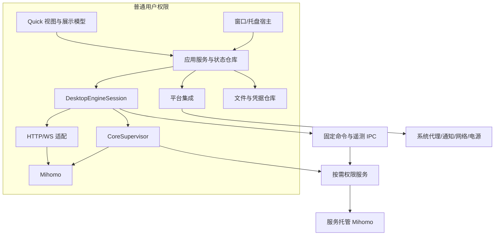
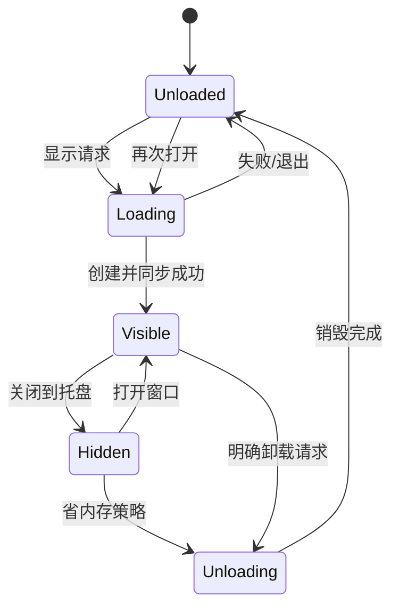
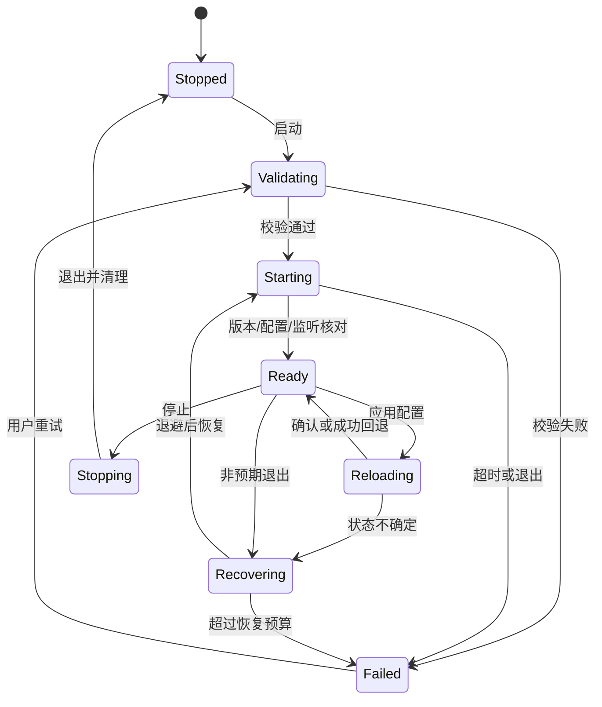
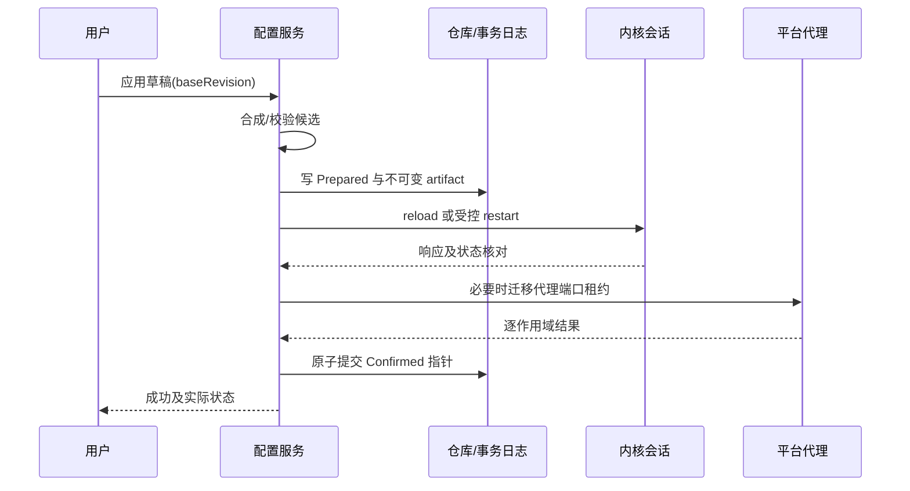
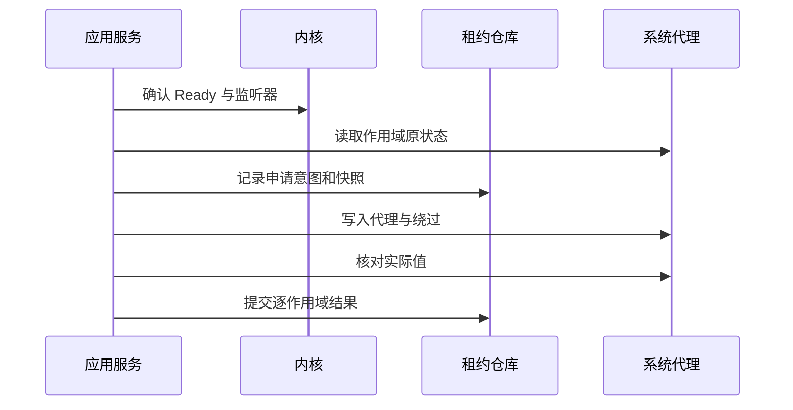

# Qt Quick + Mihomo 完整设计文档（合并版）

版本 1.3 · 2026-10-23。由 19 个分册生成，修改请以分册为准。

**官方预编译 Mihomo；订阅—代理真实转发 MVP 优先；桌面左侧导航＋右侧模块页面，圆角贴片与内置浅深主题；移动仅预留底部导航/精选入口/嵌入边界；客户端 ≤100 MB，内核单列。**

本文件包含功能范围、首页、架构、恢复、实施与验收设计。尚未创建客户端实现或完成性能实测。生成与一致性检查使用 scripts/build_design_docs.ps1 及其 -Check 参数。

## 目录

- [01 目标、范围与阶段计划](#chapter-01)
- [02 总体架构与运行模型](#chapter-02)
- [03 数据模型与接口契约](#chapter-03)
- [04 界面、导航与窗口生命周期](#chapter-04)
- [05 内核生命周期与控制 API](#chapter-05)
- [06 配置管理与事务应用](#chapter-06)
- [07 订阅、配置来源与资源更新](#chapter-07)
- [08 总览、代理组与延迟测试](#chapter-08)
- [09 连接、日志、规则与提供者](#chapter-09)
- [10 系统代理、TUN 与权限服务](#chapter-10)
- [11 Windows、Linux、macOS 平台适配](#chapter-11)
- [12 设置、持久化、备份与诊断](#chapter-12)
- [13 GUI 性能预算、基准与优化流程](#chapter-13)
- [14 测试、持续集成、发布与更新](#chapter-14)
- [15 Android / iOS 架构预留](#chapter-15)
- [16 设计决策、风险与需求追踪](#chapter-16)
- [17 UI 布局、模块化、主题与 Qt Quick 落地规范](#chapter-17)
- [18 实施任务、交付物与评审清单](#chapter-18)
- [19 网络测试、IP 与系统资源信息](#chapter-19)

---

<a id="chapter-01"></a>

## 01 目标、范围与阶段计划

文档版本：1.3；日期：2026-10-23；状态：可启动 P0/P1，具体版本与关键契约须经 G0 验证。客户端内存 ≤100 MB 是确定目标，其余分项预算与工期为规划值，尚无性能实测。

### 1. 产品定义

开发基于 Qt Quick / C++ 的 Mihomo 桌面客户端，在功能等价的前提下降低 GUI 内存、界面绘制 CPU 与后台唤醒。桌面客户端层总内存目标不超过 100 MB，Mihomo 独立统计；客户端必要辅助进程、托盘与管理层计入客户端预算。近期交付 Windows、Linux、macOS；Android、iOS 只保留架构扩展边界。100 MB 的单位、平台指标、峰值与支持负载定义见 [13](#chapter-13)，不得用空白页或卸载状态代替正常页面验收。

UI 采用“导航＋页面”：桌面左侧导航、右侧当前页面；未来移动端改用底部导航，近期只定义共享和替换边界。页面使用扁平化圆角贴片，内置完整浅色、深色两套主题。FlClash 作为信息分组、简洁视觉与响应式体验的参考，导航骨架以本项目约定为准。布局与交互规范见 [17](#chapter-17)。用户观察的 Verge Rev WebView 约 200—300 MB、FlClash 约 500—700 MB（典型约 600 MB）与 Mihomo 通常不足 100 MB，作为需统一口径复测的输入，不冒充本项目已完成的基准结果。

实际代理数据面由原有 Mihomo 负责，客户端不参与逐包转发，不改造 DNS、协议、规则引擎或 TUN 栈来获得选型收益。控制接口的采样会引入额外的内核工作，应与 GUI 开销分别报告。

Clash Verge Rev 用于核对代理软件的功能覆盖、服务模式与恢复流程；FlClash 用于参考简洁、扁平的页面信息组织。视觉与交互在传统桌面工具和手机应用之间折中：利用 Qt Quick 的响应式布局、状态过渡和轻量动效，同时保留桌面信息密度、键鼠效率与窗口习惯。桌面侧栏列出首页、代理、订阅、连接、规则、日志、测试、设置，选择后在右侧切换对应页面；首页继续聚合常用操作。窄桌面可收窄为图标导航轨，保持左侧导航，不因窗口变窄切成移动底栏。Clash Verge Rev 使用 Tauri/WebView，FlClash 使用 Flutter，比较时分别测量。

内核直接采用 [MetaCubeX/mihomo 官方 Releases](https://github.com/MetaCubeX/mihomo/releases) 的预编译程序，按版本、OS、架构和 CPU 指令集锁定具体资产及摘要；不自行编译或修改内核。安装包携带已验证资产，首次使用不依赖在线下载内核。接入、更新与来源验证见 05、14。

### 2. 交付目标及优先级

| 优先级 | 目标 | 成功依据 |
|---|---|---|
| P0 | 配置、内核、系统代理状态可信 | 操作失败不遗留错误代理；恢复过程可观察 |
| P0 | 客户端总内存 ≤100 MB、GUI 低开销 | 常用页面、托盘与卸载状态均验证；包含必要辅助进程 |
| P0 | 最小订阅—代理闭环 | 导入完整 YAML 订阅、校验、调用官方内核、选择组/节点、系统代理、实际转发与退出恢复 |
| P1 | 完成日常功能 | 计划订阅、测速、连接、规则、日志、TUN 与诊断逐步交付 |
| P1 | 桌面体验一致 | 三平台的主要操作、快捷键、错误语义一致 |
| P1 | 可维护 | 平台适配、控制 API 与共享业务隔离 |
| P2 | 未来移动共享 | 业务与展示模型不依赖桌面进程、窗口类型 |

功能正确性优先于节省少量内存。禁用必要错误处理、静默丢弃用户数据、降低内核日志级别或减少代理功能均不能计入前端优化收益。

### 3. 功能覆盖与交付层次

#### 3.1 最小可用版本（MVP）

MVP 在 P2 Windows 主平台交付。必需功能为完整 Mihomo YAML 格式订阅的添加/来源修改/重命名/手动更新/选择/删除、本地配置备用入口、配置校验与失败保留旧值、官方预编译内核启停、代理组/节点选择及可靠身份下的重启恢复、规则/全局/直连模式、系统代理设置与恢复、基础首页/设置/错误日志及修复入口、一次真实转发验证。首个订阅可直连获取；获取失败时允许导入离线文件。至少能保存两个配置并切换，停止、重开应用不会丢失所选配置与偏好。

首版配置子集在 07 的 1.1 冻结：支持内嵌节点/组/规则，Geo 规则使用随包验证资源；provider/外部文件与依赖 fake-ip/TUN 的组合不属于 P2，必须预检并明确拒绝，保留当前状态。停机时“已选择、未启动”与运行确认分开，首次失败允许无 lastGoodRevision；语义见 06。Windows MVP 同期交付无需开发环境的离线验证包、Job 子进程清理、基础休眠/换网核对和下次启动租约恢复。

“可代理”必须通过外部测试客户端显式连接本地 HTTP/mixed 代理、访问受控 HTTPS 测试站点验证；集成环境还需核对配置的代理出站收到请求，避免把 DIRECT 的 HTTP 成功当作节点转发成功。Windows 主平台另用遵从系统代理的测试客户端验证系统设置生效。TUN、IP/地理信息、详细内存卡、全量诊断、自动更新和完整辅助模块不阻塞 MVP。

#### 3.2 八类模块覆盖

| 模块 | MVP 必需内容 | 日常/稳定版内容与可选扩展 | 设计 |
|---|---|---|---|
| 首页 | 当前订阅、运行阶段、主代理组/节点、启动/停止、系统代理、代理模式、内核版本、单目标测试 | TUN、流量曲线、客户端/内核内存；IP 卡按需启用 | 08、19 |
| 代理 | 组及成员查看、选择、确认实际结果；可靠身份下重启恢复 | 筛选、延迟测试、动态 provider 身份恢复 | 08 |
| 订阅 | 完整 YAML URL 添加、手动更新、激活、失败回退；本地文件备用 | 计划更新、用量/到期、覆盖编辑与版本管理 | 06、07 |
| 连接 | 不阻塞 MVP | 快照、筛选、详情、单条/批量关闭 | 09 |
| 规则 | 由内核按配置执行，无需先完成规则浏览器 | 有序只读查看、来源、提供者刷新 | 09 |
| 日志 | 有界错误/启动输出及修复入口 | Core/App/Service、暂停、筛选、脱敏导出 | 09、12 |
| 测试 | 手动验证当前代理入口可访问 HTTPS 目标 | 节点延迟、网站可达性、可选 IP 查询；不含带宽压测承诺 | 08、19 |
| 设置 | 监听端口、代理模式、系统代理、启动/关闭行为、浅/深/系统主题、订阅秘密保护、最小修复入口 | TUN、更多外观项、调度、完整诊断、备份与更新 | 10—12、14 |

以上八类能力作为独立功能模块注册完整页面及明确支持的嵌入内容，由桌面侧栏展示全部模块入口；导航项常驻不代表页面全部常驻实例化。MVP 尚未交付的页面显示“后续提供”的禁用入口及说明，不创建空页面或请求遥测；完整能力按表中阶段交付。首页快捷操作可跳转同一路由或复用模块摘要，不另建第二套业务。未来移动底栏按 15 的平台策略选择少量模块，其余可经次级路由或嵌入呈现，不要求同时铺开八项。

#### 3.3 功能编号

| 编号 | 功能 | 范围 | 主设计 |
|---|---|---|---|
| F01 | 内核运行 | 启停、就绪、崩溃退避、版本与所有权 | [05](#chapter-05) |
| F02 | 配置管理 | 导入、编辑、覆盖、校验、事务应用、回滚 | [06](#chapter-06) |
| F03 | 订阅管理 | 下载、更新、计划、缓存、使用信息 | [07](#chapter-07) |
| F04 | 代理组与测速 | 选择、过滤、延迟、批量调度、选择恢复 | [08](#chapter-08) |
| F05 | 首页/总览 | 订阅、运行阶段、组/节点、网络/模式、流量、内核与信息卡 | [08](#chapter-08) |
| F06 | 连接 | 实时快照、筛选排序、详情、关闭 | [09](#chapter-09) |
| F07 | 日志 | 流式、缓冲、暂停、筛选、导出 | [09](#chapter-09) |
| F08 | 规则与提供者 | 只读检查、来源、手动刷新 | [09](#chapter-09) |
| F09 | 系统代理 | 应用、恢复、外部修改冲突、崩溃恢复 | [10](#chapter-10) |
| F10 | TUN 与服务 | 能力检测、授权、受限服务、状态确认 | [10](#chapter-10) |
| F11 | 托盘与窗口 | 单实例、隐藏、卸载、恢复、快捷操作 | [04](#chapter-04) |
| F12 | 设置与诊断 | 持久化、迁移、备份、脱敏、支持包 | [12](#chapter-12) |
| F13 | 应用及内核更新 | 验证、兼容性、暂存、失败回退 | [14](#chapter-14) |
| F14 | 桌面交付 | 安装、签名、卸载、平台适配 | [11](#chapter-11)、[14](#chapter-14) |
| F15 | 网络与电源变化 | 重连、休眠恢复、系统代理重新核对 | [11](#chapter-11) |
| F16 | 网络测试 | 当前入口真实请求、网站可达性与显式路径、有限批量 | [19](#chapter-19) |
| F17 | IP 信息（可选） | 手动查询出口 IPv4/IPv6、来源/路径/时间、可选地区信息 | [19](#chapter-19) |
| F18 | 系统与资源信息 | OS/架构、客户端及内核版本、客户端聚合与内核内存 | [19](#chapter-19) |

首版不含远程控制面板、任意脚本执行、WebDAV 同步、长期连接历史数据库、内置 Web 浏览器、移动端工程。后续增加功能仍需预算评审。

### 4. 分阶段交付

阶段按依赖推进，不能把阶段名称当作已完成状态。每阶段交付可运行产物、验收记录与未关闭问题。Windows 暂作首个基准平台；Linux/macOS 工具链和可编译骨架从 P0 建立，系统功能在 P4 完成。

#### P0：工程与契约基线

输入：本文档集、目标平台与工具链。

工作：确定 Qt、编译器、CMake、Mihomo 版本及来源；建立三个桌面平台的空壳构建；创建模块边界、错误模型和版本清单；制作不含秘密的配置与 API 夹具；记录依赖许可与源代码来源。

产物：三平台可启动空壳、锁定依赖清单、API 契约清单、基准环境表、基础 CI。

出口 G0：干净环境按锁定工具链构建并启动空壳；共享模块未引用桌面系统头文件；Windows MVP 的版本/官方资产/配置子集、配置测试与启动参数、认证/模式/组选择关键 API 均有真实验证记录。产物、夹具和未验证后续能力见 18 的 2.1。G0 不要求三平台功能已完成，但不允许将 MVP 关键未知项全部留到集成；没有锁定版本的功能不得宣称兼容。这里的构建可复现指流程与依赖可重复，不宣称二进制逐字节一致。

#### P1：资源原型与技术路线验证

工作：参考 FlClash 实现托盘、静态页、1 Hz 流量图、500 节点和 1,000 连接演示；实现响应式窗口缩放、显示、隐藏、卸载、重建；对比参考客户端；记录 CPU、内存、GPU、长帧。数据可先用录制或合成回放。

产物：资源原型、原始测量、对比报告、分项预算修订记录。原型预计数天至两周，取决于工具链和基准自动化；这不是完整产品工期。

出口 G1：已实现的空壳、首页和列表回放场景 ≤100 MB，测量可重复；冻结分项预算并为尚未实现的服务、解析和更新组件显式留出余量；界面卸载后可恢复。G1 是路线验证，不代替完整功能验收；G2/G3/G4 分别补测真实配置/订阅、主平台服务与更新/跨平台负载，G5 完成全部必测场景。100 MB 为固定上限，原型不得用未实现组件的假数据宣称产品已达标。

#### P2：真实内核与配置闭环

工作：真实 API、官方预编译内核进程管理、就绪握手、停机选择/首次启动/运行切换及补偿、订阅最小管理、组/节点与模式、基础首页、Windows 系统代理与租约、错误日志、基础设置及手动转发测试。安全存储、限额下载、离线验证包和 Windows 最小网络/电源恢复同期完成，不等待全量设置页、三平台安装器或服务。

产物：从订阅或本地配置到真实代理转发的 MVP；配置、下载、系统代理和停止恢复的故障记录。

出口 G2：MVP-01—16 全部通过，覆盖订阅→选择→内核→组/节点→系统代理→真实转发→停止及重启恢复，包含来源/删除、输入子集、首次失败、崩溃、中断、租约幂等、休眠与最小修复。错误配置不替换最后可用值，应用失败可恢复；无重复内核，UI 线程无同步网络/校验等待；真实闭环负载仍 ≤100 MB。

#### P3：日常功能与首个平台集成

工作：订阅、计划更新、代理组测速、连接、日志、规则/提供者、网站测试、系统/资源信息、设置、系统代理、托盘；在 Windows 完成 TUN/服务闭环；完善备份与诊断，可选增加 IP 卡。

产物：主平台日常使用 Alpha、逐功能验收、数据迁移样本。

出口 G3：F01—F12、F16、F18 在主平台闭环；F17 为可选能力，未实现明确隐藏；订阅失败保留旧配置；系统代理恢复不覆盖用户后续修改；后台没有页面专属连接/日志流；服务与组合操作纳入资源验收。

#### P4：桌面三平台 Beta

工作：Linux GNOME/KDE 能力识别、托盘和服务；macOS 菜单栏、网络服务代理、helper；三平台休眠恢复、更新、安装卸载、签名流程。

产物：三平台 Beta、明确的系统/桌面环境支持矩阵、平台故障记录。

出口 G4：支持矩阵内 F01—F16、F18 通过，F17 如启用也必须验证；缺少托盘等平台能力有可操作的退路；更新/服务和三平台真实负载补测 ≤100 MB；不笼统宣称所有发行版支持。

#### P5：稳定版与资源回归

工作：同条件对比、长期运行、窗口循环、配置与更新中断、磁盘故障、应用/内核更新回退、安装包验证、许可证及源码交付检查。

产物：候选稳定版、性能报告、升级/回退报告、用户说明、发行清单。

出口 G5：冻结预算与阻断缺陷标准满足；无数据损坏、错误代理遗留或可复现的持续资源增长；签名、校验和、源代码/许可材料齐备。

#### P6：按证据进行的后续优化

仅在分析结果支持时实施：原生托盘、独立 UI 进程、自定义场景图图表、更细的模型差异算法。每项都要比较新增代码、测试及平台维护成本。Android/iOS 不属于 P0—P6 的交付范围。

### 5. 阶段准入的执行规则

每个 G 门都有结论：通过、带已知限制通过、未通过。已知限制不能覆盖数据损坏、权限越界、错误代理恢复或资源无界增长。条件通过必须记录受影响平台、临时行为、修复任务和复测期限。

阶段可并行开展无依赖任务，例如 P1 时准备 macOS 签名和 Linux 测试环境；不得跳过 G1 后直接以完整功能数量证明技术选型成功。

### 6. 需求变更

新增需求记录：使用场景、对应功能 ID、资源成本、持久化变化、受影响平台、测试、所属阶段。影响共享接口或权限边界时记录设计决策。固定预算变化需保留旧值、调整原因与新测量依据。

本文档集是设计成果，不代表功能已实现，也不代表所列性能目标已达到。

---

<a id="chapter-02"></a>

## 02 总体架构与运行模型

关联：[阶段计划](#chapter-01)、[接口](#chapter-03)、[内核](#chapter-05)。

### 1. 技术选型

| 部分 | 决定 | 理由与限制 |
|---|---|---|
| 界面 | Qt Quick Controls + 轻量自有组件 | 控制对象规模、绘制和跨平台布局 |
| 应用逻辑 | C++20，Qt Core/Network | 固定类型数据、异步 IO、可分析的内存所有权 |
| 构建 | CMake，qt_add_qml_module | 标准 QML 模块、构建期缓存、依赖收敛 |
| YAML | 锁定版本的 yaml-cpp 候选 | P0 验证格式、解析限额与许可证；不保证注释往返 |
| 元数据 | 版本化 JSON 文件 + 原子写入 + 操作日志 | 首版不增加连接历史数据库 |
| 内核 | 官方 Releases 预编译 Mihomo 可执行文件 | 不自行编译/修改；锁定资产、CPU 要求与摘要 |
| 托盘 | QSystemTrayIcon + QApplication | 首版成熟实现；实际模块成本纳入测量 |
| 平台桥 | C++ / Objective-C++ 与原生 API | 差异收敛在适配模块 |

Qt 小版本、最低系统候选范围、Mihomo tag/资产/摘要在 P0 的 release-matrix 文件冻结；P4 对候选范围完成运行验证并形成正式支持声明。本文不假定当前最新版本和所有发行版均已验证。Qt Widgets 只用于宿主和托盘，不要求主界面采用 Widgets。

### 2. 进程拓扑



普通模式与服务模式只允许一个会话拥有目标内核。图中的两个 Mihomo 是互斥部署方式，不是同时启动两份。流量直接经过内核监听器或 TUN，不穿过客户端界面。

普通模式由用户态适配器持有控制器凭据并直接访问 HTTP/WS；服务模式由服务独占高权限内核的凭据，GUI 只能经受限 IPC 发固定命令并接收遥测，不能直连其配置 API。服务重新校验配置字段和资源，不信任 GUI 的“已验证”标记。网络测试由普通用户请求显式连接本地代理监听器，属于数据面流量，不借用控制器凭据。细节见 10、19。

默认客户端退出时停止所拥有的内核并恢复所拥有的系统代理。首版不提供“GUI 全退出但自动保留代理”的隐式行为；关闭窗口进入托盘与退出命令分开。服务是否驻留不代表内核会话应继续运行。

### 3. 模块和依赖

| 模块 | 内容 | 可依赖 | 不可依赖 |
|---|---|---|---|
| domain | 类型、值对象、校验规则、能力 | C++ 标准库、必要 QtCore 值类型 | 网络、QML、系统 API |
| application | 配置/订阅/选择/状态协调 | domain、抽象接口 | QProcess、窗口、具体 HTTP 路径 |
| infra-core | API、进程、会话实现 | application 接口、QtNetwork | QML 页面 |
| infra-storage | JSON、YAML、凭据存储适配 | domain、QtCore、平台凭据桥 | 页面状态 |
| platform | 系统代理、托盘、服务 IPC、电源 | 接口、平台库 | 页面业务决策 |
| presentation | ViewModel、列表模型、操作门面 | application、QtCore | 直接写系统代理、拼 API |
| ui-features | 功能模块的页面适配器、可嵌入内容、模块描述 | presentation 公开属性/命令、共享 UI 组件 | 具体侧栏/底栏、其他功能页面、文件/网络/进程管理 |
| ui-shell | 导航投影、路由、PageHost/EmbeddedHost、平台布局 | 已注册功能描述、页面工厂、共享 UI 组件 | 在导航项中实现业务、直接访问底层 IO |
| host | 组装依赖、单实例、窗口生命周期 | 上述模块 | 可避免的业务规则 |

平台集成接口按职责拆为代理、服务、通知、电源等小接口；上层可提供 IPlatformIntegration 聚合门面，避免一个包含几十个无关方法的接口。

NetworkProbeService 承担网站/IP 查询，ResourceSampler 承担本机进程资源采集；二者经应用接口返回不可变结果，不在 QML 中发网络请求或读取 PID。首页、测试面板和诊断复用结果与需求聚合，不能为同一内核各建一套遥测。

UI 功能按首页、代理、订阅、连接、规则、日志、测试、设置拆成独立模块。每个模块注册轻量 FeatureDescriptor，提供完整页面适配器和明确支持的可嵌入内容工厂；壳按 NavigationPolicy 生成桌面全部入口或未来移动精选入口。页面内容不导入 DesktopSidebar/MobileBottomBar，不引用兄弟页面 ID 或操作全局 StackView；跨模块只请求稳定路由或由壳组合内容。依赖方向为平台壳/组合布局 → 注册契约与功能工厂 → 展示门面 → 应用服务，功能模块不反向依赖平台壳。

注册表只保存元数据和惰性工厂，不创建全部页面。嵌入复用不带窗口标题/导航栏的内容组件，不能在首页中塞入完整页面及其工具栏。应用仓库保持业务单一状态；各可见内容实例以独立 demand token 声明 Summary/List/Detail 数据需求，离开或隐藏时释放，聚合后由仓库复用数据流。平台编排采用仓库内静态配置/类型化代码，不引入运行时下载插件或通用插件框架。契约见 03，生命周期见 04。

### 4. 推荐源码结构

```text
app/                    启动、依赖组装、单实例、窗口宿主
src/domain/             通用模型与错误
src/application/        用例、事务、仓库接口、需求协调
src/presentation/       展示门面、Qt 模型、轻量导航契约
src/infra/core/         Mihomo API、CoreSupervisor
src/infra/storage/      JSON、YAML、原子文件与凭据
src/platform/windows/   系统代理、服务、安装桥
src/platform/linux/     桌面代理、DBus/polkit
src/platform/macos/     代理、菜单栏、helper
qml/components/         通用组件、主题 token
qml/features/<module>/  独立页面适配器与可嵌入内容
qml/shell/              注册表、路由、页面/嵌入宿主
qml/desktop/            左侧导航与桌面编排策略
services/               受限权限服务
tests/                  单元、契约、集成、UI、恢复
bench/                  回放、基准脚本和场景定义
packaging/              三平台打包
docs/                   接口冻结、ADR、发行矩阵
```

平台目录在非目标平台不参与编译。通过 target 依赖落实边界，不依靠目录命名自觉。Mihomo 是可替换发行资源，不将内核源码混入 UI target。

### 5. 线程模型

| 执行上下文 | 职责 | 约束 |
|---|---|---|
| GUI/应用事件线程 | 应用状态、用例协调、模型变更、窗口 | 不阻塞文件、网络、校验或服务等待 |
| 网络事件线程 | QNetworkAccessManager、WebSocket、传输 | QObject 在所属线程创建、使用和销毁 |
| 有界工作池 | YAML、JSON 解析、差异计算、签名校验 | 大任务并发有上限，支持过期结果丢弃 |
| 存储串行执行器 | 元数据写入、事务日志、迁移、备份 | 同一仓库只有一个写者 |
| 内核/服务进程 | 转发、系统权限操作 | 不回调操作 GUI 对象 |

初期网络对象也可在 GUI 线程异步工作；若使用独立网络线程则完整迁移对象，不交叉调用。解析与大文件操作必须离开 GUI 线程。避免为了每个模块建立一个常驻线程；线程数量与栈开销属于资源预算。

跨线程传递不可变值或共享只读快照。QAbstractItemModel 的 begin/end、行数据与信号都在 GUI 线程执行。取消令牌可终止尚未执行工作；无法中断的解析用 generation 校验使结果失效。

### 6. 状态权威与命令流

应用状态仓库拥有期望状态与操作状态；内核/API 是运行时事实来源；系统 API 是系统代理事实来源。ViewModel 只读状态并发命令，不自己成为第二份运行时权威。

用户操作经过：门面校验 → 创建 operationId → 用例调度 → IO/系统操作 → 核对实际结果 → 更新仓库 → 模型通知。按钮显示进行中，成功必须有确认依据；超时进入“待核对”，不自动等同失败或重发非幂等操作。

区分 DesiredState、ObservedState、OperationState。例如 TUN 期望开启但内核尚未确认时，展示“正在启用”，不能提前显示已开启。

### 7. 并发和资源调度

EngineMutationCoordinator 串行处理影响同一会话的启动、停止、配置应用、TUN 模式切换与内核更新。一次配置应用中途不允许另一操作覆盖其配置或进程。用户停止请求可取消尚未提交的步骤；已产生系统变更时必须进入补偿。

IProxyApplication 位于 application，编排 startCore/startProxy/stopProxy/setSystemProxy；CoreSupervisor/API 不读写系统代理。配置单写者分别提交 ConfigSelection 与运行确认，首次历史可空；组合启动的中间 Ready 不表示整体成功，失败按本次新建/复用会话及租约边界补偿，见 05/06。

ResourceBudgetCoordinator 是应用层单一预算分配者。解析、下载解压、连接快照、导出与更新先申请工作集额度；无法预留则排队、减小可选采样或显式拒绝超限输入，退出/停止/补偿优先，不能因遥测占满预算而阻塞控制。按实测放大系数估算解析峰值，不只累计文件字节；后台完成后释放额度，旧 generation 结果不继续提交。100 MB 验收依赖真实测量，额度模型不构成达标证明。

配置草稿不占内核锁；订阅可并行下载，但同 profileId 的候选提交串行；节点测速为独立有界任务。配置应用期间暂停提交依赖旧配置的组选择、模式与提供者变更，读/测速结果核对 expectedRevision，应用后刷新再接受新命令；关闭连接按当前 epoch/目标集合校验。互斥获取顺序固定为会话变更协调器 → 配置仓库提交 → 平台代理租约，不持有线程阻塞锁等待网络。

每次内核启动生成 engineEpoch；每次期望配置变更生成 revision；每次列表快照有 sequence。旧 epoch 的结果不得覆盖新会话。接口细节见 [03](#chapter-03)。

### 8. 启动顺序

1. 定位用户目录、获取单实例锁；第二实例通过受限本地 IPC 请求显示窗口后退出。
2. 读取设置版本与待恢复事务，完成恢复判定，禁止无条件套用旧系统代理快照。
3. 创建应用服务和托盘宿主；窗口按用户设置决定是否立即创建。
4. 读取 ConfigSelection 与可空确认历史；只读损坏/过新 schema 修复模式不启动。默认自动启动关闭；用户以后启用时校验所选版本并启动，不把历史 activeRevision 当作仍在运行。
5. 就绪及监听器确认后，按保存的用户意图申请系统代理/TUN；失败明确降级。
6. 恢复订阅计划；页面可见后才申请页面统计需求。

自动启动代理失败不阻止打开设置、日志和配置修复。不能为了“快速启动”先写系统代理再等待内核。

### 9. 退出和异常恢复

正常退出：拒绝新变更 → 停止统计需求与调度 → 恢复本应用仍拥有的系统代理 → 停止内核会话 → 写入退出结果 → 关闭服务会话与进程。各步骤有截止时间，不能无期限卡住退出。

异常退出由本地事务日志与代理租约记录支持下次恢复；服务模式可由会话心跳超时执行受限清理。无权限服务时无法保证客户端被强杀后立即恢复系统代理，需在下次启动恢复并提供手工恢复指引，不能承诺不存在的实时保证。

### 10. 架构验收

- 销毁并重建 UI 不产生第二个内核或丢失操作状态。
- application/domain 在不链接 QtQuick/Widgets 的测试目标中可用。
- 高频数据没有完整 JSON → QVariant 树 → JS 数组 → 第二行模型的长期多份保留。
- 崩溃恢复和操作补偿依赖持久化状态，不依赖 QML 页面是否存在。
- 动态增加原生托盘或独立 UI 进程时，不重写配置、订阅和业务状态模型。
- 功能模块不依赖侧栏/底栏；桌面导航全量显示、策略精选显示和内容嵌入均使用相同模块，不复制业务或常驻额外完整页面；移动端本期只检查边界。

---

<a id="chapter-03"></a>

## 03 数据模型与接口契约

本文件定义应用内部契约。这里的类型和方法是实现设计，不是现有 Mihomo API 的逐字映射；外部字段由 [05](#chapter-05) 的锁定版本适配。

### 1. 标识、时间与版本

| 名称 | 定义 | 使用规则 |
|---|---|---|
| profileId | 本地 UUID | 改名、换 URL 不改变；复制配置产生新 ID |
| revision | 本地单调递增配置版本 | 表示合成后的候选内容，不使用墙钟时间代替 |
| engineEpoch | 每次启动尝试分配的会话唯一值 | 旧请求、旧连接 ID、旧测速不能跨会话使用；控制连接重连不改变它 |
| operationId | 单次用例 UUID | 从用户操作贯穿下载、校验、提交和诊断 |
| sequence | 某一数据流的单调序号 | 仅在相同 epoch 和流内比较 |
| schemaVersion | 持久化格式版本 | 明确迁移路径，不能用应用版本代替 |

持续时间使用单调时钟；计划更新时间、订阅到期使用 UTC 墙钟，展示时本地化。字节/累计计数使用 64 位整数；QML 展示通过格式化字符串或安全数值门面，避免 JavaScript 大整数精度丢失。

### 2. 核心数据模型

#### 2.1 Profile

| 字段 | 类型/语义 | 持久化 |
|---|---|---|
| id/name/kind | UUID、用户名称、Local/Subscription | 是 |
| sourceRef | 本地受管文件引用或 subscriptionId | 是 |
| rawHash | 原文摘要 | 是 |
| userOverlayRef | 用户结构化覆盖/补丁 | 是 |
| lastGoodRevision | 最近经运行确认的版本，可空；由配置 manifest/确认历史投影 | 索引可重建，不独立提交 |
| candidateState | None/Downloaded/Validated/Rejected | 是，含原因 |
| createdAt/updatedAt | UTC | 是 |

文件引用是受管目录内的逻辑 ID，不接受导入文件直接指定绝对写入路径。原始 YAML 保存原文；结构化修改另存覆盖层。

#### 2.2 Subscription

字段：id、profileId、sourceGeneration、urlSecretRef、displayOrigin、requestHeaderSecretRef、enabled、interval、nextDueAt、lastAttemptAt、lastSuccessAt、etag、lastModified、validatorContentHash、backoffCount、usageInfo。sourceGeneration 在来源/认证改变时递增；删除后旧 generation 永久失效，原 ID 不复用。

displayOrigin 只保存脱敏主机/路径提示，完整 URL 视为秘密。usageInfo 含上传/下载/总量/到期和来源可信度，字段缺失用 unknown，不能用零冒充未知。

#### 2.3 RuntimeConfig 与 EngineStatus

RuntimeConfig：revision、profileId、effectiveHash、artifactRef、coreVersion、overlayVersion、createdAt、validationResult、applyState。applyState 为 Candidate/Validated/Prepared/Applying/Confirmed/Failed/RolledBack。

ConfigSelection：selectedRevision、selectedPreferenceSnapshotRef、selectedResourceManifestRef、selectionGeneration，表示下次启动使用的已验证版本，允许与上次确认版本不同。首次导入时 activeRevision/lastGoodRevision 均可空。持久 manifest 的 activeRevision 只表示最近运行事务的确认版本，不表示进程正在运行；当前运行事实由 EngineStatus 的 epoch/configRevision 表达。停机选择只推进 ConfigSelection，不生成伪 Confirmed；详细规则见 06。

RuntimeConfig 还引用 resourceManifestRef 与 preferenceSnapshotRef。全局 RuntimePreferences 持有 mode、tunDesired、listenerPolicy、preferenceVersion；MVP 默认 rule、TUN 关闭、回环 HTTP/mixed 监听。具体事务与优先级见 06/08，QML 不保存第二套偏好。系统代理意图与平台代理租约独立，不写入内核 YAML。

RuntimeConfig 是不可变的语义配置模板；effectiveHash 不包含每次启动新生成的 controller secret/epoch。SessionConfig 将它与会话保留字段合成，包含 epoch、revision、受限 launchConfigRef 和 materializedHash；实际传给内核的文件必须已注入认证，不能直接执行无 secret 的模板。校验使用独立临时 SessionConfig，运行重载也生成对应 revision 的新会话文件。二者的来源/hash 与秘密生命周期见 05/06。

EngineStatus：epoch、lifecycle、ownership、version、configRevision、configCertainty、controllerEndpoint、listeners、tunObserved、health、lastError。controllerEndpoint 不向普通页面暴露认证信息；configCertainty 为 Confirmed/Uncertain/Unknown。

不能用 GET /configs 的局部字段反推完整运行配置 hash；configRevision 的确认来自本地提交记录、成功响应及必要的运行时核对。崩溃导致不确定时通过受控重载/重启收敛。

#### 2.4 代理、连接和日志

| 模型 | 主要字段 | 标识规则 |
|---|---|---|
| ProxyGroup | name、type、members、current、selectable、testable | 同 epoch 下 name；名称变化重新映射 |
| ProxyNode | name、type、provider、delayState、delayMs、testedAt | 不假设订阅之间同名即同节点 |
| Connection | id、metadata、chains、rule、start、upload、download | epoch + 内核 connectionId |
| LogEntry | localSeq、timestamp、level、source、message | 有界缓冲中的本地序号 |
| TrafficSample | epoch、monotonicAt、uploadRate、downloadRate | 断线形成 gap，不插入虚假的零 |
| Provider | name、kind、vehicleType、updatedAt、health、count | kind + name |
| Rule | index、type、payload、target、providerRef | epoch + 规则快照序号 + index |

规则顺序有意义；不能为显示而修改实际规则顺序。连接累计数值不总是速率，需有时间差才计算速率。

选择恢复记录包含 profileId、groupName、memberName、sourceIdentity、nodeFingerprint、confirmedAt；provider 名称单独不能证明节点未变。指纹在 C++ 中对规范化协议/地址/端口及影响身份的字段生成带本地密钥的摘要，不将认证明文写入索引/日志；缺乏可靠身份则 identityConfidence=Unknown，跳过跨 revision 自动恢复。动态 provider 内容变化单独增加 generation。

#### 2.5 首页、测试与资源模型

| 模型 | 关键字段与语义 | 保存策略 |
|---|---|---|
| DashboardSummary | activeProfile、subscriptionUsage、runtimeStage、primaryGroup、selectedMember、observedNetwork、mode、coreInfo | 从业务仓库投影；不复制全量节点/连接 |
| ProbeRequest | requestId、targetId/URL、kind、route=Direct/CurrentProxy/SystemDefault、expectedEpoch/revision、networkGeneration、deadline | 手动请求，受限队列 |
| ProbeResult | status、route、HTTP 状态、totalDuration、observedAt、staleReason、optionalExitIp、evidence | 有界会话缓存；失败不是零延迟 |
| IpInfo | IPv4/IPv6、family、source、route、queriedAt、optionalRegion/ASN、freshness | 默认内存保存、可隐藏，不默认写诊断 |
| ProcessResourceSnapshot | clientProcessGroup、coreIdentity、memoryMetric、clientBytes、coreBytes、completeness、sampledAt | 仅 owned 进程低频采集；缺权限为 Unknown |
| ManagedResource | id、kind、sourceIdentity、contentHash、managedRef、writer、mutable、generation、retentionRefs | 随资源 manifest 保存；动态资源显式区分 |

runtimeStage 是用户运行阶段（未配置/下载中/校验中/启动中/运行中/停止中/恢复中/失败/待核对），不展示 P0—P6 开发阶段。连接、网站、内存卡都带数据时间；UI 资源读数和 13 的正式预算口径有差异时必须标明。

#### 2.6 功能注册与导航编排（仅展示层）

以下契约属于 presentation/ui，不下沉到 domain/application，不把 QML 工厂或导航枚举传入业务接口。

| 契约 | 字段与职责 | 约束 |
|---|---|---|
| FeatureDescriptor | moduleId、titleKey、iconKey、pageRoutes、capabilityRequirement、availability、pageFactoryRef、embeddedFactories | 八个稳定 moduleId：home/proxies/subscriptions/connections/rules/logs/tests/settings；工厂惰性，描述对象不持有页面实例 |
| PageRoute | pageId、moduleId、允许的参数 schema、默认上下文 | pageId 在平台间稳定；参数只含有界业务 ID/筛选等，不传 QML 对象、秘密或任意组件路径 |
| EmbeddedFactory | contentId、factoryRef、supportedContexts、demandProfile、stateSchema | 仅暴露模块声明支持的 Summary/List/Detail 等内容形态；不要求每个模块支持所有形态，不嵌套完整页面壳 |
| NavigationPolicy | navigationEntries、secondaryEntries、embeddedPlacements | 仓库内平台编排配置：目标引用已注册 pageId/contentId；桌面列出全部模块，未来移动按空间选择、分组或嵌入 |
| NavigationItem | itemId、labelKey、iconKey、targetPageId/入口组、selected、enabled、reason | 从描述与策略投影，导航项与功能模块不是一一绑定；更多属于壳的入口组，不是业务模块 |
| PresentationContext | instanceKey、pageId/contentId、受校验业务上下文、presentationMode、active、visibility、stateKey | 页面和嵌入实例分别拥有生命周期；不能以单个全局 currentPage 判定所有内容是否活跃 |

展示接口为 registry.resolve(pageId/contentId)、router.navigate(pageId, context)、router.openDetail(...) 及宿主 activate/deactivate/restoreState；功能内容只发出路由/详情意图，具体页面切换、弹层或移动返回由壳执行。ViewModel 接收业务 ID/筛选及独立 demand token，不因从侧栏进入或嵌入进入而改变业务命令。

导航不显示仅代表平台布局选择，不等于能力禁用或权限被授予。路由解析和嵌入宿主均检查实现状态、参数与 capability；后台用例/权限服务仍独立检查授权。移动未在底栏出现的已支持功能可通过更多/详情路由或嵌入访问；明确不支持的模块不可通过隐藏路由绕过检查。未知路由给出可返回的错误，不能偷偷切换到另一功能。

### 3. 操作和错误

所有异步命令立即返回 operationId；完成通过状态或事件交付。Operation 包含 kind、target、stage、startedAt、deadline、cancelability、result。依赖配置的控制还携带 expectedRevision 与目标 generation：热重载不改变进程 epoch，但旧配置的组选择、测速和规则结果仍需失效。支持 Pending/Running/Succeeded/Failed/Cancelled/Uncertain，只有业务核对完成后进入 Succeeded。

统一错误结构：code、category、userMessageKey、retryable、operationId、stage、redactedDetail、optionalOsCode。诊断细节不直接显示完整请求、配置或凭据。

| 类别 | 例子 | UI 处理 |
|---|---|---|
| Input | YAML 语法、端口冲突 | 定位字段与行，不自动重试 |
| Network | 下载超时、DNS、TLS | 保留旧数据，允许重试 |
| Auth | 控制器秘密不匹配、授权拒绝 | 修复会话/授权，不无限重试 |
| Core | 启动失败、接口不支持 | 版本/日志入口与恢复操作 |
| Platform | 系统代理部分失败 | 列明失败作用域与当前状态 |
| Conflict | 草稿过期、租约变化 | 刷新、保留草稿，用户选择处理 |
| Storage | 空间不足、原子提交失败 | 不覆盖最后可用数据 |
| Integrity | 更新签名不合法 | 拒绝安装并保留现有版本 |
| Cancelled/Uncertain | 用户取消、提交响应丢失 | 分别显示，后者先核对状态 |

控制结果和错误不能像遥测快照一样被最新值覆盖。操作结果保留有限历史，例如最近 100 条或 24 小时，秘密剔除后落盘。

### 4. 应用接口

以下为概念签名，实现可用 QObject 信号/槽和强类型值；不要求暴露 C++ future 给 QML。

| 接口 | 方法/事件 | 语义 |
|---|---|---|
| IProxyApplication | startCore(selectionGeneration), startProxy(selectionGeneration), stopProxy(reason), setSystemProxy(desired) | 应用层组合用例；串行协调配置、内核、租约与补偿，不把系统代理塞入内核适配器；语义见 05 |
| IEngineSession | capabilities(), observedStatus() | 不含平台窗口与进程句柄 |
| 同上 | start(config), stop(reason) | 经变更协调器，返回 Operation |
| 同上 | validate(config), apply(config, mode) | 校验与应用分离；mode 为 reload/restart 决策 |
| 同上 | selectProxy(group, member), testLatency(targets, policy) | 成员及能力先校验，带 epoch |
| 同上 | setMode(mode, expectedRevision), setTun(desired, expectedRevision) | 经配置事务；持久化成功且运行核对后完成 |
| 同上 | closeConnection(id), closeConnections(scope) | destructive command，超时后核对 |
| 同上 | setTelemetryDemand(aggregateDemand) | 整体需求替换，内部管理网络流 |
| IConfigurationService | import/readDraft/validateDraft/selectForNextStart/applyRunning/rollback | 停机选择与运行事务分开；草稿携带 baseRevision，选择携带 selectionGeneration |
| IProfileService | rename/changeSource/delete(expectedGeneration, strategy) | 活动配置只允许先成功切换或停止再删除，失败不删除；引用清理见 07 |
| ISubscriptionService | add/updateOne/updateDue/cancel | 候选下载与激活分离；编辑来源增加 sourceGeneration |
| ISystemProxyAdapter | inspect/acquire/apply/release | 返回逐作用域结果与租约 |
| IPrivilegedRuntime | probe/ensureAuthorized/startSession/stopSession | 固定请求集合，不能任意执行命令 |
| INetworkProbeService | testWebsite(request), queryExitIp(request), cancel(operationId) | 强制路由、限额与结果失效；不自动切节点/模式 |
| IResourceSampler | setDemand(token), snapshot() | 聚合客户端与独立内核，记录指标/完整性 |
| IResourceBudgetCoordinator | reserve(kind, estimatedPeak), release(token) | 有界异步排队，控制/恢复优先 |
| ISettingsRepository | load/snapshot/update(expectedVersion) | 原子提交、版本比较 |
| ICredentialStore | read/write/remove(reference) | 原生安全存储适配，不返回给 QML |

Capability 值为 Supported/Unsupported/RequiresAuthorization/TemporarilyUnavailable，并附原因。将“系统允许”和“用户已开启”分开表达。

### 5. TelemetryDemand

需求由 token 注册：owner、streams、requestedInterval、visibilityPolicy、priority。token 与页面展示门面生命周期绑定，释放后取消该需求。聚合器按流合并，多个消费者共享一条网络流。

流量、连接、日志需求分别计算；日志级别为活跃消费者要求的集合/最低级别策略，不改内核自身记录等级来制造收益。数据频率受锁定 API 能力限制；客户端跳过渲染不等于减少服务端传输。

状态流和控制事件不要求常驻高频 WebSocket；使用操作完成后刷新、进程事件和低频健康核对。隐藏后如用户打开托盘速率，只保留共享流量流。

进程资源需求与网络遥测分开聚合，首页展开资源卡时默认 5 秒采集一次，隐藏后停止该页采集。IP/网站查询是显式操作，不因绑定或切页自动变成周期请求。

### 6. 快照和差异契约

完整快照携带 epoch、sequence、receivedAt、记录集合。最多一个正在解析/计算、一个最新待处理快照；新完整快照可覆盖旧的待处理完整快照。

差异携带 baseSequence、targetSequence、增删改列表。GUI 只接受 baseSequence 与当前模型一致的差异；不一致时基于最新完整快照重新计算或显式重建，不能将几个被丢弃基线的差异直接拼接。不能对增量事件随意使用 latest-wins。

重建模型只允许初始加载、epoch 变化或无法安全合并时发生；常规 1 Hz 更新采用增量。大量无序变化时批量策略需测量，避免为了理论增量引入 O(n²) 查找。

### 7. UI 模型契约

模型使用固定 roles，data() 不执行网络、磁盘、复杂解析。每个批次合并相邻通知，只发送变化 roles。选择和展开状态保存业务 ID，不保存行号。delegate 复用时清除行内临时状态。

过滤条件由展示门面持有，输入合并约 150 ms 起步；排序明确稳定次级键。筛选结果可在工作线程计算索引，再由 GUI 线程应用。大规模动态排序默认不持续追随字节变化。

页面适配器与可嵌入内容共享业务仓库和命令门面，完整列表与摘要按需投影；允许独立的轻量视图筛选状态，不复制原始数据/控制连接。视图状态按 moduleId＋业务上下文＋instanceKey 隔离，显式定义哪些选择可共享，防止首页摘要覆盖代理页筛选。销毁内容释放该实例需求，不取消应用层仍在执行的配置/订阅事务。

### 8. 一致性验收

- 旧 epoch 的控制/测速/连接结果不污染新会话；同 epoch 热重载后核对 expectedRevision。订阅下载独立于内核 epoch，核对 subscription/profile 的 generation 和 sourceHash，不因无关内核重启丢弃合法下载。
- operationId 能关联界面错误、事务日志和诊断，但不泄漏秘密。
- 网络断开时显示数据时间与 stale 状态，不显示虚假的成功或零速率。
- 64 位累计字节经 C++→QML 展示没有精度截断。
- 未实现的能力得到明确 Unsupported，不靠接口超时推断。

---

<a id="chapter-04"></a>

## 04 界面、导航与窗口生命周期

覆盖 F05、F11，关联各功能页面设计、[UI 布局、主题与 Qt Quick 规范](#chapter-17)及 [性能规范](#chapter-13)。桌面采用左侧导航＋右侧页面；FlClash 作为页面信息组织和视觉参考。本文件约定导航与 Qt 生命周期，移动底部导航只保留边界。

### 1. 信息架构

窗口由标题/全局状态区、左侧导航栏和右侧 PageHost 构成。侧栏按首页、代理、订阅、连接、规则、日志、测试、设置排列；设置可独立锚定底部，顺序与键盘焦点保持可理解。每项切换对应页面，右侧包含页标题、该页操作和内容区；提供者归入规则/代理的相关子视图，不增加主导航项。首页保留聚合控制，但连接、规则、日志、测试、设置各有独立页面。常规侧栏显示图标＋名称，窄桌面收为左侧图标导航轨，提供工具提示、可访问名称和展开入口；不按窗口宽度切换为移动底栏。具体尺寸和内容断点见 17。

功能模块通过 FeatureDescriptor 注册，NavigationModel 按 NavigationPolicy 投影入口；PageRouter 处理稳定 pageId 和上下文。桌面策略展示全部模块，未来移动策略可精选底栏入口、经更多访问或把模块内容嵌入其他页面。导航容器不拥有业务服务或页面数据，也不要求一个模块必须有一个永久导航项。移动安全区/触摸/返回由移动壳适配，本期不创建移动导航组件。MVP 未交付页面按 01 显示禁用说明，不能点击后用空白页假装功能完成。

首页优先展示订阅、当前运行阶段、主代理组/节点、网络设置与模式；流量和内核/系统信息置于次级区域，IP/网站测试可折叠或按需开启。首次启动提供“添加订阅/导入文件”，已有可用配置后提供“启动代理”，TUN 不作为首次使用的必经授权。错误提示显示在操作附近，影响代理运行的错误在全局状态区保留，不能仅用短暂 toast 表达。

| 常驻区域 | 内容 | 生命周期 |
|---|---|---|
| 宿主 | 应用服务、托盘、单实例 IPC | 客户端整个生命周期 |
| 基础壳 | 左侧导航、主题、全局状态条与 PageHost | 界面加载期间 |
| 页面 | 当前页 ViewModel、模型与视图 | 按需创建，离开后释放重资源 |
| 浮层 | 节点详情、配置编辑、确认对话框 | 打开时创建，关闭释放 |

页面导航状态保留在小型 UiSessionState：当前 pageId，以及按模块/业务上下文/实例键保存的 profileId、过滤文本、排序、选中业务 ID、滚动锚点和未提交草稿引用。它不保存完整连接列表、日志模型或 QML 对象。侧栏收展、切页和未来导航容器替换只改变呈现；连接和日志状态恢复时先同步新会话，不复活过时网络对象。

#### 1.1 模块、完整页面与嵌入内容

| 层次 | 责任 | 不得承担 |
|---|---|---|
| 功能模块 | 展示门面、内容组件、完整页面适配器、轻量注册描述 | 导入具体平台导航、定位其他页面对象、直接读写系统 |
| 完整页面适配器 | 页面标题/工具区、模块内容与本页上下文 | 复制模块业务、私建控制 API 客户端 |
| 可嵌入内容 | 明确的摘要/列表/详情能力、受上下文约束的操作与路由意图 | 自带主导航/窗口标题、擅自替换宿主页面、隐式全量遥测 |
| 平台壳与布局 | 导航选择、页面路由、嵌入编排、返回/焦点、实例可见性 | 改写模块业务状态、仅用隐藏入口代替能力/权限检查 |

例如代理模块提供完整 ProxiesPage 和 ProxySelectionContent：桌面从侧栏打开完整页面，首页可嵌入只显示固定主组的紧凑内容；未来移动可沿用底栏页面，也可将该内容嵌入首页并通过“查看全部”进入完整路由。日志摘要仅订阅有界错误需求，不因嵌入一个错误贴片而启动完整实时日志页。模块独立依赖应用门面和共享组件，跨模块由注册引用和路由组合，避免首页直接导入兄弟页面。

PageHost 与 EmbeddedHost 均为可见实例分配 instanceKey 和 demand token，激活后才申请所声明数据，隐藏/离开/销毁时释放。多个消费者由业务仓库合并数据流；视图筛选与滚动状态按实例隔离。导航策略只存工厂引用，不实例化未显示模块；“嵌入”不自动赋予后台持续运行权限。

### 2. 组件和视觉约束

建立 ThemeTokens：语义颜色、间距、字号、圆角、行高、动画时长。应用内置完整浅色/深色两套配色，设置可选浅色、深色、跟随系统；默认跟随系统，无法读取时使用浅色，显式选择持久化后不被系统事件覆盖。切换只更新视觉，不重启内核、不丢页面状态。Qt Quick Controls 使用一致的轻量样式；窗口背景、侧栏、贴片、菜单/弹层、输入框、图表和全部状态均使用当前主题，详见 17。

基本组件：NavigationItem、FlatTile、StatusIndicator、OperationButton、ErrorBanner、EmptyState、FilterBar、VirtualListRow、ConfirmDialog、TrafficSparkline、SettingsRow。FlatTile 是统一的扁平圆角贴片容器，用于首页信息块、订阅项、代理项和设置分组；连接/日志等高密度内容使用一个贴片内的表格/虚拟列表，不为每个单元格嵌套贴片。业务组件依赖门面状态，不接触网络。

初始参考：常用列表行高约 36—44 逻辑像素，布局在普通桌面尺寸可用；具体最小窗口尺寸由字体与本地化测试确定，不能靠强制缩小字体。图标优先打包的矢量/小尺寸资源，不加载远程节点图标作为默认功能。

页面以纯色底面、圆角贴片、适量留白和轻分隔表达层次；参考用户图片的柔和贴片层次，默认无投影，不使用厚边框、拟物渐变或大面积实时模糊。初始普通/大贴片圆角约 16/20、内边距与间距约 12—16 逻辑像素，控件圆角约 8—12，具体见 17。hover/选中/进行中/错误由主题状态色、文字与图标表达。弹层和切页动画短且有限，用户减少动态效果时关闭非必要动画；不能为了低占用省略核心操作或降低可读性。

Qt Quick 的优势用于布局自然重排、局部状态插值、选中/进行中反馈、轻量抽屉与详情过渡；不是给每个控件加动画。常规窗口的节点/连接可采用紧凑行或表格、内联操作、分栏详情及复制/右键/键盘导航；窄窗才在相同状态上切到单列详情。主要操作无需手势、长按或多级全屏跳转，桌面也不强制底部导航、触屏尺寸控件或全屏对话框。初始尺寸/密度/动效规格和验证样本见 17，Qt Widgets 依赖只用于成熟托盘宿主，不决定主界面外观。

### 3. 窗口状态机



退出是宿主的独立状态，不是图中 Unloaded。相同时间的多个显示请求合并；正在卸载时的新显示请求在销毁完成后重建，不能同时创建第二套引擎。

#### 3.1 Visible

只激活当前页面数据需求；失去焦点不等于隐藏，不能在用户切换应用时任意卸载窗口。窗口被最小化可采用单独节流策略，恢复时立即刷新。多窗口首版不支持，避免重复页面订阅与复杂生命周期。

#### 3.2 Hidden

关闭页面需求 token、停止动画、取消不必要的图标任务和模型刷新；保留正在进行的配置提交、订阅更新等业务任务。业务任务结束以托盘状态和下次打开结果显示，不为了维持进度条创建隐藏渲染。

#### 3.3 Unloaded

卸载步骤：保存小型会话状态 → 释放页面需求 → 断开视图回调 → 取消或标记过期的展示任务 → 销毁窗口及 QML 对象 → 按所属线程完成延迟销毁 → 销毁 QML 引擎。业务服务采用明确 C++ 所有权，不能被 JS 所有权回收。

QML 单例若由引擎持有，应视为短生命周期门面；跨引擎保留的是独立 C++ 服务。持久服务对临时对象使用安全弱引用/自动断连，禁止悬空回调。场景图资源只能通过 Qt 支持的渲染线程机制释放。

清理不保证所有 Qt 库、堆缓存和驱动内存归还 OS；分别记录实际节省与打开延迟。确需完全释放 UI 运行时且同进程达不到时，再评估独立 UI 进程。

### 4. 关闭、退出与无托盘环境

首次关闭提示当前策略并允许记住；MVP 默认在托盘可用时关闭到托盘，隐藏后的卸载策略由原型测量确定。无可用托盘时不允许窗口消失后没有可发现入口，默认保留窗口并提示选择最小化或确认退出。Linux 无托盘扩展是正常能力差异。

退出命令明确执行恢复代理与停止所拥有内核；存在配置事务时等待安全边界或进入取消/补偿。未保存编辑草稿提供保存草稿、放弃或取消退出，不能无提示丢弃。

托盘基础菜单：打开窗口、当前配置、运行状态、系统代理开关、代理模式、重启内核、退出。大量节点不全部展开成菜单；高级操作跳转页面。TUN 等授权操作以明确进行中状态处理，避免连击。

### 5. 页面加载与数据恢复

PageHost 只维持当前重页面。转场可短时保留新旧两页，动画结束释放旧页。Loader 的目的在于控制昂贵对象，不对每个基础控件套 Loader。

重新显示时先读取仓库状态，展示旧快照的时间与刷新中标记，再申请新数据。已有变更操作只附着进度观察，不再次发起操作。草稿恢复到对应 baseRevision，若期间配置变更则提示冲突。

### 6. 可访问性与桌面习惯

导航、表格和对话框可键盘使用；焦点移动与可访问名称明确。颜色外提供文字/图标表达状态；支持高 DPI、多显示器切换、字体缩放、系统深色模式和屏幕阅读器基本操作。文本国际化使用稳定 key，日志和原始配置不自动翻译。

快捷键遵从平台惯例：查找、复制、关闭窗口、退出、打开设置；macOS 使用对应 Command 习惯。危险操作不占用容易误触的全局快捷键。初版不注册全局快捷键。

### 7. UI 验收

| 编号 | 场景 | 通过条件 |
|---|---|---|
| UI-01 | 连续开关/卸载 100 次 | 无失效对象调用、重复内核、持续句柄增长 |
| UI-02 | 隐藏时下载完成 | 业务成功、无隐藏动画；打开后状态正确 |
| UI-03 | 卸载时收到旧连接快照 | 结果安全丢弃，不重建隐藏页面 |
| UI-04 | 无托盘环境关闭 | 仍有清晰恢复入口或执行明确退出 |
| UI-05 | 配置提交中退出 | 安全等待/补偿，事务可恢复 |
| UI-06 | 大字体与高 DPI | 主操作不被截断，表格可滚动 |
| UI-07 | 只有键盘操作 | 可进入页面、筛选、操作和关闭对话框 |
| UI-08 | 左侧导航切换页面 | 八类已交付模块均从左侧导航进入对应右侧页面；收展/切页不丢业务状态，未交付入口说明清楚，不常驻八套视图 |
| UI-09 | 桌面与窄屏折中 | 常规窗口保留信息密度、分栏/复制/键盘操作；窄窗无溢出，主要动作不依赖手势/长按或全屏逐级导航 |
| UI-10 | 双主题与贴片一致性 | 两套内置配色覆盖侧栏、页面、菜单/弹层、图表和全部交互状态；切换/重开偏好正确，扁平圆角贴片一致，无不可读或未适配控件 |
| UI-11 | 模块独立与嵌入复用 | 代表模块可独立页面/嵌入内容复用；策略可精选入口且已支持路由可访问，能力检查不被绕过；多实例状态隔离、需求合并，隐藏后不残留遥测或额外完整页面 |

### 8. 所属阶段

P1 完成状态机和代表页面；P2 将状态绑定真实业务；P3 完成桌面全部操作；P4 验证平台窗口/托盘习惯；P5 重复生命周期与可访问性验收。

---

<a id="chapter-05"></a>

## 05 内核生命周期与控制 API

覆盖 F01，并为所有控制功能提供基础设施。接口表用于实现规划，必须对 P0 锁定的 Mihomo 版本建立契约测试；未列出的版本不能默认兼容。

### 1. 职责与边界

CoreSupervisor 管理进程或服务会话；MihomoApiClient 管理认证、请求、WS 与解析；DesktopEngineSession 实现应用接口，协调两者。客户端只管理自己创建或通过服务正式接管的会话，首版不支持发现任意第三方内核后自动接管。

配置文件、控制器端口、工作目录、内核可执行路径均由受管资源解析得到。通过 QProcess 的参数列表启动，不将配置名称拼进 shell 命令。生产默认使用随安装包提供或已验证更新的内核；开发者自定义路径为后续显式功能。

#### 1.1 官方预编译资产接入

内核唯一发行来源为 [MetaCubeX/mihomo Releases](https://github.com/MetaCubeX/mihomo/releases)。P0 选择经验证的正式 tag 和每个平台具体资产，不在运行时跟随 latest 自动执行，也不在客户端构建中编译 Go 内核。release-matrix 记录 tag、资产原名/URL、OS/arch、最低 CPU 指令集、压缩格式、下载与解包大小上限、归档和可执行文件 SHA-256、许可证与来源验证记录。兼容 CPU 的资产优先，指令集不满足时禁止执行并给出可操作错误。

构建/打包阶段下载并验证固定资产、受限解包，保存原始可执行字节；可按平台包布局命名和设置执行权限。macOS 必要的嵌套签名会改变文件字节，必须同时记录上游摘要、签名前后摘要、签名身份和变换步骤，仍使用同一预编译程序，不冒称发布后的字节与上游完全一致。安装后离线即可启动内核。

来源校验采用项目签名发行元数据绑定上游 tag/资产/摘要，或随已验证应用包携带固定摘要；上游仅有 checksum 时不得称为上游签名。记录可核验的上游许可证及源码获取位置，具体分发义务在许可台账落实。不得下载任意用户 URL 后执行。

### 2. 生命周期状态



UI 生命周期变化不驱动此状态机。停止优先级高于尚未提交的启动；非预期退出与用户主动停止分开。应用退出后不得因自动恢复又启动内核。

| 当前阶段/事件 | 必须动作与最终状态 |
|---|---|
| Validating/Starting 收到停止 | 失效校验 generation、禁止迟到启动；已创建进程经 Stopping 清理至 Stopped |
| Reloading 收到停止或内核退出 | 进入补偿/待核对，按事务与 owned 身份安全停止；不直接发第二次重载 |
| Recovering 收到停止/退出 | 取消退避和排队启动，处理仍存活会话，进入 Stopped 或 Uncertain |
| Failed/Uncertain 请求清理 | 先探测实际会话并撤回仍拥有代理；身份无法证明时不强杀第三方进程 |
| 普通模式迁入服务失败 | 确认服务会话已停止、TUN 已清理后恢复旧用户态配置和租约；无法确认则 Uncertain，不重复启动 |

Uncertain 同时体现在 Operation/EngineStatus 的 certainty 中，状态图只是主路径；不能因图中未绘制边就忽略上述事件。

### 3. 启动流程

1. 获取会话变更许可，核对当前无本应用已有会话。
2. 读取已验证配置 artifact，确认路径、权限、端口和内核版本；运行配置测试。
3. 创建 epoch 与会话记录，生成高熵控制器 secret，将不可变 RuntimeConfig 模板物化为该 epoch/revision 的受限 SessionConfig 后执行；模板本身不得直接传给内核。独立校验使用一次性临时 secret，正式启动不修改已提交模板；同 epoch 重载复用本次认证，新 epoch 必须换 secret。控制器绑定策略在锁定版本上验证；不可从订阅继承对外控制器监听。
4. 普通模式启动 QProcess；服务模式由 startSession 门面依次调用 openSession/startCore 固定 IPC。记录 PID、创建时间或平台可靠句柄、可执行身份和配置 revision，不能仅凭 PID 认领。
5. 异步读取 stdout/stderr，限速并限制单行/总缓冲；不得因管道不读取阻塞子进程。
6. 在截止时间内查询版本、运行配置摘要和监听器；确认是当前会话的认证端点且内核未退出。默认启动截止 10 秒作为起点，慢机器可调整。
7. 更新内核 Ready，应用层依据具体用例恢复选择并决定是否申请系统代理；TUN 的路由/DNS 状态由对应平台核对。

端口探测不能完全消除 TOCTOU 竞争；真正绑定失败必须从内核退出/日志得到并向用户报告。API 可连不代表所有代理出站可用，Ready 只表达控制面和配置就绪。

#### 3.1 MVP 监听器与应用层命令

Windows MVP 默认 mixed=127.0.0.1:7890，同时接受 HTTP CONNECT/SOCKS；独立 HTTP/SOCKS 端口关闭。普通模式 controller=127.0.0.1:9090，每次 epoch 生成新 secret，禁止局域网访问。两端口均可在基础设置中修改，范围 1024—65535 且不得相同；占用时报出具体端口并提供修改/重试，不自动抢占、杀进程或静默换端口。订阅不能改写这些应用受管字段。正式 bind/监听归属必须结合 owned 进程、认证控制器、运行监听摘要和必要的 OS 端口归属核对；仅 TCP connect 成功不足以证明监听器属于本次内核。

应用层 IProxyApplication 提供以下用例，按钮和托盘复用，不在 QML 中串联多个调用：

| 命令 | 成功、失败与意图 |
|---|---|
| startCore | 启动已选择版本并确认内核，按 06 提交运行版本；不新申请系统代理，适合手工指定代理的应用 |
| startProxy | 已有 Ready 会话则复用，否则启动所选版本；恢复可靠组选择后申请系统代理，全部核对并落盘后才报告组合成功 |
| startProxy 失败 | 撤回本次新申请且仍拥有的租约；若本次新建内核则停止，确认版本不推进；若复用既有会话则保留该会话和原租约。具体失败阶段可见 |
| setSystemProxy(true/false) | 仅在 Ready 时开启，未就绪时明确转入 startProxy 组合用例；关闭只释放租约，不停止内核。失败不保存虚假的成功意图 |
| stopProxy | 设置本次停止意图、取消重试、释放本应用租约并停止 owned 内核；重复调用幂等。UserStop 清除下次系统代理意图；AppExit/SuspendForMutation 只结束本次会话，保留用户意图供以后明确启动/已启用的自动启动使用。恢复失败仍停止并保留 RecoveryRequired、原快照和手工入口，不报全部成功 |

同一 use case 的中间 Ready 只表示内核阶段完成，不提前将组合 Operation 标成功。首次 systemProxyDesired=false，只有用户组合启动/开关成功后保存 true；显式关闭或 UserStop 成功后保存 false，崩溃恢复及 AppExit 保留原意图。停止请求即失效本次自动恢复 token，即使清理失败也不会继续重启。应用自动启动默认关闭；用户以后启用时读取保存意图。运行切换沿用事务前的代理意图，未勾选系统代理时无需写系统设置也能提交配置。代理意图落盘失败同样进入补偿，不将仅 OS 写入成功当作组合成功。重试必须复用/核对既有 operation 和租约，停止优先。

### 4. 控制 API 适配表

| 目的 | 常见端点/方式 | 客户端处理 |
|---|---|---|
| 版本 | GET /version | 契约与能力核对 |
| 读取运行摘要 | GET /configs | 不视为完整原配置 |
| 热更新字段 | PATCH /configs | 仅契约确认可修改字段 |
| 重载配置 | PUT /configs | 请求体、force 与路径语义按锁定版本 |
| 代理与组 | GET /proxies | 解析类型、成员和当前选择 |
| 选择组成员 | PUT /proxies/{name} | name 是单一路径段编码 |
| 单项延迟测试 | GET /proxies/{name}/delay | URL、timeout 参数受策略限制 |
| 流量 | /traffic 流 | HTTP/WS 能力按版本适配 |
| 连接 | GET/WS /connections | 完整快照与间隔参数按版本核验 |
| 关闭连接 | DELETE /connections/{id} 或集合 | 单条与全部分别提供 |
| 日志 | /logs 流 | 级别、协议与字段按版本核验 |
| 规则 | GET /rules | 只读、有序 |
| 提供者 | /providers/proxies、/providers/rules | 查看、更新与健康接口逐项契约验证 |

默认不通过开放任意路径的方法暴露给 QML。内部请求用强类型命令；PATCH/PUT 支持的差异由能力映射决定。HTTP 状态成功仍需解析并核对语义。遇到 404/405 等先区分版本能力与认证/路径问题，不能无限重试。

控制请求绕过系统代理，避免自我依赖；只连接受管回环地址。HTTP 认证优先使用授权头；若特定 WS 实现仅支持 URL token，限定回环并在日志、诊断和错误中彻底清除。生产不得输出 secret 或完整认证 URL。

上表描述内核适配层能力。普通模式适配层位于用户态；服务模式适配层位于权限服务内，真实控制器使用服务专属受限本地端点（锁定版本支持的 Unix socket/命名管道及 OS ACL），服务独占 secret。若目标平台/内核无法强制限制访问，则该组合不启用服务模式，不以回环地址或“不向 QML 暴露”代替权限隔离。GUI 经固定 IPC 请求组选择、连接关闭、模式/配置变更和遥测；配置/TUN 必须走 applyApprovedConfig。IPC 不接受任意 HTTP 方法、URL、路径或原始请求体转发。具体映射与字段白名单在 P0 冻结、P3 实测。

### 5. 请求与重连策略

起始超时：普通 GET 3 秒、普通变更 5 秒、延迟测试由用户策略上限控制、配置应用按事务阶段给出较长截止。每项配置均有上限，不允许无限等待。取消只表示客户端停止等待，不保证服务端操作没有发生。

幂等读取可在短退避后重试一次；选择、重载、关闭连接等命令响应丢失先核对实际状态。不能仅因网络超时就再次执行全局关闭连接。WS 重连采用带抖动的 1/2/4/8 秒至约 30 秒退避；无需求、用户停止或 epoch 改变立即取消。

会话心跳低频、可暂停或合并，优先利用进程退出事件。显示页面不会各自创建健康轮询。状态 stale 与内核停止分开：控制面断线不证明数据面已经停止。

### 6. 崩溃恢复

起始策略为 1/2/4 秒退避，60 秒内最多 3 次自动启动；持续失败进入 Failed，停止刷屏并给出日志。稳定运行一段时间后再重置计数。阈值在压力测试后冻结。

内核退出时，立即标记状态不可用并尝试撤回所拥有的系统代理；恢复成功后重新申请，而不是永久指向失效端口。恢复使用最后可用配置，不能反复启动刚刚失败的候选。

服务失联时先探测其会话状态。禁止在未确认服务内核已停止时再启动用户态内核占用相同端口或 TUN。无法判断时进入 Uncertain 并提供明确恢复操作。

### 7. 停止与所有权

仅对匹配会话身份的内核停止。先恢复系统代理，再请求服务停止或进程正常退出；超过截止可终止所拥有的进程，记录是否强制。Windows MVP 的 Job 强制策略见 11；Linux/macOS 使用对应受控会话方案，不假定跨平台 QProcess 析构能满足所有清理需求。

旧 pid 文件不能作为强杀依据；PID 复用、服务升级、崩溃残留必须结合创建时间、句柄或服务会话 token 核对。

### 8. 验收与阶段

| 编号 | 测试 | 结果 |
|---|---|---|
| CORE-01 | 连点启动、窗口重建 | 仅一个 owned 会话 |
| CORE-02 | 无效配置/端口占用 | 不写系统代理，错误可定位 |
| CORE-03 | API 响应延迟后成功 | 核对状态，无重复变更 |
| CORE-04 | 内核连续崩溃 | 退避有限，回退配置，停止风暴 |
| CORE-05 | 服务失联 | 不重复启动；不确定状态可见 |
| CORE-06 | 大量 stderr | 无管道阻塞、缓冲有界 |
| CORE-07 | PID 被复用 | 不终止第三方进程 |
| CORE-08 | 旧 epoch 响应 | 不覆盖新会话状态 |
| CORE-09 | 版本/OS/CPU 资产不匹配 | 执行前拒绝，不触发系统代理；官方来源与摘要可追溯 |
| CORE-10 | 校验/启动/恢复期间停止 | 无迟到自动启动；迁移失败不产生双内核 |

P0 对启动/校验命令、认证、version/configs/proxies、模式与成员变更冻结真实请求/响应及错误夹具；流和服务端点可按后续阶段冻结。P2 完成主要闭环及崩溃/停止/端口故障，P3/P4 完成服务模式，P5 扩展故障与版本升级。

---

<a id="chapter-06"></a>

## 06 配置管理与事务应用

覆盖 F02。设计目标是保留用户原文、明确覆盖来源，并在错误、中断或崩溃后恢复到可识别状态。

### 1. 受管文件与页面

配置列表显示名称、来源、更新时间、下次所选/当前运行、候选状态和错误；操作包括导入、复制、重命名、编辑、设为当前、回退和删除，按 01 分期。MVP 的最小管理见 07/4.1。删除当前配置必须先切换或停止内核，不能删除正在使用的唯一 artifact。

本地文件导入后复制到受管目录；外部文件变化不自动改变运行配置。导入 URL 走订阅设计。编辑原文与编辑覆盖项是两个入口，页面同时显示当前运行版本和草稿 baseRevision。

```text
profiles/<uuid>/source.yaml       原文，不由结构化保存重写
profiles/<uuid>/overlay.json      版本化用户覆盖
profiles/<uuid>/draft.yaml        可选草稿
runtime/current.json             唯一可变配置 manifest，选择/确认/资源/偏好指针
runtime/<revision>/config.yaml   不可变语义模板，不直接执行
runtime/<revision>/manifest.json 不可变合成来源、偏好/资源引用与语义摘要
sessions/<epoch>/<revision>/config.yaml 注入本次 secret 的真实内核配置，受限且不导出
transactions/<operationId>.json  配置应用日志
```

路径由程序生成。导入配置的 path、rule-provider、proxy-provider、证书等引用需要解析为受管资源或明确支持的外部资源；不能让配置任意写出数据目录。首版仅支持约定的资源布局，不能安全解析的路径给出具体错误，保留原文而不尝试猜测。

### 2. 合成顺序

RawProfile → 按 profile 保存的用户覆盖 → 全局 RuntimePreferences（mode/TUN/监听器）→ 平台约束 → 应用保留字段 → RuntimeConfig。每一步记录来源，提供“有效配置”和“来源差异”只读预览；包含秘密时预览默认遮蔽，复制/导出有明确提示。全局偏好在首次使用时初始化为 rule、TUN 关闭、应用受管回环监听器；以后切换订阅不自动继承订阅中的 TUN 或监听地址。

| 类别 | 合并规则 |
|---|---|
| 普通 scalar | 后层显式值覆盖；未设置保持原值 |
| map | 递归合并已知结构；普通模式未知字段经风险分类后透传，服务模式仅允许版本化白名单 |
| 一般 sequence | 默认整体替换，不盲目按名称合并 |
| rules | 显式 prepend/append/replace 三种操作；顺序固定 |
| proxies/proxy-groups | 首版整体替换或不覆盖；复杂逐项补丁后续再做 |
| 删除字段 | 使用显式 remove 操作；区分 null 与未设置 |

应用保留字段包括受管控制器地址、secret、管理路径及必要端口约束。来自订阅的危险/冲突保留项不静默启用，界面列出被覆盖字段及原因。TUN、系统代理是应用状态；系统代理不写进 Mihomo YAML，TUN 通过有效配置表达。

受管监听器默认只绑定回环，订阅的 allow-lan/bind-address 和额外 listeners 不得静默扩大暴露面；局域网共享为后续显式能力。controller、external-ui 的下载/路径、资源路径、证书、DNS/listeners、TUN/路由、嗅探/进程查找和可能改变宿主资源的字段分别列入版本化配置策略。服务独立执行白名单、值域、路径和资源校验，未知高权限字段明确拒绝，不由普通模式的未知字段透传规则放行。

用户修改 YAML 的注释、锚点和格式不保证经过结构化解析后往返保留，所以原文独立保存。应用产生的 runtime YAML 可以规范化，但不能覆盖 source.yaml。解析器须拒绝多文档歧义、非法标签和重复关键键，限制别名扩展、深度和总大小。

### 3. 校验流水线

1. 输入限额与编码检查；默认 UTF-8，其他编码明确转换并保留源备份。
2. YAML 解析与安全限额。
3. 结构检查：必须字段、类型、端口范围、组成员引用、循环/不存在引用。
4. 平台检查：TUN 能力、受管资源路径、监听器冲突、保留字段。
5. 合成有效语义配置并写临时 artifact，不把每次 epoch 的 secret 纳入不可变语义摘要。
6. 使用目标版本内核执行配置测试，在隔离 staging 中物化带临时认证的会话配置并复刻正式资源布局；不可变资源只读映射，可能写入的缓存/数据库使用独立副本。测试限时，不能修改当前 provider/Geo/缓存，也不能产生正式 TUN/路由变更；锁定版本核验测试模式副作用。服务配置测试在服务校验后按相同隔离策略执行。
7. 展示差异、预计热重载/重启和可能中断，再进入应用。

内核测试通过不是出站可用保证。校验错误映射原文行列与覆盖层位置；无法映射的指出“合成配置第 N 行”，不能误指用户原文。默认大小可从 16 MiB 原文和有限深度起步，在真实大规则配置上验证后冻结，可配置合理上限。

端口预检区分本应用当前 owned 监听器与第三方占用：运行中应用相同端口不得因自己的内核占用而误拒绝；校验命令不得实际占用正式监听/TUN。受控重启释放旧端口后仍可能被他人抢占，最终以启动绑定和所有权核对判定并按事务补偿。

### 4. 应用事务

#### 4.0 停机选择、首次启动与运行应用

“使用此配置”必须按当前运行状态处理，不能把校验通过视为运行成功：

| 场景 | 持久化与运行结果 |
|---|---|
| 首次导入并校验 | 保存候选，用户选择后原子提交 ConfigSelection；activeRevision/lastGoodRevision 仍为空，页面显示“已选择，未启动” |
| 停机切换配置或修改模式/端口 | 合成并校验新候选，原子更新 ConfigSelection 及其偏好/资源引用；旧确认快照不变，不申请系统代理 |
| 启动所选版本 | 读取同一 selectionGeneration，完成下述运行事务后才更新 activeRevision/lastGoodRevision；成功后 selectedRevision 与其一致 |
| 运行中切换或应用新候选 | 不先改 selectedRevision；在同一运行事务成功时一起提交选择、确认版本及偏好；失败保留原选择和原运行状态 |
| 正常停止 | 保留选择和确认历史；EngineStatus 变为 Stopped，首页不得仅因 activeRevision 非空显示运行中 |

从 Stopped 启动失败时清理本次 owned 进程及本次租约，回到 Stopped/Failed，保留候选错误。首次使用没有旧版本时回退目标就是“无内核、无本应用租约”，不解引用空 lastGoodRevision；有历史时提供“改用上次可用版本并启动”，不悄悄运行另一订阅。运行中应用失败则自动补偿到事务开始时的已确认旧版本；自动崩溃恢复只使用该会话最后确认版本。选中提交与运行提交共享 manifest 单写者，但分别记录操作类型、generation 和结果。

停机偏好来自 selectedPreferenceSnapshotRef，运行时偏好来自确认 preferenceSnapshotRef；两者不一致时 UI 明示“下次启动生效”。revision 绑定合成时的偏好和资源，启动不临时拼接另一份 settings。来源改变生成新候选，旧已确认 artifact 保留；新内容必须重新合成/校验，不因换 URL 就删掉旧可用版本。

同一 revision 可在不同 epoch 启动，语义摘要不变，会话认证和物化文件摘要不同；会话记录关联二者。会话文件每个 revision 写一次并限制当前用户/服务权限，重载指向新文件；退出/恢复完成后清理不再使用的秘密文件，保留脱敏来源与结果。实际内核配置的预览默认遮蔽认证；诊断/普通导出不复制 sessions。



事务日志阶段：Prepared、CoreApplying、CoreConfirmed、PlatformApplying、Committed，失败进入 Compensating、RolledBack 或 RecoveryRequired。日志在对应不可逆外部操作前更新，并使用原子写和必要的持久化同步。跨文件、进程和系统设置不存在单一原子事务，必须依靠补偿与恢复收敛。

用户确认前可取消；校验中取消结果作废；应用过程中取消只能在安全边界转入恢复，不能直接删临时文件并声称已撤销。

#### 4.1 热重载与重启

只对锁定版本确认支持的变更热重载。控制器地址/secret、核心运行容器、服务模式、部分监听器/TUN 改动默认走受控重启，除非契约测试证明安全。其余字段由适配器提供 requiresRestart 判定。

重启流程先暂时撤回旧系统代理，停止旧会话，启动新配置，确认后应用新代理租约；其间可能短暂直连或不可用，产品明确提示。首版不提供无中断切换保证。热重载也不保证现有连接全部保留。

#### 4.2 确认与回退

确认依据包括请求成功、API 版本/摘要、关键监听器及已知状态。不能仅用“请求发出”更新当前配置。API 无法证明完整 hash 时以受控提交记录为准；响应丢失进入待核对，必要时重新加载确定版本。

运行中候选失败：保留失败 artifact 与脱敏错误 → 尝试恢复事务开始时的确认配置 → 重新核对关键状态 → 恢复旧代理租约。若回退失败，停止代理意图、撤回拥有的系统代理，标记 RecoveryRequired，禁止循环自动切换。首次/停机启动失败按 4.0 清理，不强行恢复不存在的会话。

最后可用只在整笔事务确认后推进。下载成功、YAML 通过、内核暂时起来均不单独更新该指针。

### 5. 崩溃后的恢复表

| 日志阶段 | 下次启动 |
|---|---|
| Prepared | 候选尚未作用于内核，保留原选择；按事务前运行/停止状态恢复 |
| CoreApplying | 状态不确定；识别 owned 会话，有旧运行会话则收敛到旧确认版本，否则停止本次会话 |
| CoreConfirmed | 仍需核对平台代理；未提交前默认恢复事务前运行/停止状态 |
| PlatformApplying | 检查逐作用域租约，只恢复仍属于本应用的变更 |
| Committed | 保留新确认版本并清理过期事务；进程是否运行仍须探测，不能仅凭此标记自动启动 |
| Compensating/RecoveryRequired | 不自动推进候选；执行恢复向导或安全停止 |

多文件提交采用先写不可变 artifact，再原子替换单一 manifest 指针。manifest 持有 manifestGeneration、committedOperationId、ConfigSelection、可空 activeRevision/lastGoodRevision、确认 preferenceSnapshotRef/resourceManifestRef、leaseGeneration 和引用集合；它是配置/偏好提交的唯一权威。catalog 与 settings 中同类摘要是可重建投影，不允许另一个写者独立修改运行指针。

提交顺序：持久化候选及 Prepared → 每次外部动作前持久化意图日志 → 核对内核与平台代理 → 原子替换并按平台同步 manifest → 更新事务日志 Committed。恢复必须先读 manifest：若 committedOperationId 与目标 revision 匹配，按新版本核对并补记日志，不因日志仍为 PlatformApplying 回滚；若未提交，依据旧确认版本补偿内核、偏好和租约。日志声称 Committed 但 manifest 不匹配、引用/摘要损坏时进入 RecoveryRequired，不猜测提交成功。

同一 manifest 的下一次选择/运行提交必须等待前一次日志已终结或已按 manifest 补记；不得让后续提交覆盖 committedOperationId 后再用它判断旧未完成日志。日志带 base/target manifestGeneration，已终结历史日志只用于审计，不与当前 manifest 的最后 operationId 强行相等。提交已成功而补记失败时冻结新变更，允许只读/停止/恢复，先完成核对再继续。

恢复表适用于 manifest 尚未提交该操作的情况。日志包含 operationKind、previousSelection、previousConfirmedRevision、hadRunningSession 与本次 lease 引用；首次/停机启动未提交时恢复为停止，而不是凭历史 activeRevision 自动启动。PlatformApplying 必须同时核对内核 revision、候选端口和逐作用域租约，恢复事务前的运行或停止状态，不能只恢复系统代理。旧 artifact 在无引用且超出保留策略后清理。必须注入 manifest 替换前后、日志更新前后和服务确认响应丢失等故障窗口。

#### 5.1 资源与回滚范围

每个运行版本引用 ManagedResource 清单：resourceId、kind、sourceIdentity、contentHash、managedRef、writer、mutable、generation 与保留引用。应用管理的证书/静态规则/Geo 版本按内容保存，回退恢复其引用；MVP 允许内嵌节点和规则，无需先完成所有外部资源格式。不能安全受管化的引用明确拒绝。

内核管理的动态 provider 使用独立受管可写目录及最后可用缓存，唯一写者为内核；回滚恢复配置与资源身份，不承诺重现远端历史内容。远端不可用且无有效缓存时保留错误并回退可启动的配置，不能把缺失资源称为回滚成功。资源清理保留当前/最后可用版本和未完成事务引用，Geo 与 provider 的更新责任见 07。

### 6. 编辑冲突与版本保留

草稿携带 baseRevision 和 sourceHash。订阅更新或其他窗口操作改变基线时，编辑保存返回冲突，提供查看差异、另存副本或重新基于最新内容编辑；首版不自动三方合并 YAML。

默认保留最近 5 个确认版本和当前事务引用版本，另设总容量上限。清理前保留至少一个可用版本；空间不足导致新配置无法落盘时不破坏旧配置。

### 7. 验收与阶段

CFG-01 错误 YAML 不替换当前配置；CFG-02 同名组/无效引用定位明确；CFG-03 校验时 UI 可交互；CFG-04 任意事务阶段强杀后恢复确定版本；CFG-05 磁盘满不损坏 manifest；CFG-06 草稿冲突不覆盖新订阅；CFG-07 回退失败停止并撤回代理；CFG-08 端口变化后代理设置与真实监听一致；CFG-09 原文注释不因查看有效配置丢失；CFG-10 manifest/日志写入间隙恢复判定一致；CFG-11 校验不改运行资源，缺缓存不冒称回滚成功；CFG-12 模式/TUN/端口落盘失败补偿并核对实际值。

P2 完成导入、合成、停机选择/首次启动/运行切换事务，并覆盖首次失败、manifest 提交前后中断、磁盘失败和端口迁移；P3 完成编辑和完整回退 UI；P5 扩展全部故障窗口与长稳回归。MVP-09—12 补充停机/重启与首次失败验收。

---

<a id="chapter-07"></a>

## 07 订阅、配置来源与资源更新

覆盖 F03，并与 F02、F08 衔接。订阅负责获取候选；配置服务负责验证和应用，二者不能混成“下载后直接覆盖运行文件”。

### 1. 支持输入

首版支持本地 Mihomo YAML 和返回完整 Mihomo 配置的 HTTPS 订阅 URL。单纯节点链接、Base64 节点集合、第三方转换服务不默认为同等支持，导入时给出类型错误与说明。HTTP 源可作为用户明确选择的兼容能力，默认提示传输不加密；不关闭 TLS 校验。

#### 1.1 P2 可交付的配置范围

“完整 YAML”指配置文件输入格式，并非首版承诺支持任意 Mihomo 配置。P2 冻结为下列子集；预检在修改运行状态之前完成，并定位不支持字段，不能删掉未知依赖后冒称原配置已生效：

| 内容 | P2 行为 |
|---|---|
| 内嵌 proxies/proxy-groups/rules | 支持无外部文件依赖的节点、组及规则；选择器/自动组按内核能力展示，默认规则执行交给内核。至少一份含可选代理组和真实远端节点的订阅样本通过端到端验证 |
| 普通域名/IP/MATCH 规则与 GEOIP/GEOSITE | 前者直接支持；后者使用随包固定且已核验的 Geo 资产，数据模式、文件名、来源/许可、摘要、大小和版本写入资源清单，运行时不隐式下载；P0 必须验证离线规则匹配 |
| proxy-providers/rule-providers、RULE-SET、外部证书/规则文件 | P2 明确 UnsupportedConfigFeature，说明当前仅支持内嵌配置；P3 才引入受管获取、缓存、更新和身份语义。不声称此类订阅已可用 |
| DNS | P2 不提供本地 DNS 服务/fake-ip，受管有效配置禁用内核 DNS 并移除监听，域名节点与目标使用锁定内核的系统解析路径。导入普通 DNS 设置时展示覆盖项；显式 enhanced-mode: fake-ip、DNS 劫持或外部 DNS 文件的配置明确不支持，不静默降级。E2E 必须使用域名目标并验证 HTTP CONNECT 语义 |
| TUN/控制器/监听器/LAN/external-ui | 保留原文，按应用策略关闭 TUN/LAN，替换 controller/监听器，禁用外部 UI 下载；校验结果列出覆盖及原因。MVP 不申请管理员权限 |
| 未识别字段 | 版本化普通模式策略分类：已知无宿主副作用且可透传的字段进入允许表；路径/下载/执行/额外监听或无法分类字段拒绝，不能把“普通权限”当作任意透传依据 |

基础 Geo 资产由构建/打包收集并作为不可变 ManagedResource 随配置引用；P2 仅使用随包版本，自动资源更新关闭。锁定内核支持显式路径时指向受管只读版本；若只支持相对工作目录加载，则为每个 revision 创建包含固定文件名的受管工作目录，校验/运行使用同一资源清单，动态缓存另置，不让内核改写随包原件。不能取得经验证资产时不得假装兼容 GEOIP/GEOSITE，G0 应明确缩小并公布配置子集及通过样本，G2 必须至少通过不依赖 Geo 的可用订阅样本。用户无需先配置下载代理或启动内核才能完成校验。

订阅编辑包含名称、URL、更新间隔、自动更新、自动应用、下载路径策略、必要请求头。完整 URL/请求头通常含凭据，不显示在列表、通知和默认诊断中。

MVP 先交付添加/编辑来源、手动更新、查看校验结果及明确激活；计划调度、用量告警后续补齐。入口可称“订阅”，其详情中包含配置原文/覆盖，用户不必理解 runtime artifact 才能启动代理。首次添加成功后允许用户继续“激活并启动”，下载完成本身不等于已启用。

### 2. 下载状态机

Idle → Scheduled → Downloading → CandidateStored → Validating → Ready；网络失败进入 Backoff，内容失败进入 Rejected。激活进入配置事务，不属于下载状态。

每个 subscriptionId 最多一个下载；再次手动更新可附着当前任务或取消后重启。删除订阅先取消任务并失效 generation，迟到响应不得重新创建已删除配置。

### 3. 网络策略

| 项目 | 初始策略 |
|---|---|
| 下载路由 | MVP 默认 Direct；RunningProxy/Auto 需用户显式选择，不继承全局系统代理或控制 API 的回环策略 |
| Auto | 直连优先；允许时失败后通过已就绪内核尝试一次，并记录路径 |
| 并发 | 默认最多 2 个订阅下载，同源限额 |
| 超时 | 连接/整体截止分开，整体先以 30 秒起步 |
| 重定向 | 最多 5 次；跨 origin 不转发敏感请求头 |
| 大小 | 解压后默认上限 16 MiB，流式计数防压缩膨胀 |
| 条件请求 | ETag、Last-Modified 绑定 source generation 与对应内容 hash；304 只复用该校验器对应的本地原文，缺失则清除条件头重新下载 |
| 重试 | 短暂网络失败有限重试；401/403、格式错误不高频重试 |

不自动接受 HTTPS 降级到 HTTP；显式配置兼容源时另行处理。URL 不允许 file/执行型 scheme；本地网络 HTTP/HTTPS 订阅可能是用户实际需求，按明确来源使用，而非把所有私网地址一概拒绝。

RunningProxy 使用明确指定的受管 HTTP/SOCKS 代理，内核不可用时返回可解释错误，不形成启动前必须先通过自身代理下载配置的循环。首次启动始终可用本地配置或 Direct 获取。

### 4. 候选提交与激活

下载先写 temporary 文件，检查状态码、大小、内容、来源与 generation，计算摘要后提交候选原文。Content-Type 是提示，真正以结构校验决定，HTML 登录页面不能当 YAML 成功。

非活动配置更新：保存新 source 候选并校验，当前内核不变。活动配置自动应用默认保守关闭；用户开启后才在校验成功时进入配置事务。校验失败保留旧确认版本与旧可用源，显示失败候选的原因。

订阅更新与用户编辑同时发生时，候选另存，禁止直接覆盖草稿。选择状态恢复由 [08](#chapter-08) 的名称/成员存在性规则处理，不把旧 YAML 中的选择重新写回原文。

#### 4.1 最小管理操作与持久化

MVP 包含添加、重命名、替换 URL/请求头、手动更新、选择/应用、删除，并能保存至少两个配置后切换；不要求先完成覆盖编辑器。修改 URL/请求头时增加 sourceGeneration、清除旧 ETag/Last-Modified、取消旧下载；旧运行 artifact 与旧可用源保留到新候选确认，编辑成功不代表下载或应用成功。名称修改不触发内核重启。

删除非活动配置时取消下载并使 generation 失效，再原子移除索引；删除当前运行或下次所选配置时，用户选择“先切换到指定已验证配置”或“停止并删除”，默认取消。切换/停止及租约处理未成功不得删除；无其他配置时只允许停止并删除，成功后回到未配置首页。同一 manifest 更新中替换或清空指向被删对象的 ConfigSelection、activeRevision/lastGoodRevision 及对应偏好/资源引用，不能留下悬空指针；无历史引用后才可清理文件/秘密，未完成恢复事务的引用不得删除。保留策略中的历史 artifact 仍按引用规则清理，不立即递归删目录。

应用重启恢复列表、所选版本、脱敏来源与确认历史；不会自动把新下载候选替换为所选版本。停止时激活按 06 只提交下次选择；运行时更新/切换走事务，失败保持旧会话。

### 5. 调度和电源变化

使用一个最早到期定时器管理全部计划，而不是每个订阅永久持有高频 Timer。下次时间保存 UTC；进程内等待使用单调计时。加小幅抖动避免同时唤醒，用户手动更新立即执行。

应用重启/休眠恢复时只对已到期项目做一次合并调度，按并发上限排队，不补跑每一次错过的周期。网络离线暂停，恢复后带抖动执行。失败采用指数退避且设置最大间隔，成功后恢复正常周期。

如果用户设置“计量网络不自动更新”，平台能力不可得时显示限制并遵从保守策略。托盘/卸载状态仍可进行低频业务计划更新；它与页面统计停止不冲突。

### 6. 用量与到期信息

解析来源响应中的订阅用量头时，字段单位和格式按约定处理。未知/格式错误显示“来源未提供”，不推断为无限或零。用量不等同本机流量累计，多设备使用和提供方统计延迟需在帮助说明中解释。

元数据随响应保存最后采集时间；本机流量图由内核遥测提供，二者不混算。显示临近到期/流量告警不导致高频轮询。

### 7. 规则集、Geo 数据与提供者

P2 的静态 Geo 随包策略见 1.1；本节的动态资源能力在 P3 交付。应用管理订阅，内核管理 provider。proxy-provider/rule-provider 的更新调用锁定 API，不自行同时写其文件；Geo 资源使用明确的应用更新任务或交由内核机制管理，指定唯一写者。

P3 Geo 由应用资源更新任务作为唯一写者，采用版本化不可变文件和配置事务切换引用；关闭同一资源的内核自动更新。锁定版本不支持关闭时不提供应用并发更新，显式改用内核管理并记录较弱的历史回滚保证。provider 保持内核唯一写者及独立缓存目录，服务模式的刷新经固定 IPC。不可变资源引用经 06 的配置事务提交；动态内容变化只更新资源状态索引/generation，不另行改写配置提交权威。指纹不可靠的节点不跨内容变化自动恢复。

全局“更新资源”需列出会更新哪些内容，分别显示结果。资源下载成功不自动宣称配置已应用。外部引用路径在配置校验时受管化或明确拒绝，不依靠任意相对路径逃逸工作目录。

### 8. 验收与阶段

SUB-01 HTML/超大/压缩膨胀响应被拒绝，旧配置保留；SUB-02 304 但本地源缺失时重新获取而非报成功；SUB-03 跨域重定向无认证头泄漏；SUB-04 删除后迟到响应不复活；SUB-05 休眠一晚后不补发数十次更新；SUB-06 用户草稿与新候选并存；SUB-07 代理不可用时首个配置仍能导入；SUB-08 使用信息未知不显示零；SUB-09 自动应用失败回退最后可用版本。

P2 完成 MVP 订阅添加、限额下载、手动更新/激活与失败保留旧值；P3 完成计划/用量/资源管理，P4 完成网络/电源适配，P5 验证长时间调度与恢复。

---

<a id="chapter-08"></a>

## 08 总览、代理组与延迟测试

覆盖 F04、F05，与 [19 网络测试与信息采集](#chapter-19) 的 F16—F18 衔接。首页聚合常用操作，侧栏“代理”进入完整组/节点页面；首页可复用代理模块声明的主组选择内容，不依赖完整代理页对象。模块契约见 03/04，扁平圆角贴片与浅色/深色主题见 17。

### 1. 总览的信息与操作

| 区域 | 内容与操作 | 数据来源与更新 | 交付 |
|---|---|---|---|
| 订阅 | 当前名称、更新时间、激活状态；添加/切换/手动更新；有则显示用量/到期 | 配置/订阅仓库事件；不轮询完整订阅 | MVP 基础，P3 用量/计划 |
| 当前阶段 | 未配置、下载中、校验中、启动中、运行中、停止中、恢复中、失败/待核对；对应进度/修复入口 | 当前会话及相关 operation；只显示真实阶段 | MVP |
| 代理组与节点 | 主组、当前成员、可选的最终节点链、已有延迟；点击进入选择面板 | 共享代理快照、操作后刷新 | MVP |
| 网络设置 | 系统代理与虚拟网卡模式（TUN）各自显示实际状态、进行中与权限原因 | 平台租约/能力及内核 TUN 核对；操作后刷新 | MVP 系统代理；P3/P4 TUN |
| 代理模式 | 规则/全局/直连分段控制；待确认时显示 pending | 全局偏好与内核运行摘要 | MVP |
| 流量统计 | 当前上下行、约 120 点曲线；可靠累计或明确的估算 | 可见时共享 /traffic，约 1 Hz | P2 可提前接入，不阻塞 G2；P3 必需 |
| IP 信息 | 手动查询的出口 IPv4/IPv6、可选地区/ASN、路径/来源/时间 | 19 的显式外部查询，默认不自动刷新 | 可选 F17 |
| 网站测试 | “测试当前代理”按钮及最近结果，展开查看目标和路径 | 19 的手动限额请求，无后台全量测试 | MVP 单目标，P3 扩展 |
| Clash/内核信息 | 实际 Mihomo 版本、owned 会话状态、运行时间；重启/日志入口 | 就绪握手、进程/服务事件；不显示 secret | MVP |
| 系统信息 | 客户端版本、OS/架构；客户端聚合内存与独立内核内存及指标 | 19 的本机 ResourceSampler，资源卡展开可见时约 5 秒 | P3 F18 |
| 恢复提示 | 配置失败、平台代理冲突、版本不兼容 | 持久操作结果，保留到可处理 | MVP |

必需控制在首页首屏可达，信息贴片不要求全部展开。窄桌面保留左侧图标轨，右侧按“订阅/阶段 → 组与节点 → 网络与模式 → 流量 → 可折叠信息”排列；宽窗口在扣除侧栏后的内容区按需采用混合宽度网格，状态/流量行与下方主次分栏可使用不同列数。使用统一 FlatTile、圆角纯色底面、细分隔和适中留白，两主题使用相同信息结构；不为每个指标嵌套贴片。缺数据时显示未提供/不可用；未实现的可选卡隐藏，不以占位的零值冒充结果。

宽窗口首页参考 [用户截图](../reference/flclash-dashboard-user-reference.png)：首行会话状态宽贴片＋上传/下载两块，第二行模式＋系统代理＋TUN 控制条，下方订阅/网站/主代理组等摘要。大状态块优先显示订阅与真实阶段，不强制查询 IP；核心操作保持首屏可达，可选信息按高度调整。主组、订阅与测试摘要由对应模块的可嵌入内容承载。连接预览仅在可靠轻量来源或已有显式需求时显示，否则提供“查看连接”路由；请求/DNS 数量与 IP 质量没有明确来源则省略。具体图形映射与差异见 17 的 2.1。

“当前阶段”是运行流程，不能显示 P0—P6 开发进度。“主代理组”默认取当前模式适用且可选择的组；规则模式多组并存时先让用户固定常用组，无显式选择时按有效配置有序选择首个可选组并说明只是快捷入口。全局模式展示 GLOBAL（若契约支持），直连模式显示 DIRECT。嵌套组展示链路、自动组显示自动策略；无法唯一解析最终节点时显示“不唯一/由策略决定”，不把一个首页节点称为所有连接的出口。

首次使用路径：空首页添加订阅或导入 YAML → 下载/校验 → 激活已验证配置 → 启动 Mihomo → 选择可选组成员 → 开启系统代理 → 手动测试。用户可通过“启动代理”组合命令完成前置启动与平台代理申请，阶段逐步可见，失败保留具体修复入口。选择直连模式时不宣称测试证明远端代理节点可用。

停机激活后显示“已选择，未启动”，保留所选名称与“启动代理”；首次无历史时 lastGood 可空。基础设置允许修改端口及模式后再次启动；“仅启动内核”和“启动代理”的组合/失败语义见 05，不由首页维护另一份状态机。

默认不为显示“活动连接数”额外打开完整连接流；若锁定 API 无轻量来源，省略或标记需开启统计，不能隐蔽增加大快照开销。累计流量只有在来源可靠时展示；仅对 1 Hz 速率积分得到的是估算，不能当作精确累计。

每个快捷操作显示期望、进行中和确认状态。API/平台状态暂时未知时展示“待核对”，不能仅根据用户点击改成已开启。内核未就绪时，系统代理开关给出前置条件或组合启动流程，不直接指向未监听端口。

### 2. 流量采样与曲线

TrafficRepository 保存有界环形缓冲；TrafficViewModel 输出绘制所需的缩放后点集。先采用简单轻量图表，在约 120 点、1 Hz 场景测量后才考虑 QSGGeometryNode。

断线插入 gap，重连不连出跨长时间的假曲线；epoch 变化重置运行期统计。速率与字节计数标明单位，自动缩放保持一定迟滞，避免每秒反复跳量级。窗口隐藏/离开总览后释放该页 demand；托盘速率开启时复用同一流。

曲线没有连续插值动画；鼠标悬停只处理当前指针与附近点，不扫描配置或触发网络。文本变化可每秒一次，未变化就不通知 QML。

### 3. 代理页面结构

代理页位于主侧栏右侧，页内顶部使用紧凑组选择器/分组标签，下面为该组成员虚拟列表，宽窗口可采用主详情双栏；组选择器与应用左侧主导航是不同层次。提供名称/类型/提供者筛选、当前成员标识、延迟状态、测试时间和手动选择。节点采用虚拟化圆角贴片/紧凑行，详情按需加载。ProxySelectionContent 可在首页按固定组上下文嵌入，复用命令与仓库，保持独立筛选/滚动状态；首版不将每个组的所有成员同时实例化。

组能力由内核类型映射：selector 等可手动选择；url-test/fallback/load-balance 等行为按内核定义展示。不可手选的组不显示可用选择按钮，不为了统一 UI 把所有组视为 selector。嵌套组按引用显示，详情可展开且避免循环递归。

### 4. 手动选择流程

1. 校验 epoch、组存在、可选择、成员仍属于该组。
2. 为该组建立一个最新用户意图，提交选择命令；显示“切换中”。
3. 读取组状态或确认响应所表达的选择，成功后更新 current；失败恢复真实状态并显示原因。
4. 相同组的快速点击可合并未发出的意图；已发请求响应必须按序列处理，旧响应不得覆盖最后确认值。

不采用无法回滚的乐观已选状态；可用 pending 标记改善反馈。取消客户端请求不等于节点未切换，超时后必须读取实际组状态。

切换只改变内核当前选择，不默认强制关闭已有连接。提供单独“切换后关闭本组连接”选项时，需要可靠连接归属和明确提示；首版默认关闭此选项。

### 5. 选择恢复

保存 profileId、groupName、memberName、sourceIdentity、nodeFingerprint、上次确认时间；只在配置来源上下文、组能力及节点身份均匹配时恢复。API 不足以识别动态 provider 成员时跳过跨 revision 自动恢复；同名但来源或指纹变化视为新节点。新订阅删除成员时采用内核默认选择并提示。

本地 UUID 无法在内核任意改名后保证身份一致；组/节点改名没有明确稳定 ID 时视作新项。首版应用为选择恢复唯一写者，合成配置关闭内核自身的选择持久化（锁定版本的 profile.store-selected 或等价能力）；P0 核验键及行为。无法关闭时禁用应用自动恢复并明确采用内核行为，不允许两个写者竞争。

P2 就保存内嵌节点的已确认选择，应用重启/同 revision 内核重启后在系统代理申请前恢复并读回；身份变化或成员不存在则保留内核默认并提示，不让旧同名节点被误选。持久化失败不能标记“已保存”，返回错误并保留实际运行选择，用户可重试保存；恢复结果不确定则不得完成“已恢复选择”的启动阶段。跨 provider 更新的复杂恢复在 P3 完成。

### 6. 延迟测试

| 策略 | 初始值/规则 |
|---|---|
| 触发 | 手动测试当前组/选中项；默认不后台全量测速 |
| 并发 | 起始 4 个，可配置上限并对内核/网络负载测量 |
| 超时 | 每项起始 5 秒，整体任务可取消 |
| 测试目标 | 默认受控 HTTPS 探测 URL；高级设置可改 |
| 缓存 | 记录时刻与目标 hash，过期显示 stale |
| 状态 | Untested/Queued/Testing/Success/Timeout/Failed/Cancelled |
| 去重 | 同 epoch、节点、目标的并发请求合并 |

delayMs 是到指定探测目标的结果，不等于带宽或所有网站体验；超时不显示 0 ms。测试组自身与测试组内每个节点含义不同，按钮明确范围。调用可能产生真实出站请求和节点流量，在帮助中说明。

取消队列中尚未发出的项；已发项目停止等待并按 generation 忽略结果，内核侧可能仍执行。用户切换配置/epoch 后旧结果作废。离开页面可默认取消队列；如选择后台继续，任务由服务持有且无隐藏动画。

按延迟排序为明确动作或选项；持续结果到达时批量更新、固定次级键，避免列表每收到一项就跳动。超时/未知排在末尾。

### 7. 模式切换

规则/全局/直连通过会话命令执行并核对运行摘要。它与系统代理、TUN 三种状态独立：规则模式不意味着系统流量一定进入代理，直连模式也不等于系统代理被关闭。UI 各自显示，帮助给出简短解释。

模式、TUN 和受管监听器采用全局 RuntimePreferences，覆盖订阅/用户 YAML 中对应字段；首版默认 rule、TUN 关闭、回环监听，跨订阅保持明确用户意图。更改通过 IConfigurationService 合成新 revision、持久化 Prepared 和偏好快照，再按能力 PATCH/重载/重启，运行核对及 manifest 提交成功后才更新确认偏好。即使只 PATCH mode，也保存等价的新有效配置供下次启动。

API 成功但 manifest 提交失败时进入补偿，恢复旧运行值与偏好；补偿无法确认则 Uncertain。进程不运行时可提交经过校验的下一次启动偏好，但 observed 仍显示“内核已停止”。系统代理 requested 状态单独按租约提交；开启失败不显示已开启。设置、首页、托盘必须走同一命令路径。

### 8. 验收与阶段

OV-01 总览隐藏后无页面专属流；OV-02 gap 不画假数据；OV-03 状态未知不显示成功；OV-04 首页订阅/阶段/组节点/网络/模式与共享仓库一致；OV-05 IP/网站不自动请求，资源卡按需采集；OV-06 自动/嵌套/多组不虚构唯一出口。PX-01 非 selector 不可误选；PX-02 快速连点最终与内核一致；PX-03 已删除成员不被恢复；PX-04 超时不显示零延迟；PX-05 测速并发/队列有界；PX-06 配置切换后旧测速不污染；PX-07 500 节点滚动对象数与可视范围相关；PX-08 同名不同来源/指纹不自动恢复，缓存只有一个写者。

P1 完成回放页面，P2 接入订阅/内核状态、真实组与模式操作、内嵌节点选择持久化/恢复及单目标测试，P3 完成测速、动态资源选择恢复和扩展首页信息，P5 执行压力回归。

---

<a id="chapter-09"></a>

## 09 连接、日志、规则与提供者

覆盖 F06、F07、F08，分别作为侧栏右侧的独立功能页面。P2 先提供启动/订阅/配置失败的基本错误与有界脱敏日志，保证 MVP 可排障；本章完整查看、筛选、导出和连接/规则能力在 P3 扩展。完整页面与可选嵌入内容分别申请自己需要的数据，隐藏或离开后释放对应实例需求；不因导航项注册而开始数据流。表格/日志位于统一圆角贴片内，适配浅色/深色主题并保留高密度操作。

### 1. 连接页

#### 1.1 展示和数据

列包括目标主机/IP、网络类型、端口、进程（可用时）、代理链、规则、持续时间、累计上下行、计算速率。默认只启用常用列，详情面板展示完整 metadata。进程信息可能因系统/权限缺失，显示不可用，不触发额外提权只为补齐一列。

进入页面申请约 1 Hz 完整快照，首次显示加载态；后续更新有时间戳与 stale 标记。快照按 epoch+id 索引，工作线程解析与计算差异，GUI 批量提交。最多一个处理中和一个最新待处理快照。模型差异必须核对 baseSequence，见 [03](#chapter-03)。

#### 1.2 速率、筛选与排序

速率由相同 epoch、同连接相邻累计值差除以单调时间差；首次样本未知，负差或异常间隔不生成负速率。结束连接在新快照消失，默认不保存长期历史。

筛选支持文本、进程、类型、代理链和规则；输入约 150 ms 合并，纯文本默认不启用昂贵正则。排序默认稳定，用户选择实时字节排序时降频重排并显示行为。选中项用 ID 追踪，不能因行插入错选其他连接。

#### 1.3 关闭操作

单条关闭发送当前 epoch/id；若已结束或 404，经核对视为目标已不活动。批量“关闭筛选结果”对确认时的 ID 快照执行，并给出成功/已结束/失败数量；后续新连接不在目标集合。

“关闭全部”调用集合接口会影响执行时的所有连接，需明确确认，不能误用来实现关闭筛选结果。重复点击合并，响应超时核对状态，不盲目重发。全局关闭无撤销能力，不保存成后台自动计划。

#### 1.4 资源限制和降级

虚拟化减少行对象，不减少全量快照解析。达到报文/内存上限时停止该流并显示“数据过大，已暂停”，提供降低频率、筛选展示或诊断；客户端本地筛选不减少传输，要明确区别。解析失败保留旧快照并标 stale，不将失败当作所有连接归零。

快照报文上限根据 P1/P3 的真实压力测量冻结，例如 32 MiB 作为初始防护值。更大用户场景可增加有上限的设置；不能静默截断后显示完整统计。

### 2. 日志页

#### 2.1 来源与缓冲

区分 Core（内核日志流）、App（客户端操作）、Service（权限服务）三种来源。统一模型显示时间、级别、来源、消息；各来源级别名称做映射但保留原值供诊断。

默认内存环形缓冲以 2,000 条、4 MiB 两个上限中先达到者为准；超长消息截断有明确标记，完整原始秘密不得为了排障写入未脱敏文件。丢弃旧消息记录计数，不伪装连续完整历史。

网络接收与 UI 通知分批处理，例如最多 100 ms 或 200 条一次，压力下合并通知，避免每行一个 QML 事件。具体批量参数在 P1 记录。

#### 2.2 暂停、跟随与筛选

“暂停接收”释放该页日志 demand 并冻结当前缓冲；恢复后标明中间存在缺口，不保证补齐。用户向上滚动只暂停自动跟随，接收仍在继续，界面提示新增数量；这两个行为分别命名。

级别、来源和文本筛选作用于有界缓冲；改变服务端日志级别前核对 API 支持。页面筛选不更改内核全局日志配置。清空仅清本地缓冲，不清内核文件或修改诊断记录。

#### 2.3 导出与后台诊断

导出当前缓冲时在工作线程生成脱敏文本，显示包含时间段、来源、丢弃/截断计数。默认隐藏订阅 token、控制器 secret、认证头、URL 查询凭据。目标域名/进程名等隐私字段提供预览与进一步隐藏选项。

后台诊断记录是独立显式设置，具有独立 demand 和文件轮转/保留策略。关闭日志页不一定停止用户明确开启的诊断；UI 和性能报告注明该例外。

### 3. 规则页

首版只读展示当前有效规则的顺序、类型、匹配内容、目标和来源；筛选不会改变实际顺序。默认进入时获取一次，配置 revision 改变时重新获取，不每秒刷新。

规则提供者引用按 providerName 关联，可展开计数和更新时间。API 未返回详细内容时标记有限信息，不自行解压读取不受管路径来猜测。规则命中统计只在锁定版本提供可靠字段时启用，缺失不推断为零。

编辑通过配置覆盖的 prepend/append/replace 操作，离开只读页进入配置事务；首版不实现拖拽任意规则行后直接热改内核。

### 4. 提供者页

分 proxy-provider 和 rule-provider，显示类型、更新时间、项目数和上次结果。进入时或用户刷新时查询；配置变化后重新加载。

手动更新同一 provider 串行，调用契约支持的更新端点；成功后再次读取元数据，并提示不一定能从时间字段证明每个远端内容均改变。更新失败保留旧状态并显示错误。

代理提供者健康检查可能发出大量网络请求，需明确范围、有界调度和取消说明；不在进入页面时自动全量执行。提供者文件由内核管理，应用不得与内核并发写同一个文件。

### 5. 错误和空状态

| 场景 | 行为 |
|---|---|
| 内核停止 | 显示停止与启动入口，释放流 |
| 控制面断开 | 旧数据标 stale，有限重连 |
| 无活动连接/无日志 | 显示正常空状态，不当作错误 |
| 接口不支持 | 明确版本能力限制，不重复报错 |
| 解析超限/格式错误 | 暂停受影响数据流，其他控制保持可用 |
| 选中连接已结束 | 详情标为结束，关闭按钮禁用 |

### 6. 验收与阶段

CON-01 1,000 连接 1 Hz 下差异正确、交互无明显长阻塞；CON-02 连接结束与关闭并发不误操作；CON-03 关闭筛选不会关闭新连接；CON-04 旧 epoch ID 不提交；LOG-01 超限后缓冲稳定且报告丢弃；LOG-02 暂停接收无后台该页流；LOG-03 导出不泄漏凭据；RULE-01 筛选不改变规则顺序；PROV-01 更新串行且不会双写资源。

P1 通过回放验证列表/日志性能，P2 交付基本错误与日志，P3 完成本章完整功能，P5 压力和长时间验收。

---

<a id="chapter-10"></a>

## 10 系统代理、TUN 与权限服务

覆盖 F09、F10。权限边界服务于桌面系统功能，GUI 正常以普通用户身份运行。系统代理和 TUN 独立显示，不能用一个开关隐藏两种机制的差异。

### 1. 系统代理语义

系统代理只影响遵从平台代理设置的应用；TUN 通过虚拟接口和路由接管流量，实际覆盖受平台、路由和内核配置影响。系统代理开启不意味着所有应用都被代理，TUN 开启也不等于不存在绕行。

首版系统代理支持明确的手动 HTTP/HTTPS 代理和绕过列表；SOCKS 的系统映射按平台能力提供，不能把 SOCKS 端口错误写作 HTTP 端口。PAC 原状态必须能保存/恢复，但首版不新增 PAC 服务器。

### 2. 代理租约模型

ProxyLease：leaseId、ownerSession、platform、scope、beforeSnapshot、appliedSnapshot、generation、createdAt、status。scope 在 Windows 可为目标用户设置，在 macOS 为网络服务集合，在 Linux 为桌面配置后端。

写入前持久化 beforeSnapshot 与预期 appliedSnapshot；写入后核对真实值并记录逐作用域结果。快照保存原始模式、地址、绕过、PAC/自动发现等被改字段，不能只保存一个 on/off。

释放时比较当前字段与本应用最后应用值：仍匹配则恢复 before；不匹配说明用户或其他软件修改，停止自动覆盖并提示冲突。平台代理 API 通常没有真正 compare-and-swap，读后写之间仍可能竞争；需最小化窗口、再次核对，并明确这是尽力的所有权保护。

### 3. 开启、关闭与部分失败



申请失败时对已成功且仍拥有的作用域补偿恢复；无法恢复则显示具体作用域与修复入口。关闭系统代理的含义是释放本应用租约，通常恢复此前用户状态，而不是无条件把系统设为直连。

监听端口变更先通过配置事务管理，再迁移租约；不能让系统代理长时间指向旧端口。外部软件修改时默认不自动抢回，可提供用户明确的重新应用操作。

同一 owner/scope/目标监听器的重复 acquire 为幂等：已匹配 appliedSnapshot 时返回原租约，不把本应用代理再存成 beforeSnapshot。端口迁移属于原租约的新 generation，保留最初 before；写新 applied 前记录意图，失败恢复事务前状态。当前值与 applied 不同则返回 Conflict；只有用户明确“重新应用”后才以当时外部设置为新 before 创建新租约，旧记录标为 Superseded，后续不能再恢复更早快照覆盖第三方设置。

MVP 的绕过列表默认仅为本机/本地名称（localhost、127.0.0.1、::1 及平台支持的本地名称项），由 Windows 适配器核验序列化和通知语义，不默认扩大为所有私网网段。租约启用手动代理期间暂停原 PAC/自动发现以避免路径歧义，关闭时恢复其原值。原状态、改动字段和冲突在恢复入口可查看；不会把“关闭系统代理”固定写成全局直连。

### 4. 崩溃与会话租约

普通模式 GUI 被强杀后可能短期遗留系统代理；下次启动检查未完成租约，只对仍匹配 appliedSnapshot 的值恢复。提供独立恢复入口和平台手工操作说明。不能宣称无服务也能在进程死亡后立刻清理。

服务模式以客户端会话租约与心跳管理 owned 内核；只有 ProxyRecoveryCapability=Verified 的平台/作用域才承诺 GUI 死亡后恢复系统代理。心跳间隔/超时从 10 秒/60 秒起步，睡眠期间暂停过期判定并在恢复后给予重新握手窗口；阈值在负载/更新测试后冻结。未验证代理恢复能力时仍安全停止 owned 内核/TUN，并明确可能遗留系统代理、下次启动恢复与手工入口，不把服务驻留等同于全部恢复已保证。

#### 4.1 代理租约的可信移交

服务模式申请系统代理前，应用调用 acquireProxyLease，提交有界的目标作用域和受管监听器引用，不提交可随意恢复的 before 值。服务或经验证的当前用户恢复适配器读取真实 before、生成 applied、持久化受保护租约，再按本章第 3 节逐作用域写入/确认；queryProxyLease/releaseProxyLease 使用同一权威记录。leaseId 绑定认证用户、桌面会话、owned core、generation 和 operationId；GUI 的 data/leases 只保存引用与状态投影，不能指示服务恢复任意设置。

Windows 服务使用目标用户 token/配置作用域及正确通知路径；不能把 LocalSystem 的 HKCU 当作用户 HKCU。Linux 桌面 GSettings/KDE 属于用户会话，机器服务不能假设能访问会话 DBus；只有验证过的受限用户恢复组件可承接该作用域，否则标 NotAvailable 并采用下次启动恢复。macOS 按 SystemConfiguration 的受授权网络服务作用域核对。额外恢复组件计入 100 MB，不为宣称实时恢复强制引入。

服务启动先读自己的租约日志、探测进程身份和已应用值，再决定继续会话、补偿或清理；旧 GUI PID/session 不足以接管。用户注销、服务升级、休眠与心跳丢失逐项测试；超时先恢复已验证仍拥有的系统代理，再清理 owned 内核/TUN。无可用恢复能力时记录限制，不执行任意跨用户写入。

不为纯省 CPU 诉求强制引入服务守护；服务用于需要的权限与可靠会话清理。

### 5. TUN 状态与操作

TunState：Unsupported、Off、AuthorizationRequired、Enabling、On、Disabling、Failed、Uncertain。DesiredTun 与 ObservedTun 分开；On 至少需要内核确认配置、目标接口可用及平台可核对的关键路由/DNS状态。核对不意味着对所有流量给出绝对保证。

启用流程：检查平台能力与驱动/设备 → 生成候选配置 → 请求权限服务 → 如需服务模式迁移则安全停止普通会话 → 启动服务会话并应用 TUN → 核对 → 提交状态。服务授权被拒绝时保持旧工作模式，不让整个应用失效。

迁移候选、旧配置/偏好与代理租约引用进入同一会话事务。新服务会话失败后，先确认其内核和 TUN 已停止，再恢复旧用户态内核及租约；清理无法确认则 Uncertain，禁止立即启动另一内核。MVP 只要求系统代理入口，TUN 不作为订阅导入或首次启动的前置条件。

禁用先应用无 TUN 配置或停止对应会话，核对接口/路由清理。默认可继续以服务模式运行普通代理以避免额外切换；是否迁回用户态作为显式策略，不每次切开关就来回重启。

TUN 设置提供受支持栈、DNS、自动路由和绕过范围的基础选项；高级字段由 YAML 覆盖管理。具体字段与平台能力在锁定内核版本验证，不承诺所有平台支持全部组合。路由/DNS 由内核机制负责，服务不另行创建一套竞争配置。

### 6. 权限服务职责

服务仅支持版本化固定协议。会话类：probeVersion/openSession/startCore/stopCore/querySession/closeSession/heartbeat；配置类：applyApprovedConfig；受限控制类：selectProxy/testLatency/closeConnections/refreshProvider；遥测类：setTelemetryDemand/queryMetrics；代理租约类：acquireProxyLease/queryProxyLease/releaseProxyLease；更新类：stageCoreUpdate/activateCoreVersion。安装/服务升级/卸载走平台授权机制。startSession/stopSession 仅为 03 的应用门面，映射 open/start 和 stop/close，不是额外 IPC。

每个请求固定 payload schema：资源用受管逻辑引用，组/节点校验当前 revision，关闭连接校验 epoch 与目标集合，提供者仅操作当前配置声明资源；更新只接受项目签名发行描述符和受限传输，不接受任意可执行路径。模式/TUN 经 applyApprovedConfig，不新增任意 PATCH 转发。禁止 shell、任意程序、任意路径写入及通用 HTTP/WS 隧道。

IPC 包含 protocolVersion、requestId、sessionId、action、受限 payload；验证报文长度、字段、状态和请求速率，拒绝未知指令。客户端操作与服务内核所有权绑定，不接受仅凭猜测 sessionId 的控制。

变更请求携带 operationId、expectedRevision 和 generation；服务保留有界操作结果和未完成意图，同一会话 requestId 重放返回原操作/查询状态，不重复应用。服务重启后查询持久化意图和事实再恢复，客户端超时不能靠换 requestId 盲重试。对端 OS 身份、会话和授权与每次请求绑定，不能只在握手时检查。

| 平台 | 通道 | 身份与权限 |
|---|---|---|
| Windows | 受限命名管道 | ACL、目标用户/会话、对端身份及安装目录校验 |
| Linux | system DBus 或受限 Unix socket | peer credentials、polkit action、包/安装策略 |
| macOS | XPC | audit token、代码签名要求、受支持授权安装方式 |

服务从受信安装目录启动经过验证的内核；更新文件先验证摘要/签名和写入权限。配置不直接引用用户可随时替换的路径，先复制到服务拥有的 staging，拒绝符号链接/重解析点，验证后原子发布。artifact 中引用资源同样受管。

服务独占高权限内核 controller 的 secret 和 OS 受限本地端点，GUI 只能收到裁剪后的状态/数据。服务重新合成受管字段并执行版本化字段白名单和值域；订阅对 controller/附加监听、external-ui 下载、证书/路径、资源写入、TUN/路由等字段不能绕过检查，未知字段拒绝并定位原因。仅“复制到 staging”不构成配置安全。字段策略/端点 ACL 在锁定官方内核上核验；无法强制隔离时禁用该平台服务模式，保留普通代理。

首版服务约定单个活动本地用户会话拥有 TUN；多用户并发争抢返回 Busy 并指出已有会话，不能互相覆盖机器路由。后续多会话支持需独立设计。

### 7. 服务/客户端兼容与失败

握手比较协议主版本与能力；不兼容时禁用相关权限操作，提供升级服务，普通代理仍可使用。服务崩溃由系统服务管理器恢复，但不能未核对旧内核就再起一份。安装失败不自动降级为 root GUI。

日志只记操作与结果，不记录配置秘密。权限服务的配置大小、并发和启动次数有上限，避免普通客户端让高权限进程无限分配资源。

### 8. 验收与阶段

SYS-01 原有 PAC/绕过列表可恢复；SYS-02 第三方修改后释放不覆盖；SYS-03 多网络服务部分失败可补偿；SYS-04 内核未就绪不写代理；SYS-05 可信租约移交/服务重启与用户身份正确，未验证恢复能力明确降级。TUN-01 拒绝授权不破坏普通模式；TUN-02 快速开关串行；TUN-03 迁移失败清理后恢复或 Uncertain，无双内核。SVC-01 未授权 IPC 被拒绝；SVC-02 路径逃逸和链接替换被拒绝；SVC-03 客户端死亡有清理及能力限制记录；SVC-04 协议不兼容不强行操作；SVC-05 多用户争用明确失败；SVC-06 GUI 无法绕过服务直连高权限配置 API，未知危险字段被拒；SVC-07 IPC 重放与响应丢失不重复变更。

P2 完成主平台普通模式系统代理与租约基础，P3 完成主平台 TUN/权限服务及可信租约移交，P4 完成其他平台，P5 重点进行所有权、崩溃、权限和网络恢复测试。

---

<a id="chapter-11"></a>

## 11 Windows、Linux、macOS 平台适配

覆盖 F14、F15，承接 [系统代理与 TUN](#chapter-10)。支持声明以 P0 冻结、P4 实测的 release-matrix 为准，不把 Qt 能编译等同于产品全部功能可用。

### 1. 支持矩阵与编译约束

| 平台 | 首选架构/交付候选 | 需要冻结的条件 |
|---|---|---|
| Windows | x64 首发；ARM64 按工具链验证 | Windows 版本、Qt/编译器、TUN 依赖、安装/便携行为 |
| Linux | x86_64 首发；ARM64 按需求 | 参考发行版、glibc、X11/Wayland、GNOME/KDE、打包方式 |
| macOS | Apple Silicon 与 x86_64 按支持范围 | 最低系统、Qt、helper 安装 API、签名、公证 |

移动端不出安装包。最低 OS 与发行版支持不能在未选 Qt 版本和未跑测试时写成产品承诺。Linux 的内核代理功能与桌面系统代理/托盘能力分别记录。

P0 冻结候选系统范围及官方 Mihomo 预编译资产/CPU 要求，P4 运行验证后形成正式支持矩阵；不是把“最低系统选择”推迟到发行时。MVP 在 Windows 先验证完整订阅—系统代理—真实转发，Linux/macOS 的构建壳不等于已验证系统能力。

### 2. Windows

#### 2.1 系统代理

默认处理当前用户 Internet/WinINET 代理配置，通过受支持的 Internet 选项接口或受控设置适配实现，并发送配置变化通知；读取和恢复手动代理、绕过列表、PAC、自动发现等相关字段。不要只写注册表而不通知。

WinHTTP 代理独立，首版不修改系统级 WinHTTP 设置；环境变量和自带代理的软件也不保证受此开关影响。界面帮助明确这个范围。HTTP/HTTPS 映射到实际 HTTP/mixed 监听器，SOCKS 只有在支持路径正确时设置。

#### 2.2 进程、服务和托盘

Windows P2 用户态内核必须纳入带 KILL_ON_JOB_CLOSE 的 Job Object，Job 句柄不被子进程继承；平台启动器确保进程在执行配置前已归入 Job，必要时采用受控挂起创建、分配后恢复，验证 Qt/原生启动路径及 stdout/stderr 接管。分配失败则清理本次子进程并报错，不降级为脱管常驻。正常退出仍按租约→内核顺序清理，强杀客户端时 Job 负责终止内核，系统代理只能在下次启动或手工恢复；这项限制必须在 MVP 用户说明中可见。服务托管内核由服务会话管理。停止身份验证使用进程句柄/创建时间，不只看 PID。

服务安装进入受保护目录，服务控制与 IPC 有 ACL，客户端不能传任意可执行路径。便携版允许普通代理；需要 TUN 时提供明确授权安装服务入口，不能悄悄把便携目录变成高权限信任根。

服务模式 controller 优先使用官方内核支持并经契约验证的受限命名管道；GUI 不获得可直接调用高权限配置 API 的凭据。平台代理崩溃恢复需核验目标用户 token/配置与通知，按 10 的恢复能力声明，不读写 LocalSystem 自身用户设置冒充成功。

托盘测试 Explorer 重启、图标丢失后重建、DPI 和多显示器。自启动默认用户级、可见且可关闭；服务自启动与客户端自启动分别展示。

#### 2.3 网络和电源

接收原生网络/电源事件并合并短时间重复通知；休眠恢复后核对内核、控制连接、代理租约和 TUN，不能直接反复重启。网络换址不默认等于配置失效。

Windows MVP 即交付最小休眠/换网核对，不等待 Linux/macOS：唤醒后合并一次核对 owned 进程、恢复需要的控制连接、比较租约；内核仍在则不重启，外部代理变化只提示，进程确实退出才使用 05 的有限恢复预算。离线不关闭本地监听、不使已选配置失效，手动下载/测试返回可重试错误；不会因网络通知自动发起公网 IP 查询或订阅请求风暴。

### 3. Linux

#### 3.1 桌面代理与托盘

按运行会话探测后端。GNOME 使用对应 GSettings 代理 schema；KDE 使用经过目标版本验证的配置/通知机制；其他桌面显示未支持自动设置，并提供具体手工配置入口。不能仅凭环境变量含 KDE 就写配置并报告成功。

有些应用忽略桌面代理，终端已运行进程的环境变量也不会自动更新；不全局重写 shell rc 或注入用户环境。

QSystemTrayIcon 的效果依赖 StatusNotifierItem/桌面支持。GNOME 缺少扩展时可能无托盘；Wayland 激活窗口也可能受合成器限制。无托盘退路遵从 [04](#chapter-04)。测试会话 DBus 重启与托盘宿主重建。

#### 3.2 权限和发行

TUN 设备及路由/DNS 需要的权限由受限服务获得，优先 systemd + polkit 或发行包集成；不要默认给可被用户替换的 Mihomo 文件永久宽泛 capabilities。服务权限最小化方案需结合内核实际系统调用验证，不能靠猜测缩减后宣称可用。

AppImage 适合普通用户态分发，但不自动解决高权限服务安装；完整 TUN 体验优先提供对应 deb/rpm 或独立受管服务包。Flatpak 沙箱权限与后台服务访问单独评估，首版不在未验证时列为完整支持。

设置/数据按 XDG 目录；运行 socket/锁使用用户 runtime 目录并检查权限。测试不同文件系统、缺少 systemd 用户会话和只读安装目录。

服务 controller 使用 root/服务专属目录中的受限 Unix socket，GUI 经固定 IPC 请求。用户桌面代理的恢复若依赖用户会话 DBus，必须验证独立恢复组件；未实现时只保证服务会话/TUN 清理与下次启动代理恢复，不承诺 GUI 死后立即恢复桌面设置。

### 4. macOS

#### 4.1 系统代理和菜单栏

使用 SystemConfiguration 等原生机制读取/修改选定网络服务的代理设置；快照覆盖相关服务与字段，逐服务应用和恢复。VPN、Wi-Fi、以太网服务切换时重新核对，不能只对“第一个网卡”处理。

菜单栏首版可用 Qt 标准路径，测试点击、Dock、关闭窗口仍运行和重新激活行为。Quit 与 Close Window 遵循平台惯例。

#### 4.2 helper 与分发

优先官网签名、公证分发。helper 安装依据最低系统采用 Apple 支持的授权/ServiceManagement 路线；P0 选择 SMAppService 或相应兼容路线并验证包布局与授权体验，不在通用架构中硬编码过时安装命令。

XPC 以签名/audit token 验证对端；签名嵌套内核、helper 与动态库，核对更新后的 designated requirement。TUN 与 DNS/路由能力由锁定内核和授权方式实测。App Store/沙箱分发作为未来单独课题，不在首版承诺。

controller 使用服务专属受限本地端点，不把完整控制凭据发回 GUI；上游预编译程序在嵌套签名前后分别记摘要和签名步骤，见 05。系统信息/资源卡按 19 的可用指标显示，缺权限明确部分统计，不为卡片单独提权。

### 5. 通用路径与实例

通过 QStandardPaths 解析配置、数据、缓存与日志；路径不可硬编码用户名。安装目录只读，运行配置不能写进应用包。锁文件 + QLocalServer/平台等价 IPC 维持单实例，端点限制当前用户；接收显示、导入等有限请求，不接受任意命令。

P2 Windows 提供可解压的用户态离线验证包，数据仍写 QStandardPaths 当前用户目录，不称作“数据随程序目录迁移”的完整便携模式；不做机器级安装、服务注册或自启动。包内带 Qt/QML 模块、平台插件、已选择的 TLS 运行依赖、官方内核、受管静态资源和许可/版本清单，普通用户无需 Qt/开发环境即可运行。正式安装器、完整便携数据模式及更新在 P4 单独验证。

导入深链协议不作为首版必需能力；未来启用时限制 scheme、长度和可支持参数，外部请求不能自动安装服务或覆盖当前配置。第二实例传文件同样视作未信任输入。

### 6. 网络变化与休眠恢复算法

1. 对连续事件做短时合并，标记网络环境 generation。
2. 核对 owned 进程/服务会话是否仍存在。
3. 恢复所需控制连接；旧 epoch/网络请求安全失效。
4. 检查系统代理租约；外部变化只提示，不自动抢回。
5. TUN 异常时先采集状态，再按有限策略恢复；禁止不断重置机器路由。
6. 恢复订阅到期调度，页面可见时恢复遥测；隐藏页面仍无专属流。

没有网络不等于停止本地代理，离线时可保留监听器和配置编辑。在线检测应尽量用平台信号；需要探测 URL 时显式设置、低频并记录其网络开销。

### 7. 平台验收矩阵

| 场景 | Windows | Linux | macOS |
|---|---|---|---|
| 系统代理 | 原 PAC/手动/自动发现恢复 | GNOME/KDE 各自读取恢复 | 多网络服务部分失败恢复 |
| 托盘 | Explorer 重启 | 无托盘扩展、DBus 变化 | 菜单栏、Dock、再激活 |
| 显示 | 多屏 DPI、RDP | X11/Wayland、缩放 | Retina/外接显示器 |
| 权限 | 普通用户、拒绝 UAC | polkit 拒绝、服务缺失 | 授权拒绝、helper 版本冲突 |
| 电源 | 睡眠、休眠、换网 | suspend/resume | 合盖、唤醒、换网 |
| 分发 | 安装/便携/升级卸载 | 发行包/AppImage 受限能力 | 签名、公证、升级 |

全部按“实际支持”“有限支持”“未覆盖”记录。P4 完成矩阵，P5 在冻结版本重新执行关键路径。

---

<a id="chapter-12"></a>

## 12 设置、持久化、备份与诊断

覆盖 F12。持久化必须在窗口未加载时工作，故障不能依赖页面退出回调才写回。

### 1. 设置分类

| 分组 | 设置 | 生效方式 |
|---|---|---|
| 外观 | 浅色/深色/跟随系统、字体、减少动态效果 | 两套主题随包内置；即时 UI 变更，不重启内核 |
| 窗口 | 关闭行为、隐藏后卸载、启动显示 | 下次对应事件；先保存意图 |
| 常驻 | 托盘速率、开机启动 | 平台操作确认后保存 observed 状态 |
| 内核 | 自动启动、模式、监听器、TUN 基础项 | 进入配置/会话事务 |
| 订阅 | 更新间隔、网络策略、自动应用 | 计划重算，不立即批量下载 |
| 测试与信息 | 探测目标/路径、可选 IP 服务、信息卡显示 | 手动发起请求；默认不后台探测，见 19 |
| 诊断 | 应用日志等级、后台记录、轮转 | 显式需求与资源提示 |
| 更新 | 通道、检查频率、下载策略 | 独立低频调度 |
| 高级 | 数据目录查看、备份恢复、恢复代理 | 明确影响与错误回退 |

字段区分 requested 与 effective，例如保存“请求开机启动”不能在系统操作失败时显示已启用。需要重启内核的设置在提交前提示，多个改动可合并成一次配置事务。

themePreference=Light/Dark/System 为持久 UI 偏好，默认 System；effectiveTheme 根据用户选择/系统能力派生，无法读取系统时回退 Light。显式选择不被系统主题通知覆盖，重建窗口前解析有效主题。侧栏收展及小型视图状态属于 UI 偏好；FeatureDescriptor/NavigationPolicy 属于随包平台编排，不存入运行配置，不新增运行时插件或用户自定义导航系统。功能嵌入布局与主题都不改变内核事务。

mode/TUN/监听器为 06/08 定义的全局 RuntimePreferences，确认快照由 manifest 引用并随配置事务提交；settings 只存 UI 偏好和可重建的运行摘要。订阅覆盖不能覆盖全局偏好及应用保留字段。系统代理意图与租约另存，页面和托盘不得旁路保存。MVP 完成订阅秘密存储、端口/模式与基础关闭行为，完整设置分类在 P3 交付。

#### 1.1 MVP 首次默认值

| 项目 | 固定首版行为 |
|---|---|
| 自动启动内核/开机启动 | 均关闭；恢复检查完成前即使以后开启也不得启动 |
| 系统代理/TUN/LAN | 首次均关闭；系统代理只有用户操作且确认后保存意图，TUN/LAN 首版不可开启 |
| 模式与监听 | rule；mixed 127.0.0.1:7890，controller 127.0.0.1:9090；详细限制见 05 |
| 订阅 | Direct 手动下载；自动更新/自动应用关闭，新候选需明确使用 |
| 关闭/退出 | 有可用托盘时关闭隐藏，否则保留可恢复窗口/按 04 提示；退出停止代理，禁用“退出后留内核” |
| 外观与测试 | System（不可读则 Light），两套主题内置；网站手动测试，IP 默认关闭 |

停机改运行项更新 selectedPreferenceSnapshotRef，正在运行则通过运行事务确认；不能把下次启动值回填成内核已生效。MVP 至少保存主题、关闭行为、自动启动意图、端口/模式、配置列表及所选版本、可靠的节点选择与系统代理意图/租约。第一次启动无配置不生成默认假订阅，直接提供添加和本地导入。

### 2. 目录与数据所有权

```text
config/settings.json          schemaVersion + 用户偏好
data/catalog.json             profile/subscription 索引与版本引用
data/profiles/                原文、覆盖、草稿
data/runtime/                 不可变运行版本
data/runtime/current.json     唯一可变配置 manifest（与版本目录分开）
data/sessions/                受限会话配置/认证物化文件，结束后清理，不进普通导出
data/resources/               不可变资源与资源 manifest
data/core-state/              内核唯一写入的 provider/动态缓存
data/preferences/             manifest 引用的确认运行偏好快照
data/transactions/            配置/更新事务日志
data/leases/                  系统代理与会话恢复信息
data/credentials/             仅必要的受限降级存储
cache/downloads/              可重建候选与临时文件
logs/                         脱敏轮转日志
```

源配置往往含节点密码，本身就是敏感数据；原生凭据存储不能让所有 YAML 自动变成加密安全。对受管目录设置当前用户权限，不以“使用 keychain”声称配置完全受保护。

catalog 引用受管逻辑 ID，解析后确认仍在根目录内。备份与导入档案拒绝路径穿越、链接、设备文件和无限展开。缓存清理不能删当前 revision 或未完成事务引用的数据。

### 3. 原子写、迁移和损坏恢复

普通设置使用 QSaveFile 或等价的同目录临时写入/原子替换，检查提交结果；关键事务增加必要的文件及目录持久化同步。不同 OS/文件系统对断电保障有差异，不能把 rename 等同绝对防断电。

schemaVersion 递增迁移：锁定单写者 → 备份原元数据 → 验证输入 → 写迁移候选 → 校验引用与计数 → 原子切换 manifest → 保留备份到确认运行。迁移失败进入恢复模式，不用默认空数据覆盖旧文件。

旧应用发现更高 schemaVersion 时拒绝写入并说明需使用兼容版本；回退应用只有在元数据兼容或恢复对应备份后进行。启动恢复模式允许查看目录、导出备份、回退与安全停止。

### 4. 秘密存储

凭据适配器候选：Windows DPAPI/凭据能力、macOS Keychain、Linux Secret Service；P0 根据打包和会话环境锁定实现。Linux 没有 Secret Service 时提供仅本次会话或明确的当前用户受限文件存储选项，不能静默宣称加密。

Windows P2 采用当前用户范围 DPAPI 保存订阅 URL/敏感请求头的加密 blob，manifest/catalog 只存 secretRef；保护失败则本次添加/替换失败并保留旧值，不静默写明文。QML 输入到 C++ 的一次性提交可短暂持有新值，提交后清空，仓库读取不回传明文；不把“掩码展示”误写成输入过程绝无明文。原始 YAML/运行 YAML 仍按受限目录保护，其明文风险单独说明。

订阅 URL、敏感请求头、更新认证与控制器 secret 使用 secretRef；QML 只得到 masked 值和“已保存”状态。编辑时可替换，不默认回显。内核确需读取 secret 时写入受限运行配置，诊断/备份单独处理。

服务模式的 controller secret 只存在于服务受保护存储/端点，普通用户目录和 GUI 不留可读副本。节点身份指纹使用本地密钥摘要，不导出认证派生索引作为公开标识。IP 查询结果/网站目标按 19 的隐私范围处理，不因增加首页卡片而默认进入支持包。

secret 的内存零化尽力实施，但 Qt 隐式共享/字符串拷贝下不承诺所有副本瞬间消失；主要措施是缩短生命周期、减少复制与防日志泄漏。

### 5. 备份恢复

默认“诊断导出”不含原始配置与凭据；“配置备份”则可能包含节点认证，必须清晰区分。备份 manifest 包括格式版本、应用版本、文件摘要与包含秘密的声明。若提供密码加密，使用成熟库和有认证的格式，不能自行设计加密算法。首版可先提供明确标记敏感的本地备份，并要求用户选择受控位置。

恢复先解包到受限 staging，检查大小/数量/路径/摘要/schema，显示将导入的配置与秘密范围；确认后作为新配置导入。默认不覆盖现有系统代理租约、不恢复旧 PID/session，不直接启动导入 TUN。恢复当前配置仍经正常配置事务。

### 6. 诊断设计

应用日志结构：UTC、单调偏移、级别、模块、operationId、stage、脱敏消息。默认以错误和关键状态变更为主，细粒度跟踪限时开启。示例轮转预算为 3 个 5 MiB 文件，具体在 P1 记账；服务有独立上限。

支持包内容：版本/构建/平台能力、脱敏设置、状态机摘要、最近操作结果、日志、资源摘要、可选的脱敏配置结构。默认排除完整订阅 URL、控制 token、原始认证、内网拓扑、完整连接目标；用户可预览并主动选择增加内容。导出不自动上传或发送。

崩溃转储可能含秘密，默认不自动上传；是否生成与如何本地保存需平台配置和用户说明。记录状态变更即可定位的错误不必默认抓完整内存。

### 7. 恢复工具

恢复页不依赖内核：检查当前系统代理租约、释放仍拥有的代理、查看服务、恢复最后可用配置、导出支持包、打开受管目录。清空数据必须先停止内核、处理租约并提供备份，不能只递归删除目录。

P2 必须有最小恢复入口：不启动内核即可查看启动/事务错误和当前租约，尝试恢复仍拥有的代理、修改冲突端口、重新导入/选择配置、打开日志/数据目录及查看手工恢复说明。catalog/manifest 损坏或 schema 过新时，UI 仍允许只读修复和租约核对，不用空目录覆盖原数据，不执行自动启动。完整备份向导和支持包不阻塞 MVP。

### 8. 验收与阶段

STORE-01 写入失败旧值可读；STORE-02 迁移中断恢复旧 manifest；STORE-03 新 schema 旧应用不写；SEC-01 日志/支持包无认证泄漏；SEC-02 缺安全存储时明确降级；BACK-01 恢复拒绝路径穿越和超量展开；BACK-02 备份恢复不接管旧会话；DIAG-01 后台记录有界且开销可测；DIAG-02 支持包可在无 UI 页面数据流时生成。

P0 定义格式和秘密策略，P2 建立原子仓库、订阅秘密存储及 MVP 必要设置，P3 完整设置分类与导出，P5 验证迁移与故障。

---

<a id="chapter-13"></a>

## 13 GUI 性能预算、基准与优化流程

本方案最重要的选型验证文件。**桌面客户端层总内存不超过 100 MB 是用户已确定的设计目标和发布准入要求，不是可随意上调的原型建议。** 尚无实测，不能宣称已经达到；P1 用实际原型验证目标，并冻结分项预算、平台环境和测量脚本。其他 CPU/时延数字属于初始预算。

### 1. 统计边界

分别报告：GUI/客户端管理进程及其必要运行时子进程；权限服务；Mihomo；GPU 相关分配；包体与启动 IO。Qt 同进程业务开销计入客户端，不只统计窗口对象。参考客户端的 WebView/Flutter 运行时也应计入，不能只选看起来最小的一个进程。

100 MB 的客户端预算包含 Qt 宿主、Qt/QML 运行时、托盘、业务逻辑、模型、缓存、常驻服务及运行期间临时更新/解析辅助进程，不能靠拆进程规避。Mihomo 独立进程不在此预算；内核自身是否超过 100 MB 取决于配置和负载，不作为本项目的普遍保证。独立安装器的系统管理进程单列，正常运行中的更新工作进程仍计入客户端。

官方 Mihomo 以测试模式执行配置校验的临时进程也作为内核辅助单列，必须报告其峰值与生命周期；应用解析、staging、IPC 和更新辅助仍计入客户端。不能把客户端业务迁入任意另一个进程后改称“内核”。首页资源读数和正式脚本的区别见 19。

用户提供的观察基线为 Verge Rev WebView 约 200—300 MB、FlClash 约 500—700 MB（典型约 600 MB）。尚未确认版本、页面、OS、进程边界和计量口径，不能据此直接声称本项目节省 80% 或以上。

主比较保持相同内核版本、配置、日志等级、规则、健康检查、窗口、DPI 和数据采样。不能替换内核时注明 fork/版本限制，用同形 API 回放补充纯 GUI 对比；真实网络与回放结果分开，回放不能证明代理性能。

### 2. 强制内存目标与初始分项预算

| 项目 | 目标/预算 | 说明 |
|---|---|---|
| 客户端内存上限 | ≤100 MB（100,000,000 字节，约 95.37 MiB） | 三平台各按下面固定口径验收；不含 Mihomo，包含必要客户端进程 |
| 内部工程目标 | 常规可见状态争取 ≤80 MB，留出约 20 MB 波动余量 | 子预算建议，最终仍不得突破 100 MB |
| 静态空闲 CPU | 单个逻辑核口径 <0.1% | 无主动连续渲染，长窗口累计测量 |
| 1 Hz 总览 CPU | 单个逻辑核口径 <0.5% | 区分数据处理与渲染 |
| 隐藏/卸载 | 同样 ≤100 MB，且无页面连接/日志流、持续动画 | 另测较可见状态的节省与恢复延迟 |
| 60 Hz 滚动 | P95 帧时间争取 ≤16.7 ms，记录 P99 与 >50 ms 长帧 | 同时报 CPU/GPU，不只看平均 FPS |
| 稳定性 | 缓存/对象有界，循环后无持续增长趋势 | 可保留稳定平台缓存，不要求每次回到首次启动字节值 |

P1 必须为隐藏/卸载的进一步节省、冷启动和恢复时间填写实际值与门槛；不得自行把 100 MB 上限改成更大值。三平台分别测量，避免将 Windows 私有提交与 macOS footprint 直接排名。

工程分项以 80 MB 工作预算进行归因：运行时/基础壳约 40 MB，页面和模型约 15 MB，网络及解析工作集约 10 MB，图片/字体/缓存约 5 MB，服务与托盘等约 5 MB，其余约 5 MB。该分配是待测假设，非 Qt 固定成本事实；类目按互斥归因，重分配不改变总上限。GPU 单列，见下文。

#### 2.1 有界数据与调度预算

| 项目 | 起始限额 | 超限或取消行为 |
|---|---|---|
| 页面/嵌入实例 | 当前重页面＋可见且声明的有界嵌入内容；转场短时允许新旧两页 | 导航注册不实例化页面，转场结束释放旧页，隐藏嵌入释放需求 |
| 流量曲线 | 约 120 点 | 环形覆盖，不增长 |
| 日志 | 2,000 条和 4 MiB，任一先到 | 丢弃旧项并计数，长行有标记 |
| 连接完整快照 | 一个处理中、一个最新待处理 | 新完整快照替换待处理旧快照 |
| 订阅下载 | 总并发 2 | 排队，可取消；解压字节有上限 |
| 节点测速 | 总并发 4 起步 | 有界队列，取消未发项 |
| 配置解析/校验 | 正常一个写事务，受控工作池 | 旧草稿结果失效，避免叠加峰值 |
| 图标与字体缓存 | 从约 5 MB 子预算内分配 | 优先打包资源，测量后收紧 |
| 操作历史 | 最近 100 条或 24 小时 | 清理旧记录，保留未完成事务 |
| 网站/IP 测试 | 总并发 2、批量最多 8、结果 32 项 | 有界响应，手动发起，配置/网络变化标 stale |
| 资源信息卡 | 可见且展开约 5 秒采集一次 | 多消费者合并，隐藏停止页面采集，未知值不记零 |

这些限额同时约束内存和后台工作，不意味着实际每个上限可叠加到刚好用满；有共享预算协调，内存敏感的解析与更新阶段避免并发叠加。线程/连接/缓存实际计数在诊断中可见。

由 02 的 ResourceBudgetCoordinator 在分配前预留解析放大工作集，控制/补偿优先；队列满时暂停可选遥测、排队下载/导出，或明确拒绝超支持负载，不静默丢控制结果。G1 测已有组件并记录未实现组件预留；G2 复测真实订阅/配置/MVP，G3 加服务和测试/资源卡，G4 加更新和跨平台，G5 汇总全部场景。未实现组件不得用估算取代最终准入。

#### 2.2 支持负载与峰值

必须达标的首版基准至少包含：500 节点、1,000 活动连接约 1 Hz 更新、约 120 点流量图、2,000 条/4 MiB 日志缓冲、100 行每秒常规日志、常用配置校验/切换、订阅更新、正常内核更新、隐藏与重建。不是仅刚启动空窗口达标。

上述支持负载下，稳定运行与切页、滚动、重建、解析等正常操作的观测峰值均要求不超过 100 MB；不能只报告平均值。稳定段至少 1 Hz 采样，操作峰值使用约 100 ms 或更高精度工具，注明采样分辨率。

16 MiB 原文、32 MiB 快照是早期防护上界候选，不意味着允许该负载无条件突破总预算。P1/P3 需要通过并发限制、流式处理或降低合理接收限额实现预算。超支持负载压力场景必须有界并明确暂停/拒绝，不能静默截断，也不能把常见页面重新标成“不支持”来达标。正式支持数据规模在 G1/G3 留痕冻结。

连续操作后缓存达到平台稳定值时仍不得超过上限；不采用强行裁剪工作集、交换出去或主动压缩来制造表面驻留下降。若完整 Qt 壳已经无法满足目标，应在 G1 明确未通过并调整实现。

### 3. CPU 和内存口径

单逻辑核 CPU 百分比 = 进程累计 CPU 时间增量 / 墙钟时间增量 ×100%。若操作系统工具显示全机归一化值，需说明逻辑核数量并转换。0.06 CPU 秒/分钟等于 0.1%，0.3 秒/分钟等于 0.5%；任务管理器瞬时 0% 不能作为证据。

100 MB 门槛的平台计量固定为：Windows 对客户端进程组同时检查私有提交总量与工作集保守总量均 ≤100 MB；后者包含共享映射的重复计数，报告时明确它是保守上界，并附私有工作集/共享页分析。Linux 以进程组 PSS 总量为主，同时报 USS/RSS 和交换量；macOS 以固定工具取得的进程组 physical footprint 总量为主，同时报驻留与压缩信息。跨平台不宣称三者完全等价。

正式报告提供进程清单、原始指标、聚合方法和观测峰值。除上述 Windows 保守上界外，分析共享页时应避免简单重复相加。私有提交不等于物理 RAM，不能只选择较小指标通过；Windows 任一指定指标超限即需调查并修复。其他平台同样不可只靠交换/压缩达标。

GPU 内存可能位于独立显存或共享系统内存，应注明来源与系统口径；已经计入进程指标的共享图形页不可再次简单相加。独立显存另列，不把“100 MB 客户端内存”宣传成包含全部显存的统一总量；P1 为图形分配制定平台子预算并调查驱动异常增长。不能靠把 CPU 工作转移给 GPU 就宣称总体资源下降。内核 /memory 不是完整客户端或内核进程内存。

### 4. 场景和样本

| 场景 ID | 数据/操作 | 主指标 |
|---|---|---|
| PERF-S1 | 静态设置页 10 分钟 | CPU 累计、唤醒、渲染活动、稳态内存 |
| PERF-S2 | 总览 1 Hz，120 点，10 分钟 | 数据处理/绘制占比、GPU、内存 |
| PERF-S3 | 500 节点稳定滚动 2 分钟 | P95/P99 帧、delegate 数、峰值内存 |
| PERF-S4 | 1,000 连接 1 Hz、5% 与 30% 周转两档 | JSON、差异、模型提交、排序成本 |
| PERF-S5 | 日志 10/100/1,000 行每秒各档 | 丢弃计数、内存上限、事件队列延迟 |
| PERF-S6 | 隐藏到托盘 10 分钟 | 页面流是否关闭、CPU、内存 |
| PERF-S7 | 卸载 10 分钟后打开 | 资源释放、首次可交互/首个真实数据时间 |
| PERF-S8 | 显示/隐藏/卸载重建各 100 次，侧栏收展/切页及浅深主题切换 | 内存趋势、句柄、对象与显存；状态保留且无整套页面重复常驻 |
| PERF-S9 | 24 小时与稳定版前 72 小时运行 | 长期增长、调度、断线恢复 |
| PERF-S10 | 冷启动、热启动、运行中配置切换 | 启动时间、峰值、UI 阻塞 |
| PERF-S11 | 连接页 1,000 条＋两项订阅排队更新＋配置校验/应用＋网站测试 | 全局预算分配、峰值、控制响应与排队可见；资源敏感工作允许串行 |
| PERF-S12 | 服务运行＋首页流量/资源卡展开＋内核更新暂存/回退 | 客户端聚合含服务/更新、内核独立、资源采样开销与恢复一致性 |

日志高压是承压场景，不要求它和空闲页同 CPU 预算，但要求有界、不冻结其他操作。连接压力另加 10,000 条探索性档，按目标用户数据决定是否进入产品支持范围。

PERF-S11/S12 为正常支持负载组合验收，不通过重新命名成压力场景豁免 100 MB；内核更新执行前按事务暂停冲突操作，但下载/暂存阶段的正常并发需要测量。启用可选 IP 卡时另测单次查询、超时和切换后的清理，不为可选功能预留无界后台采样。

UI 场景覆盖两套内置主题、扁平圆角贴片和展开/收窄侧栏；总览中的模块嵌入与完整页面切换核对 demand 聚合、实例状态和释放。注册全部导航、以测试策略精选入口不会提前创建隐藏页或增加后台流。移动底栏本期不实现，不用空壳移动演示代替上述边界检查；正常页面与必要嵌入仍受同一 100 MB 上限。

### 5. 测量步骤

1. 记录机器、CPU/内存/GPU、OS、驱动、屏幕/刷新率/DPI、电源模式、软件版本和构建选项。
2. 使用 Release，关闭调试器、QML Profiler 和开发热重载；分析运行与最终测量分开。
3. 重启应用、预热约 2 分钟，再采样稳定段；冷启动场景单独保持冷条件。
4. 每场景至少 5 次，交错运行产品次序减少系统温度/缓存偏差，记录中位数和范围。
5. 同时采集 CPU 时间、内存、图形与行为计数，保存原始 CSV/JSON 与操作脚本。
6. 报告所有失败与异常，不只选择最好一轮。资源改动通过重复测量验证超出噪声。

首次参考环境需实测系统噪声下限；0.1% 目标若工具分辨率不足，延长采样而非把读数四舍五入为零。截图只能补充环境，不能替代原始数据。

### 6. 内部埋点

可开关的本地统计：每流接收字节/快照数、丢弃待处理快照数、解析/差异/模型提交耗时、活跃 demand、行/对象数量、队列长度、图表重绘、配置阶段耗时。默认聚合计数，不逐连接高频写日志。

QML Profiler 观察绑定、对象和 JS；平台工具观察 CPU/堆/唤醒；渲染统计观察批次与过度绘制。工具开销不纳入正常产品指标；开启分析时在报告注明。

### 7. 实现预算

- 列表按可视范围创建，复用 delegate；data() 不格式化复杂内容或执行 IO。
- 高频行更新使用变更 roles，不每秒 reset；排序、过滤与格式化可分批/缓存。
- 无大 JSON/JS 副本常驻；解析缓冲及时释放，队列有界。
- Qt 编译期 QML 缓存按版本启用，不声称全部 JS 已变为原生代码。
- 图形后端使用 Qt 默认支持路径，软件渲染是兼容性选项，不能默认认为更省 CPU。
- 窗口隐藏时业务计划仍可低频工作，页面任务应停止；分别归因。

### 8. 优化决策树

| 观察到的问题 | 优先检查 | 升级方案的触发条件 |
|---|---|---|
| 静态 CPU 高 | Timer、动画、绑定循环、重复 update | 定位到具体唤醒源后修复 |
| 总览 CPU 高 | 曲线重绘、字符串、通知频率 | 简单图表确为瓶颈才用场景图几何 |
| 连接页高 | JSON、O(n²) 差异、动态排序、全量通知 | 改算法/批次；不先换 UI 框架 |
| 可见内存高 | 对象数、缓存、多份数据、图片/纹理 | 先减少占用来源 |
| 卸载仍高 | Qt 固定成本、分配器、驱动缓存 | 测得收益足够时独立 UI 进程 |
| Widgets 固定开销影响预算 | 托盘和菜单依赖的增量 | 三平台原生托盘维护成本可接受时替换 |

### 9. 报告与回归门槛

报告包含基线版本、场景、原始统计、相对变化、功能差异、限制与结论。G1 冻结预算后，回归可暂以同环境内存/CPU 中位数恶化超过 10% 且大于绝对噪声为调查阈值；这是报警值，最终是否阻断由预算、原因和重复证据决定。

客户端内存超过 100 MB 的必测正常场景不得发布为已达标，不能用其他场景平均值抵消。缓存无界、后台持续重绘、数据积压、错误状态下忙重试即使尚未超过 100 MB 也属于缺陷。性能不能只通过空白页证明。

---

<a id="chapter-14"></a>

## 14 测试、持续集成、发布与更新

覆盖 F13、F14，并为全部功能提供质量门槛。测试重点在状态、恢复和权限边界，低风险视觉微调不要求编写镜像实现的单元测试。

### 1. 测试分层

| 层 | 工具候选 | 内容 | 执行时机 |
|---|---|---|---|
| 单元 | Qt Test / 项目统一 C++ 测试库 | 覆盖规则、ID、调度、差异、错误映射 | 每次变更 |
| 模型 | QAbstractItemModelTester 等 | 行增删、roles、索引、排序与通知 | 模型变化 |
| API 契约 | 真实锁定内核 + 固定夹具 | 端点、认证、字段、WS、版本差异 | 适配变化、内核升级 |
| 集成 | 临时目录、真实子进程、可控故障 | 配置事务、仓库、下载、回退 | 相关模块变化 |
| QML/UI | Qt Quick Test + 平台操作测试 | 侧栏路由/收展、独立页/嵌入、策略精选入口、双主题/贴片、键盘、生命周期及错误反馈；移动只验证契约边界 | UI/生命周期变化 |
| 平台系统 | 隔离机器/虚拟机 | 代理、权限服务、安装与恢复 | 平台变化、候选发布 |
| 性能 | Release 专用参考机 | 固定场景和原始数据 | 资源敏感变化、阶段门 |
| 长稳 | 可重复任务与状态采集 | 24/72 小时、休眠、换网 | Beta/稳定候选 |
| 真实代理端到端 | 固定官方内核＋可控出站代理/HTTPS 站点＋独立测试客户端 | MVP-01—16；显式代理及主平台系统设置路径、节点转发、重启与异常恢复 | P2 门、核心链路变化、候选发布 |

系统代理、TUN、服务安装测试不在开发者日常网络环境无隔离地执行。测试机保留原设置快照，结束后核对恢复；测试失败也执行清理。

19 的“测试”是面向用户的网络功能，本章是工程质量验证。两者均不能以 API 成功代替真实代理流量；端到端测试需核对受控远端代理收到请求，Direct 成功不得充当节点代理通过。

### 2. 关键故障注入

| 故障 | 注入位置 | 必须结果 |
|---|---|---|
| 进程被杀 | 配置事务每个阶段 | 下次启动收敛到确定版本 |
| 内核退出 | 就绪前、重载中、稳定期 | 不遗留错误代理，有限恢复 |
| IO 失败 | 写临时文件、替换 manifest、轮转日志 | 旧数据可读，错误有界 |
| 网络异常 | 超时、半包、重定向、TLS、断流 | 保留旧配置，无无限重试 |
| 响应丢失 | 非幂等控制已执行后 | 待核对，不盲目重发 |
| 权限拒绝 | 安装服务、代理、TUN | 保持可用普通模式 |
| 外部改设置 | 租约存在期间 | 不覆盖他人最新状态 |
| 数据压力 | 巨大快照、日志突发、YAML 别名 | 有界暂停，其他控制可用 |
| 版本冲突 | 服务协议、schema、内核 API | 明确拒绝不兼容路径 |
| 电源变化 | 睡眠、换网、时钟跳变 | 调度合并、旧结果失效 |

操作系统断电/文件系统行为用专项恢复测试验证，不把单元测试模拟成功等同真实断电保证。

P2 即执行核心路径的配置/端口/系统代理/磁盘失败、首次无旧版本、manifest 原子替换前后中断、重复租约与端口迁移、核心崩溃/客户端强杀及下次启动恢复；它们对应 MVP-12—16，不等到 P5 才发现。权限服务、更新和三平台的其他故障在其交付阶段增加，P5 回归整个矩阵。

### 3. CI 与构建产物

每个变更至少运行相关单元、模型、格式/静态检查和主平台构建；合入主分支运行三平台编译与关键契约。目标平台用各自工具链原生验证；不要把交叉编译通过当作运行通过。

Release 记录源码 commit、依赖锁定、编译器、Qt、内核摘要、资源版本、构建标志。默认不带调试 QML、热重载、开发控制端口和测试 secret。调试符号独立保留，方便本地诊断。

发布流水线：构建 → 测试 → 打包 → 签名/公证 → 验证签名 → 安装升级测试 → 生成 manifest、校验和、许可清单与发布说明 → 分发。签名凭据位于发布设施，不进入源码和普通构建日志。

可重复构建是长期目标，首版先确保可追溯和依赖固定，不在未验证时宣称二进制逐字节可重现。

### 4. 应用更新设计

UpdateManifest 至少包含 product、channel、version、platform、arch、minOs、minUpdaterVersion、artifactUrl、size、sha256、signature、releaseNotesRef、兼容性约束。HTTPS + 摘要不足以证明发布者身份，manifest/包需使用发行信任锚验证；密钥轮换有预定义规则。

发行协议采用成熟密码库验证 Ed25519 分离签名：外层 envelope 包含 keyId、payloadBase64 和 signature，签名输入为解码后的原始 UTF-8 manifest 字节；先校验大小/签名再解析，不先重排 JSON 再验签。payload 另含 schemaVersion、releaseSequence、issuedAt、expiresAt、minServiceProtocol、dataSchemaRange，signature 不包含自身。拒绝重复关键键及不支持的 schema。内置根密钥集合验证轮换描述符（新 keyId、用途、生效 sequence、撤销）；未经旧信任根或随已验证安装包引入的新根不生效。

按产品/通道持久化最高接受 releaseSequence；网络元数据低于已接受值或过期时拒绝并提示，时钟明显异常进入可解释状态，不自动绕过验证。手动降级需明确选择兼容受管版本并检查 schema/服务，不降低最高 sequence；本地自动回退只使用已验证且固定引用的上一版本，不重新接受旧网络 manifest。P0 固定发行公钥/元数据格式候选，P4 冻结并进行失效、轮换和重放测试。

更新状态：Idle → Checking → Available → Downloading → Verified → ReadyToInstall → Installing → AwaitingHealth → Complete/Failed/RolledBack。默认通知更新，不静默打断代理。

下载在受限 staging，大小、URL 来源、摘要和签名均验证；防档案路径逃逸。安装前完成或安全中止配置事务、撤回代理、停止 owned 内核。安装机制采用各平台适配的成熟工具链；应用运行时不自行覆盖正在执行的全部文件。

安装后以 health marker 确认启动、设置可读与必要服务兼容。回退必须考虑 schema：默认先做兼容性检查与备份，不在不可逆迁移后直接启动旧应用。不能自动安全回退时进入恢复模式并保留数据。

health marker 绑定更新 operationId、目标应用版本、schema 与服务协议；独立安装器/启动器保留更新日志和上一版本，限时等待标记，主应用完全无法启动时仍能触发受控回退或恢复入口。实现按打包方式验证，不能依赖“新应用自己成功运行后才执行回退”。用户主动取消和健康超时分别记录。

Linux 包管理器安装的应用优先交给包管理器更新；应用内检查可提示新版本，不与系统包数据库竞争。AppImage 等形态另行采用验证过的替换机制。

### 5. 内核更新设计

内核与 UI 独立版本，但稳定版只支持 release-matrix 中的组合。仅使用 [MetaCubeX/mihomo 官方 Releases](https://github.com/MetaCubeX/mihomo/releases) 中的预编译资产，不发布自行编译内核或不明第三方构建；项目签名元数据绑定官方 tag、资产原名/URL、归档/解包摘要、OS/arch/CPU 要求和允许的打包变换。若上游只有摘要，项目完成可信绑定，不能把任意 checksum 文本当作签名。更新是显式版本升级，不自动执行 latest。

流程：下载并验证 → 暂存新版本 → 读取版本/契约兼容 → 用当前及代表配置校验 → 获得会话变更许可 → 停止旧会话 → 切换受管版本 → 启动确认 → 提交 current 指针。失败切回旧内核和旧确认配置。权限服务安装目录的更新由授权服务按受限协议完成。

禁止 GUI 下载后向高权限服务传任意路径直接执行；服务验证受管 artifact 身份、权限和摘要。当前/上一可用内核保留到新版本确认，缓存清理不删除回退引用。

### 6. 安装、卸载与用户数据

#### 6.1 P2 最小离线验证包

先交付 Windows x64 可解压 Release 包，当前用户数据按 QStandardPaths 保存，不注册服务、不改机器级配置，也不承诺数据随目录移动。使用锁定 Qt 的部署工具并核验 QML imports、platforms/图像等实际插件及所选 TLS 后端依赖，附官方内核、静态 Geo 资源（如在支持范围）、摘要/许可/构建清单和启动/停止/强杀后手工恢复说明。Qt、系统 TLS 信任库的依赖和最低 OS 随 release-matrix 记录，不带测试私钥或生产凭据。

干净非开发环境验证 UI、HTTPS 下载、本地离线导入、真实内核启动、真实代理转发、中文/含空格路径、只读程序目录和停止清理。离线包本身不含可用代理凭据，“离线可运行”指不需要临时下载内核/插件/规则依赖；实际代理需用户配置和可用网络。此子项不依赖在线更新器、TUN 或其他平台安装器。对外稳定分发仍执行下述正式发行与签名要求。

#### 6.2 正式安装与卸载

安装不默认导入第三方客户端数据或接管其系统代理。可提供手动配置导入，但来源、凭据和语义差异明确。卸载先检测活动会话/服务租约，恢复仍拥有的代理与路由状态，再卸载服务；用户数据默认保留或明确选择删除。

安装器权限不赋予普通 GUI 持续管理员权限。便携、机器安装和用户安装分别验证自启动、路径、更新和服务兼容。

### 7. 缺陷与发布门

阻断：数据丢失/损坏、权限越界、认证泄漏、错误代理遗留且无可用恢复、无界增长、可复现崩溃主路径、更新不可恢复、实际支持平台关键功能失效。

性能预算恶化先复测归因；客户端正常支持负载内存 ≤100 MB 为硬目标，超限不得发布为达标，也不得以平均帧率好看替代。视觉细节缺陷可有明确限制发布，但不应破坏参考 UI 的主流程和可访问性。

### 8. 验收编号与交付

UPD-01 无效签名拒绝安装；UPD-02 中断下载不覆盖当前版本；UPD-03 新内核不能启动时回退；UPD-04 schema 不兼容回退进入恢复；UPD-05 过期/重放/轮换/撤销按发行策略执行；UPD-06 新应用无法启动时独立恢复机制仍可用。REL-01 干净机器安装成功；REL-02 卸载恢复拥有的系统状态；REL-03 不删除第三方代理配置；REL-04 三平台签名/来源与版本清单可核验；REL-05 官方预编译内核资产/CPU/摘要与打包变换可追溯，离线安装可运行。

P0 建 CI 并冻结 MVP 关键契约，P2 交付 Windows 离线验证包与 MVP 故障测试，P3 增加服务/动态资源测试，P4 完成更新与正式三平台安装/签名，P5 执行最终发布门。

---

<a id="chapter-15"></a>

## 15 Android / iOS 架构预留

这是边界设计，近期不创建移动端工程、不承诺移动发布工期。桌面低资源目标与三平台交付优先。

### 1. 共享与平台差异

| 部分 | 共享策略 | 现在落实 | 未来工作 |
|---|---|---|---|
| 订阅与配置 | C++ 用例和数据大部分共享 | 不依赖窗口/进程 | 移动文件与后台限制适配 |
| 展示模型 | 状态与命令共享 | 异步接口、能力驱动 | 原生容器状态映射 |
| 基础 QML | 主题和业务组件共享 | 尺寸无关 token、浅组件 | 触摸、安全区与软键盘 |
| 页面布局与导航 | 共享 pageId、状态和命令，导航容器替换 | 桌面左侧导航＋右侧页面、窄宽适配 | 移动底部导航、页面编排和返回验证 |
| 内核宿主 | 各平台替换 | IEngineSession | Android 服务、iOS 扩展 |
| 系统能力 | 平台实现 | capability + 不支持原因 | VPN 授权、通知、平台存储 |

“一套代码”指同仓库共享核心和 UI 组件，不保证五端完全没有原生代码，也不预先给出未经实现验证的代码复用百分比。

### 2. 最小接口要求

业务调用 validate/apply/start/stop/select/test/telemetry，状态以值对象和事件返回；不传 QProcess 指针、PID 作为业务主键、桌面 socket 路径或 QWidget。配置 artifact 用逻辑引用，平台解析为适合宿主的资源。

展示层识别 Supported/RequiresAuthorization/Unsupported 等能力；不写“如果 Android 则按钮 A，否则按钮 B”的分散判断。与触屏相关的快捷操作可由布局选择，但业务语义一致。

UI 销毁不等于代理会话停止，这是桌面托盘与未来移动后台共同需要的边界。UI 重建从宿主同步真实状态，不能自己按旧按钮状态启动另一内核。

### 3. Android 未来替换点

VPN 授权、VpnService、前台服务、通知、socket protect、网络变化由原生适配承载。Mihomo 的嵌入/桥接方式和编译链届时验证，不能直接把桌面外部进程方案当成移动可发布方案。

配置/统计跨服务边界传递要有大小上限与版本，UI 断开后服务仍有明确策略。后台计划受系统节电约束，不假定桌面定时器能准时运行。现在无需写 JNI 或 Go ABI。

### 4. iOS 未来替换点

Packet Tunnel Extension 等原生网络扩展宿主、主应用与扩展共享数据、受限 IPC、配置与统计生命周期需独立设计。Qt UI 放在主应用，不引入网络扩展进程；扩展有自己的资源限制，不能把桌面 Qt/内核总占用预算搬过去。

实际内核接入、entitlement、许可证、签名和分发可行性在启动 iOS 实现前核验。这里只保留接口，不保证同一个桌面 Mihomo 二进制或所有功能直接可用。

### 5. 布局共享

导航采用平台壳＋独立功能模块＋共享路由的边界：桌面壳为左侧导航＋右侧 PageHost，未来移动壳为页面区＋底部导航。FeatureDescriptor 声明完整页面及可嵌入内容，NavigationPolicy 选择导航入口和嵌入位置，NavigationModel 投影展示项，PageRouter 统一处理 pageId/context。业务和 ViewModel 不识别侧栏或底栏；八类功能的路由语义不因平台编排改变，不要求导航项与模块一一对应。

移动可按空间和任务选择少量底栏项，首页/代理/订阅/更多四项仅为候选编排。其余已支持模块可经更多/详情路由访问，也可用模块声明的内容嵌入首页或其他页面，例如把代理选择嵌入首页、将测试摘要嵌入网络信息区；不为减少底栏项复制业务或把完整页面硬塞入另一页。不适合嵌入的复杂模块保留按需完整页，未支持能力明确说明。隐藏底栏项不等于禁用路由或跳过授权，详见 03/04。

底栏项数、标签、嵌入组合和返回栈在移动实现阶段验证，本期只落实注册/路由/内容/生命周期的可替换边界，不创建底栏、更多页或移动页面工程。桌面窗口变窄只收展左侧导航和重排右侧内容，不以宽度推断移动平台。

移动壳未来负责安全区、软键盘避让、触摸命中区域、系统返回/页面内部返回以及生命周期；内核宿主仍按 3/4 节替换。基础圆角贴片、语义颜色及内置浅色/深色主题共享，控件尺寸和页面编排允许按平台调整；不能只靠改变侧栏位置宣称已支持移动。桌面断点具体见 [17](#chapter-17)。

桌面原型验证窗口缩放和长文本即可提前发现布局耦合，不因此要求现在制作完整手机页面、手势体系或移动签名工程。

### 6. 防止过度设计

接口先服务真实桌面调用；未来移动端确实需要时允许有版本演进。不要现在构建通用分布式状态总线、跨五端 SDK、RPC 代码生成或虚拟 VPN 容器。只要保持所有权、异步状态、平台依赖和资源路径边界，近期即可获得足够扩展性。

### 7. 预留验收

MOB-BOUND-01 domain/application 不链接窗口与平台系统库；MOB-BOUND-02 业务接口没有桌面进程类型；MOB-BOUND-03 UI 隐藏/销毁后会话状态仍可同步；MOB-BOUND-04 未支持能力有正常 UI；MOB-BOUND-05 主题组件不依赖固定桌面像素与鼠标悬停才能完成关键操作；MOB-BOUND-06 模块注册、导航策略、路由和可嵌入内容解耦，支持全部入口/精选入口/嵌入组合且能力校验一致；移动安全区/触摸/返回有明确归属，本期无需移动 UI 实现即可检查该边界。

---

<a id="chapter-16"></a>

## 16 设计决策、风险与需求追踪

### 1. 已作出的设计决策

| ADR | 决策 | 依据 | 重新评估条件 |
|---|---|---|---|
| ADR-01 | Qt Quick + C++，外置 Mihomo | 降低 GUI 开销，保留成熟数据面 | 原型无法达到有意义的资源收益 |
| ADR-02 | 桌面三平台优先 | 当前需求与工作量 | 用户明确启动移动阶段 |
| ADR-03 | 首版一个 Qt 客户端 | 简化状态、IPC 和固定开销 | 卸载界面后常驻仍不达预算 |
| ADR-04 | 标准 Qt 托盘先行 | 成熟与维护成本 | Widgets 增量经测量成为主要成本 |
| ADR-05 | 原文 + 覆盖 + 不可变运行版本 | 保留原文、可追溯与回退 | 真实配置需要更复杂补丁 |
| ADR-06 | 页面按需遥测 | 降低解析、事件与绘制 | 新业务明确需要后台统计 |
| ADR-07 | JSON 元数据，无连接历史库 | 首版规模、依赖与资源 | 大规模历史查询成为明确需求 |
| ADR-08 | 权限服务固定协议 | 保护权限边界与恢复 | 新系统能力经单独评审 |
| ADR-09 | 资源原型先于功能全量 | 验证选型主要目标 | 不因交付压力自动跳过 |
| ADR-10 | 用户提供的 FlClash 风格截图与 FlClash 信息组织为 UI 参考 | 左侧导航、柔和圆角贴片、状态/双流量与控制条符合用户方向 | 按 Qt Quick 能力、桌面密度和任务验证调整；截图不等于已验证版本/数据 |
| ADR-11 | 客户端层总内存 ≤100 MB | 用户确定的目标；内核单列、辅助进程计入 | 不能自行上调，达不到则记录 G1 未通过并优化 |
| ADR-12 | 官方 Releases 预编译 Mihomo | 直接复用原内核程序，不增加内核编译/维护分支 | 资产下架/兼容性问题需重新锁定官方版本，不悄悄换第三方构建 |
| ADR-13 | 先完成订阅—系统代理—真实转发 MVP | 用户优先需要基本代理，辅助卡片不阻塞 | 新必需能力有明确场景/预算后调整 |
| ADR-14 | 桌面左侧导航＋右侧模块页面，未来移动底栏 | 用户指定导航＋页面；桌面展示全模块，移动可精选/嵌入，保持 Qt Quick 密度与键鼠效率 | 导航策略可调整入口组合，不让功能业务依赖侧栏/底栏 |
| ADR-15 | 服务独占高权限控制器，GUI 使用固定 IPC | 防止直接配置 API 绕过受管字段/资源校验 | 官方内核/OS 无法强制隔离则该组合禁用服务能力 |
| ADR-16 | 全局运行偏好与配置同事务，manifest 为提交权威 | 跨订阅模式/TUN/监听器一致，日志晚写可恢复 | 增加按配置偏好需要显式迁移和优先级设计 |
| ADR-17 | 功能注册、导航策略、页面适配器与可嵌入内容分离 | 桌面全量导航、移动少量入口或嵌入复用同一模块与业务 | 实际宿主需求后再增加内容形态；不提前搭建通用插件平台 |
| ADR-18 | 扁平圆角贴片＋内置浅色/深色主题 | 用户指定视觉；语义 token 覆盖组件、状态和可访问性 | 原型评审可调色值/圆角，保留双主题与一致交互 |
| ADR-19 | 停机选择与运行确认分离，首次历史允许空 | 避免首次导入/失败/重启时伪造 lastGood；manifest 同一写者提交两类状态 | 增加多会话时重新界定每个会话的确认权威 |
| ADR-20 | P2 明确内嵌配置子集与离线依赖，随包官方内核 | 先形成可验证订阅—代理闭环；provider/外部文件预检拒绝，Geo 按声明范围核验 | P3 动态资源的获取/缓存/回退完整后扩展范围 |

代码复用需遵从锁定来源的许可证；可参考交互和布局，但不能因为“只移植 UI”就假定源代码、素材、字体与品牌可任意复用。该工作在发布流程内落实，不增加用户逐项审批。

### 2. 风险表

| 风险 | 概率/影响（初始判断） | 对策与验证 | 所属阶段 |
|---|---|---|---|
| Qt 固定成本使内存收益不足 | 中/高 | P1 测空壳与真实页面，按来源归因 | P1 |
| 参考客户端 500—700 MB 口径不明 | 高/中 | 记为用户观察，复测进程/驻留/提交/内核边界 | P1 |
| 漂亮布局引入大量对象与特效 | 中/高 | 保留信息布局，优化虚拟化、资源与动画实现 | P1/P3 |
| 高频连接 JSON 主导 CPU | 高/中 | 按需流、有界队列、线性索引与批量提交 | P1/P3 |
| 内核 API 随版本变化 | 中/高 | 锁定版本、契约与能力映射 | P0/P2 |
| 系统代理与第三方争抢 | 中/高 | 租约、值比较、冲突提示 | P3/P4 |
| Linux 桌面能力碎片化 | 高/中 | 参考环境与明确支持矩阵 | P4 |
| 权限服务变成通用执行器 | 低/极高 | 固定 IPC、路径/身份/版本核验 | P3/P4 |
| 配置更新中断造成状态混乱 | 中/高 | 不可变 artifact、事务日志、补偿 | P2/P5 |
| 更新与 schema 回退不兼容 | 中/高 | 备份、兼容矩阵、恢复模式 | P4/P5 |
| 移动预留过度扩张近期范围 | 中/中 | 只验边界，不建移动工程 | 全阶段 |
| 嵌入模块复制状态或重复遥测 | 中/中 | 内容/页面适配器分离、实例上下文隔离、仓库需求聚合，UI-11 | P1/P3 |
| 网站成功被误认为节点转发成功 | 中/高 | 显式 CurrentProxy，规则可 DIRECT；受控远端代理核对 MVP-06 | P2/P5 |
| 服务无法恢复用户桌面代理 | 中/高 | 可信租约移交、目标用户作用域、按能力声明和故障注入 | P3/P4 |
| 并发解析/更新突破内存 | 中/高 | 统一额度与控制优先、PERF-S11/S12，阶段追加真实组件证据 | P1—P5 |
| 上游资产/CPU 不兼容或更新元数据重放 | 中/高 | tag/资产/摘要/CPU 锁定、项目签名绑定、sequence/有效期 | P0/P4 |
| 校验通过被写成 lastGood，首次失败无处回退 | 中/高 | ConfigSelection 与确认指针分离、可空历史、MVP-09/12 | P2 |
| 完整 YAML 含未支持 provider/DNS/外部资源 | 高/高 | 配置子集/覆盖说明、离线资源与域名样本、MVP-11；明确限制不假称通用兼容 | P0/P2/P3 |
| 离线包/修复/休眠依赖被拖至三平台发布 | 中/高 | W17/W18 分基础子项、G2 干净环境与异常恢复，MVP-01/13/15/16 | P2 |

### 3. 需求—实现—验收追踪

| 需求 | 主模块 | 文档 | 关键验收 | 阶段 |
|---|---|---|---|---|
| F01 内核运行 | EngineSession/CoreSupervisor | 05 | CORE-01—10、MVP-01/03 | P2 |
| F02 配置 | ConfigurationService/Repository | 06 | CFG-01—12、MVP-09/11/12 | P2/P3 |
| F03 订阅 | SubscriptionService/Scheduler | 07 | SUB-01—09、MVP-02/10 | P2 基础/P3 完整 |
| F04 代理组 | ProxyService/ProxyModel | 08 | PX-01—08、MVP-04/09 | P2/P3 |
| F05 首页 | DashboardVM/TrafficRepository | 08/19 | OV-01—06、MVP-08 | P1/P2/P3 |
| F06 连接 | ConnectionRepository/Model | 09 | CON-01—04 | P3 |
| F07 日志 | LogBuffer/LogModel | 09/12 | LOG-01—03、MVP-08 | P2 基础/P3 完整 |
| F08 规则与提供者 | ProviderService/RuleModel | 09 | RULE-01、PROV-01 | P3 |
| F09 系统代理 | ProxyLeaseService/Adapter | 10/11 | SYS-01—05、MVP-05/07/13/14 | P2 主平台/P3/P4 |
| F10 TUN/服务 | PrivilegedRuntime/TunCoordinator | 10/11 | TUN-01—03、SVC-01—07 | P3/P4 |
| F11 窗口托盘 | Host/UiLifecycle | 04 | UI-01—11 | P1/P4 |
| F12 设置诊断 | Settings/Credential/Diagnostic | 12 | STORE/SEC/BACK/DIAG、MVP-09/16 | P2 基础/P3/P5 |
| F13 更新 | UpdateService/PlatformInstaller | 14 | UPD-01—06 | P4/P5 |
| F14 桌面交付 | Platform/Packaging | 11/14 | MVP-01/16、REL-01—05、平台矩阵 | P2 离线包/P4/P5 |
| F15 网络/电源 | NetworkMonitor/Recovery | 11 | MVP-15、换网/休眠矩阵 | P2 Windows 基础/P4/P5 |
| F16 网络测试 | NetworkProbeService | 19 | NET-01—05、MVP-06 | P2 基础/P3/P4 |
| F17 IP 信息（可选） | NetworkProbeService/IpInfo | 19 | IP-01—03 | P3/P4，未实现不阻塞 MVP |
| F18 系统/资源信息 | ResourceSampler | 19 | RES-01—03 | P3/P4 |
| MVP 订阅—代理闭环 | W07—W13/W15/W17/W18/W20 基础 | 01/18/19 | MVP-01—16（全部必需） | P2/G2 |
| NFR 低资源 | 所有模块 | 13 | PERF-S1—S12 | P1—P5 逐步补证据 |
| NFR UI 布局/双主题/参考图 | UI/Presentation | 04/17 | UI-08—10、REF-01—13 | P1/P3 |
| NFR 模块与嵌入解耦 | FeatureRegistry/NavigationPolicy/PageHost/EmbeddedHost | 02—04/17 | UI-11、REF-12 | P1 代表模块/P3 扩展 |
| NFR 移动预留 | 共享模块/可替换平台壳 | 15 | MOB-BOUND-01—06 | P0/P4，仅边界 |

每条任务在开发时补充测试文件/报告链接；本表不假装已有测试实现。没有验收记录的功能只能称为实现中。

### 4. 需要实测冻结的参数

| 参数 | 当前状态 | 冻结负责人角色 | 门 |
|---|---|---|---|
| Qt/编译器/内核/平台版本及 MVP 关键 API | 待 P0 选择并实测；G0 必须产生 18/2.1 的基线记录 | 架构/构建/内核适配 | G0 |
| UI 参考图与 FlClash 代码版本 | 用户图 UI-REF-20261023-01 已归档即可做原型；代码 tag/commit 在源码/素材复用或版本对比前固定 | 产品/UI/实现 | G0 参考台账/复用前 |
| 内存与 CPU 分项预算 | 总内存 ≤100 MB 已确定；测量脚本/子预算待测 | 性能/架构 | G1 |
| 窗口卸载默认策略 | 待比较节省与延迟 | 产品/性能 | G1 |
| 下载/快照/YAML 限额 | 有初始值，待大样本 | 各模块实现 | G3 |
| 最低 OS/发行版 | G0 冻结候选，G4 实测并形成正式支持声明 | 平台/发布 | G0/G4 |
| 官方预编译内核资产/CPU/摘要 | P0 锁定，不自行编译 | 构建/内核适配 | G0；更新时重验 |
| 网站/可选 IP 服务及响应契约 | P0 指定测试目标与来源；可选公网服务未验证则不启用 | 网络/产品 | G0/G3 |
| P2 输入字段/Geo/DNS/离线依赖 | 07/1.1 已定范围；G0 锁定具体策略和通过样本，不把任意完整 YAML 视为支持 | 配置/网络/打包 | G0/G2 |
| 服务控制端点/字段策略/恢复能力 | G0 候选验证任务，G3 主平台/G4 其他平台实测 | 平台/安全 | G3/G4 |
| 更新/服务协议兼容集合 | P0 定义候选格式/信任根，P3/P4 冻结并实测 | 平台/发布 | G3/G4 |

这些是实施前或阶段内的明确验证项，不是需要用户现在回答的阻塞问题。

### 5. 文档变更规则

更改接口同步更新 03 与使用它的模块；更改事务同步更新 06/10/12 的恢复；更改页面行为同步更新 04/17 与性能场景；更改阶段同步更新 01 与本追踪表。合并版由分册生成，修改以分册为准。

---

<a id="chapter-17"></a>

## 17 UI 布局、模块化、主题与 Qt Quick 落地规范

本项目采用“导航＋页面”。桌面为左侧导航＋右侧页面，未来移动端为底部导航＋页面；本期仅实现桌面并定义移动边界。页面使用扁平化圆角贴片，内置浅色和深色两套主题。FlClash 用于参考简洁的信息组织与视觉层次，导航骨架以本项目规范为准。

侧栏、功能页面和可嵌入内容彼此解耦：桌面可展示全部模块，未来移动可选择少量底栏入口，其他能力经更多/详情或嵌入内容呈现。利用 Qt Quick 的布局、状态反馈和轻量过渡，保持适中的桌面信息密度、键鼠效率与窗口惯例；页面不堆成密集工具表单或巨型手机卡片。以下为本项目设计，尚未对冻结参考版本截图验证，不声称逐像素复刻。

已将用户提供的首页截图归档为 UI-REF-20261023-01，见 [UI 参考记录](../reference/README.md)及[原图](../reference/flclash-dashboard-user-reference.png)。它是本轮首页视觉与布局的直接参考，尚未核验对应仓库 commit/运行版本，也未逐页核对；断点、token 和组件名为本项目设计，不声称是 FlClash 源码数值。P0 固定代码参考版本，P1 同时对照用户图片和代表页面。

### 1. 参考范围与保留原则

优先借鉴：常用操作集中、页面信息层级清晰、内容适度分组、状态可读、桌面/窄屏自然重排，以及易理解的设置组织和基础反馈。图片的紧凑左侧导航、柔和底色、蓝色强调、圆角贴片与浅色图表填充是视觉起点；导航项仍覆盖本项目全部模块，控件密度与详情容器按桌面/紧凑窗口验证，不要求保留参考中的每个控件位置。

目标是让熟悉 FlClash 的用户容易理解和使用 Qt 客户端。资源优势来自对象、模型、缓存与渲染实现；不以删除信息、压缩字号、取消必要详情或牺牲使用流程来达标。

界面参考不等于依赖 Flutter。不能为了复用现成页面在 Qt 内嵌 Flutter/WebView；采用原生 QML 组件重新实现。涉及代码、图标、字体、配色资源的直接复用，在引入时记录来源与许可，发布前完成相应义务；产品名称和标识单独设计。

### 2. 参考版本冻结清单

| 项目 | 记录方式 | 产物 |
|---|---|---|
| 代码版本 | tag、commit、仓库 URL、许可证版本 | reference_manifest |
| 运行条件 | OS、构建形态、DPI、字体、主题 | 环境表 |
| 页面 | 首页、代理、订阅、连接、规则、日志、测试、设置 | 参考中存在者记录布局/操作；新增能力明确标为本项目设计 |
| 窗口 | 窄、中、宽，记录逻辑尺寸 | 重排规则表 |
| 状态 | 初始、加载、空、失败、长文本、大数据、弹层 | 状态矩阵 |
| 行为 | 切页、选择、测速、编辑、保存、关闭、托盘 | 操作路径记录 |
| 特效 | 圆角、阴影、动画、透明效果 | token 与成本清单 |

参考检查与资源检查分开记录，避免“样式相近”掩盖操作状态错误，也避免“低内存”掩盖信息缺失。素材记录可保存在开发仓库 docs/reference，不将截图中的真实订阅、节点认证和个人数据带入公共仓库。

#### 2.1 用户截图的采用与调整

| 截图区块 | 本项目采用方式 | 数据与范围边界 |
|---|---|---|
| 左侧图标＋名称导航、右侧 Dashboard | 使用同类分区、选中背景与细强调标记；右侧切换完整页面 | 桌面列出八类模块，保持功能注册与导航策略解耦，不照搬截图的五项导航 |
| 首行状态大贴片＋上传/下载两块 | 状态/会话块约占一半，上传和下载各占四分之一；速率突出、曲线作轻量背景 | 状态块优先订阅、运行阶段/时间和明确启停；IP 仅用户查询后按需显示，不让可选 IP 查询成为首页依赖 |
| Outbound mode、System proxy、TUN 控制条 | 独立圆角贴片，模式分段、系统代理和 TUN 各自独立开关 | 遵循真实 pending/confirmed/不可用状态；不开启无能力的 TUN，不以统一开关混淆三种状态 |
| Intranet IP / Profile / Service status | 本机/订阅摘要与网站测试结果采用紧凑贴片分区 | 订阅用量有来源才显示；网站手动测试并标路径/时间；LAN 共享不因截图增加为首版功能 |
| 下方连接预览＋代理组预览 | 保留主次分栏视觉，代理组摘要由模块内容嵌入；连接预览为可选可见需求 | 默认首页不为预览订阅完整连接流；无轻量可靠接口时使用“查看连接”入口；请求/DNS 计数无来源则不显示 |
| 柔和阴影、背景装饰及右上状态标记 | 以底色差和间距为主；首行可用打包矢量/简单静态形状点缀，状态用文字/图标 | 装饰不替代状态，不直接截取图片素材；阴影仅经测量少量采用，不要求所有贴片有离屏特效 |

截图中的出口地址、组织、IP 质量、节点旗帜、用量和延迟不作为默认值或真实性证据；IP 质量评分无已验证来源则省略。窗口按钮遵从 Windows/Linux/macOS 的实际窗口惯例，不在所有平台绘制截图的 macOS 按钮。图片仅为浅色样本，深色主题按 5 节补全；图片像素不能直接用作逻辑尺寸。

### 3. 响应式布局

导航容器由平台壳决定：桌面始终在左，未来移动在底部；不能用窗口宽度替代平台判断。桌面侧栏收展和右侧内容重排由 LayoutPolicy 统一计算，先扣除导航宽度再校验内容最小宽度。使用逻辑像素，字体/缩放变化时重新验证。初始尺寸仅用于原型：

| 桌面窗口宽度 | 左侧导航 | 右侧内容布局 |
|---|---|---|
| <720 | 最小尺寸验证区；如允许继续缩小，保留约 64 的左侧图标轨 | 单列/滚动，详情按需打开；未通过大字体验证的宽度不作为支持尺寸 |
| 720—999 | 约 64 的图标轨，可手动临时展开左侧名称面板 | 单列贴片，信息区折叠/换行，表格保留必要滚动 |
| 1000—1199 | 默认约 192 的图标＋名称侧栏，可收窄 | 首页按剩余空间一至两列，列表详情按需显示 |
| ≥1200 | 默认约 208 的图标＋名称侧栏，不无限增宽 | 页面最大宽度约束，贴片网格/主详情分栏，不创建重复面板 |

实际断点、侧栏宽度和最小窗口在 P1 经内容、大字体和高 DPI 验证后冻结。导航顺序为首页、代理、订阅、连接、规则、日志、测试、设置；短窗口导航区可滚动，设置可锚定底部但不能遮挡其他项。图标轨必须有工具提示、可访问名称和键盘选中状态；收展后保留当前页面。窄桌面仍使用左侧导航，不切底栏。

#### 3.1 视觉密度与 Qt Quick 交互基线

| 维度 | 原型基线与验收意图 |
|---|---|
| 主要桌面样本 | 约 1000×700 与 1280×800 逻辑尺寸；另测约 720×560 紧凑窗口、侧栏收展及最小尺寸。最低尺寸经大字体验证后冻结，不按手机屏幕定义桌面比例 |
| 控件/间距 | 常规按钮约 32—36 高、节点行约 36—44 高，正文优先系统可读字号，间距阶梯以 4/8/12/16/24 起步；只给确需触摸的容器提高命中区域，不统一放大桌面全部控件 |
| 内容表达 | 参考截图使用柔和扁平圆角贴片，普通贴片初始圆角 16、大状态块约 20、内边距及间距 12—16，控件圆角约 8—12；纯色面、轻分隔、默认无投影；连接/日志在同一贴片内使用高效表格/列表 |
| 状态与过渡 | hover/focus/选中约 80—120 ms、展开/布局约 120—200 ms 作为起点；使用 QML states/transitions/局部属性动画，操作结果由真实状态决定，动画不延迟点击/确认 |
| 桌面操作 | 选中/复制、右键上下文菜单、Enter/Escape、Tab 焦点、滚轮/触控板及可发现快捷键；详情优先侧向面板/弹层，窄窗才推入单页 |
| 性能/可访问性 | 不常驻无限动画/模糊，不给每行单独 Timer/昂贵离屏层；减少动态效果关闭非必要动画，颜色外有文字/图标，键盘/屏幕阅读器等价可用 |

以上尺寸为可修订的原型起点，不能为同时塞入更多项目而压缩可读性，也不能只为“像移动应用”增加大面积空白。设计评审需同时提交常规桌面与紧凑窗口截图/操作记录；只展示窄屏不能证明已实现桌面折中。

跨桌面断点优先改变同一内容容器的布局属性和侧栏宽度，不同时常驻展开/收窄的两套页面。未来平台壳替换时复用功能工厂和状态契约，不同时加载桌面和移动整套对象；必须替换视图时恢复实例状态并释放旧视图。

长名称使用省略/换行与详情，不能把卡片撑出窗口；表格可以切换为行卡片或水平滚动，根据参考与数据密度选择。页面切换、筛选、选中节点在窗口缩放前后保持。

#### 3.2 首页编排草图

```text
应用标题 / 全局状态                                      窗口控制
左侧导航             右侧：首页
首页（已选）         页面标题 / 全局运行结果
代理                 [订阅/阶段/启停（宽）] [上传/曲线] [下载/曲线]
订阅                 [规则/全局/直连]       [系统代理]  [TUN]
连接                 [本机信息（可选）] [订阅/用量] [网站测试结果]
规则                 [连接入口/可选轻量预览（宽）]  [主组/节点摘要]
日志                 [内核/系统与内存（可折叠）]    [IP（可选）]
测试                 错误与修复提示（有则显示）
设置                 紧凑窗口：左侧图标轨＋右侧单列圆角贴片
```

方括号代表扁平圆角贴片，不表示每个文字/控件都套一层卡片。普通宽窗口采用截图的“状态宽块＋双流量块、横向控制条、下方摘要分区”节奏；实际列数取决于扣除侧栏后的宽度。订阅、阶段、节点与网络控制首屏可达，节点摘要在高度不足时上移/压缩信息区，IP/系统详情可收起，不能为了对齐截图把必需操作挤出首屏。窄窗口先合并流量块再改为单列，不复制数据或改变路由。完整功能由侧栏进入独立页面；首页快捷入口路由到同一页面，返回保持状态。草图只说明信息结构，不把固定字符宽度当成像素规范。

#### 3.3 模块化导航与嵌入

模块声明“能展示什么”，平台策略决定“在哪里展示”。FeatureRegistry 只登记元数据与惰性工厂；DesktopNavigationPolicy 投影八个模块入口，未来 MobileNavigationPolicy 选择少量底栏项、次级路由和嵌入组合。底栏候选首页/代理/订阅/更多只用于说明边界，不冻结移动项数或现在实现移动 UI。完整契约见 03/04/15。

| 模块示例 | 完整页面 | 可声明的嵌入内容与限制 |
|---|---|---|
| 代理 | 全部组/成员、筛选、详情、测速 | 主组选择摘要/列表，首页只请求固定组；查看全部发路由意图 |
| 订阅 | 来源管理、手动/计划更新、校验与激活 | 当前订阅摘要/更新操作，共享原事务，不内嵌完整编辑器 |
| 测试 | 有限网站目标、结果及路径详情 | 单目标测试入口/最近结果，不因贴片可见自动发网络请求 |
| 日志 | 有界完整查看、筛选与导出 | 最近错误摘要可选；不能为一条提示启动完整实时流 |

以上是内容工厂的设计候选，按实际宿主需求实现，不强制每个模块都有全部摘要/列表/详情形态。内容组件不带侧栏、页标题或全局返回栈；完整页面适配器组合标题/操作/内容。嵌入以参数和事件工作，不使用外部 parent 层级或兄弟页面对象定位业务。一个模块可以没有移动底栏项而仍被嵌入或路由访问。

导航隐藏、能力不支持、尚未交付三者分开。所有路由和嵌入入口检查能力与参数；不显示导航不等于禁用业务，也不等于可绕过权限。多实例状态按 module/context/instance 隔离，仓库聚合需求后共享数据流。注册与导航排序不预创建页面，嵌入隐藏后释放需求；操作状态仍由应用服务维护。

### 4. 页面映射

| 页面/元素 | 沿用的信息与交互 | Qt 实现策略 |
|---|---|---|
| 应用壳 | 左侧导航、全局状态、右侧当前页面 | DesktopShell + NavigationModel/PageRouter + PageHost；移动壳本期仅边界 |
| 功能模块 | 完整页面与可嵌入内容 | FeatureDescriptor + 惰性工厂；PageHost/EmbeddedHost 按实例激活需求 |
| 总览贴片 | 运行信息、流量、主要开关的层级 | FlatTile + 模块摘要/轻量内容，按数据变化更新属性 |
| 流量图 | 可读曲线与速率 | 有界数据、1 Hz 更新、无常驻动画 |
| 组选择 | 组类型、当前选项、分组层级 | 组索引 + 当前成员虚拟列表 |
| 节点贴片/行 | 名称、状态、延迟、选择反馈 | delegate 复用，明确 pending 与 confirmed，不带页面导航 |
| 配置列表 | 来源、当前、更新结果、菜单 | C++ 模型 + 虚拟行，菜单按需创建 |
| 设置 | 分类、说明、开关、输入 | 轻量 SettingsRow，重面板按需创建 |
| 连接/日志 | 可筛选、可检查、错误可见 | 表格/虚拟列表，不预创建所有文本对象 |
| 弹层与详情 | 操作上下文、明确确认 | 单个按需实例，结束后释放 |
| 网站/IP/资源卡 | 手动结果、来源/路径/时间、内存指标 | NetworkProbeService/ResourceSampler 投影；不在卡片内发请求或创建独立 Timer |

贴片网格适合少量固定总览内容；上千节点不能用 Flow+Repeater 一次实例化全部贴片。需要网格外观时用可虚拟化视图或分行模型，保持视觉分组并控制可见对象；表格和日志使用一个圆角面板及内部平面行，不把每个单元格都做成独立贴片。

### 5. 主题 token 与组件规格

#### 5.1 两套内置配色

浅色与深色主题随应用打包，不依赖平台原生控件外观或在线主题。设置项为浅色、深色、跟随系统；默认跟随系统，无法识别时回退浅色。显式选择保存到 settings，系统主题变化只在跟随系统时生效。启动/重建在首帧前解析主题，减少深色启动闪白；切换不重启内核、不清页面状态、不触发业务请求。

下表是本项目原型配色，以图片中的冷灰柔和底面、明亮蓝色强调和淡色选中区为方向；没有从截图精确取色，也不是参考产品源码 token。深色使用同类底面分层，避免简单反色；P1 按对比度与视觉评审调整。

| 语义 token | 浅色 | 深色 | 用途 |
|---|---|---|---|
| background | #F4F6FA | #141820 | 页面背景 |
| navigationSurface | #EDF1F7 | #191E28 | 左侧导航底面 |
| surface | #FFFFFF | #202632 | 圆角贴片、菜单/弹层 |
| surfaceMuted | #F0F3F8 | #283140 | 次级分组、输入底面 |
| onSurface | #1F2937 | #E7ECF4 | 正文、标题 |
| muted | #5F6B7C | #A8B3C5 | 次级文字，仍需可读 |
| outline | #D8DEE8 | #3A4558 | 装饰性分隔，不作为唯一控件边界 |
| primary / onPrimary | #365CD6 / #FFFFFF | #A9BCFF / #152452 | 主按钮及其文字 |
| selection / onSelection | #E8EEFF / #294BC0 | #2A3861 / #DAE3FF | 导航/成员选中态 |
| focusRing | #365CD6 | #A9BCFF | 键盘焦点与必要的交互边界 |
| success | #177245 | #76D9A5 | 成功文字/图标，配合文字说明 |
| warning | #8A5200 | #F4C16B | 警告文字/图标 |
| error | #B42318 | #FFABA3 | 错误文字/图标 |

hover/pressed/pending/disabled 为主题中的显式状态 token，不由各页面任意降低透明度生成；禁用项以文字说明和不可操作状态表达。图表网格、曲线、提示框、选择高亮、输入/开关、滚动条和菜单都适配两主题，不仅替换窗口底色。正文和次级正文对实际底色至少 4.5:1，大字至少 3:1；焦点/必要控件边界对相邻底色至少 3:1。装饰 outline 不承担可操作性识别，不能以浅分隔线代替焦点或必要边界。状态不能只靠颜色。

#### 5.2 圆角贴片与交互组件

ThemeTokens 统一包括以上语义颜色、间距阶梯、贴片/控件圆角、字体/行高、状态样式、动画时长和密度。由少量全局只读对象分发，主题切换批量更新，避免每行查询系统主题。FlatTile 用原生 QML Rectangle/布局表达纯色圆角底面，初始普通/大块圆角 16/20，默认无投影、无实时模糊和拟物渐变；分组靠底色、间距与标题。可交互贴片才提供 hover/pressed/focus，不让信息容器看起来全部可点击。

组件规格包含：尺寸与伸缩、内容/图标、hover/focus/pressed/disabled/pending/error 状态、键盘行为、可访问名称、数据角色、生命周期和测量记录。例如 ProxyItem 不自行测速，仅调用门面；DelayBadge 接受格式化状态，不持有网络或 Timer。

控件反馈约 80—120 ms、展开/布局约 120—200 ms，动画结束停止更新。圆角不意味着每个列表行创建离屏遮罩/独立 layer；只在必要边界裁剪并测量成本。弹层若确需轻微阴影应单独记账，不给所有贴片套阴影。减少动态效果时关闭非必要过渡，两主题保持相同布局与操作位置。

### 6. 内存与绘制要求

1. 左侧导航常驻元数据，完整页面与嵌入内容按需实例化，运行结构遵循 Qt 生命周期和模型系统。
2. 页面共享同一业务仓库，不各自复制原始 JSON、节点表和完整配置。
3. 可见列表 delegate 数量与视口相关，缓存只覆盖合理预取区。
4. 文字采用明确纯文本格式，复杂富文本只在必要详情中使用。
5. hover 和选择效果只改局部属性，不重新生成列表与图片。
6. 预加载仅用于经测量确有收益的少量组件，不能为快速切页常驻全部页面。
7. 状态文本只在值实际变化时通知，不用 16 ms Timer 刷新“看起来实时”的界面。
8. 必测正常负载中客户端总内存 ≤100 MB，辅助进程计入；若超限先查实现，不削减已确认的核心功能与可读性。

### 7. 对照评审表

每页记录四列：参考截图/行为、Qt 对应实现、差异、原因。差异可为平台惯例、能力差异、可访问性改进或测量支持的优化；“Qt 不方便”不是省略核心操作的理由。

先完成应用壳、总览、代理页三个代表页面，覆盖普通宽屏、窄窗口、长节点名、深浅色和大字体。它们通过视觉与资源评审后，再推广同一组件库。无需一次性画出全部手机界面。

### 8. 验收

| 编号 | 条件 |
|---|---|
| REF-01 | 参考版本、截图和差异清单可追溯，不混用多个版本而无说明 |
| REF-02 | 常用导航与操作路径保持熟悉，未因优化删除主要信息 |
| REF-03 | 在窄、中、宽桌面窗口无溢出、重叠或关键按钮消失 |
| REF-04 | 响应式切换不创建两套常驻页面，不丢筛选/选择/草稿 |
| REF-05 | 500 节点视觉完整但可视对象数受控，滚动满足帧预算 |
| REF-06 | 图表、卡片效果和主题切换符合 100 MB 与 CPU 预算 |
| REF-07 | 键盘、大字体、深浅色与高 DPI 可用 |
| REF-08 | 复制的代码/素材/字体有来源与许可记录，品牌不冒用 |
| REF-09 | 桌面左侧导航＋右侧页面，八类已交付模块全部可达；窄窗口仅收展左侧导航、重排内容，不误切移动底栏 |
| REF-10 | 常规桌面与紧凑窗口同时通过：Qt Quick 过渡/布局自然，信息密度适中，键鼠/复制/上下文操作有效；无工具表单墙、巨型控件堆叠或手势必经路径 |
| REF-11 | 圆角贴片风格统一，内置浅色/深色及跟随系统覆盖所有组件状态；对比度、持久化与首帧主题正确，切换不影响业务 |
| REF-12 | 功能注册/导航策略/完整页面/可嵌入内容分离；代表模块能以独立页和嵌入形式展示，精选导航策略不复制业务或重复遥测；移动 UI 本期不实现 |
| REF-13 | UI-REF-20261023-01 的侧栏、状态/双流量区、控制条和摘要分区有明确映射与差异说明；示例地址/质量/计数未冒充真实结果，首页不为复刻图片开启完整连接流 |

P0 冻结参考，P1 验证代表页面，P3 扩展全量桌面页面，P4 适配平台习惯，P5 回归。

---

<a id="chapter-18"></a>

## 18 实施任务、交付物与评审清单

本文件将设计拆成可排期任务。任务顺序表达依赖，不代表所有任务必须由同一人串行执行；未结合团队与实际样本，不给完整产品固定工期。

1.3 实施就绪结论：**可以立即开始 P0 工程/契约验证及无依赖的 P1 界面原型。MVP 功能范围、默认值、失败与验收已具备拆任务条件；真实内核接入仍须先完成 G0 的具体版本与关键契约验证。** 文档就绪不代表 G0/G1/G2 已通过。无需先完成 TUN、完整连接/规则页、三平台服务或在线更新才能交付 Windows MVP。

### 1. 工作分解

| 工作包 | 任务与产物 | 前置 | 完成定义 |
|---|---|---|---|
| W00 | Qt/官方 Mihomo 预编译资产锁定、候选平台矩阵、许可台账 | 无 | tag/资产/OS/arch/CPU/摘要与来源，离线包方案可追溯 |
| W01 | 用户截图归档、FlClash 参考冻结、页面/状态/窗口记录 | W00 | UI-REF-20261023-01、reference_manifest 与布局映射/差异模板 |
| W02 | CMake 模块、三平台空壳、CI | W00 | 干净环境可构建启动 |
| W03 | domain、错误、Operation、接口、夹具 | W02 | 无 UI 业务测试目标可运行 |
| W04 | 宿主、单实例、托盘、窗口三态 | W02/W03 | UI-01—04 基础路径通过 |
| W05 | 功能注册/导航策略/路由、桌面左侧导航、双主题圆角贴片与首页/代理/连接回放 | W01/W03/W04 | 八模块轻量描述、代表页/嵌入内容、精选入口策略夹具、UI-08—11/REF-09—13；移动仅边界 |
| W06 | 资源采集/场景回放/基线报告 | W04/W05 | 已实现原型 ≤100 MB；未实现组件预留与后续实测清单 |
| W07 | 原子存储、schema、恢复日志 | W03 | 写入/迁移中断可恢复 |
| W08 | API、进程、就绪/停止/崩溃 | W03/W07 | CORE 契约与状态验收 |
| W09 | 合成/输入子集、隔离校验、停机选择/首次启动/运行回退事务 | W07/W08 | manifest 唯一提交权威、空历史语义与 P2 CFG 中断检查通过 |
| W10 | 总览、组选择/持久化与恢复、模式，后续测速 | W05/W08/W09 | P2 OV/PX 基础及 MVP-04/09，P3 完整 |
| W11 | 订阅限额下载/最小 CRUD/手动使用，后续计划/用量 | W07/W09、W15 安全存储子项 | P2 MVP-02/10/11，P3 SUB 完整验收 |
| W12 | 基础启动/错误日志，后续连接/日志/规则/提供者完整页面 | W05/W08 | P2 有界错误与修复跳转；P3 CON/LOG/RULE/PROV |
| W13 | 主平台系统代理与租约 | W07/W08/W09 | P2 MVP-05/07，P3 SYS 完整与服务恢复移交 |
| W14 | 服务 IPC、独占控制器、安装与 TUN 会话 | W08/W09/W13 | 字段/端点隔离、恢复能力、TUN/SVC，无 root GUI |
| W15 | 基础设置/凭据，后续诊断/备份 | W07（安全存储子项）；完整功能另需 W09 | P2 秘密/端口/关闭行为，P3 STORE/SEC/BACK/DIAG |
| W16 | Linux/macOS 系统集成 | W04/W08/W13/W14 | 平台矩阵内路径通过 |
| W17 | 基础 Windows 换网/唤醒核对，后续三平台/后台调度 | 基础 W08/W13；完整 W11/W16 | P2 MVP-15；P4 平台矩阵无风暴、状态正确 |
| W18 | Windows 离线验证包，后续安装器/应用与内核更新/签名 | 基础 W00/W02/W08/W09；完整 W07/W14/W16 | P2 MVP-01/16 无开发环境可运行；P4 UPD/REL，可回退或恢复 |
| W19 | 长稳、性能回归、发布文档 | W10—W18/W20 | G5 阻断项清零、MVP 真实转发与预算证据齐全 |
| W20 | 网站测试/真实转发验证，后续资源采集与可选 IP | W05/W08/W09/W13 | P2 MVP-06 单目标，P3 NET/RES 及已启用 IP 验收 |

W06 不通过时暂停大规模展开 W10—W18，优先定位成本；不以功能数量代替路线验证。平台环境准备、许可证核对可提前并行。

工作包可分基础/完整子项：W15 安全存储子项只依赖 W07，先于 W11，不产生循环依赖；W10—W13/W15/W20 基础项在 P2 完成。W17 的 Windows 核对与 W18 的离线包子项也在 P2，分别不依赖 W16 和 W14；不能把“干净离线可运行”留给 P4。W06 不假设 W14/W18 已实现；真实服务和更新的预算在 G3/G4 追加验证。

### 2. 阶段与工作包

| 阶段 | 核心工作包 | 最小评审产物 |
|---|---|---|
| P0 | W00—W03 | 版本/接口/来源基线、三平台空壳 |
| P1 | W04—W06 | 参考图风格的侧栏/双主题代表界面、模块嵌入边界、资源原始数据、G1 结论 |
| P2 | W07—W09、W10—W13/W15/W17/W18/W20 基础 | MVP-01—16 全部通过，订阅—系统代理—真实转发与重启/故障恢复、离线验证包 |
| P3 | W10—W15/W20 完整 | 主平台 Alpha、NET/RES、TUN/服务与组合资源验收；IP 可选 |
| P4 | W16—W18 | 三平台 Beta、平台支持与更新矩阵 |
| P5 | W19 | 稳定候选、长稳/性能/安装升级报告 |

#### 2.1 G0 必须产生的实物基线

下列路径为实施时创建的交付物，目前不冒充已有文件。工程开始无需等待全部完成，但对应集成不得绕过验证记录：

| 交付物 | 至少包含 |
|---|---|
| docs/baseline/release_matrix.json | Qt patch/模块、编译器/SDK、CMake、YAML 解析器及依赖许可；Windows 参考 OS/x64/CPU、官方 Mihomo tag/资产/上游 URL/归档和程序摘要；其他平台候选单列 |
| docs/baseline/config_policy.json | 07 的 P2 字段允许/覆盖/拒绝规则、监听默认值、无 provider 的配置范围、Geo 数据模式/文件/来源/摘要/许可与离线策略；不支持的特性有稳定错误码 |
| docs/baseline/mihomo_contract.md 与 tests/fixtures/core/ | 实测配置测试/启动参数、退出码/超时/副作用；认证、version/configs/proxies、选择成员/模式请求响应及读回；名称编码、错误体、Ready 判定、关闭选择持久化、Windows Job 创建路径 |
| tests/fixtures/mvp/ 与运行说明 | 已脱敏的内嵌节点/组/域名规则样本、Geo 匹配样本或明确缩小范围、错误/不支持样本；受控代理和 HTTPS 站点的部署/断言/清理方式，秘密从测试环境注入 |
| docs/baseline/build_and_package.md | 干净构建命令、Qt/QML/TLS 插件部署、官方资源获取与校验步骤、P2 离线包布局；用户态数据目录、DPAPI、无服务异常退出恢复限制 |

G0 对 Windows MVP 的关键契约必须给出“通过/不支持且已有明确替代路径”；若关键端点、无网络校验或真实样本不成立，先修订适配/输入策略再进入依赖集成。后续遥测、provider、TUN、更新端点只需列明确阶段任务。UI 可依据已归档截图开始原型，FlClash 源码版本冻结只阻塞源码/素材复用与对应比较结论。

#### 2.2 P2 推荐交付顺序与阻断条件

1. W07/W15 基础落盘与凭据，W08 无 UI 内核启动/停止及配置测试，W09 停机选择和首次运行事务；用本地内嵌配置先验证显式代理真实转发。
2. W11 订阅下载/候选/最小管理，W10 选择恢复和模式；验证两个来源切换、应用失败保留旧值及重启恢复。
3. W13 与 IProxyApplication 组合启动/停止接入，补齐租约幂等、端口迁移、系统代理独立客户端验证，W12/W15 最小日志/修复界面。
4. W17/W18/W20 基础完成换网/强杀恢复、离线包和用户手动网站测试，在隔离 Windows 干净环境逐项记录 MVP-01—16 与 G2 性能。

首次失败、写入失败、核心崩溃、manifest 提交前后中断和租约冲突是 G2 必测，不能延期到 P5。验收报告记录构建/内核版本、输入摘要、目标/路由、系统设置前后和清理结果；真实代理流量含受控远端证据。具体版本未冻结时可以做原型，不能宣布 MVP 完成。

### 3. 接口冻结检查

- 共享层无 QProcess/QWidget/平台系统 API。
- 异步命令有 operationId、epoch、截止与不确定状态处理。
- 连接差异带基线 sequence；错误/控制消息不会被遥测覆盖。
- 资源引用是受管逻辑 ID；高权限接口不能执行任意路径。
- 设置/manifest 有 schema 与迁移；草稿有 baseRevision。
- 100 MB 统计包含全部客户端必要进程，内核单列。
- 官方内核 tag/资产/CPU/摘要已锁定，服务 controller 不能由 GUI 绕过。
- 运行偏好与配置 manifest 同事务；恢复先读提交权威，再核对日志/资源/租约。
- 停机选择与确认版本分开，首次 lastGood 允许空；组合启动/停止和重复租约的幂等/失败语义有契约与夹具。
- 不可变语义模板与会话认证物化文件分开，epoch 换 secret 不改语义 revision，禁止无认证模板直接启动。
- P2 输入子集、域名解析、Geo 随包及 provider 拒绝策略可预检；离线包不依赖三平台服务/在线更新。
- 首页字段有真实来源、路径/时间/Unknown；网站成功与节点转发的证据区别明确。
- 功能模块不依赖导航容器，完整页/嵌入内容使用受校验上下文和实例需求；导航隐藏不代替能力/权限检查。
- 浅色/深色主题随包内置，语义 token、偏好与首帧解析明确；用户参考图已映射，不复制示例数据或素材为功能结果。

### 4. 每功能完成模板

```text
功能 ID / 工作包：
实现版本 / commit：
支持平台与已知限制：
对应文档版本：
接口 / 数据格式变化：
主要交互和空/错/进行中状态：
成功路径记录：
失败 / 取消 / 迟到响应 / 重启恢复记录：
资源增量及是否影响 100 MB 上限：
验收编号、测试位置和结果：
未关闭问题及阻断级别：
结论：通过 / 条件通过 / 未通过
```

### 5. 性能报告模板

```text
报告 ID / 日期：
参考机器、OS/驱动、CPU/GPU/内存、显示/DPI/刷新率：
Qt / 内核 / 产品版本与构建形态：
参考客户端版本与进程列表：
配置 hash / 数据规模 / 采样频率 / 日志与诊断设置：
场景 ID / 操作脚本 / 预热 / 采样分辨率 / 重复次数：
客户端各进程与聚合内存口径：
客户端稳态、P95 与观测峰值 MB；≤100 MB 结论：
内核与服务分别记录；GPU 及共享页说明：
累计 CPU 时间、归一化方式与采样长度：
P95/P99 帧时间、长帧、对象/句柄与队列趋势：
卸载节省、重新可交互和真实数据恢复时间：
原始数据路径 / 噪声 / 异常 / 功能差异：
结论与后续优化：
```

### 6. 首次原型必须回答的问题

1. Qt 基础壳、QApplication/Widgets 托盘、Quick 窗口各自带来多少固定内存？
2. 参考图中的侧栏、圆角贴片和首页/代理真实内容能否在两主题下保持 ≤100 MB，而非只测空窗口？
3. 最小化、隐藏和卸载分别节省多少 CPU/内存，重开延迟是否可接受？
4. 1,000 连接的瓶颈在 JSON、差异、模型提交还是渲染？
5. 参考客户端的 200—300 MB / 约 600 MB 能否在同口径复现？
6. 必要权限服务计入后还剩多少预算，是否需要收紧缓存或改变宿主？
7. 是否已有证据需要原生托盘或独立 UI 进程？
8. 左侧全量导航及首页订阅/阶段/组节点/网络/模式是否可达，窄宽切换、主题切换是否保留状态？
9. 未实现服务/解析/更新各预留多少，何时补测真实组件，组合操作是否有明确排队策略？
10. 同一代表模块作为完整页/嵌入内容与精选导航入口时，是否无业务复制、视图状态串扰、重复数据流或隐藏实例需求？该检查不要求实现移动 UI。

### 7. 发布候选检查

所有目标平台的版本与支持范围清楚；MVP-01—16 真实订阅/代理转发及恢复通过；必测正常及组合负载内存 ≤100 MB；CPU 与帧预算通过；原文/草稿/最后可用配置与资源可恢复；服务控制器、字段和代理租约所有权安全；更新签名/防重放、备份、独立回退和 schema 路线通过；官方预编译内核/许可证/素材来源完整；IP/网站请求路径和隐私说明正确；最终用户说明包含关闭与退出、系统代理与 TUN、平台差异和恢复入口。

本清单只定义开发交付要求。本次产物是设计文档，没有创建客户端实现或运行性能测试。

---

<a id="chapter-19"></a>

## 19 网络测试、IP 与系统资源信息

覆盖 F16、可选 F17、F18。它们是代理客户端的产品能力，与 14 的开发测试、13 的正式性能基准分开。最小交付只要求一次真实代理入口测试；批量网站卡、IP/地区卡、资源详情在后续阶段增加，不阻塞订阅—代理闭环。

### 1. 能力与入口

| 能力 | 入口与默认行为 | 结果含义 |
|---|---|---|
| 节点延迟 | 代理组/节点面板手动触发；调用内核 delay 能力 | 指定节点/组到特定探测 URL 的延迟，见 08 |
| 网站测试 | 首页测试内容/单按钮、侧栏→测试页；手动单项或有限批量 | 指定路径下的 HTTPS 可达性和总耗时，不等于带宽/所有网站体验 |
| IP 查询 | 可选首页卡/测试面板，首次点击才查询 | 查询服务观察到的该请求出口，不证明全部流量出口或 TUN 无绕行 |
| 内核信息 | 首页/设置→关于 | 实际运行 Mihomo 版本、状态、运行时间及受管资产来源 |
| 系统与资源 | 首页可折叠信息/设置→诊断 | OS/架构、客户端版本、owned 客户端进程组与独立内核内存 |

测试模块提供按需完整页面与可嵌入的单目标入口/结果内容，首页复用同一门面；导航项常驻不加载测试页，不自动请求网络。信息区使用两主题一致的扁平圆角贴片。未来移动可按策略嵌入测试内容或经次级路由打开完整页，本期不实现移动布局。首版不包含带宽压测、自动解锁检测、全站可达性扫描、持续 IP 地理定位。

### 2. 显式请求路径

NetworkProbeService 在普通用户权限下创建独立网络上下文；不复用控制 API 的无代理连接池，也不继承全局 QNetworkProxyFactory 后误报路径。

| 路径 | 实现与限制 |
|---|---|
| CurrentProxy（默认） | 显式配置已就绪 owned 内核的回环 HTTP/mixed 或 SOCKS 监听器；代理不可用就失败，禁止自动回退直连；SOCKS 远端域名解析能力在锁定 Qt 版本核验 |
| Direct（用户选择） | 禁用应用层代理，验证本机基础网络；TUN/VPN/OS 路由仍可能截获，标明“无应用层代理，受系统路由影响”，不能承诺绕过 TUN |
| SystemDefault（高级验证） | 使用平台当前系统代理并显示实际解析结果；无可解析代理可能直连。用于辅助验证系统设置，不能代替 CurrentProxy，也不能证明所有系统应用遵从设置 |

CurrentProxy 在规则模式仍可能由规则选择 DIRECT；在直连模式通常就是 DIRECT。界面显示测试时的 mode、组选择与 route，只有受控测试能核对远端代理出站时才给出“已验证节点转发”结论。普通公网网站成功只标“当前入口可达”；连接链若可靠可附加为证据，不为测试常驻完整连接流。

服务模式只通过普通本地代理监听器发出数据面请求，不取得高权限控制器 secret。配置/模式/节点变化、epoch 或网络 generation 改变时取消未发任务并将旧结果标为 stale；不自动切换节点、全局模式或 TUN 以让测试成功。

### 3. 请求限额与结果

默认总并发 2，批量一次最多 8 个目标，每目标整体截止 10 秒，结果缓存最近 32 项；离开测试面板取消排队任务，已发请求停止等待并丢弃过期结果。和节点 delay 分开计数但受统一网络/资源预算约束；限额在 G3 冻结。首页不自动重试，用户重试生成新 operationId。

默认采用一个在 P0 记录来源、隐私和响应契约的 HTTPS 目标；工程验收使用受控站点，不在设计中虚构可用公共服务。P2 用户测试入口必须可编辑目标 HTTPS URL 并持久化；若未选择经验证的公共默认目标，显示“设置测试网址”并在输入后执行，不能把仅存在于 CI 的域名随包作为可用默认值。HTTP 只作为用户明确选择的兼容测试，MVP 正式验收使用 HTTPS。默认不降级 TLS、不发送订阅头/控制器认证、不自动带 Cookie 或跨来源认证。最多 3 次重定向，记录最终 origin；HTTPS→HTTP 拒绝。不得使用 shell、内嵌浏览器或执行网页脚本。

网站测试使用有界 GET，下载上限 64 KiB；达上限即停止读取。状态包括 Success、HttpError、DnsError、TlsError、ProxyUnavailable、Timeout、Cancelled、TooLarge、Uncertain；缺数据不显示 0 ms。记录总耗时和 HTTP 状态，预期状态/固定响应须按目标契约验证；普通 200 登录页不能证明指定测试站点成功。可用时记录 DNS/TCP/TLS 分段，但不从总耗时猜造分段。

### 4. IP 信息与隐私

IP 查询使用同一路径策略，响应上限 16 KiB，按服务契约解析并校验 IP 格式；IPv4/IPv6 分别记录目标、路径和采集时间，不从一次 IPv4 响应推断 IPv6。地区/ASN 为来源附加数据，可缺失或不准确。服务失败显示未获取并保留旧结果时间；默认不请求备用服务，不自动在多个第三方间暴露地址。

开启前在卡片说明请求会向所选服务暴露当前出口，用户点击即发起本次查询；默认无定时刷新，切换节点后标旧值待刷新。用户可以隐藏卡片，IP/地区默认仅在会话缓存、不进入支持包/持久日志。缺少已验证服务时该可选卡保持未配置，不影响代理。

### 5. 系统、客户端与内核内存

IResourceSampler 只采集 owned 身份核验通过的进程，GUI 展开资源卡且可见时默认每 5 秒一次；多个消费者共享一次采集，隐藏后停止该页需求。版本/OS/架构为启动静态信息，运行时间用单调时钟计算，尽量合并现有低频更新，不增每行 Timer。

| 显示项 | 指标与边界 |
|---|---|
| 客户端内存 | 宿主、托盘、必要辅助进程和权限服务合计；排除所有 Mihomo 进程。Windows 显示私有提交与工作集保守总量，Linux 优先 PSS，macOS 优先 physical footprint |
| 内核内存 | 当前 owned Mihomo 的独立进程指标；配置校验临时 Mihomo 也独立记录为内核辅助，不漏记为系统无关进程 |
| 指标不足 | 缺权限、平台不支持或服务失联显示 Unknown/部分统计及已知值，禁止把缺失进程当作 0 |

服务返回自身及 owned 内核的受限指标，不接受任意 PID 读取请求。无法低成本取得正式指标时显示明确命名的可用驻留等指标，标“仅供运行查看，不能据此判定 100 MB 达标”；13 的预算判定仍由正式脚本和固定口径完成。GPU 单列，/memory 若可用只标内核接口报告值，不冒称 OS 完整进程内存。

首页数字必须带单位、采集时间、指标名称/说明与统计完整性。采集器不申请额外管理员权限只为补全信息，不调用工作集裁剪制造低读数；自身 CPU/内存计入客户端预算。

### 6. 最小闭环验收

| 编号 | 验收场景与通过条件 |
|---|---|
| MVP-01 | 干净 Windows 普通用户环境离线解压验证包，无 Qt/开发工具/服务仍能打开 UI、导入受支持本地配置并启动；官方内核/Qt 插件/TLS 依赖和固定资源齐全，版本/摘要/架构可核验 |
| MVP-02 | 添加受支持的完整 YAML HTTPS 订阅，Direct 下载/校验/使用；无网络时可导入本地文件；HTML/错误 YAML/超限或 TLS 错误不替换当前选择或确认配置 |
| MVP-03 | 启动一次 owned 内核，认证控制面和回环代理端口就绪；无效认证被拒绝，控制器不对 LAN 开放；重复点击和 UI 重建不重复启动，端口被第三方占用不误认其为 Ready |
| MVP-04 | 选择可选组成员并确认实际值；规则/全局/直连切换后有效配置与偏好一致，失败不伪报成功 |
| MVP-05 | 主平台系统代理在内核就绪后应用，逐作用域可核对；测试程序使用平台代理设置访问受控目标 |
| MVP-06 | 独立测试客户端显式连接本地代理访问受控 HTTPS 站点；测试配置使目标走可记录的代理出站，核对远端收到请求，排除 DIRECT 假通过 |
| MVP-07 | 停止/退出恢复仍拥有的原系统代理并停止 owned 内核；第三方改动不覆盖，坏订阅/端口占用可修复 |
| MVP-08 | 首页状态及错误可读，隐藏/重建不破坏会话，真实闭环正常操作的客户端内存 ≤100 MB |
| MVP-09 | 保存至少两个配置，停机切换显示“已选择，未启动”；退出重开保留所选版本/模式/端口/主题，自动启动默认关闭；启动后可靠身份的已确认节点恢复并读回，旧同名/删除成员不误恢复 |
| MVP-10 | 重命名、换 URL/请求头、手动更新和活动配置删除路径可操作；旧 generation 下载不复活，来源变化清除校验器；运行更新失败保持旧会话，切换/停止失败不删除；删除最后配置后回到未配置 |
| MVP-11 | 无 provider 的内嵌节点/组/域名规则样本完成转发；Geo 样本按声明范围离线验证；provider/外部文件/fake-ip 依赖及未知危险字段在运行变更前明确拒绝，不隐式下载或静默删规则；覆盖项可见 |
| MVP-12 | 首次无 lastGood 时配置/端口/系统代理/落盘失败均不产生空指针回退或错误确认；组合启动若本次新建内核失败则清理，复用既有会话则保留；运行中应用失败补偿旧版本，manifest 提交前后中断均按权威记录恢复 |
| MVP-13 | 核心被杀后撤回拥有的代理，1/2/4 秒有限恢复、停止取消重试；强杀客户端时 Job 终止 owned 内核，下次启动先恢复匹配旧租约再允许启动；第三方进程/代理均不误清理，限制与手工恢复说明可见 |
| MVP-14 | 重复开启返回原租约不重拍 before；迁移监听端口后租约跟随新端口，关闭恢复最初 PAC/自动发现/绕过；外部变更返回冲突，明确重新应用后释放只恢复新的外部快照 |
| MVP-15 | Windows 换网/休眠唤醒后合并核对控制面与租约；仍活着的内核不重复启动，离线仍可编辑配置/保留监听，下载/测试错误可重试；无订阅/测试请求风暴、无后台 IP 查询 |
| MVP-16 | 最小修复入口无需内核：可查看错误、改端口、导入/选择、释放仍拥有代理及打开日志；损坏/过新元数据不被空值覆盖；DPAPI 失败不降级明文，默认日志/诊断无秘密；可自设 HTTPS 目标并经当前入口测试，失败不回退直连 |

以上 16 项全部属于 G2。正式 MVP-06 在隔离环境使用可控代理服务器和 HTTPS 站点形成可重复端到端记录；至少包含域名目标和 HTTP CONNECT，不只访问固定 IP。API 返回成功、合成数据回放和网站能直连均不能代替。记录启动/停止与异常恢复前后系统设置，测试失败也执行清理。MVP 不要求先实现连接列表、规则浏览、全量测速、TUN、IP 卡或在线更新。

### 7. 扩展验收与阶段

NET-01 CurrentProxy 失败不回退直连；NET-02 Direct/SystemDefault 路径及 TUN 限制明确；NET-03 超时/重定向/大响应/证书错误有界且不泄漏秘密；NET-04 变更 epoch/revision/节点或网络后旧结果标 stale；NET-05 批量并发/队列有界，首页不自动探测。IP-01 未点击不请求；IP-02 IPv4/IPv6 与来源/时间/路径区分，失败不伪造结果；IP-03 导出不默认含出口/地区。RES-01 客户端含服务、内核单列，PID 复用不误采；RES-02 缺权限显示统计不完整；RES-03 隐藏释放需求，多消费者共享采集。

P1 完成首页状态/资源卡回放；P2 通过 MVP-01—16 与单目标 NET 基础；P3 完成 F16、F18 及可选 F17；P4 验证三平台实际指标、系统路径和能力差异；P5 回归隐私、组合负载和真实转发。

---

## 参考资料与使用说明

### 5. 使用与限制

文档已经给出实现方向、默认策略、失败处理与验收条件，但尚未锁定 Qt/内核/参考 UI 的具体版本，也没有实际资源数据。版本、断点和分项预算需要按阶段验证；总内存目标 100 MB 已确定，不能在实现时自行放宽。

1.3 复审补齐了停机选择与运行确认/空历史、组合启动失败补偿、监听/初始设置、订阅最小管理与重启持久化、配置子集/离线 Geo/DNS、租约幂等与端口迁移、Windows Job/唤醒/修复、P2 离线包和依赖拆分。G2 验收由 8 项扩展为 16 项。当前不存在需要用户补充才能开始 P0 的产品决策；版本和行为验证是工程交付任务，见 18/2.1。

API 表为常见 Mihomo 控制接口规划，P0/P2 需对锁定版本核验请求体、流协议与能力。FlClash 页面参考需在 P0 固定 commit 并截图，本文的断点和组件映射不冒充其源码实现。移动平台的运行容器、签名和分发只保留边界。

用户截图 UI-REF-20261023-01 已归档，可用于首页直接对照，但其仓库版本和示例数据未核验。深色主题及移动精选入口/嵌入策略为本项目设计，不冒称截图已展示这些能力。移动底栏与移动页面本期不实现。

各分册均有验收条件，16 汇总需求，18 提供执行模板。测试名称是计划，不表示测试已经存在或运行通过。本次未创建客户端代码和性能结果。

1.1 已补齐八类能力、最小转发闭环、官方内核资产、事务/权限/恢复与资源验收。1.2 将 UI 统一为桌面左侧导航＋右侧页面，明确模块注册/导航投影/嵌入复用及移动底栏边界，补全双主题圆角贴片与用户参考图映射。IP 为可选功能；TUN、完整诊断与自动更新不阻塞 MVP。

### 6. 参考资料

- [FlClash](https://github.com/chen08209/FlClash)：主要 UI、交互和响应式参考；Flutter 技术路线。
- [Clash Verge Rev](https://github.com/clash-verge-rev/clash-verge-rev)：桌面功能、服务和恢复参考；Tauri/WebView 技术路线。
- [Mihomo 文档](https://wiki.metacubex.one/)及 [API 文档源码](https://github.com/MetaCubeX/Meta-Docs/blob/main/docs/api/index.md)：以冻结版本实测为准。
- [Mihomo 官方预编译发布](https://github.com/MetaCubeX/mihomo/releases)：内核唯一发行来源，实施时冻结实际 tag/资产，不在设计中虚构已验证版本。
- [Qt Quick 性能建议](https://doc.qt.io/qt-6/qtquick-performance.html)：模型、绑定、加载、渲染、内存。
- [QSystemTrayIcon](https://doc.qt.io/qt-6/qsystemtrayicon.html)：标准托盘的模块依赖和平台行为。
- [Qt QML 模块构建](https://doc.qt.io/qt-6/qt-add-qml-module.html)：模块和构建期处理。

项目/文档会演进，实施必须保留具体版本与来源；参考资料不替代本项目契约测试和平台验收。
