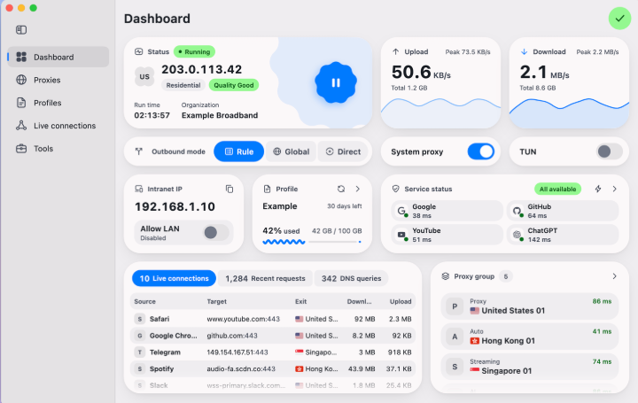

# UI 参考记录

## 用户提供的 FlClash 风格首页截图

- 编号：UI-REF-20261023-01。
- 来源：用户于 2026-10-23 在本会话提供，作为界面布局和视觉参考；尚未核验对应仓库 tag/commit 或实际运行版本。
- 文件：[flclash-dashboard-user-reference.png](flclash-dashboard-user-reference.png)，720×455 像素；图片像素不等于窗口逻辑尺寸，不据此锁定断点或最小窗口。
- SHA-256：66434ED9CF6BCB8A04AF5ED15F88D93E8F30FA500C22A0AC927479C275D230C2。
- 参考范围：左侧图标/文字导航、右侧首页、圆角平面贴片、状态与流量层级、模式及网络开关、订阅/网站/代理组摘要编排。
- 不作为功能或真实数据证据：截图中的地址、组织、流量、延迟、用量、IP 质量及请求/DNS 统计均为示例内容；不作为应用默认值、第三方服务契约或已实现能力。
- 本图用于仓库内设计对照，不作为随客户端分发的图标、背景或产品素材；如需再分发须核对许可与来源，实际产品使用自行实现的组件和品牌。

设计映射、主动调整和验收见 [17 UI 规范](../design/17-FlClash界面参考与QtQuick落地.md)。当前图片只提供浅色参考，深色主题由本项目按同一语义层级设计。

